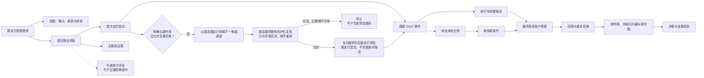

# 附录 C 容量规划与上线检查清单

“压测达到了十万 TPS，所有容器也都是绿色，可以上线了吗？”如果报告没有说明 TPS 的业务单位，没有统计 502 和未知状态，没有恢复积压曲线，也没有说明失去一个区域后剩下哪几条可用连接，这个问题还不能得到肯定回答。

本附录把[第 22 章](../part-6-case-study/global-payment-routing-platform.md)的容量模型、四条验收旅程和前文的安全边界整理为可重复门禁。它不另造一套压测系统，不提供脱离部署的“最大 TPS”，更不因为检查表填满就授予真实资金操作权限。目标是让每个上线/不上线结论都能追溯到输入、版本、环境、责任人和可复查证据。

## C.1 先冻结要证明的范围

一次测试只能证明其实际覆盖的工作负载。开始前，应固定实现提交 SHA、镜像摘要、数据库迁移版本、配置包摘要、服务商连接修订版、压测脚本和随机种子。还要记录机器规格、实例数量、数据库参数、地域拓扑与外部配额；只保留一个终端截图，之后无法判断变化来自代码还是环境。

范围说明至少回答这些问题：

| 输入 | 必须写清的内容 | 缺失会造成的误判 |
| --- | --- | --- |
| 业务单位 | 新支付意图/秒、确认/秒、HTTP 请求/秒分别是多少 | 把 API 重放或查询当作新付款 |
| 流量组成 | 支付方式、操作种类、商户热度、国家币种与凭证域 | 平均流量掩盖热点和准入条件稀疏性 |
| 时间形态 | 峰值持续时间、突发斜率、稳定段与恢复段 | 用几十秒测试代表数小时大促 |
| 失败分布 | 超时、响应丢失、乱序、重复和明确拒绝的注入位置 | 把发送前报错冒充已扣款后响应丢失 |
| 外部约束 | 每账户/端点配额、并发、延迟与查询契约 | 总 CPU 有余量，却已超过某账户限额 |
| 成功条件 | 延迟、错误、积压、资金不变量和恢复时间 | 只报成功 RPS，忽略未服务好的流量 |
| 环境与授权 | 模拟器、真实 PSP 沙箱或获准生产演练 | 把接口语义验证当成生产容量证明 |

本书案例的 10 万 TPS 指每秒希望被接纳的 100,000 个新支付意图。它不是当前实现的实测容量，也不是默认允许向服务商发出的请求速率。沙箱与生产环境的延迟和配额可能不同；Stripe 官方明确提示沙箱不是生产负载的等价替身，不宜用高压沙箱调用直接推断生产容量。[Stripe：速率限制与负载测试](https://docs.stripe.com/rate-limits)

## C.2 从业务到工作量：把回流算进去

沿用第 22 章的演示假设：每个支付意图平均 2.2 个商户 API 请求；平均增加 0.03 个获准后备支付尝试；每个支付操作平均增加 0.01 次同键重送；5% 的支付操作需要查询，每次平均三次；每个支付操作平均收到 1.1 个回调。它们是容量系数，不是资金动作的许可条件。



| 工作量 | 公式 | 10 万新支付意图/秒下的示例需求 |
| --- | --- | ---: |
| 商户 API | `100000 × 2.2` | 220,000 次请求/秒 |
| 首次与合法后备切换的逻辑操作 | `100000 × 1.03` | 103,000 次操作/秒 |
| 路由求值 | `100000 + R_retry + R_no_candidate + R_shadow` | 至少 100,000 次求值/秒；增量单列 |
| 后备护栏复核 | 本例假设 `100000 × 0.03`，被否决检查另计 | 至少 3,000 次检查/秒；不折算成完整路由求值 |
| 服务商执行 | `103000 × 1.01` | 104,030 次调用/秒 |
| 服务商查询 | `103000 × 0.05 × 3` | 15,450 次调用/秒 |
| 服务商总出站 | 执行 + 查询 | 119,480 次调用/秒 |
| 回调入站 | `103000 × 1.1` | 113,300 个事件/秒 |

路由服务的实际完整求值次数要加上创建支付尝试前获准的路由重试、额外 `no_candidate` 求值和影子工作；不能让影子求值增加服务商操作。表中的 100,000/s 是已选 `SALE` 切片，若 `no_candidate` 来自额外到达请求，相同流量也要加入商户 API 分母。反过来，合法后备切换从路由服务生成的 `RoutePlanDecision` 取固定下一候选通道，支付服务刷新风险结论，并调用路由服务拥有的仅护栏复核；该检查只能允许或否决，不能重建候选、重排、重评分或续期，过期或不可用必须停止。因而不能把 103,000 个操作当成 103,000 次完整路由求值，但护栏检查仍要单列，且被否决后未创建支付尝试的检查不能从分母消失。获准时支付服务写入 `FallbackExecutionBinding`，它不是新的路由决策。退款、手动请款、对账文件扫描和其他支付方式也要单列，不能塞进“平均一笔支付”的隐含成本里。

最乐观地把每秒 119,480 次调用平分到三个区域，失去一地后每个剩余区域承担每秒 59,740 次调用。若约定运行上限为可验证容量的 65%，单区容量至少需要每秒约 91,908 次调用。若报告只填 85,000，则故障后约 70.28% 利用率已经超预算；“还没到 100%”不是通过理由。这仍是假设算术，还必须按真实地域准入条件和账户配额检验，不能默认流量可以均分。

队列要同时计算积压和追平。假设每个操作产生一条待投影记录，每秒 103,000 条的流入在 600 秒停机期间积累 6,180 万条；若恢复后仍承受原流量，并希望一小时追平，消费能力至少为 `103000 + 61800000/3600 ≈ 120167 events/s`。这只是条目模型，磁盘预算还要乘真实字节数、索引、WAL 和副本开销。消费速率仅等于流入时，积压不会自动消失。

## C.3 负载发生器也要接受审计

压测程序应分别记录提供量、启动量、完成量、未发送、取消与超时。固定并发客户端在系统变慢时会自然减少请求到达量；若只观察完成请求的延迟，系统可能看起来很稳定，却已没有承受约定需求。采用计划到达时间的负载模式时，还要记录调度滞后，并把“来不及发出的请求”保留在报告中。

HTTP 统计与业务统计必须并列。HTTP 200 里可能是明确拒绝，202 里可能是状态未知，502 则是入口或上游故障；三者不能合成一个成功率。ApacheBench 将失败请求与非 2xx 响应分列，前者为零并不证明没有 502。[ApacheBench：输出说明](https://httpd.apache.org/docs/2.4/programs/ab.html) PostgreSQL 的 pgbench 也区分速率调度延迟、迟到与跳过的事务；数据库基准不能替代整条支付链压测。[PostgreSQL：pgbench](https://www.postgresql.org/docs/current/pgbench.html)

测试不应只跑热缓存、全新幂等键和均匀商户。至少保留一个热点商户、相同键的并发竞争、重复确认、迟到回调、服务商慢响应和恢复任务叠加的分布。否则主流程只需一次查询的基准测试，很可能完全没有覆盖生产里最昂贵的锁争用路径。

| 场景 | 主要压力 | 必须提交的结果 |
| --- | --- | --- |
| 稳态 | 目标正常分布与持续峰值 | 提供量/服务量、延迟分位数、非 2xx、资源与队列稳定性 |
| 慢服务商/响应丢失 | 执行变慢与未知状态查询放大同时发生 | 每连接并发、查询/重送、未知状态年龄、其他通道隔离 |
| 缓存/特征/投影丢失 | 冷启动、必需与可选依赖失效 | 正确降级、配置有效期、发件箱增长与恢复追平 |
| 区域丢失 | 可用资源减少、旧归属者复活 | 隔离负向证明、原操作恢复、剩余容量和准入决策 |

每轮包含预热、稳定负载、故障注入、故障持续、恢复和追平阶段。只截取最漂亮的一分钟，会把恢复债务藏到报告之外。停止条件应提前约定：发现第二条非预期资金路径立即停止新增测试工作；资源接近安全水位时按阈值降载，保留恢复预算；不得为了让测试结束而删除状态未知记录或重置其年龄。

## C.4 资源、超时和探针必须回答不同问题

平均在途量可以帮助估算资源需求，但不等于需要多少 goroutine，也不证明 p99。服务商长尾延迟、连接握手、数据库排队和批处理抖动会一起影响实际延迟。HTTP 客户端与传输层应复用，响应体必须按契约读完并关闭；连接数和空闲连接参数是资源控制，不是资金重试策略。[Go：net/http 客户端与传输层](https://pkg.go.dev/net/http)

数据库连接池也不是越大越好。增加连接可能把等待从应用挪到数据库锁和 CPU；应联合观察获取等待、已占用连接、事务时间、锁等待、WAL 和磁盘。配套仓库使用 pgxpool，其 `Stat` 提供获取耗时、空获取、取消获取，以及已获取/空闲/总连接数等维度，可用来定位排队在哪里。[pgxpool：Stat](https://pkg.go.dev/github.com/jackc/pgx/v5/pgxpool#Stat)

| 边界 | 上线前需要的预算与证据 | 不能用来替代它的信号 |
| --- | --- | --- |
| 准入 | 每商户/连接的速率、并发、拒绝原因与恢复保留量 | 全机 CPU 平均值 |
| 截止时间 | 排队、路由、网关、服务商与持久化的剩余时间分配 | 把各服务 p99 简单相加 |
| 数据库 | 池等待、锁、事务、WAL、空间和恢复时间 | 连接成功或 `SELECT 1` |
| 队列 | 深度、最老年龄、净流入、追平速率及存储余量 | 消费者进程还活着 |
| 容器 | 请求/限制、节流、OOM、重启与调度余量 | 主机还有空闲内存 |
| 服务商 | 账户和端点的速率、并发、错误类别与预算 | 平台汇总调用量 |

Kubernetes 就绪探针决定实例是否适合接收流量，存活探针用于判断是否需要重启，启动探针处理启动期；它们不是同一个健康结论。把某家 PSP 短暂故障挂到全服务存活探针，可能让全部 Pod 同时重启并扩大事故。[Kubernetes：探针](https://kubernetes.io/docs/concepts/workloads/pods/probes/) CPU 限制导致的节流与内存超限后的 OOM 行为也不同，应观察实际容器限制下的结果，而不是只用开发机测试。[Kubernetes：资源管理](https://kubernetes.io/docs/concepts/configuration/manage-resources-containers/)

## C.5 四条旅程比四十个启动绿灯更重要

复用第 22 章的场景编排，不为附录另写一套模拟业务。每条旅程要同时收集 API、支付服务、网关、服务商观察、配置版本和时间线；最终状态正确只是其中一个断言。

| 旅程 | 关键反例 | 必须成立的不变量 | 证据负责人 |
| --- | --- | --- | --- |
| 正常支付与重复提交 | 同键不同载荷，重复确认/回调 | 同一资源；没有第二个非预期支付尝试/操作；金额与引用一致 | 支付/网关团队 |
| 响应丢失与恢复 | 服务商已完成副作用后断开响应，再重启工作进程 | 原操作、连接/修订版/命名空间、键、载荷不变；未知状态不换路 | 支付/连接器团队 |
| 坏配置与回滚 | 半套下载、错误引用、作者自批、合法但退化的金丝雀发布 | 只使用完整批准版本；回滚不改变在途操作，不复活撤销的硬性准入条件 | 配置/路由团队 |
| 区域故障与旧主复活 | 分区后旧世代再写，再从旧备份启动 | 旧归属者被拒绝；新归属者先恢复原操作；证据缺口不新建 `SALE` | 支付/SRE 团队 |

区域旅程不仅检查故障转移，也检查故障恢复后的回切。旧区域重新上线时，历史磁盘和配置可能都“看起来正常”，但它仍没有重新获得资金写权限。容量报告通过也不能替代隔离机制；隔离机制通过也不能替代可用配额与数据驻留许可。两个证明必须在同一发布范围内成立。

还应把[附录 A](payment-state-models.md)的不变量和[附录 B](security-compliance.md)的负向测试接入总门禁：成功终态遇到冲突进入人工复核；错误连接的签名不能更新另一操作；生产禁用模拟器；日志和事件不含受限凭证；运行身份无法越权写其他服务的数据。

## C.6 Go：缺少证据时，门禁不能默认通过

下面是“全球卡支付 `SALE` 生产发布”这一特定配置档案的证据归约参考，不是通用批准器。它复用外部测试结果，不执行压测或资金操作；未来 `tools/launchcheck` 的采集层应负责验证证据真实来源、摘要和权限。单区域测试配置档案应另有明确清单，不能简单删掉没跑过的必选项。

```go
package launchgate

import (
	"sort"
	"time"
)

type Scope struct {
	CodeSHA, BundleDigest, Environment, WorkloadID string
}

type Evidence struct {
	Name, State, Owner, Artifact string
	Scope                        Scope
	CheckedAt                    time.Time
}

type Report struct {
	Go      bool
	Reasons []string
}

func EvaluateGlobalLive(target Scope, now time.Time, maxAge time.Duration, items []Evidence) Report {
	if target.CodeSHA == "" || target.BundleDigest == "" ||
		target.Environment != "live" || target.WorkloadID == "" ||
		now.IsZero() || maxAge <= 0 || len(items) > 64 {
		return Report{Reasons: []string{"invalid_target_or_evidence"}}
	}
	required := []string{
		"code_and_contracts", "postgres_integration", "funds_invariants",
		"configuration_rollback", "region_fencing", "fault_capacity",
		"security_boundary", "provider_live_approval",
	}
	known := make(map[string]bool, len(required))
	for _, name := range required {
		known[name] = true
	}
	seen := make(map[string]Evidence, len(items))
	var reasons []string
	for _, item := range items {
		if !known[item.Name] {
			reasons = append(reasons, "unexpected_gate")
			continue
		}
		if _, duplicate := seen[item.Name]; duplicate {
			reasons = append(reasons, item.Name+":duplicate")
			continue
		}
		seen[item.Name] = item
	}
	for _, name := range required {
		item, exists := seen[name]
		switch {
		case !exists:
			reasons = append(reasons, name+":missing")
		case item.State != "pass":
			reasons = append(reasons, name+":not_passed")
		case item.Owner == "" || item.Artifact == "" || item.Scope != target:
			reasons = append(reasons, name+":unbound_evidence")
		case item.CheckedAt.IsZero() || item.CheckedAt.After(now) || now.Sub(item.CheckedAt) > maxAge:
			reasons = append(reasons, name+":stale_or_invalid_time")
		}
	}
	sort.Strings(reasons)
	return Report{Go: len(reasons) == 0, Reasons: reasons}
}
```

这里的 `pass` 必须由受信任采集器根据真实测试与阈值产生，不能接受任意调用方自己勾选。范围绑定发布目标，表示证据已被批准用于该组代码、配置、环境和工作负载；它不要求单元测试真的在生产端点执行。容量原始数值中的 NaN、无穷值、分母为零和单位错误，应在[第 22 章的容量模型](../part-6-case-study/global-payment-routing-platform.md)及采集器里拒绝，而不是让本函数猜测。

```go
package launchgate

import (
	"testing"
	"time"
)

func TestGlobalLiveGateFailsClosed(t *testing.T) {
	now := time.Date(2026, 8, 26, 12, 0, 0, 0, time.UTC)
	target := Scope{"code-revision", "bundle-digest", "live", "peak-card-sale"}
	names := []string{
		"code_and_contracts", "postgres_integration", "funds_invariants",
		"configuration_rollback", "region_fencing", "fault_capacity",
		"security_boundary", "provider_live_approval",
	}
	base := make([]Evidence, 0, len(names))
	for _, name := range names {
		base = append(base, Evidence{name, "pass", "owner", "artifact", target, now})
	}
	cases := []struct {
		name string
		edit func([]Evidence) []Evidence
		goOK bool
	}{
		{"complete", func(e []Evidence) []Evidence { return e }, true},
		{"missing approval", func(e []Evidence) []Evidence { return e[:len(e)-1] }, false},
		{"unknown", func(e []Evidence) []Evidence { e[0].State = "unknown"; return e }, false},
		{"wrong bundle", func(e []Evidence) []Evidence { e[0].Scope.BundleDigest = "other"; return e }, false},
		{"stale", func(e []Evidence) []Evidence { e[0].CheckedAt = now.Add(-2 * time.Hour); return e }, false},
		{"future", func(e []Evidence) []Evidence { e[0].CheckedAt = now.Add(time.Second); return e }, false},
		{"duplicate", func(e []Evidence) []Evidence { return append(e, e[0]) }, false},
	}
	for _, tc := range cases {
		t.Run(tc.name, func(t *testing.T) {
			items := tc.edit(append([]Evidence(nil), base...))
			got := EvaluateGlobalLive(target, now, time.Hour, items)
			if got.Go != tc.goOK || (!got.Go && len(got.Reasons) == 0) {
				t.Fatalf("unexpected report: %+v", got)
			}
		})
	}
}
```

相同代码在旧配置上通过测试，不能证明新配置包安全；一周前的小流量报告也不能直接证明今天的目标峰值。证据有效期应按类型和变化失效条件设计，示例用统一的 `maxAge` 只为突出“缺证据即拒绝”。实际报告还应列出每个阈值、采集窗口、测量值、误差与判定原因，保留未运行和不适用的批准依据。命令行工具判定不发布或采集失败时都应返回非零退出码，不能只在 JSON 中写一行警告。

## C.7 上线清单要带负责人、退出条件和恢复动作

以下清单不是“做过一次就永远有效”。新增服务商、改账户权限、改变配额或迁移区域，都可能使相应证据失效。

| 门禁 | 放量前证据 | 出现问题时的动作 | 负责人 |
| --- | --- | --- | --- |
| 发布物一致 | 代码、镜像、迁移、配置包和操作手册修订版对齐 | 停止发布，不混用版本 | 发布负责人 |
| 服务商接入 | 真实账户范围、沙箱验收、生产授权、查询和幂等契约 | 禁用该连接的新工作准入 | 连接器负责人 |
| 资金正确性 | 重复、状态未知、乱序、冲突与并发反例均通过 | 停止新资金路径，保留原操作恢复 | 支付负责人 |
| 配置治理 | 审批分离、完整下载、最近可用良好版本与回滚演练 | 回滚未来选择，不改在途身份 | 配置负责人 |
| 容量与余量 | 目标分布、故障剩余容量、队列追平和外部配额 | 降低新工作准入，保护恢复工作 | SRE |
| 数据安全 | 独立身份与角色、秘密生命周期、日志与驻留检查 | 隔离受影响权限，按事件流程处理 | 安全负责人 |
| 运营闭环 | 告警可达、状态未知与人工复核队列、对账差异有人接手 | 升级事件，不批量改状态消警 | 支付运营与财务 |

放量应分阶段进行，每阶段都有样本与时间窗口：先在测试环境证明状态，再在真实沙箱证明协议，获得上线授权后才进入受控的生产金丝雀发布。观察首次响应之外的状态未知收敛、回调延迟、费用与差异；后者可能需要更长成熟期，不能只因十分钟成功率好看就结束观察。

紧急停用开关的对象必须具体。停止某连接的新选路，不等于停止它的查询、回调和退款；暂停新支付意图准入，也不等于丢弃已经提交的发件箱记录。紧急撤销凭证有时会阻断恢复，操作前后要登记受影响的在途对象与替代调查路径。遇到无法验证的资金结果，出口是隔离和人工复核，不是临时换一个服务商幂等键。

操作手册至少包含触发指标、确认步骤、获权角色、执行命令的目标范围、预期结果、失败出口和回滚限制。命令不能只写“重启服务”或“清理队列”。对有资金副作用的系统，恢复速度很重要，但恢复者首先要知道自己保留了什么事实，以及仍然有权执行什么动作。

## C.8 如何阅读本仓库现有证据

本版配套系统采用[固定代码版本](https://github.com/YouEclipse/payments/commit/bc4afde24da708d22f67da72a90a1557b1477173)及其[持续集成记录](https://github.com/YouEclipse/payments/actions/runs/33041147119)；CI 门禁包含 Go 单元测试、竞态检测、静态检查、构建与 OpenAPI 检查、真实 PostgreSQL 集成、服务镜像、Compose 就绪检查和支付端到端测试。它证明当前窄切片的工程基线，不证明目标环境的生产吞吐。书稿与代码仓库当前均为私有；这些链接只对获授权的 GitHub 身份可见，本书不会为获得匿名可访问性而改变仓库可见性，也不把无法匿名打开误写成 CI 未运行。

| 证据层 | 固定基线已有内容 | 仍需补齐的目标证明 |
| --- | --- | --- |
| 状态与身份 | 自动请款 `SALE`、幂等、精确连接、状态未知时恢复原操作、持久期限/预算/租约/派发标记、冲突隔离 | 后备切换的后继项、新操作种类与新策略各自的反例测试 |
| 数据库与进程 | 真实 PostgreSQL 迁移与事务测试，Compose 服务启动与纵向端到端测试 | 生产权限、备份恢复、容量与灾难恢复演练 |
| 四条综合旅程 | 正常、明确拒绝、响应丢失与重复请求的基线 | 配置发布回滚、跨区隔离、故障负载组合 |
| 路由与证据 | v3 风险/能力/规则/成本/性能/评分模型，支付执行快照，网关追加式观察 | 动态健康度、配置/实验/模型平台及其系统旅程 |
| 观测与负载 | 基础健康与指标入口 | 完整延迟/错误/队列/资源曲线与可复现报告 |
| 上线资格 | 模拟器环境门禁 | 真实服务商接入授权、安全合规和运营签核 |

当前基线没有完整 `test/system`、`tools/capacity-plan` 与 `tools/launchcheck` 工具链，本附录的纯 Go 示例不是已经部署的采集器。后续实现应复用第 22 章场景及模型，把报告制品接到同一 CI 与发布流程；没有运行的门禁保持 `not_run`，不因为目录里出现了文件名就算完成。

## C.9 最终判断

容量结论应写成：“在这些版本、资源、配额、流量分布和故障条件下，系统满足这些延迟、错误、积压与资金不变量；超过这些条件尚未验证。”它比一个孤立 TPS 数字更长，却能让下一次扩容、服务商故障或配置发布真正复用现有证据。

能证明的范围内才允许发布；缺少必要证据就不发布。两者都是有价值的工程结果，区别在于能否据此安全地采取下一步行动，而不在于报告最后是不是绿色。
