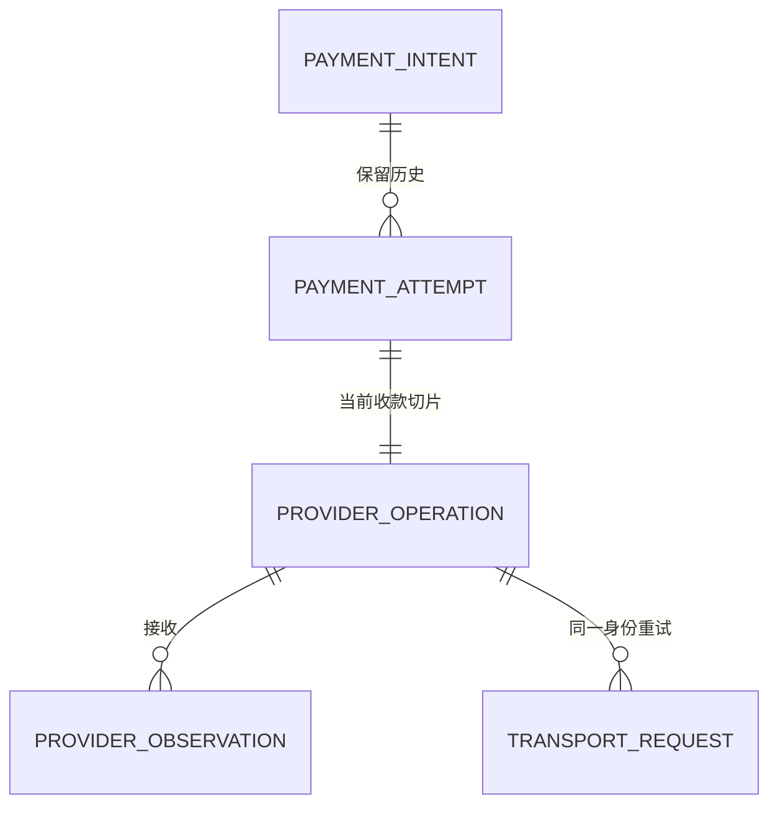
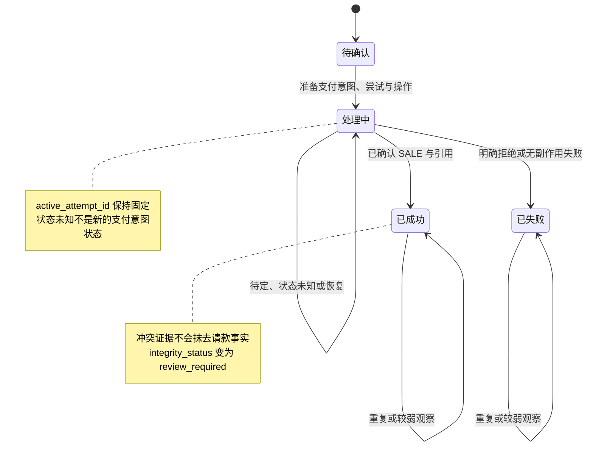
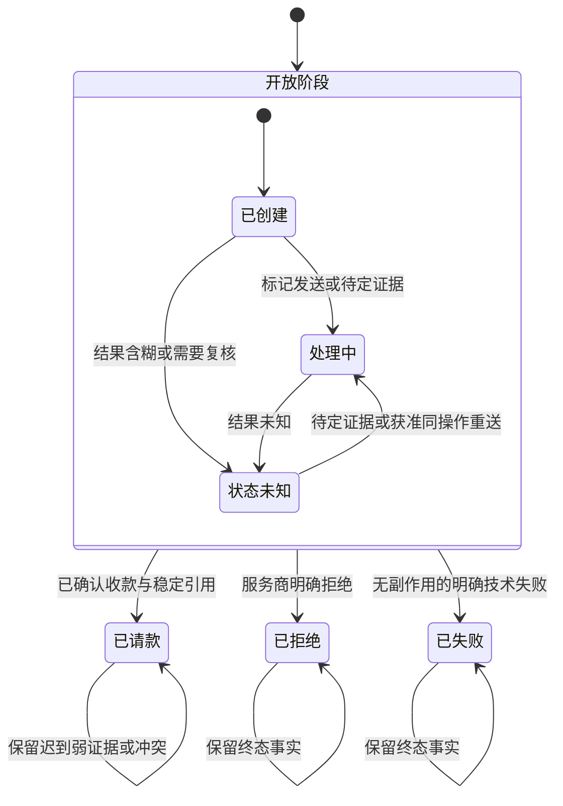
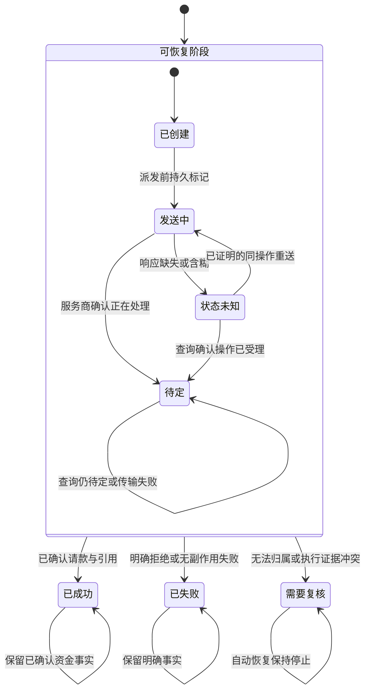

# 附录 A 支付意图、支付尝试与服务商请求状态模型

**中文** | [English](../en/appendices/payment-state-models.md)

凌晨两点，值班工程师同时看到三条记录：订单显示支付处理中，服务商查询显示已收款，内部任务显示请求超时。它们不一定相互矛盾。订单读取的是支付意图投影，服务商描述的是资金操作，任务记录的是一次传输。真正危险的是把三者都写入同一列 `payment_status`，再用最后到达的消息覆盖前面的事实。

本附录为[第 1 章](../part-1-foundations/payment-lifecycle.md)、[第 10～12 章](../part-3-reliability/timeout-and-retry.md)和[第 17 章](../part-4-operating-at-scale/reconciliation.md)提供同一份状态参考。正文中的服务商请求泛指对外请求；配套代码的逻辑资金对象统一叫 `ProviderOperation`。一次支付操作可以产生多次 HTTP 请求，但这些请求不能因此获得多个资金身份。

这里以[配套系统的固定代码版本](https://github.com/YouEclipse/payments/commit/bc4afde24da708d22f67da72a90a1557b1477173)为基线：令牌化卡支付、自动请款、单次 `sale`，加上持久恢复截止时间、预算与租约、首次派发标记及支付网关追加式服务商观察。该版本的领域测试、真实 PostgreSQL 与 Compose 端到端测试由[同一次持续集成运行](https://github.com/YouEclipse/payments/actions/runs/33041147119)验证。下文明确分开“当前实现”“已定义但未接通”和“未来参考”，不因为枚举里出现某个单词，就宣称相应产品流程已经存在。

## A.1 三层对象与两种基数

支付意图回答“商户想收哪笔钱”；支付尝试回答“为这个目标选定了哪条执行路径”；支付操作回答“在这条路径上做了哪个资金动作”。三层均由支付编排服务拥有业务状态，支付网关只拥有外部执行记录和协议事实，路由服务不修改这些状态。



这张图包含两种约束。领域模型允许一个支付意图留下多个历史支付尝试；当前 `confirm` 流程只创建一个，不执行跨服务商后备切换。当前数据库还用 `UNIQUE(payment_attempt_id)` 限制每个支付尝试只有一个 `sale` 操作。将来支持授权、请款和退款后，支付操作基数才会扩展为一对多，必须同时修改迁移、领域约束和 API，不能只删除这条唯一约束。

`active_attempt_id` 是当前仍可能产生或确认资金结果的支付尝试；`latest_attempt_id` 是最近创建的历史记录；`winning_attempt_id` 是达到收款目标的那次支付尝试。它们并非同义词。状态未知期间活跃尝试不能被清空以“方便重试”；确认成功后活跃尝试清空、获胜尝试固定，最近尝试仍可用于解释历史。外部出现第二笔成功时，不能通过把获胜尝试换成“更新的一笔”消除重复收款。

执行身份也不是一个服务商名称。支付尝试和支付操作必须共同固定 `provider_connection_id`、`provider_connection_revision`、`provider_namespace_id` 与 `provider`。前两项标识所选配置，命名空间表达服务商的幂等和引用冲突域；共享命名空间不代表可以互换凭证或任意重定向请求。HTTP 重试还必须固定操作标识、服务商键、金额、币种和语义载荷。[第 11 章](../part-3-reliability/idempotency.md)解释这些身份分别解决什么问题。

## A.2 支付意图：业务结果与完整性是两根轴

当前支付意图的 `status` 枚举如下，精确定义位于配套实现的[支付领域模型](https://github.com/YouEclipse/payments/blob/bc4afde24da708d22f67da72a90a1557b1477173/services/payment/internal/domain/model.go)。

| 状态 | 本书中的含义 | 当前可达性 |
| --- | --- | --- |
| `requires_confirmation` | 已建立固定金额、币种和凭证的收款目标，尚未创建资金操作 | 已实现 |
| `processing` | 已提交执行，或正在等待、查询、恢复原操作 | 已实现，包含状态未知 |
| `succeeded` | 当前自动请款契约已确认完整收款结果 | 已实现，不表示结算已完成 |
| `failed` | 当前收款流程以明确拒绝或无副作用失败结束 | 已实现，不自动开启新支付尝试 |
| `requires_action` | 预留给需要顾客交互的续程 | 枚举已定义，3DS/重定向流程未实现 |
| `canceled` | 预留的业务取消投影 | 枚举已定义，取消 API 未实现 |



`integrity_status` 独立取 `healthy` 或 `review_required`。因此 `status=succeeded, integrity_status=review_required` 是有效组合：已确认的成功不能被删除，但出现了必须调查的矛盾事实。把复核做成覆盖业务状态的单一枚举，会令客服和财务失去“之前已经确认收款”的关键信息。读 API 的消费者也不能只看状态；履约是否需要暂停，应由其完整性策略明确决定。

同样，`processing` 不是“请求还在某台机器内运行”。进程可能已退出，商户连接也可能已断开，只要原资金结果尚未确定，持久化支付意图就仍然是 `processing`。当前确认接口的 HTTP 202 表示结果待定；GET 成功返回 HTTP 200 只表示读取成功，并不把其中的 `processing` 变成付款成功。接口的传输状态与对象状态必须分开解释。

“终态保护”也不等于经济事实永远不会变化。退款、拒付、结算调整可能发生在收款成功之后，它们应形成新的操作或事实，不是把原 `sale` 的历史改成从未成功。订单取消同理：停止发货是订单动作，释放授权或退钱是支付动作；订单已经取消时到达一条有效支付成功证据，平台仍必须记录，并通过明确后续流程处理。否则账面上看似只有取消，服务商处却真实存在收款。

## A.3 支付尝试：状态未知仍占据原资金路径

当前支付尝试枚举是 `created / processing / unknown / captured / declined / failed`；正文用于解释阶段的“已路由、执行中、终态”不是本版本的持久化枚举。决策已选定后，`PrepareConfirmation` 在事务中固定支付尝试；发送前再进入处理中。



图中的“开放阶段”是阅读分组，不是存储值；终态自环也不表示冲突可以静默忽略。已请款后收到失败，支付尝试保留 `captured`，支付意图标记复核；迟到的待定证据不应把它改回处理中。相反，未知状态可以收敛成已请款、已拒绝或失败，因为它表达的是“不知道”，不是“已经失败”。

`reroute_disposition` 与状态分开。当前实现每条路径都保持 `blocked`；虽然类型含有 `allowed`，实际 `FallbackPlanner` 尚未接通。未来即使某支付尝试失败，也必须再证明 `side_effect_certainty=none`、原因命中明确允许列表、预算和风控允许，才能创建继任尝试。发卡行拒绝不因为没有副作用就自动获得换路许可。未知状态、待定、认证续程和人工复核默认全部阻断。

若两个工作进程同时观察到旧支付尝试已终结，状态表本身不能保证只创建一个继任尝试。那是支付意图锁、版本检查、唯一约束及事务提交共同负责的事情。状态机回答“允许做什么”，并发协议回答“这次由谁做”；两者缺一不可。

## A.4 支付操作：状态、确定性与恢复动作不能折叠

当前支付操作的种类只有 `sale`。它表示服务商原生自动请款，不是仅授权的额度冻结。状态之外还有两列：`side_effect_certainty` 为 `none / possible / confirmed`，`retry_mode` 为 `same_key / query_or_wait / none`。前者描述证据，后者描述恢复许可；把两列都压成 `retryable=true` 会丢失最重要的安全边界。



这张图表达当前主干，不穷举每一种早到回调的接收时点。`retry_scheduled` 已存在于枚举与恢复扫描条件，但当前领域归一器主要通过 `next_retry_at` 对待定/未知状态安排恢复，不会因为这个预留值存在就创造新的重试产品能力。支付操作还保存不可回拨的恢复截止时间、递减预算、领取世代/租约/动作和可验证的缺席证据；这些字段约束同一操作的恢复，不授权跨服务商后备切换。

`MarkSending` 在真正调用服务商前把确定性从无改为可能，并首次写入不可重置的 `first_dispatched_at`。支付网关也在取得派发 CAS 获胜权时记录自己的只写一次标记。进程在标记之后、发送之前崩溃，实际上可能什么也没发，但另一工作进程不能仅凭猜测把它降回无副作用；重复查询、租约或退避也不能重置这个年龄锚点。恢复必须走支付网关的持久记录及服务商契约，必要时查询原操作；只有得到与精确身份绑定、仍在有效期内的明确缺席证据，才可沿原连接、键和载荷重发。网络层的普通 404 不等于这种许可。

| 新观察 | 原有知识 | 归一结果 | 自动动作 |
| --- | --- | --- | --- |
| 完整成功，引用与身份匹配 | 非终态 | 操作成功、尝试已请款、意图成功 | 停止恢复 |
| 成功但缺少必要服务商引用 | 非终态 | 状态未知，完整性转复核 | 不宣布成功，不换路 |
| 明确拒绝 | 非终态 | 操作失败、尝试被拒绝、意图失败 | 当前实现停止 |
| 失败且确定性不为无副作用 | 非终态 | 状态未知，而非普通失败 | 恢复原操作 |
| 查询发生传输错误 | 已知待定 | 保留待定，推进恢复时间 | 不抹掉“服务商已受理”的知识 |
| 重复成功，引用未变 | 已成功 | 幂等空操作 | 不再增加资金金额或状态版本 |
| 成功后收到明确失败 | 已成功 | 保留成功，标记复核 | 保存冲突，不按接收时间覆盖 |
| 事件身份不匹配或引用被另一聚合占用 | 任意 | 拒绝或隔离，按冲突类型进入复核 | 不绑定到“最相近”的支付 |

其中 `review_required` 操作是自动化停止点；支付意图的完整性标记也可能与保留的终态并存。当前实现没有“人工点一下便强制覆盖终态”的修复 API。未来修复命令必须携带证据、审批、版本和审计，不能把清空复核标记当作修复本身。

## A.5 单调性不是按字符串大小比较状态

所谓单调收敛，是已经确立的事实不能被更弱或矛盾的观察无声擦除，不是给所有状态排一列整数。待定比未知多知道“服务商已受理”；成功与明确失败却不是一个可以自然排序的先后关系。它们冲突时必须保留两份证据和隔离结果。[第 17 章](../part-4-operating-at-scale/reconciliation.md)再讨论如何调查与修复，而不是让对账脚本直接更新状态。

事件的 `occurred_at` 也不是写权限。不同服务商的时钟、投递顺序和重试机制不同；迟到消息可能更可靠，也可能只是重复。处理顺序应是验证来源、关联精确身份、去重或隔离、锁定聚合、执行领域归约、原子提交收件箱、状态与发件箱。版本号只在对应对象实际改变时增加；重复的未知状态若只改变恢复时间，不应伪造新的支付状态变化。

数据库为这些规则提供最后一道保护：金额 `CHECK` 防止负数与越界；复合外键保证活跃、最近和获胜支付尝试属于同一支付意图；支付操作与支付尝试的完整执行元组必须一致；成功对象必须有服务商引用；命名空间范围的唯一约束捕获引用或幂等键碰撞。但 `CHECK` 不是任意跨表业务推理器，不能把“所有获胜支付尝试都已请款”之类逻辑仅靠一句跨行 `CHECK` 实现。需由领域事务与适当约束共同保证，且用真实数据库测试验证。[PostgreSQL：约束](https://www.postgresql.org/docs/current/ddl-constraints.html)

### A.5.1 用崩溃窗口检验状态含义

一张图是否真正可实现，可以用三个停止点来检查。第一处是 `PrepareConfirmation` 提交之前：若事务没有提交，支付尝试、支付操作与发件箱记录都不应被外部执行观察到，资金调用也不应已开始。第二处是提交之后、服务商响应之前：此时 API 进程消失不能撤销远端动作，恢复者必须沿原身份查询或续行。第三处是结果事务已提交、HTTP 回包之前：商户重放应读取同一业务结果，不能再次扣款。

因此，跨服务交互不要求所有状态在同一时刻可见，却要求每个服务的持久化承诺有明确边界。网关已确认收款而支付服务尚未消费发件箱，短时间内会出现两种不同投影；这不是允许丢弃其中一份数据的理由。值班工具应该显示各自版本、最近证据与待投递消息，让观察者看见延迟，而不是把多份状态拼成一个未经证明的“最终答案”。

单元测试证明归约函数如何处理事件，集成测试证明事务与约束不会被绕过，端到端测试证明服务重启后仍能找到原操作。三者都需要。仅在测试中顺序调用两次确认，无法证明两个真实连接同时提交时只有一个获胜者；仅检查 HTTP 返回同一标识，也无法证明网关和服务商没有形成第二条副作用。测试应同时断言支付尝试数、支付操作数、命名空间与键的唯一性以及最终金额。

## A.6 一个可以运行的不变量示例

下面不是第二套完整状态机，而是一个针对“已经成功的自动请款快照”的独立检查器。它刻意接受 `succeeded + review_required`，同时拒绝把金额、身份或引用不完整的记录叫作成功。字段对应真实领域对象的最小投影，生产写入仍须调用领域命令并经过数据库事务。

```go
package statespec

import "errors"

type Identity struct {
	ConnectionID, Revision, NamespaceID, Provider string
}

type Intent struct {
	ID, Status, Integrity, Currency, Active, Winner string
	Amount, Authorized, Captured, Refunded          int64
}

type Attempt struct {
	ID, IntentID, Status, PaymentReference string
	Identity                               Identity
}

type Operation struct {
	ID, IntentID, AttemptID, Kind, Status, Certainty string
	Currency, Reference, IdempotencyKey              string
	Amount                                           int64
	Identity                                         Identity
}

func ValidateCapturedSale(p Intent, a Attempt, o Operation) error {
	invalid := errors.New("captured sale invariant violated")
	if p.ID == "" || p.Status != "succeeded" || p.Amount <= 0 ||
		(p.Integrity != "healthy" && p.Integrity != "review_required") {
		return invalid
	}
	if p.Refunded < 0 || p.Refunded > p.Captured ||
		p.Captured != p.Amount || p.Authorized != p.Amount {
		return invalid
	}
	if a.ID == "" || a.IntentID != p.ID || a.Status != "captured" ||
		p.Active != "" || p.Winner != a.ID || a.PaymentReference == "" {
		return invalid
	}
	if o.ID == "" || o.IntentID != p.ID || o.AttemptID != a.ID ||
		o.Kind != "sale" || o.Status != "succeeded" || o.Certainty != "confirmed" ||
		o.Amount != p.Amount || p.Currency == "" || o.Currency != p.Currency ||
		o.Reference == "" || o.IdempotencyKey == "" {
		return invalid
	}
	i := a.Identity
	if i.ConnectionID == "" || i.Revision == "" || i.NamespaceID == "" ||
		i.Provider == "" || i != o.Identity {
		return invalid
	}
	return nil
}
```

把以下测试与检查器放在同一个 Go 包中，运行 `go test -race ./...`。它测试的不是文案，而是成功事实与复核标记能否共存，以及“同一个 PSP 品牌但换了连接修订版”是否被拒绝。

```go
package statespec

import "testing"

func TestCapturedSaleInvariants(t *testing.T) {
	identity := Identity{"conn_a", "rev_1", "namespace_a", "provider_a"}
	baseP := Intent{
		ID: "pi_1", Status: "succeeded", Integrity: "healthy", Currency: "USD",
		Winner: "att_1", Amount: 12900, Authorized: 12900, Captured: 12900,
	}
	baseA := Attempt{"att_1", "pi_1", "captured", "pay_ref_1", identity}
	baseO := Operation{
		ID: "op_1", IntentID: "pi_1", AttemptID: "att_1", Kind: "sale",
		Status: "succeeded", Certainty: "confirmed", Currency: "USD",
		Reference: "op_ref_1", IdempotencyKey: "key_1", Amount: 12900, Identity: identity,
	}
	cases := []struct {
		name string
		edit func(*Intent, *Attempt, *Operation)
		ok   bool
	}{
		{"healthy", func(*Intent, *Attempt, *Operation) {}, true},
		{"review preserves capture", func(p *Intent, _ *Attempt, _ *Operation) {
			p.Integrity = "review_required"
		}, true},
		{"partial amount is not full success", func(p *Intent, _ *Attempt, _ *Operation) {
			p.Captured--
		}, false},
		{"foreign attempt", func(_ *Intent, a *Attempt, _ *Operation) {
			a.IntentID = "pi_other"
		}, false},
		{"revision drift", func(_ *Intent, _ *Attempt, o *Operation) {
			o.Identity.Revision = "rev_2"
		}, false},
		{"missing reference", func(_ *Intent, _ *Attempt, o *Operation) {
			o.Reference = ""
		}, false},
		{"unknown is not captured", func(_ *Intent, _ *Attempt, o *Operation) {
			o.Status, o.Certainty = "unknown", "possible"
		}, false},
		{"authorization is not sale", func(_ *Intent, _ *Attempt, o *Operation) {
			o.Kind = "authorize"
		}, false},
	}
	for _, tc := range cases {
		t.Run(tc.name, func(t *testing.T) {
			p, a, o := baseP, baseA, baseO
			tc.edit(&p, &a, &o)
			if got := ValidateCapturedSale(p, a, o) == nil; got != tc.ok {
				t.Fatalf("valid=%v, want %v", got, tc.ok)
			}
		})
	}
}
```

检查器允许 `refunded` 的合法累计值是为了展示金额关系，不代表当前 API 已能退款；当前执行链中该值保持零。它也不验证事件签名、并发锁、请求哈希、历史完整性或所有非终态，这些工作不能因一个纯函数测试通过而被省略。真实实现对应的证明点包括 `TestUnknownBlocksNewConfirmationAndConverges`、`TestConflictingTerminalOutcomeRequiresReview`、`TestPendingThenTransportUnknownPreservesPendingAndAdvancesBackoff`，以及 PostgreSQL 的身份漂移、引用冲突和收件箱原子提交测试。

## A.7 手动请款与退款：扩展操作，不改写过去

下面是未来参考，不是当前 OpenAPI。手动请款至少要增加 `authorize / capture / void / refund` 的独立操作身份和金额预留机制；支付尝试可保留原支付路径，后续操作绑定原获批连接与交易引用，不重新进入路由竞价。Stripe 的生命周期中，分别授权与请款可产生 `requires_capture`；本书借鉴这种阶段区分，不复制它的所有状态及 API 行为。[Stripe：支付意图生命周期](https://docs.stripe.com/payments/paymentintents/lifecycle)

| 后续操作 | 必须绑定的既有事实 | 不能做的简化 |
| --- | --- | --- |
| 请款 | 原授权的连接、引用、币种、剩余额度与有效窗口 | 授权一成功就把已请款额加满 |
| 撤销/取消 | 原交易及服务商允许的可取消窗口 | 只改本地取消状态，便声称远端额度已释放 |
| 退款 | 原收款引用、可退余额、独立退款键与操作 | 把成功改成失败，抹去此前请款 |
| 部分请款/退款 | 已确认累计额与在途预留额，均按同币种最小单位记录 | 两个并发请求各自读取同一剩余额度后同时花完 |

例如两次各 80 元的退款都读到“可退 100 元”，仅在成功回调时累加会超退。应先在原支付聚合下原子预留额度，拒绝累计已确认加在途预留超限；状态未知的退款仍占用预留，不能因超时释放后再退一次。这个原则也适用于部分请款，但具体可调整授权、超额请款和撤销窗口依赖目标支付方式与服务商契约。

服务商返回“请款请求已收到”不一定表示资金最终清算成功。Adyen 的手动请款有异步结果，并可能在已收到成功 `CAPTURE` 事件后出现 `CAPTURE_FAILED`；这些协议层次必须被适配器保留，不能一律归成平台的最终成功。[Adyen：请款](https://docs.adyen.com/online-payments/capture/) 退款也有自己的请求与结果生命周期，不能复用原收款操作的终态字段承载全部后续变化。[Adyen：退款](https://docs.adyen.com/online-payments/refund/)

## A.8 使用这份参考的顺序

排查一笔支付时，先定位支付意图、支付尝试和支付操作的精确身份，再看原始证据和确定性，最后看投影状态。扩展新支付方式时，先写转换前提与不可违反的不变量，再修改枚举；先证明重复、乱序、状态未知和并发边界，再增加正常路径。

本附录的状态图不是所有银行卡、钱包和银行转账的通用网络协议，也不是账本。它统一的是平台的责任边界：同一业务目标不能因为一次传输失败而凭空多出资金路径；已确认事实不能因为迟到事件而消失；任何新能力都必须同时拥有领域规则、持久约束、接口契约和反例测试。完整上线核对见[附录 C](capacity-planning-and-launch-checklist.md)。
