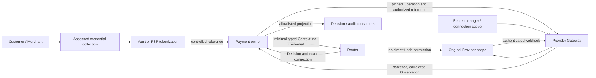
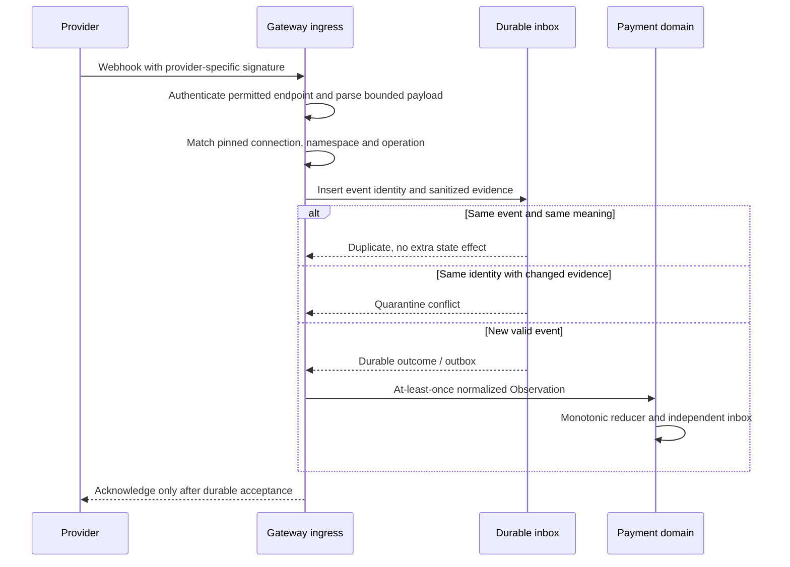

# 附录 B 安全、合规与数据边界

一次线上排查很容易从“为什么这笔支付没走通”变成“把整个请求打出来看看”。请求被复制进日志，日志进入检索平台，错误工单又把它贴进聊天群。原本只应该在凭证边界短暂出现的数据，就这样获得了比支付业务更广的访问者和更长的寿命。增加 TLS 或把服务拆成微服务，并不会撤销这些副本。

本附录的核心命题是：安全首先是限制数据和权限的传播，其次才是保护已经允许存在的数据。它把[第 3 章的服务边界](../part-1-foundations/routing-system-boundaries.md)、[第 4 章的 Context](../part-2-routing-engine/routing-context.md)、[第 14 章的 Decision Record](../part-4-operating-at-scale/routing-decision-store.md)和[第 20 章的配置治理](../part-5-global-routing/configuration-platform.md)串成横向检查方法，不另建一套 Fraud Engine，也不代替目标市场的安全评估、合同审核和法律意见。

## B.1 先区分“本系统不保存”与“标准一律禁止保存”

PAN 属于持卡人数据 CHD；CVV/CVC/CID、完整磁道和 PIN/PIN Block 属于敏感认证数据 SAD。两者不能混称。对本书讨论的商户收单路由场景，SAD 在授权完成后不得保存，即使加密也不例外；PAN 则有不同的存储保护与业务必要性要求。本项目采取更窄的架构政策：原始 PAN 和 SAD 均不进入平台数据库、Router、Decision、日志或消息；凭证采集交给经过评估的托管组件或 Vault。[PCI SSC：CVV 与授权后存储要求](https://www.pcisecuritystandards.org/faqs/are-merchants-allowed-to-request-card-verification-codes-values-from-cardholders/)

Token 不是一个统一安全等级。Provider vault token、平台受控引用、网络 Payment Token 可能具有不同的可逆性、用途和域限制。一个服务拿不到 PAN，却能任意调用 detokenization API，不能因此自称已脱离持卡人数据环境。EMVCo Payment Token 也有特定定义和域控制；PCI SSC 明确区分 Token 本身与同时处理账户数据、或连接相关系统的环境。不能把这一结论推广为“所有叫 token 的字段都免于 PCI”。[PCI SSC：EMVCo Payment Tokens 的作用域](https://www.pcisecuritystandards.org/faqs/1326/)

PCI DSS 是技术与运行控制基线，评估对象还包括能够影响 CDE 安全的组件。实际责任要结合接入方式、网络隔离、服务商责任矩阵和评估范围确认；本书不宣布 PCI certification，也不提供一个可通用于所有商户的 SAQ 结论。[PCI SSC：PCI DSS 适用对象与评估](https://www.pcisecuritystandards.org/standards/pci-dss/)

| 数据类别 | 合理持有者 | 本项目的持久化边界 | Router / 通用观测平台 |
| --- | --- | --- | --- |
| 原始 PAN、SAD | 经评估的支付凭证采集边界 | 平台不接收和落盘；SAD 不因调试例外保存 | 禁止 |
| 受控 payment-method reference | Payment，执行时交给获授权 Gateway | 按用途、访问控制和保留策略保护 | 不发送 Token，只传必要派生属性 |
| Provider API credential / webhook secret | 指定 connection 的 Gateway 或密钥服务 | Secret store；不得写入业务事件和配置摘要 | 禁止 |
| 金额、币种、必要国家/卡网络属性 | Payment 与 Router | 使用版本化、最小化字段 | 允许必要字段，不附带原请求 |
| Provider reference、内部 payment ID | 状态所有者、对账与受控审计 | 为资金关联保存，访问可审计 | 非公开标识；不作高基数 metric label |
| 客户联系方式、设备和风险原始特征 | 各自业务或 Risk 所有者 | 按目的隔离 | 默认不复制，使用最小 Risk Decision |
| Config / Model / Policy digest | 控制平面、Router、审计 | 可持久化版本证据 | 摘要不能夹带 secret 或原始训练样本 |

表中的“允许”不是要求所有服务都存一份。每次新增字段，都应记录业务目的、权威来源、允许接收者、存储位置、保留期限、删除路径和批准人。没有这些答案时，默认不把字段加入跨服务契约。

## B.2 从请求链画出信任边界



这是一张目标信任图，不是当前已经部署的 Vault、Secret Manager 或网络隔离证明。每一条箭头都应有调用身份、资源范围和数据契约。Merchant API key 只证明商户入口身份，不能继续转发给 Router；Router 获准返回 Candidate，不代表它拥有 Gateway 的 execute 权限；Gateway 能查某个 Provider account，不代表能任意把该账户的事件绑定到另一商户。

同一 VPC、Kubernetes namespace 或机器不是身份凭证。NIST 的 Zero Trust 模型明确反对仅因物理或网络位置而隐式信任资源；这里采用的是这条原则，而不是要求为每个示例部署一整套服务网格。[NIST SP 800-207](https://csrc.nist.gov/pubs/sp/800/207/final)

生产方案应给 Payment、Router、Gateway、Config、Settlement 分配独立服务身份。授权应覆盖“谁能对哪个商户、哪条 connection、哪种操作做什么”，而不只是拥有一个共享内部 token。数据库同理：迁移角色与运行角色分离，运行角色不能 DDL，Router 没有 Payment 表权限；只读审计身份也不能顺手获得所有 Token 列。当前 Compose 的共享开发账号不能作为生产权限模型照搬。

## B.3 API 契约应拒绝多余能力，而不是只忽略字段

`map[string]any` 作为 Context 很方便，也最容易让安全边界逐渐失效。一个 `debug_payload` 字段就能绕过原本精心设计的七个安全属性；一个忽略未知字段的 decoder，又会让调用方误以为其中的 override、Token 或规则已被服务接受。

因此入口应同时限制 Content-Type、总字节数、嵌套深度、字段集合、类型、版本和业务值；拒绝重复键、非预期大小写变体及尾随第二份 JSON。拒绝响应只返回稳定错误码，不回显原始 body 或错误字段的值。Go 的 `encoding/json` 传统解码行为允许重复对象名，struct 匹配也可能不区分大小写；`DisallowUnknownFields` 不是这些检查的总开关。[Go：encoding/json 行为说明](https://pkg.go.dev/encoding/json)

下面用一个刻意很小的审计投影展示正向 allowlist。它不是第 4 章的完整 Context schema：只接受精确字段名、一个嵌套 execution 对象和短字符串；没有自由扩展字段，重复键、数组、null 和任何未知键都会被拒绝。由于允许的形状固定，恶意嵌套不会触发无界递归。

```go
package auditboundary

import (
	"bytes"
	"encoding/json"
	"errors"
	"io"
	"unicode/utf8"
)

var ErrBoundary = errors.New("audit projection violates its schema")

type shape map[string]shape

func ValidateAuditJSON(raw []byte) error {
	if len(raw) == 0 || len(raw) > 4096 || !utf8.Valid(raw) {
		return ErrBoundary
	}
	schema := shape{
		"decision_id": nil, "payment_intent_id": nil,
		"policy_version": nil, "outcome": nil,
		"execution": {
			"connection_id": nil, "revision": nil,
			"namespace_id": nil, "provider": nil,
		},
	}
	d := json.NewDecoder(bytes.NewReader(raw))
	if err := object(d, schema); err != nil {
		return ErrBoundary
	}
	if _, err := d.Token(); !errors.Is(err, io.EOF) {
		return ErrBoundary
	}
	return nil
}

func object(d *json.Decoder, schema shape) error {
	start, err := d.Token()
	if err != nil || start != json.Delim('{') {
		return ErrBoundary
	}
	seen := make(map[string]bool, len(schema))
	for d.More() {
		token, err := d.Token()
		key, isString := token.(string)
		if err != nil || !isString || seen[key] {
			return ErrBoundary
		}
		child, allowed := schema[key]
		if !allowed {
			return ErrBoundary
		}
		seen[key] = true
		if child != nil {
			if err := object(d, child); err != nil {
				return ErrBoundary
			}
			continue
		}
		value, err := d.Token()
		text, isString := value.(string)
		if err != nil || !isString || len(text) == 0 || len(text) > 128 {
			return ErrBoundary
		}
	}
	end, err := d.Token()
	if err != nil || end != json.Delim('}') || len(seen) != len(schema) {
		return ErrBoundary
	}
	return nil
}
```

它通过“不允许额外字段”同时拒绝根部 PAN、嵌套 CVV 和换大小写的 Secret，不靠一张永远列不全的敏感词黑名单。下面的反例测试还检查错误文本不会回显测试标记。

```go
package auditboundary

import (
	"strings"
	"testing"
)

func TestAuditBoundary(t *testing.T) {
	const valid = `{"decision_id":"dec_1","payment_intent_id":"pi_1",` +
		`"policy_version":"policy_1","outcome":"captured","execution":{` +
		`"connection_id":"conn_a","revision":"rev_1",` +
		`"namespace_id":"ns_a","provider":"provider_a"}}`
	if err := ValidateAuditJSON([]byte(valid)); err != nil {
		t.Fatal(err)
	}
	cases := map[string]string{
		"root credential": strings.Replace(valid, `"decision_id":`, `"PAN":"test_secret","decision_id":`, 1),
		"nested secret":   strings.Replace(valid, `"revision":`, `"CVV":"test_secret","revision":`, 1),
		"duplicate":       strings.Replace(valid, `"outcome":`, `"outcome":"failed","outcome":`, 1),
		"case variant":    strings.Replace(valid, `"decision_id":`, `"Decision_ID":`, 1),
		"trailing value":  valid + `{}`,
		"array injection": strings.Replace(valid, `"rev_1"`, `["rev_1"]`, 1),
		"null value":      strings.Replace(valid, `"rev_1"`, `null`, 1),
		"oversized":       strings.Repeat(" ", 4097),
		"invalid UTF-8":   valid + string([]byte{0xff}),
	}
	for name, raw := range cases {
		t.Run(name, func(t *testing.T) {
			err := ValidateAuditJSON([]byte(raw))
			if err == nil || strings.Contains(err.Error(), "test_secret") {
				t.Fatalf("unsafe acceptance or error response: %v", err)
			}
		})
	}
}
```

这仍不是通用 DLP。若开发者把 Token 填进合法的 `decision_id` 值，schema 并不知道它的真实含义。生产代码还要从权威对象构造 typed projection，验证 ID 与 outcome 的业务语义，禁止原请求、动态 map 和任意 error 对象直接进入日志。正向契约解决“哪些槽位可以存在”，数据来源与访问控制解决“谁能往槽位里放什么”。错误路径、trace baggage、死信队列、备份和崩溃转储都必须纳入同一检查。

## B.4 Webhook：验签、关联和去重是三件事

有效签名只证明消息符合某个密钥的认证契约，不证明它属于当前 Operation，也不证明内容第一次出现。处理顺序应明确分层：按 endpoint/connection 找到允许的认证材料；依 Provider 规范验证原文或指定规范化内容；校验账户、对象和操作关联；在持久 inbox 中去重或隔离；再提交领域结果。

Stripe 要求签名验证使用未被改写的原始 body；Adyen Standard webhook 则使用其规定的字段构造签名内容，部分其他 webhook 类型验证原始 body。不能写一个“对所有 PSP 都先 JSON marshal 再 HMAC”的通用算法。[Stripe：签名排查](https://docs.stripe.com/webhooks/signature)、[Adyen：HMAC 验证](https://docs.adyen.com/development-resources/webhooks/secure-webhooks/verify-hmac-signatures/)



新事件和重复投递还需要区分。事件 ID 的持久去重防止重复生效；签名中的时间窗口用于限制捕获消息的恶意重放，两者不能相互替代。Stripe 的签名时间戳属于签名内容，而且每次重新投递会产生新时间戳；应依其契约检查投递时效，不把事件发生时间当成固定五分钟后永远丢弃的理由。[Stripe：Webhook 重放防护](https://docs.stripe.com/webhooks#preventing-replay-attacks)

当前 Gateway 模拟器协议是原始 body 的 HMAC-SHA256 加持久事件去重，没有真实 PSP 的 timestamp/签名版本协议，不能据此声称完整 anti-replay 已完成。它已经区分 connection 认证权限与 namespace 冲突域：同 namespace 的另一 connection 不自动获得写权限，跨路径关联必须是显式授权的 recovery alias。这个约束位于配套实现的 `docs/adr/0002-immutable-provider-connections.md`，固定 revision 见[第 22 章交付说明](../deliveries/chapter-22-global-payment-routing-platform.md)。

## B.5 密钥轮换不能改变旧操作的执行含义

把 secret 移到环境变量，只是避免写进源码，不是完成密钥管理。生产设计应使用可审计的 Secret Manager/KMS 或适当的硬件边界，明确生成、分发、使用、轮换、撤销、恢复与销毁职责。应用只拿到必要的使用权限，控制平面和审计记录保存凭证版本引用，不复制明文。[NIST SP 800-57 Part 1](https://csrc.nist.gov/pubs/sp/800/57/pt1/r5/final)

轮换时至少区分两件事：验证旧 webhook 的认证材料，以及向原 Provider account 发起恢复请求的执行权限。旧 secret 仍可验证迟到事件，不意味着它还能创建新交易；新 secret 生效，也不意味着旧 UNKNOWN 可以改用另一个账户。每次变化要有激活窗口、可回滚版本、在途操作清单和撤销证据。

已验证基线的 connection registry 刻意拒绝同一 ID/revision 下改变 endpoint、namespace 或 webhook-secret digest。当前配置每个 connection ID 只解析一个 revision，因此变更使用新的 ID 与 revision，并保留旧映射服务在途恢复。它尚未实现同 endpoint 多个签名密钥的重叠轮换协议。Adyen 官方要求换 HMAC key 时考虑传播时间并暂时接受前一个 key；真实 Adapter 应显式实现这种重叠契约，不能通过关闭 registry 校验来解决。[Adyen：HMAC key 轮换](https://docs.adyen.com/development-resources/webhooks/secure-webhooks/verify-hmac-signatures/#changing-your-hmac-key)

配置平台也是安全边界。能把路由指向攻击者 endpoint 的发布权限，可能比读取一条日志更危险。作者、审批者、发布者应分权；artifact 必须带版本与摘要，完整校验后原子激活；运行实例不能接受请求中临时注入的 rules 或 endpoint。Break-glass 需要短时权限、具体理由、审批或事后复核及审计记录，不能拥有“把 UNKNOWN 一键改失败”的无条件权限。

## B.6 保留、删除与跨区处理要设计在 schema 里

Append-only 说明事实不能被任意改写，不等于把所有个人数据永久保存。[第 14 章](../part-4-operating-at-scale/routing-decision-store.md)的证据记录应尽量引用版本与摘要，把需要短期保留的敏感映射分离；删除、匿名化或限制处理必须有可验证流程，而非口头承诺“日志过几天自动清理”。

以 GDPR 适用场景为例，删除请求存在需要评估的条件，也存在法定义务或法律请求等保留例外；不能为了方便对账就一律拒绝删除，也不能收到请求便删除必须保留的资金事实。由合规与法律负责人确定目的和依据，再由工程实现对应的数据类、保留策略与访问限制。[欧盟委员会：处理个人权利请求](https://commission.europa.eu/law/law-topic/data-protection/information-business-and-organisations/dealing-requests-individuals_en)

工程上至少维护一份数据去向清单：在线表、只读副本、分析仓、对象存储、日志、trace、死信、导出文件和备份。备份的保留周期、恢复后重新执行删除标记的程序、legal hold 与正常 TTL 的优先级都要明确。Hash 也不天然匿名；低熵值可被枚举，与别表重新关联也可能恢复身份，因此“只存摘要”不能自动结束隐私评估。

多 Region 的数据驻留同样不是一个 `country=DE` 的布尔条件。应区分交易处理位置、持久存储位置、支持人员访问位置和跨区分析用途。Router 只消费经过批准的 eligible scope 与版本，不自行解释全部法条；不确定的授权范围 fail closed。区域故障时，业务方希望继续收款，也不能因此默许把凭证或敏感证据复制到未获批准的区域。[第 19 章](../part-5-global-routing/multi-region.md)讨论的容灾权限必须包含这道门。

## B.7 把威胁转成可以失败的测试

| 威胁 | 必须观察到的失败或隔离 | 证明材料 |
| --- | --- | --- |
| PAN/CVV/Secret 被塞进根部、嵌套或大小写变体字段 | 请求被拒绝，错误和日志不回显值 | HTTP/契约测试、日志捕获与 fixture 扫描 |
| 同 event ID 改写状态或关联 | inbox 冲突被持久隔离，不覆盖资金事实 | Gateway 与 Payment 双侧数据库测试 |
| A 的合法签名用于更新 B 的 operation | 未授权关联失败，即使 namespace 相同 | 不同 connection、alias 的正反例 |
| 同 revision 重绑 endpoint 或密钥 | 启动或 readiness 失败，不继续原 UNKNOWN | registry 重启与漂移测试 |
| Router 身份尝试 execute 或读 Payment 表 | 授权和数据库权限拒绝 | 真实部署身份/role 的负向测试 |
| 生产配置使用 simulator 或开发凭证 | 启动或上线门禁失败 | 环境矩阵及真实启动结果 |
| 调试日志、panic、trace 或死信泄漏受控引用 | 测试捕获到泄漏即失败 | 合成敏感标记，不使用真实卡数据 |
| 密钥撤销、备份恢复或跨区切换绕过边界 | 未授权使用被拒绝，在途恢复按原契约处理 | 演练记录与审计关联 ID |

不要只搜索源码中有没有 `cvv`。泄漏可能来自 `%+v` 打印整个结构体、HTTP middleware 记录 header、SDK 自动追踪 body，或异常把 URL query 写入日志。测试应使用合成标记走成功、拒绝、timeout、解析失败和 panic 恢复路径，再检查所有输出面。敏感值不能作为 metric label；普通 payment ID 也会造成高基数和关联风险，应按[第 15 章](../part-4-operating-at-scale/observability.md)的有限维度观察。

## B.8 当前实现与上线剩余工作

当前固定基线已经提供商户身份绑定、Payment/Router/Gateway 内部 token 校验、严格且有限体积的 JSON、模拟器环境限制、精确 connection 关联、HMAC webhook、durable inbox/quarantine、不可变 revision registry，以及禁止 UPDATE/DELETE/TRUNCATE 的 Provider observation ledger；这些边界的实现 commit 与 CI 见[第 22 章交付说明](../deliveries/chapter-22-global-payment-routing-platform.md)。Router 的共享 token 中间件保护除 `/livez`、`/readyz` 和 `/metrics` 外的所有路径，检查 `X-Internal-Token`，等长值使用恒时比较，无 token 或错误 token 返回 401；开发环境允许本地默认值，非开发环境未显式配置则拒绝启动，入口位于 `services/router/cmd/server/main.go`。

但它仍是本地/测试支付核心。已有共享 token 鉴权不等于已具备 mTLS、每服务独立 principal 或细粒度资源授权；Compose 使用共享开发数据库账号；全链路日志 redaction、Secret Manager/KMS、独立生产 DB roles、真实 PSP timestamp/replay 与重叠轮换、数据保留/删除执行器、合规评估均不能从现有 green CI 推导为已经完成。上面的 Go allowlist 是可运行的附录参考，也不等于已经挂到所有生产输出入口。书稿和实现仓库当前均为 private，证据链接需要获授权的 GitHub 身份；这是一项访问边界，不是修改仓库可见性的理由。

这些缺口应进入[附录 C 的 Go/No-Go 门禁](capacity-planning-and-launch-checklist.md)，由明确 owner 提供部署证据。安全边界不是写到文档末尾的免责条款：只有错误身份、错误字段和错误配置真的被系统拒绝，正文中画出的边界才具有运行意义。当前实现、教学模型与目标合同的逐项状态见[附录 B 交付记录](../deliveries/appendix-b-security-compliance.md)。
