# Appendix C: Capacity Planning and Launch Checklist

[中文](../../appendices/capacity-planning-and-launch-checklist.md) | **English**

“The load test reached 100,000 TPS, and every container is green. Can we launch?” An affirmative answer is premature if the report does not define the business unit behind TPS, count 502 responses and unknown outcomes, show recovery-backlog curves, or explain which connections remain available after losing a region.

This appendix turns the capacity model, four acceptance journeys, and safety boundaries from [Chapter 22](../part-6-case-study/global-payment-routing-platform.md) and earlier chapters into repeatable gates. It does not invent another load-testing system, provide a deployment-independent maximum TPS, or grant authority to move real money because a checklist is complete. Every go/no-go decision should be traceable to inputs, versions, environment, owners, and reviewable evidence.

## C.1 Freeze the Scope to Be Proven

A test proves only the workload it actually covers. Before starting, pin the implementation commit SHA, image digests, database migration version, configuration-bundle digest, provider connection revisions, load-test scripts, and random seed. Record machine specifications, instance counts, database settings, regional topology, and external quotas too. A terminal screenshot alone cannot later distinguish a code change from an environment change.

The scope definition must answer at least the following questions:

| Input | Required detail | Misinterpretation if omitted |
| --- | --- | --- |
| Business unit | New intents/s, confirmations/s, and HTTP requests/s separately | Counting API replay or queries as new payments |
| Traffic mix | Payment methods, operation kinds, merchant concentration, countries, currencies, and credential domains | Averages hide hotspots and sparse eligibility |
| Time profile | Peak duration, burst ramp, steady phase, and recovery phase | Treating a few seconds as evidence for an hours-long sale |
| Failure distribution | Injection points for timeouts, response loss, reordering, duplication, and explicit declines | Treating a pre-send error as a lost response after a charge |
| External constraints | Per-account / endpoint quotas, concurrency, latency, and query contracts | Assuming spare CPU means account limits remain available |
| Success criteria | Latency, errors, backlog, funds invariants, and recovery time | Reporting only successful RPS and excluding underserved demand |
| Environment and authorization | Simulator, real PSP sandbox, or authorized production drill | Treating protocol validation as production-capacity evidence |

The case study's 100,000 TPS means a target admission rate of 100,000 new payment intents per second. It is neither a measured capacity of the current implementation nor a default permitted provider request rate. Sandbox and production latency and quotas can differ. Stripe explicitly notes that a sandbox is not equivalent to production for load testing; high-pressure sandbox calls should not be used to infer production capacity directly. [Stripe: Rate Limits and Load Testing](https://docs.stripe.com/rate-limits)

## C.2 Translate Business Demand into Work, Including Returning Traffic

Use the illustrative assumptions from Chapter 22: an average of 2.2 merchant API requests per intent; 0.03 additional authorized fallback attempts; 0.01 additional same-key resends per operation; queries for 5% of operations, averaging three queries each; and 1.1 webhooks per operation. These are capacity coefficients, not permission conditions for funds actions.

```mermaid
flowchart LR
    Demand["New payment-intent demand"] --> API["Create, confirm, replay, and query"]
    Demand --> Route["Initial routing evaluation"]
    Route --> Attempt["Initial payment attempt"]
    Route --> NoCandidate["No-candidate evidence"]
    Route -.-> Shadow["Optional shadow evaluation<br/>No provider operation"]
    Attempt --> Plan{"Definitively no side effects<br/>and fallback permitted?"}
    Plan -->|"Yes"| Fixed["Take next candidate from pinned route plan"]
    Fixed --> Guardrail["Router-owned guardrail revalidation<br/>Allow or veto only; never reorder"]
    Guardrail -->|"Allow"| Fallback["Payment-owned fallback execution binding<br/>New attempt; no full routing reevaluation"]
    Guardrail -->|"Veto, expired, or unavailable"| Stop["Stop<br/>No new funds path"]
    Attempt --> Sale["Logical SALE operation"]
    Fallback --> Sale
    Sale --> Execute["Execution and same-key resends"]
    Sale --> Unknown["Unknown-outcome fraction"]
    Unknown --> Query["Query original operation"]
    Execute --> Provider["Per-account provider budgets"]
    Query --> Provider
    Provider --> Event["Webhooks and duplicate deliveries"]
    Event --> Inbox["Inbox, domain reducer, and outbox"]
    Inbox --> Projection["Decision and outcome projections"]
```



| Workload | Formula | Example demand at 100,000 new intents/s |
| --- | --- | ---: |
| Merchant API | `100000 × 2.2` | 220,000 requests/s |
| Logical operations for initial attempts and valid fallback | `100000 × 1.03` | 103,000 operations/s |
| Routing evaluation | `100000 + R_retry + R_no_candidate + R_shadow` | At least 100,000 evaluations/s; additions reported separately |
| Fallback guardrail revalidation | Assumed here as `100000 × 0.03`; vetoed checks are additional | At least 3,000 checks/s; not counted as full routing evaluations |
| Provider execution | `103000 × 1.01` | 104,030 calls/s |
| Provider queries | `103000 × 0.05 × 3` | 15,450 calls/s |
| Total provider outbound | Execution + queries | 119,480 calls/s |
| Inbound webhooks | `103000 × 1.1` | 113,300 events/s |

Actual full routing evaluations include authorized routing retries before an attempt is created, additional `no_candidate` evaluations, and shadow work. Shadow evaluation must not increase provider operations. The table's 100,000/s represents the selected `SALE` slice. If `no_candidate` outcomes come from additional arriving requests, that traffic also belongs in the merchant API denominator. Valid fallback instead takes the pinned next candidate from the router's `RoutePlanDecision`. The payment service refreshes the risk conclusion and calls router-owned guardrail-only revalidation. That check may allow or veto, but cannot rebuild candidates, reorder, rescore, or extend validity. Expiry or unavailability stops execution. Thus 103,000 operations are not 103,000 full routing evaluations. Guardrail checks still need their own workload line, including vetoed checks that never create an attempt. On approval, the payment service writes a `FallbackExecutionBinding`, which is not a new routing decision. Refunds, manual capture, reconciliation-file scans, and other payment methods also need separate lines rather than hidden costs inside an average payment.

Even under the optimistic assumption that 119,480 calls/s can be divided evenly among three regions, losing one region leaves each survivor handling 59,740 calls/s. With an agreed operating ceiling of 65% of verified capacity, each region needs approximately 91,908 calls/s of capacity. A report claiming only 85,000 yields about 70.28% utilization after failure, exceeding the budget. Remaining below 100% is not a passing criterion. These are still hypothetical calculations; actual regional eligibility and account quotas must be checked rather than assuming evenly distributable traffic.

Queues require both accumulation and catch-up calculations. If each operation produces one projection record, an arrival rate of 103,000/s accumulates 61.8 million records during a 600-second outage. To catch up within an hour while continuing to receive the original traffic, consumption must reach at least `103000 + 61800000/3600 ≈ 120167 events/s`. This counts records only. Disk budgets must also account for actual bytes, indexes, WAL, and replicas. A consumer running merely as fast as new arrivals will not drain the backlog.

## C.3 Audit the Load Generator Too

Load generators should separately report offered, started, completed, unsent, canceled, and timed-out work. A fixed-concurrency client naturally reduces arrival rate when the system slows down. If only completed-request latency is observed, the system can look stable while no longer serving the agreed demand. Scheduled-arrival load models must also record scheduling lag and retain requests that could not be sent in time in the report.

HTTP and business statistics must appear side by side. HTTP 200 may contain a definite decline, 202 may contain an unknown result, and 502 indicates ingress or upstream failure. They cannot be collapsed into one success rate. ApacheBench reports failed requests separately from non-2xx responses; zero failures in the former does not prove there were no 502 responses. [ApacheBench: Output](https://httpd.apache.org/docs/2.4/programs/ab.html) PostgreSQL pgbench also distinguishes rate-scheduling delay, late transactions, and skipped transactions. A database benchmark cannot replace a load test of the entire payment path. [PostgreSQL: pgbench](https://www.postgresql.org/docs/current/pgbench.html)

Tests should not use only warm caches, fresh idempotency keys, and uniformly distributed merchants. Include at least a hot merchant, concurrent competition for the same key, repeated confirmations, late webhooks, slow providers, and overlapping recovery work. Otherwise, a benchmark whose main path requires only one query may entirely miss production's most expensive lock-contention paths.

| Scenario | Main pressure | Required results |
| --- | --- | --- |
| Steady state | Target normal mix and sustained peak | Offered / served demand, latency percentiles, non-2xx responses, resource and queue stability |
| Slow provider / response loss | Slow execution plus amplification from unknown-outcome queries | Per-connection concurrency, queries / resends, unknown age, isolation of other routes |
| Cache / feature / projection loss | Cold starts and required or optional dependency failures | Correct degradation, configuration validity, outbox growth, recovery catch-up |
| Region loss | Reduced resources and revival of the old owner | Negative fencing evidence, original-operation recovery, remaining capacity, eligibility decisions |

Each run includes warm-up, stable load, fault injection, sustained failure, recovery, and catch-up. Selecting only the best-looking minute hides recovery debt. Agree on stopping conditions beforehand: stop adding test work immediately if a second unintended funds path is found; reduce admitted load at safety thresholds as resources approach limits while preserving recovery budgets. Never delete unknown records or reset their age merely to finish the test.

## C.4 Resources, Timeouts, and Probes Answer Different Questions

Average in-flight work can help estimate resource needs, but it does not directly determine goroutine count or prove p99 latency. Provider tail latency, connection handshakes, database queues, and batch-processing jitter jointly affect actual latency. Reuse HTTP clients and transports, and consume and close response bodies according to the contract. Connection and idle-connection settings control resources; they are not funds-retry policies. [Go: net/http Clients and Transports](https://pkg.go.dev/net/http)

Bigger database pools are not always better. More connections can move waiting from the application into database locks and CPU. Observe acquisition waits, occupied connections, transaction duration, lock waits, WAL, and disk together. The companion repository uses pgxpool. Its `Stat` exposes acquisition duration, empty and canceled acquisitions, and acquired, idle, and total connection counts to help locate queues. [pgxpool: Stat](https://pkg.go.dev/github.com/jackc/pgx/v5/pgxpool#Stat)

| Boundary | Required budgets and evidence before launch | Insufficient substitute |
| --- | --- | --- |
| Admission | Per-merchant / connection rates, concurrency, rejection reasons, and recovery reserves | Average machine CPU |
| Deadlines | Remaining-time allocation across queues, routing, gateway, provider, and persistence | Simply adding each service's p99 |
| Database | Pool waits, locks, transactions, WAL, space, and recovery time | Connection success or `SELECT 1` |
| Queues | Depth, oldest age, net inflow, catch-up rate, and storage headroom | A live consumer process |
| Containers | Requests / limits, throttling, OOM, restarts, and scheduling headroom | Spare host memory |
| Providers | Per-account and endpoint rates, concurrency, error categories, and budgets | Aggregate platform call volume |

Kubernetes readiness probes determine whether an instance should receive traffic. Liveness probes determine whether it should restart. Startup probes handle startup. These are different health judgments. Connecting a brief PSP failure to the entire service's liveness probe can restart every Pod at once and amplify the incident. [Kubernetes: Probes](https://kubernetes.io/docs/concepts/workloads/pods/probes/) CPU-limit throttling also differs from OOM behavior after exceeding memory limits. Measure under actual container limits rather than relying only on a development machine. [Kubernetes: Resource Management](https://kubernetes.io/docs/concepts/configuration/manage-resources-containers/)

## C.5 Four Journeys Matter More Than Forty Green Startup Checks

Reuse Chapter 22's scenario orchestration rather than writing another simulated business for this appendix. Each journey collects API, payment-service, gateway, provider-observation, configuration-version, and timeline evidence. A correct final state is only one assertion.

| Journey | Key counterexample | Required invariant | Evidence owner |
| --- | --- | --- | --- |
| Normal payment and repeated submission | Same key with different payload; duplicate confirmations / webhooks | Same resource; no second unintended attempt or operation; consistent amounts and references | Payment / gateway teams |
| Response loss and recovery | Disconnect after the provider completes the side effect, then restart workers | Original operation, connection / revision / namespace, key, and payload remain fixed; unknown does not reroute | Payment / connector teams |
| Bad configuration and rollback | Partial download, wrong references, self-approval, valid but degraded canary | Only complete approved versions; rollback preserves in-flight identity and does not revive revoked hard eligibility | Configuration / routing teams |
| Regional failure and old-primary revival | Old generation writes after partition, then starts from an old backup | Reject old owner; new owner recovers original operations first; evidence gaps do not create new `SALE` operations | Payment / SRE teams |

The regional journey tests failback as well as failover. When the old region returns, its historical disk and configuration may look normal, but it has not thereby regained authority to write funds-related state. Passing capacity tests cannot replace fencing, and passing fencing tests cannot replace available quotas and data-residency permission. Both proofs must hold within the same release scope.

Also integrate [Appendix A's](payment-state-models.md) invariants and [Appendix B's](security-compliance.md) negative tests into the overall gate: conflicting evidence after terminal success requires review; a signature for the wrong connection cannot update another operation; production disables simulators; logs and events contain no restricted credentials; and runtime identities cannot write another service's data without authorization.

## C.6 Go: Missing Evidence Must Not Default to a Pass

The following is an evidence-reduction reference for the specific profile of a global card-payment `SALE` production release, not a universal approver. It consumes external test results and performs neither load tests nor funds operations. A future `tools/launchcheck` collection layer must validate evidence provenance, digests, and permissions. A single-region test profile requires its own explicit checklist; it must not be created by simply dropping required items that were never run.

```go
package launchgate

import (
	"sort"
	"time"
)

type Scope struct {
	CodeSHA, BundleDigest, Environment, WorkloadID string
}

type Evidence struct {
	Name, State, Owner, Artifact string
	Scope                        Scope
	CheckedAt                    time.Time
}

type Report struct {
	Go      bool
	Reasons []string
}

func EvaluateGlobalLive(target Scope, now time.Time, maxAge time.Duration, items []Evidence) Report {
	if target.CodeSHA == "" || target.BundleDigest == "" ||
		target.Environment != "live" || target.WorkloadID == "" ||
		now.IsZero() || maxAge <= 0 || len(items) > 64 {
		return Report{Reasons: []string{"invalid_target_or_evidence"}}
	}
	required := []string{
		"code_and_contracts", "postgres_integration", "funds_invariants",
		"configuration_rollback", "region_fencing", "fault_capacity",
		"security_boundary", "provider_live_approval",
	}
	known := make(map[string]bool, len(required))
	for _, name := range required {
		known[name] = true
	}
	seen := make(map[string]Evidence, len(items))
	var reasons []string
	for _, item := range items {
		if !known[item.Name] {
			reasons = append(reasons, "unexpected_gate")
			continue
		}
		if _, duplicate := seen[item.Name]; duplicate {
			reasons = append(reasons, item.Name+":duplicate")
			continue
		}
		seen[item.Name] = item
	}
	for _, name := range required {
		item, exists := seen[name]
		switch {
		case !exists:
			reasons = append(reasons, name+":missing")
		case item.State != "pass":
			reasons = append(reasons, name+":not_passed")
		case item.Owner == "" || item.Artifact == "" || item.Scope != target:
			reasons = append(reasons, name+":unbound_evidence")
		case item.CheckedAt.IsZero() || item.CheckedAt.After(now) || now.Sub(item.CheckedAt) > maxAge:
			reasons = append(reasons, name+":stale_or_invalid_time")
		}
	}
	sort.Strings(reasons)
	return Report{Go: len(reasons) == 0, Reasons: reasons}
}
```

A trusted collector must derive `pass` from actual tests and thresholds; arbitrary callers cannot check the box themselves. Scope binds evidence to the release target, indicating approval for that combination of code, configuration, environment, and workload. It does not require unit tests to execute against production endpoints. NaN, infinities, zero denominators, and incorrect units in raw capacity measurements must be rejected by [Chapter 22's capacity model](../part-6-case-study/global-payment-routing-platform.md) and the collector, not guessed at by this function.

```go
package launchgate

import (
	"testing"
	"time"
)

func TestGlobalLiveGateFailsClosed(t *testing.T) {
	now := time.Date(2026, 8, 26, 12, 0, 0, 0, time.UTC)
	target := Scope{"code-revision", "bundle-digest", "live", "peak-card-sale"}
	names := []string{
		"code_and_contracts", "postgres_integration", "funds_invariants",
		"configuration_rollback", "region_fencing", "fault_capacity",
		"security_boundary", "provider_live_approval",
	}
	base := make([]Evidence, 0, len(names))
	for _, name := range names {
		base = append(base, Evidence{name, "pass", "owner", "artifact", target, now})
	}
	cases := []struct {
		name string
		edit func([]Evidence) []Evidence
		goOK bool
	}{
		{"complete", func(e []Evidence) []Evidence { return e }, true},
		{"missing approval", func(e []Evidence) []Evidence { return e[:len(e)-1] }, false},
		{"unknown", func(e []Evidence) []Evidence { e[0].State = "unknown"; return e }, false},
		{"wrong bundle", func(e []Evidence) []Evidence { e[0].Scope.BundleDigest = "other"; return e }, false},
		{"stale", func(e []Evidence) []Evidence { e[0].CheckedAt = now.Add(-2 * time.Hour); return e }, false},
		{"future", func(e []Evidence) []Evidence { e[0].CheckedAt = now.Add(time.Second); return e }, false},
		{"duplicate", func(e []Evidence) []Evidence { return append(e, e[0]) }, false},
	}
	for _, tc := range cases {
		t.Run(tc.name, func(t *testing.T) {
			items := tc.edit(append([]Evidence(nil), base...))
			got := EvaluateGlobalLive(target, now, time.Hour, items)
			if got.Go != tc.goOK || (!got.Go && len(got.Reasons) == 0) {
				t.Fatalf("unexpected report: %+v", got)
			}
		})
	}
}
```

The same code passing on an old configuration does not prove a new bundle safe. A low-traffic report from a week ago does not directly prove today's target peak. Evidence validity should depend on its type and the changes that invalidate it. The example uses one `maxAge` only to emphasize rejection when evidence is missing. Actual reports should include every threshold, collection window, measurement, error margin, and decision reason, retaining the approved basis for not-run and not-applicable items. A command-line tool should return a nonzero exit code for both no-go decisions and collection failures, rather than merely putting a warning in JSON.

## C.7 A Launch Checklist Needs Owners, Exit Conditions, and Recovery Actions

The following checklist does not remain valid forever after one successful run. Adding a provider, changing account permissions or quotas, or migrating regions may invalidate corresponding evidence.

| Gate | Evidence before increasing traffic | Action on a problem | Owner |
| --- | --- | --- | --- |
| Artifact consistency | Aligned code, images, migrations, configuration bundle, and runbook revisions | Stop release; do not mix versions | Release owner |
| Provider integration | Actual account scope, sandbox acceptance, production authorization, query and idempotency contracts | Disable admission of new work on that connection | Connector owner |
| Funds correctness | Passing counterexamples for duplicates, unknown, reordering, conflicts, and concurrency | Stop new funds paths; preserve original-operation recovery | Payment owner |
| Configuration governance | Separation of approval, complete downloads, LKG, and rollback drills | Roll back future selections without changing in-flight identities | Configuration owner |
| Capacity and headroom | Target mix, capacity after failure, queue catch-up, and external quotas | Reduce new-work admission; protect recovery | SRE |
| Data security | Separate identities and roles, secret lifecycle, log and residency checks | Isolate affected authority; follow the incident process | Security owner |
| Operational closure | Reachable alerts, unknown and review queues, owners for reconciliation discrepancies | Escalate; do not bulk-edit state to silence alerts | Payment operations and finance |

Roll out in stages, each with its own sample and time window. First prove state behavior in a test environment, then protocol behavior in a real sandbox. Only after launch authorization should a controlled production canary begin. Observe more than the initial response: unknown-outcome convergence, webhook delay, fees, and discrepancies. Some require longer maturity windows. Ten minutes of attractive success rates do not justify ending observation.

Emergency switches must target something specific. Stopping new routing to a connection is different from stopping its queries, webhooks, and refunds. Pausing new-intent admission is different from discarding committed outbox records. Emergency credential revocation can block recovery; record affected in-flight objects and alternative investigation paths before and after the action. When a funds outcome cannot be verified, the exit is quarantine and manual review, not an improvised replacement provider idempotency key.

Runbooks should include trigger metrics, confirmation steps, authorized roles, the target scope of commands, expected results, failure exits, and rollback limitations. “Restart the service” or “clear the queue” is insufficient. Recovery speed matters in a system with funds side effects, but the operator must first know which facts have been preserved and which actions remain authorized.

## C.8 Reading the Repository's Existing Evidence

This edition uses the [pinned companion code version](https://github.com/YouEclipse/payments/commit/bc4afde24da708d22f67da72a90a1557b1477173) and its [CI record](https://github.com/YouEclipse/payments/actions/runs/33041147119). CI includes Go unit tests, race detection, static analysis, builds and OpenAPI checks, real PostgreSQL integration, service images, Compose readiness, and payment end-to-end tests. It establishes the engineering baseline of the current narrow slice, not production throughput in the target environment. The manuscript and code repositories are currently private. These links are available only to authorized GitHub identities. The book does not change repository visibility to obtain anonymous access or treat an anonymously inaccessible link as evidence that CI never ran.

| Evidence layer | Present in the pinned baseline | Target evidence still required |
| --- | --- | --- |
| State and identity | Automatic-capture `SALE`, idempotency, exact connections, recovery of original unknown operations, durable deadlines / budgets / leases / dispatch markers, conflict isolation | Separate counterexamples for fallback successors, new operation kinds, and new policies |
| Database and process | Real PostgreSQL migrations and transaction tests; Compose startup and vertical end-to-end tests | Production permissions, backup restoration, capacity, and disaster-recovery drills |
| Four integrated journeys | Baseline normal payments, explicit declines, response loss, and duplicate requests | Configuration release / rollback, cross-region fencing, combined failure workloads |
| Routing and evidence | v3 risk / capability / rule / cost / performance / scoring models, payment execution snapshots, gateway append-only observations | Dynamic health and configuration / experiment / model platforms with system journeys |
| Observability and load | Basic health and metrics endpoints | Complete latency / error / queue / resource curves and reproducible reports |
| Launch eligibility | Simulator environment gates | Real provider authorization, security and compliance, and operational sign-off |

The current baseline lacks the complete `test/system`, `tools/capacity-plan`, and `tools/launchcheck` toolchain. The pure Go examples in this appendix are not deployed collectors. Future implementation should reuse Chapter 22's scenarios and models and connect report artifacts to the same CI and release process. Gates that have not run remain `not_run`; a filename appearing in a directory does not make them complete.

## C.9 The Final Decision

A capacity conclusion should read: “With these versions, resources, quotas, traffic distributions, and failure conditions, the system meets these latency, error, backlog, and funds-invariant requirements. Conditions beyond this scope have not been validated.” It is longer than an isolated TPS number, but it makes the evidence reusable for the next capacity increase, provider outage, or configuration release.

Release only within the scope that the evidence supports. If required evidence is missing, do not release. Both are valuable engineering outcomes; the distinction is whether the next action can safely be taken, not whether the report ends in green.
