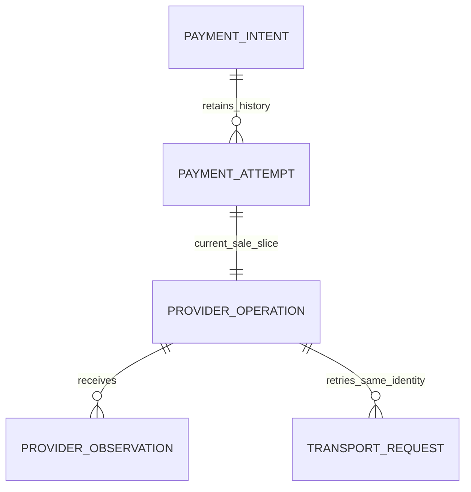
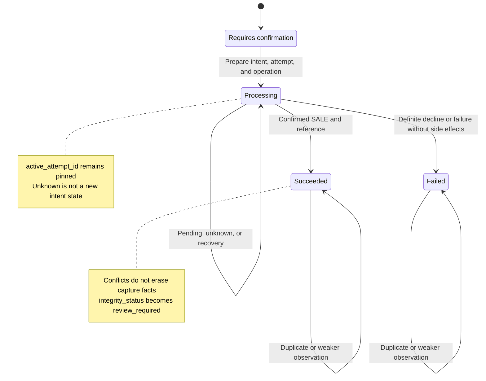
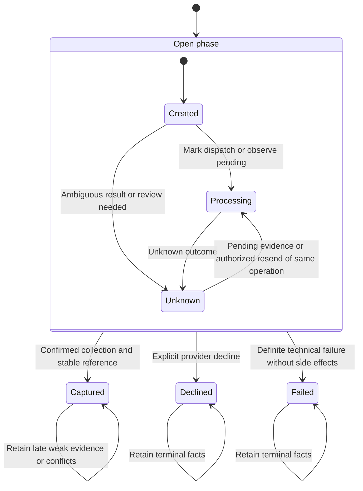
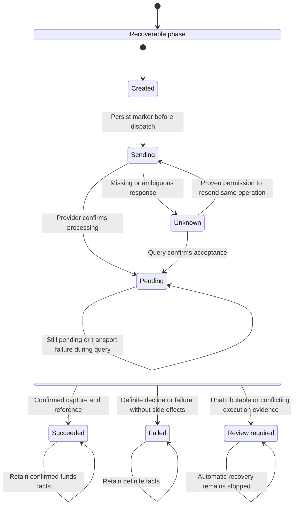

# Appendix A: State Models for Payment Intents, Attempts, and Provider Requests

[中文](../../appendices/payment-state-models.md) | **English**

At two in the morning, the on-call engineer sees three records at once: the order says payment is processing, a provider query says funds were collected, and an internal task says the request timed out. These records do not necessarily contradict each other. The order reads a payment-intent projection, the provider describes a funds operation, and the task records a transmission. The real danger is writing all three into one `payment_status` column and allowing the last message received to overwrite earlier facts.

This appendix provides a common state reference for [Chapter 1](../part-1-foundations/payment-lifecycle.md), [Chapters 10–12](../part-3-reliability/timeout-and-retry.md), and [Chapter 17](../part-4-operating-at-scale/reconciliation.md). The text uses provider request as a general term for outbound requests; the companion code consistently calls the logical funds object `ProviderOperation`. One payment operation can generate multiple HTTP requests, but those requests must not acquire multiple funds identities.

The baseline is the [pinned companion implementation](https://github.com/YouEclipse/payments/commit/bc4afde24da708d22f67da72a90a1557b1477173): tokenized card payments, automatic capture, a single `sale`, durable recovery deadlines, budgets and leases, first-dispatch markers, and append-only provider observations in the gateway. Domain tests, real PostgreSQL tests, and Compose end-to-end tests for that version were validated by [the same CI run](https://github.com/YouEclipse/payments/actions/runs/33041147119). The sections below explicitly distinguish current implementation, defined-but-unconnected features, and future reference designs. A word appearing in an enum does not establish that its product flow exists.

## A.1 Three Object Layers and Two Cardinalities

A payment intent answers which funds the merchant wants to collect. An attempt answers which execution path was selected for that objective. An operation answers which funds action was performed on that path. The payment orchestration service owns the business state at all three layers. The gateway owns only external execution records and protocol facts; the routing service does not modify these states.



The diagram includes two kinds of constraint. The domain model allows an intent to retain multiple historical attempts, but the current `confirm` flow creates only one and does not execute cross-provider fallback. The database also uses `UNIQUE(payment_attempt_id)` to restrict each attempt to one `sale` operation. When authorization, capture, and refunds are supported, operation cardinality will expand to one-to-many. Migrations, domain constraints, and APIs must change together; simply dropping the unique constraint is insufficient.

`active_attempt_id` identifies the attempt that may still produce or confirm a funds outcome. `latest_attempt_id` identifies the most recently created historical record. `winning_attempt_id` identifies the attempt that achieved the collection objective. These are not synonyms. An active attempt must not be cleared during an unknown outcome to make retrying easier. Once success is confirmed, the active attempt is cleared and the winner is pinned; the latest attempt remains useful for explaining history. If a second external success appears, replacing the winner with the newer attempt does not eliminate duplicate collection.

Execution identity is more than a provider name. The attempt and operation must jointly pin `provider_connection_id`, `provider_connection_revision`, `provider_namespace_id`, and `provider`. The first two identify the selected configuration; the namespace expresses the provider's idempotency and reference-collision domain. Sharing a namespace does not make credentials interchangeable or authorize arbitrary redirection. HTTP retries must also pin the operation identity, provider key, amount, currency, and semantic payload. [Chapter 11](../part-3-reliability/idempotency.md) explains the problem each identity solves.

## A.2 Payment Intents: Business Outcome and Integrity Are Separate Axes

The current payment-intent `status` enum is summarized below. Its exact definition is in the companion implementation's [payment domain model](https://github.com/YouEclipse/payments/blob/bc4afde24da708d22f67da72a90a1557b1477173/services/payment/internal/domain/model.go).

| State | Meaning in this book | Current reachability |
| --- | --- | --- |
| `requires_confirmation` | A collection objective with a fixed amount, currency, and credential exists; no funds operation has been created | Implemented |
| `processing` | Submitted for execution, or waiting for, querying, or recovering the original operation | Implemented; includes unknown outcomes |
| `succeeded` | The current automatic-capture contract has confirmed the complete collection outcome | Implemented; does not mean settlement is complete |
| `failed` | The current collection flow ended in a definite decline or a failure with no side effects | Implemented; does not automatically open another attempt |
| `requires_action` | Reserved for continuations requiring customer interaction | Enum defined; 3DS and redirect flows not implemented |
| `canceled` | Reserved business-cancellation projection | Enum defined; cancellation API not implemented |



`integrity_status` independently takes `healthy` or `review_required`. Thus `status=succeeded, integrity_status=review_required` is a valid combination: the confirmed success cannot be deleted, but contradictory evidence requires investigation. Making review a single enum value that replaces business state would deprive customer support and finance of the fact that collection was previously confirmed. API consumers must also consider more than status; their integrity policies must explicitly determine whether fulfillment should pause.

Likewise, `processing` does not mean that the request is still running on some machine. The process may have exited and the merchant connection may have closed. As long as the original funds outcome remains unresolved, the durable intent is still `processing`. HTTP 202 from the confirmation endpoint indicates a pending result. HTTP 200 from a successful GET indicates only a successful read; it does not turn the returned `processing` state into a successful payment. Transport status and object state must be interpreted separately.

Protecting terminal states does not mean economic facts can never change. Refunds, chargebacks, and settlement adjustments may follow successful collection. They create new operations or facts rather than rewrite the original `sale` as never having succeeded. Order cancellation follows the same principle: stopping shipment is an order action; releasing an authorization or returning funds is a payment action. Valid success evidence arriving after order cancellation must still be recorded and handled through an explicit subsequent process. Otherwise, local records appear to contain only a cancellation while the provider has actually collected funds.

## A.3 Attempts: An Unknown Outcome Still Occupies the Original Funds Path

The current attempt enum is `created / processing / unknown / captured / declined / failed`. Terms used in the chapters to explain phases, such as routed, executing, or terminal, are not persisted enum values in this version. After a decision is selected, `PrepareConfirmation` pins the attempt in a transaction; it then enters processing before dispatch.



Open phase is a visual grouping, not a stored value. Terminal self-loops do not imply that conflicts may be silently ignored. When a failure arrives after capture, the attempt retains `captured` and the intent is marked for review. Late pending evidence must not return it to processing. By contrast, unknown can converge to captured, declined, or failed because it means that the result is not known, not that it has already failed.

`reroute_disposition` is separate from state. Every current implementation path keeps it `blocked`; although the type contains `allowed`, the actual `FallbackPlanner` is not connected. Even in a future implementation, a failed attempt must also establish `side_effect_certainty=none`, an explicitly allowlisted reason, and permission from budgets and risk controls before creating a successor. An issuer decline does not automatically permit rerouting merely because it has no side effects. Unknown, pending, authentication continuations, and manual review all block rerouting by default.

If two workers simultaneously observe that an old attempt has terminated, the state table alone cannot guarantee a single successor. Intent locking, version checks, unique constraints, and transaction commit share that responsibility. The state machine answers what is permitted; the concurrency protocol answers who performs it this time. Both are necessary.

## A.4 Operations: State, Certainty, and Recovery Actions Must Remain Separate

The current operation kind is only `sale`. It represents provider-native automatic capture, not an authorization-only hold. Two additional columns complement state: `side_effect_certainty` is `none / possible / confirmed`, and `retry_mode` is `same_key / query_or_wait / none`. The first describes evidence; the second describes permission to recover. Reducing both to `retryable=true` loses the most important safety boundary.



This diagram describes the main paths, not every point at which an early webhook can arrive. `retry_scheduled` exists in the enum and recovery-scan conditions, but the current domain normalizer mainly schedules recovery for pending and unknown states through `next_retry_at`. The reserved value does not create an additional retry capability. Operations also retain a recovery deadline that cannot be moved backward, a decreasing budget, claim generations, leases, actions, and verifiable absence evidence. These fields constrain recovery of the same operation; they do not authorize cross-provider fallback.

Before actually calling the provider, `MarkSending` changes certainty from none to possible and writes the non-resettable `first_dispatched_at` for the first time. The gateway also records its own write-once marker when it wins the dispatch CAS. A process that crashes after marking but before sending may have sent nothing, but another worker cannot downgrade certainty to no side effects based on a guess. Repeated queries, leases, or backoff cannot reset this age anchor either. Recovery must follow the gateway's durable records and the provider contract, querying the original operation when necessary. Resending over the original connection with the original key and payload is permitted only after explicit, unexpired absence evidence tied to the exact identity is obtained. An ordinary network-layer 404 is not such permission.

| New observation | Existing knowledge | Normalized result | Automatic action |
| --- | --- | --- | --- |
| Complete success with matching reference and identity | Nonterminal | Operation succeeded, attempt captured, intent succeeded | Stop recovery |
| Success without a required provider reference | Nonterminal | Unknown state; integrity requires review | Do not declare success or reroute |
| Explicit decline | Nonterminal | Operation failed, attempt declined, intent failed | Current implementation stops |
| Failure whose certainty is not no side effects | Nonterminal | Unknown, rather than ordinary failure | Recover the original operation |
| Transport error during a query | Known pending | Preserve pending; advance recovery time | Retain knowledge that the provider accepted the operation |
| Duplicate success with unchanged reference | Succeeded | Idempotent no-op | Do not increase funds amounts or state version again |
| Definite failure after success | Succeeded | Preserve success; require review | Retain the conflict; do not overwrite by arrival order |
| Event identity mismatch or reference held by another aggregate | Any | Reject or quarantine; require review according to conflict type | Do not bind to the nearest-looking payment |

An operation in `review_required` is a stop point for automation. An intent's integrity flag may also coexist with a preserved terminal state. The current implementation has no repair API that lets an operator force a terminal-state overwrite with a click. Future repair commands must carry evidence, approval, version, and audit information. Clearing a review flag is not itself a repair.

## A.5 Monotonicity Is Not Lexicographic State Ordering

Monotonic convergence means that established facts cannot silently disappear under weaker or contradictory observations. It does not mean assigning every state an integer in a single order. Pending carries more knowledge than unknown: the provider has accepted the operation. Success and definite failure, however, have no natural ordering. If they conflict, both pieces of evidence and the quarantine outcome must be retained. [Chapter 17](../part-4-operating-at-scale/reconciliation.md) discusses investigation and repair rather than allowing a reconciliation script to update state directly.

An event's `occurred_at` is not write authority either. Provider clocks, delivery order, and retry mechanisms differ. A late message may be more reliable, or it may simply be a duplicate. Processing should verify the source, associate the exact identity, deduplicate or quarantine, lock the aggregate, apply domain reduction, and atomically commit the inbox, state, and outbox. Versions increase only when the corresponding object actually changes. A repeated unknown observation that changes only recovery time must not fabricate a new payment-state change.

The database supplies the final layer of protection: amount `CHECK` constraints reject negative or out-of-range values; composite foreign keys ensure that active, latest, and winning attempts belong to the same intent; operations and attempts must share the complete execution tuple; successful objects require provider references; and namespace-scoped uniqueness captures reference or idempotency-key collisions. A `CHECK` constraint is not a general cross-table business-reasoning engine, however. Logic such as every winning attempt being captured cannot be implemented solely through a cross-row `CHECK`. Domain transactions and appropriate constraints must jointly guarantee it and be validated against a real database. [PostgreSQL: Constraints](https://www.postgresql.org/docs/current/ddl-constraints.html)

### A.5.1 Test State Meaning at Crash Windows

Three stopping points help establish whether a diagram can actually be implemented. The first is before `PrepareConfirmation` commits: if the transaction did not commit, external execution must not observe the attempt, operation, or outbox record, and no funds call should have started. The second is after commit but before the provider response: disappearance of the API process cannot undo a remote action; recovery must query or continue using the original identity. The third is after the result transaction commits but before the HTTP reply: a merchant replay must read the same business result, not charge again.

Cross-service interaction therefore does not require every state to become visible simultaneously, but it does require an explicit boundary for each service's durability promise. When the gateway has confirmed collection and the payment service has not yet consumed the outbox, two different projections briefly coexist. That is not permission to discard either record. On-call tools should show each version, the latest evidence, and pending messages, exposing the lag rather than combining multiple states into an unproven final answer.

Unit tests establish how reduction functions handle events. Integration tests establish that transactions and constraints cannot be bypassed. End-to-end tests establish that the original operation can still be found after service restarts. All three are needed. Calling confirmation twice sequentially in a test does not prove a single winner when two real connections commit simultaneously. Checking only that HTTP returns the same ID does not prove that the gateway and provider created no second side effect. Tests should also assert attempt counts, operation counts, namespace and key uniqueness, and final amounts.

## A.6 A Runnable Invariant Example

The following is not a second complete state machine. It is an independent checker for an already-successful automatic-capture snapshot. It deliberately accepts `succeeded + review_required` while rejecting records with incomplete amounts, identities, or references as successful. Its fields are a minimal projection of real domain objects; production writes must still use domain commands and database transactions.

```go
package statespec

import "errors"

type Identity struct {
	ConnectionID, Revision, NamespaceID, Provider string
}

type Intent struct {
	ID, Status, Integrity, Currency, Active, Winner string
	Amount, Authorized, Captured, Refunded          int64
}

type Attempt struct {
	ID, IntentID, Status, PaymentReference string
	Identity                               Identity
}

type Operation struct {
	ID, IntentID, AttemptID, Kind, Status, Certainty string
	Currency, Reference, IdempotencyKey              string
	Amount                                           int64
	Identity                                         Identity
}

func ValidateCapturedSale(p Intent, a Attempt, o Operation) error {
	invalid := errors.New("captured sale invariant violated")
	if p.ID == "" || p.Status != "succeeded" || p.Amount <= 0 ||
		(p.Integrity != "healthy" && p.Integrity != "review_required") {
		return invalid
	}
	if p.Refunded < 0 || p.Refunded > p.Captured ||
		p.Captured != p.Amount || p.Authorized != p.Amount {
		return invalid
	}
	if a.ID == "" || a.IntentID != p.ID || a.Status != "captured" ||
		p.Active != "" || p.Winner != a.ID || a.PaymentReference == "" {
		return invalid
	}
	if o.ID == "" || o.IntentID != p.ID || o.AttemptID != a.ID ||
		o.Kind != "sale" || o.Status != "succeeded" || o.Certainty != "confirmed" ||
		o.Amount != p.Amount || p.Currency == "" || o.Currency != p.Currency ||
		o.Reference == "" || o.IdempotencyKey == "" {
		return invalid
	}
	i := a.Identity
	if i.ConnectionID == "" || i.Revision == "" || i.NamespaceID == "" ||
		i.Provider == "" || i != o.Identity {
		return invalid
	}
	return nil
}
```

Place the following test in the same Go package as the checker and run `go test -race ./...`. It tests whether a success fact can coexist with a review flag and whether a connection-revision change is rejected even when the PSP brand remains the same.

```go
package statespec

import "testing"

func TestCapturedSaleInvariants(t *testing.T) {
	identity := Identity{"conn_a", "rev_1", "namespace_a", "provider_a"}
	baseP := Intent{
		ID: "pi_1", Status: "succeeded", Integrity: "healthy", Currency: "USD",
		Winner: "att_1", Amount: 12900, Authorized: 12900, Captured: 12900,
	}
	baseA := Attempt{"att_1", "pi_1", "captured", "pay_ref_1", identity}
	baseO := Operation{
		ID: "op_1", IntentID: "pi_1", AttemptID: "att_1", Kind: "sale",
		Status: "succeeded", Certainty: "confirmed", Currency: "USD",
		Reference: "op_ref_1", IdempotencyKey: "key_1", Amount: 12900, Identity: identity,
	}
	cases := []struct {
		name string
		edit func(*Intent, *Attempt, *Operation)
		ok   bool
	}{
		{"healthy", func(*Intent, *Attempt, *Operation) {}, true},
		{"review preserves capture", func(p *Intent, _ *Attempt, _ *Operation) {
			p.Integrity = "review_required"
		}, true},
		{"partial amount is not full success", func(p *Intent, _ *Attempt, _ *Operation) {
			p.Captured--
		}, false},
		{"foreign attempt", func(_ *Intent, a *Attempt, _ *Operation) {
			a.IntentID = "pi_other"
		}, false},
		{"revision drift", func(_ *Intent, _ *Attempt, o *Operation) {
			o.Identity.Revision = "rev_2"
		}, false},
		{"missing reference", func(_ *Intent, _ *Attempt, o *Operation) {
			o.Reference = ""
		}, false},
		{"unknown is not captured", func(_ *Intent, _ *Attempt, o *Operation) {
			o.Status, o.Certainty = "unknown", "possible"
		}, false},
		{"authorization is not sale", func(_ *Intent, _ *Attempt, o *Operation) {
			o.Kind = "authorize"
		}, false},
	}
	for _, tc := range cases {
		t.Run(tc.name, func(t *testing.T) {
			p, a, o := baseP, baseA, baseO
			tc.edit(&p, &a, &o)
			if got := ValidateCapturedSale(p, a, o) == nil; got != tc.ok {
				t.Fatalf("valid=%v, want %v", got, tc.ok)
			}
		})
	}
}
```

The checker permits valid accumulated `refunded` values to illustrate amount relationships. This does not mean the current API supports refunds; the field remains zero in the current execution path. Nor does the checker validate event signatures, concurrency locks, request hashes, historical integrity, or every nonterminal state. A passing pure-function test cannot replace that work. Corresponding proof points in the real implementation include `TestUnknownBlocksNewConfirmationAndConverges`, `TestConflictingTerminalOutcomeRequiresReview`, and `TestPendingThenTransportUnknownPreservesPendingAndAdvancesBackoff`, together with PostgreSQL tests for identity drift, reference conflicts, and atomic inbox commits.

## A.7 Manual Capture and Refunds: Extend Operations Without Rewriting History

The following is a future reference design, not the current OpenAPI. Manual capture requires at least separate identities for `authorize / capture / void / refund` and an amount-reservation mechanism. An attempt may retain the original payment path; subsequent operations bind to the originally approved connection and transaction reference rather than reenter routing competition. Stripe's lifecycle can produce `requires_capture` when authorization and capture are separated. This book borrows that distinction between phases, not every Stripe state or API behavior. [Stripe: PaymentIntent Lifecycle](https://docs.stripe.com/payments/paymentintents/lifecycle)

| Subsequent operation | Existing facts it must bind to | Invalid shortcut |
| --- | --- | --- |
| Capture | Original authorization connection, reference, currency, remaining amount, and validity window | Count the full amount as captured immediately after authorization |
| Void / cancellation | Original transaction and provider-permitted cancellation window | Change only local cancellation state and claim the remote hold was released |
| Refund | Original collection reference, refundable balance, separate refund key, and operation | Change success to failure and erase the earlier capture |
| Partial capture / refund | Confirmed totals and in-flight reservations, both in the same currency's minor units | Let two concurrent requests read and spend the same remaining amount |

For example, two refunds of CNY 80 may each read a refundable balance of CNY 100. Adding amounts only when successful callbacks arrive permits over-refunding. Instead, reserve the amount atomically under the original payment aggregate, rejecting requests whose confirmed total plus in-flight reservations exceeds the limit. An unknown refund still occupies its reservation; a timeout must not release it and allow another refund. The same principle applies to partial capture, although adjustable authorizations, overcapture, and void windows depend on the target payment method and provider contract.

A provider acknowledging receipt of a capture request does not necessarily mean final clearing succeeded. Adyen manual capture has asynchronous outcomes, and `CAPTURE_FAILED` may appear after a successful `CAPTURE` event. Adapters must preserve these protocol layers rather than map them all to final platform success. [Adyen: Capture](https://docs.adyen.com/online-payments/capture/) Refunds have their own request and outcome lifecycle too. The original collection operation's terminal field cannot carry every subsequent change. [Adyen: Refund](https://docs.adyen.com/online-payments/refund/)

## A.8 How to Use This Reference

When investigating a payment, first locate the exact intent, attempt, and operation identities, then examine raw evidence and certainty, and only then inspect projected state. When adding a payment method, specify transition preconditions and invariants before extending enums. Prove duplicate, reordered, unknown, and concurrent cases before adding the normal path.

These diagrams are neither a universal network protocol for all cards, wallets, and bank transfers nor a ledger. They establish the platform's responsibility boundaries: a transport failure must not create another funds path for the same business objective; late events must not erase confirmed facts; and every new capability needs domain rules, durable constraints, an API contract, and counterexample tests. See [Appendix C](capacity-planning-and-launch-checklist.md) for the complete launch checklist.
