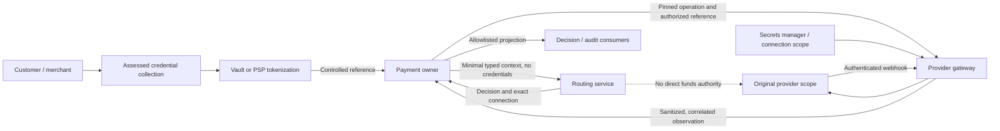
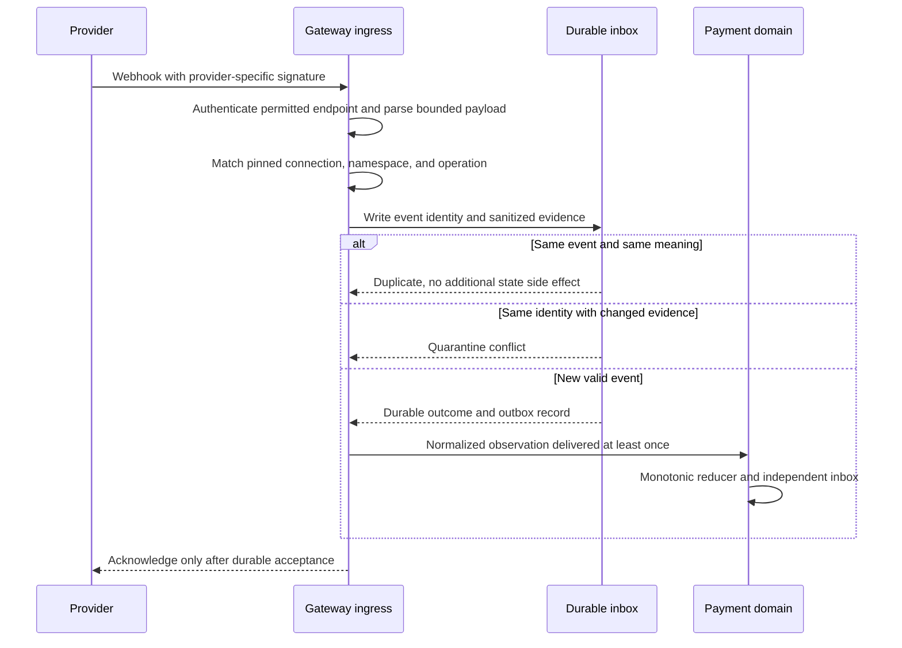

# Appendix B: Security, Compliance, and Data Boundaries

[中文](../../appendices/security-compliance.md) | **English**

A production investigation can easily move from “Why did this payment fail?” to “Print the entire request.” The request is copied into logs, the logs enter a search platform, and an incident ticket copies the payload into a group chat. Data that should have existed briefly within a credential boundary acquires a wider audience and a longer lifetime than the payment itself. Adding TLS or splitting the application into microservices does not revoke those copies.

The central argument of this appendix is that security begins by limiting the spread of data and authority, then protecting the data that is permitted to exist. It connects the [service boundaries in Chapter 3](../part-1-foundations/routing-system-boundaries.md), [context in Chapter 4](../part-2-routing-engine/routing-context.md), [decision records in Chapter 14](../part-4-operating-at-scale/routing-decision-store.md), and [configuration governance in Chapter 20](../part-5-global-routing/configuration-platform.md) into a cross-cutting review method. It does not introduce another fraud engine or replace security assessment, contract review, and legal advice for the target market.

## B.1 Distinguish Our Storage Policy from a Universal Prohibition

PAN is cardholder data, or CHD. CVV/CVC/CID, full track data, and PIN/PIN blocks are sensitive authentication data, or SAD. These categories must not be conflated. In the merchant-acquiring routing scenario discussed here, SAD must not be stored after authorization, even when encrypted. PAN is subject to different storage-protection and business-necessity requirements. This project adopts a narrower architectural policy: neither raw PAN nor SAD enters the platform database, routing service, decisions, logs, or messages. Credential collection is delegated to an assessed hosted component or vault. [PCI SSC: Card Verification Codes and Post-Authorization Storage](https://www.pcisecuritystandards.org/faqs/are-merchants-allowed-to-request-card-verification-codes-values-from-cardholders/)

Token is not a uniform security classification. Provider vault tokens, platform-controlled references, and network payment tokens can differ in reversibility, purpose, and domain restrictions. A service that cannot read PAN directly but can freely call a detokenization API cannot therefore declare itself outside the cardholder data environment. EMVCo payment tokens have specific definitions and domain controls. PCI SSC distinguishes the token itself from an environment that also handles account data or connects to relevant systems. This must not be generalized into a claim that every field called a token is exempt from PCI scope. [PCI SSC: Scope of EMVCo Payment Tokens](https://www.pcisecuritystandards.org/faqs/1326/)

PCI DSS provides a baseline of technical and operational controls. Assessment also covers components that can affect the security of the cardholder data environment, or CDE. Actual responsibilities depend on the integration method, network segmentation, provider responsibility matrix, and assessment scope. This book makes no claim of PCI certification and supplies no SAQ conclusion applicable to every merchant. [PCI SSC: PCI DSS Applicability and Assessment](https://www.pcisecuritystandards.org/standards/pci-dss/)

| Data category | Appropriate owner | Persistence boundary in this project | Routing service / general observability platform |
| --- | --- | --- | --- |
| Raw PAN and SAD | Assessed payment-credential collection boundary | Platform neither receives nor persists them; debugging does not justify retaining SAD | Prohibited |
| Controlled payment-method reference | Payment service; authorized gateway during execution | Protected by purpose, access controls, and retention policy | Send only necessary derived attributes, not the token |
| Provider API credentials / webhook secrets | Gateway for the designated connection or a secrets service | Secret storage; never business events or configuration digests | Prohibited |
| Amount, currency, necessary country / network attributes | Payment and routing services | Versioned, minimized fields | Necessary fields allowed; do not attach the original request |
| Provider references and internal payment IDs | State owner, reconciliation, and controlled audit | Retained for funds correlation with auditable access | Nonpublic identifiers; not high-cardinality metric labels |
| Customer contact details, device data, and raw risk features | Respective business or risk owner | Isolated by purpose | Do not copy by default; use a minimal risk decision |
| Configuration / model / policy digests | Control plane, routing service, and audit | Version evidence may be retained | Digests must not embed secrets or raw training samples |

Allowed does not mean every service should retain a copy. For each new field, record its business purpose, authoritative source, permitted recipients, storage location, retention period, deletion path, and approver. Without these answers, the default is to exclude the field from cross-service contracts.

## B.2 Draw Trust Boundaries Along the Request Path



This is a target trust model, not evidence that a vault, secrets manager, or network segmentation is already deployed. Every arrow needs a caller identity, resource scope, and data contract. A merchant API key establishes identity only at the merchant entry point and must not be forwarded to the routing service. Authority to return candidates does not confer gateway execution authority. A gateway's ability to query a provider account does not authorize binding that account's events to another merchant.

Sharing a VPC, Kubernetes namespace, or machine is not an identity credential. NIST's zero-trust model explicitly rejects implicit trust based solely on physical or network location. That principle is what this design adopts; it does not require deploying an entire service mesh for every example. [NIST SP 800-207](https://csrc.nist.gov/pubs/sp/800/207/final)

A production design should assign separate service identities to payment, routing, gateway, configuration, and settlement services. Authorization must establish who can perform which operation for which merchant and connection, rather than merely whether a caller possesses a shared internal token. The same applies to databases: migration and runtime roles are separate, runtime roles cannot execute DDL, and the routing service has no access to payment tables. A read-only audit identity must not automatically gain access to every token column. The shared development account in the current Compose setup is not a production permissions model.

## B.3 API Contracts Should Reject Excess Capability, Not Merely Ignore Fields

Using `map[string]any` for context is convenient and makes it easy for security boundaries to erode. A single `debug_payload` field can bypass seven carefully designed safe attributes. A decoder that ignores unknown fields may also lead callers to believe that supplied overrides, tokens, or rules were accepted.

Entry points should therefore constrain content type, total byte size, nesting depth, field set, types, version, and business values together. Reject duplicate keys, unexpected case variants, and a second trailing JSON value. Rejections return stable error codes without echoing the raw body or offending values. Traditional Go `encoding/json` decoding permits duplicate object names and may match struct fields case-insensitively. `DisallowUnknownFields` does not enable every required check. [Go: encoding/json Behavior](https://pkg.go.dev/encoding/json)

The deliberately small audit projection below demonstrates a positive allowlist. It is not the complete context schema from Chapter 4. It accepts only exact field names, one nested execution object, and short strings. There is no free-form extension field. Duplicate keys, arrays, nulls, and all unknown keys are rejected. Because the permitted shape is fixed, malicious nesting cannot trigger unbounded recursion.

```go
package auditboundary

import (
	"bytes"
	"encoding/json"
	"errors"
	"io"
	"unicode/utf8"
)

var ErrBoundary = errors.New("audit projection violates its schema")

type shape map[string]shape

func ValidateAuditJSON(raw []byte) error {
	if len(raw) == 0 || len(raw) > 4096 || !utf8.Valid(raw) {
		return ErrBoundary
	}
	schema := shape{
		"decision_id": nil, "payment_intent_id": nil,
		"policy_version": nil, "outcome": nil,
		"execution": {
			"connection_id": nil, "revision": nil,
			"namespace_id": nil, "provider": nil,
		},
	}
	d := json.NewDecoder(bytes.NewReader(raw))
	if err := object(d, schema); err != nil {
		return ErrBoundary
	}
	if _, err := d.Token(); !errors.Is(err, io.EOF) {
		return ErrBoundary
	}
	return nil
}

func object(d *json.Decoder, schema shape) error {
	start, err := d.Token()
	if err != nil || start != json.Delim('{') {
		return ErrBoundary
	}
	seen := make(map[string]bool, len(schema))
	for d.More() {
		token, err := d.Token()
		key, isString := token.(string)
		if err != nil || !isString || seen[key] {
			return ErrBoundary
		}
		child, allowed := schema[key]
		if !allowed {
			return ErrBoundary
		}
		seen[key] = true
		if child != nil {
			if err := object(d, child); err != nil {
				return ErrBoundary
			}
			continue
		}
		value, err := d.Token()
		text, isString := value.(string)
		if err != nil || !isString || len(text) == 0 || len(text) > 128 {
			return ErrBoundary
		}
	}
	end, err := d.Token()
	if err != nil || end != json.Delim('}') || len(seen) != len(schema) {
		return ErrBoundary
	}
	return nil
}
```

By rejecting additional fields, it rejects root-level PAN, nested CVV, and case-modified secret fields without relying on an inevitably incomplete blacklist. The counterexample tests below also verify that error text does not echo the synthetic test marker.

```go
package auditboundary

import (
	"strings"
	"testing"
)

func TestAuditBoundary(t *testing.T) {
	const valid = `{"decision_id":"dec_1","payment_intent_id":"pi_1",` +
		`"policy_version":"policy_1","outcome":"captured","execution":{` +
		`"connection_id":"conn_a","revision":"rev_1",` +
		`"namespace_id":"ns_a","provider":"provider_a"}}`
	if err := ValidateAuditJSON([]byte(valid)); err != nil {
		t.Fatal(err)
	}
	cases := map[string]string{
		"root credential": strings.Replace(valid, `"decision_id":`, `"PAN":"test_secret","decision_id":`, 1),
		"nested secret":   strings.Replace(valid, `"revision":`, `"CVV":"test_secret","revision":`, 1),
		"duplicate":       strings.Replace(valid, `"outcome":`, `"outcome":"failed","outcome":`, 1),
		"case variant":    strings.Replace(valid, `"decision_id":`, `"Decision_ID":`, 1),
		"trailing value":  valid + `{}`,
		"array injection": strings.Replace(valid, `"rev_1"`, `["rev_1"]`, 1),
		"null value":      strings.Replace(valid, `"rev_1"`, `null`, 1),
		"oversized":       strings.Repeat(" ", 4097),
		"invalid UTF-8":   valid + string([]byte{0xff}),
	}
	for name, raw := range cases {
		t.Run(name, func(t *testing.T) {
			err := ValidateAuditJSON([]byte(raw))
			if err == nil || strings.Contains(err.Error(), "test_secret") {
				t.Fatalf("unsafe acceptance or error response: %v", err)
			}
		})
	}
}
```

This is still not general data loss prevention, or DLP. If a developer places a token in an otherwise valid `decision_id` value, the schema cannot know its true meaning. Production code must construct typed projections from authoritative objects, validate the business semantics of identifiers and outcomes, and prohibit original requests, dynamic maps, and arbitrary error objects from entering logs directly. Positive contracts define which slots may exist; provenance and access controls determine who can place what in them. Error paths, trace baggage, dead-letter queues, backups, and crash dumps must undergo the same review.

## B.4 Webhooks: Authentication, Correlation, and Deduplication Are Distinct

A valid signature proves only that a message meets a particular key's authentication contract. It does not establish that the message belongs to the current operation or is being seen for the first time. Processing should be explicitly layered: identify permitted authentication material from the endpoint and connection; verify the raw or specifically canonicalized content required by the provider; validate account, object, and operation correlation; deduplicate or quarantine in a durable inbox; then commit the domain outcome.

Stripe requires signature verification over the unmodified raw body. Adyen standard webhooks construct signed content from specified fields, while some other webhook types verify the raw body. A universal algorithm that reserializes JSON before applying HMAC to every PSP is invalid. [Stripe: Signature Troubleshooting](https://docs.stripe.com/webhooks/signature), [Adyen: HMAC Verification](https://docs.adyen.com/development-resources/webhooks/secure-webhooks/verify-hmac-signatures/)



New events and repeated deliveries must also be distinguished. Durable event-ID deduplication prevents repeated effects. A signature time window limits malicious replay of captured messages. Neither replaces the other. Stripe includes the signature timestamp in signed content and generates a new timestamp for each redelivery. Delivery freshness should be checked according to that contract, rather than using the event occurrence time as a reason to reject it forever after a fixed five-minute interval. [Stripe: Replay Protection](https://docs.stripe.com/webhooks#preventing-replay-attacks)

The current gateway simulator protocol uses HMAC-SHA256 over the raw body plus durable event deduplication. It lacks a real PSP's timestamp and signature-version protocol and therefore does not establish complete replay protection. It already separates connection authentication authority from the namespace collision domain: another connection in the same namespace does not automatically gain write authority, and cross-path association requires an explicitly authorized recovery alias. See the companion implementation's [immutable provider connection architecture decision](https://github.com/YouEclipse/payments/blob/bc4afde24da708d22f67da72a90a1557b1477173/docs/adr/0002-immutable-provider-connections.md).

## B.5 Key Rotation Must Not Change an Existing Operation's Execution Meaning

Moving secrets to environment variables keeps them out of source code; it does not complete key management. Production designs should use an auditable secrets manager, KMS, or appropriate hardware boundary, with explicit responsibilities for generation, distribution, use, rotation, revocation, recovery, and destruction. Applications receive only necessary usage permissions. Control-plane and audit records retain credential-version references rather than plaintext copies. [NIST SP 800-57 Part 1](https://csrc.nist.gov/pubs/sp/800/57/pt1/r5/final)

Rotation must distinguish at least two concerns: authentication material for verifying old webhooks and execution authority for recovering operations on the original provider account. A secret still valid for late-event verification does not necessarily authorize new transactions. A newly activated secret does not authorize moving an old unknown operation to another account. Each change needs an activation window, a rollback version, an inventory of in-flight operations, and revocation evidence.

The validated baseline's connection registry deliberately rejects changes to endpoints, namespaces, or webhook-secret digests under the same ID and revision. Each connection ID currently resolves to only one revision. Changes therefore use a new ID and revision while preserving old mappings for in-flight recovery. An overlapping rotation protocol with multiple signature keys on the same endpoint is not yet implemented. Adyen requires accounting for propagation time and temporarily accepting the previous HMAC key during rotation. A real adapter must implement that overlap explicitly, not disable registry checks to work around it. [Adyen: HMAC Key Rotation](https://docs.adyen.com/development-resources/webhooks/secure-webhooks/verify-hmac-signatures/#changing-your-hmac-key)

The configuration platform is also a security boundary. Permission to publish a route to an attacker's endpoint may be more dangerous than access to a log entry. Authors, approvers, and publishers should have separate duties. Artifacts require versions and digests, complete validation, and atomic activation. Runtime instances must reject rules or endpoints injected into individual requests. Emergency break-glass access requires short-lived permissions, a specific reason, approval or subsequent review, and an audit record. It must not provide unconditional authority to turn an unknown outcome into failure with one click.

## B.6 Design Retention, Deletion, and Cross-Region Processing into the Schema

Append-only means facts cannot be arbitrarily rewritten; it does not mean every piece of personal data should be retained forever. Evidence records in [Chapter 14](../part-4-operating-at-scale/routing-decision-store.md) should prefer version and digest references while separating sensitive mappings that need only short retention. Deletion, anonymization, and processing restrictions require verifiable procedures, not a verbal promise that logs will disappear after a few days.

For example, where GDPR applies, deletion requests have conditions that require assessment, as well as retention exceptions for legal obligations or legal claims. Reconciliation convenience does not justify blanket refusal to delete, and a request does not justify deleting funds facts that must legally be retained. Compliance and legal owners determine purpose and legal basis; engineering then implements the corresponding data categories, retention policies, and access restrictions. [European Commission: Handling Individual Rights Requests](https://commission.europa.eu/law/law-topic/data-protection/information-business-and-organisations/dealing-requests-individuals_en)

At minimum, engineering should maintain an inventory of data destinations: online tables, read replicas, analytical warehouses, object storage, logs, traces, dead-letter queues, exports, and backups. Backup retention, reapplying deletion markers after restoration, and the precedence of legal holds over normal TTLs must be explicit. Hashing does not inherently anonymize data. Low-entropy values can be enumerated, and joins with other tables may recover identity, so storing only a digest does not automatically end privacy assessment.

Multi-region data residency is likewise more than a Boolean condition such as `country=DE`. Distinguish transaction-processing location, durable-storage location, support personnel's access locations, and cross-region analytical purposes. The routing service consumes approved eligibility scopes and versions rather than interpreting all legislation itself. Uncertain authorization scopes must be rejected. A business desire to continue collecting during a regional outage does not implicitly authorize copying credentials or sensitive evidence into an unapproved region. Disaster-recovery authority in [Chapter 19](../part-5-global-routing/multi-region.md) must include this gate.

## B.7 Turn Threats into Tests That Can Fail

| Threat | Required rejection or isolation | Evidence |
| --- | --- | --- |
| PAN, CVV, or secrets injected into root, nested, or case-variant fields | Reject the request; do not echo values in errors or logs | HTTP / contract tests, captured logs, and fixture scanning |
| Same event ID with altered state or association | Persistently quarantine the inbox conflict without overwriting funds facts | Database tests on both gateway and payment-service sides |
| A valid signature for A used to update B's operation | Reject unauthorized association, even in the same namespace | Positive and negative cases for connections and aliases |
| Endpoint or key rebound under the same revision | Fail startup or readiness; do not continue the original unknown operation | Registry restart and drift tests |
| Routing identity attempts execution or reads payment tables | Reject through authorization and database permissions | Negative tests using actual deployment identities and roles |
| Production configuration uses a simulator or development credentials | Fail startup or launch gates | Environment matrix and actual startup results |
| Debug logs, crashes, traces, or dead letters leak controlled references | Fail when a test detects leakage | Synthetic sensitive markers, never real card data |
| Revocation, backup restoration, or regional failover bypasses boundaries | Reject unauthorized use; recover in-flight work under its original contract | Drill records and correlated audit IDs |

Do not merely search source code for `cvv`. Leaks can come from `%+v` printing an entire struct, HTTP middleware recording headers, SDKs tracing bodies automatically, or exceptions logging URL query parameters. Tests should carry synthetic markers through success, rejection, timeout, parsing failure, and crash recovery, then inspect every output surface. Sensitive values must not become metric labels. Even ordinary payment IDs create cardinality and correlation risks; use the bounded dimensions described in [Chapter 15](../part-4-operating-at-scale/observability.md).

## B.8 Current Implementation and Remaining Launch Work

The pinned baseline already provides merchant identity binding; internal token checks for payment, routing, and gateway services; strict, bounded JSON; simulator environment restrictions; exact connection correlation; HMAC webhooks; durable inboxes and quarantine; an immutable revision registry; and a provider observation ledger that prohibits `UPDATE`, `DELETE`, and `TRUNCATE`. These boundaries correspond to the [pinned code version](https://github.com/YouEclipse/payments/commit/bc4afde24da708d22f67da72a90a1557b1477173) and its [CI record](https://github.com/YouEclipse/payments/actions/runs/33041147119). The routing service's shared-token middleware protects every path except `/livez`, `/readyz`, and `/metrics`. It checks `X-Internal-Token`, uses constant-time comparison for equal-length values, and returns 401 for missing or incorrect tokens. Development permits a local default; other environments refuse to start without explicit configuration. The entry point is `services/router/cmd/server/main.go`.

It remains a local and test payment core. Shared-token authentication does not establish mTLS, separate service principals, or fine-grained resource authorization. Compose uses a shared development database account. End-to-end log redaction, a secrets manager or KMS, separate production database roles, real PSP timestamp and replay protection, overlapping key rotation, retention and deletion executors, and compliance assessment cannot be inferred from passing CI. The Go allowlist above is a runnable appendix reference, not proof that it is attached to every production output boundary. The manuscript and implementation repositories are currently private; evidence links require an authorized GitHub identity. This is an access boundary, not a reason to change repository visibility.

These gaps belong in [Appendix C's launch gates](capacity-planning-and-launch-checklist.md), with named owners providing deployment evidence. Security boundaries are not disclaimers appended to documentation. The boundaries in a diagram have operational meaning only when the system actually rejects incorrect identities, fields, and configurations.
