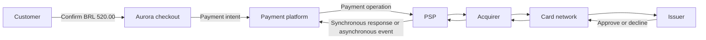
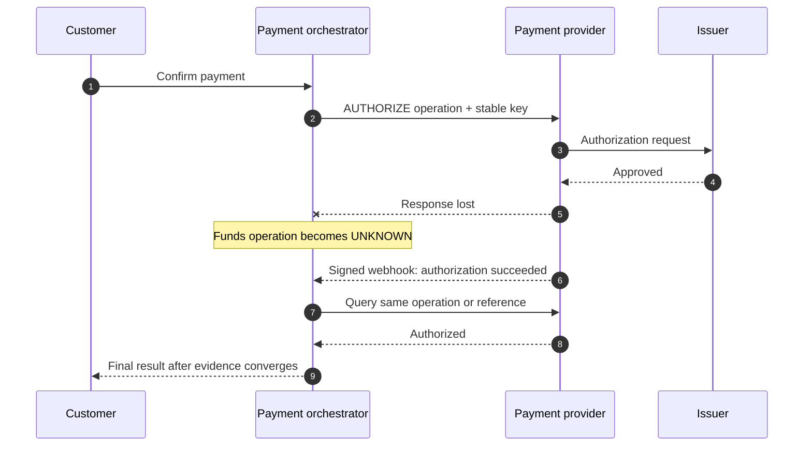
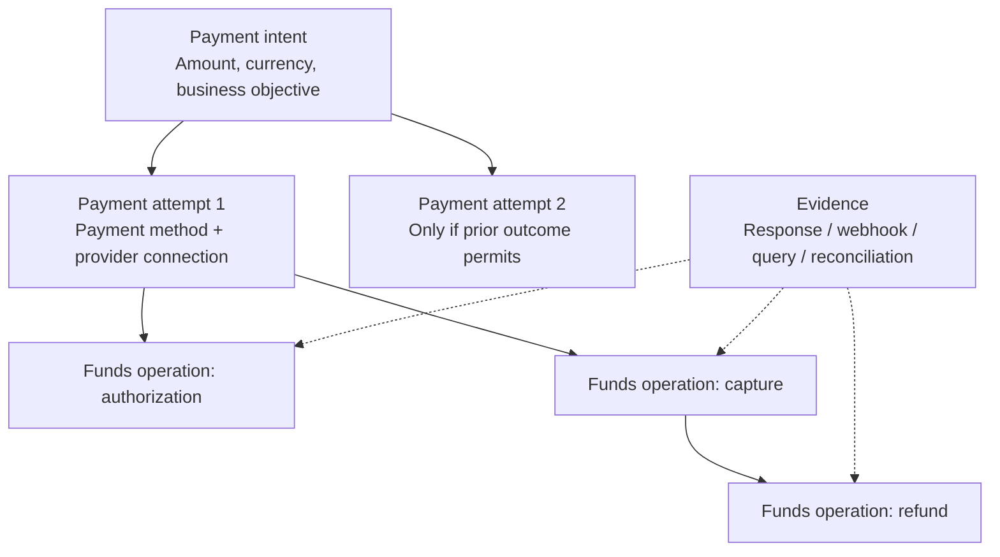
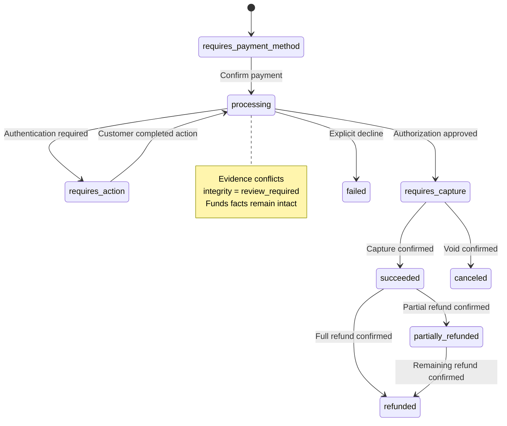

# Chapter 1: The Lifecycle of a Payment

[中文](../../part-1-foundations/payment-lifecycle.md) | **English**

When a customer clicks Pay, the page presents a single button. The payment system faces something much longer than an instant: a lifecycle that can last seconds, days, or even months.

A card payment first asks whether the issuer approves, then whether the merchant actually intends to collect the money. Clearing, settlement, refunds, and possible chargebacks follow. API responses, order fulfillment, cardholder balances, and merchant receipts run on different clocks. Collapsing them into `paid = true` is convenient in a demo, but in production it invites overselling, duplicate charges, incorrect refunds, and unreconcilable records.

The chapter's central argument is that **a payment is not an HTTP call; it is an auditable lifecycle built from a business intent, execution attempts, funds operations, and external evidence.** We begin with the simplest synchronous collection flow, examine why it fails, and derive the objects and invariants used throughout the book. Provider selection comes later. Whether there is one PSP or many routes, funds facts must first be represented correctly.

## 1.1 The Problem: What Does Success Mean to the Customer?

Suppose the online ticketing platform Aurora sells a concert ticket for BRL 520.00. After the customer submits a card token, Aurora sends the request to a PSP. The PSP may provide acquiring itself or forward the request to a partner acquirer. Through the card network, the acquirer reaches the issuer, which approves or declines authorization based on account status, available funds or credit, authentication, and risk.



Commercial labels often overlap along this chain. One PSP may act as gateway, processor, and acquirer, while another aggregates external acquirers. System boundaries should follow which facts each participant owns and which side effects it executes, not the terminology on a marketing page.

| Participant | Responsibility relevant here | What its response alone cannot prove |
| --- | --- | --- |
| Customer | Provide a payment method and complete required authentication | Completing a click does not establish authorization approval |
| Merchant | Create orders and decide fulfillment, cancellation, or refunds | Canceling an order does not establish that funds were released or returned |
| Payment platform | Own the payment lifecycle, call providers, receive asynchronous evidence | A successful local write does not establish external funds success |
| PSP / processor / acquirer | Accept and process operations and connect acquiring and network paths | Request accepted may not be a final funds outcome |
| Card network | Carry authorization and clearing information between acquirer and issuer | Successful transport does not establish issuer approval |
| Issuer | Approve or decline authorization and maintain cardholder-side account facts | Approval normally reserves funds or credit; it does not establish merchant settlement |

Visa's developer documentation distinguishes authorization, capture, clearing, and settlement: authorization requests approval, while subsequent capture initiates clearing and settlement for an approved transaction. This primary API model illustrates domain boundaries, but does not imply that every provider uses identical endpoints or state names. Actual capabilities follow the specific contract and interface. [VisaNet Connect — Acceptance](https://developer.visa.com/capabilities/visanet-connect-acceptance/docs-getting-started)

Payment success therefore needs an object and a phase. All of the following may be true simultaneously:

- The issuer approved authorization;
- The merchant has not shipped and has not captured;
- The customer's available credit has decreased;
- The merchant's balance available for settlement has not increased;
- Aurora's order is still awaiting inventory confirmation.

An API returning only `success` leaves the caller unable to distinguish request receipt, authorization approval, capture, settlement, or merely the start of processing. The system's first responsibility is to preserve these different facts rather than give every participant the same Boolean.


*Figure: One success receipt contains distinct facts: funds or credit reserved, funds collected, and clearing or settlement recorded. These phases do not become true at the same time.*

## 1.2 The Simple Design: One Synchronous Collection

At launch, Aurora sells only digital tickets, issues them immediately after payment, and integrates one PSP. The team can use automatic capture: one external request expresses that approval should be followed immediately by capture. This book calls that composite business operation `SALE`. It is a common platform meaning, not an assumption that every provider exposes a `/sale` API.

A minimal Go interface might look like this:

```go
package lifecycle

import "context"

type Money struct {
	AmountMinor int64
	Currency    string
}

type SaleCommand struct {
	PaymentID          string
	PaymentMethodToken string
	Money              Money
	ProviderKey        string
}

type SaleResult struct {
	ProviderReference string
	Authorized        bool
	CaptureSubmitted  bool
}

type Gateway interface {
	Sale(context.Context, SaleCommand) (SaleResult, error)
}
```

Several aspects are worth retaining: amounts use minor currency units, currency is explicit, the platform receives a token rather than putting PAN or CVV into domain objects, and `Authorized` is separate from `CaptureSubmitted`. For immediate delivery, full collection, and one provider, this interface can support the first vertical flow.

Automatic capture places two business instructions close together; it does not make the funds lifecycle atomic. Authorization can succeed and capture subsequently fail. A provider may accept capture before reporting the result through a webhook. Clearing and settlement still follow later. Adyen's documentation similarly explains that automatic capture normally follows authorization immediately, whereas manual capture requires a separate request and returns results asynchronously. [Adyen: Capture](https://docs.adyen.com/online-payments/capture)

A simple implementation will often handle network errors as follows:

```go
result, err := gateway.Sale(ctx, command)
if err != nil {
	return markPaymentFailed(command.PaymentID)
}
return markPaymentPaid(command.PaymentID, result.ProviderReference)
```

This is the dangerous starting point. `err != nil` establishes only that the caller received no usable response, not that the PSP never received the request. Nor does `CaptureSubmitted` establish completed settlement. After a single lost response, the pair of states `failed / paid` is already insufficient.

## 1.3 Problems at Scale: One State Starts Telling Four Different Lies

### 1.3.1 Fulfillment and Collection Happen at Different Times

Aurora begins selling physical tickets and travel packages. The merchant wants to collect only after inventory confirmation or supplier acceptance. It needs manual capture: first `AUTHORIZE`, then `CAPTURE` when fulfillment conditions are met. If fulfillment is impossible, it uses `VOID` or cancels the uncaptured authorization within the permitted window.

| Mode | First funds operation | Subsequent operations | Suitable businesses | Main cost |
| --- | --- | --- | --- | --- |
| Automatic capture / `SALE` | Request capture immediately after authorization | Possible queries or refunds after failure | Digital goods and immediate delivery | Simple, but allows little time for fulfillment checks |
| Manual capture | `AUTHORIZE` | `CAPTURE` or `VOID` | Hotels, rentals, collection after shipment | Manage authorization windows, capturable amounts, and asynchronous results |

Only some payment methods support separating authorization and capture. Authorization windows, partial capture, multiple capture, and related rules can differ by method, network, region, and provider. Stripe represents manual capture as `capture_method=manual` and requires capture before the specific authorization expires. An implementation must not hard-code one provider's number of days as a global rule. [Stripe: Separate Authorization and Capture](https://docs.stripe.com/payments/place-a-hold-on-a-payment-method)

Manual capture forces us to acknowledge that `authorized` is not `paid`. An order service can associate inventory reservation with authorization, but its fulfillment policy must explicitly require authorization, accepted capture, or some later degree of funds certainty. Conversely, canceling an order is more than assigning `payment.status = canceled`:

- Before a provider operation is sent, business cancellation can block execution;
- After authorization but before capture, void or reverse the original transaction;
- After capture, a refund is generally needed rather than rewriting history as never paid;
- While the original operation is `UNKNOWN`, cancellation records pending compensation; it cannot prove that no external charge occurred.

### 1.3.2 The Synchronous Response Is No Longer the Only Evidence

3-D Secure may require the customer to leave the current request to complete a challenge. Some wallets and bank transfers have longer asynchronous processing. Even ordinary card payments can acquire additional or corrected information through webhooks, active queries, and subsequent reports.



The timeout occurs after issuer approval and failure to deliver the provider response. Marking it `failed` and creating another collection can produce two funds paths. The correct classification is `UNKNOWN`. Until evidence converges, the system can neither promise failure to the customer nor safely assume that it may execute a new operation.

Webhooks are not database replication streams. Providers can redeliver an event, networks can reorder arrivals, and a consumer can crash after writing the database but before acknowledging the message. The receiver should verify the source, durably record an inbox entry, acknowledge promptly, and then process idempotently. Adyen's handling guide likewise calls for verification, storage before successful acknowledgment, and business processing afterward, while warning about duplicate delivery. [Adyen: Handle Webhook Events](https://docs.adyen.com/development-resources/webhooks/handle-webhook-events)

### 1.3.3 One ID Cannot Explain Retries and Refunds

Early systems often reuse `order_id` as payment ID, idempotency key, and provider reference. This fails as soon as a customer changes payment method after failure or a payment has a partial refund. A production system needs at least these distinct identities:

| Identifier | Object identified | Typical scope | Interchangeability |
| --- | --- | --- | --- |
| Merchant idempotency key | One logical merchant API operation | Merchant + key here; operation name and payload participate in conflict validation | Does not replace payment ID or permit reusing the key on another endpoint |
| `payment_id` | A business intent to collect an amount and currency | Platform-wide | Not an order ID or provider transaction number |
| `attempt_id` | One controlled attempt with a payment method and exact connection | One payment | Must not be arbitrarily added during `UNKNOWN` |
| `operation_id` | One AUTHORIZE, CAPTURE, VOID, REFUND, or SALE funds action | One attempt / original transaction chain | Network retries reuse the same operation |
| Provider idempotency key | Deduplication of an operation within a provider contract | Provider-declared account, region, and retention period | No global cross-PSP deduplication |
| Provider transaction reference | A provider-created transaction or modification | Original provider connection | Capture, void, refund, and query must correlate to it |
| Provider event ID | Identity carried by an asynchronous delivery | Provider webhook contract | Deduplicates events; does not identify the payment itself |

These distinctions are operational, not naming preferences. After response loss, the platform may have a provider idempotency key but no provider transaction reference. A later webhook may associate them. Subsequent capture, void, and refund operations bind to the originally approved connection and reference; they must not select another PSP. For example, Adyen's referenced refund request carries the original `paymentPspReference` in its path, while the refund receives a separate reference and may complete asynchronously. [Adyen: Refund](https://docs.adyen.com/online-payments/refund/)

### 1.3.4 Cancellation and Refunds Are Not Erasers

Suppose BRL 520.00 has been captured and is later refunded in full after the concert is canceled. Retaining only `status = refunded` leaves an auditor unable to determine how much was captured, whether refunds occurred in installments, whether settlement completed, or which fees were charged. It also fails to explain why the customer saw a debit followed by a return.

Funds facts should be appended rather than overwritten:

```text
Authorization approved: BRL 520.00
Capture succeeded: BRL 520.00
Refund requested: BRL 520.00
Refund succeeded: BRL 520.00
```

The business view can show fully refunded while underlying history still proves that capture occurred. A chargeback is not another name for a normal refund. It is a distinct funds and liability fact arising from a dispute, potentially weeks or months later. A lifecycle does not delete earlier nodes after moving from left to right; it continually incorporates new evidence and produces new projections.

## 1.4 Production Design: Separate Intent, Attempt, Operation, and Evidence

An evolvable minimal model has four layers. They can initially live in one service and database. The separation concerns ownership and invariants, not an immediate requirement for four microservices.



**Payment Intent** represents the merchant's objective to collect a fixed amount and currency from a customer. A material amount or currency change should create a new intent or follow an explicit change protocol, not silently rewrite an executing payment.

**Payment Attempt** represents one controlled execution of that intent using a payment method and an exact provider connection. It pins the execution path and credential-usability boundary. A network retry is not inherently another attempt. In particular, creating an attempt while the preceding operation is `UNKNOWN` introduces another potential funds path.

**Provider Operation** represents one logical action that can produce a funds side effect, such as `SALE`, `AUTHORIZE`, `CAPTURE`, `VOID`, or `REFUND`. Transport retries of that operation reuse the original provider, merchant account, region, idempotency key, and semantic payload. `QUERY` can be recorded as a recovery action, but it reads facts and must not acquire a new funds identity.

**Evidence** comprises the sources used to determine an operation's outcome: synchronous responses, verified webhooks, status queries, and reconciliation. Record the source, external identity, receipt time, and a digest of the original result. A projection may change, but evidence must not be deleted merely because another message looks newer.

### 1.4.1 Do Not Put Every Dimension into One Giant State Machine

Payments have at least four dimensions: business progress, funds operations, external processing, and settlement. Combining them into one enum such as `authorized_but_capture_pending_and_order_canceled` causes a combinatorial explosion. Preserve facts and project them for different consumers:

| Dimension | Example state or fact | Primary consumers |
| --- | --- | --- |
| Intent business state | `requires_action`, `processing`, `requires_capture`, `succeeded`, `failed`, `canceled` | Checkout, orders, customer support |
| Integrity state | `healthy`, `review_required`; independent of business state | Automatic recovery, operations review, audit |
| Operation outcome | `pending`, `succeeded`, `failed`, `unknown` | Orchestration, recovery jobs |
| Funds totals | Authorized, captured, voided, and refunded amounts | Fulfillment, refunds, ledger / finance interfaces |
| Settlement evidence | Submitted for clearing, settled, observed fees, matched payouts | Finance, reconciliation |

The product contract must define an intent's `succeeded`. For automatic-capture card payments, it may mean the platform has enough evidence to confirm collection, but not that clearing, settlement, and the merchant's bank receipt have all completed. In manual capture, successful authorization is better projected as `requires_capture`. Asynchronous methods may remain `processing` for a long time. Stripe's PaymentIntent lifecycle uses states such as `requires_action`, `processing`, and `requires_capture` to express these distinctions. This book adopts the phased approach rather than copying a provider's enum. [Stripe: PaymentIntent Lifecycle](https://docs.stripe.com/payments/paymentintents/lifecycle)

### 1.4.2 Evidence Converges Monotonically; Last Write Does Not Win

The following Go example illustrates a narrow but critical rule: repeated events do not apply repeatedly, and conflicting success and failure evidence is retained with `review_required` rather than resolved by letting the latest timestamp overwrite everything before it.

```go
package lifecycle

type OperationState string

const (
	OperationPending   OperationState = "pending"
	OperationUnknown   OperationState = "unknown"
	OperationSucceeded OperationState = "succeeded"
	OperationFailed    OperationState = "failed"
)

type Operation struct {
	ID                   string
	AttemptID            string
	Kind                 string
	AmountMinor          int64
	ProviderConnectionID string
	ProviderKey          string
	OriginalProviderRef  string
	DispatchState        OperationState
}

type Evidence struct {
	EventID              string
	OperationID          string
	Outcome              OperationState
	AmountMinor          int64
	OriginalProviderRef  string
	ProviderOperationRef string
}

type OperationProjection struct {
	Succeeded            bool
	Failed               bool
	Unknown              bool
	ReviewRequired       bool
	ProviderOperationRef string
	EvidenceIDs          []string
}

func ProjectOperation(op Operation, facts []Evidence) OperationProjection {
	projection := OperationProjection{
		Unknown: op.DispatchState == OperationUnknown,
	}
	seen := make(map[string]Evidence, len(facts))

	for _, fact := range facts {
		if fact.OperationID != op.ID {
			continue
		}
		if fact.EventID == "" {
			projection.ReviewRequired = true
			continue
		}
		if previous, duplicate := seen[fact.EventID]; duplicate {
			if previous != fact {
				projection.ReviewRequired = true
			}
			continue
		}
		seen[fact.EventID] = fact
		projection.EvidenceIDs = append(projection.EvidenceIDs, fact.EventID)

		if fact.AmountMinor != op.AmountMinor {
			projection.ReviewRequired = true
		}
		if op.OriginalProviderRef != "" &&
			fact.OriginalProviderRef != "" &&
			fact.OriginalProviderRef != op.OriginalProviderRef {
			projection.ReviewRequired = true
		}
		if fact.ProviderOperationRef != "" {
			if projection.ProviderOperationRef == "" {
				projection.ProviderOperationRef = fact.ProviderOperationRef
			} else if projection.ProviderOperationRef != fact.ProviderOperationRef {
				projection.ReviewRequired = true
			}
		}

		switch fact.Outcome {
		case OperationSucceeded:
			projection.Succeeded = true
			projection.Unknown = false
		case OperationFailed:
			projection.Failed = true
			projection.Unknown = false
		case OperationUnknown:
			if !projection.Succeeded && !projection.Failed {
				projection.Unknown = true
			}
		}
	}

	if projection.Succeeded && projection.Failed {
		projection.ReviewRequired = true
	}
	return projection
}
```

A real implementation also needs database uniqueness, optimistic concurrency versions, transactional inboxes and outboxes, and cross-operation invariants such as total refunds not exceeding captured funds. A repeated ID is a replay only when its content agrees. The example raises review for conflicting content; production also retains a compliant digest of the conflicting original content and quarantines it rather than storing only the first result. The point is the direction of evidence merging: `UNKNOWN → succeeded` converges after definite evidence, whereas `succeeded + failed` is an anomaly, not a choice between two values. `review_required` is not a funds state. It indicates that automatic projection cannot safely decide without losing facts and requires provider queries, report checks, or manual handling.

### 1.4.3 A Normal Manual-Capture Path



This is a projection for business consumers, not the only underlying truth. `canceled` retains earlier authorization and void facts. `refunded` retains capture and every refund. Settlement and chargebacks have their own fact streams; they cannot be forced into one final terminal node on this diagram.

A production path must preserve three bindings:

1. Capture and void bind to the original authorization's provider connection and transaction reference.
2. Refunds bind to the provider connection that performed capture and the original payment reference.
3. Recovery retries of the same logical operation bind to the original provider key and identical semantic payload.

These relationships prevent a later routing system from independently optimizing the destination of capture, void, or refund operations. Routing may select a candidate for a new, unexecuted attempt. An existing funds chain must be recovered and compensated through its original connection.

### 1.4.4 Data Boundaries Begin in Chapter 1

Lifecycle records persist for long periods and are copied into event and analytical systems, so they must not contain unnecessary raw card data. Prefer controlled collection components that exchange credentials for tokens. Domain services see only token references and necessary derived attributes. Tokenization reduces sensitive-data propagation but does not automatically place every related system outside PCI DSS scope.

In particular, sensitive authentication data such as CVV/CVC/CID must not enter payments, attempts, operations, logs, traces, messages, or decision records. PCI SSC's FAQ states that card verification codes cannot be stored after authorization, even when encrypted. [PCI SSC FAQ 1280](https://www.pcisecuritystandards.org/faqs/1280/) This also explains why the platform cannot persist the complete initial form unchanged merely to support future retries or fallback.

### 1.4.5 From the Conceptual Model to a Runnable Slice

This chapter corresponds to [pinned implementation `bc4afde`](https://github.com/YouEclipse/payments/tree/bc4afde24da708d22f67da72a90a1557b1477173). Its [domain model](https://github.com/YouEclipse/payments/blob/bc4afde24da708d22f67da72a90a1557b1477173/services/payment/internal/domain/model.go) separates intents, attempts, operations, certainty, and integrity. Its [transactional store](https://github.com/YouEclipse/payments/blob/bc4afde24da708d22f67da72a90a1557b1477173/services/payment/internal/postgres/store.go) handles idempotency, inboxes and outboxes, and conflicts in funds evidence. `review_required` belongs to an independent integrity dimension rather than converting successful collection into failure.

The current slice executes only automatic-capture `SALE` for tokenized cards through an environment-gated simulator; it handles no real money. Manual capture, voids, refunds, 3DS, settlement, and chargebacks are design semantics in this chapter, not available APIs. The diagram is not a verbatim copy of the code's enum. See [Appendix A](../appendices/payment-state-models.md) for exact enums and implemented transitions.

[The successful CI run for this commit](https://github.com/YouEclipse/payments/actions/runs/33041147119) covers real PostgreSQL and Compose: success, explicit decline, convergence from `UNKNOWN` after response loss, and exactly one attempt and one operation throughout the unknown window. Eventual success alone does not prove safety. A single funds path and conflict isolation must also be verified.

## 1.5 Failure Modes: Does the Lifecycle Survive Bad Conditions?

### Marking a Payment Failed after Losing a Response

This is a particularly dangerous confusion between communication and funds semantics. Mark the original operation `UNKNOWN`, use the original provider, account, region, key, and payload for contract-permitted retries or queries, and await webhooks or reconciliation. Do not create another funds path before obtaining definite evidence of no side effects.

### Treating Business Declines and Technical Failures as the Same Failure

An issuer decline is a business outcome with a definite answer. Local parameter validation may establish that a request never left the platform. A connection reset, timeout, or ambiguous provider `5xx` may leave the funds outcome uncertain. Customer messaging, monitoring attribution, and recovery differ for all three. Adapters preserve original provider codes alongside normalized classifications. The orchestrator then uses the payment method, issuer guidance, and explicit policy to decide whether customer correction, same-route retry, or termination is permitted. HTTP status alone is insufficient. Nor does a soft decline automatically justify repeated attempts with other providers. Every new attempt needs an auditable reason and a budget.

### Duplicate Confirmation Creates Two Operations

Mobile-network retries, browser navigation, and merchant timeout retries can all repeat confirmation. The ingress should resolve the merchant idempotency key to the same API result. The database must also constrain the logical operation identity for an intent. Caching a response only in memory or Redis does not cover crashes or repeats after expiry.

### The Webhook Arrives before the Synchronous Response

Record both as events and merge by operation identity rather than assuming a fixed order. If the webhook already confirmed success, a late synchronous success is duplicate evidence. If the late response claims failure, require review instead of applying last-write-wins.

### Capture and Authorization Amounts Do Not Match

Partial capture, incremental authorization, and multiple capture depend on specific payment-method and provider contracts. Validate through explicit capabilities and amount invariants rather than assuming `amount <= authorized` is a universal rule. Reject execution or require review for excessive amounts, currency changes, or missing original references.

### Order Cancellation Overwrites Capture

The order service can state that fulfillment will stop; it cannot declare that the payment never occurred. The orchestrator derives compensation from funds facts: block execution if undispatched, void if authorized, refund if captured, and resolve the original operation first if `UNKNOWN`. Even successful compensation retains the original authorization and capture history.

### Promising the Customer a Refund on API Acceptance

Refunds can themselves be asynchronous, fail, or be reversed. Distinguish `refund_requested`, provider acceptance, final confirmation, and visibility to the customer. Customer-support wording should describe a verifiable phase rather than translate HTTP 2xx into money already received.

### Treating Settlement as Another Name for Capture

Capture generally initiates later clearing and settlement. Merchant net amounts, fees, currency conversion, and payouts may be determined still later. Order-facing payment state need not await all settlement, but finance must associate these outcomes through provider reports and reconciliation.

## 1.6 Trade-offs: What Does a More Accurate Model Cost?

**Automatic or manual capture.** Automatic capture shortens the path and reduces expired authorizations and operational tasks, making it suitable for immediate fulfillment. Manual capture aligns collection with fulfillment but adds state, scheduling, recovery, and capability differences. The choice follows the business promise, not architectural preference.

**One payment state or multidimensional facts.** A single enum is easy to query but couples business, operation, and settlement meanings. Facts plus projections are more accurate but require event deduplication, versioning, and projection reconstruction. A practical compromise exposes a few stable business states externally while retaining operations and evidence internally, so external simplicity does not distort funds facts.

**Synchronous certainty or pending outcomes.** Longer HTTP waits may sometimes obtain a result, but cannot eliminate arbitrary network partitions. Allowing `processing / UNKNOWN` adds client polling and customer-support explanation costs. It also accurately represents what the system knows and is necessary to prevent duplicate charging.

**A common provider interface or explicit differences.** Adapters should normalize commands, identities, and outcome categories so orchestration does not depend on provider fields. They must preserve differences in idempotency scope, authorization windows, partial capture, and webhook semantics. An interface that makes every provider appear identical is more dangerous than a small set of explicit capability descriptions.

**Microservices now or domain boundaries first.** A small team can deploy API, orchestration, and adapters together while separating payments, attempts, operations, and evidence in code and the database. Split services when data ownership, independent scaling, compliance isolation, or release cadence actually diverge. Network boundaries do not create correct funds semantics by themselves.

## 1.7 Recap: A Payment Is a Set of Facts That Cannot Be Erased

We began with a synchronous `SALE`. For a single-market, immediate-delivery, single-provider product, it is a reasonable starting point. Automatic capture still contains distinct authorization and capture semantics; clearing and settlement do not finish simultaneously with an HTTP 200.

Delayed fulfillment, asynchronous authentication, response loss, refunds, and reconciliation make `paid / failed` insufficient. The resulting minimal model has four layers: an intent preserves the merchant's objective; an attempt preserves a controlled execution and its connection; a provider operation preserves the logical funds identity of AUTHORIZE, CAPTURE, VOID, REFUND, or SALE; and evidence preserves facts observed through responses, webhooks, queries, and reconciliation.

Several invariants carry through the rest of the book:

- Authorization is not capture, and capture is not settlement.
- Timeouts, disconnects, response loss, and ambiguous technical errors default to `UNKNOWN`, not definite failure.
- Retries of one logical operation reuse the same provider path, idempotency key, and payload.
- Capture, void, and refund bind to the original connection and reference; they do not reroute.
- Cancellation and refunds change the current business view without erasing authorization, capture, or funds evidence.
- Duplicate, reordered, or conflicting evidence converges through idempotency and monotonic projection; cases that cannot be safely interpreted require review.
- Lifecycle data is limited to what its responsibilities require. PAN and SAD must not spread into platform domains, logs, and events.

[The next chapter](why-payment-routing.md) preserves these payment semantics while expanding Aurora from one PSP to several. The question becomes why and when a separate routing system is needed without breaking attempts, operations, or funds facts, rather than simply which HTTP endpoint is faster.

## Further Reading

- [VisaNet Connect — Acceptance: Authorization, Capture, Clearing, and Settlement](https://developer.visa.com/capabilities/visanet-connect-acceptance/docs-getting-started)
- [Stripe: Separate Authorization and Capture](https://docs.stripe.com/payments/place-a-hold-on-a-payment-method)
- [Stripe: PaymentIntent Lifecycle](https://docs.stripe.com/payments/paymentintents/lifecycle)
- [Adyen: Capture](https://docs.adyen.com/online-payments/capture)
- [Adyen: Refund](https://docs.adyen.com/online-payments/refund/)
- [Adyen: Handle Webhook Events](https://docs.adyen.com/development-resources/webhooks/handle-webhook-events)
- [PCI SSC FAQ 1280: Card Verification Code Storage](https://www.pcisecuritystandards.org/faqs/1280/)
