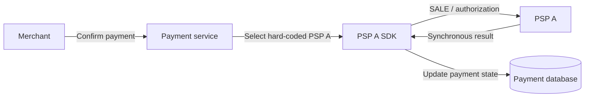
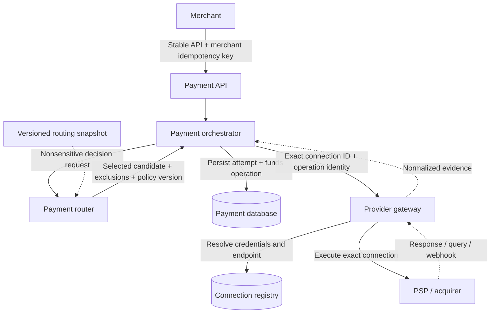
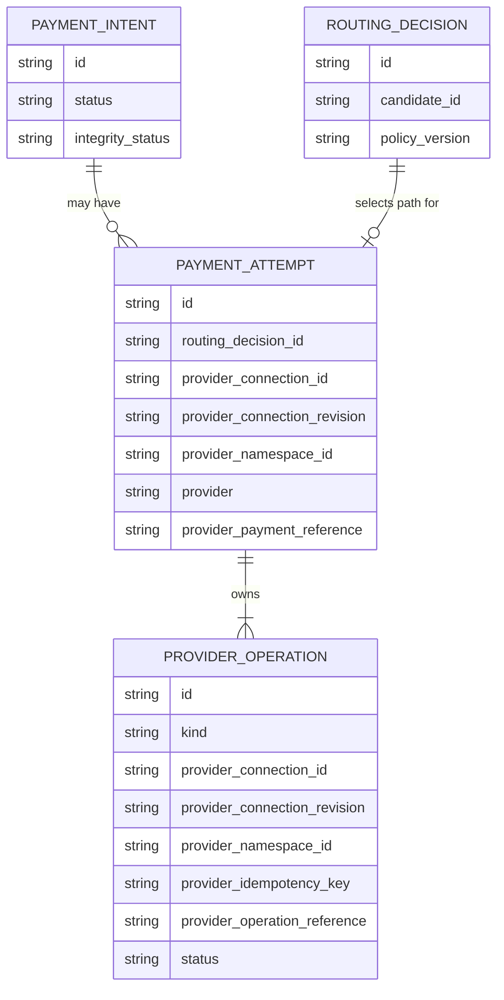
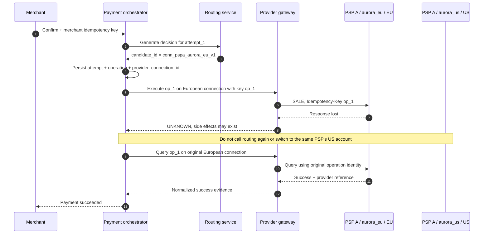
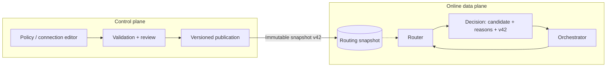

# Chapter 3: Responsibilities and Boundaries of a Payment Routing System

[中文](../../part-1-foundations/routing-system-boundaries.md) | **English**

Chapter 2 explained why routing is needed: as countries, currencies, payment methods, and providers multiply, scattering selection logic through payment code makes policy changes, recovery, and auditing increasingly difficult.

Extracting selection logic completes only half the job. A new danger appears when teams keep adding provider SDKs, payment state machines, network retries, webhook handling, and even refunds to the router. A selection function of a few dozen lines becomes a central service through which all funds operations must pass. Routing is now deployed separately, yet its boundaries are less clear than before.

This chapter establishes an invariant for the entire book:

> **Routing generates explainable, replayable decisions; it neither owns the payment lifecycle nor executes funds side effects. The payment orchestrator owns payments, attempts, and funds operations. The provider gateway executes operations only on a selected, pinned provider connection.**

This boundary does not depend on deploying three separate processes. A small team can begin with modules in one codebase. What matters is that types, storage, and call direction make clear who can change funds state, choose paths, and access provider credentials.

This chapter defines those responsibilities and minimum contracts. The next chapter develops routing context; Chapters 5–9 cover rules, eligibility, cost, success rates, and scoring. Timeouts, fallback, and complete decision storage belong to the reliability and operations chapters. Nor will we present the companion system's current automatic-capture `SALE` as support for manual capture, voids, refunds, or real PSPs.

## 3.1 Why One Service Doing Everything Was Initially Correct

At Aurora's launch, the payment path had one PSP. The payment service accepted confirmation, read the order amount, called the PSP SDK, and wrote the result to its database:



There is nothing wrong with this design. One function sees both the request and the provider response. Few failure surfaces exist outside the local transaction, and developers need not trace payments across services. “Routing” is simply the constant `psp_a`; a separate platform is unnecessary.

After integrating a second PSP, teams usually add a function to the same service:

```go
package payment

func selectProvider(currency string) string {
	if currency == "BRL" {
		return "psp_b"
	}
	return "psp_a"
}
```

This remains a reasonable intermediate design. The problem is not that the function is short or the architecture insufficiently “microservice-based.” Selection and execution now change for different reasons: operations adjusts paths frequently, provider APIs upgrade independently, and the payment state machine must evolve more conservatively. While one procedural flow implicitly controls all three, a change in any one can affect the others.

## 3.2 Where Ambiguous Boundaries Fail at Scale

### 3.2.1 `psp_a` Is Not an Executable Path

Aurora may have both US and European merchant accounts at the same PSP. They use different credentials, contracts, settlement currencies, and regional endpoints, and may use different connector versions. If routing returns only `psp_a`, execution must make another choice: which account, endpoint, and credentials?

If this “second choice” is hidden in an SDK factory or environment variable, the routing decision is incomplete. Troubleshooters see “PSP A selected” but cannot tell whether the request reached the European or US account. A process restart or configuration update may even send a retry of the same operation to another connection.

This book calls an executable path a **route candidate**. At least four dimensions identify it:

| Dimension | Question answered | Why execution cannot decide it ad hoc |
| --- | --- | --- |
| Provider | Which external processor, such as `psp_a`? | A brand alone does not locate contracts or failure domains |
| Merchant account | Which account at the provider processes it? | Capabilities, limits, rates, bills, and idempotency scope may differ |
| Connector | Which protocol mapping and API version? | Fields, errors, and state semantics may differ |
| Region | Which provider endpoint or data region? | Latency, residency, credentials, and idempotency visibility may differ |

A candidate is therefore not an alias for PSP A. It is a configured provider-connection snapshot the gateway can execute precisely. For example:

```
candidate_id = conn_pspa_aurora_eu_v1
connection_revision = aurora_eu_credentials_v1
provider_namespace_id = pspa_aurora_eu_account
provider = psp_a
merchant_account = aurora_eu
connector = checkout_v2
region = eu
```

`candidate_id` is the stable identity in the routing contract. When orchestration accepts the selection and creates an attempt, it pins that identity as `provider_connection_id`. Both can have the same unambiguous value, but their meanings differ: the former is a decision candidate; the latter is the connection bound to a funds execution. `provider` remains useful for selecting an adapter type and aggregating statistics, but cannot replace connection identity.

A subtler drift must also be prevented: the ID stays unchanged while its underlying account or endpoint is rebound. Execution therefore pins `connection_revision` and `provider_namespace_id` as well. The former references an immutable connection revision; the latter identifies the external identity-conflict domain explicitly declared by the adapter. It cannot be inferred from a brand and is not the webhook authentication domain. The current simulator contract shares this domain among references, events, and idempotency keys. If a real provider gives these different scopes, its adapter must express them separately. The gateway accepts only fully registered identities. Old revisions may still serve recovery of existing operations; credential rotation cannot silently redefine a revision still in use.

### 3.2.2 A Selection Result Is Not a Payment Result

Returning `conn_pspa_aurora_eu_v1` means only “under this input and policy version, the next attempt should use this path.” It does not prove the PSP received a request, much less that authorization, capture, or settlement completed.

If routing calls the PSP itself and returns `approved` to orchestration, both components believe they own the state machine. Routing knows the external response; orchestration knows the internal payment. Neither can atomically prove their association across a crash window. After a routing timeout, an RPC failure alone cannot tell orchestration whether the external operation occurred.

Routing decisions and provider results must therefore be different objects:

| Object | Core question | Does it represent funds facts? | Owner |
| --- | --- | --- | --- |
| Routing decision | Which connection may the next attempt use, and why? | No | Computed by routing; associated by orchestration |
| Payment attempt | Which controlled execution seeks to complete this payment? | Not on its own | Orchestration |
| Provider funds operation | Which logical funds operation runs on a pinned connection? | Only with outcome evidence | Orchestration |
| Provider result | What synchronous, queried, or asynchronous evidence did the provider supply? | Evidence requiring monotonic convergence | Normalized by the gateway; applied by orchestration |
| Payment state | What is the merchant-visible lifecycle state? | Internal authoritative state | Orchestration |

### 3.2.3 Network Failure Forces the Question of Recovery Ownership

Suppose the European connection receives `SALE` and completes automatic capture, but its response is lost. If routing owns network retries, it needs the original funds-operation ID, provider idempotency key, payload digest, and attempt. If orchestration retries too, each may send a request. Worse, they may ask routing again and receive another candidate.

Timeouts, connection resets, lost responses, and ambiguous `5xx` responses cannot establish the absence of funds side effects. The operation must become `UNKNOWN`, and the orchestrator that owns it chooses recovery. Network retries and queries must reuse the original `provider_connection_id`, operation ID, provider idempotency key, and semantic payload. Provider idempotency guarantees apply only within documented scope. Adyen, for example, states that keys are stored at company-account level and not checked across regional endpoints. This is a concrete reason that region and account cannot drift during retry. [Adyen API Idempotency](https://docs.adyen.com/development-resources/api-idempotency)

### 3.2.4 A “Unified Adapter” Can Quietly Become a Second Router

Adapters map platform operations to provider APIs and normalize responses, errors, and webhooks. They may know how PSP A names its fields, but must not secretly send a request to PSP B when PSP A slows. Nor may they silently weaken semantics when a capability is absent, such as replacing `authorize` with automatic-capture `sale`.

Once an adapter has an independent routing policy, decision records no longer describe the actual path and orchestration's pinned connection becomes meaningless. An adapter may report “this connection cannot execute this operation” or return a normalized outcome. It may not report “I switched providers for you.”

## 3.3 Deriving Production Boundaries from Responsibility Conflicts

Resolving these ambiguities yields four logical components: payment API, payment orchestrator, routing service, and provider gateway. Their call direction is:



Only the gateway needs to resolve connections into endpoints and credentials. Routing decides using nonsensitive candidate metadata. Orchestration persists the identities needed to pin the path and correlate outcomes. The payment API knows no provider details. PAN is cardholder data; CVV/CVC and similar values are sensitive authentication data. Neither belongs in routing requests, decisions, logs, or messages, but PAN and SAD must not be conflated. The companion system currently passes only tokenized card tokens, exclusively from orchestration to the gateway, never to routing. Tokenization also does not automatically remove systems from PCI DSS scope: scope depends on token type, continued access to account data, and connections to the cardholder data environment. [PCI SSC FAQ 1326](https://www.pcisecuritystandards.org/faqs/1326/)

### 3.3.1 Payment API: Preserve the Merchant Contract without Exposing Topology

The API authenticates merchants, validates requests, applies merchant-level idempotency, creates or reads payments, and returns stable public states. It should not let merchants specify internal accounts, regions, or credentials, or require `psp_a` in the public API. Otherwise, changing an internal contract or connector becomes a breaking API change.

The API may accept explicitly authorized business constraints, such as a required payment method or manual capture. It passes these to orchestration and routing for validation rather than assembling provider requests itself.

### 3.3.2 Orchestration: The Sole Component Advancing the Funds Lifecycle

Orchestration owns `PaymentIntent`, `PaymentAttempt`, and `ProviderOperation`. It decides when to request routing, pin a selection into an attempt, execute, query, wait, or require human review.

The minimum domain relationships are:



Four identities must remain distinct. The merchant's `Idempotency-Key` constrains one public API operation. Internal `operation_id` identifies a logical platform funds operation. `provider_idempotency_key` enables safe retries within a provider's contractual scope. `provider_payment_reference` or `provider_operation_reference` is transaction-correlation evidence returned by the provider. None substitutes for another.

Orchestration also enforces monotonic convergence. A later webhook is not inherently more correct, and a query may not be newer than a known terminal outcome. Two incompatible provider references for one operation, or unexplained failure evidence after confirmed success, require retaining the facts and entering `review_required`, not last-write-wins processing.

### 3.3.3 Routing: Pure Decision-Making, Not a Toy Algorithm

Routing accepts a nonsensitive decision input, validates it, and generates a decision from versioned candidate and policy snapshots. Its output must contain the full selected candidate, not just a provider string:

```go
package routing

type Candidate struct {
	ID              string `json:"candidate_id"`
	Revision        string `json:"connection_revision"`
	NamespaceID     string `json:"provider_namespace_id"`
	Provider        string `json:"provider"`
	MerchantAccount string `json:"merchant_account"`
	Connector       string `json:"connector"`
	Region          string `json:"region"`
}

// CandidateRef contains neither credentials nor mutable capabilities.
type CandidateRef struct {
	ID              string `json:"candidate_id"`
	Revision        string `json:"connection_revision"`
	NamespaceID     string `json:"provider_namespace_id"`
	Provider        string `json:"provider"`
	MerchantAccount string `json:"merchant_account"`
	Connector       string `json:"connector"`
	Region          string `json:"region"`
}

type Decision struct {
	ID                string       `json:"decision_id"`
	SelectedCandidate CandidateRef `json:"selected_candidate"`
	CandidateOrder    []string     `json:"candidate_order"`
	PolicyVersion     string       `json:"policy_version"`
}
```

“Pure decision-making” does not allow untraceable strings, nor forbid in-process caches. Routing may cache validated configuration snapshots, capability catalogs, and health signals, and compute stable `decision_id` values. Such state supports decisions; it does not replace payment or funds-operation state.

The same input, policy version, and signal snapshot should reproduce the same result. After publication, routing cannot present today's latest configuration as the version used in the past. Chapter 14 designs full decision storage. Here, orchestration must at least persist `routing_decision_id`, the selected `provider_connection_id`, and necessary version references, so real execution does not lose its identity when routing caches expire.


*Figure: The router decides only and issues a ticket for this connection alone. Funds execution has a separate single entry point, uses the pinned connection, and permits no hidden rerouting; the alternative pipe stays locked.*

### 3.3.4 Provider Gateway: Execute the Exact Connection and Isolate Provider Differences

The gateway receives “execute this funds operation on this `provider_connection_id`,” not “find a PSP that can collect money.” It resolves the endpoint, credentials, and adapter through the registry, then validates request identity and the persisted request digest. Reusing an `operation_id` with a different amount, currency, token, capture method, or connection ID must be rejected as a conflict, never overwritten by the latest request.

This Go example shows orchestration pinning a decision into an attempt and funds operation. Scoring and fallback are deliberately absent:

```go
package orchestration

import "errors"

type SelectedCandidate struct {
	CandidateID     string
	Revision        string
	NamespaceID     string
	Provider        string
	MerchantAccount string
	Connector       string
	Region          string
}

type Attempt struct {
	ID                   string
	RoutingDecisionID    string
	ProviderConnectionID string
	ConnectionRevision   string
	ProviderNamespaceID  string
	Provider             string
}

type Operation struct {
	OperationID            string
	AttemptID              string
	ProviderConnectionID   string
	ConnectionRevision     string
	ProviderNamespaceID    string
	Provider               string
	ProviderIdempotencyKey string
}

func PinRoute(decisionID string, selected SelectedCandidate, attemptID, operationID string) (Attempt, Operation, error) {
	if decisionID == "" || attemptID == "" || operationID == "" ||
		selected.CandidateID == "" || selected.Revision == "" || selected.NamespaceID == "" ||
		selected.Provider == "" || selected.MerchantAccount == "" || selected.Connector == "" || selected.Region == "" {
		return Attempt{}, Operation{}, errors.New("incomplete routing decision")
	}

	attempt := Attempt{
		ID:                   attemptID,
		RoutingDecisionID:    decisionID,
		ProviderConnectionID: selected.CandidateID,
		ConnectionRevision:   selected.Revision,
		ProviderNamespaceID:  selected.NamespaceID,
		Provider:             selected.Provider,
	}
	operation := Operation{
		OperationID:            operationID,
		AttemptID:              attemptID,
		ProviderConnectionID:   selected.CandidateID,
		ConnectionRevision:     selected.Revision,
		ProviderNamespaceID:    selected.NamespaceID,
		Provider:               selected.Provider,
		ProviderIdempotencyKey: operationID,
	}
	return attempt, operation, nil
}
```

In a real system, attempts and funds operations must be persisted before the gateway may produce external side effects. Otherwise, a crash after external success but before an internal write leaves a transaction that cannot reliably be correlated. The gateway should likewise persist the operation and request digest before entering a state in which the request may have crossed the network boundary.

### 3.3.5 Good Boundaries Make the Failure Side Identifiable

One benefit of component boundaries is choosing recovery according to whether side effects may have occurred, rather than retrying every error uniformly:

| Failure location | Known facts | Permitted next action | Explicitly prohibited |
| --- | --- | --- | --- |
| Local routing-request validation | No path selected or external funds operation created | Correct the request or return a merchant error | Call an arbitrary default provider |
| Routing returns no eligible candidate | Complete exclusion evidence; no funds side effects | Save reasons and end this confirmation | Bypass eligibility to choose the cheapest PSP |
| Routing RPC times out | Routing executes no funds operations | Retry the same decision request within the total deadline, or fail safely | Treat the timeout as provider failure |
| Operation persisted; failure before gateway call | Connection pinned; provably no external boundary crossing | Continue with the same operation command | Create another attempt |
| Timeout after gateway dispatch | Provider side effects may have occurred | Mark `UNKNOWN`; query, wait, or retry with the original key on the original connection | Reroute or generate a new key |
| Webhook conflicts with a known terminal outcome | At least two pieces of evidence cannot be reconciled automatically | Retain evidence and enter `review_required` | Overwrite by arrival order |

This explains why routing's purity matters. A routing RPC failure does not introduce funds uncertainty, so its retry semantics can be far simpler than those of provider calls. Once an operation is persisted and ready for dispatch, however, recovery must read authoritative state rather than rerun the entire confirmation flow.

Nor should orchestration create a funds operation with an assumed provider before accepting a decision. First generate a stable `attempt_id` for decision correlation, obtain the complete candidate, then write the attempt, operation, connection identity, and request fingerprint within the same persistence boundary. If no candidate qualifies, exclusion evidence may be stored, but the database must not contain a provider operation that a background worker could accidentally execute.

### 3.3.6 Stable IDs Do Not Freeze All Configuration Forever

A `candidate_id` must consistently identify the same execution identity, while endpoints, certificates, and keys still need rotation. Whether configuration can change under the same ID depends on preserving funds association and equivalent provider contracts. Key rotation within the same merchant account can generally be versioned in the registry. Changing region from `eu` to `us`, or account from `aurora_eu` to `aurora_us`, alters idempotency, billing, or data boundaries and requires a new candidate ID rather than an in-place replacement.

Disabling a connection must not erase its historical identity. It can immediately leave the candidate set for new payments, while the gateway still resolves it under controlled permissions for original-transaction queries, capture, void, refund, and reconciliation. “Unavailable for new routing” and “no longer accessible” are different states. Combining them can destroy endpoint, account, and credential-version evidence precisely when old transactions need recovery.

## 3.4 Keeping One Connection after Failure

Test the boundary with a falsifiable scenario. Aurora configures two PSP A connections:

| Candidate | Provider | Merchant account | Connector | Region |
| --- | --- | --- | --- | --- |
| `conn_pspa_aurora_eu_v1` | `psp_a` | `aurora_eu` | `checkout_v2` | `eu` |
| `conn_pspa_aurora_us_v1` | `psp_a` | `aurora_us` | `checkout_v2` | `us` |

A EUR payment selects Europe. The gateway times out after sending the request, and the operation becomes `UNKNOWN`. Even if a new routing configuration now ranks the US connection first, recovery cannot reroute. It must query the original connection or, where the provider contract permits, resend the same operation with the original key and payload:



Acceptance must prove that the database contains only one attempt and one logical provider operation; all dispatches, queries, and same-operation retries use `conn_pspa_aurora_eu_v1`; the idempotency key and semantic payload stay unchanged; and `conn_pspa_aurora_us_v1` receives no request. Checking only final `succeeded` status is insufficient: an implementation risking duplicate charges can reach that state too.

This is recovery of the same funds operation, not the fallback described in Chapter 12. Orchestration may create another attempt only once the previous attempt is established to have no side effects and policy permits rerouting. `UNKNOWN` never establishes that conclusion.

## 3.5 Why Capture, Void, and Refund Cannot Be Rerouted

Authorization, capture, and settlement are distinct stages. Approval normally reserves funds or credit; it does not mean the merchant has received money. With manual capture, capture must reference the original authorization's provider transaction. Adyen's capture API, for example, uses the original payment's `paymentPspReference` in the request path and requires the same merchant account. [Adyen Capture](https://docs.adyen.com/online-payments/capture)

The destination of subsequent operations is therefore the original transaction's connection, not a new “best candidate”:

```
Capture target = original provider_connection_id + provider_payment_reference
Void target    = original provider_connection_id + provider_payment_reference
Refund target  = original provider_connection_id + provider_payment_reference
```

These operations can have their own internal operation IDs, provider idempotency keys, and provider operation references. They cannot switch accounts, regions, or PSPs. Initial routing may filter for capabilities such as manual capture, but does not select a new capture path for an already-authorized transaction.

At this chapter's stage, the companion Go system still supports only automatic-capture `SALE` for tokenized cards, with no manual-capture, void, or refund API. These constraints are domain invariants for future extensions, not claims about current implementation scope.

## 3.6 The Data Plane and Control Plane Need Boundaries Too

The online routing path should consume only validated, versioned snapshots. Policy editing, approval, publication, connection activation, and capability maintenance belong to the control plane. A payment request should not query multiple administrative systems and assemble unversioned state on the fly:



If the control plane is unavailable, the data plane can retain its last known good snapshot. Missing or invalid critical snapshots must cause explicit failure, not a hidden default PSP. Chapter 20 covers publication, staged rollout, and rollback. Here, every online decision must identify its version.

## 3.7 Common Failure Modes

### Routing Calls a Provider before Returning the Decision

This merges selection and side effects. On a routing RPC timeout, orchestration cannot know whether to create an operation, query the provider, or route again. The fix is not another blind retry: routing's responsibility must end before the external call.

### Decisions Store Only the Provider Name

Multiple accounts or regions force execution to choose a second time. Configuration changes can move retries into another idempotency scope. `candidate_id` / `provider_connection_id` must run through decisions, attempts, operations, and gateway commands.

### Every Retry Requests a New Routing Decision

Routing correctly returns today's best path, but incorrectly changes an operation with an unknown outcome. Recovery code must read the pinned connection from the persisted operation, not candidates from a new decision.

### The Gateway Secretly Changes Endpoints Based on Health

If an endpoint is merely a transparent network address inside one connection, and the provider explicitly guarantees shared identity and idempotency scope, the gateway can handle it under that connection contract. Crossing region, merchant-account, or credential boundaries is a routing change and cannot hide inside client load balancing.

### `provider_idempotency_key` Becomes a Global Deduplication Key

Provider idempotency protects only the contractually declared scope. It cannot tell PSP B that PSP A already processed a request. Identical strings across connections do not create cross-PSP deduplication. The platform still needs merchant keys, operation identities, unique constraints, and state machines. Stripe and Adyen differ in result retention, concurrent-request handling, and key scope. Adapters must implement their official contracts rather than assume uniform behavior. [Stripe Idempotent Requests](https://docs.stripe.com/api/idempotent_requests), [Adyen API Idempotency](https://docs.adyen.com/development-resources/api-idempotency)

### Asynchronous Evidence Overwrites by Arrival Time

Responses, queries, and webhooks can repeat, arrive late, or arrive out of order. The gateway validates origins and preserves original provider codes. Orchestration applies monotonic transitions by operation identity. Conflicting confirmed references require isolation and `review_required`; database update time cannot determine truth.

## 3.8 Boundaries Do Not Require Four Microservices

Separate services provide independent scaling, fault isolation, credential boundaries, and release cadences, but add RPC timeouts, deployment, authentication, tracing, and cross-database consistency costs. Both deployments below can preserve this chapter's invariants:

| Form | Suitable stage | Required boundaries |
| --- | --- | --- |
| Modular monolith | Few providers, small team, limited throughput | Separate decision and result types; only orchestration changes payments; the gateway does not route |
| Separate routing / payment / gateway services | Frequent policy releases, significant credential isolation or scaling needs | Complete identities in RPC contracts; explicit authoritative storage and failure semantics per service |

Four boxes in a diagram do not justify four databases and Kubernetes deployments. Split according to ownership, compliance, failure domains, and independent evolution. Conversely, a single process must not let a convenience function bypass operation persistence and call a provider directly.

Exact connection identity has costs. Teams must manage candidate lifecycles without encoding mutable endpoints or secrets directly into IDs, preserve historical resolution after deactivation for queries, refunds, and reconciliation, and log stable IDs rather than secret configuration. The return is auditable execution and safe recovery, not abstraction for its own sake.

## 3.9 Mapping the Boundaries to the Go Implementation

This chapter corresponds to [verified implementation `bc4afde`](https://github.com/YouEclipse/payments/tree/bc4afde24da708d22f67da72a90a1557b1477173), which expresses the contracts in three services:

* The [router](https://github.com/YouEclipse/payments/tree/bc4afde24da708d22f67da72a90a1557b1477173/services/router/internal/routing) generates deterministic decisions with `selected_candidate`, candidate ordering, exclusion evidence, and policy version. Candidates carry connection ID, revision, namespace, and provider/account/connector/region metadata.
* The [payment service](https://github.com/YouEclipse/payments/blob/bc4afde24da708d22f67da72a90a1557b1477173/services/payment/internal/app/service.go) requests decisions and pins `routing_decision_id` and full connection identity to attempts and operations before external calls. It owns payment state and `UNKNOWN` recovery.
* The [provider gateway](https://github.com/YouEclipse/payments/tree/bc4afde24da708d22f67da72a90a1557b1477173/services/provider-gateway/internal/gateway) persists operations, request digests, and append-only connection revisions, rejecting rebinding an existing revision to another configuration. Queries and same-operation retransmissions retain the original identity. Recovery aliases require explicit configuration, cannot create another operation, and cannot authenticate another connection's webhook merely because a namespace matches.

[CI for this commit](https://github.com/YouEclipse/payments/actions/runs/33041147119) verifies real PostgreSQL migrations, connection-identity conflicts, out-of-order evidence, race detection, and Compose end-to-end tests. The `UNKNOWN` case also checks matching connection IDs, revisions, and namespaces across payment service and gateway, and exactly one funds path.

The current vertical slice is deliberately narrow: tokenized cards, `capture_method=automatic`, and provider-native `SALE`, with the simulator permitted only in local, development, or test environments. It represents success, definite decline, `UNKNOWN` after response loss, convergence through queries and webhooks, and `review_required` for conflicting evidence. It cannot handle real money, nor does it implement the manual capture, voids, refunds, full routing context, dynamic scoring, or cross-provider fallback explicitly deferred in this chapter.

These scope statements are themselves architectural boundaries. Knowing that capture must bind to the original connection is different from already providing a capture API.

## 3.10 Recap

The most important routing boundary is between decisions and funds facts, not HTTP paths or repository directories.

Routing accepts nonsensitive inputs, uses versioned snapshots to select an exact candidate, and returns an explainable, reproducible decision. Provider, merchant account, connector, and region together define the candidate. Returning `psp_a` alone is insufficient for execution or safe recovery.

Orchestration owns payments, attempts, and funds operations. It pins `candidate_id` as the attempt's `provider_connection_id`, persists operations, then allows the gateway to execute. The gateway resolves connections, invokes adapters, and normalizes responses, queries, and webhooks into evidence. It cannot secretly change connections.

Once a request may have crossed the provider boundary, a timeout means `UNKNOWN`. Recovery of the same logical operation pins the original connection, operation ID, provider idempotency key, and semantic payload. Capture, void, and refund also bind to the original approved connection and transaction reference; they cannot reroute.

This boundary gives later chapters a stable foundation. The next can focus on the minimum inputs for routing without making context carry payment state. Rules, eligibility, and scoring can evolve without executing funds. Fallback can occur only when the attempt outcome owned by orchestration permits it.

## Further Reading

* [Adyen: API Idempotency](https://docs.adyen.com/development-resources/api-idempotency)
* [Adyen: Capture](https://docs.adyen.com/online-payments/capture)
* [Stripe API Reference: Idempotent Requests](https://docs.stripe.com/api/idempotent_requests)
* [PCI SSC Glossary: Cardholder Data and Sensitive Authentication Data](https://www.pcisecuritystandards.org/glossary/)
* [PCI SSC FAQ 1326: EMVCo Payment Tokens and PCI DSS](https://www.pcisecuritystandards.org/faqs/1326/)
* [Chapter 2: Why Payment Routing?](why-payment-routing.md)
* [Chapter 4: Building Routing Context](../part-2-routing-engine/routing-context.md)
* [Chapter 10: Timeouts, Retries, and Unknown Outcomes](../part-3-reliability/timeout-and-retry.md)
* [Chapter 14: Routing Decision Storage](../part-4-operating-at-scale/routing-decision-store.md)
