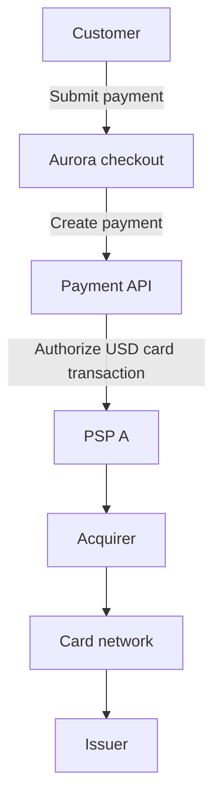
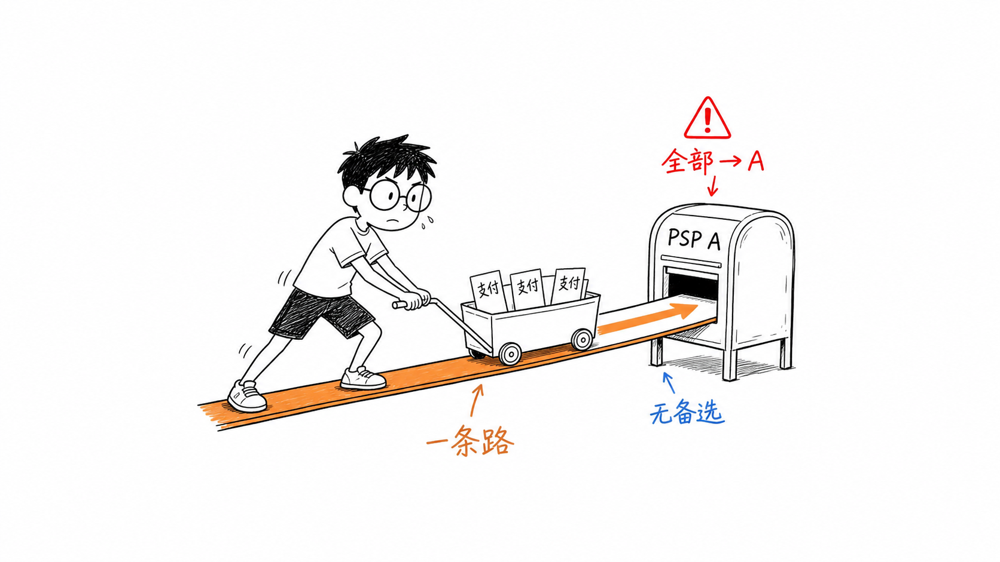
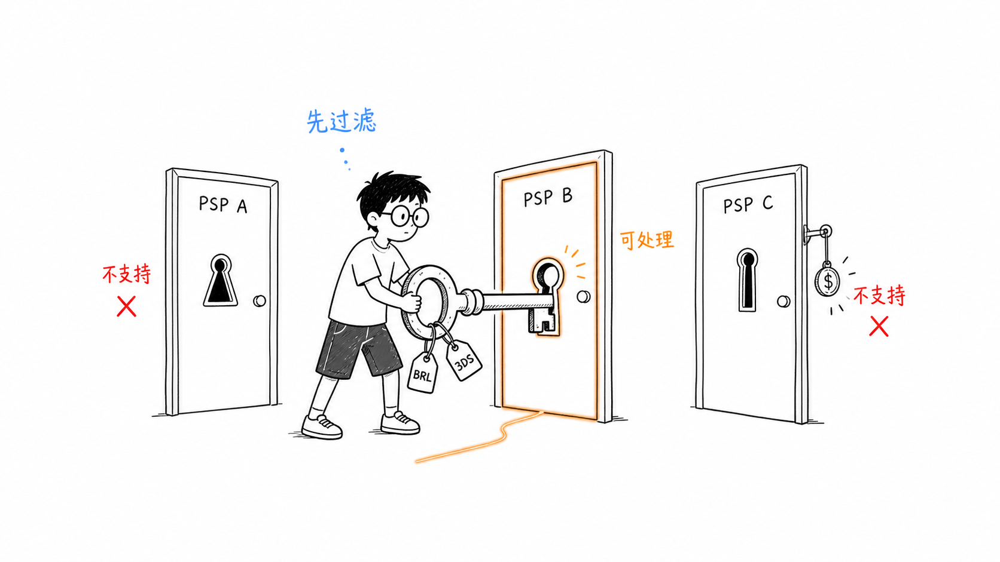
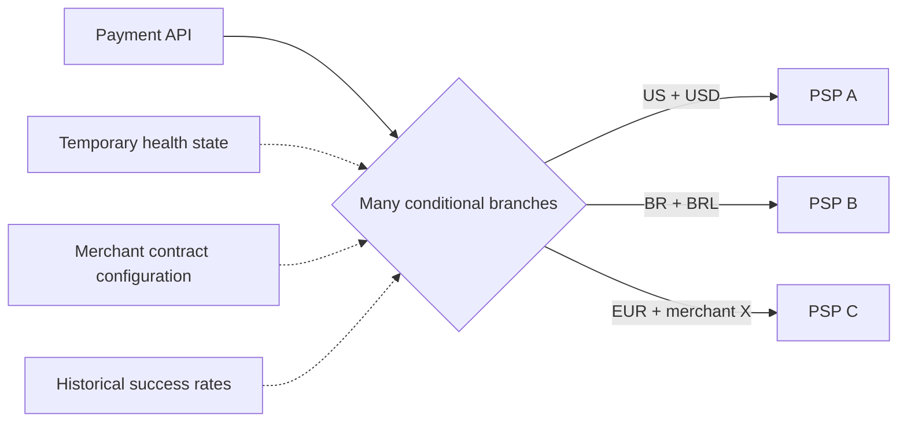
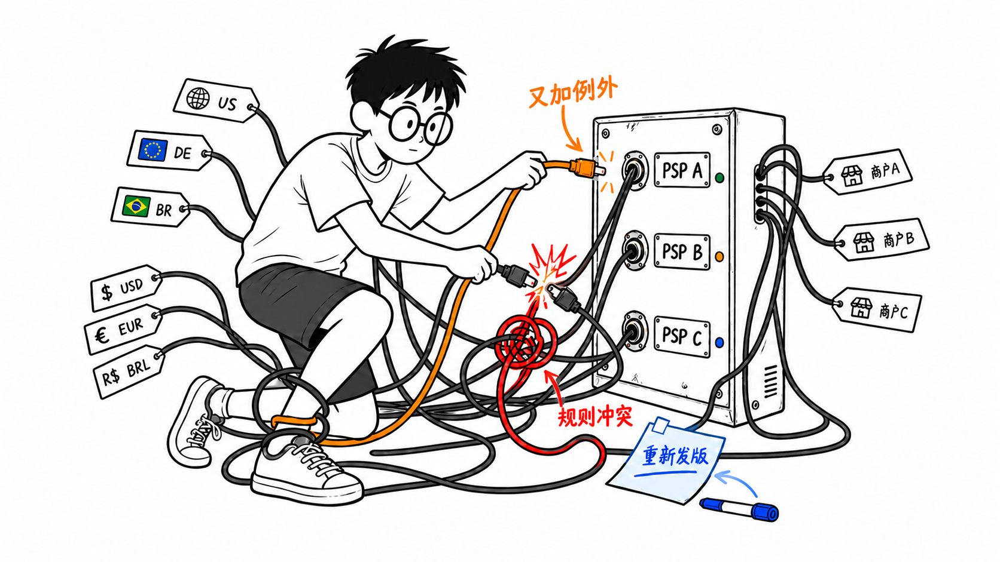
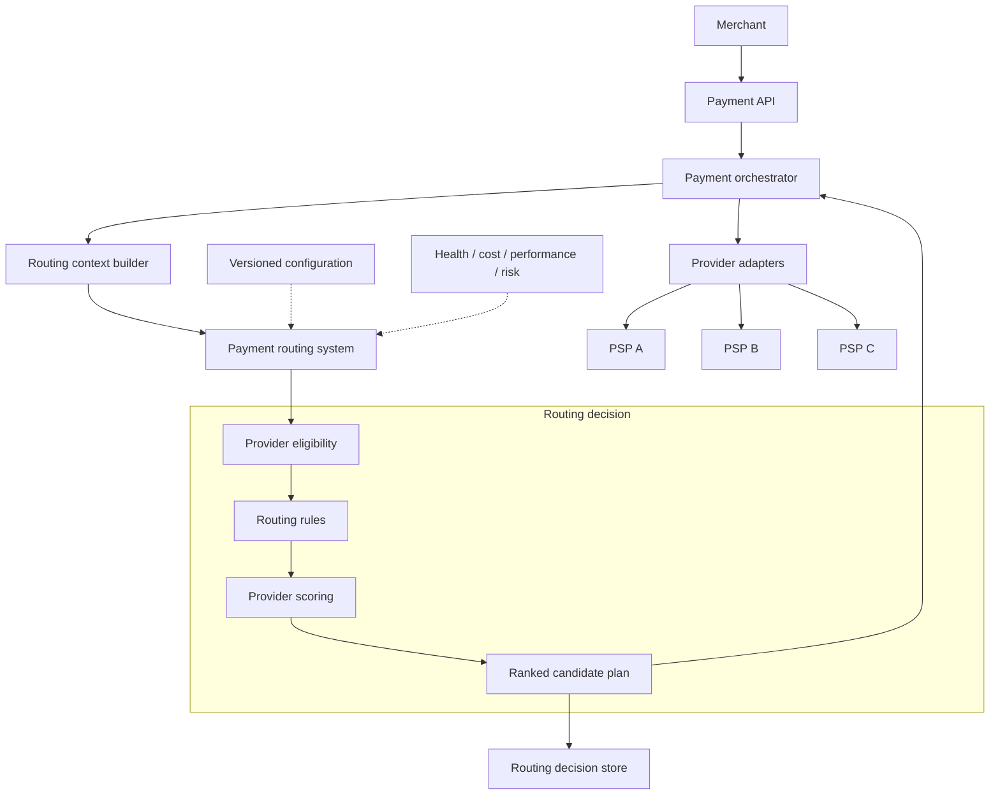
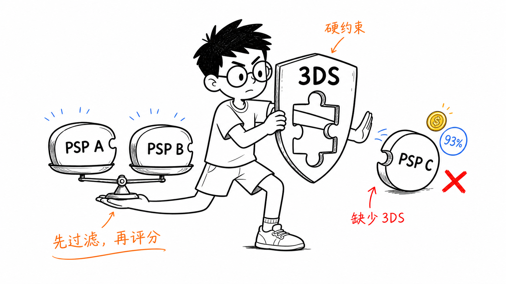
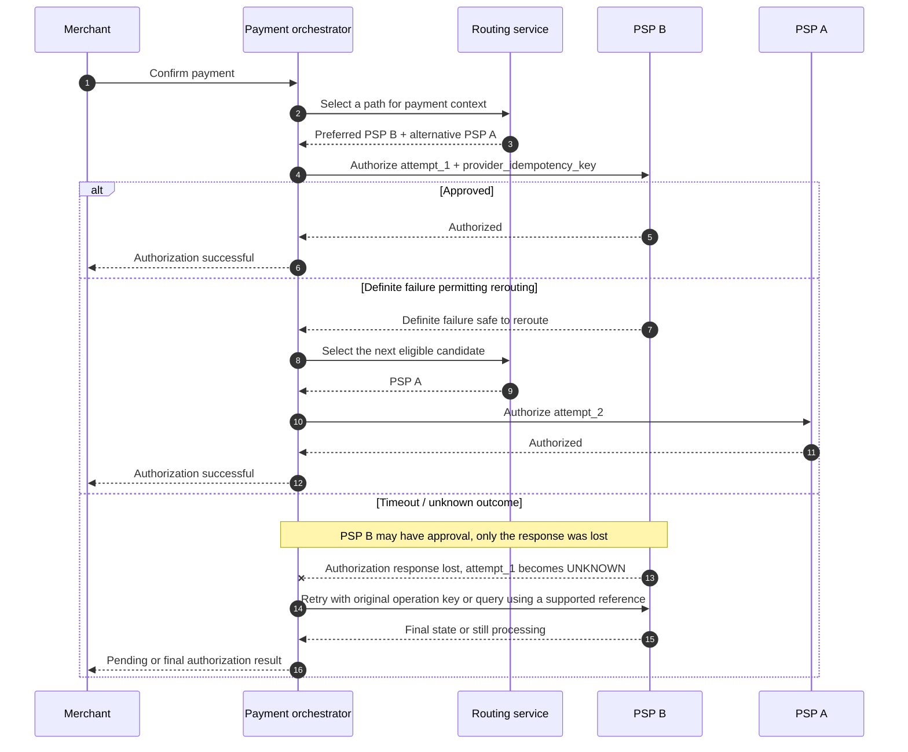

# Chapter 2: Why Payment Routing?

[中文](../../part-1-foundations/why-payment-routing.md) | **English**

Payment routing is not a component that every payment system needs from day one.

A newly launched commerce platform usually serves one market, accepts a small set of payment methods, and works with one payment service provider (PSP). Its priority is to complete the first real transaction, not to build a complex decision platform in advance. Sending every payment request to the same PSP is a reasonable, maintainable, and often entirely appropriate starting point.

The problem is that the business will not stay at that starting point forever.

As merchants enter new countries, add local payment methods, compare rates from different **acquirers**, and demand higher payment availability, “where should this request go?” stops being an answer hard-coded into the application. It becomes a decision informed by transaction context, contractual capabilities, live health, and historical performance.

This chapter starts with a system connected to one PSP. We retain its strengths, examine the business changes that gradually invalidate its assumptions, and derive the basic shape of a payment routing system. Our subject is **provider routing** on the merchant or payment-platform side, not routing inside a card network. Later chapters cover rules, success-rate and cost models, idempotency, fallback, and observability. Here we first answer a more fundamental question: **why is routing worth designing as a separate system?**

## 2.1 Routing Exists Even without a Routing Service

Suppose an online ticketing platform called Aurora launches first in the United States, accepts only USD credit-card payments, and integrates with PSP A. Its simplified authorization path looks like this:



There is no component named “routing service,” but the system has already made a routing decision:

```
All transactions → PSP A
```



*Figure: All payments follow one path to PSP A, with no alternative. Provider selection is implicit in the single-provider architecture.*

That decision is simply embedded in configuration, SDK calls, or business code. It does not need to become a separate component while all transactions satisfy the same assumptions:

* PSP A supports the required countries, currencies, and payment methods.
* PSP A's availability meets the business target.
* The merchant accepts PSP A's rates and settlement arrangements.
* PSP A's authorization performance does not differ materially across customer segments.
* The merchant has no alternative processing path when a payment fails.

A single-PSP architecture also has strengths that are often underestimated: one set of API semantics, one error-code system, one webhook path, and one provider-specific set of reconciliation semantics and reports. Refunds, chargebacks, settlement, and customer support can all be organized around one provider. Adding an abstraction layer at this stage can increase development and troubleshooting costs.

A single PSP is therefore not an “unsophisticated” architecture. It is the minimum viable design for a particular set of business constraints. The question is not how quickly to replace it, but which changes make it insufficient.

## 2.2 The First Crack: Providers Do Not Have Equivalent Capabilities

Six months later, Aurora plans to enter Germany and Brazil. Initially, the team expects to keep PSP A and simply add EUR and BRL. Integration assessment quickly reveals a problem: payment providers are not interchangeable HTTP APIs distinguished only by price.

Their boundaries may differ in:

* Authorized merchant entities and countries.
* Supported transaction and settlement currencies.
* Payment methods such as cards, Pix, iDEAL, and wallets.
* Coverage of Visa, Mastercard, and local card networks.
* Support for 3DS, network tokens, installments, and partial capture.
* Per-transaction limits, risk policies, and merchant-category restrictions.
* Local and cross-border acquiring.
* Completeness of refund, chargeback-evidence, and reconciliation data.

Payment credentials themselves can restrict the candidate set. A card token issued by PSP A's vault usually cannot be sent directly to PSP B. Routing the same payment method across providers requires a compliant credential-portability design in advance: for example, a controlled independent vault and forwarding mechanism, provider-supported migration, or network tokens where applicable. Without credentials the destination provider can use, it cannot be a real candidate even if its contract and currency support qualify.

Suppose PSP A processes US and European cards but does not support the Pix capability required by Aurora's Brazilian entity. PSP B has local Brazilian capabilities but lacks a particular German local payment method. PSP C covers both markets but cannot provide Aurora's required installment product. Provider selection is first an **eligibility problem**, not a scoring problem.

The system must first ask:

> Which providers can process this transaction under contractual, compliance, and technical constraints?

Only providers admitted to the candidate set can compete on success rate, cost, and latency. A low-fee PSP that does not support the current currency must never win, however high its score.



*Figure: Filter first using BRL currency support and required 3DS. Providers A and C are unsupported; provider B can process the transaction.*

## 2.3 The Second Crack: Availability Cannot Depend on One External Service

On a promotion day, PSP A's authorization API begins timing out frequently. Aurora's own payment API, database, and network remain healthy, yet customers still see “payment failed.” From their perspective, merchant availability is limited by the weakest link in the synchronous path.

Adding a second PSP reduces dependence on one provider, but “having two accounts” does not automatically provide redundancy. Both PSPs may share an acquirer, card network, cloud region, or token vault and thus a common failure domain. The backup account may also lack adequate limits, credentials, webhooks, or processing capacity. The system still needs to know:

* Is PSP A failing globally, or only in one region, payment method, or endpoint?
* Has the current request already reached PSP A?
* Could PSP A have completed authorization before the timeout?
* Which failures permit a safe switch to PSP B?
* After switching, which provider must handle refunds, capture, and reconciliation?

This is the critical difference between payment availability and failover for ordinary read requests. A timed-out payment request does not mean no payment occurred. If PSP A obtained issuer approval but lost the returning response, immediately submitting the same order to PSP B can produce two authorizations or even two charges.

The value of multiple providers is therefore more complex than “switch whenever something fails.” The system must distinguish success, definite failure, and unknown outcomes, and execute fallback only when the semantics permit it. [Chapter 10](../part-3-reliability/timeout-and-retry.md), [Chapter 11](../part-3-reliability/idempotency.md), and [Chapter 12](../part-3-reliability/fallback-routing.md) explore that boundary in full.

## 2.4 The Third Crack: Average Success Rates Hide Meaningful Differences

Availability is only one reason to add PSPs. Aurora soon discovers that even when PSP A and PSP B are both healthy, their authorization performance differs across transactions.

Suppose valid samples from the last four weeks show:

| Transaction segment | PSP A authorization rate | PSP B authorization rate |
| --- | ---: | ---: |
| German-issued Visa, EUR | 94% | 88% |
| Brazilian-issued Mastercard, BRL | 72% | 91% |
| US-issued Visa, USD | 93% | 92% |

These figures are illustrative snapshots for the discussion, not benchmarks of real providers. A comparable measurement must at least use the same merchant, time window, and first-attempt denominator, with similar amounts, authentication, tokens, and risk policies, and examine sample size and uncertainty. Otherwise, `94%` versus `88%` may merely reflect different traffic difficulty.

PSP A may still lead on the global average. But that average is not the most relevant evidence for a Brazilian-issued Mastercard transaction. Combinations of provider and acquiring path, issuer connectivity, authentication method, request-field quality, and local processing capabilities can produce substantial differences.

The decision therefore evolves from:

```
route() = PSP_A
```

to:

```
route(issuer_country, card_brand, currency, payment_method, merchant) = provider
```

This is the intuition behind success-rate routing: choose the available path with the higher expected authorization rate for the current transaction. Historical success rate, however, is not a constant that can simply be copied into an `if` statement. Small samples, delayed data, customer differences, issuer response-code definitions, and selection bias caused by routing itself all introduce noise. [Chapter 8](../part-2-routing-engine/success-rate-routing.md) explains segmented aggregation, smoothing, and fallback, and why short-window fluctuations must not be mistaken for a real advantage.

## 2.5 The Fourth Crack: The Cheapest Transaction May Not Save the Most Money

Provider costs commonly combine fixed and proportional fees, cross-border charges, currency conversion, card-network fees, and charges associated with failures, refunds, chargebacks, or additional services. Even if these are temporarily reduced to one number, comparing “the fee per request” is insufficient.

To isolate the cost definition, consider another illustrative group of 100 EUR transactions with a different card type and risk segment. Two paths qualify:

| Provider | Expected authorization-related cost per attempt | Expected success rate | Rough cost per success |
| --- | ---: | ---: | ---: |
| PSP A | 1.10 EUR | 92% | 1.20 EUR |
| PSP B | 0.85 EUR | 75% | 1.13 EUR |

Here, “expected authorization-related cost per attempt” is assumed to include possible fixed and outcome-dependent charges for each payment attempt. Under this simplification, `cost / success_probability` is already closer to the business problem than looking only at 0.85 EUR. It still excludes lost orders, retry costs, and customer experience caused by payment failure. For a high-margin ticket, a 17-percentage-point success-rate difference may matter much more than a 0.25 EUR fee difference. Low-margin, small-value, or deferrable payments may lead to another conclusion.

Cost-aware routing therefore aims to optimize expected outcomes across contracts, success rates, and business value, rather than mechanically choosing the lowest rate. [Chapter 7](../part-2-routing-engine/cost-aware-routing.md) builds a fuller `expected_cost(transaction, provider)`. [Chapter 18](../part-4-operating-at-scale/settlement.md) connects routing decisions to final settlement and cost attribution.

## 2.6 The Fifth Crack: Risk Is Not an Extra Check after Routing

Routing and risk management cannot operate in isolation. One provider may support a more complete 3DS flow; another may offer stronger token capabilities for a particular wallet. High-risk transactions may require additional authentication, while low-risk, low-value transactions may suit a lower-friction path.

Risk-aware routing does not turn the router into a complete fraud detection system. A better boundary is for the fraud engine to emit structured signals or constraints that routing consumes as eligibility or scoring inputs. For example:

```
risk_action = REQUIRE_3DS
```

excludes providers unable to perform the required authentication flow, while:

```
risk_action = BLOCK
```

should terminate the transaction before provider selection, rather than search for a PSP “more likely to approve.” If risk is merely a soft score that success-rate weights can offset, the system may bypass required controls to improve short-term conversion.

Routing is therefore not a single-variable maximization problem. Among success rate, cost, latency, risk, and compliance, some are objectives that can be traded off; others are hard constraints that cannot be violated. Production systems must distinguish them explicitly.

## 2.7 From a Second SDK to Hard-Coded Routing

After Aurora integrates PSP B, the most direct implementation places selection inside the payment API:

```go
func selectProvider(currency, issuerCountry string) string {
	if currency == "BRL" || issuerCountry == "BR" {
		return "psp_b"
	}
	return "psp_a"
}
```

For two providers and two or three markets, this code is clear, fast, and easy to test. Problems arise as dimensions multiply. The German merchant entity prefers PSP A for EUR; a large merchant has a separate PSP B rate; Brazilian Visa debit cards need a local path; and PSP A requires temporary deprioritization during weekend maintenance. Conditions soon overlap across:

```
merchant × entity × country × currency × payment_method
× card_brand × amount × risk_action × provider_health
```

This is more than a code-style issue. Every rate adjustment or operational traffic shift requires changing, testing, and deploying the payment API. Rule conflicts can only be inferred from condition order. Later, explaining exactly which logic a payment matched becomes difficult.



The turning point for hard-coded routing is usually not a particular provider count. It is when **routing policies change faster than the payment application can be released**. Separating policy from execution begins to produce a net benefit when operations needs safe preview, approval, release, and rollback, and engineering needs to evolve decision logic independently.



*Figure: US, German, and Brazilian markets; USD, EUR, and BRL; merchants A/B/C; and providers A/B/C create intertwined exceptions. Another exception leads to rule conflicts and another deployment.*

## 2.8 The Routing Layer Emerges

A separate routing service accepts routing context and returns a routing decision. It should return more than `psp_b`: it should explain how candidates were formed, which providers were excluded, which policy version was used, and which signals informed the choice.



The diagram uses `PSP A` and `PSP B` as shorthand. A production target is usually more specific, such as `provider_connection + merchant_account + region_endpoint`. Two merchant accounts at the same PSP may have different contracts, currencies, credentials, and failure domains. A shared brand does not make them one path.

The key boundary is: **the routing service chooses; the payment orchestrator advances payment state and executes provider calls.** If routing initiates authorization while deciding, it simultaneously owns policy evaluation, external side effects, and the payment state machine, obscuring timeout, retry, and audit boundaries. [Chapter 3](routing-system-boundaries.md) examines whether routing should be stateful and how responsibilities divide between routing and orchestration.

A minimal routing decision might be:

```json
{
  "decision_id": "rd_01J...",
  "payment_id": "pay_01J...",
  "selected_provider": "psp_b",
  "candidate_order": ["psp_b", "psp_a"],
  "policy_version": "routing-policy-42",
  "reason_codes": ["BR_LOCAL_ACQUIRING", "HIGHER_EXPECTED_SUCCESS"],
  "experiment": null
}
```

This is a decision, not a payment result. `selected_provider = psp_b` means the next attempt should use PSP B; it does not mean authorization succeeded. Once authorization is approved at a provider, subsequent capture, void, or refund generally must use that provider and transaction reference. These are not new routing opportunities to choose any PSP.

`candidate_order` is also only a conditional order at decision time, not permission for future fallback execution. Before creating another attempt, the system must revalidate current eligibility, risk constraints, health, and whether the preceding attempt reached an outcome that permits rerouting.

## 2.9 How Routing Policies Evolve

A routing layer should not immediately become a complex machine learning system. A safer evolution lets policy complexity grow with the problem.

### 2.9.1 Static Routing

Static routing assigns a fixed provider to a stable segment: for example, PSP A by default for the US entity and PSP B for Brazil. It is predictable and explainable, fitting stable traffic with clear contractual boundaries. Its drawback is that it does not respond to changes in provider state or performance.

Static routing may also include simple priority lists or fixed traffic splits such as `90% → PSP A, 10% → PSP B`. Splits help gradual migration and collection of comparison data, but random assignment must remain stable through `payment_id` or a stable hash. Otherwise, retries of the same payment may inadvertently switch paths.

### 2.9.2 Rule-Based Routing

As exceptions grow, conditions and actions can become versioned rules:

```
IF merchant_entity == "aurora_br"
AND currency == "BRL"
AND payment_method == "card"
THEN prefer [PSP_B, PSP_A]
```

Rule-based routing decouples policy from application releases, but introduces priority, conflict, validation, approval, and rollback concerns. A rule engine does not eliminate complexity; it makes complexity visible, testable, and auditable. [Chapter 5](../part-2-routing-engine/rule-based-routing.md) evolves `if / else` into a complete rule model.

### 2.9.3 Success-Rate Routing

The system can estimate each provider's `expected_success_rate` by transaction segment and favor paths more likely to receive authorization. Avoid two traps: treating accidental 100% success in a small sample as a stable advantage, and sending a provider only easy transactions before using their outcomes to prove superiority. Models need minimum samples, smoothing, exploration traffic, and fair evaluation definitions.

### 2.9.4 Cost-Aware Routing

The system can estimate fixed and proportional fees, cross-border costs, and FX, then combine them with success probability and order value. Minimum cost can be the objective or one scoring factor. Contract schedules often include tiers, rebates, and monthly commitments, so routing models must be calibrated against actual settlement bills.

### 2.9.5 Risk-Aware Routing

Risk signals may become hard constraints, such as required 3DS support, or soft preferences, such as choosing stronger token capabilities among otherwise equivalent paths. Routing should consume stable, explainable risk actions rather than replicate the fraud engine's entire feature set and models.

### 2.9.6 Fallback after Failure

Fallback is a recovery policy owned by the payment orchestrator. After the preceding attempt is proven to have no side effects and policy permits continuation, it selects the next candidate from the order originally pinned to the payment intent and revalidates hard constraints such as risk, health, and capabilities. It does not rescore candidates or rewrite the original plan. It must consider the preceding attempt's terminal outcome and provider semantics, not merely “PSP A is unhealthy.” Continuing to another candidate requires local eligibility or an adapter to detect unsupported capabilities before dispatch, or a provider contract that explicitly guarantees a particular error occurs before execution without side effects. An error name alone does not establish this. A definite hard decline generally should not trigger a retry at another PSP. An unknown result caused by a timeout or disconnect must first be investigated by querying the original operation or waiting for a webhook; failure cannot be assumed. Even a same-key resubmission must satisfy the provider contract and recovery-evidence requirements. Chapters 10–12 develop these limits.

The strategies can be compared as follows:

| Strategy | Main inputs | Strengths | Main risks | Suitable stage |
| --- | --- | --- | --- | --- |
| Static routing | Country, entity, currency, fixed weights | Predictable and explainable | Cannot follow state changes | Initial integrations and hard boundaries between entities |
| Rule-based routing | Transaction fields, merchant configuration, priorities | Flexible and auditable | Rule conflicts and configuration explosion | More markets and providers |
| Success-rate routing | Segmented historical outcomes, sample counts, windows | Potential conversion gains | Noise, bias, delayed feedback | Sufficient multi-provider data |
| Cost-aware routing | Contract rates, amount, FX, expected success | Controls processing cost | Model differs from bills | Mature contracts and profit objectives |
| Risk-aware routing | Risk actions, authentication capabilities, compliance constraints | Coordinates conversion and risk | Soft scores bypass hard constraints | Structured risk outputs |
| Fallback routing | Attempt terminal outcome, error classification, provider health | Improves resilience | Duplicate charges during unknown outcomes | Idempotency and status queries exist |

These strategies are not mutually exclusive. Production decisions usually apply hard eligibility and risk constraints, then rules, and finally compare success rates and costs among remaining candidates. Fallback differs from the first five: those select the initial path, while fallback is recovery after a preceding attempt. It can proceed along the pinned candidate order only after the failed outcome has been safely classified and hard constraints have been revalidated.

## 2.10 A Concrete Routing Decision

Consider a payment from Aurora's Brazilian site:

```json
{
  "payment_id": "pay_br_2048",
  "merchant_entity": "aurora_br",
  "amount_minor": 52000,
  "currency": "BRL",
  "payment_method": "card",
  "card_brand": "mastercard",
  "issuer_country": "BR",
  "risk_action": "REQUIRE_3DS"
}
```

Three providers are integrated:

| Provider | BRL local acquiring | Required 3DS supported | Recent segment success rate | Estimated cost | Current health |
| --- | --- | --- | ---: | ---: | --- |
| PSP A | No | Yes | 72% | 7.80 BRL | Healthy |
| PSP B | Yes | Yes | 91% | 6.40 BRL | Healthy |
| PSP C | Yes | No | 93% | 5.90 BRL | Healthy |

PSP C has the highest raw success rate and lowest cost, but cannot complete the required authentication, so eligibility excludes it. PSP A and PSP B both qualify. PSP B offers local acquiring, a higher segment success rate, and a lower estimated cost, making it the first choice.



*Figure: Check required 3DS first. PSP C lacks it despite a 93% success rate and attractive cost. PSP B wins among eligible candidates; PSP A remains a conditional backup.*

The decision's reason codes might be:

```
Selected: PSP_B
Excluded: PSP_C → REQUIRED_3DS_UNSUPPORTED
Preferred: PSP_B → LOCAL_ACQUIRING, HIGHER_EXPECTED_SUCCESS, LOWER_EXPECTED_COST
Fallback: PSP_A → enabled only after a definite failure that permits safe rerouting
```

The following Go code is deliberately simple. It illustrates “filter first, score second, record reasons last”:

```go
package routing

import (
	"errors"
	"math"
)

type Candidate struct {
	Name           string
	Eligible       bool
	SuccessRate    float64 // Range: 0.0–1.0
	NormalizedCost float64 // 0.0 is cheapest; 1.0 is most expensive
	Degraded       bool
}

type Decision struct {
	Provider string
	Score    float64
	Reasons  []string
}

func Route(candidates []Candidate) (Decision, error) {
	best := Decision{Score: math.Inf(-1)}

	for _, candidate := range candidates {
		if !candidate.Eligible {
			continue
		}

		healthPenalty := 0.0
		if candidate.Degraded {
			healthPenalty = 0.30
		}

		score := 0.70*candidate.SuccessRate -
			0.20*candidate.NormalizedCost -
			healthPenalty

		// In this teaching example, the provider name is a stable tie-break key.
		if score > best.Score ||
			(score == best.Score && candidate.Name < best.Provider) {
			best = Decision{
				Provider: candidate.Name,
				Score:    score,
				Reasons:  []string{"ELIGIBLE", "BEST_COMPOSITE_SCORE"},
			}
		}
	}

	if best.Provider == "" {
		return Decision{}, errors.New("no eligible provider")
	}
	return best, nil
}
```

This is not a production algorithm. It does not address sample confidence, rate units, hard rules, or experiment assignment. Name ordering is only a minimal deterministic tie-breaker; real systems must also account for configuration priorities and versions. Weights should not be arbitrarily hard-coded either. The essential sequence is:

1. Filter non-negotiable conditions first.
2. Score objectives that permit trade-offs.
3. Include explainable evidence with the choice.
4. Represent no eligible candidate explicitly; never silently choose an arbitrary default PSP.

Later chapters replace each step with components that can be independently tested and evolved.

The companion repository's [pinned implementation](https://github.com/YouEclipse/payments/tree/bc4afde24da708d22f67da72a90a1557b1477173/services/router/internal/routing) retains v1 hard eligibility filtering, versioned static policy ordering, and candidate exclusion reasons corresponding to this chapter's starting point. The rules, success-rate, cost, and risk constraints developed later are implemented by v2/v3 pipelines in the same commit. This preserves replay of the simple design without freezing the narrative at an early snapshot.

## 2.11 Why Fallback Must Understand Payment Attempts

Suppose PSP B is selected and its authorization request times out. The sequence below includes one of the most dangerous cases:



If the orchestrator immediately sends the transaction to PSP A after the timeout, the issuer may approve again. Two authorizations may initially appear as two holds or pending entries; if both are later captured, they may become two posted transactions. Provider idempotency keys usually constrain duplicates only within that provider's specific account, region, and retention period. They cannot make PSP A recognize a transaction processed by PSP B. The system must therefore distinguish at least four identities:

* The merchant request's `Idempotency-Key`, preventing duplicate creation of the same confirmation.
* Internal `payment_id` and `attempt_id`, distinguishing the business payment from each provider attempt.
* The provider funds-operation idempotency key, allowing the same operation to be retried at the same provider without repeated side effects.
* Merchant or provider references supplied in requests for supported correlation or search, and the transaction ID returned after the provider creates a transaction for queries and later capture, void, or refund. These references are not idempotency keys; a lost response may mean the transaction ID was never received.

A new attempt at another provider should be created only after the original attempt has a definite failure that permits rerouting, or the system can prove the provider did not accept the request for processing. Some `5xx` responses, connection resets, and socket timeouts leave the outcome unknown. A definite issuer decline does not permit arbitrary retries either. Rules must account for payment method, issuer guidance, current card-network rules, retry budgets, and provider API semantics, not rely on a generic HTTP-status table.


*Figure: Do not switch blindly. The original PSP B outcome is UNKNOWN, so PSP A is blocked. Query status first and recover the original operation before considering another attempt.*

## 2.12 Production Failure Modes

Routing provides greater control and introduces new failure surfaces. At minimum, explicitly design for the following situations.

### Provider Timeouts and Unknown Outcomes

A network timeout describes a communication result, not a funds result. Suspend dangerous fallback, converge state through idempotent retry, status queries, webhooks, or reconciliation, and define a clear operational process for unknown outcomes.

### Stale Metrics or Distorted Samples

Yesterday's success rate may not represent the present, and 4/4 in a small segment cannot reliably beat 900/1000. Metric services must supply timestamps, sample counts, and data versions. When data expires, fall back to a stable policy instead of continuing to produce apparently precise scores.

### Flapping Health Signals

A few timeouts may cause every instance to remove PSP A, suddenly overload PSP B, then switch back as PSP B slows, creating oscillation. Health evaluation needs minimum samples, hysteresis, half-open recovery, traffic ramps, and capacity protection, not a shared Boolean.

### Configuration Errors

An overbroad rule may send all traffic to an unvalidated provider; equal-priority rules may cause nondeterministic outcomes. The configuration platform needs schema validation, conflict detection, impact preview, approval, staged rollout, versioning, and one-step rollback. Runtime nodes should retain the last known good configuration.

### Dependency Failures and Cascading Timeouts

If every decision synchronously queries contract databases, metrics warehouses, and the fraud engine, routing availability becomes the product of those dependencies' availability. Production paths usually use versioned snapshots, local or distributed caches, and strict latency budgets. Define separately which stale signals permit degradation and which missing signals require rejection.

### Duplicate Requests, Duplicate Webhooks, and Out-of-Order Events

Merchants may repeat confirmation, providers may redeliver webhooks, and status queries may return older information than the event stream. Routing decisions, orchestrator attempts, and final payment states must connect through idempotent writes and monotonic transitions. One Redis `SETNX` at ingress does not establish consistency throughout the chain.

### Optimization Backfires

Optimizing only authorization rate may send risky traffic down more permissive paths. Optimizing only cost may harm conversion, while short-term conversion can obscure chargebacks and settlement losses. Review objectives alongside business profit and loss and risk limits, then calibrate them through experiments and retrospective attribution.

## 2.13 Production Considerations

These failure modes imply a basic set of properties required before routing enters production.

**Determinism and reproducibility.** Identical context, configuration version, and signal snapshots should produce a stable result. Random splits need stable bucketing and recorded assignment. Troubleshooters must replay the decision as it happened rather than guess yesterday's behavior using today's configuration.

**Explainable decisions.** The decision store should record at least candidates, exclusion reasons, matched rules, score summaries, health snapshots, configuration versions, and the final selection. Minimize and redact sensitive features; auditing is not a justification for logging a full card number.

**Low latency without live exhaustive queries.** Routing sits on the synchronous payment path, so its latency directly increases customer waiting time. Distribute rules, capability matrices, and aggregate metrics with controlled freshness. Noncritical analytics writes can be asynchronous, but core decision records cannot silently disappear.

**Safe degradation.** If configuration services fail, a validated previous version may remain usable. If dynamic success metrics expire, static priorities may be appropriate. Missing critical eligibility or risk constraints may require failing closed. Define degradation per signal rather than a universal “use the default PSP.”

**Idempotency across the call chain.** Merchant requests, payments, attempts, and provider requests have different scopes. A newly generated routing candidate does not establish that an authorization retry is safe. The orchestrator holding payment state must decide whether to create another attempt.

**Clear data boundaries.** Routing context carries only payment-method type, card brand, issuer country, controlled IIN/BIN-derived information, and noncredential attributes describing token portability or candidate compatibility. It carries neither raw PAN nor payment-credential tokens. Credential tokens travel only from the payment orchestrator to the provider gateway for the selected connection. Tokenization reduces sensitive-data propagation, but its effect on PCI DSS scope depends on token type, reversibility, connectivity, and implementation. “We use tokens” does not automatically put systems out of scope. CVV and other sensitive authentication data must not enter routing decisions, logs, or metric labels, and cannot be retained after authorization for future fallback.

**Configuration deserves the same rigor as code.** Routing policies change without application releases, so they are production code in their own right. Rules need test cases, owners, change reasons, approval records, effective times, rollout scope, and rollback paths.

**A closed outcome feedback loop.** A decision can be evaluated only when connected to authorization, capture, refunds, chargebacks, settlement, and actual fees. Technical availability, authorization approval rate, first-attempt success rate, and final payment success including recovery are distinct metrics. An ambiguous `success_rate` cannot replace them. Ingress traffic distribution alone cannot prove business improvement either.

## 2.14 The Minimum Responsibilities of a Payment Routing System

We can now give a preliminary definition:

> A payment routing system uses a payment's context, provider eligibility, versioned policies, and available health, performance, cost, and risk signals to select the next permitted execution path, producing a decision that the system can persist, explain, and replay.

This deliberately does not say that routing completes the payment. In the full system:

* The payment API maintains a stable merchant interface and idempotency contract.
* The payment orchestrator owns payment and attempt state and decides when to execute, query, or compensate.
* The router produces provider choices and their reasons.
* Provider adapters translate a common intent into each PSP's API semantics.
* Reconciliation converges internal state with provider and settlement data.

These boundaries are not the only possible design. But if everything is compressed into one synchronous service, any policy change can affect the funds state machine, and any provider difference can contaminate global decision logic. [Chapter 3](routing-system-boundaries.md) tests these boundaries and examines what routing should and should not store.

## 2.15 Recap

We began with a perfectly reasonable single-PSP system, not with a presumed need for a rule engine.

For one market, one set of payment methods, and one processing path, the implicit rule `all → PSP A` is simple enough. More countries, currencies, contracts, and payment methods first reveal eligibility differences. Higher availability requirements create a need for redundancy, along with duplicate-charge risks during unknown outcomes. As transaction data accumulates, success rate, cost, and risk call for finer-grained choices.

Hard-coded `if / else` can support the early stage. Once policies change faster than releases and decisions require audit and replay, policy needs to separate from payment execution code. The resulting router is not a load balancer randomly choosing PSPs. It is a payment decision system governed by hard constraints, using versioned policies, and producing explainable decisions.

[The next chapter](routing-system-boundaries.md) tightens the boundaries further: which state belongs to orchestration and routing, whether routing should call PSPs, and how a routing decision maps to an attempt. These questions must be answered before rule engines, dynamic scoring, and fallback can rest on clear funds semantics.

## Further Reading

* [Stripe API: Idempotent Requests](https://docs.stripe.com/api/idempotent_requests)
* [Stripe: Advanced Error Handling](https://docs.stripe.com/error-low-level)
* [PayPal REST API: Idempotency](https://developer.paypal.com/api/rest/reference/idempotency/)
* [Stripe: Payment Orchestration](https://docs.stripe.com/payments/orchestration)
* [Adyen: API Idempotency](https://docs.adyen.com/development-resources/api-idempotency)
* [Adyen: Capture](https://docs.adyen.com/online-payments/capture)
* [Adyen: Provider-Internal Intelligent Routing and Cost/Conversion Optimization](https://docs.adyen.com/partners/uplift-enablement)
* [PCI SSC: PCI DSS Document Library](https://www.pcisecuritystandards.org/document_library/)
* [PCI SSC FAQ: Restrictions on Storing CVV and Other Sensitive Authentication Data](https://www.pcisecuritystandards.org/faqs/1280/)
* [PCI SSC FAQ: EMVCo Payment Tokens and PCI DSS Scope](https://www.pcisecuritystandards.org/faqs/1326/)
