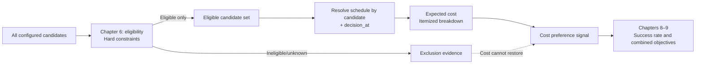
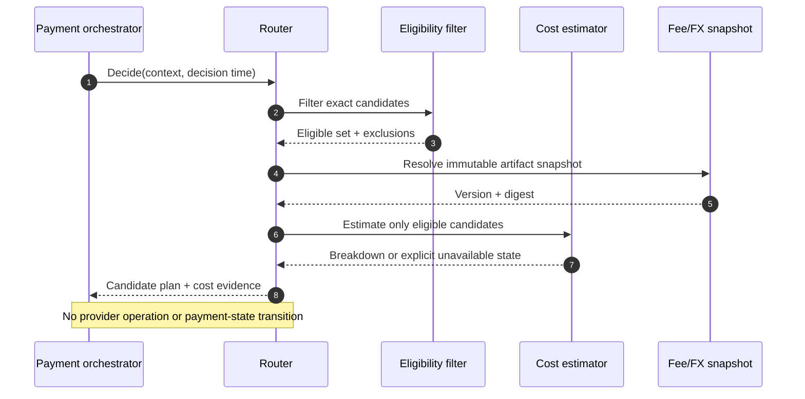
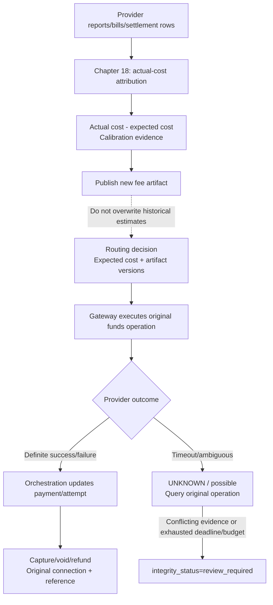

# Chapter 7: Cost-Aware Routing

[中文](../../part-2-routing-engine/cost-aware-routing.md) | **English**

After Chapter 6's eligibility filtering, Aurora can exclude connections that do not support the currency, method, or funds operation. Every remaining candidate can process the payment, but their economics differ. The next question follows naturally: can we choose the cheapest?

“Cheap” is not one percentage on a provider website. Fixed processing fees, proportional fees, cross-border surcharges, foreign exchange (FX), scheme and interchange fees, failed-attempt charging, and the account's contract version can all change the comparison. Online decisions also see only information available then. Final bills require capture, clearing, settlement, and provider reports.

This chapter establishes the following boundary:

> **Expected cost is a decomposable estimate calculated at decision time for an already-eligible candidate from versioned rate and FX facts. It is a decision feature, not a funds fact about charging, posting, settlement, or profit, and never overwrites subsequently attributed actual cost.**

Cost therefore cannot bypass hard constraints, reroute capture, void, or refund because another path is cheaper, or create a “cheaper” new payment while the provider outcome is `UNKNOWN`. Chapter 8 introduces success probabilities, Chapter 9 combines objectives, and Chapter 18 covers settlement and actual-cost attribution.

The companion Go system implements a narrow v3 slice. `fee_catalog.v1` binds immutable rates to `candidate_id + connection_revision + operation + payment_currency`, supporting fixed fees/BPS, explicit cross-border classification, directed FX quotes, and mutually exclusive `attempt / success_only / failure_only` charging scenarios. Each `cost.Result` enters optimization evidence with full breakdown, artifact versions/digests, and evaluation time. The scorer explicitly uses `SucceededCostMicros`, neither adding success and failure charges together nor calling the result actual cost.

This is not yet a production rate platform. Development configuration uses synthetic repository fixtures, without live quotes, contract synchronization, approval/publication, tiers, or settlement/billing attribution. It proves contracts, arithmetic, identity, and degradation semantics only. The Go examples below are compressed teaching projections explaining the invariants; the final section maps simplified fields to the real implementation.

## 7.1 The Problem: The Lowest Rate Is Not Necessarily the Lowest Cost

Suppose two eligible candidates have these contractual rates. Figures are illustrative, not public provider quotes:

| Candidate | Exact execution identity | Fixed fee | Proportional fee | Estimate for 10.00 USD | Estimate for 100.00 USD |
| --- | --- | ---: | ---: | ---: | ---: |
| `cand_us_a` | Provider A / `acct_us` / `conn_a` / `us-east` | 0.30 USD | 2.60% | 0.56 USD | 2.90 USD |
| `cand_us_b` | Provider B / `acct_us` / `conn_b` / `us-east` | 0.10 USD | 2.90% | 0.39 USD | 3.00 USD |

Percentage-only comparison always selects A, although B is cheaper for small payments. Fixed-fee-only comparison always selects B, although A is cheaper for large payments. Crossover directly follows from a fixed plus amount-dependent cost structure. Adyen's pricing page likewise separates processing from payment-method fees and explains variable interchange and other components in some Interchange++ card pricing. Production models therefore need cost structure, not a copied marketing percentage. [Adyen Pricing](https://www.adyen.com/pricing)

Even with fixed fees included, “Provider A” is the wrong pricing key. Accounts, regions, and connectors at the same PSP may have different contracts, settlement currencies, and rates. Routing compares Chapter 6's exact candidates, not brands.

An initial online estimate is `C_attempt = C_fixed + C_variable + C_crossborder + C_fx + C_other_known`.

This describes the estimated cost of initiating one attempt under current information, not the cost of obtaining a successful payment. A cheaper attempt may fail more often and require retries or fallback, increasing final business cost. Before Chapter 8 supplies segmented success probabilities, this chapter cannot answer that question by assumption.



The critical arrow is “eligibility → eligible only,” not “cost → ordering.” A candidate without a contract, violating region requirements, or lacking operation support cannot compete even with zero estimated cost.


*Figure: The low headline rate hides fixed fees, cross-border charges, FX, and other hidden charges. All receipts must enter the total-cost comparison.*

## 7.2 A Simple Design: Start with One Proportional Fee

A minimal system configures a BPS rate—one basis point is one ten-thousandth—for each exact candidate, selecting the smallest estimate only among eligible candidates. This example retains the simple model's limits but gets three things right: integer minor-unit amounts, errors for missing rates rather than zero, and stable candidate-ID tie-breaking.

```go
package simplecost

import (
	"errors"
	"math"
	"sort"
)

var (
	ErrInvalidAmount = errors.New("invalid payment amount")
	ErrMissingRate   = errors.New("missing candidate rate")
	ErrOverflow      = errors.New("cost arithmetic overflow")
)

type Quote struct {
	CandidateID string
	FeeMinor    int64
}

// CheapestPercentage accepts only candidates that passed eligibility.
// Integer division rounds down here; production rounding follows later.
func CheapestPercentage(
	amountMinor int64,
	eligibleCandidateIDs []string,
	rateBPS map[string]int64,
) (Quote, error) {
	if amountMinor <= 0 {
		return Quote{}, ErrInvalidAmount
	}
	quotes := make([]Quote, 0, len(eligibleCandidateIDs))
	for _, id := range eligibleCandidateIDs {
		bps, ok := rateBPS[id]
		if !ok || bps < 0 {
			return Quote{}, ErrMissingRate
		}
		if bps != 0 && amountMinor > math.MaxInt64/bps {
			return Quote{}, ErrOverflow
		}
		quotes = append(quotes, Quote{
			CandidateID: id,
			FeeMinor:    amountMinor * bps / 10_000,
		})
	}
	if len(quotes) == 0 {
		return Quote{}, ErrMissingRate
	}
	sort.Slice(quotes, func(i, j int) bool {
		if quotes[i].FeeMinor != quotes[j].FeeMinor {
			return quotes[i].FeeMinor < quotes[j].FeeMinor
		}
		return quotes[i].CandidateID < quotes[j].CandidateID
	})
	return quotes[0], nil
}
```

This suits early systems with homogeneous rates, one currency, and no fixed components. Its value is a replaceable pure-function boundary: inputs are eligible IDs, amount, and a router-owned rate snapshot; outputs are estimates and stable order. It reads no payment database, calls no gateway, and changes no payment state.

It also reveals the next questions: should integer division round down, up, or nearest? When do rates take effect? In what currency are fixed fees expressed? How is cross-border status determined? Which FX source and time apply? Can a candidate with missing data still be compared? Leaving these to defaults produces a superficially stable but unauditable model.

## 7.3 Scaling Problems: Cost Is a Vector with Time and Provenance

### 7.3.1 Each Component Has Its Own Degree of Knowability

Production rates are more than additional fields. Items may originate in contracts, scheme rules, provider estimates, or later bills, with different certainty at decision time:

| Component | Typical basis | Precisely known at decision time? | Safe online representation |
| --- | --- | --- | --- |
| Fixed processing fee | Fixed amount per request/transaction | Usually, if contract is explicit | Fixed-point amount + currency + operation |
| Provider markup | Amount BPS, fixed amount, or both | If contract and classification are known | BPS/fixed amount + rounding |
| Interchange/scheme fees | Card product, region, MCC, clearing conditions | May be estimated at authorization | `estimated` item + basis/version |
| Cross-border surcharge | Provider/scheme geographic definition | If geography and rules are known | Explicit classification + version |
| FX cost/markup | Source/settlement currencies, rate, markup | Depends on converter and quote freshness | Rational rate + observation/expiry/source |
| Failed-attempt fee | Request, authorization, or another event | Depends on contract and final event | Only contract-supported scenarios, no guessing |
| Refund/chargeback fee | Later independent event | Usually not yet incurred | Separate scenario or later actual cost, not a present charge |

Mastercard's first-party explanation lists factors including merchant category, authorization-to-clearing time, submitted data, and volume, and directs contractual questions to the acquirer or payment service. [Mastercard Merchant Interchange Rates](https://www.mastercard.com/us/en/business/support/merchant-interchange-rates.html) Public tables explain structure but cannot replace Aurora's account-specific contract artifact.

`CostBreakdown` must retain every item's name, amount, currency, estimation basis, and version. The total is a deterministic sum in one quote currency. If an item cannot validly convert to that currency, no comparable total exists; the total is not merely “temporarily a little smaller.”

### 7.3.2 Rates Bind to Candidates, Contract Versions, and Effective Time

Rate publication defines intervals, not overwriting a database row. If the old contract ends at `2026-09-01T00:00:00Z` and the new one starts then, use half-open `[effective_from, effective_until)` intervals:

| `decision_at` | Matching schedule | Reason |
| --- | --- | --- |
| `2026-08-31T23:59:59.999Z` | `fee_v17` | Still in the old interval |
| `2026-09-01T00:00:00Z` | `fee_v18` | Old right endpoint excluded; new left endpoint included |
| Both versions match | Invalid configuration | Loading order cannot choose |
| Neither matches | `missing_schedule` | Do not silently reuse the most recent schedule |

Read `decision_at` once per decision and record schedule version and digest. Estimating A, then reading `time.Now()` during a version boundary before estimating B compares contracts that were never simultaneously valid. Published artifacts are immutable. Corrections create new versions; historical expected cost keeps its original references.

Tiers and monthly volume commitments are harder. The month's hundred-thousandth transaction may arrive concurrently across regions; counts may change through cancellations, backfills, and billing definitions. A safe starting point is a control-plane-published tier snapshot with provenance, or an approved conservative tier. It remains expected cost. Bills, tier calibration, and allocation belong to Chapter 18; publication governance belongs to Chapter 20.

### 7.3.3 Currency Codes, Precision, and Rounding Are Contractual

`amount_minor = 1000` means something only with currency and its minor-unit exponent. ISO 4217 provides alphabetic codes and relationships between minor and major units. Its reference data evolves, so consume versioned metadata rather than assuming two decimals for every currency. [ISO 4217 Currency Codes](https://www.iso.org/iso-4217-currency-codes.html)

To represent fees below a minor unit, this chapter uses `cost_micros`: one millionth of the quote currency's major unit. For USD, `1_000_000 cost_micros = 1 USD`. This is an internal fixed-point unit, not a universal provider API format or a “micro-cent.” Every boundary carries `quote_currency`; screens and reports apply declared display rounding only at the final step.

When fee and quote currencies differ, FX requires base/quote currencies, integer numerator/denominator, source, `as_of`, `expires_at`, and version. Floating-point `0.1` cannot enter the fee path. Reference rates also differ from executable rates. The ECB explicitly describes euro reference rates as informational and strongly discourages transaction use. They can support comparison or calibration, but cannot impersonate actual provider FX without contractual authority. [ECB Euro Foreign Exchange Reference Rates](https://www.ecb.europa.eu/stats/policy_and_exchange_rates/euro_reference_exchange_rates/html/index.en.html)

### 7.3.4 Lowest Attempt Cost Is Not Lowest Cost per Successful Payment

If A's authorization estimate is 20 cost cents and B's is 24, this chapter can say only that A's known per-attempt cost is lower. Lower segment success, technical failures generating more attempts, or billable failures change the expected chain required to complete the payment.

Do not sneak in a global success rate or directly output `cost / probability`. Probability segmentation, windows, samples, and confidence are not yet established; fallback also depends on outcome semantics and `UNKNOWN`. Chapter 7 produces a pure cost breakdown, Chapter 8 an independent success signal, and Chapter 9 combines them under explicit objectives and guardrails. Cost configuration errors cannot then masquerade as funds failure, nor model drift rewrite rate facts.

### 7.3.5 Expected and Actual Costs Must Coexist

| Dimension | Expected cost | Actual cost |
| --- | --- | --- |
| Creation time | Routing decision | After reports, bills, clearing/settlement data arrive |
| Basis | Fee/FX/classification artifact snapshot | Actual fee and settlement rows plus attribution rules |
| Purpose | Decision signal among eligible candidates | Reconciliation, financial attribution, calibration, model-error analysis |
| Historical rewriting | No; retain original estimate/version | Append revisions without overwriting expected cost |
| Proves settlement? | No | A fee row alone does not prove full payment settlement |

Transaction reports reveal differences that cannot always be known beforehand. Adyen's settlement details report, for example, supports transaction-level costs and fields for commission, markup, scheme fees, interchange, and exchange rates. These are inputs to actual-cost attribution, not facts routing already knew before authorization. [Adyen Settlement Details Report](https://docs.adyen.com/reporting/settlement-reconciliation/transaction-level/settlement-details-report)

Calibration compares `actual - expected` to locate omissions, misclassification, or stale rates. Correct by publishing new artifacts and retaining difference evidence, not replacing historical expected values with actual ones. Otherwise, the team loses the ability to explain the original route.

## 7.4 Production Design: Explainable Fixed-Point Estimation That Can Decline Comparison

### 7.4.1 Filter before Estimating

The estimator consumes two frozen inputs: Chapter 4's minimal amount, currency, and geographic-classification facts, and Chapter 6's eligible set. It reads router-owned fee/FX snapshots but does not request live provider quotes, read tokens, or access PAN/CVV.



An eligibility-excluded candidate's `FeeSchedule` should not participate in ranking at all. Conversely, missing cost data does not silently change capability facts. Return `missing_schedule`, `stale_fx`, or `unknown_cross_border`. Only a separately published guardrail may reject routing when costs are incomparable. Ordinary cost code cannot disguise eligible candidates as ineligible using `+∞`.

### 7.4.2 Versioned Schedules and Itemized Breakdowns

This Go core handles same-currency estimates: fixed fees, BPS, and explicit cross-border surcharges all use `cost_micros`; validity is half-open; quotient/remainder arithmetic avoids overflowing `amount * bps`. It accepts normalized currency exponents only. Cross-currency work returns `ErrFXRequired` for an FX layer with complete provenance.

This is a teaching simplification, not a copy of the repository. `FeeSchedule` omits the real key's `ConnectionRevision`, `Operation`, `PaymentCurrency`, and `FixedCurrency`, and collapses real `Attempt`, `Success`, and `Failure` fee groups into one total. Production `cost.Estimate` returns `AttemptCostMicros`, `SucceededCostMicros`, and `FailedCostMicros` separately. v3 scoring consumes only successful-scenario `SucceededCostMicros`, retaining all three and the full breakdown.

```go
package cost

import (
	"errors"
	"math"
	"time"
)

var (
	ErrScheduleNotEffective = errors.New("fee schedule is not effective")
	ErrUnknownCrossBorder   = errors.New("cross-border classification is unknown")
	ErrFXRequired           = errors.New("currency conversion is required")
	ErrInvalidCostInput     = errors.New("invalid cost input")
	ErrCostOverflow         = errors.New("cost arithmetic overflow")
)

type RoundingMode string

const (
	RoundDown   RoundingMode = "down"
	RoundHalfUp RoundingMode = "half_up"
	RoundUp     RoundingMode = "up"
)

type FactState string

const (
	FactKnown   FactState = "known"
	FactUnknown FactState = "unknown"
)

type CrossBorderFact struct {
	State       FactState
	Value       bool
	RuleVersion string
}

type FeeSchedule struct {
	ScheduleID      string
	ArtifactVersion string
	CandidateID     string
	QuoteCurrency   string
	EffectiveFrom   time.Time
	EffectiveUntil  time.Time
	FixedMicros     int64
	VariableBPS     int64
	CrossBorderBPS  int64
	PercentageRound RoundingMode
}

type Input struct {
	AmountMinor      int64
	PaymentCurrency  string
	CurrencyExponent uint8
	DecisionAt       time.Time
	CrossBorder      CrossBorderFact
}

type BreakdownItem struct {
	Kind         string
	AmountMicros int64
	Basis        string
}

type Estimate struct {
	CandidateID        string
	QuoteCurrency      string
	TotalMicros        int64
	Breakdown          []BreakdownItem
	ScheduleID         string
	ArtifactVersion    string
	CrossBorderRuleVer string
	EvaluatedAt        time.Time
}

func EstimateSameCurrency(schedule FeeSchedule, in Input) (Estimate, error) {
	if in.AmountMinor <= 0 || schedule.FixedMicros < 0 ||
		schedule.VariableBPS < 0 || schedule.CrossBorderBPS < 0 {
		return Estimate{}, ErrInvalidCostInput
	}
	if in.DecisionAt.Before(schedule.EffectiveFrom) ||
		(!schedule.EffectiveUntil.IsZero() && !in.DecisionAt.Before(schedule.EffectiveUntil)) {
		return Estimate{}, ErrScheduleNotEffective
	}
	if in.PaymentCurrency != schedule.QuoteCurrency {
		return Estimate{}, ErrFXRequired
	}
	if in.CurrencyExponent > 6 {
		return Estimate{}, ErrInvalidCostInput
	}

	factor, err := pow10(6 - in.CurrencyExponent)
	if err != nil || in.AmountMinor > math.MaxInt64/factor {
		return Estimate{}, ErrCostOverflow
	}
	amountMicros := in.AmountMinor * factor
	variable, err := mulDiv(amountMicros, schedule.VariableBPS, 10_000, schedule.PercentageRound)
	if err != nil {
		return Estimate{}, err
	}

	items := []BreakdownItem{
		{Kind: "fixed", AmountMicros: schedule.FixedMicros, Basis: "contract"},
		{Kind: "variable", AmountMicros: variable, Basis: "amount_bps"},
	}
	total, err := checkedAdd(schedule.FixedMicros, variable)
	if err != nil {
		return Estimate{}, err
	}

	if schedule.CrossBorderBPS > 0 {
		if in.CrossBorder.State != FactKnown {
			return Estimate{}, ErrUnknownCrossBorder
		}
		if in.CrossBorder.Value {
			surcharge, calcErr := mulDiv(
				amountMicros,
				schedule.CrossBorderBPS,
				10_000,
				schedule.PercentageRound,
			)
			if calcErr != nil {
				return Estimate{}, calcErr
			}
			total, err = checkedAdd(total, surcharge)
			if err != nil {
				return Estimate{}, err
			}
			items = append(items, BreakdownItem{
				Kind:         "cross_border",
				AmountMicros: surcharge,
				Basis:        "classified_by:" + in.CrossBorder.RuleVersion,
			})
		}
	}

	return Estimate{
		CandidateID:        schedule.CandidateID,
		QuoteCurrency:      schedule.QuoteCurrency,
		TotalMicros:        total,
		Breakdown:          items,
		ScheduleID:         schedule.ScheduleID,
		ArtifactVersion:    schedule.ArtifactVersion,
		CrossBorderRuleVer: in.CrossBorder.RuleVersion,
		EvaluatedAt:        in.DecisionAt,
	}, nil
}

func mulDiv(value, numerator, denominator int64, mode RoundingMode) (int64, error) {
	if value < 0 || numerator < 0 || denominator <= 0 {
		return 0, ErrInvalidCostInput
	}
	q, r := value/denominator, value%denominator
	if numerator != 0 && (q > math.MaxInt64/numerator || r > math.MaxInt64/numerator) {
		return 0, ErrCostOverflow
	}
	whole := q * numerator
	tail := r * numerator
	partial, remainder := tail/denominator, tail%denominator
	if mode == RoundUp && remainder > 0 {
		partial++
	} else if mode == RoundHalfUp && remainder >= denominator/2+denominator%2 {
		partial++
	} else if mode != RoundDown && mode != RoundHalfUp && mode != RoundUp {
		return 0, ErrInvalidCostInput
	}
	return checkedAdd(whole, partial)
}

func checkedAdd(left, right int64) (int64, error) {
	if left < 0 || right < 0 || right > math.MaxInt64-left {
		return 0, ErrCostOverflow
	}
	return left + right, nil
}

func pow10(exponent uint8) (int64, error) {
	value := int64(1)
	for i := uint8(0); i < exponent; i++ {
		if value > math.MaxInt64/10 {
			return 0, ErrCostOverflow
		}
		value *= 10
	}
	return value, nil
}
```

The estimator deliberately does not infer `CrossBorder`. Its meaning may depend on entity, acquirer region, issuer country, and contract. A result derived from context and versioned classification must include `RuleVersion`. `customer_country != merchant_country` is not universally correct.

Publication validation should at least establish existing candidate IDs with exact account/connector/region binding, nonoverlapping intervals per scope, currencies/exponents from approved reference versions, rounding for every fee item, no overflow at the platform maximum, and a one-to-one version/digest mapping. Runtime checks do not replace publication checks; retain both.

### 7.4.3 Missing and Stale Cannot Mean Free

Results need `comparable`, `unavailable`, and reasons, not just an integer. Go map zero values must never make missing configuration the best route:

| Situation | Prohibited behavior | Explicit result | Configurable safe action |
| --- | --- | --- | --- |
| No effective schedule | `cost = 0` | `missing_schedule` | Abstain for the whole cost stage or use approved static policy |
| Expired schedule | Reuse last version | `stale_schedule` | Fail closed or leave cost comparison |
| Missing/expired required FX | 1:1, NaN, cached zero | `missing_fx` / `stale_fx` | Produce no total; wait or degrade |
| Applicable cross-border fee but unknown facts | Assume domestic | `unknown_cross_border` | Do not compare estimate; record gap |
| Overflow/illegal rounding | Wrap to negative | `arithmetic_error` | Reject evaluation and alert |
| Only some candidates estimable | Compare complete candidates silently | `incomplete_comparison` | Apply merchant policy uniformly to the whole stage |

Abstaining does not mean random selection. Return to an explicit, versioned static order still restricted by eligibility, recording `COST_STAGE_ABSTAINED`. If merchant policy requires comparability for all candidates, return a controlled no-decision result. Availability objectives determine the policy, but configuration must declare it rather than exception code invent it.

If the business forbids execution without trusted rates, make `cost_data_required` a separate guardrail with stable exclusion reasons. Auditors can then distinguish inability to process from organizational refusal to use an unpriceable path, rather than discovering an estimator silently transformed unknown into infinity.

### 7.4.4 Rank Only Complete Estimates

Ranking takes complete estimates corresponding one-to-one with eligible candidates. It neither reads configuration nor ignores omissions:

```go
package costrank

import (
	"errors"
	"sort"
)

var ErrIncompleteComparison = errors.New("incomplete cost comparison")

type Estimate struct {
	CandidateID   string
	TotalMicros   int64
	QuoteCurrency string
}

func RankEligible(eligibleIDs []string, estimates map[string]Estimate) ([]Estimate, error) {
	if len(eligibleIDs) == 0 {
		return nil, ErrIncompleteComparison
	}
	ranked := make([]Estimate, 0, len(eligibleIDs))
	seen := make(map[string]struct{}, len(eligibleIDs))
	quoteCurrency := ""
	for _, id := range eligibleIDs {
		if _, duplicate := seen[id]; id == "" || duplicate {
			return nil, ErrIncompleteComparison
		}
		seen[id] = struct{}{}
		estimate, ok := estimates[id]
		if !ok || estimate.CandidateID != id || estimate.TotalMicros < 0 {
			return nil, ErrIncompleteComparison
		}
		if quoteCurrency == "" {
			quoteCurrency = estimate.QuoteCurrency
		}
		if estimate.QuoteCurrency == "" || estimate.QuoteCurrency != quoteCurrency {
			return nil, ErrIncompleteComparison
		}
		ranked = append(ranked, estimate)
	}
	if len(ranked) != len(estimates) {
		return nil, ErrIncompleteComparison
	}
	sort.Slice(ranked, func(i, j int) bool {
		if ranked[i].TotalMicros != ranked[j].TotalMicros {
			return ranked[i].TotalMicros < ranked[j].TotalMicros
		}
		return ranked[i].CandidateID < ranked[j].CandidateID
	})
	return ranked, nil
}
```

Candidate ID as final tie-breaker provides determinism, not business preference. Chapter 9 may treat differences below contractual precision or an operational materiality threshold as ties. This chapter does not conceal success rate, risk, or latency inside cost numbers.

### 7.4.5 Decision Evidence and Funds Evidence Follow Separate Paths



Expected cost does not make a payment `AUTHORIZED` or `CAPTURED`; a fee row cannot alone make it `SETTLED`. After a timeout, a cheaper candidate is no remedy for uncertainty. Query, receive webhooks, or reconcile using the original `operation_id`. Ordinary `UNKNOWN/possible` remains `processing` while recovery continues. Only conflicting funds evidence, or exhausted recovery deadlines/budgets without safe interpretation, sets the independent integrity state to `review_required`. Do not send every temporary unknown directly to manual review.

Capture, void, and refund likewise belong to the original chain and retain connection and references. Cost rerouting might find a cheaper PSP, but cannot transfer another provider's authorization there. It would create new funds facts and break history.

## 7.5 Failure Modes: Cost Optimization Leads the System Astray

| Failure mode | Symptom | Cause and control |
| --- | --- | --- |
| Estimate before eligibility | Cheap unsupported currency path wins | Freeze eligibility first; estimate only that set |
| Brand-only rates | Different accounts receive identical prices | Key by exact candidate/contract scope |
| `float64` amounts or FX | Boundary values differ across languages | Minor units + fixed point + explicit rounding |
| Missing/NaN/parse failure becomes zero | Worst-data candidate is cheapest | Explicit unavailability; never default free |
| Overlapping effective versions | Restarts/node order change results | Reject overlaps on publication; record digests |
| Reuse old FX indefinitely | Severe deviations during volatility | `as_of`, expiry, provenance, degradation policy |
| Generic `country` classifies cross-border | Domestic surcharges or missed cross-border fees | Named geography and versioned classification |
| Assume all failures free or billable | Systematic bias | Include only contract/event-supported charges with evidence |
| Actual overwrites expected | Historical decisions always appear correct | Immutable associated records; calibrate differences |
| Cross-provider capture/refund to save cost | Original authorization chain breaks | Pin original connection/reference |
| Cheaper route immediately after `UNKNOWN` | Duplicate customer charges | Resolve original operation; no cost-driven fallback |
| Cost score becomes profit or ledger | Routing values enter financial books | Expected cost is decision evidence; ledger/settlement have separate authorities |

Distinguish two unknowns. `cost_estimate_unavailable` means costs cannot be reliably compared; attempt `UNKNOWN` means provider execution is uncertain. The former may trigger cost-stage abstention; the latter triggers original-operation queries and reconciliation. One Boolean for both can turn configuration gaps into funds-state incidents.

Test falsifiable invariants, not one happy-path total: low proportional/high fixed must lose on small payments to high proportional/low fixed; a request exactly at `effective_from` must match only the new version; maximum permitted amounts cannot overflow; absent FX/schedules or unknown cross-border facts cannot produce zero, negative, or NaN; and an extremely low rate cannot restore an ineligible candidate.

## 7.6 Trade-offs: Precision, Availability, and Complexity

| Choice | Benefit | Cost | Suitable boundary |
| --- | --- | --- | --- |
| Complete estimates for every candidate | Fair, auditable comparison | One gap can disable the stage | Mature contracts, strict comparability |
| Static order on missing data | Preserves availability | Temporarily forgoes savings | Record abstention; still enforce eligibility |
| One quote currency | Direct ordering, consistent explanation | FX dependency and extra rounding | Multiple settlement currencies |
| Separate ranking per currency | Avoids unnecessary conversion | No total order across currencies | Naturally currency-grouped candidates |
| Fully replicate complex pricing | Potentially closer fit | Publication, testing, explanation, drift costs | Only with ongoing actual-data calibration |
| Conservative tier snapshot | Deterministic, replayable | May miss short-term discounts | Tiered pricing with unstable concurrent counts |
| Live per-request provider quotes | Potential freshness | Latency, dependency, poor replay | Usually outside synchronous routing |

Negative costs and rebates require explicit choices too. Month-end rebates may exist, but expected rebates as negative per-payment fees can concentrate traffic in pursuit of unconfirmed rewards. Start with nonnegative online fees and auditable Chapter 18 attribution. Future inclusion needs caps, validity, confidence, and a total-cost floor, not merely removing `>= 0` checks.

More complex models can produce six-decimal precision founded on wrong classification. Explainability is part of the model, not an extra UI: breakdowns, basis, schedule/FX/classification versions, and unavailable reasons are essential. `total = 18342` alone cannot distinguish rate changes, classification, stale FX, or rounding.

Minimum expected cost is not the ultimate business objective. Success, risk, health, latency, and traffic commitments may justify another candidate. That reflects correct responsibility, not model failure. The estimator answers “what does this attempt cost under these assumptions?” The explicit multi-objective layer decides whom to choose.

## 7.7 Companion Go System: Implemented v3 Cost Boundaries

The [pinned implementation](https://github.com/YouEclipse/payments/tree/bc4afde24da708d22f67da72a90a1557b1477173/services/router/internal/cost) provides `Compile(Artifact)` and `Estimate(at, Query)`. Compilation rejects revision drift, overlapping schedules, unknown currency precision, overlapping FX intervals, and illegal rounding. Evaluation accepts explicitly frozen time, permitted exact connections, named cross-border classification, and quote currency. Missing, stale, unknown, and overflowing data return typed states/reasons with `Estimate=nil`; legitimate zero fees retain contractual evidence. The pure package supports `sale` and `authorize` schedules, but current v3 optimization accepts only `sale + automatic`; manual-capture funds chains are not implemented.

`routing_optimization.v1` requires fee, performance, and capability candidate manifests to match IDs and revisions exactly. Only candidates permitted by eligibility, rules, and risk are estimated. If any candidate lacks cost or performance, scoring applies the declared `static_order` or `reject` to the entire batch, never comparing only complete cases. Final `executable_until` is shortened to the earliest expiry among schedules, FX, cross-border classification, performance windows, risk, and scoring configuration. A once-computable price cannot authorize execution indefinitely.

Development artifacts are synthetic and providers simulated. Tests establish determinism, explanation, and failure boundaries, not real PSP prices, live FX, or billing accuracy. Actual rate ingestion and approval/publication remain for Chapter 20; actual cost and settlement attribution remain for Chapter 18.

## 7.8 Recap: Cost as Evidence, Not Funds Truth

Starting with a proportional fee, we encountered fixed-fee crossover, then cross-border, FX, validity, failed attempts, and contract scope. The resulting production invariants are:

1. Eligibility and guardrails precede cost. Cost cannot restore excluded candidates.
2. Rates bind exact candidates, account/connector/region scope, effective time, and immutable version, not brands.
3. Amounts, BPS, FX, and rounding use explicitly unit-defined integer/fixed-point arithmetic, never floating point.
4. `CostEstimate` includes quote currency, breakdown, basis, schedule/FX/classification versions, and evaluation time.
5. Missing, stale, unknown, and overflow are explicit incomparable states, never zero fees, NaN, negatives, or silent defaults.
6. Expected cost is a decision-time snapshot; actual cost comes from later reports and attribution. Retain both and calibrate differences without overwriting.
7. Lowest attempt cost is not lowest cost per success. Success probabilities and combined objectives arrive in Chapters 8 and 9.
8. Cost never changes authorization, capture, settlement, or `UNKNOWN` semantics. Subsequent operations and uncertain outcomes remain on the original provider-operation chain.

Routing can then produce explainable, replayable economic signals among permitted candidates, continuously calibrated against actual data, rather than choose the PSP with the cheapest web-page rate. The next chapter asks an independent question without contaminating cost evidence: how likely is this segment to succeed on each candidate?

## Further Reading

* [Chapter 4: Building Routing Context](routing-context.md)
* [Chapter 6: Provider Eligibility](provider-eligibility.md)
* [Chapter 8: Success-Rate Routing](success-rate-routing.md)
* [Chapter 9: Provider Scoring and Risk-Aware Routing](provider-scoring.md)
* [Chapter 18: Settlement and Cost Attribution](../part-4-operating-at-scale/settlement.md)
* [ISO 4217 Currency Codes](https://www.iso.org/iso-4217-currency-codes.html)
* [ECB Euro Foreign Exchange Reference Rates](https://www.ecb.europa.eu/stats/policy_and_exchange_rates/euro_reference_exchange_rates/html/index.en.html)
* [Adyen Settlement Details Report](https://docs.adyen.com/reporting/settlement-reconciliation/transaction-level/settlement-details-report)
