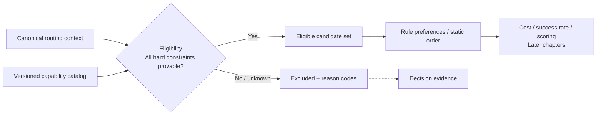
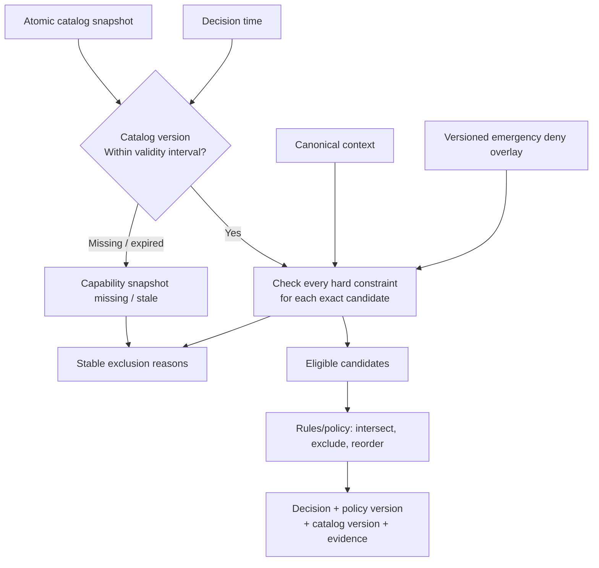
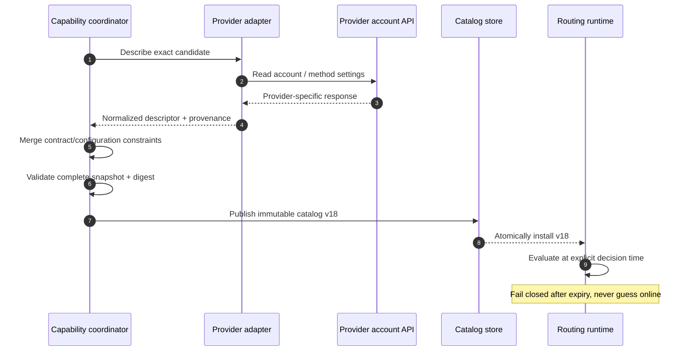
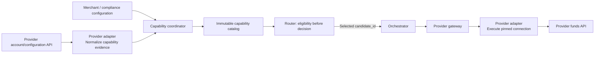

# Chapter 6: Provider Eligibility

[中文](../../part-2-routing-engine/provider-eligibility.md) | **English**

When Aurora entered its second market, it did not immediately add another PSP. It opened another merchant account at the same PSP: the US connection continued processing USD cards, while a new connection handled EUR cards for the European entity. Both used the same connector and displayed the same PSP brand in the dashboard. The team treated them as having “the same capabilities” and simply gave Europe higher rule priority.

The first problematic transaction came from the US site: USD, with a provider token bound to the US account. A merchant tag nevertheless made the rules prefer Europe. The European connection was online, fast, and even had better historical success. It simply could not use that token and lacked the account configuration required for the transaction. **An unexecutable candidate must never enter comparison, however high its score.**

The central proposition is:

> **Eligibility is a set of provable hard constraints evaluated before any preference or score. Capabilities are connection-level facts with versions, provenance, and validity periods, not PSP-brand promises. Unknown or expired facts must never be guessed to mean support.**

We retain Chapter 3's exact candidate identity rather than repeat its provider, account, connector, and region model. This chapter asks whether that particular connection may process the current operation under the current context. Cost, success rates, risk-aware combined scoring, dynamic health, and fallback come later. Adapters may describe and normalize capabilities; funds execution still occurs only through the gateway.

## 6.1 The Problem: Preference Cannot Prove Executability

An initial router can easily put every provider in one scoring table, add or subtract rule scores, and select the winner. It assumes every listed candidate can legally and technically process the request. Local methods, multiple acquiring accounts, manual capture, token binding, and contractual geographic restrictions invalidate that assumption.

Eligibility is a conjunction, not a compensable score:

```
eligible(candidate, context, snapshot) =
    snapshot_known_and_fresh
    AND account_enabled
    AND currency_supported
    AND country_supported
    AND payment_method_supported
    AND operation_supported
    AND amount_in_range
    AND token_portable
    AND merchant_and_compliance_constraints_satisfied
```

Any false term excludes the candidate. Any unknown required fact also prevents admission. Excellence elsewhere cannot offset an unsupported currency or disabled account. This is the boundary between hard constraints and preferences.



Ordering is itself a safety property. If scoring precedes filtering, some code will eventually return an unfiltered winner when no candidate scores perfectly. If force or preference can restore excluded connections, the catalog is merely commentary. Later stages should receive only eligible candidates, not “all candidates plus a reminder to ignore some.”

## 6.2 A Simple Design: Start with v1's Four Hard Filters

Chapter 3's v1 baseline in `services/router/internal/routing` places exact connections and three minimal capability sets in startup configuration. This section examines its properties and limitations. The new v2 catalog in Section 6.8 is a distinct capability declaration.

```go
type Candidate struct {
	ID                      string   `json:"candidate_id"`
	ConnectionRevision      string   `json:"connection_revision"`
	ProviderNamespaceID     string   `json:"provider_namespace_id"`
	Provider                string   `json:"provider"`
	MerchantAccount         string   `json:"merchant_account"`
	Connector               string   `json:"connector"`
	Region                  string   `json:"region"`
	Enabled                 bool     `json:"enabled"`
	SupportedCurrencies     []string `json:"supported_currencies"`
	SupportedPaymentMethods []string `json:"supported_payment_methods"`
	SupportedOperations     []string `json:"supported_operations"`
}
```

`Engine.Decide` first calls `eligibilityReasons` for each candidate. Only IDs without reasons enter static policy ordering. It deliberately collects all known failures rather than stopping at the first. This excerpt omits only existing `Detail` text; constraints and codes remain unchanged:

```go
package routing

import "slices"

type Request struct{ Currency, PaymentMethod, Operation string }
type Reason struct{ Code string }

const (
	ReasonProviderDisabled          = "provider_disabled"
	ReasonCurrencyNotSupported      = "currency_not_supported"
	ReasonPaymentMethodNotSupported = "payment_method_not_supported"
	ReasonOperationNotSupported     = "operation_not_supported"
)

func eligibilityReasons(req Request, candidate Candidate) []Reason {
	reasons := make([]Reason, 0, 4)
	if !candidate.Enabled {
		reasons = append(reasons, Reason{Code: ReasonProviderDisabled})
	}
	if !slices.Contains(candidate.SupportedCurrencies, req.Currency) {
		reasons = append(reasons, Reason{Code: ReasonCurrencyNotSupported})
	}
	if !slices.Contains(candidate.SupportedPaymentMethods, req.PaymentMethod) {
		reasons = append(reasons, Reason{Code: ReasonPaymentMethodNotSupported})
	}
	if !slices.Contains(candidate.SupportedOperations, req.Operation) {
		reasons = append(reasons, Reason{Code: ReasonOperationNotSupported})
	}
	return reasons
}
```

Several baseline properties deserve preservation. Empty capability lists mean unsupported, not wildcard. Callers cannot submit candidates or policies. `NewEngine` validates and copies configuration, which remains immutable during decisions. Exclusions sort stably by candidate ID. With no eligible candidate, HTTP returns `422` and full decision evidence, not a secret default provider.

v1 also appends `not_in_policy` within that loop. Its behavior is deterministic, but conceptually this is a policy constraint, not provider capability. With a separate catalog, the pipeline first builds technically eligible candidates, then applies Chapter 5's rules/policies. Both may appear in final evidence, but must retain separate fact ownership.

| Proven by v1 | Not inferable from v1 alone |
| --- | --- |
| Exact candidate is enabled | Remote provider account can still collect payments |
| Request's three-letter currency is supported | Transaction country, entity, or issuer country meets restrictions |
| Nonsensitive category `card` is supported | Local methods, card brands, 3DS/SCA modes |
| `sale` or `authorize` is supported | Full capture-mode, void, and refund capabilities |
| Static policy includes the candidate | Amount bounds, contract and merchant allowlists |
| Startup produces immutable configuration | Capability provenance, observation time, expiry, catalog version |
| Ineligibility has stable reasons | Token portability across accounts or providers |

The retained v1 OpenAPI reflects this narrow scope: the seven nonsensitive fields from Chapter 4, only `card` for `payment_method`, and `sale` / `authorize` for `operation`. v2 adds a context envelope and richer evidence without silently changing v1. Accepting `authorize` reserves a routing contract; it does not establish end-to-end manual capture. Funds execution remains tokenized-card automatic-capture `SALE`.

## 6.3 Scaling Problems: Why Brand-Level Booleans Mislead

### 6.3.1 Two Connections at One PSP Are Different Capability Subjects

Provider documentation describes potential product capabilities. Production calls a particular account, credential set, region, and connector version. Stripe Connect requires relevant capabilities to be active on the specific connected account and warns that test environments may not enforce some capabilities. Adyen's Management API exposes and changes countries, currencies, and enablement for methods at merchant/store level. These are account facts, not brand constants. [Stripe Account Capabilities](https://docs.stripe.com/connect/account-capabilities), [Adyen: Manage Payment Methods through the API](https://docs.adyen.com/platforms/payment-methods/api)

Consider three connections with the same brand:

| Dimension | `conn_pspa_us_primary` | `conn_pspa_eu_main` | `conn_pspa_eu_moto` |
| --- | --- | --- | --- |
| PSP / connector | PSP A / `pspa_v3` | PSP A / `pspa_v3` | PSP A / `pspa_v3` |
| Account / region | Aurora US / `us-east` | Aurora Europe / `eu-west` | Aurora Europe MOTO / `eu-west` |
| Currency | USD | EUR, GBP | EUR |
| Method | card | card, iDEAL | card |
| Operation | `sale` | `sale`, `authorize` | `sale` |
| Capture | Automatic | Automatic, manual | Automatic |
| Token domain | `pspa:acct_us` | `pspa:acct_eu`, network tokens | `pspa:acct_eu_moto` |
| Account state | Enabled | Enabled | Emergency-disabled |

Storing only `provider=pspa, supports_card=true` loses every important difference. Chapter 3 established which connection was chosen. Here, capabilities must use the same `candidate_id` as their key, or selection and execution still diverge at the last step.


*Figure: The same PSP brand has different account and regional doors. Europe A is open, Southeast Asia B is being tested, and Latin America C has unknown eligibility. A shared brand does not make their capabilities interchangeable.*

### 6.3.2 “Supports Payments” Is a Multidimensional Predicate

Constraints need different evidence and absence policies; they cannot collapse into `supported=true`:

| Dimension | Question | Typical evidence | When missing |
| --- | --- | --- | --- |
| Currency | Can this account create this operation in this currency? | Account settings, contract, provider API | Fail closed |
| Country | Which restriction applies: transaction, entity, customer, or issuer? | Canonical context + precise field definition | Do not substitute another country |
| Method | Is the exact method and variant enabled? | Account-level method configuration | Fail closed |
| Operation / capture | Do `sale`, `authorize`, and capture mode match? | Connector and account capabilities | Fail closed |
| Amount | Are minor units within bounds? | Provider/method limits, merchant contract | Fail closed |
| Account enablement | May account, credentials, and business line accept new transactions? | Remote account state, internal approval | Fail closed |
| Token portability | Can this connection consume the nonsensitive token domain? | Vault binding, token-group/network-token facts | Do not infer support from a shared PSP |
| Merchant / compliance | Are merchant, MCC, entity, region, and authentication requirements satisfied? | Contract and compliance configuration | Fail closed |

Country is particularly easy to misuse. `transaction_country`, `merchant_country`, `customer_country`, and `issuer_country` are not synonyms. Constraints must reference exact fields and provenance from Chapter 4's registry. Substituting billing country for issuer country, or IP location for entity country, disguises absence as knowledge.

Operations cannot be reduced to `payments=true` either. `sale` creates an automatic-capture funds operation; `authorize` authorizes only. Future `capture`, `void`, and `refund` may appear in connector descriptions but cannot trigger rerouting. For existing transactions, orchestration retains the original `provider_connection_id` and reference. It may verify that connection's support, but cannot switch because another is “more eligible.”

### 6.3.3 Tokens Are Part of Capability Intersection, Not Freely Portable Strings

Routing should never see token values, but needs sufficient nonsensitive binding information: `token_domain=pspa:acct_us`, `network_token:merchant_aurora`, or a vault-provided candidate set. Stripe Connect requires explicitly cloning supported PaymentMethod types for direct charges across connected accounts. Clones have independent IDs and do not remain synchronized with the source. Adyen tokens default to one merchant account; sharing requires token groups. The same PSP therefore does not imply token compatibility. [Stripe: Share Payment Methods across Accounts](https://docs.stripe.com/connect/direct-charges-multiple-accounts), [Adyen Tokenization](https://docs.adyen.com/online-payments/tokenization/)

Portability must be explicit. Unknown domains, expired bindings, or incompatibility should produce `token_not_portable` / `token_binding_unknown`, not a trial request to another connection. Migration, cloning, or credential recollection belongs to vault/checkout workflows, not routing's online repair logic.

### 6.3.4 Capabilities Change; Booleans Have No Time Semantics

KYC completion may enable an account; a contract may expire at month-end; a dashboard may disable a method; a new connector may add an operation. A `true` without `observed_at`, `effective_from`, and `expires_at` cannot answer whether it remained true at decision time.

Conflicting sources complicate matters further. A contract may allow EUR while the account API says collection is disabled. A probe reaching the API does not prove acceptance of a real method. Retain provenance and each source's authority rather than letting the last writer override every dimension.

## 6.4 Production Design: A Versioned Capability Catalog

### 6.4.1 Descriptors Express Facts; the Catalog Expresses a Consistent Snapshot

An immutable catalog needs clear constraint semantics, not the largest possible field count. This teaching model includes possible amount and contract extensions; it is not the wire schema. The initial `services/router/internal/capability` supports six set constraints, account state, and validity, but not amounts, merchant allowlists, or compliance tags.

```go
package capability

import "time"

type Support string

const (
	SupportYes     Support = "yes"
	SupportNo      Support = "no"
	SupportUnknown Support = "unknown"
)

type SnapshotMeta struct {
	CatalogVersion string
	PublishedAt    time.Time
	EffectiveFrom  time.Time
	ExpiresAt      time.Time
	Digest         string
}

type Evidence struct {
	Dimension     string
	Source        string
	ObservedAt    time.Time
	EffectiveFrom time.Time
	ExpiresAt     time.Time
}

type CountryConstraint struct {
	ContextField string
	Values       []string
}

type Descriptor struct {
	CandidateID          string
	AccountEnabled       Support
	Currencies           []string
	CountryConstraints   []CountryConstraint
	PaymentMethods       []string
	Operations           []string
	CaptureModes         []string
	AcceptedTokenDomains []string
	MinAmountMinor       int64
	MaxAmountMinor       int64
	AllowedMerchants     []string
	ComplianceTags       []string
	Evidence             []Evidence
}

type Catalog struct {
	Meta        SnapshotMeta
	Descriptors []Descriptor
}
```

There is deliberately no `ProviderSupportsCards bool`. Candidate ID keys each descriptor. Catalog version identifies an atomic snapshot. Evidence names the dimension proved, source, observation time, and validity interval. `CountryConstraint.ContextField` specifies which country is constrained. `SupportUnknown` is inability to prove support, not another selectable preference. The actual wire format uses `Set{state: known/unknown, values: [...]}`: a known empty set explicitly supports nothing; an unknown set proves nothing. Neither means `ANY`.

Where amount bounds depend on currency/method, real schemas need keyed constraints rather than this example's global fields. The example stays narrow to illustrate versions and three-valued semantics. One struct cannot pretend to erase every provider difference.

### 6.4.2 Evaluate All Hard Constraints; Preferences See Only the Result

A production filter accepts canonical context, a complete catalog snapshot, and explicit decision time. It accumulates stable reasons per candidate and returns two sets: eligible candidates and exclusions with complete evidence.

Eligibility retains three-valued outcomes; admission to subsequent stages is a strict binary boundary:

| Status | Proof condition | Admitted? |
| --- | --- | --- |
| `eligible` | Every required constraint has fresh evidence and is true | Yes |
| `ineligible` | Known facts prove at least one constraint false | No |
| `unknown` | No known false, but at least one missing, conflicting, or expired fact | No; fail closed |

A candidate with both false and unknown facts can be top-level `ineligible`, while retaining every reason. Metrics then distinguish explicit lack of support from data-quality faults, and one false condition cannot hide an expiring catalog.



Implement monotonic accumulation of rejection reasons. Expensive external computation may stop early, but output semantics must not depend on check order. This executable teaching subset checks only snapshot, enablement, amount, currency, and token domain, then passes results to a reorder-only preference function. It assumes structurally valid inputs and does not replace full catalog compilation and three-valued filtering.

```go
package capability

import (
	"slices"
	"time"
)

type Reason struct {
	Code   string
	Detail string
}

func BasicReasons(now time.Time, amount int64, meta SnapshotMeta, d Descriptor) []Reason {
	reasons := make([]Reason, 0, 4)
	if meta.CatalogVersion == "" || meta.Digest == "" {
		reasons = append(reasons, Reason{Code: "capability_snapshot_missing"})
	}
	if meta.ExpiresAt.IsZero() || !now.Before(meta.ExpiresAt) || now.Before(meta.EffectiveFrom) || now.Before(meta.PublishedAt) {
		reasons = append(reasons, Reason{Code: "capability_snapshot_stale"})
	}
	// Expired facts prove neither current support nor current non-support.
	if len(reasons) != 0 {
		return reasons
	}
	switch d.AccountEnabled {
	case SupportYes:
	case SupportNo:
		reasons = append(reasons, Reason{Code: "provider_disabled"})
	default:
		reasons = append(reasons, Reason{Code: "capability_unknown"})
	}
	if amount < d.MinAmountMinor {
		reasons = append(reasons, Reason{Code: "amount_out_of_range"})
	}
	if d.MaxAmountMinor <= 0 {
		reasons = append(reasons, Reason{Code: "capability_unknown"})
	} else if amount > d.MaxAmountMinor {
		reasons = append(reasons, Reason{Code: "amount_out_of_range"})
	}
	return reasons
}

type Context struct {
	AmountMinor int64
	Currency    string
	TokenDomain string
}

type FilterResult struct {
	Eligible   []string
	Exclusions map[string][]Reason
}

func FilterSubset(now time.Time, ctx Context, catalog Catalog) FilterResult {
	result := FilterResult{Exclusions: make(map[string][]Reason)}
	for _, d := range catalog.Descriptors {
		reasons := BasicReasons(now, ctx.AmountMinor, catalog.Meta, d)
		if slices.ContainsFunc(reasons, func(r Reason) bool {
			return r.Code == "capability_snapshot_missing" || r.Code == "capability_snapshot_stale"
		}) {
			result.Exclusions[d.CandidateID] = reasons
			continue
		}
		if ctx.Currency == "" || ctx.TokenDomain == "" {
			reasons = append(reasons, Reason{Code: "capability_unknown"})
		} else {
			if !slices.Contains(d.Currencies, ctx.Currency) {
				reasons = append(reasons, Reason{Code: "currency_not_supported"})
			}
			if !slices.Contains(d.AcceptedTokenDomains, ctx.TokenDomain) {
				reasons = append(reasons, Reason{Code: "token_not_portable"})
			}
		}
		if len(reasons) == 0 {
			result.Eligible = append(result.Eligible, d.CandidateID)
		} else {
			result.Exclusions[d.CandidateID] = reasons
		}
	}
	slices.Sort(result.Eligible)
	return result
}

func ApplyPreference(eligible, preference []string) []string {
	ordered := make([]string, 0, len(eligible))
	for _, id := range append(slices.Clone(preference), eligible...) {
		if slices.Contains(eligible, id) && !slices.Contains(ordered, id) {
			ordered = append(ordered, id)
		}
	}
	return ordered
}
```

The actual evaluator also checks the exact country field, payment method, operation/capture mode, each set's known/unknown state, and descriptor validity. Amounts, merchant constraints, and compliance tags above remain future extensions; fields existing does not prove enforcement. Order reasons by a fixed enumeration, not map iteration. `Detail` is for people; programs use stable codes. Public or cross-team details should not disclose account names, contract terms, or credential state.

Extend current codes rather than renaming without reason:

| Reason code | Meaning | Can rules/scoring override? |
| --- | --- | --- |
| `provider_disabled` | Configuration explicitly bars new traffic to the connection | No |
| `currency_not_supported` | Known currency is outside the supported set | No |
| `payment_method_not_supported` | Known method or variant is unsupported | No |
| `operation_not_supported` | Operation or capture mode is unsupported | No |
| `country_not_supported` | Explicitly named country constraint fails | No |
| `amount_out_of_range` | Minor-unit amount exceeds valid bounds | No |
| `token_not_portable` | Known token domain is incompatible | No |
| `merchant_constraint_unmet` | Merchant/contract constraint fails | No |
| `compliance_constraint_unmet` | Requirement is absent or explicitly prohibited | No |
| `capability_snapshot_missing` | No descriptor exists for this candidate | No |
| `capability_snapshot_stale` | Snapshot is outside validity | No |
| `capability_unknown` | Required dimension lacks sufficient evidence | No |

`not_in_policy` can remain in final evidence, but must arise after eligibility. Seeing `currency_not_supported + not_in_policy` then lets operations distinguish technical impossibility from business prohibition and identify each owner.

### 6.4.3 Snapshots and Caches Reuse Only Still-Valid Facts

Do not call PSP configuration APIs synchronously for each payment. That imports external control-plane latency, limits, and failure into routing availability. Collect, validate, and publish complete snapshots in the background; runtime reads immutable in-memory versions.



Freshness requires explicit rules:

1. Install only whole catalogs passing structural, reference, time-range, and integrity checks; never combine half of v17 with half of v18.
2. `observed_at` says when a fact was seen; `effective_from` / `expires_at` say when it may be used. They are not interchangeable.
3. Failed refreshes may retain an unexpired last known good snapshot. After expiry, affected facts become unknown and fail closed.
4. Record catalog version and digest. v2 uses `capability_catalog_version` / `capability_catalog_digest`; v1's `policy_version` is not a capability version.
5. Per-fact TTLs are reasonable, but each decision still references a reconstructible logical snapshot, not merely “latest.”

| Source | Authoritatively establishes | Does not establish |
| --- | --- | --- |
| Approved internal configuration/contract | Merchant allowlists, entities, amount or geographic contract bounds | Current remote account activity |
| Provider account API / webhook | Account state, enabled methods, remote configuration | Internal permission to send this merchant to the connection |
| Connector manifest | Operations, fields, and errors mapped by that version | Account enablement of those capabilities |
| Controlled probe | Credential authentication, endpoint reachability, side-effect-free queries | Acceptance of a real card, amount, or method |
| Historical metrics | Outcomes and latency in a time window | Static contractual/compliance eligibility; scoring follows in Chapters 8 and 13 |

Merging is not a simple source-priority order. Each source speaks only for dimensions it owns; eligibility intersects all hard constraints. Conflicting authoritative sources for one dimension produce unknown/disabled plus an alert, not an arrival-order winner.

### 6.4.4 Emergency Disablement Is a Narrowing-Only Overlay

Startup-only `Enabled` suffices for the baseline but not minute-scale incidents. A production catalog can add a versioned emergency deny overlay keyed by candidate ID, with reason, owner, `created_at`, `expires_at`, and version. Applied after the base descriptor, it can turn eligible into ineligible, never unknown/false into true.

Ownership depends on the cause. Temporary business traffic stops fit Chapter 5's high-priority `exclude`; invalid credentials, terminated contracts, and compliance blocks are eligibility facts. Either way, effects must be monotonically restrictive, versioned, auditable, and limited to new attempts not yet decided. Existing `UNKNOWN` queries and subsequent capture/void/refund retain the original connection. Disablement does not authorize rewriting historical funds identity.

### 6.4.5 Adapters Describe Capabilities; the Gateway Executes Funds

Adapters understand provider-specific fields and can normalize `charges_enabled`, method configuration, and capture semantics into descriptors. This does not mean routing should hold PSP credentials or call remote APIs inside `Decide`.



Collection and execution may reuse provider-semantic modules, but permissions and entry points must differ. The coordinator emits read-only auditable artifacts. The gateway receives pinned identity and idempotent operations and calls funds APIs. Execution adapters cannot choose another account. Routing still outputs only a decision.

## 6.5 Proving through Failure That Hard Boundaries Cannot Be Crossed

The strongest test does not merely show that USD selects A. It creates a tempting wrong choice and proves rejection. This test directly runs the earlier subset without an undefined fixture DSL:

```go
package capability

import (
	"slices"
	"testing"
	"time"
)

func TestFilter_SameProviderConnectionsCannotBypassEligibility(t *testing.T) {
	now := time.Date(2026, 8, 1, 0, 0, 0, 0, time.UTC)
	ctx := Context{
		AmountMinor: 2599,
		Currency:    "USD",
		TokenDomain: "pspa:acct_us",
	}
	catalog := Catalog{
		Meta: SnapshotMeta{CatalogVersion: "catalog_v1", Digest: "example_digest",
			PublishedAt: now.Add(-time.Hour), EffectiveFrom: now.Add(-time.Hour), ExpiresAt: now.Add(time.Hour)},
		Descriptors: []Descriptor{
			{CandidateID: "conn_pspa_us", AccountEnabled: SupportYes, Currencies: []string{"USD"},
				AcceptedTokenDomains: []string{"pspa:acct_us"}, MinAmountMinor: 1, MaxAmountMinor: 100000},
			{CandidateID: "conn_pspa_eu", AccountEnabled: SupportYes, Currencies: []string{"EUR"},
				AcceptedTokenDomains: []string{"pspa:acct_eu"}, MinAmountMinor: 1, MaxAmountMinor: 100000},
		},
	}
	result := FilterSubset(now, ctx, catalog)
	if !slices.Equal(result.Eligible, []string{"conn_pspa_us"}) {
		t.Fatalf("unexpected eligible set: %v", result.Eligible)
	}
	codes := make([]string, 0)
	for _, reason := range result.Exclusions["conn_pspa_eu"] {
		codes = append(codes, reason.Code)
	}
	if !slices.Contains(codes, "currency_not_supported") || !slices.Contains(codes, "token_not_portable") {
		t.Fatalf("lost rejection evidence: %v", codes)
	}
	ordered := ApplyPreference(result.Eligible, []string{"conn_pspa_eu", "conn_pspa_us"})
	if !slices.Equal(ordered, []string{"conn_pspa_us"}) {
		t.Fatalf("preference resurrected an excluded connection: %v", ordered)
	}
}
```

It proves that same-PSP connections are evaluated separately, candidates retain multiple failures, and a Europe-first preference cannot restore Europe. The companion repository repeats the safety claim with real catalogs and rules. Passing the teaching subset does not replace full implementation tests.

At least the following failure matrix is also needed:

| Fault injection | Expected result | Invariant proved |
| --- | --- | --- |
| Missing descriptor | `capability_snapshot_missing`; zero gateway calls | Absence is not wildcard |
| Catalog beyond `expires_at` | Dependent facts unknown; no-candidate evidence | Expiry cannot become support |
| Same-provider candidates; only one supports USD automatic capture | Retain only exact match | Brand cannot override connection facts |
| `force` / `prefer` targets ineligible connection | Empty set or other eligible candidates survive | Policy cannot manufacture capability |
| Token domain belongs to another account | `token_not_portable` | Same-PSP tokens are not automatically portable |
| Known supported currency, absent country | `capability_unknown` | One dimension cannot prove another |
| Emergency denial after installation | New decisions exclude; old operations query original connection | Disablement affects only new routing |
| New catalog has half the descriptors | Reject whole install; retain unexpired old version | Snapshot atomicity |
| All candidates excluded | `422` + stable exclusions; zero gateway calls | No hidden default |
| Shuffle descriptor/candidate order | Same decisions, reason order, digest | No reliance on map/file order |

Cross-service tests must directly assert zero gateway calls. Checking only routing's return value misses orchestration executing an old default after `422`; unit tests can all pass while the funds boundary is bypassed.

## 6.6 Failure Modes: Common Capability-System Self-Deceptions

### An Empty List Means Everything Is Supported

Omitted `supported_currencies` decodes to an empty slice. Treating it as unrestricted turns a deployment mistake into expanded traffic. Current `contains` returns false for empty lists; preserve that fail-closed property. A real `ANY` must be explicit, schema-validated, and supported by provenance.

### One Successful Probe Proves Full Payment Capability

Authenticated access to an account-query API proves only authentication and that endpoint. It does not prove currency, real amount, token, or capture support. Probe evidence fills only its own fields and cannot override account and contract facts.

### Dynamic Failures Become Static Capabilities

Temporary latency, timeouts, or lower performance for a BIN segment do not mean permanent lack of card support. Writing these into capabilities causes flapping and ownership confusion. Chapter 13 models health/breakers; Chapter 8 models historical success. Eligibility consumes only signals explicitly promoted to hard disablement.

### Only the Winner Is Recorded

When all candidates fail, `no eligible provider` cannot distinguish expired catalogs, nonportable tokens, and forbidden contracts. Stable per-candidate reasons, catalog version, decision time, and policy version are necessary replay evidence. Chapter 14 develops persistence.

### An Execution Adapter Secretly Finds a Compatible Account

If an adapter receives `conn_pspa_eu`, detects token incompatibility, and uses `conn_pspa_us`, recorded decisions and actual funds paths diverge immediately. Pin execution. Reveal incompatibility before eligibility; if missed, return an execution error, never silently reroute.

### Last Known Good Is Used Forever after Expiry

A last known good version is good only while valid. Unlimited extension prevents revocations, contract expiry, and closed accounts from taking effect. If tolerance must be longer, define `expires_at` and a risk owner at publication, not by ignoring validity during an outage.

## 6.7 Trade-offs: The Cost of Provable Eligibility

**Fail-closed behavior and short-term availability.** Expired catalogs increase `no eligible provider`; assuming support sends transactions down technically or legally unavailable paths. Improve availability with replicated storage, early refresh, per-dimension TTLs, and unexpired last known good snapshots, not guesses.

**Unified models and provider differences.** Canonical fields shield routing from individual APIs, but the lowest common denominator loses critical semantics. Use version-controlled core fields and provider-specific evidence. Eligibility consumes defined canonical constraints; unknown extensions do not prove support.

**Snapshot granularity and release frequency.** Whole catalogs simplify atomic installation and replay but grow with candidate count. Row updates are lighter yet risk mixed versions. Sharding is possible if each decision identifies a manifest and shard digests; complexity cannot collapse into “read latest rows.”

**Reason transparency and information leakage.** Detailed reasons aid operations and tests, but account, contract, and compliance details belong outside uncontrolled logs/public APIs. Stable codes may cross boundaries; sensitive evidence stays in access-controlled audit records.

**Synchronous discovery and runtime isolation.** Online PSP queries seem current but add latency, throttling, and cascades. Asynchronous snapshots accept bounded staleness while establishing versions and validity. They better suit the payment hot path, with webhooks/polling reducing observation delay.

## 6.8 The Companion Go System's Narrow Vertical Increment

The [pinned implementation](https://github.com/YouEclipse/payments/tree/bc4afde24da708d22f67da72a90a1557b1477173/services/router/internal/capability) accepts `capability_catalog.v1` without requiring a general configuration platform. `Compile` requires a full candidate manifest and corresponding descriptors. It rejects aliases for one execution connection, duplicate IDs, partial snapshots, invalid sources, and time ranges, then copies and canonicalizes the whole version into an immutable catalog and digest.

The initial wire constraints comprise six sets: currencies, countries attached to an explicit country field, methods, operations, capture modes, and credential domains, plus enablement and descriptor validity. The country field is only `merchant.country` or `payment_method_context.issuer_country`; unknown cannot silently change its meaning. Known and unknown sets are explicit; known-empty supports nothing. Amount ranges, merchant allowlists, compliance tags, and online account discovery are not integrated. Teaching-model fields are not implementation claims.

`Catalog.Filter` evaluates purely at context build time. Expired catalogs/descriptors are unknown and no longer prove current support or non-support. A fresh known rejection makes the top-level candidate ineligible while preserving unknown reasons. Only candidates supported by every required fact enter Chapter 5's engine. HTTP rechecks validity at actual return time so a long pause cannot authorize new execution with stale facts.

Local artifacts are explicitly demo data. The same simulator provider's US primary supports USD/BRL, the European backup supports EUR, and both share a declared simulator credential domain. GBP has no eligible connection. Compose tests can therefore verify exact selection, no attempts/operations for no-candidate results, and original-connection convergence after response loss. They do not prove real PSP account, contract, or token compatibility. The demo's long validity period is not a production freshness template.

Decisions carry catalog version/digest, ruleset version/digest, and complete eligibility evidence. After selection, payment pins them with context in the attempt transaction. Dynamic health, complete storage, costs and success rates, online refresh, and cross-region publication remain later work. Real database and cross-service tests must verify execution boundaries; pure-function tests alone cannot.

## 6.9 Recap: Prove a Path Is Possible before Asking Whether It Is Worthwhile

Eligibility asks which exact connection has evidence to process this operation, not which provider is better. Proof attaches to candidate identity and considers currency, precisely defined country, method, operation/capture, amount, enablement, portability, merchant contract, and compliance. Brand documentation informs modeling but does not replace account facts.

Catalogs organize facts into immutable snapshots with provenance, versions, digests, and validity. False excludes; unknown and expired also fail closed. Emergency overlays only narrow. Exclusions retain stable reasons; no candidate returns an auditable failure with no gateway call. Adapters describe and normalize, routing filters and decides, and the gateway executes only pinned connections.

We retained v1's four-filter fail-closed baseline and evolved it into a connection-level catalog with versions, times, and sources. Unsupported dimensions remain explicit limitations rather than extra fields on a brand Boolean. Chapter 5's rules now have an input boundary they cannot cross.

The next chapter estimates cost only within eligible candidates. No fee, however low, can restore a connection excluded here.

## Further Reading

* [Stripe Connect: Account Capabilities and Configuration](https://docs.stripe.com/connect/account-capabilities)
* [Stripe Connect: Share Payment Methods across Multiple Accounts](https://docs.stripe.com/connect/direct-charges-multiple-accounts)
* [Stripe: Payment Method Support](https://docs.stripe.com/payments/payment-methods/payment-method-support)
* [Adyen: Manage Payment Methods through the API](https://docs.adyen.com/platforms/payment-methods/api)
* [Adyen: Tokenization](https://docs.adyen.com/online-payments/tokenization/)
* [Chapter 3: Payment Routing Boundaries](../part-1-foundations/routing-system-boundaries.md)
* [Chapter 4: Building Routing Context](routing-context.md)
* [Chapter 5: Rule-Based Routing](rule-based-routing.md)
* [Chapter 7: Cost-Aware Routing](cost-aware-routing.md)
* [Chapter 13: Provider Health and Circuit Breakers](../part-3-reliability/provider-health.md)
* [Chapter 20: Routing Configuration Platform](../part-5-global-routing/configuration-platform.md)
