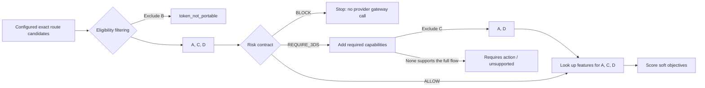
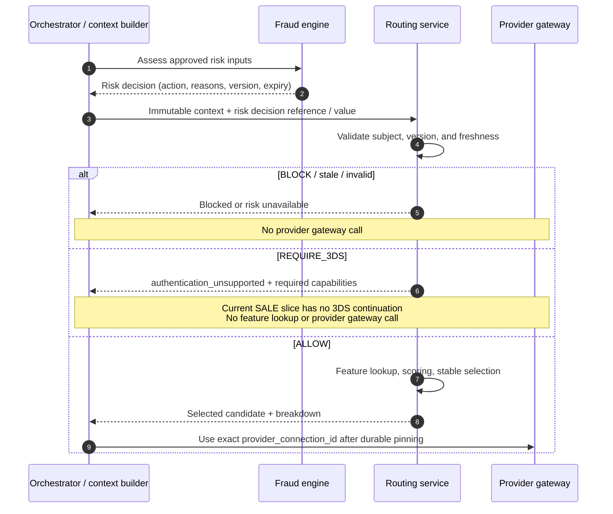

# Chapter 9: Provider Scoring and Risk-Aware Routing

[中文](../../part-2-routing-engine/provider-scoring.md) | **English**

Aurora can now answer three kinds of questions: rules express business intent, eligibility filtering proves that an exact provider connection can handle the current operation, and cost and performance supply versioned soft evidence for eligible routes. The team therefore writes what appears to be a complete formula:

\[
score=0.50\times success-0.25\times cost-0.20\times risk+0.05\times preference
\]

The formula soon creates a dangerous problem: a connection receives `BLOCK` from the fraud engine, yet its high historical success rate and low cost still give it the highest score. Engineers increase the risk weight. Next time, a connection that does not support the current token or 3DS flow wins because it performs well on the other three terms.

The problem is not insufficiently precise weights. Two different kinds of semantics have been placed in one compensable number. Currency, account status, central risk blocks, and authentication requirements are inviolable guardrails; expected cost, conditional success rate, and approved business preferences are objectives that can be traded off.

This chapter establishes the final invariant of Part II:

> **Production routing is constrained optimization executed in fixed stages. Context validation, eligibility filtering, rule guardrails, and the risk contract first define the allowed set. Feature lookup and scoring compare soft objectives only within that set; stable selection produces a complete breakdown. The fraud engine owns risk decisions. The routing service neither reads raw fraud features nor reassesses risk.**

The full sequence is fixed: context validation → eligibility filtering → rule guardrails → risk contract → feature lookup → scoring → stable selection.

This chapter only brings together the inputs and signals from [Chapter 4](routing-context.md) through [Chapter 8](success-rate-routing.md). Timeouts, retries, `UNKNOWN`, and fallback remain for [Chapter 10](../part-3-reliability/timeout-and-retry.md) through [Chapter 12](../part-3-reliability/fallback-routing.md); minute-scale health joins in [Chapter 13](../part-3-reliability/provider-health.md). The complete routing decision store, experiments, and models are covered in [Chapter 14](../part-4-operating-at-scale/routing-decision-store.md), [Chapter 16](../part-4-operating-at-scale/experimentation.md), and [Chapter 21](../part-5-global-routing/intelligent-routing.md), respectively. The current automatic-capture `SALE` slice does not gain full 3DS, manual capture, or real PSP support merely by having a `REQUIRE_3DS` field.

The companion Go system implements the complete narrow v3 routing pipeline: `routing_context.v2` carries a subject-bound, expiring `risk_decision.v1`; the routing service executes context, capability, rule, risk, cost, performance, integer-scoring, and stable-selection stages in order. After strict validation, the payment service pins the complete semantics of risk/optimization evidence and `candidate_order` in JSONB snapshots, reconstructing the content ID under a typed specification when rereading them. “Complete” does not mean preserving original response bytes or object-key order. It refers only to this chapter's tokenized-card, automatic-capture `SALE` contract: risk currently comes only from local/test fixtures or a fail-closed unavailable state, and cost/performance artifacts are synthetic. There is no real fraud engine, dynamic health, production artifact publishing platform, 3DS continuation, or real PSP.

## 9.1 The Problem: Why the Highest Score May Identify a Forbidden Route

Suppose Aurora has four route candidates for a 120 EUR card payment. The following numbers are illustrative and do not describe actual providers:

| Route candidate | Eligibility | 3DS execution capability | Expected cost | Estimated success rate | Intuitive result |
| --- | --- | --- | ---: | ---: | --- |
| A | Eligible | Yes | 0.28 EUR | 91% | May be compared |
| B | `token_not_portable` | Yes | 0.16 EUR | 96% | Must be excluded |
| C | Eligible | No | 0.12 EUR | 97% | May be compared only when the risk decision is `ALLOW` |
| D | Eligible | Yes | 0.24 EUR | 94% | May be compared |

Converting both `eligible=false` and `BLOCK` into penalties requires inventing a “sufficiently large negative number.” Future objectives, unit changes, or higher weights may offset it. Negative infinity introduces special cases in serialization, cross-language handling, and missing-value processing.

A set is safer. B leaves the pipeline after eligibility filtering. The fraud engine gives one risk action for this transaction: `BLOCK` stops A, C, and D; `REQUIRE_3DS` adds a hard capability requirement, excludes C, and allows only A and D to proceed; `ALLOW` lets A, C, and D receive cost/performance features and enter the scorer. Ordering itself is a safety property, not an implementation detail.



Scope is often overlooked here. A risk decision usually constrains the business facts of this payment/payment attempt; it is not each candidate's own “risk attribute.” The routing service should not run a homemade fraud formula separately for A, B, and C. It consumes the fraud engine's action for the current transaction and selects among the connections that action permits.

## 9.2 The Simple Design: What a Weighted Sum Can Teach Us

A weighted sum is a reasonable first version if all candidates already satisfy hard constraints and every feature is complete, comparable, and version-consistent. It maps multiple soft objectives into a total order that is easy to explain and analyze for sensitivity.

The simplest Go function might be:

```go
package naive

type Features struct {
	SuccessRate float64
	Cost        float64
	RiskScore   float64
}

func Score(f Features) float64 {
	return 0.50*f.SuccessRate - 0.25*f.Cost - 0.20*f.RiskScore
}
```

This compiles but lacks stable semantics. Is `SuccessRate` `0.94` or `94`? Is `Cost` in EUR, cents, or cost micro-units? Does `RiskScore=70` mean the same thing across fraud providers? Will a missing map value become zero? Will `NaN` destroy the comparator's total order?

Even after scaling everything to `0–1`, dynamic min–max normalization can behave counterintuitively: adding an extremely expensive candidate that could never win compresses the other candidates' cost range and may change the original winner. If normalization depends on the competitors present in this particular request, a connection's score is no longer replayable.

What deserves to survive from the weighted sum is explicit objectives, contributions, and weights. Production design adds three boundaries: guardrails stay outside the formula; each feature retains its own units and evidence before a versioned normalizer projects it into common points; missing or expired data triggers a previously published degradation policy rather than a zero value.

## 9.3 Problems at Scale: Not Every Number Should Become a Feature

### 9.3.1 Classify Signals Before Discussing Weights

This table matters more than a weight table:

| Signal | Authoritative owner | Type | Can other objectives compensate? | When missing / expired |
| --- | --- | --- | ---: | --- |
| Context schema, amount, currency, funds operation | Orchestrator / context builder | Validation | No | Fail the request; do not guess defaults |
| Capability / account / token binding | Capability catalog | Eligibility guardrail | No | Unknown means ineligible |
| Rule `include` / `exclude` | Routing policy | Policy guardrail | No | Use a validated artifact or reject |
| Fraud `BLOCK` / `REQUIRE_3DS` | Fraud engine | Risk guardrail | No | Fail closed under the risk policy |
| Rule `prefer` | Routing policy | Objective / stable ranking | Yes, as defined by the scoring profile | Use the versioned default order |
| Expected cost | Cost-artifact producer | Objective | Yes | Abstain from the stage or return no decision; never use zero |
| Performance estimate | Performance-data producer | Objective | Yes | Stage abstention / prior / static order, explicitly recorded |
| Provider health | Health subsystem | Guardrail / feature in a later chapter | Depends on the Chapter 13 contract | Not integrated early in this chapter |
| Payment outcomes / settlement | Orchestrator / finance | After-the-fact facts | Excluded from this online score | Calibrate later; do not rewrite historical scores |

Classification prevents weighting everything merely because it is numeric. AVS results, IP addresses, email addresses, device fingerprints, full addresses, and raw model vectors are inputs to the fraud engine and should not be copied into the routing service. Routing sees, at most, the authorized action, stable reason categories, decision version, and validity. This preserves ownership and limits sensitive-data propagation into logs, traces, and decision evidence.

### 9.3.2 Risk-Aware Routing Does Not Mean Building Another Fraud Engine

Fraud providers' score ranges, thresholds, and actions are not inherently comparable. Stripe's official documentation distinguishes `risk_score`, `risk_level`, and outcomes, with configurable thresholds; Adyen risk profiles can produce allow, block, review, or 3DS requirements. These outputs belong to each risk system's semantics. Applying `100-score` to two raw numbers does not create a universal safety metric. [Stripe Radar supported attributes](https://docs.stripe.com/radar/rules/supported-attributes) [Adyen risk-profile configuration](https://docs.adyen.com/risk-management/configure-your-risk-profile)

At the fraud-engine boundary, the platform should normalize implementations into its own `RiskDecision`:

| Action | Routing-service semantics | Enters scoring? | May call the provider gateway? |
| --- | --- | ---: | ---: |
| `ALLOW` | Risk gate passes; continue | No | After route selection |
| `BLOCK` | Stop; produce no executable candidate | No | No |
| `REQUIRE_3DS` | Add hard `3ds_required` capability and intersect capabilities again | No | Only if the full authentication flow is executable |
| `MANUAL_REVIEW` | Return a controlled review state; initiate no new funds operation | No | No by default |

The fraud engine may use rules, models, and high-dimensional signals to form an action. The routing service neither knows nor needs to know “why the device fingerprint contributed 17 points.” Stable reason codes may include `velocity_anomaly` or `authentication_required`, but must not contain full emails, IP addresses, PAN, CVV/SAD, or free-form analysis.

Risk decisions must also bind the subject and time. An `ALLOW` issued three minutes ago for a 20 EUR attempt cannot be replayed for a new 2,000 EUR payment attempt. An expired `ALLOW` does not mean “lower risk”; it means there is no current authorization. If a new payment attempt is legitimately created after a definitive preceding failure, build a new context and obtain a new risk decision. When the original funds operation is `UNKNOWN`, create no new attempt and do not reroute under the pretext of refreshing risk.

### 9.3.3 `REQUIRE_3DS` Is a Flow Requirement, Not a Penalty

3DS is not a Boolean label added before continuing an ordinary `SALE`. EMVCo's 3-D Secure documentation defines protocol architecture, messages, and interaction channels; implementations may enter frictionless, challenge, or other flows. [EMVCo 3-D Secure documentation](https://www.emvco.com/whitepapers/emv-3-d-secure-whitepaper/3-d-secure-documentation/3-d-secure-specification/) `REQUIRE_3DS` therefore requires, at minimum, support for the required protocol across the current connector, merchant account, client channel, and orchestrator flow—not just `supports_3ds=true` in candidate configuration.

The EU regulatory technical standards for SCA define strong customer authentication and exemptions. Applicability also depends on the entities, payment scenario, acquirer, and legal assessment; the routing service cannot declare an exemption from country and amount alone. [Commission Delegated Regulation (EU) 2018/389](https://eur-lex.europa.eu/legal-content/EN/TXT/?uri=CELEX%3A32018R0389) Routing executes normalized risk/authentication requirements and versioned capability facts.

The companion system does not currently implement a full 3DS challenge and continuation state machine. Its safe v3 behavior is therefore the risk outcome `authentication_unsupported`, an empty candidate order, and no provider gateway call. It must never reduce `REQUIRE_3DS` to a minus-fifty-point penalty and continue an automatic-capture `SALE` to preserve conversion. A future `requires_action` continuation needs its own end-to-end state machine and contract; existing fields do not establish that it exists.

### 9.3.4 Missing, Stale, and Invalid Are Not Three Different Scores

Cost and performance require explicit feature states:

| State | Meaning | Forbidden behavior | Action before scoring |
| --- | --- | --- | --- |
| `known` | Value, unit, version, and validity have passed checks | Copy only a bare value | Retain evidence, then normalize |
| `missing` | No evidence for the candidate / segment | Use a Go zero value | Abstain from or fail the entire stage according to configuration |
| `stale` | Evidence existed but has expired | Reuse indefinitely as last-known-good | Degrade explicitly and record the old version |
| `invalid` | NaN, out-of-range value, inconsistent currency, incorrect digest or count | Clamp and continue | Reject the feature batch and alert |

Abstaining from the entire stage is crucial. If only B lacks cost, assigning zero to B's cost contribution rewards or punishes data quality. Comparing only A and C silently turns a soft objective into an eligibility constraint on B. A safe published configuration declares that all allowed candidates must have comparable cost; otherwise cost abstains as a whole or the system returns no decision. If the business truly prohibits execution without reliable rates, that belongs in an independent `cost_data_required` guardrail, not an exception branch.

Risk does not use this soft degradation. Missing, subject-mismatched, or expired risk decisions must fail closed when platform policy requires risk assessment. Switching to `success_only` cannot bypass a central block.

### 9.3.5 Normalization Is Itself a Versioned Policy

Cost uses `cost_micros` in the quote currency; success uses a probability with sample counts and intervals. Both retain their original units. The normalizer produces only a fixed-point scoring projection, for example on a `0–10,000` scale:

\[
success\_points=round(p\times 10{,}000)
\]

\[
cost\_points=10{,}000\times\frac{cost\_ceiling-cost}{cost\_ceiling-cost\_floor}
\]

Costs outside fixed bounds may clamp to `0` or `10,000` points, while the original `TotalMicros` remains in the cost breakdown. `cost_floor`, `cost_ceiling`, rounding, weights, and merchant applicability belong to `scorer_profile_version`; they must not be generated from this request's minimum and maximum candidate costs.

A success point estimate must retain Chapter 8's `sample_size`, interval, window, `source_segment`, and snapshot version. The normalizer creates a projection, not replacement evidence. Historical success remains an observational conditional estimate; a combined score does not promote it into a causal effect.

### 9.3.6 Expected Margin and Cost per Success Carry Assumptions

Once cost and success appear together, teams readily write `cost / success_probability` and name it “cost per successful payment.” It offers intuition for an isolated, single-attempt model with no fees on failure, but it is neither an actual bill nor total payment cost. Providers may charge failed attempts; technical errors, soft declines, and definitive declines permit different next actions; `UNKNOWN` cannot immediately create another attempt; and successive outcomes are not independent.

Another common objective is expected margin:

\[
expected\_margin=p_{success}\times order\_margin-expected\_processing\_cost
\]

It is closer to business value than a dimensionless weighted sum, but adds ownership questions. `order_margin` comes from commercial/finance systems, not the routing service guessing from order amount. A versioned definition must specify whether refunds, chargebacks, fulfillment, and taxes are included. Chapter 8's probability is a conditional estimate under historical policy, not the causal success rate after switching candidates. Multiplying a selection-biased point estimate by a high margin amplifies the error too.

A first version can therefore retain independent cost and success contributions. Adopting cost per success or expected margin later requires publishing the formula, input owners, units, windows, missing-data policy, and applicable attempt model as a new `objective_version`. In particular, risk loss cannot be inserted into expected margin to offset `BLOCK` in pursuit of an “economic optimum.” Final attribution of chargebacks, settlement, and actual fees belongs to [Chapter 17](../part-4-operating-at-scale/reconciliation.md) and [Chapter 18](../part-4-operating-at-scale/settlement.md); it cannot be fabricated as an online known fact.

## 9.4 Production Design: Separate Hard Gates from Soft Scoring

The production pipeline has two channels through which evidence cannot flow backward:

```mermaid
flowchart LR
    Context["1 Context validation"] --> Eligibility["2 Eligibility filtering"]
    Eligibility --> Rules["3 Rule guardrails"]
    Rules --> Risk["4 Risk contract"]

    subgraph Hard["Hard gates: shrink the set or stop"]
        Eligibility
        Rules
        Risk
    end

    Risk -->|"Allowed candidate set"| Lookup["5 Feature lookup"]
    Lookup --> Batch["Validate the complete feature batch"]
    Batch --> Normalize["Versioned normalizer"]
    Normalize --> Score["6 Scoring + breakdown"]
    Score --> Select["7 Stable selection"]

    subgraph Soft["Soft objectives: compare only the allowed set"]
        Lookup
        Batch
        Normalize
        Score
        Select
    end

    Select --> Decision["Routing decision<br/>Selected candidate + evidence versions"]
    Decision -.-> Orchestrator["Orchestrator subsequently pins the attempt / funds operation"]
```



Each stage accepts only the preceding stage's output type. The scorer's signature should not accept all configured candidates, because future callers can easily forget filtering. Feature loaders likewise receive only allowed IDs, avoiding wasted I/O for excluded connections and misleading “high-scoring but ineligible” logs.

### 9.4.1 The Risk Contract Only Validates and Executes Actions

The Go types below show the minimum risk contract routing needs. `SubjectDigest` binds the normalized context but is not proof of anonymization; full risk features stay in the fraud engine. Reason codes must be sorted and unique so identical input produces identical evidence digests. To emphasize the gate, these teaching types omit production `SchemaVersion`, `Source`, and the canonical decision digest. Action behavior matches the current automatic-capture `SALE` slice: `REQUIRE_3DS` preserves required-capability evidence but cannot execute without an authentication continuation.

```go
package riskcontract

import (
	"errors"
	"sort"
	"time"
)

type Action string

const (
	Allow        Action = "allow"
	Block        Action = "block"
	Require3DS   Action = "require_3ds"
	ManualReview Action = "manual_review"
)

var ErrInvalidRiskDecision = errors.New("invalid risk decision")

type Decision struct {
	DecisionID    string
	SubjectDigest string
	Action        Action
	ReasonCodes   []string
	Version       string
	EvaluatedAt   time.Time
	ExpiresAt     time.Time
}

type Gate struct {
	Continue             bool
	RequiredCapabilities []string
	Outcome              string
	ReasonCodes          []string
}

func Evaluate(now time.Time, subjectDigest string, d Decision) (Gate, error) {
	if subjectDigest == "" || d.DecisionID == "" || d.Version == "" || d.SubjectDigest != subjectDigest ||
		d.EvaluatedAt.After(now) || !d.EvaluatedAt.Before(d.ExpiresAt) ||
		!now.Before(d.ExpiresAt) || !sortedUnique(d.ReasonCodes) {
		return Gate{}, ErrInvalidRiskDecision
	}

	reasons := append([]string(nil), d.ReasonCodes...)
	switch d.Action {
	case Allow:
		return Gate{Continue: true, Outcome: "allowed", ReasonCodes: reasons}, nil
	case Require3DS:
		if len(reasons) == 0 {
			return Gate{}, ErrInvalidRiskDecision
		}
		return Gate{
			RequiredCapabilities: []string{"3ds_required"},
			Outcome:              "authentication_unsupported",
			ReasonCodes:          reasons,
		}, nil
	case Block:
		if len(reasons) == 0 {
			return Gate{}, ErrInvalidRiskDecision
		}
		return Gate{Outcome: "blocked", ReasonCodes: reasons}, nil
	case ManualReview:
		if len(reasons) == 0 {
			return Gate{}, ErrInvalidRiskDecision
		}
		return Gate{Outcome: "requires_review", ReasonCodes: reasons}, nil
	default:
		return Gate{}, ErrInvalidRiskDecision
	}
}

func sortedUnique(values []string) bool {
	if !sort.StringsAreSorted(values) {
		return false
	}
	for i, value := range values {
		if value == "" || (i > 0 && values[i-1] == value) {
			return false
		}
	}
	return true
}
```

Only `ALLOW` receives `Continue=true`, and even this does not authorize immediate provider execution: feature lookup, scoring, and selection over the allowed set still follow. Current `REQUIRE_3DS` returns `authentication_unsupported` directly, with no optimization result, an empty candidate order, and zero gateway calls. A future end-to-end 3DS continuation must still intersect `3ds_required` with Chapter 6 capabilities and the orchestrator's flow; simply setting this Boolean to `true` is insufficient.



### 9.4.2 Combine Fixed-Point Scores Without Losing Original Evidence

The first scorer can combine only success and cost. Risk has already been handled by its gate; the minimal implementation uses rule preference as stable rank. Adding preference points later requires a new profile rather than changing a constant.

This Go example represents success evidence in integer PPM and retains Chapter 7's cost micro-units. Field names align with the current production objective: success consumes `Performance Estimate.ConservativePPM`, while cost consumes the successful-outcome scenario `Cost Estimate.SucceededCostMicros`, including attempt fees. It rejects missing features, an empty currency, invalid bounds, and invalid weights; all normalization parameters come from `Profile`:

```go
package scoring

import (
	"errors"
	"math"
)

const (
	pointScale     int64 = 10_000
	probabilityPPM int64 = 1_000_000
)

var ErrInvalidScoreInput = errors.New("invalid score input")

type FeatureState string

const FeatureKnown FeatureState = "known"

type Profile struct {
	Version           string
	SuccessWeightBPS  int64
	CostWeightBPS     int64
	CostFloorMicros   int64
	CostCeilingMicros int64
}

type Input struct {
	CandidateID         string
	SuccessState        FeatureState
	ConservativePPM     int64
	PerformanceVer      string
	CostState           FeatureState
	SucceededCostMicros int64
	CostCurrency        string
	CostArtifactVer     string
}

type Breakdown struct {
	CandidateID         string
	TotalPoints         int64
	SuccessPoints       int64
	CostPoints          int64
	SuccessContribution int64
	CostContribution    int64
	ProfileVersion      string
	PerformanceVersion  string
	CostArtifactVersion string
}

func Score(profile Profile, in Input) (Breakdown, error) {
	validWeights := profile.SuccessWeightBPS >= 0 && profile.SuccessWeightBPS <= pointScale &&
		profile.CostWeightBPS >= 0 && profile.CostWeightBPS <= pointScale &&
		profile.SuccessWeightBPS+profile.CostWeightBPS == pointScale
	if profile.Version == "" || !validWeights || profile.CostFloorMicros < 0 ||
		profile.CostCeilingMicros <= profile.CostFloorMicros ||
		profile.CostCeilingMicros-profile.CostFloorMicros > math.MaxInt64/pointScale ||
		in.CandidateID == "" || in.SuccessState != FeatureKnown ||
		in.CostState != FeatureKnown || in.ConservativePPM < 0 ||
		in.ConservativePPM > probabilityPPM || in.SucceededCostMicros < 0 ||
		in.CostCurrency == "" || in.PerformanceVer == "" || in.CostArtifactVer == "" {
		return Breakdown{}, ErrInvalidScoreInput
	}

	successPoints := (in.ConservativePPM*pointScale + probabilityPPM/2) / probabilityPPM
	clampedCost := min(max(in.SucceededCostMicros, profile.CostFloorMicros), profile.CostCeilingMicros)
	costRange := profile.CostCeilingMicros - profile.CostFloorMicros
	costPoints := (profile.CostCeilingMicros - clampedCost) * pointScale / costRange
	successContribution := successPoints * profile.SuccessWeightBPS / pointScale
	costContribution := costPoints * profile.CostWeightBPS / pointScale

	return Breakdown{
		CandidateID:         in.CandidateID,
		TotalPoints:         successContribution + costContribution,
		SuccessPoints:       successPoints,
		CostPoints:          costPoints,
		SuccessContribution: successContribution,
		CostContribution:    costContribution,
		ProfileVersion:      profile.Version,
		PerformanceVersion:  in.PerformanceVer,
		CostArtifactVersion: in.CostArtifactVer,
	}, nil
}
```

This is still a teaching projection of single-row scoring. Actual `scoring.Score` does not accept bare inputs assembled by the caller. It requires exactly one complete `cost.Result` and `performance.Result` for each allowed `candidate_id + connection_revision`. It validates batch consistency across artifact digests, rate tables/cohorts, country/card network/currency, windows, evaluation times, and quote currency before reading `SucceededCostMicros` and `ConservativePPM` from nested evidence. The real breakdown also preserves all three original cost scenarios, probability/interval/sample/pending outcomes, the profile digest, `ObjectiveVersion=conservative_success_and_success_scenario_cost.v1`, and the rounding version. This teaching function does not replace provenance checks.

Go 1.21 and later provide built-in `min` / `max`; check `go.mod` for the companion repository's version when implementing. Earlier-version support can use explicit helpers, without reverting to floating point for convenience. At batch level, `CostCurrency` must also prove that all candidates share the same quote currency; this function must not directly compare EUR and USD micro-units.

A breakdown cannot contain only normalized points. Decision evidence must also reference the full `CostBreakdown`, performance samples/windows/confidence/source segments, rule-set/capability/risk/scoring-profile versions, and any degradation profile. Chapter 14 designs persistence; here the scorer must first produce these references.

### 9.4.3 Degradation Must Switch the Entire Profile

Feature states form an explicit decision table. The design can support multiple published complete profiles, but the current v1 implementation deliberately supports only `full_v1`, plus batch-wide `static_order` or `reject` when evidence is unavailable. It has no runtime `success_only` / `cost_only` modes:

| Cost batch | Performance batch | Currently published action | Behavior |
| --- | --- | --- | --- |
| All known and comparable | All known and comparable | `full_v1` | Score both objectives |
| Any valid evidence row is unknown / stale / prior | Any | `static_order` | Abstain from both cost and performance, set all `Numbers=nil`, and sort by frozen rule rank |
| Any valid evidence row is unknown / stale / prior | Any | `reject` | Return controlled no-decision with no candidate order |
| Missing / duplicate rows, revision drift, or mixed values / versions / windows | Any | No permissive fallback | `ErrInvalidBatch`, empty order; malformed input is not ordinary unavailability |

`static_order` does not temporarily set a weight to zero. It preserves all original evidence, computes no candidate's `Numbers`, and records `cost_stage_abstained`, `performance_stage_abstained`, and `scoring_static_order`. Even if only cost is unavailable, the current profile does not build an ad hoc objective space from the remaining features. Future `success_only` or `cost_only` modes require publication, validation, and recording as new mode/profile behavior; exception branches must not silently invent them.

A single candidate cannot skip the first four gates: its context must be valid, capabilities eligible, rules permissive, and risk approved. Configuration may optimize whether all soft features must be read. If the sole candidate is selected directly, the decision records `SINGLE_ALLOWED_CANDIDATE`, not fabricated comparison scores.

### 9.4.4 Stable Selection Does Not Depend on Input Order

After the scorer produces each candidate's breakdown, selection uses a fixed total order: `total_points DESC → policy_rank ASC → candidate_id ASC`. Policy rank comes from the same rule/default artifact; candidate ID ultimately supplies determinism, not business value.

```go
package selection

import (
	"errors"
	"sort"
)

var ErrInvalidRankedCandidates = errors.New("invalid ranked candidates")

type Candidate struct {
	CandidateID string
	TotalPoints int64
	PolicyRank  int
}

func Select(values []Candidate) (Candidate, error) {
	if len(values) == 0 {
		return Candidate{}, ErrInvalidRankedCandidates
	}
	ranked := append([]Candidate(nil), values...)
	seen := make(map[string]struct{}, len(ranked))
	for _, value := range ranked {
		if value.CandidateID == "" || value.TotalPoints < 0 || value.PolicyRank < 0 {
			return Candidate{}, ErrInvalidRankedCandidates
		}
		if _, exists := seen[value.CandidateID]; exists {
			return Candidate{}, ErrInvalidRankedCandidates
		}
		seen[value.CandidateID] = struct{}{}
	}
	sort.Slice(ranked, func(i, j int) bool {
		if ranked[i].TotalPoints != ranked[j].TotalPoints {
			return ranked[i].TotalPoints > ranked[j].TotalPoints
		}
		if ranked[i].PolicyRank != ranked[j].PolicyRank {
			return ranked[i].PolicyRank < ranked[j].PolicyRank
		}
		return ranked[i].CandidateID < ranked[j].CandidateID
	})
	return ranked[0], nil
}
```

The selector must not call `time.Now()`, randomness, or external services, nor take the “first” map element. Business experiments or traffic splitting should supply explicit inputs through Chapter 16's stable assignment; the selector itself remains deterministic.

### 9.4.5 “No Selection” Also Needs a Stable Contract

The routing service should not always return a selected candidate. The table uses current v3 transport reasons/outcomes. Future continuable 3DS `requires_action` behavior needs a new contract rather than changing the meaning of `authentication_unsupported`:

| Routing outcome | Typical reason | Selected candidate | Orchestrator action |
| --- | --- | ---: | --- |
| `selected` | `scoring_full_v1` / `scoring_stable_tie_break` | Yes | Pin the connection, then create a funds operation |
| `no_eligible_candidate` | Unsupported / unknown capability | No | No gateway call; return controlled failure |
| `blocked` | `risk_blocked` | No | Retain risk reference and stop execution |
| `unsupported` | `risk_authentication_unsupported` | No | Retain `3ds_required`, do not weaken it, and fail explicitly |
| `requires_review` | `risk_requires_review` | No | Preserve the fraud owner's pre-execution review; create no funds operation |
| `risk_unavailable` | Missing / stale / subject mismatch | No | Apply fail-closed policy |
| `feature_unavailable` | Incomplete batch under a strict profile | No | Retry the data read or use declared higher-level degradation |

Outcomes and reason codes come from bounded enumerations; internal stack traces and free-form fraud analysis are not exposed to merchants. Degradation can still end in `selected`, but must record `cost_stage_abstained`, `performance_stage_abstained`, and `scoring_static_order`, so reports cannot mistake safe degradation for full optimization.

The decision ID should cover the context digest, allowed candidate IDs, all artifact/risk/scorer versions, feature states, breakdowns, and tie-break inputs. Canonical form must sort sets and fix integer and UTC-time representations. Hashing only the selected candidate cannot detect changed evidence. Chapter 14 covers full storage and indexing, but the object produced here must already support a stable digest.

## 9.5 One More Boundary Separates a Routing Decision from Funds Execution

A completed score establishes only that, under these pinned facts, A is preferred within the allowed set. The routing service does not create payment attempts, call providers, or treat candidate order as automatic fallback permission. It returns at least this evidence:

| Evidence group | Minimum content |
| --- | --- |
| Input | Context schema / digest and decision time |
| Hard gates | Capability catalog, rule set, risk decision / version / expiry, and every exclusion reason |
| Features | Raw cost / performance values, states, units, windows, and artifact versions |
| Scoring | Profile version, normalizer-parameter references, and each term's points / weight / contribution |
| Selection | Allowed order, stable tie-break, selected `candidate_id`, and reason codes |

Only after accepting the routing decision does the orchestrator pin `candidate_id` as this attempt/funds operation's `provider_connection_id`. The gateway executes only that exact connection. A timeout, disconnect, or ambiguous `5xx` puts the funds operation into `UNKNOWN`; the system queries or recovers along the original connection, operation ID, payload, and provider key. Updated features or scores cannot trigger rerouting.

Subsequent capture, void, and refund likewise bind the original connection and provider transaction reference. Chapter 12 fallback cannot bypass risk blocks either: if a definitive failure without side effects permits a new attempt, the orchestrator builds a new context and refreshes risk, health, and capability **execution-time safety vetoes**. An old `ALLOW` does not authorize a new attempt. But the new attempt does not regenerate candidates, reread cost/performance, or rescore. It can take only the next untried candidate from the route plan pinned by the initial decision. Fresh safety evidence may veto that candidate or stop fallback; it cannot add candidates, change order, or insert a new winner at the front.

## 9.6 Failure Modes: How Scores Hide Boundary Errors

| Failure mode | Apparent approach | Actual risk | Defense |
| --- | --- | --- | --- |
| Score before filtering | Check the winner's capability at the end | Exception branches may omit filtering | Typed stages; pass only the allowed set to scoring |
| Risk as a negative weight | High success offsets high risk | Central blocks are bypassed | Gate risk actions before scoring |
| Routing recalculates fraud | Small model using AVS, IP, and email | Dual ownership, privacy spread, inconsistent results | Consume only the fraud engine's decision |
| Penalize `REQUIRE_3DS` | Unauthenticated routes may still win | Authentication / compliance violation | Hard capability requirement; do not execute if unsupported |
| Missing cost becomes zero | Routes without data look cheapest | Rewards data gaps | Typed state + stage-wide abstention |
| Stale performance treated as current | Scores remain precise | Old evidence drives new traffic | Expiry + degradation profile |
| Dynamic min–max normalization | Adding a candidate changes the winner | Score depends on competitor set | Fixed versioned bounds |
| Mixed quote currencies | Direct EUR / USD micro-unit comparison | Dimensional error | Batch currency validation |
| Floating-point NaN / infinity | Comparator lacks a total order | Restarts or sorting libraries change the winner | Reject at the boundary; use integer online scores |
| First input wins ties | Tests look normal | Map / database order shifts traffic | Fixed order by score, policy rank, and ID |
| Sole candidate skips risk | “There is no alternative anyway” | Blocked requests still execute | All hard gates apply to one candidate too |
| Rescore after `UNKNOWN` | New winner looks better | Duplicate authorization / collection | Recover the original operation; do not reroute |
| Fallback reuses old `ALLOW` | Previous risk has expired | New attempt bypasses current risk controls | New context + risk / health / capability vetoes; retain the fixed plan |
| Fallback reloads features / rescores | Current metrics produce a new winner | Plan drift for one intent bypasses audited ordering | No reordering; take only the next pinned candidate |

Do not conflate risk `MANUAL_REVIEW` with funds-integrity `review_required`. The former requests human judgment from the fraud engine before execution; the latter arises only from incompatible, identity-conflicting, or unsafely attributable funds evidence. Late but duplicate, weaker, nonconflicting observations are still appended and reduced to a domain no-op; lateness alone does not require review. Both review types may appear in one operations UI, but must retain distinct owners, reasons, and transitions.

## 9.7 Testing: Prove That a High Score Cannot Exceed Authority

The central tests concern failures, not the numeric result of one weight set:

| Test | Construction | Required proof |
| --- | --- | --- |
| Eligibility precedes scoring | Give an ineligible candidate the highest success and lowest cost | It never enters feature lookup or selection |
| Risk block | Risk action is `BLOCK` | Block evidence returned; zero gateway calls |
| Stale / mismatched risk | Expired `ALLOW` or different context digest | Explicit failure, never degraded permission |
| Required 3DS unsupported | No allowed candidate supports the full flow | Requires action / unsupported, no `SALE` call |
| Missing feature | One candidate lacks cost | Cost stage abstains or returns no decision; no candidate-only penalty |
| Invalid feature | Out-of-range probability, mixed currency, arithmetic overflow | No score; stable error recorded |
| Stable tie | Equal score and rank; repeatedly shuffle input | Same lexicographically fixed ID always wins |
| Restart determinism | Restart repeatedly with identical context and versions | Same breakdown, order, reasons, and winner |
| Sole candidate | One eligible route, but risk blocked | Still no gateway execution |
| `UNKNOWN` isolation | Feature versions change after the selected operation times out | No routing call or second funds path |
| Fallback safety renewal | Definitive no-side-effect failure permits a new attempt | New context carries valid risk / health / capability vetoes; candidate set / order match the original plan |

Add scorer property tests: contributions and totals remain in bounds for any valid weights; candidate permutations do not change output; invalid feature states, duplicate IDs, negative points, and unknown profiles fail. Golden tests pin context, catalog, rules, risk, cost, performance, and scorer-profile versions and verify the complete `ScoreBreakdown`, not just the selected ID.

End-to-end tests must prove that blocked, stale-risk, or unsupported-3DS responses create no executable provider funds operation in the payment service and send no request to the gateway/simulator. Checking HTTP status alone does not prove that funds side effects were absent.

## 9.8 Tradeoffs: Constrained Optimization Still Needs Restraint

**Hard gates and availability.** Failing closed on missing risk reduces conversion but prevents network failures from bypassing central controls. If the business allows presigned, unexpired offline decisions for specific low-risk cases, that belongs in the fraud-engine contract; routing cannot grant ad hoc permission.

**One score and Pareto information.** A single total simplifies stable selection but hides boundaries such as slightly higher success at substantially higher cost. Full breakdowns, materiality thresholds, and shadow reports let the business review weights. More complex multi-objective search should not sacrifice online explainability.

**Fixed normalizers and environmental drift.** Fixed bounds make replay possible, while market prices and performance distributions change. Publish new profiles and compare them in shadow rather than letting nodes learn their own latest minima. [Chapter 20](../part-5-global-routing/configuration-platform.md) covers control-plane governance.

**Strict complete batches and degradation.** Requiring complete features for all candidates is fair, but one data gap can affect an entire optimization stage. Stage-wide abstention preserves payment availability while temporarily surrendering gains. The key is not one universal fail-open/fail-closed choice: each stage's choice must be versioned, observable, and unable to bypass risk or eligibility.

**Integer points and precision.** Fixed-point arithmetic provides determinism and overflow bounds with controlled rounding. Put scales and rounding in the profile, and use materiality thresholds so one point is not presented as a significant business advantage.

**Central risk and routing latency.** Synchronous fraud-engine calls provide fresh actions but add tail latency and cascading-failure risk. Time-bounded projections from the context builder isolate routing but require strict subject binding and expiry. Neither deployment transfers risk ownership to routing.

## 9.9 Implementation Boundaries in the Companion Go System

The chapter's [pinned implementation](https://github.com/YouEclipse/payments/tree/bc4afde24da708d22f67da72a90a1557b1477173/services/router/internal/decision) establishes v3 as a reader-first contract, with no fallback to v2/v1 on error. The payment service's `routing_context.v2` builder first calls an explicit `RiskSource`, binding payment/attempt, amount/currency, merchant, and payment-method provenance through a `risk_subject.v1` digest. Routing and payments share `riskdecision` validation and recompute action evidence and digests. Only `ALLOW` proceeds to optimization; `BLOCK`, `MANUAL_REVIEW`, and currently unexecutable `REQUIRE_3DS` return empty candidate orders and no optimization result, stopping before a provider funds operation is created.

The allowed set then enters `routing_optimization.v1`: cost, performance, and capability manifests must exactly cover the same candidate IDs/revisions. Cost and performance evaluate at the same `context.built_at`. `scoring_profile.v1` uses `ConservativePPM` and `SucceededCostMicros` across the complete batch to produce integer breakdowns, then returns stable order by `total_points DESC → rule_rank ASC → candidate_id ASC`. Unavailable evidence can trigger only configured batch-wide `static_order` or `reject`; malformed identity, version, window, or numbers cause direct rejection. The content-derived decision ID and exclusive-end `executable_until` bind risk, optimization, every hard gate, and the earliest expiry of the evidence used.

The payment service's v3 client uses a strict JSON boundary to validate decisions, risk, optimization, candidate order, exact connection revisions, digests, scoring states, and execution deadlines. It pins complete context/decision semantics as JSONB snapshots in the attempt transaction; it does not recompute routing's cost or statistical mathematics. Because JSONB may reorder object members, rereading strictly parses optimization results and reconstructs content-ID material using routing's typed transport structure. Object-key reordering alone does not invalidate a legitimate decision, while field-value or business-ordered-array changes still fail; duplicate/escaped duplicate keys, case aliases, and trailing values are rejected too. This mechanism preserves neither original canonical bytes nor a full SHA or cross-language canonicalization protocol. Unit, race, contract, and PostgreSQL tests cover non-allow risk stopping before feature overflow, optimization never reviving hard exclusions, manifest revision drift, batch-wide degradation, stable ties, expiry boundaries, and immutable persisted evidence semantics.

Implementation limits matter equally. `DevelopmentRisk` is enabled only locally/in tests; unconfigured sources elsewhere fail closed. It is not a fraud engine. Cost/performance come from synthetic fixtures, not provider quotes or real outcomes. The system has no dynamic health, production artifact library/signing/approval/hot release, complete 3DS, manual capture, experiments, machine learning, or real PSP sandbox/production connection. The payment service stores full decision snapshots, but Chapter 14's independently queryable decision store and outbox projector are unimplemented. Chapter 12's fallback successor transaction cannot be inferred to exist from this chapter's candidate order.

## 9.10 Summary

Provider scoring first decides what cannot be traded off; it does not compress every signal into a number. Context validation makes inputs interpretable; eligibility proves execution capability; rule and risk guardrails shrink the allowed set; feature lookup reads versioned soft evidence only within it. The scorer uses fixed units, normalizers, and profiles to produce breakdowns, and selection uses a stable total order to choose an exact candidate.

Seven rules follow:

1. The pipeline is fixed and noncommutative: context → eligibility → rules → risk → features → scoring → selection.
2. The fraud engine produces risk decisions; routing validates and executes actions without reading raw features or reassessing fraud.
3. `BLOCK`, `REQUIRE_3DS`, capability, and compliance requirements are gates, not weights offset by success or cost.
4. Cost and performance retain original units, windows, samples, and artifact versions; normalized points are only a versioned projection.
5. Missing, stale, and invalid are explicit. Degradation switches the whole profile; missing values never become zero, and comparisons cannot silently exclude candidates without data.
6. Ties follow `score DESC → policy rank ASC → candidate_id ASC`; input order, map iteration, and restarts cannot change the result.
7. A routing decision is not a funds outcome. `UNKNOWN` recovery, capture, void, and refund always pin the original connection and provider reference.

Part II now has a complete, deliberately bounded initial-selection pipeline. [The next chapter](../part-3-reliability/timeout-and-retry.md) starts after a route has been selected and addresses the most dangerous execution reality: a timeout establishes failed observation, not that the provider failed to complete a funds operation.
