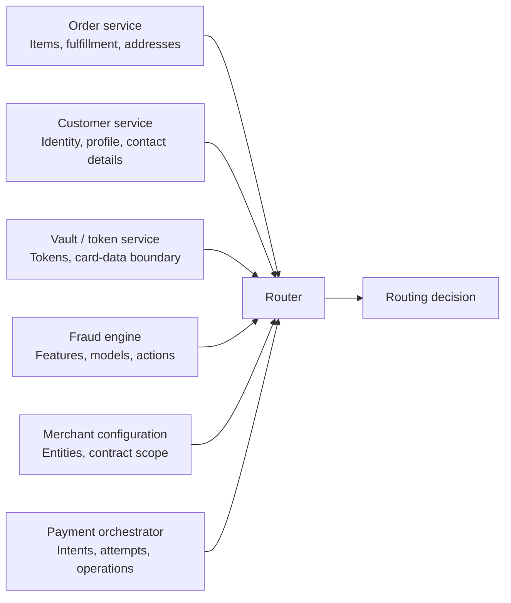
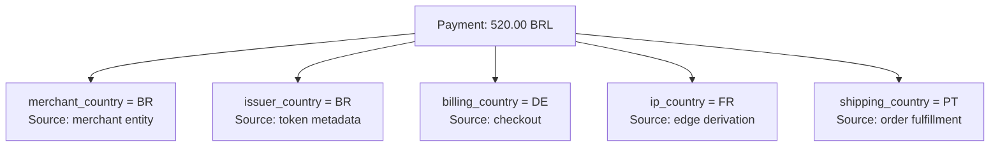
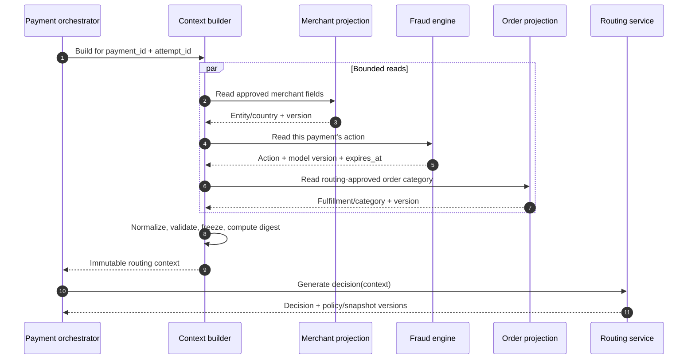
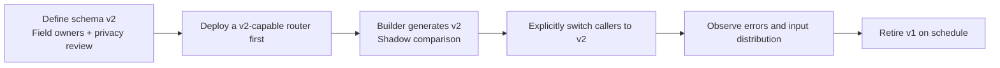

# Chapter 4: Building Routing Context

[中文](../../part-2-routing-engine/routing-context.md) | **English**

Chapter 3 defined routing as a pure decision component: it selects an exact candidate but neither owns the payment nor executes funds operations. That boundary immediately raises a question: what should routing see when deciding?

One intuitive answer is “send the entire payment, order, customer, and payment method.” This appears complete, but makes routing inherit every upstream model, private datum, and ambiguous field. Another answer is “query whatever routing needs in real time.” Then the same payment receives different inputs at different times, and call-chain availability becomes the product of all upstream services' availability.

This chapter establishes a narrower definition:

> **Routing context is a minimal, immutable snapshot built for one routing decision. It contains only normalized, nonsensitive facts needed for eligibility or subsequent scoring, with explicit schema, provenance, and observation times. It is not a copy of payment, order, customer, or credential objects.**

We address only the input contract. The rule DSL belongs to Chapter 5, eligibility evaluation to Chapter 6, costs, success rates, and scoring to Chapters 7–9, and full decision storage to Chapter 14. We identify inputs those consumers require without implementing them prematurely.

## 4.1 The Problem: Why `route(...)` Parameters Keep Growing

Aurora initially processes only US-issued USD cards through one connection. After adding Brazil and Germany, the team adds parameters to selection:

```go
package naive

func route(
	merchantID string,
	amountMinor int64,
	currency string,
	paymentMethod string,
	issuerCountry string,
	riskAction string,
) string {
	return "" // Selection omitted: the growing function signature is the point.
}
```

Soon it also needs merchant legal entity, fulfillment type, card network, device channel, customer location, and 3DS requirements. To avoid further signature changes, the team passes entire objects:

```go
package naive

type Payment struct{}
type Order struct{}
type Customer struct{}
type PaymentMethod struct{}

func route(payment Payment, order Order, customer Customer, method PaymentMethod) string {
	return "" // The short signature now hides four large ownership boundaries.
}
```

There are fewer parameters but deeper coupling. `Payment` may contain funds operations and state; `Order`, items and shipping addresses; `Customer`, names, emails, and profiles; and `PaymentMethod`, tokens or even PAN and CVV from an incorrect boundary. Routing needs none of that data, yet may copy it into serialization, logs, traces, error reports, and retained decisions.

A subtler problem is identical names with different meanings. `country` may mean merchant legal-entity country, issuer country, billing or shipping country, IP-derived country, or current device location. `amount` may mean displayed order value, intent amount, tax-inclusive total, or settlement amount. `risk_score` may come from different model versions. A field without ownership and provenance is more dangerous than a missing field because it makes a wrong decision look reasonable.



If routing fans out to all these services for every decision, it no longer consumes one input: it assembles world state during the request. An order may be canceled after the first query, a risk model released before the second, and merchant configuration switched during the third. The result is a mixed snapshot that never existed at one instant, making testing and reliable replay difficult.

## 4.2 A Simple Design: Start with the Existing Seven-Field v1 Request

Chapter 3's v1 baseline implements a narrow vertical path: tokenized cards, automatic-capture `SALE`, and versioned static candidate ordering. Orchestration holds the token, but sends routing only seven nonsensitive fields. This compatibility entry point remains while the chapter evolves it into v2:

```go
package routing

// Request represents the retained legacy routing v1 contract.
// Payment credentials are excluded by design.
type Request struct {
	PaymentID     string `json:"payment_id"`
	AttemptID     string `json:"attempt_id"`
	MerchantID    string `json:"merchant_id"`
	AmountMinor   int64  `json:"amount_minor"`
	Currency      string `json:"currency"`
	PaymentMethod string `json:"payment_method"`
	Operation     string `json:"operation"`
}
```

This is a good starting point, not a defect caused by “too few fields”:

| Field | Current meaning | Why it belongs in context |
| --- | --- | --- |
| `payment_id` | Stable intent identity | Correlates decisions without carrying full payment state |
| `attempt_id` | Identity pregenerated by orchestration for this controlled attempt | Stable correlation and future deterministic bucketing, not a funds outcome |
| `merchant_id` | Internal platform merchant identity | Selects applicable configuration scope without exposing provider accounts |
| `amount_minor` | Intent amount as integer minor units | Avoids floating-point amounts and supports amount constraints |
| `currency` | Three-letter uppercase currency code | Transaction currency, not settlement currency |
| `payment_method` | Nonsensitive category, currently only `card` | Not a token, PAN, or provider-specific method object |
| `operation` | `sale`, or `authorize` reserved for future use | Distinguishes automatic capture from authorization-only capabilities |

The v1 OpenAPI uses `additionalProperties: false`, rejecting callers that add `payment_method_token`; router tests explicitly cover this. The payment service sends `operation = sale`. Although the routing contract can validate `authorize`, that does not grant the companion system manual capture, void, or refund support.

The request already resembles a snapshot: all values for one call are inputs, routing reads no payment database, and credentials are inaccessible. It suffices for deterministic static policies. What it lacks is a schema version, build time, and provenance. v2 fills those three gaps rather than adding arbitrary fields to the old endpoint.

## 4.3 Scaling the Design: Adding Fields Does Not Mean Copying Objects

### 4.3.1 Every Fact Needs an Authoritative Owner

A context builder assembles facts; it must not reinvent them. Amounts and operation identities come from orchestration, legal entities from merchant configuration, order classification from commerce, safe payment-method derivatives from the controlled vault/token boundary, and risk actions from the fraud engine. Routing consumes stable outputs already defined by those owners.

| Field group | Examples suitable for context | Authoritative owner | Raw data normally excluded |
| --- | --- | --- | --- |
| Merchant | `merchant_id`, legal-entity reference, business country, policy scope | Merchant configuration | Contacts, full contracts, provider credentials |
| Payment | `payment_id`, `attempt_id`, amount, currency, operation, capture method | Payment orchestrator | Full state machine, historical provider results, idempotency secrets |
| Order | Broad product category, fulfillment mode, value band | Order / commerce service | SKU lists, descriptions, support notes, full shipping address |
| Payment method | `card` / `wallet` / `bank_transfer`, network, controlled issuer-country derivative | Vault / tokenization boundary | Tokens, PAN, expiry, CVV, full track data |
| Geography | Separately named merchant, issuer, billing, shipping, and IP-derived countries | Respective business owner or controlled derivation service | Generic unprovenanced `country`, raw IP, full address |
| Device | `web` / `ios` / `android`, platform family, broad trust level | Edge / device intelligence | Full User-Agent, advertising IDs, persistent fingerprints |
| Risk | `ALLOW`, `BLOCK`, `REQUIRE_3DS`, reason categories, model version, validity | Fraud / risk engine | Full features, internal vectors, arbitrary uncalibrated scores |

An authoritative owner does not imply a synchronous call from routing. A more reliable approach lets orchestration or a dedicated builder read validated projections within a deadline, then freeze one input. Routing accepts only the snapshot. A field without stable ownership is not ready for a lasting routing contract.

Customer objects particularly should not enter by default. If account age or membership matters, the customer domain should emit a minimal derivative such as `account_age_band = established`, with its definition version. “A future model might use it” does not justify `customer_id`, names, or emails. Device data follows the same rule: the fraud engine may process high-dimensional signals inside its own boundary; routing usually needs only the resulting action or broad requirement.

### 4.3.2 Geography Is Not One `country`

Aurora's Brazilian entity may sell to a customer living in Germany, connecting from a French IP, using a Brazilian-issued card, and requesting paper-ticket delivery to Portugal. At least five geographic facts exist; none inherently means “transaction country.”



Names must encode meaning rather than leave rule authors to guess `country`. Normalize country codes to ISO 3166-1 alpha-2. ISO recommends two-letter codes for general use and maintains them over time, so use versioned reference data rather than permanently copying an old table into code. [ISO 3166 Country Codes](https://www.iso.org/iso-3166-country-codes.html)

Normalization solves representation, not truth. `issuer_country` may derive from token metadata, `ip_country` is an imperfect inference, and `billing_country` may be self-reported. Provenance and necessary observation times let consumers distinguish contractual, derived, and user-supplied facts. Two letters do not give them equal credibility.

### 4.3.3 Null, Missing, Unknown, and Not Applicable Are Different

Many APIs use an empty string for “caller omitted it,” “cannot determine it,” “irrelevant to this method,” and “withheld for privacy.” Rules then treat it as a default country or risk level, silently turning unknown facts into assertions.

| State | Precise meaning | Example | Safe handling |
| --- | --- | --- | --- |
| `known` | Value exists and passes format and source checks | `issuer_country = BR` | Consume under its declared semantics |
| `missing` | Contract requires a caller-supplied field that is absent | Card request lacks `payment_method.category` | Reject validation; do not guess |
| `unknown` | Field applies, but its owner cannot currently determine it | Token metadata cannot resolve issuer country | Preserve explicitly; later policy defines action |
| `not_applicable` | Field has no meaning for the category | Bank transfer has no card network | Do not count as data-quality failure |
| `redacted` | Value exists but privacy or permissions withhold it from routing | Exact device identifier stays in the fraud engine | Use only approved derivatives |
| `stale` | Value once existed but exceeds declared freshness | Expired risk action | Do not present it as currently known |

Required scalars can reject absence directly, as v1 does for `merchant_id`, amount, and currency. Future optional fields should use explicit presence states rather than Go zero values. `amount_minor = 0` cannot simultaneously mean a free order, an unknown amount, and a parse failure. Nor can `risk_score = 0` mean both minimum risk and no model result.

### 4.3.4 “The Latest Value” Breaks Determinism

Suppose the builder reads merchant entity at 10:00:00, risk action at 10:00:01, and order at 10:00:02. A concurrent update may produce a combination with no consistent instant. Worse, if routing queries risk or merchant services again during evaluation, retrying the same request may obtain new inputs.

We need an explainable consistency contract, not a global transaction across all services. Each fact carries source and observation time, the context records completion time, and time-sensitive signals also carry `expires_at` or TTL. Once assembled within the overall deadline, the builder freezes the object; routing cannot fetch additional fields from the caller's business services.

Distinguish two kinds of input. Merchant, payment, order, method, and risk facts form caller-built context. Candidate capabilities, policy, and provider health form routing's own versioned decision environment. **Identical context + router code + policy/capability/signal snapshots** should yield identical decisions. Retaining context alone cannot prove that replay with the latest health reproduces the past.

### 4.3.5 Richer Inputs Amplify Privacy and PCI Risks

Context traverses RPCs, logs, traces, caches, and later decision evidence. Each new field expands copying and retention. GDPR Article 5(1)(c) requires personal data to be adequate, relevant, and limited to what is necessary for its purpose. Applicability and legal basis remain for privacy and legal teams, but the principle aligns with admitting fields only for an explicit decision purpose. [EUR-Lex: Regulation 2016/679, Article 5](https://eur-lex.europa.eu/legal-content/EN/TXT/?uri=CELEX%3A32016R0679)

Card-data boundaries are stricter. Routing neither needs nor should receive tokens, PAN, or CVV. Tokens stay in execution commands from orchestration to the gateway. Routing receives only `payment_method = card` and approved noncredential derivatives. PCI SSC explains that tokens may fall outside account data only under specific EMV payment-token conditions and outside the relevant environment. Connections to systems storing, processing, or transmitting account data can still remain in scope. Token use is not universal proof of exclusion. [PCI SSC FAQ 1326](https://www.pcisecuritystandards.org/faqs/1326/)

CVV/CVC/CID are sensitive authentication data and cannot be retained after authorization, even encrypted. They belong neither in context nor in debug payloads, logs, or future replay samples. [PCI SSC FAQ 1280](https://www.pcisecuritystandards.org/faqs/1280/)

## 4.4 Production Design: A Verifiable Input Snapshot

### 4.4.1 The Context Builder Sits between Owners and Routing

The builder reads authorized minimal projections, normalizes and validates them, adds provenance, and freezes the result within a deadline. Orchestration usually calls it; it may be a module in the same deployment. It does not change payment state, own routing policy, or read provider credentials.



Parallel reads are not mandatory. If payment creation already persisted valid merchant and risk projections, the builder can use local snapshots to reduce online dependencies. Routing must receive a completed object. It does not call the vault when `issuer_country` is missing or run another fraud process when risk has expired.

Use field-level allowlists, not reflection that copies every upstream JSON field. Then an ordinary upstream model change adding `customer_email` or `payment_method_token` cannot silently cross the boundary.

### 4.4.2 Express the Minimum Snapshot with Explicit State and Provenance

The following Go types represent this chapter's minimal `routing_context.v1` envelope, accepted by `/internal/v2/routing-decisions`. `Base` retains the original seven fields and adds explicit `capture_method`. Merchant and method contexts include only derivatives current consumers need. Ownership for order, device, geography, and risk has been defined, but fields without consumers do not yet enter the wire format. Expanding a conceptual model does not require collecting everything now.

```go
package routingcontext

import "time"

type FieldState string

const (
	FieldKnown         FieldState = "known"
	FieldUnknown       FieldState = "unknown"
	FieldNotApplicable FieldState = "not_applicable"
	FieldRedacted      FieldState = "redacted"
	FieldStale         FieldState = "stale"
)

type Observed[T any] struct {
	State      FieldState `json:"state"`
	Value      *T         `json:"value,omitempty"`
	Source     string     `json:"source"`
	SourceVer  string     `json:"source_version"`
	ObservedAt time.Time  `json:"observed_at"`
	ExpiresAt  *time.Time `json:"expires_at,omitempty"`
}

// ContextBase retains legacy semantics and makes capture semantics explicit.
type ContextBase struct {
	PaymentID     string `json:"payment_id"`
	AttemptID     string `json:"attempt_id"`
	MerchantID    string `json:"merchant_id"`
	AmountMinor   int64  `json:"amount_minor"`
	Currency      string `json:"currency"`
	PaymentMethod string `json:"payment_method"`
	Operation     string `json:"operation"`
	CaptureMethod string `json:"capture_method"`
}

type MerchantContext struct {
	EntityID string           `json:"entity_id"`
	Country  Observed[string] `json:"country"`
}

type PaymentMethodContext struct {
	Category         string           `json:"category"`
	Network          Observed[string] `json:"network"`
	IssuerCountry    Observed[string] `json:"issuer_country"`
	CredentialDomain Observed[string] `json:"credential_domain"`
}

type ContextV1 struct {
	SchemaVersion string               `json:"context_schema_version"`
	BuiltAt       time.Time            `json:"built_at"`
	Base          ContextBase          `json:"base"`
	Merchant      MerchantContext      `json:"merchant"`
	PaymentMethod PaymentMethodContext `json:"payment_method_context"`
}
```

`Observed[T]` prevents unknown values from hiding behind zero values. `known` requires a value, source and version, observation time, and unexpired `expires_at`. `stale` retains its original value with an expired validity period. `unknown/not_applicable/redacted` carry no value, including no explicit null masquerading as absence. `missing` is a builder diagnostic, not a permitted wire state in this version. Validators define allowed states per field: merchant country must be known; issuer country may be unknown. A controlled source supplies token domain; the token string must not be inspected to guess it.

These types deliberately omit tokens, PAN, CVV, raw IPs, full addresses, names, emails, User-Agent, and free text. `PaymentMethodContext.Category` duplicates `Base.PaymentMethod` during migration. Validate equality during the transition and remove the old field only when retired; never let the two values drive different branches.

### 4.4.3 Normalization Is a Contract, Not String Cleanup

Normalization gives one business fact one wire representation and rejects ambiguity before routing. It should not make best-effort guesses about caller intent.

| Type | Canonical form | Inputs to reject or handle explicitly |
| --- | --- | --- |
| Amount | Positive integer `amount_minor` + separate three-letter currency | Floating-point amounts, signed strings, absent currency |
| Currency | Uppercase ISO 4217 code, such as `BRL` | Three-letter strings absent from published reference data |
| Country | ISO 3166-1 alpha-2 with semantic field name, such as `issuer_country = BR` | Free text `Brazil`, generic `country`, custom codes |
| Payment method | Versioned lowercase enum, such as `card` | Tokens, SDK objects, automatic fallback for unknown strings |
| Operation | Common platform enum, such as `sale`, `authorize` | Provider endpoint names, capture method guessed from defaults |
| Time | UTC with explicit precision and source; dynamic values have `expires_at` | Bare local-time strings, “live” values without observation times |
| Set / list | Define whether order matters; sort unordered sets before encoding | Different bytes for the same set due to map iteration |

ISO 4217 maintains minor-unit metadata as well as alphabetic codes, and its tables evolve. The current router validates only `^[A-Z]{3}$`; that protects v1 format but does not validate membership or currency exponents. A production builder should reference a versioned currency catalog and normalize amounts where they are created, rather than ask routing to parse `"520.00"`. [ISO 4217 Currency Codes](https://www.iso.org/iso-4217-currency-codes.html)

Do not apply `strings.ToLower` to every string. `merchant_id`, `payment_id`, and external codes have distinct case rules; indiscriminate conversion may merge valid identities. Implement normalization per field and test it with the schema version.

A frozen context can have a digest to detect accidental changes during transport or retention. A digest is neither encryption nor anonymization and cannot replace retaining explainable approved fields:

```go
package routingcontext

import (
	"crypto/sha256"
	"encoding/hex"
	"encoding/json"
)

func SnapshotDigest(context ContextV1) (string, error) {
	payload, err := json.Marshal(context)
	if err != nil {
		return "", err
	}
	digest := sha256.Sum256(payload)
	return "sha256:" + hex.EncodeToString(digest[:]), nil
}
```

This snippet shows only digest computation; prior validation is required. The companion `Context.Digest` calls `Validate` first. Both ends fix field order, canonical UTC RFC3339Nano, and full SHA-256. Shared golden fixtures constrain both payment and routing services; arbitrary JSONB text cannot be hashed directly. Future unordered maps, floats, or custom JSON encoders require corresponding canonical forms. A digest is not anonymization: enumerable inputs or continued payment association may still make it controlled data.

### 4.4.4 Four Validation Layers, with Named Defaults

Builder and router both validate contracts, with different responsibilities. The builder handles provenance and normalization; routing revalidates wire payloads at its trust boundary:

1. **Structural validation:** required fields, types, size limits, unknown fields, and schema version.
2. **Semantic validation:** positive amount, currency/country membership in versioned catalogs, meaningful enum combinations.
3. **Provenance validation:** source and observation time for `known` values, no future timestamps, unexpired dynamic signals.
4. **Security validation:** allowlisted fields and values, rejecting credential-like fields and excessive free text.

“Use US when missing” is a hidden rule, not a default. Legitimate defaults need explicit business semantics, ownership, and versioning. If merchant configuration declares `default_fulfillment_mode = digital`, the builder can record `source = merchant_profile`; it cannot choose that because a field is empty. Unknown risk cannot silently become `ALLOW`, nor can unknown geography become merchant country merely to preserve traffic.

### 4.4.5 Schema Evolution Requires a Deployment Protocol

Rejecting unknown fields prevents accidental leaks, but also means the payment service cannot send a new envelope first and expect an old router to ignore it. Upgrade safely in this order:



Use a new endpoint, versioned media type, or explicitly optional fields introduced into the existing schema first. Whatever the mechanism, readers must be ready first, and request evidence must include `context_schema_version`. Breaking field semantics requires a version change: `country` cannot retain its name while changing from billing country to issuer country.

A new field does not immediately become available to rules. Observe population rate, unknown share, source distribution, and privacy effects first, then enable consumption through later policy-release processes. Schema and policy releases thereby remain independently reversible.

### 4.4.6 What Replay Can and Cannot Answer

Snapshots improve reproducibility, but saving JSON is not full replay. Exact reproduction also requires router code, policy, capabilities, health/features snapshots, and the deterministic bucketing algorithm version. Missing artifacts allow input explanation at best, not proof of the same historical candidate.

| Available evidence | Can answer | Cannot answer |
| --- | --- | --- |
| Current payment only | Current business state | What routing saw then |
| Context snapshot + schema decoder | Inputs the caller declared then | Available candidates and policy version then |
| Context + decision-environment versions | Reproduce the decision with retained implementation | What today's new data would produce |
| Context digest only | Whether a known payload matches | Recover fields or explain the decision |

Replay does not override minimization and retention policies. Do not permanently place raw IPs, addresses, tokens, or high-dimensional device features into context for hypothetical experiments. Retain approved derivatives, definition versions, provenance references, and digests, then delete unnecessary data on a defined schedule. Chapter 14 addresses candidate, reason, and version retention. Here, inputs must be identifiable, verifiable, and immutable after the fact.

## 4.5 Failure Modes: Input Errors Masquerading as Policy Errors

### Empty Strings Mean Unknown

One caller omits `issuer_country`; another genuinely cannot identify the issuer. Encoding both as `""` makes a data-quality incident look like a real unknown population. Reject missing required fields; use explicit states for optional ones and measure `missing` separately from `unknown`.

### One `country` without Provenance

A rule author assumes issuer country, while the builder changed it to IP country last month. Code still compiles as decisions silently change. Use semantic names, definition versions, and provenance tests. Meaning changes require schema upgrades.

### Payment Tokens Enter Context

To check whether a provider can use a credential, the team sends routing the whole token. Instead, the vault/tokenization domain should emit noncredential capability information such as `credential_portability = network_token` or a controlled candidate-compatibility reference. The original token appears only in gateway commands for the selected connection. Rejection of unknown `payment_method_token` fields in the companion router is executable evidence of this boundary.

### Raw IPs, Addresses, or Fingerprints Are Saved “for Future Optimization”

These fields enter logs, traces, and long-lived evidence, adding leakage and compliance risks without a current consumer. Let risk or device-intelligence services derive required actions or segments inside controlled boundaries. Admit only minimal outputs reviewed for purpose, permissions, retention, and fairness.

### Context Remains Mutable after Construction

The builder returns pointers to shared maps or upstream objects; another goroutine later updates them, making the router's digest differ from logged content. Use value semantics or deep copies, expose no mutable collections after construction, and compute one digest of the final canonical payload before persistence or sending.

### Dynamic Signals Lack Observation Times

`risk_action = ALLOW` looks known but may come from three hours ago and have been withdrawn by a new model. Time-sensitive facts need `observed_at`, source version, and freshness contracts. Expired means `stale`, not `known`. Later policy determines the action, but input state must expose it.

### Routing Queries Multiple Upstreams to Fill Gaps

Live queries for incomplete context make retries see different values and turn routing into an integration orchestrator. Return structured validation errors for the builder to fix or fail explicitly. Routing-owned health can come from local versioned snapshots, but must remain distinct from caller business data.

### A New Attempt Reuses Old Context with a Changed `attempt_id`

Context is one decision's snapshot, not permanent payment-level configuration. Orchestration may create another attempt only after a definite prior outcome permits rerouting. Merchant, risk, and order facts may then have changed, requiring new context. Preserve the old snapshot; never replace its ID or refresh selected fields in place. `UNKNOWN` still recovers the original operation and cannot use context rebuilding to reach another candidate.

### Context Is Stored without Version References

Troubleshooters rerun historical inputs with today's policy and capabilities, obtain another provider, and wrongly infer historical nondeterminism. Replay tools must distinguish reproduction with original versions from counterfactual evaluation with new ones. Counterfactuals support analysis but cannot rewrite the original decision.

## 4.6 Trade-offs: Minimal Context Does Not Mean Minimal Thought

**Richness and boundaries.** More fields can improve segmentation while increasing latency, quality issues, privacy exposure, and selection bias. Before adding one, define its consumer, failure semantics, owner, retention period, and falsifiable benefit. Future model usefulness is insufficient.

**Inline values and version references.** Small approved inline facts are easiest to guarantee at decision time. Large configuration and routing-owned signals suit immutable version references. References alone require historical resolvability; full values may duplicate sensitive data. Practice usually combines minimal inline business facts with decision-environment versions.

**Strict rejection and gradual migration.** `additionalProperties: false`, enums, and required fields prevent typos and leaks but demand reader-first deployment. Ignoring unknown fields eases rolling upgrades yet can mislead callers into believing new fields took effect. Explicit versions and strict failures suit payment routing better.

**Granularity and usable samples.** Exact SKUs, device models, and addresses create sparse combinations, destabilize later success estimates, and increase reidentification risk. Broad categories are easier to explain and operate but may hide real differences. Bucket definitions need versions and owner maintenance.

**Build latency and freshness.** Synchronous owner queries offer freshness but raise tail latency and cascade risk. Local projections are steadier but require replication-lag and expiry policies. No approach fits every field: legal entities change slowly, risk actions may be short-lived, and fulfillment should bind to this payment's business version.

**Replay and retention.** More retained data provides analytical flexibility, not unlimited necessity or legal grounds for storage. Prefer minimal derivatives, schema/source versions, and safe digests, with periods jointly defined by privacy, compliance, and business owners.

## 4.7 Companion Implementation: Build Once, Validate at Both Ends, Pin Atomically

The engineering increment appears in the [pinned implementation snapshot](https://github.com/YouEclipse/payments/tree/bc4afde24da708d22f67da72a90a1557b1477173). The payment service's `internal/routingcontext` builds `routing_context.v1` from persisted intents, controlled merchant profiles, and method metadata. Routing's `/internal/v2/routing-decisions` strictly decodes the same wire format. Each boundary owns its types, while shared golden JSON and complete digest tests prevent silent evidence breakage from field-order changes.

This implementation does not pretend to integrate a merchant service or production vault. The local demo supplies a versioned `merchant_demo` profile expiring 24 hours after startup. Custom merchants and nonlocal environments require explicit configuration covering every authenticated merchant. Simulator metadata recognizes only declared demo tokens and emits a noncredential domain. Missing reliable metadata remains unknown; portability is not guessed from prefixes. Expired profiles reject construction rather than automatically extending with each request.

Beyond validating facts at build time, routing checks a five-minute freshness window on entry and rechecks known fields and configuration validity before returning success. Queuing or a GC pause therefore cannot carry expired facts into execution. Pure evaluation uses the explicit build time; online clock checks live in the outer layer. They solve different problems and should remain separate.

After a successful decision, the payment service rebinds intent amount, currency, merchant, capture semantics, and exact connection within the transaction preparing the attempt. It stores context/decision JSONB snapshots, then creates the operation and outbox. Triggers reject later snapshot modification. Historical rows with both snapshots null stay historical; context is not fabricated. Only after commit is the gateway invoked. `UNKNOWN` recovery reads the original operation and calls neither builder nor router again.

Deployment is explicitly reader-first: deploy v2-capable routing, then switch payment via `PAYMENT_ROUTER_API_VERSION`. v2 errors do not automatically fall back to v1. Independent persistence of negative decisions, complete historical artifact libraries, and replay queries remain for Chapters 14 and 20. This chapter pins evidence already entering execution. A context digest cannot replace complete release gates using real databases and cross-service tests.

## 4.8 Recap: Routing Needs a Snapshot, Not the Whole World

The existing seven-field request is the right starting point. `payment_id`, `attempt_id`, `merchant_id`, integer amount, currency, nonsensitive method category, and operation suffice for initial static routing of tokenized-card `SALE`. v2 preserves those semantics while adding schema, build time, capture method, and minimal facts with provenance. Tokens still enter only gateway commands for selected connections; routing rejects credential fields.

As the business grows, we do not copy whole payment, order, customer, device, or risk objects. We derive a context snapshot:

- Each field has one meaning and an authoritative owner.
- Amounts, currencies, countries, methods, and times have field-specific canonical forms.
- `known`, `missing`, `unknown`, `not_applicable`, `redacted`, and `stale` cannot impersonate one another.
- Dynamic facts include source, source version, `observed_at`, and necessary `expires_at`.
- Context is immutable after construction, with an explicit schema version and verifiable digest.
- Tokens, PAN, CVV, raw IPs, full addresses, and high-dimensional device features stay outside routing.
- Exact replay additionally requires original router code, policies, capabilities, and signals; context is not a complete decision record.

Context takes ownership from no upstream domain. Orchestration still owns payments, attempts, and operations; commerce explains fulfillment; the fraud engine judges fraud; and the vault protects credentials. The builder freezes only approved facts truly required for one decision.

[The next chapter](rule-based-routing.md) evolves a few hard-coded conditions into a versioned rule model on this stable input. Explicit meanings, absence semantics, and schemas keep rules from resting on an ever-changing `map[string]any`.

## Further Reading

- [ISO 3166 Country Codes](https://www.iso.org/iso-3166-country-codes.html)
- [ISO 4217 Currency Codes](https://www.iso.org/iso-4217-currency-codes.html)
- [EUR-Lex: Regulation 2016/679, Article 5](https://eur-lex.europa.eu/legal-content/EN/TXT/?uri=CELEX%3A32016R0679)
- [PCI SSC FAQ 1326: EMVCo Payment Tokens and PCI DSS](https://www.pcisecuritystandards.org/faqs/1326/)
- [PCI SSC FAQ 1280: Card Verification Code Storage](https://www.pcisecuritystandards.org/faqs/1280/)
- [Chapter 3: Responsibilities and Boundaries of Payment Routing](../part-1-foundations/routing-system-boundaries.md)
- [Chapter 14: Routing Decision Storage](../part-4-operating-at-scale/routing-decision-store.md)
