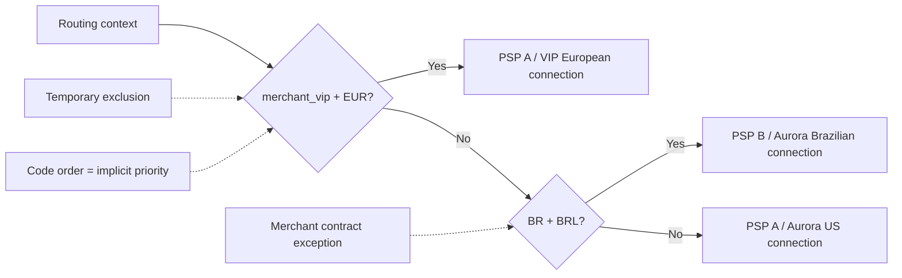
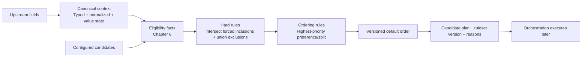
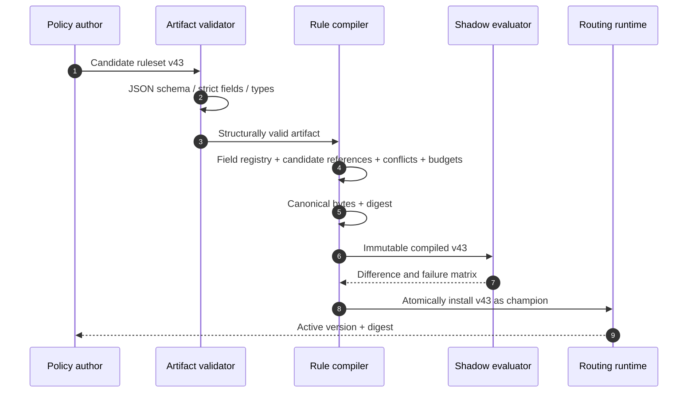
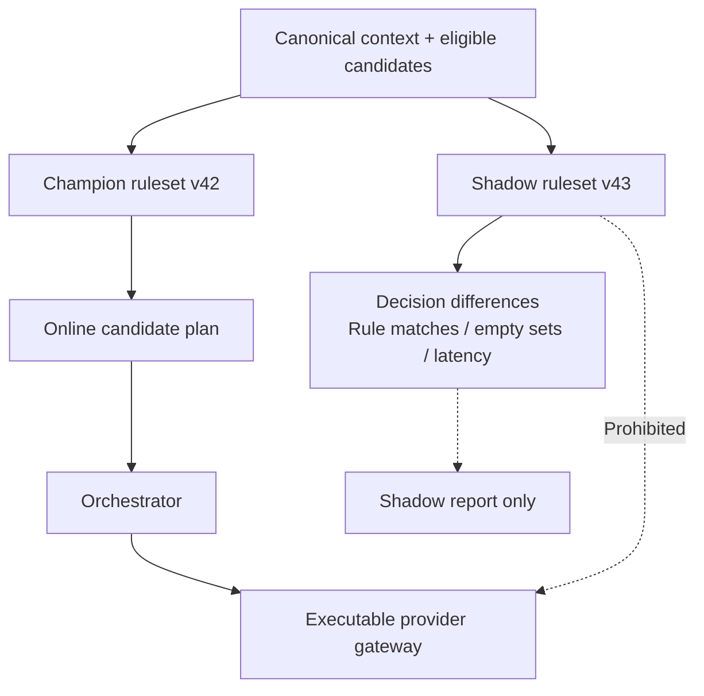

# Chapter 5: Rule-Based Routing

[中文](../../part-2-routing-engine/rule-based-routing.md) | **English**

In Chapter 2, Aurora used a few `if / else` branches to send Brazilian traffic to local acquiring and leave other transactions with a default provider. With few markets and exceptions, and one engineering team releasing every change, this code is simple, transparent, and easy to test.

The real turning point is not a magical rule count. It is when **business policies change faster than router code can be released**. A large merchant requires EUR transactions to use its dedicated account; operations must exclude a connection before PSP maintenance; finance wants to meet a contractual traffic commitment. If each request becomes another branch, code order silently becomes priority, emergency switches bypass review, and no one can explain precisely why a payment took its path.

The central proposition is:

> **Routing rules are not `if / else` moved from code into JSON. They are versioned, immutable, deterministic, explainable, auditable policy artifacts. They constrain or prefer candidates; they cannot create provider capability facts or execute funds side effects.**

Starting with reasonable sequential branches, we introduce restricted conditions, `exclude` / `force` / `prefer` / `split`, three-valued logic, conflict semantics, defaults, ruleset versions, shadow evaluation, and emergency exclusion. We do not build the full configuration platform: approval, cross-region distribution, and governance belong to [Chapter 20](../part-5-global-routing/configuration-platform.md). Actual connection support for currencies, operations, or authentication belongs to [Chapter 6](provider-eligibility.md). Costs, success rates, and scoring follow in Chapters 7–9; fallback and complete decision storage belong to Chapters 12 and 14.

## 5.1 The Problem: Code Runs but Does Not Explain Policy

Aurora initially adds this selection logic:

```go
package routing

func route(merchantID, country, currency string) string {
	if merchantID == "merchant_vip" && currency == "EUR" {
		return "conn_pspa_vip_eu"
	}
	if country == "BR" && currency == "BRL" {
		return "conn_pspb_aurora_br"
	}
	return "conn_pspa_aurora_us"
}
```

Its order is explicit, and it may be easier to read than a general rule language. Problems begin with the third exception: which branch should a BRL payment by `merchant_vip` at the Brazilian site match? If PSP A's European connection is disabled urgently, should the first branch still return it? Is moving the Brazilian branch to the top a refactor or a production traffic change?



What is missing is a formal policy contract, not merely “dynamic configuration”: which canonical fields conditions reference, how absence behaves, how multiple matches combine, which actions are hard constraints, how outcomes are explained, and which version every instance uses.

## 5.2 A Simple Design: Ordered Branches Are Still a Good Start

Prematurely abstracting a rule language has costs. If two stable policies change twice a year, Go branches retain compiler checks, code review, unit tests, and ordinary releases without adding parsers, artifact schemas, configuration publication, or runtime diagnostics.

Three properties deserve preservation:

1. Inputs are explicitly typed rather than arbitrary `map[string]any`.
2. Evaluation order is clear; identical inputs do not choose randomly.
3. The default is visible in code, so readers know what happens when nothing matches.

A rule engine should preserve these properties after policies gain independent releases. Allowing uploaded scripts, network access, `time.Now()`, or unordered-map traversal during evaluation merely replaces visible complexity with complexity that is harder to reproduce.

## 5.3 Scaling Problems: Declarative Rules Can Also Escape Control

### 5.3.1 Which Rule Overrides Another?

Suppose the team rewrites two branches:

```text
R1: merchant_id = merchant_vip        → prefer conn_pspa_vip_eu
R2: country = BR AND currency = BRL   → prefer conn_pspb_aurora_br
```

A transaction matching both gets opposing preferences. “Last rule in the file wins” makes file order a hidden API. “More specific condition wins” requires deciding whether two equality conditions are more specific than one range. Without explicit priorities and conflict semantics, declarative configuration is no safer than `if / else`.

### 5.3.2 Missing Is Not an Empty String; Unknown Is Not False

Consider:

```text
issuer_country != "US" → prefer conn_pspa_eu
```

If unavailable BIN/IIN metadata leaves `issuer_country` absent, many ordinary expression engines let an empty string satisfy `!= "US"`. “We do not know the issuer country” becomes “the issuer country is definitely not US.” Expired fields, failed upstream queries, and genuinely inapplicable fields also represent different facts.

Conditions therefore need more than Boolean outcomes. Context must distinguish at least:

| Value state | Meaning | `equals("US")` | `not equals("US")` | Default treatment |
| --- | --- | --- | --- | --- |
| Known | Present and validated | True or false | Opposite of equality | Evaluate normally |
| Missing | Current schema/scenario did not supply it | Unknown | Unknown | No match; record why |
| Unknown | Expected, but source failed, expired, or lacks confidence | Unknown | Unknown | Do not promote uncertainty into fact |

The crucial rule is `NOT Unknown = Unknown`, not `True`. Future `is_missing` / `is_unknown` operators need separately defined action boundaries; the current AST does not expose them. Missing in this table explains the general model. Omitting required v2 wire fields fails structural validation before evaluation rather than entering as an empty string. Valid explicit unknown values remain unknown in conditions.

### 5.3.3 The Same Rules Can Produce Different Results across Instances

The Go specification states that map iteration order is unspecified and may differ between iterations. Taking the “first” rule or candidate from a map can select different connections in two processes. [Go Specification: Map Iteration](https://go.dev/ref/spec#For_statements)

Other nondeterminism includes reading the current clock during evaluation, random tie-breaking, treating database return order as priority, locale-dependent string comparisons, caller-selected rule versions, or mutating shared rules while requests are running.

These faults need not fail immediately. They often create rare, irreproducible traffic shifts: logs show identical context and version but different outcomes. For a system that must explain individual payments, that difference is itself a defect.

### 5.3.4 Rules Cannot Declare a Connection Capable

Operations may want to write:

```text
BRL → include conn_pspa_us
```

Policy cannot prove that this account supports BRL, local acquiring, the required capture mode, or the token. Capabilities are connector, contract, and provider facts; rules express business intent. If `include` can restore an ineligible candidate, emergency rules can bypass technical and compliance boundaries.

The rule engine therefore takes an already-eligible candidate set and returns a subset and ordering. Chapter 6 explains the accompanying capability catalog and three-valued eligibility. The earlier v1 filters for enablement, currency, method, and operation are only the starting point, not a complete capability-fact system.

## 5.4 Production Design: Compile Policies into Immutable Artifacts

The production path has five steps: normalize inputs, obtain eligible candidates, apply hard policies, apply preferences, and complete an explicit default order.



The engine stops at a routing decision. It creates no attempts, calls no gateway, and handles no provider timeouts. Candidate order expresses current preference, not permission to try every connection in sequence. In particular, once an operation is `UNKNOWN`, a new emergency rule cannot change its original `provider_connection_id`. Creating another attempt is governed by Chapter 12's fallback semantics.

### 5.4.1 Use a Restricted Rule Model, Not Arbitrary Scripts

A minimal ruleset can contain:

| Object | Key fields | Invariant |
| --- | --- | --- |
| `RuleSet` | Schema version, ruleset version, digest, effective time, rules, default order | Published versions are immutable; each version maps to one digest |
| `Rule` | Stable ID, owner, priority, condition, action, reason code | Unique ID; higher priority first; no external access |
| `Condition` | Canonical field, operator, typed operands | Only registered fields; compatible types and operators |
| `Action` | `exclude`, `force`, `prefer`, `split`, candidate IDs / weights | Only narrows or reorders eligible candidates; no external side effects |
| `RuleHit` | Rule ID, truth value, action, affected candidates, reason | Explains matches, nonmatches, and unknown results |

Restrict the language deliberately. This implementation has only string equality `eq`, membership `in`, integer inclusive `range`, and conjunction `all`. They preserve uncertainty without implicit defaults that turn unknown into true. Richer absence tests or negation require separate semantics. The example `Not` illustrates the truth table; it does not mean the current AST exposes that operator.

`force [X]` means “only X is permitted for a new decision,” not “execute X regardless.” It intersects eligibility, returning no candidate if X is unavailable. `split` assigns stable fixed-weight buckets within the allowed set, without random calls. Policy splitting differs from experimentation: Chapter 16 adds business units, assignment/exposure, metrics, and stopping rules. A 75/25 configuration alone does not establish an attributable experiment.

### 5.4.2 Canonical Inputs Precede Rule Evaluation

Rules should not convert `brl` to `BRL` or guess whether `52000` means minor or major units. The previous chapter's builder owns amount units, currencies, country codes, enums, and provenance. The engine consumes canonical field IDs and typed values, making `base.currency == "BRL"` mean the same thing everywhere. The registry exposes no tokens, PAN, CVV/SAD, or provider secrets. Artifacts cannot reference such fields or place them in operands, reasons, or shadow reports. [PCI SSC FAQ 1280](https://www.pcisecuritystandards.org/faqs/1280/)

These Go types show minimum three-valued semantics:

```go
package rules

type ValueState uint8

const (
	ValueMissing ValueState = iota
	ValueUnknown
	ValueKnown
)

type Truth uint8

const (
	False Truth = iota
	True
	Unknown
)

type StringValue struct {
	State ValueState
	Value string
}

func Equal(actual StringValue, expected string) Truth {
	if actual.State != ValueKnown {
		return Unknown
	}
	if actual.Value == expected {
		return True
	}
	return False
}

func Not(value Truth) Truth {
	switch value {
	case True:
		return False
	case False:
		return True
	default:
		return Unknown
	}
}

func All(values ...Truth) Truth {
	result := True
	for _, value := range values {
		if value == False {
			return False
		}
		if value == Unknown {
			result = Unknown
		}
	}
	return result
}
```

A rule matches only when the condition is `True`. `False` means known facts do not satisfy it. `Unknown` means facts are insufficient and requires a stable reason such as `RULE_INPUT_UNKNOWN`. Separating them distinguishes ordinary business branches from degrading upstream data quality.

### 5.4.3 Hard Actions Narrow the Set; Preferences Only Reorder

Define all four actions precisely:

| Action | Set semantics | Can restore an eligibility-excluded candidate? | Typical use |
| --- | --- | --- | --- |
| `force [A]` | Highest-priority matched force intersects allowed candidates with `{A}` | No | Permit only a specifically contracted path |
| `exclude [C]` | Remove C; union all matched exclusions | No | Legal restrictions, merchant disablement, emergency stop for new traffic |
| `prefer [B,A]` | Reorder still-allowed candidates | No | Stable commercial preference |
| `split {A:7500,B:2500}` | Stable bucketing among allowed weighted members, renormalizing weights | No | Deterministic contract/policy allocation, not automatically an experiment |

Union every matched exclusion, then apply the highest-priority matched force. Preferences cannot restore removed candidates. If hard rules empty the set, record `no_candidate_after_rules` and return no candidate; do not use a hidden default provider. Multiple force actions use priority as explicit override semantics. Potentially co-matching, equal-priority incompatible targets are rejected at compile time.

Apply preferences after fixing the hard set. Sort rules by `priority DESC, rule_id ASC`, but use only the highest-priority matched preference/split action; lower-priority actions do not concatenate over it. A preference puts still-allowed targets first, then appends remaining default-order members. A split first removes connections absent from its weights, then buckets using SHA-256 of `(rule_set.version,rule_id,payment_id)`. Zero remaining total weight is rejected. Stable assignment is guaranteed only for the same artifact and effective set. Existing attempts never change path because of rebucketing.

This Go snippet illustrates deterministic ordering and default completion. The full increment also needs hard sets, three-valued conditions, and conflict diagnostics, but never chooses winners through map iteration:

```go
package rules

import "sort"

type PreferRule struct {
	ID         string
	Priority   int
	Candidates []string
}

func StablePreference(hits []PreferRule, allowed map[string]bool, defaults []string) []string {
	orderedRules := append([]PreferRule(nil), hits...)
	sort.Slice(orderedRules, func(i, j int) bool {
		if orderedRules[i].Priority != orderedRules[j].Priority {
			return orderedRules[i].Priority > orderedRules[j].Priority
		}
		return orderedRules[i].ID < orderedRules[j].ID
	})

	seen := make(map[string]bool, len(allowed))
	result := make([]string, 0, len(allowed))
	appendCandidate := func(candidateID string) {
		if allowed[candidateID] && !seen[candidateID] {
			seen[candidateID] = true
			result = append(result, candidateID)
		}
	}

	if len(orderedRules) > 0 {
		for _, candidateID := range orderedRules[0].Candidates {
			appendCandidate(candidateID)
		}
	}
	for _, candidateID := range defaults {
		appendCandidate(candidateID)
	}
	return result
}
```

### 5.4.4 Priority Does Not Replace Conflict Checking

Priority expresses intentional overrides; it should not become a dumping ground for bad configuration. Before activation, reject at least:

- Potentially co-matching, equal-priority `prefer` rules that reverse the same candidate pair.
- Equal-priority overlapping forces with different targets, or a forced target absent from a co-matching split.
- Potentially co-matching equal-priority splits, even with identical weights: rule IDs enter the hash and change assignment.
- References to nonexistent or retired candidate IDs.
- Unknown fields, incorrect types, or incomparable ranges.
- Default order missing potentially surviving candidates, or containing duplicate IDs.
- Different artifacts claiming the same `version` with different canonical digests.

A restricted equality/membership/range AST supports substantial static overlap analysis, but cannot pretend every intersection is fully provable. Unresolved combinations can enter offline test matrices and shadow evaluation. If runtime still detects a prohibited conflict, return an explicit error with rule IDs rather than resolving by file order.

### 5.4.5 Defaults Belong to the Version, Not Hidden Code

No matched rule is a normal path. The ruleset should contain `default_candidate_order` or reference a static-policy version in the same release bundle. Record `DEFAULT_POLICY_APPLIED`, completing order only within eligible candidates.

Defaults answer “who is preferred without business exceptions,” not “choose anyone when all information is broken.” Invalid context, unknown critical eligibility, or an empty hard-rule result require explicit failure or degradation, not a default concealing missing facts.

### 5.4.6 Published Rulesets Are Immutable Facts

Artifacts undergo structural validation, then semantic compilation:



JSON Schema constrains required fields, types, enums, and additional fields; cross-rule conflicts, candidate references, and priorities still need domain validation. [JSON Schema Draft 2020-12](https://json-schema.org/draft/2020-12) Digests used for signatures or cross-implementation comparison require canonical representation. RFC 8785 defines JSON canonicalization so hashes and signatures use an invariant serialization. [RFC 8785](https://www.rfc-editor.org/rfc/rfc8785.html)

JCS canonicalizes object-property order but not business array order. The compiler must first normalize semantically unordered sets: sort rules by stable ID and `AND` conditions and set operands by canonical values. Preserve the meaningful order of `prefer` targets and `default_candidate_order`. Only then compute the JCS digest, so rearranging rule-file positions preserves artifact identity while accidentally reordering preferences changes it.

Publishing `v43` does not mutate in-memory `v42`. Fully validate the new snapshot, then atomically switch a pointer; each evaluation sees one complete version. Rollback reactivates a validated old artifact and creates another activation audit event rather than overwriting old files. Chapter 20 develops approval, signatures, staged rollout, cross-region acknowledgment, and retention. Here, runtime must see immutable versions and digests.

Evaluation time is also explicit input. With `effective_from` / `effective_until`, use the recorded decision time supplied by orchestration rather than repeated `time.Now()` calls across conditions. Replay then sees the same effective rules.

### 5.4.7 Shadow Evaluation Observes but Never Executes

Before becoming champion, a candidate ruleset can evaluate the same canonical context and eligible set in shadow:



Shadow results measure route differences, empty sets, unknown inputs, and latency. They cannot create attempts, operations, or fallback, nor record “if B were selected” as real funds facts. Chapter 14 covers decision records; Chapter 16 covers controlled experiments. Here, the shadow evaluator must be pure, with tests proving gateway-call counts remain unchanged.

### 5.4.8 Reason Codes Are an API, Not Log Copy

An explainable evaluation should at least return:

```text
rule_set_version: rules_v43
rule_set_digest:  sha256:...
matched_rules:    [merchant_vip_eur, emergency_exclude_conn_c]
unknown_rules:    [issuer_country_preference]
allowed:          [conn_a, conn_b]
candidate_order:  [conn_b, conn_a]
reason_codes:     [POLICY_INCLUDED, POLICY_EXCLUDED, POLICY_PREFERRED]
default_applied:  false
```

Stable codes support testing, aggregation, and auditing. Human-readable detail cannot be downstream software's sole decision basis. Rule IDs, versions, affected candidates, and truth values matter too. Storage and retention belong to the decision-store chapter; the evaluator must first produce the evidence.

### 5.4.9 Emergency Exclusion Is Still a Controlled Policy Change

“Stop new payments to `conn_c` immediately” is legitimate, but not as a Boolean in one instance's memory. The minimum safe approach generates a high-priority `exclude [conn_c]`, validates and versions it, activates atomically, and returns `EMERGENCY_CANDIDATE_EXCLUDED`. Emergency handling may shorten the approval path with subsequent review, but cannot omit operator, reason, version, or rollback target.

Emergency rules affect **new attempts not yet decided**. They cannot move operations already pinned to `conn_c`, especially `UNKNOWN` ones. Capture, void, and refund retain original connections and references. Technical outages need Chapter 13's health and breaker model; capability, contract, or credential expiry also requires updating Chapter 6's eligibility facts. Rules are not the source of truth for every disablement reason.

## 5.5 Failure Modes: Rules Quietly Break Payment Boundaries

### Callers Supply Rules or Versions

If payment services submit temporary rules, candidate ordering, or `rule_set_version`, they bypass the control plane and may select different versions on retry. Strict HTTP decoding must reject unknown fields. Policies come only from validated runtime snapshots. Existing tests rejecting caller-supplied policy must survive the ruleset migration.

### Maps or Database Order Break Ties

Restarts, compiler changes, or data layout then affect routes. Sort rules, action targets, defaults, and reason output by explicit dimensions. Maps provide lookup, never business order.

### `prefer` Becomes `force`

Preference cannot revive candidates removed by capabilities or hard policy. Prefer an interface accepting eligible candidates and returning a subset permutation, enforcing the invariant through types and tests rather than caller memory.

### Unknown Makes an Inequality True

Missing issuer country, expired merchant country, or failed derived fields matching `!=` turn quality incidents into traffic changes. Three-valued logic, per-field missing policies, and `RULE_INPUT_UNKNOWN` metrics must coexist.

### Published Artifacts Change without New Versions

Historical `rules_v42` becomes unreplayable, and instances report one version while executing different content. Verify version and digest; reject and alert on the same version with different content.

### Shadow Evaluation Shares an Execution Callback

If evaluation can directly call the gateway, one shadow run may create another funds path. Return pure plans. Orchestration remains the sole component allowed to execute provider operations; shadow consumers have neither permission nor credentials.

### Emergency Exclusion Rewrites Existing Funds Identity

Rules choose candidates for new attempts. Reevaluating before each recovery query can prevent querying an `UNKNOWN` operation's original provider or incorrectly select another connection. Recovery reads persisted `provider_connection_id`, never current rules.

## 5.6 A Test Matrix Beyond Proving a Rule Matches

Test semantics, not merely parser coverage:

| Layer | Key cases | Required property |
| --- | --- | --- |
| Schema | Unknown fields, wrong types, duplicate IDs, illegal operators | Fail before activation with stable error locations |
| Semantic validation | Equal-priority conflicts, invalid candidates, incomplete defaults | File order cannot resolve conflicts |
| Truth tables | Known/unknown with eq/in/range/all; explanatory Not table | Unknown never becomes true; unavailable operators rejected |
| Determinism | Shuffle rules, candidates, and map insertion order; repeat | Stable plans, matches, reasons, and digests |
| Hard constraints before preference | High-priority preference targets an excluded candidate | No resurrection |
| Defaults | No matches; hard rules empty the set | Explicit default for the former, explicit failure for the latter |
| Versions | Whole-artifact compilation and stable digest; cross-release registration/rollback in Chapter 20 | Each evaluation sees a complete version; no false claim of local historical registry |
| Shadow | Champion and shadow differ | Online plan unchanged; still one gateway call |
| Emergency | New decisions exclude a connection; existing `UNKNOWN` recovers | No rewriting attempts or operations |
| API boundary | Caller injects rules, versions, or tokens | Strict decoding rejects before evaluation |

One falsifiable acceptance test creates overlapping equal-priority rules with opposite preferences. Installation must fail. Swapping their file positions must preserve error type and conflicting IDs. After correcting priorities, evaluate the same canonical context a thousand times with shuffled candidates: `candidate_id`, matched-rule order, and digest must remain identical.

A second checks safety. Eligibility contains only `conn_b`, while a high-priority action says `force [conn_a]` or `prefer [conn_a]`. Force must return no candidate; preference must still select `conn_b`. Neither may send `conn_a` to the gateway. Splits likewise remove ineligible members first; percentages cannot exempt eligibility. This establishes an inviolable interface for the next chapter.

## 5.7 Trade-offs: The Cost of Treating Policy as Code

**Expressiveness and verifiability.** Arbitrary scripts maximize flexibility but hinder static conflicts, complexity budgets, and cross-language replay. A restricted AST may require multiple rules or product-model changes. Predictability usually matters more on the payment path. Truly unexpressible requirements should evolve a versioned model, not open a scripting escape hatch.

**Strict conflicts and operational speed.** Rejecting ambiguity may delay emergency changes by minutes; silently selecting a winner immediately amplifies mistakes into funds traffic. Shorten approval and validation for emergency `exclude`, but retain schema, semantics, and audit identity.

**Complete overlap analysis and conservative diagnostics.** Equality/set intersections are tractable; complex ranges and multidimensional combinations quickly become expensive. Reject provable conflicts, diagnose uncertain overlaps, and require test matrices, historical replay, and shadow evidence. Do not claim the validator solves every logical problem.

**Ruleset granularity.** Per-merchant artifacts isolate well but create version proliferation and cache pressure. One global artifact distributes easily but expands impact and conflicts. A platform baseline with restricted merchant overrides can work, provided merge order is versioned rather than assembled ad hoc per instance.

**Immediate effect and replay.** Reading current database rows appears real-time but cannot prove what a decision saw. Immutable snapshots and atomic activation add publication latency in exchange for determinism, rollback, and auditing. Optimize artifact generation and propagation for emergencies instead of restoring unversioned online queries.

## 5.8 Companion Go Implementation and This Chapter's Increment

The [pinned implementation](https://github.com/YouEclipse/payments/tree/bc4afde24da708d22f67da72a90a1557b1477173/services/router/internal/rules) lives in `internal/rules`, integrated into v2 through `internal/decision`. Static v1 in `internal/routing` remains; upgrades do not silently change the old endpoint. Online requests contain context, never caller-supplied rules, candidate lists, or version selection.

`Compile` strictly validates `routing_rules.v1`: four condition types, four actions, complete defaults, unique IDs, valid time ranges, existing references, bounded complexity, and rejection of overlapping equal-priority force/order conflicts before activation. It copies inputs, normalizes unordered sets, computes the full digest, and reads neither network nor current clock during evaluation. Identical context, eligible set, and artifact produce identical plans and evidence.

v2 decisions record `rule_set_version`, `rule_set_digest`, hits, eligibility results, and exclusions. Regression tests ensure `force`, `exclude`, `prefer`, and `split` cannot resurrect ineligible connections. Equal-weight splits cannot be deemed equivalent when rule IDs alter their hash seeds. No-candidate results retain evidence and return `422`; payment creates no funds path. Rules govern new decisions only, not original-operation queries or recovery.

This increment does not provide historical registries, hot updates, approvals, cross-region acknowledgment, or online shadow scheduling. Pure functions allow offline comparison, not an experiment platform. Versions and digests identify content but alone cannot prevent another deployment reusing a version. Chapter 20 implements governance; Chapter 16 covers experiments. Funds execution remains tokenized-card automatic-capture `SALE`; the simulator is neither a real PSP sandbox nor real-money processing.

## 5.9 Recap: Rules Make Business Intent Verifiable

We began with three ordered Go branches. They are reasonable early on. As merchant exceptions, regional policies, and emergency exclusions grow, line order becomes hidden priority, missing inputs become mistaken facts, and policy versions cannot be audited independently.

A production rule engine does not execute arbitrary scripts. It consumes canonical typed context with distinct absence and uncertainty, evaluating immutable rules against eligible candidates. Force intersects, exclude monotonically removes, prefer reorders, and split assigns stably only among permitted weighted members. Nothing can restore ineligible connections, create attempts, call providers, or change existing funds identity.

Determinism follows explicit semantics: priority and stable-ID ordering, preactivation conflict rejection, versioned defaults, explicit evaluation time, and canonical digests. Shadow only compares; emergency exclusion still creates a version and reason code. Identical context, eligible set, decision time, and ruleset must produce the same plan and explanation.

The next chapter fills the deliberate gap: why may a candidate enter that input set? Only when capabilities, contracts, and validity for provider, account, connector, and region become three-valued eligibility facts do preferences have a hard boundary they cannot cross.

## Further Reading

- [Go Specification: Map Iteration Order](https://go.dev/ref/spec#For_statements)
- [JSON Schema Draft 2020-12](https://json-schema.org/draft/2020-12)
- [RFC 8785: JSON Canonicalization Scheme](https://www.rfc-editor.org/rfc/rfc8785.html)
- [PCI SSC FAQ 1280: Card Verification Code Storage](https://www.pcisecuritystandards.org/faqs/1280/)
- [Chapter 4: Building Routing Context](routing-context.md)
- [Chapter 6: Provider Eligibility](provider-eligibility.md)
- [Chapter 9: Provider Scoring and Risk-Aware Routing](provider-scoring.md)
- [Chapter 12: Fallback Routing](../part-3-reliability/fallback-routing.md)
- [Chapter 14: Routing Decision Storage](../part-4-operating-at-scale/routing-decision-store.md)
- [Chapter 20: Routing Configuration Platform](../part-5-global-routing/configuration-platform.md)
