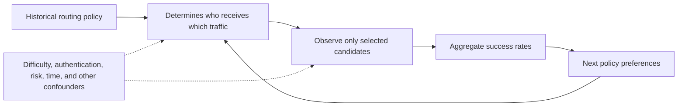
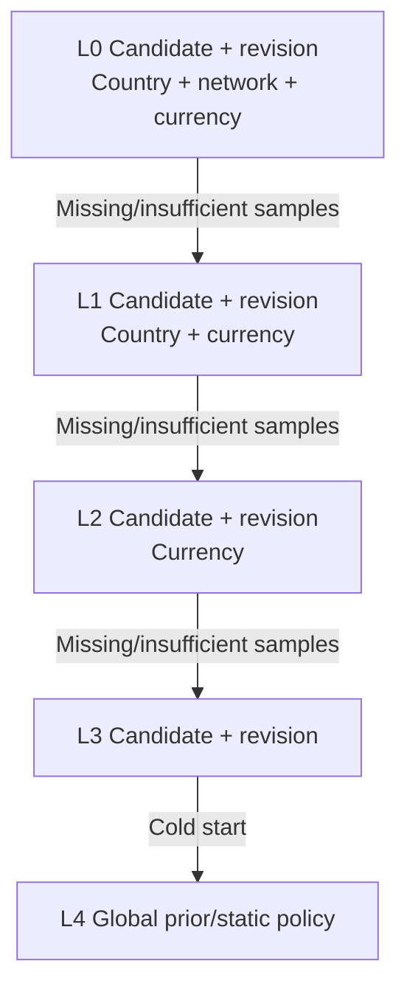
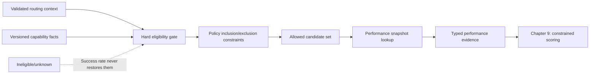

# Chapter 8: Success-Rate Routing

[中文](../../part-2-routing-engine/success-rate-routing.md) | **English**

In Chapter 2, Aurora saw an appealing table: for German-issued Visa transactions in EUR, PSP A's authorization rate was `94%` and PSP B's `88%`. “Send all these transactions to A from now on” seems natural.

That conclusion may be useful or entirely wrong. Did both groups share merchants, similar amounts, and authentication policies? Did B receive only harder retries after A declined? Did A have nine thousand samples or sixteen? Were unresolved timeouts counted as failures? More fundamentally, we observe only the connection selected by historical policy. The logs contain no outcomes for unselected candidates on the same transaction.

This chapter's proposition is therefore not “choose the highest historical success rate”:

> **Success-rate routing consumes immutable, versioned conditional performance estimates. Each binds an exact candidate, segment, sample size, statistical window, uncertainty, freshness, and fallback source. It describes evidence under historical policy, not a provider's causal advantage. Eligibility always precedes performance comparison.**

We begin with an overall leaderboard, encounter metric definitions, traffic mix, selection bias, sparse samples, delayed outcomes, and drift, then derive a read-only `PerformanceSnapshot`, fixed hierarchical fallback, and explicit shrinkage. [Chapter 9](provider-scoring.md) combines cost and success. [Chapter 13](../part-3-reliability/provider-health.md) handles minute-scale health. Chapters 15, 16, and 21 cover metric production, causal experiments, and counterfactual learning. We do not prematurely build a streaming platform or present development simulator outcomes as real PSP benchmarks.

The companion Go system implements this reading boundary. v3's `services/router/internal/performance` compiles immutable `performance.v1`, follows a fixed hierarchy using exact `candidate_id + connection_revision`, a named country field, `payment_method_context.network`, and currency, and validates per-level sample thresholds, `pending_count` coverage, window age, and publication age. It returns shrinkage estimates, Wilson intervals, and conservative PPM. Artifacts currently come only from synthetic repository fixtures. There is no real PSP outcome producer, streaming job, or production publication chain. Implementing an observational-evidence contract is not the same as having credible live provider rankings.

## 8.1 The Problem: `94%` and `88%` Cannot Tell Us What Switching Would Do

The ordinary authorization-rate definition is:

\[
\text{Authorization rate}=\frac{\text{Approved authorizations}}{\text{Authorization attempts meeting the metric definition}}
\]

The formula is sound; every word needs a contract. Does `approved` mean explicit issuer/network approval or HTTP `2xx`? Do three retransmissions of one logical authorization count once or three times? Is an `UNKNOWN` attempt a failure or an incomplete observation? Automatic-capture `SALE` includes authorization and capture semantics; can it be combined with authorization-only operations?

Even identical definitions can confuse traffic composition with connection capability. Consider illustrative data, not any real provider's performance:

| Historical difficulty stratum | Candidate A | Candidate B |
| --- | ---: | ---: |
| Relatively easy known stratum | 855 / 900 = 95% | 96 / 100 = 96% |
| Relatively difficult known stratum | 70 / 100 = 70% | 675 / 900 = 75% |
| Unstratified total | **925 / 1,000 = 92.5%** | **771 / 1,000 = 77.1%** |

B beats A in both known strata, yet the overall table puts A fifteen percentage points ahead. The arithmetic is correct: historical policy sent 90% easy traffic to A and 90% difficult traffic to B. The overall rate measures both performance and historical allocation.

Stratifying by country, brand, and currency reduces mixing but still does not establish causality. Two `DE + visa + EUR` buckets may differ in amount, merchant, 3DS path, token type, issuer, time, or risk policy. Stratification controls only recorded, semantically stable fields. It neither controls unknown confounders nor creates counterfactual outcomes for sending the same payment to both A and B.

Historical routing forms a feedback loop:



Interpreting that loop as “B will retain its success rate on A's traffic” uses selected samples to answer an unobserved question. Smoothing, confidence intervals, and complex models cannot invent unsupported counterfactual evidence.


*Figure: Overall rankings mix different traffic and sample sizes. Separate tracks reveal that comparisons describe the observed groups; the ranking does not establish causality.*

## 8.2 A Simple Design: Why an Overall Leaderboard Is a Reasonable Start

For one merchant, one market, uniform request semantics, and stable allocation, the previous day's approvals and attempts per connection provide valuable first diagnostics. The method is simple and exposes widespread integration failures quickly.

A minimal system may publish hourly snapshots:

| Candidate | Window | Approved | Finalized attempts | Raw success rate |
| --- | --- | ---: | ---: | ---: |
| `conn_pspa_aurora_eu_v1` | Last 24 hours | 9,400 | 10,000 | 94.0% |
| `conn_pspb_aurora_eu_v1` | Last 24 hours | 880 | 1,000 | 88.0% |

Routing could select the largest rate among available candidates. But the table answers “what happened to the traffic each received yesterday,” not “what happens if today's transaction switches.” It omits at least four kinds of evidence: transaction segments, allocation reasons, incomplete outcomes, and sampling uncertainty.

Preserve offline aggregation, not the leaderboard itself. Routing lies on the synchronous payment path and should not scan details, query warehouses, or compute windows per payment. Production keeps statistics off-path while upgrading the product to validated, replayable snapshots.

## 8.3 Scaling Problems: How One `success_rate` Becomes Misleading

### 8.3.1 Provider Brand Is Not the Statistical Subject

Accounts at the same PSP may differ in acquiring relationships, contracts, credentials, regional endpoints, and connector versions. Aggregating them into `psp_a` lets stronger connections hide weaker ones and cannot explain the executed path.

Aggregate by stable `candidate_id`, identifying one exact provider/account/connector/region connection. `provider` remains an operational summary dimension, not an online lookup key. Retired IDs must still explain history. New connectors or accounts that change execution semantics require a new candidate or explicit identity migration, never silently splicing old time series onto new connections.

### 8.3.2 Fix Numerators and Denominators before Models

Failure is not one outcome. Issuer decline, provider validation failure, local eligibility exclusion, fraud blocking, socket timeout, and unresolved queries occur at different stages. Counting every non-`2xx` in the denominator and every synchronous `2xx` in the numerator measures connector HTTP behavior more than authorization approval.

First write a metric-definition contract:

| Event | Authorization denominator? | Approval numerator? | Reason |
| --- | --- | --- | --- |
| Dispatched, explicitly approved | Yes | Yes | Definite authorization outcome |
| Dispatched, definite issuer/network decline | Yes | No | Definite authorization outcome |
| Blocked locally by eligibility/risk | No | No | No authorization sent |
| Retransmission of the same logical operation | No additional sample | No additional sample | Network retries are not independent samples |
| Timeout/disconnect, still `UNKNOWN` | Not finalized yet | No | Final outcome absent; do not preclassify as decline |
| Pure connector parameter/protocol error | Separate technical metric | No | Do not mix with issuer approval |
| Capture, void, refund, settlement result | No | No | Different funds stage |

“Not finalized yet” does not mean discard forever. Producers need an outcome watermark: publish windows whose waiting period has elapsed or whose observations have converged through definite evidence. Late webhooks, queries, or reconciliation enter later versions, not mutations of published snapshots. Expose unresolved samples through `pending_count` / `coverage_ratio`; degrade entire buckets below completeness thresholds instead of simply deleting slow outcomes. Chapters 17 and 18 address final corrections. Here, online readers must know `observed_at` and window completeness.

For end-to-end first-attempt success, define a separate named metric. Finalized technical failures may belong in its denominator, but it cannot retain the name “issuer authorization approval rate.” Include `outcome_definition` and `denominator_version` in the schema. Business objectives and Chapter 9's scoring contract choose the metric; dashboard SQL must not change it ad hoc.

Each connector also normalizes provider/network response and advice codes through a versioned dictionary, not HTTP guesses. Visa's developer material separately defines authorization response codes, authentication outcomes, and other response fields: request success and authorization approval are different facts. [Visa Request and Response Codes](https://developer.visa.com/request_response_codes)

The companion currently implements only tokenized-card automatic-capture `SALE`. Since `SALE` may combine authorization and capture, `sale_succeeded / sale_attempted` cannot be called a general authorization rate before reliable authorization facts are separated.

### 8.3.3 High-Dimensional Buckets Quickly Become Empty

Country, issuer, BIN/IIN, brand, currency, method, amount band, 3DS, token type, merchant, and time can all matter. Ten values per dimension rapidly produce many sparse combinations. `1 / 1 = 100%` and `0 / 1 = 0%` are arithmetically correct but barely distinguish performance.

Longer windows add samples while importing last month's connector, issuer, and authentication environment. Shorter windows track change but add variance and empty buckets. One global “last seven days” cannot resolve this. Every estimate must expose window, count, and uncertainty so routing can judge evidential suitability.

Do not hard-code BIN/IIN lengths or put them directly in high-cardinality labels. Online context can carry controlled nonsensitive derivatives or metadata versions. Raw PAN, CVV/SAD, and secrets never enter performance keys, decisions, or metrics. If fine-grained quality, compliance boundaries, or coverage are unreliable, start with stable country, brand, and currency.

### 8.3.4 Drift and Feedback Delay Create “Fresh Old Facts”

A 24-hour window may not be fresh: aggregation may have stopped six hours ago, many recent `UNKNOWN` attempts may remain unresolved, or a connector may just have upgraded. `window_end` alone cannot distinguish these cases.

Use at least three times: `window_end` is the event cutoff, `observed_at` the outcome watermark, and `produced_at` artifact creation. Routing validates explicit age and completeness policies. Expiry returns `PERFORMANCE_SNAPSHOT_STALE` with degradation, not four-decimal false precision.

Minute-scale timeout, latency, and error spikes belong to operational health, not daily success windows. Otherwise, long-term performance and short-term failure are double-weighted. [Chapter 13](../part-3-reliability/provider-health.md) introduces health as a hard constraint or independent signal. This chapter concerns slower historical performance.

## 8.4 Production Design: Publish Evidence, Not Rankings

Separate outcome production from online reading. Routing reads validated snapshots, not detail databases, and never waits for aggregation:

```mermaid
flowchart LR
    Raw["Provider responses/queries/webhooks"] --> Normalize["Versioned connector normalization"]
    Normalize --> Dedup["Deduplicate logical operations"]
    Dedup --> Final["Finalized outcomes + watermark"]
    Final --> Segment["Stratify by candidate and stable context"]
    Segment --> Estimate["Sample thresholds + shrinkage + uncertainty"]
    Estimate --> Artifact["Immutable performance snapshot"]
    Artifact --> Validate["Router validates version and freshness"]
    Eligibility["Eligible candidate set"] --> Lookup["Fixed hierarchical lookup"]
    Validate --> Lookup
    Lookup --> Feature["Estimate + evidence, no funds execution"]
```



This does not require Kafka, Flink, or an online feature store immediately. At low to medium scale, hourly batches over finalized PostgreSQL facts can produce strict JSON artifacts distributed through deployment or configuration. Producers own definitions and artifacts; routing owns validation, lookup, and degradation; orchestration still owns attempts, operations, and funds state.

### 8.4.1 `PerformanceSnapshot` Is One Immutable Observation

A snapshot needs more than `candidate_id → rate`:

| Field | Example | Why online evidence retains it |
| --- | --- | --- |
| `schema_version` | `performance.v1` | Reject incompatible structures |
| `snapshot_version` / digest | `perf_2026-08-26T10` | Replay and detect same-version different content |
| `segment_schema_version` | `segment.v1` | Explain dimensions, wildcards, normalization |
| `outcome_definition` / denominator version | `authorization_approval.v1` | Fix numerator, denominator, deduplication, pending treatment |
| `window_start` / `window_end` | UTC interval | Sample coverage period |
| `observed_at` | Outcome watermark | Detect delayed/censored outcomes |
| `produced_at` | Artifact creation time | Detect stalled publication |
| `candidate_id` + segment key | Exact connection and canonical fields | Conditional evidence for this transaction |
| `approved` / `sample_size` | `675 / 900` | Distinguish 1/1 from 900/1000 |
| `estimate` | Smoothed probability | Point estimate used for comparison |
| `confidence` / interval | `high`, `[0.72, 0.78]` | Expose uncertainty instead of hiding noise |
| `source_segment` / fallback level | `candidate+country+currency` | Explain why the finest bucket was not used |

Published artifacts do not mutate. Each `snapshot_version` maps to one canonical digest. At load time, validate probabilities, count relationships, time order, references, duplicate keys, and hierarchy completeness, then atomically replace the pointer. Callers cannot choose a more favorable snapshot version in requests.

### 8.4.2 Fixed Hierarchical Fallback Avoids Picking the Prettiest Bucket

The first deliverable queries Chapter 4's canonical country, `payment_method_context.network`, and currency, always with exact candidate revision. `country_field` explicitly selects `merchant.country` or `payment_method_context.issuer_country`, never an unnamed mixture. The fallback chain belongs to the segment schema:



Why not query both country-preserving and brand-preserving parents at L1 and choose the higher rate? That selects buckets based on observed outcomes, introducing another winner's curse and obscuring explanations. Decide which dimensions to drop using offline validation and business semantics, publish with `segment_schema_version`, and follow one fixed chain online.

Every level needs versioned minimum samples. A single successful observation in the finest bucket must not send `100%` straight to scoring. Emit `PERFORMANCE_INSUFFICIENT_SAMPLE` and fall back. If all levels are insufficient, return a declared global prior or abstain and use stable static policy. Missing cannot mean `0%`, nor can the first configured candidate become an implicit winner.

This Go example shows deterministic read-only lookup. It retains transport-aligned `ConnectionRevision`, `Network`, per-level thresholds, pending coverage, and two age limits, while omitting observation states, cohorts, and artifact compilation to emphasize fixed fallback. Maps serve exact lookup only, never winner selection by iteration:

```go
package performance

import (
	"errors"
	"math/big"
	"time"
)

var (
	ErrSnapshotStale   = errors.New("performance snapshot is stale")
	ErrInvalidSnapshot = errors.New("performance snapshot is invalid")
	ErrNoEvidence      = errors.New("no performance evidence")
)

const (
	any      = "*"
	ppmScale = uint64(1_000_000)
)

type SegmentKey struct {
	CandidateID        string
	ConnectionRevision string
	Country            string
	Network            string
	Currency           string
}

type Bucket struct {
	Estimate     float64
	Lower95      float64
	Upper95      float64
	SampleSize   uint64
	PendingCount uint64
	Confidence   string
}

type Snapshot struct {
	SchemaVersion        string
	SegmentSchemaVersion string
	OutcomeDefinition    string
	Version              string
	WindowStart          time.Time
	WindowEnd            time.Time
	ObservedAt           time.Time
	ProducedAt           time.Time
	MinSamples           [4]uint64
	MinCoveragePPM       uint64
	MaxAge               time.Duration
	MaxWindowAge         time.Duration
	Buckets              map[SegmentKey]Bucket
}

type Query struct {
	CandidateID        string
	ConnectionRevision string
	Country            string
	Network            string
	Currency           string
}

type Result struct {
	Bucket
	SnapshotVersion string
	SourceSegment   SegmentKey
	FallbackLevel   int
	CoveragePPM     uint64
	WindowStart     time.Time
	WindowEnd       time.Time
	ObservedAt      time.Time
}

func (s Snapshot) Lookup(now time.Time, q Query) (Result, error) {
	invalidTimeline := !s.WindowStart.Before(s.WindowEnd) ||
		s.ObservedAt.Before(s.WindowEnd) ||
		s.ProducedAt.Before(s.ObservedAt) ||
		s.ProducedAt.After(now)
	if s.SchemaVersion == "" || s.SegmentSchemaVersion == "" ||
		s.OutcomeDefinition == "" || s.Version == "" ||
		s.MinCoveragePPM == 0 || s.MinCoveragePPM > ppmScale ||
		s.MaxAge <= 0 || s.MaxWindowAge <= 0 || invalidTimeline ||
		q.CandidateID == "" || q.ConnectionRevision == "" ||
		q.Country == "" || q.Network == "" || q.Currency == "" {
		return Result{}, ErrInvalidSnapshot
	}
	for _, minimum := range s.MinSamples {
		if minimum == 0 {
			return Result{}, ErrInvalidSnapshot
		}
	}
	if now.Sub(s.ProducedAt) > s.MaxAge || now.Sub(s.WindowEnd) > s.MaxWindowAge {
		return Result{}, ErrSnapshotStale
	}

	levels := []SegmentKey{
		{q.CandidateID, q.ConnectionRevision, q.Country, q.Network, q.Currency},
		{q.CandidateID, q.ConnectionRevision, q.Country, any, q.Currency},
		{q.CandidateID, q.ConnectionRevision, any, any, q.Currency},
		{q.CandidateID, q.ConnectionRevision, any, any, any},
	}
	for level, key := range levels {
		bucket, ok := s.Buckets[key]
		coverage := coveragePPM(bucket.SampleSize, bucket.PendingCount)
		if !ok || bucket.SampleSize < s.MinSamples[level] || coverage < s.MinCoveragePPM {
			continue
		}
		return Result{
			Bucket:          bucket,
			SnapshotVersion: s.Version,
			SourceSegment:   key,
			FallbackLevel:   level,
			CoveragePPM:     coverage,
			WindowStart:     s.WindowStart,
			WindowEnd:       s.WindowEnd,
			ObservedAt:      s.ObservedAt,
		}, nil
	}
	return Result{}, ErrNoEvidence
}

func coveragePPM(samples, pending uint64) uint64 {
	if samples == 0 {
		return 0
	}
	numerator := new(big.Int).Mul(new(big.Int).SetUint64(samples), new(big.Int).SetUint64(ppmScale))
	denominator := new(big.Int).Add(new(big.Int).SetUint64(samples), new(big.Int).SetUint64(pending))
	return numerator.Quo(numerator, denominator).Uint64()
}
```

Map the example explicitly to implementation. `Query.Network` comes from `payment_method_context.network`, not an invented brand-alias field. `Query.Country` means only the fact selected by `country_field`. ID and revision must both match. `MinSamples[0..3]`, `MinCoveragePPM`, `pending_count`, `window_start/end`, `observed_at`, `produced_at`, `MaxAge`, and `MaxWindowAge` are artifact contracts. The example assumes known country/network and returns `ErrNoEvidence` without buckets. Production also carries `known`/`unknown`/`stale`/`redacted`/`not-applicable`, skips unusable fine levels, and returns explicit `global_prior` only under approved policy.

The real loader additionally validates `0 ≤ estimate ≤ 1`, `0 ≤ lower ≤ upper ≤ 1`, UTC times, counts within exact floating-point bounds, schema-permitted wildcard positions, and matching candidate IDs/revisions in capability manifests. Production `EstimatorVersion` specifies per-level sample, coverage, and confidence thresholds. The teaching function does not present these policy constants as universal statistical theorems.

### 8.4.3 Shrinkage and Intervals Address Noise, Not Bias

Fixed thresholds are explainable but create discontinuities. Another approach shrinks fine buckets toward their parent. With `s` approvals, `n` finalized attempts, parent estimate `p₀`, and parent equivalent sample strength `k`, a transparent estimate is:

\[
\hat p=\frac{s+k p_0}{n+k}
\]

Small `n` stays near the parent; increasing `n` gives local evidence more influence. `k` is not universal. Publish it through offline calibration and segment-schema versions, not per-instance tuning.

Point estimates still cannot express uncertainty. This Go code returns a shrunk point estimate and a Wilson score interval for the raw binomial sample. Wilson's 1927 paper introduced score-based proportion inference. It avoids a zero-width interval for `1/1`, but does not prove payment samples are independent and identically distributed. [E. B. Wilson, “Probable Inference, the Law of Succession, and Statistical Inference”](https://doi.org/10.1080/01621459.1927.10502953)

```go
package performance

import (
	"errors"
	"math"
)

type Estimate struct {
	Probability     float64
	SampleSize      uint64
	ObservedLower95 float64
	ObservedUpper95 float64
}

func SmoothedEstimate(
	successes, trials uint64,
	parentRate, priorStrength float64,
) (Estimate, error) {
	if successes > trials || math.IsNaN(parentRate) || math.IsInf(parentRate, 0) ||
		math.IsNaN(priorStrength) || math.IsInf(priorStrength, 0) ||
		parentRate < 0 || parentRate > 1 || priorStrength < 0 {
		return Estimate{}, errors.New("invalid performance evidence")
	}
	denominator := float64(trials) + priorStrength
	if denominator == 0 {
		return Estimate{}, errors.New("estimate has no evidence or prior")
	}

	probability := (float64(successes) + priorStrength*parentRate) / denominator
	lower, upper := wilson95(successes, trials)
	return Estimate{
		Probability:     probability,
		SampleSize:      trials,
		ObservedLower95: lower,
		ObservedUpper95: upper,
	}, nil
}

func wilson95(successes, trials uint64) (float64, float64) {
	if trials == 0 {
		return 0, 1
	}
	z := 1.959963984540054
	n := float64(trials)
	p := float64(successes) / n
	z2 := z * z
	denominator := 1 + z2/n
	center := (p + z2/(2*n)) / denominator
	radius := z * math.Sqrt((p*(1-p)+z2/(4*n))/n) / denominator
	return math.Max(0, center-radius), math.Min(1, center+radius)
}
```

The teaching function returns only the shrunk point and raw interval. Production `performance.Estimate` also computes `ConservativeProbability = min(Probability, ObservedLower95)`, then rounds down to `ConservativePPM`. Chapter 9's v3 scorer consumes that conservative PPM, not bare `ProbabilityPPM`. This is a versioned engineering objective, not a guaranteed lower bound on true success. `EstimatorVersion`, `IntervalMethodVersion`, samples, pending coverage, and observational-only interpretation remain attached.

Intervals describe raw-proportion instability under an assumed sample model. Shrinkage describes how much sparse buckets borrow from parents. Thus fields are named `ObservedLower95` / `ObservedUpper95`: they need not surround the shrunk estimate. If a producer wants intervals for the shrinkage model itself, choose and calibrate a method and publish `interval_method_version`; do not mix statistical objects. Neither method answers what B would do on transactions historically sent to A. Selection bias comes from data generation; error bars cannot remove it.

`confidence` may be an enum derived from sample size, interval width, completeness, and fallback level, with versioned thresholds. Return underlying fields and reasons, not an unexplained `0.8734`.

### 8.4.4 Eligibility Comes First; Performance Adds Evidence Only to Eligible Candidates

Success estimates are soft objectives, not capability proof. High approval in `DE + visa + EUR` cannot admit a disabled account or a connection missing operation, capture mode, currency, or authentication support.

The proper order is:



Prefer sorting candidate IDs before attaching evidence. This provides replayable output, not alphabetical preference. Versioned policy determines missing-data handling: mark `PERFORMANCE_NO_EVIDENCE` and abstain, or use a declared prior. High success cannot override `capability_unknown`; low success should not secretly disable a legitimate connection forever. The latter is scoring or operational policy, not eligibility fact.

Chapter 9 combines cost, success, risk, and ties. This chapter's typed features include at least:

| Evidence group | Fields |
| --- | --- |
| Identity | `candidate_id`, `snapshot_version` |
| Point estimate and sample | `estimate`, `sample_size`, `confidence` |
| Uncertainty | `observed_lower_95`, `observed_upper_95`, `interval_method_version` |
| Time and fallback | `window_start`, `window_end`, `observed_at`, `source_segment`, `fallback_level` |

These are decision evidence, not provider outcomes. Looking up an estimate creates no attempt, invokes no gateway, and changes no payment state.

### 8.4.5 Cold Starts: Unknown Cannot Masquerade as Average

New candidates lack history. Setting them to `0%` can starve them forever; a high default can suddenly shift production onto an unverified path. A safer sequence is:

1. Eligibility, contracts, connection tests, and operational guardrails establish permission for this new authorization class.
2. Use an explicit parent prior or static policy, not fabricated observations for the new connection.
3. If exploration is approved, grant controlled low-volume traffic and record assignment and exposure probability.
4. Only once publication thresholds are met do snapshots gradually use finer candidate evidence.

A prior states a conservative assumption without local evidence. It cannot appear as “this connection historically succeeds 90% of the time.” `source_segment=global_prior`, `sample_size=0`, and `PERFORMANCE_COLD_START` must appear together.

## 8.5 Selection Bias and Exploration: Acknowledge What Logs Lack

Routing logs provide partial feedback: outcomes only for selected candidates. Swaminathan and Joachims describe the historical policy's action-selection probability as propensity and show that counterfactual estimation depends on it, with high variance when propensities are small. [Counterfactual Risk Minimization](https://www.jmlr.org/papers/v16/swaminathan15a.html)

This yields three boundaries:

* If historical policy selected B with probability zero in a context, no B outcomes exist there. Offline methods cannot reliably establish superiority using those logs alone.
* Nonzero recorded propensities do not remove unrecorded confounding, delays, or policy changes. Inverse propensity weighting can still have enormous variance from rare actions.
* Deterministic historical policies without replayable assignment rules cannot have exposure probabilities invented retrospectively.

Li and colleagues' replay method provides unbiased evaluation under particular randomized-logging and matching conditions. Adequate randomized coverage, not simply a large dataset, is essential. [Unbiased Offline Evaluation of Contextual-Bandit-Based News Article Recommendation Algorithms](https://arxiv.org/abs/1003.5956) Payment losses, risk, and funds side effects are much more sensitive than news clicks. We borrow the principle of recording selection mechanisms and support, not a recommender-system rollout recipe.

### 8.5.1 Exploration Belongs Only in a Narrow Safe Region

Exploration is not random funds requests to feed a model. It follows every hard constraint and requires explicit merchant, risk, capacity, and experiment authorization:

| Scenario | Explore another candidate for performance data? | Reason |
| --- | --- | --- |
| First attempt before any provider operation exists | Conditionally | Eligible set, permitted risk, and traffic caps only |
| Duplicate arrival of the same idempotent request | No redraw | Reuse stable assignment/existing decision |
| Original operation is `UNKNOWN` | No | Side effects may exist; recover/query original connection |
| Retransmission after timeout | No | Original connection, operation ID, payload, provider key |
| Capture, void, refund | No | Original connection and transaction reference |
| Ineligible or risk-blocked candidate | No | Exploration and scores cannot cross hard constraints |

Even the first row requires stable buckets, maximum shares, minimum merchant-sample safeguards, capacity caps, emergency stop, and auditable versions. Record assignment before sending and associate outcomes with the same exposure. Unexecuted assignments are not failures. [Chapter 16](../part-4-operating-at-scale/experimentation.md) covers complete design, significance, variance reduction, and launch decisions; [Chapter 21](../part-5-global-routing/intelligent-routing.md) covers off-policy learning and model policies.

Without those conditions, name estimates accurately: conditional observed performance under historical policy. They can stabilize decisions, reveal data problems, and generate hypotheses, but cannot claim A causally improves on B by six percentage points.

## 8.6 Failure Modes: Precise-Looking Errors Are the Most Dangerous

| Failure | Surface appearance | Consequence | Defense/reason |
| --- | --- | --- | --- |
| Brand-level aggregation | PSP A globally 94% | Mixes accounts, connectors, regions | Exact `candidate_id` |
| No historical allocation record | A overall exceeds B | Traffic mix becomes apparent advantage | `PERFORMANCE_OBSERVATIONAL_ONLY` |
| 1/1 beats 900/1000 directly | Tiny bucket shows 100% | Noise chasing and oscillation | `PERFORMANCE_INSUFFICIENT_SAMPLE` |
| Highest of multiple parent buckets | Lookup always finds a nice number | Outcome-dependent fallback, poor replay | Fixed hierarchy + `source_segment` |
| `UNKNOWN` counted as decline | Short-window rate collapses | Penalizes slow outcomes; censoring bias | Outcome watermark |
| Retransmissions counted repeatedly | Timeout-prone connection gains samples | Inflated denominator/declines | Logical-operation deduplication |
| Stalled snapshots | Still four decimal places | Old conditions guide new traffic | `PERFORMANCE_SNAPSHOT_STALE` |
| Silent identity reuse | New connector inherits old samples | Mixed execution semantics | New ID or explicit migration |
| High success revives ineligible paths | Conversion overrides capability gaps | Technical, contract, compliance violations | Eligibility-before-scoring tests |
| No support under old deterministic policy | Segment never sent to B | B counterfactual cannot be evaluated | Mark unsupported; do not invent conclusions |

Target leakage is another common fault: post-authorization response codes, references, or final state enter routing features. Offline replay looks excellent, but those fields do not exist at decision time online. Segment schemas may use only context available then, with explicit provenance and freshness. Producers should validate the `available_at` boundary during artifact construction.

## 8.7 Tests: Reject Tempting Bad Evidence

Tests need more than “higher success sorts first”:

| Test | Construction | Required proof |
| --- | --- | --- |
| Small samples | Fine bucket 1/1; parent 900/1000 | No unconditional tiny-sample victory; threshold fallback or explicit low confidence |
| Fixed hierarchy | L0 absent; L1 and L2 present | Next schema-defined level, not highest rate |
| Staleness | `produced_at` exceeds `max_age` | Stale degradation, not ordinary features |
| Shuffled inputs | Repeatedly permuted candidates | Stable evidence order, versions, tie inputs |
| Eligibility first | Ineligible candidate estimated 99% | Lookup/scoring cannot restore it |
| Delayed outcomes | `UNKNOWN` later approved | First version does not count decline; later facts enter new snapshots |
| Deduplication | Three transmissions of one operation | Denominator increases once |
| Cold start | No candidate buckets | Explicit prior or abstention, never default 0/1 |
| Identity | Two accounts at one PSP | Separate aggregation and lookup |
| Unsupported region | Historical propensity zero | No offline counterfactual superiority claim |

Property tests should generate arbitrary `successes ≤ trials`, time boundaries, and bucket permutations, checking bounded probabilities, terminating fallback, and stable serialization digests. Golden tests pin snapshots and contexts with `snapshot_version`, `source_segment`, `sample_size`, intervals, and reasons. Process restarts must preserve outputs for identical input.

Also test payment invariants: lookup failure cannot directly call the gateway; `UNKNOWN` queries/retries retain original `provider_connection_id`; capture, void, and refund never reroute. Success optimization cannot alter recovery semantics.

## 8.8 Trade-offs: Finer, Faster, and “Smarter” Are Not Free

**Segmentation and statistical power.** Finer segments reduce known mixing but create sparsity; coarser ones stabilize counts but hide heterogeneity. Fixed hierarchy and shrinkage are explainable compromises, not a uniquely correct granularity.

**Freshness and completeness.** Short windows respond faster but contain more unresolved attempts. Waiting for watermarks improves completeness at the cost of lag. Separate minute-scale health from slower performance so one signal does not do two jobs.

**Exploration and funds risk.** Without exploration, old policy can leave candidates unsupported indefinitely. Too much exposes customers to uncertain paths. Define acceptable loss, eligible scope, and stopping criteria before pursuing statistically clean uniform randomization.

**Robustness and responsiveness.** Strong priors, larger thresholds, and wider windows reduce oscillation but delay real improvements. Versioned parameters, shadow reports, and Chapter 16's controlled experiments are more auditable than continually hand-tuning `k` in production.

**Explainability and model complexity.** Stratified rates, fixed fallback, and explicit intervals replay easily. High-dimensional models may predict better but require training data, calibration, drift management, and counterfactual evaluation. Chapter 21's models must still produce typed features and version evidence and obey eligibility and guardrails.

## 8.9 Companion Go Implementation Boundaries

The [pinned implementation](https://github.com/YouEclipse/payments/tree/bc4afde24da708d22f67da72a90a1557b1477173/services/router/internal/performance) provides strict `performance.v1` compilation and read-only lookup. `candidate_id + connection_revision` is indivisible statistical identity. The fixed chain is country + network + currency → country + currency → currency → candidate → global prior; `network` comes only from `payment_method_context.network`. `country_field` selects merchant or issuer country explicitly. Queries also carry operation/capture cohorts, preventing automatic-capture `SALE` statistics from masquerading as general authorization rates. The package validates `authorize + manual` statistical schemas, but v3 installs only `sale + automatic` snapshots and has no manual-capture execution chain.

Artifacts pin window bounds, outcome watermark, `produced_at`, publication/window age limits, four sample thresholds, pending-coverage threshold, prior, and estimator version. Lookup does not select the prettiest parent. It follows the fixed chain, checks samples and coverage, and shrinks through eligible ancestors. Cold starts return `prior`, zero observations, and observational-only reasons. v3 queries only exact revisions permitted by eligibility, rules, and risk. Batch scoring then verifies common snapshot, cohort, country/network/currency, window, and evaluation time across candidates.

Tests cover 1/1 samples, fixed hierarchy, pending coverage, unknown/stale metadata, expired publication and old windows, revision/cohort isolation, new artifacts for late evidence, permutations, concurrent replay, and numerical boundaries. They prove the reader contract and determinism. Repository snapshots and outcomes are synthetic fixtures. There is no real PSP normalization, production logical-operation deduplication producer, streaming cluster, production artifact library, approval chain, causal experiment, or counterfactual support. The implementation is therefore **fixture-backed observational performance**, not a real provider benchmark, machine learning capability, or demonstrated live traffic gain.

## 8.10 Recap

The difficulty is evidence boundaries, not division. A performance estimate for one route must identify the exact connection, transaction class, funds stage, finalized sample count, window, outcome watermark, fallback level, uncertainty, and artifact version.

Six invariants follow:

1. Overall `94%` and `88%` describe history, not causality. Stratification reduces known mixing but does not eliminate selection bias.
2. Numerators, denominators, deduplication units, and watermarks precede statistics. Authorization, technical availability, `SALE`, capture, and settlement stay distinct.
3. `candidate_id`, not provider brand, is the online statistical subject. Same-PSP accounts, connectors, and regions must not silently share buckets.
4. Small samples require explicit uncertainty through thresholds, shrinkage, intervals, and parent fallback. `1/1` cannot automatically win.
5. Eligibility and risk guardrails define the allowed set first. Performance adds soft evidence only within it and executes no funds side effects.
6. Exploration is restricted to authorized new first-attempt scenarios. `UNKNOWN` recovery, capture, void, and refund remain pinned to original connections and references.

We still have a feature, not a final selector: explainable, versioned, and able to degrade. The next chapter combines it with expected cost, risk decisions, and stable tie-breaking in a constrained scoring pipeline, preserving the rule that an attractive score cannot override a hard constraint.
