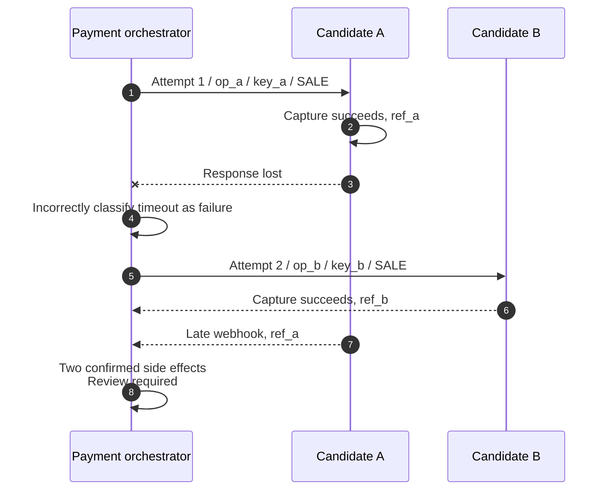
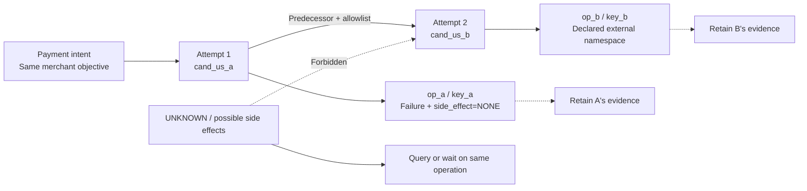
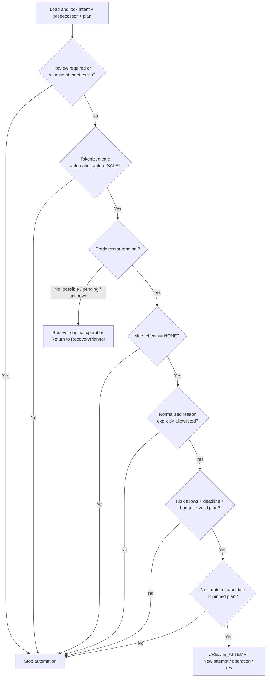
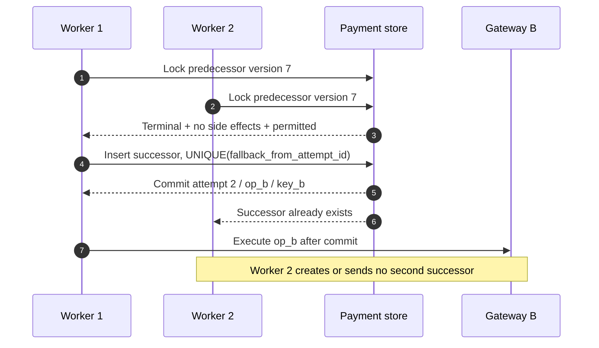

# Chapter 12: Fallback Routing

[中文](../../part-3-reliability/fallback-routing.md) | **English**

For a 129.00 USD automatic-capture payment using a tokenized card, Aurora's routing service returns the ordered plan `cand_us_a`, `cand_us_b`. The orchestrator creates attempt 1 and a `SALE` operation using the first candidate. A few hundred milliseconds later, the gateway reports “provider temporarily unavailable.” Should the system immediately call `cand_us_b`?

That message cannot answer the question. If the adapter proves rejection before the request crossed the provider boundary, the old operation has `side_effect_certainty=none`. If the request may have reached the provider but its response was lost, the same message means `possible` and `UNKNOWN`. Even genuine `none` does not justify automatically routing around issuer declines, risk blocks, or a 3DS `action`. This chapter's central proposition is:

> **Fallback routing is a recovery action in which the payment orchestrator creates a new attempt after the old attempt definitively terminates with `side_effect=NONE` and a versioned policy's reason allowlist explicitly permits it. It is neither retrying another PSP after a timeout nor a selection strategy alongside static, cost, and success-rate routing.**

Chapter 10 covered query, wait, and same-key resend for one operation; Chapter 11 defined stable identities at each layer. Here we ask only when a second funds path may exist. Chapter 13 covers health effects on future transactions, and Chapter 14 covers full decision records. The first engineering increment remains tokenized cards and automatic-capture `SALE`, without pretending the same rules fit transfers, wallets, or manual capture.

## 12.1 The Problem: An Error Is Not Permission for a Second Funds Path

The intuitive implementation calls candidates in order and moves on after any error:

```go
package naivefallback

import "context"

type Command struct {
	AmountMinor int64
	Currency    string
}

type Provider interface {
	Sale(context.Context, Command) error
}

// Charge deliberately demonstrates an unsafe approach: err cannot prove
// that the preceding call produced no side effects.
func Charge(ctx context.Context, providers []Provider, command Command) error {
	var lastErr error
	for _, provider := range providers {
		if err := provider.Sale(ctx, command); err != nil {
			lastErr = err
			continue
		}
		return nil
	}
	return lastErr
}
```

This loop treats a process-visible `error` as a remote funds fact. If A completed capture but lost its response, calling B may charge the customer twice. A's idempotency key cannot protect B because their deduplication domains are separate.



The mechanisms must be distinguished:

| Mechanism | Trigger | Identity changes? | Owner | May create a funds path? |
| --- | --- | --- | --- | --- |
| Routing | Before executing a new attempt | Selects a specific candidate | Routing decides; payments pins it | Decision only, no funds execution |
| Retry / recovery | Original outcome unresolved | Pins operation, connection, key, payload | Payment recovery + gateway | No new attempt |
| Fallback routing | Old attempt has definitive no-side-effect terminal state | New attempt, operation, provider key | Payment fallback planner | Only after all gates pass |
| Provider health | Technical observations across transactions form a snapshot | Affects eligible set or score for subsequent requests | Health subsystem / routing | Does not rewrite recovering operations |

Cost-aware and success-rate routing compare eligible candidates for a new attempt. Fallback asks whether any new attempt may exist after the old one. Placing them in one strategy enum suggests that scores can offset side-effect uncertainty—a responsibility error.

## 12.2 The Simple Design: `side_effect=NONE` Is Necessary but Insufficient

Proceeding only when the old operation has no side effects improves on switching after every error. But “no side effects” does not mean “try again.” An explicit issuer decline may normalize to `failure/none` while forbidding retry or requiring corrected information/authentication. Checking certainty alone mistakes technical safety for business permission.

At least two independent gates must pass consecutively:

1. **Evidence gate:** the old attempt is terminal, with trusted `side_effect_certainty=none`. Timeouts, disconnects, invalid responses, ambiguous 5xx, and pending results cannot pass.
2. **Policy gate:** the normalized reason appears in the explicit allowlist of the policy referenced by the current route plan. Issuer declines, risk blocks, `review_required`, and 3DS/wallet `action` are excluded by default.

Then check operation type, fallback count, total deadline, attempted candidates, risk guardrails, and concurrent ownership. Any missing or unknown field fails explicitly; permission is never guessed.

| Old-attempt evidence | `side_effect` | Default action | Why |
| --- | --- | --- | --- |
| Durable local state proves no dispatch; allowlisted technical failure | `none` | Continue checking budget, deadline, risk, next candidate | Both evidence and policy gates may pass |
| Provider contract gives exact-operation “not processed” terminal result | `none` | Fallback only if normalized reason is allowlisted | HTTP code alone is insufficient |
| Issuer decline, even apparently “soft” | `none` | Stop, no fallback by default | Follow advice/customer actions, no PSP shopping |
| Timeout, EOF, reset, ambiguous 5xx | `possible` | Query/wait/evidence-backed same-key recovery | A may already have executed |
| Pending or asynchronous acceptance reference | `possible` | Query/wait on original operation | Old operation exists; do not switch |
| `requires_action` / 3DS challenge | `possible` or flow state | Continue original authentication flow | Interaction and transaction context cannot migrate arbitrarily |
| Risk `block`, expired fail-closed decision, `review_required` | Any | Stop automatic recovery | No bypass of central guardrails or evidence conflicts |
| Captured/authorized/confirmed provider reference | `confirmed` | Stop; subsequent operations bind original transaction | Funds facts already exist |

Stripe's official decline table pairs decline/advice codes with differing next steps: authenticate, change payment method, or contact the issuer. It offers no cross-provider rule to switch on every soft decline. [Stripe: Decline codes](https://docs.stripe.com/declines/codes) Mastercard's official switching rules likewise define Merchant Advice Codes and actions including “do not retry.” [Mastercard: Switching rules](https://www.mastercard.com/content/dam/mccom/shared/business/support/rules-pdfs/mastercard-switch-rules-manual.pdf) Adapters may retain original provider/network codes; policy consumes only stable reasons from versioned mappings. Unknown codes must be rejected, not guessed from a string containing `temporary`.

### 12.2.1 Outcome Classification Is Not a Provider-Supplied Boolean

Providers should not decide platform fallback. Adapters interpret protocol responses—for example, possible dispatch or a code meaning definitive decline in this API version. Payment-owned policy decides whether the business permits a new attempt. A durable `OutcomeClassification` can contain:

| Field | Producer | Meaning |
| --- | --- | --- |
| `outcome_class` | Adapter normalizer | Success, failure, pending, unknown |
| `side_effect_certainty` | Adapter + durable dispatch evidence | None, possible, confirmed |
| `normalized_reason` | Versioned normalizer | Stable reason code, not raw error text |
| `retryable_same_route` | Recovery policy | Whether recovery on original connection/key/payload is allowed |
| `fallback_allowed` | Fallback policy | Whether the current reason is explicitly allowlisted |
| `requires_user_action` | Adapter / payment-method flow | Whether a 3DS, redirect, or other continuation exists |
| `source` / `normalizer_version` | Gateway | Synchronous response, query, webhook, or local proof |

`fallback_allowed=true` is only the policy gate's result, not an immediate send command. The planner still checks certainty, old terminal state, risk, plan, budget, and ownership. This prevents adapter-owned routing and cross-route execution based on one raw provider field. Conversely, `retryable_same_route` authorizes only Chapter 10 recovery, never a new attempt.

## 12.3 Problems at Scale: A New Attempt Reopens the Entire Execution Chain

### 12.3.1 A Healthy Alternative Does Not Make UNKNOWN Safe

Lower latency and higher success at `cand_us_b`, or even an ongoing incident at A, cannot change attempt 1's funds facts. Recovery of `UNKNOWN/possible` retains A's `operation_id`, `provider_connection_id`, provider key, and hash. Chapter 13 health snapshots may steer the next payment away from A; they cannot retroactively establish nonexecution.

Adyen requires reuse of the same key after timeout and states that regional endpoints do not cross-check duplicate keys. [Adyen API idempotency](https://docs.adyen.com/development-resources/api-idempotency) This specific contract illustrates a general boundary: recovery pins original connection and key; a cross-candidate new attempt gets its own operation and key, without claiming cross-PSP protection from the old key.

### 12.3.2 “Soft” and “Hard” Declines Are Not Intuitive Buckets

The same message may originate from the gateway, local adapter, PSP, acquirer, or issuer. HTTP 402/422 can wrap entirely different advice. Production classification carries at least `source`, provider/network code, normalizer version, operation type, and side-effect evidence. Start with an extremely narrow allowlist, such as only `provider_unavailable_pre_dispatch`. Expansion needs official target-adapter semantics, contract tests, risk review, and rollback.

This chapter blocks issuer declines by default even with conclusive `none`. Asking the customer to correct CVC, authenticate, change cards, or retry later is a new product/network interaction, not permission to spray multiple PSPs during one confirmation. The restriction gives up some immediate conversion while avoiding ignored advice, duplicate authentication, and issuer shopping until someone approves.

### 12.3.3 A 3DS `action` Is a Continuation, Not Failure

Redirects, challenges, and native 3DS SDK flows tie together a provider transaction, authentication session, return URL, and client state. Adyen's official result-code documentation explicitly connects `action` results to subsequent `/payments/details` authentication continuation. [Adyen: Payment result codes](https://docs.adyen.com/online-payments/build-your-integration/payment-result-codes) Treating `requires_action` as A's failure and switching to B loses authentication correlation and may leave A capable of completing.

`requires_action`, `challenge_in_progress`, and `redirect_pending` therefore stop fallback by default. A future customer-visible cross-provider restart needs a new user journey, explicit consent, and proof that old authentication/authorization safely terminated. That is not this chapter's automatic fallback.

### 12.3.4 Pin the Allowed Set Without Freezing Expired Safety Guardrails

Calling the live scorer after every failure lets cost, performance, and health changes make the sequence inexplicable. New configuration may even introduce a connection never admitted initially. Initial routing should issue an immutable `RoutePlanDecision` containing `plan_id`/digest, policy/capability/feature versions, stable order, maximum attempts, and validity. Payments pins the original in the attempt-1 transaction. **Fallback requests no new routing decision and reruns no cost, performance, or scoring stage to generate another candidate set or ranking.**

The planner takes only the **next** listed, untried candidate. It cannot jump to a rescored winner, add a provider, or let the gateway choose another account. Before creating an attempt, payments obtains a fresh versioned risk decision and calls a routing-owned guardrail-only interface such as `RevalidatePlanCandidate` to check that one pinned candidate's capability/health hard gates. The interface returns only `allow` or evidence-bearing `veto`; it cannot add/reorder candidates, score, or issue a plan. Payments does not duplicate eligibility/health evaluation semantics. Risk `block`, `require_3ds`, or `review`, expired/incomplete revalidation, or an unavailable endpoint stops the planner. The teaching planner explicitly includes only risk expiry in its snapshot; guardrail-only revalidation is a future companion contract, not a second routing pass.

When permitted, payments creates its own immutable `FallbackExecutionBinding` in the successor transaction. It references the original `RoutePlanDecision`, prior attempt/version, pinned next candidate, refreshed risk/guardrail evidence, planner action/reason, and budget changes. It is not a routing decision and contains no new candidate set or ranking. Routing continues to own initial-plan and eligibility semantics; payments alone decides whether old-attempt evidence permits a new funds path.

### 12.3.5 A New Attempt Needs Entirely New Execution Identity

Fallback does not change the old attempt's provider field to B. An allowed successor satisfies at least:

| Identity or fact | Attempt 1 → attempt 2 | Reason |
| --- | --- | --- |
| `payment_intent_id`, amount, currency, capture mode | Unchanged | Same merchant objective |
| `attempt_id` / `attempt_number` | New ID, increasing number | Independent audit of each funds path |
| `operation_id` | New ID | B's sale is not a retry of A's operation |
| `provider_connection_id` | Next exact candidate in pinned plan | Provider, account, connector, region may differ |
| `provider_idempotency_key` | New key, unique in B's adapter-declared external namespace; execution pins B's exact connection/revision | Do not reuse A's key or mistake connection ID for every provider's deduplication domain |
| `routing_plan_id` / candidate snapshot | Same pinned plan plus executed entry | Explains B's permission |
| `fallback_from_attempt_id` | References predecessor | Immutable attempt chain |
| Provider transaction reference | Never copied | B generates its own; A's evidence remains A's |



### 12.3.6 Concurrent Workers Can Multiply One Permission into Several Successors

Synchronous requests, recovery workers, webhook consumers, and operator commands may all observe the same terminal failure. Identical `CREATE_ATTEMPT` results from a pure planner do not authorize every caller to write. One transaction locks the intent/predecessor, checks old version, `active_attempt_id`, winning attempt, and plan budget, then inserts a unique successor, operation, and outbox event. A unique constraint on `fallback_from_attempt_id`, or equivalent CAS, ensures that 20 contenders create at most one attempt 2.

Locks and leases determine successor ownership, not side-effect certainty. A global lock still cannot permit fallback from UNKNOWN.

### 12.3.7 Budget and Deadline Cover the Whole Attempt Chain

Giving every candidate a fresh three-second timeout and two fallbacks turns a five-candidate plan into a long waterfall. Restart-reset counters may loop back to A. The plan therefore pins absolute `fallback_deadline_at` and `max_attempts`, counting attempt 1. Each successor transaction increments a durable total, never a per-worker or per-provider count.

Track attempted stable `candidate_id`s, not provider brands: one PSP's accounts/connectors/regions are distinct connections, but aliases or configuration reloads must not revisit the same candidate. Exhausted order, deadline, or budget stops new attempts; none proves that an UNKNOWN failed. Inbound HTTP expiry cannot reset the fallback deadline either. The API may return the current processing projection while background work obeys the original absolute clock.

## 12.4 Production Design: A Payment-Owned Planner with Three Actions

### 12.4.1 Fixed Evaluation Order

Do not scatter allowlist, budget, and certainty checks across handlers in varying orders. Build an immutable old-attempt/plan snapshot and evaluate a pure `FallbackPlanner` in fixed order:



Checking `review_required` and winning attempts first stops automation after late evidence exposes conflict. Operation-scope checks prevent capture/refund from borrowing sale policy. Nonterminal possible/pending/unknown returns to original recovery. Only terminal + no side effects + allowlisted reason reaches budget/candidate selection.

The Go design permits only `stop`, `recover_original`, and `create_attempt`. Its allowlist deliberately contains one pre-dispatch technical reason. Maps provide membership checks only; traversal follows pinned plan order for replayability.

```go
package fallback

import (
	"errors"
	"time"
)

var ErrInvalidSnapshot = errors.New("invalid fallback snapshot")

type Action string

const (
	ActionStop            Action = "stop"
	ActionRecoverOriginal Action = "recover_original"
	ActionCreateAttempt   Action = "create_attempt"
)

type SideEffect string

const (
	SideEffectNone      SideEffect = "none"
	SideEffectPossible  SideEffect = "possible"
	SideEffectConfirmed SideEffect = "confirmed"
)

type RiskAction string

const (
	RiskAllow      RiskAction = "allow"
	RiskBlock      RiskAction = "block"
	RiskRequire3DS RiskAction = "require_3ds"
	RiskReview     RiskAction = "review"
)

type Candidate struct {
	ID string
}

type RoutePlan struct {
	ID          string
	Version     string
	Candidates  []Candidate
	MaxAttempts int
	DeadlineAt  time.Time
}

type PriorAttempt struct {
	ID                 string
	Number             int
	CandidateID        string
	OperationKind      string
	Terminal           bool
	SideEffect         SideEffect
	NormalizedReason   string
	ReviewRequired     bool
	RequiresUserAction bool
	TriedCandidates    map[string]struct{}
}

type Snapshot struct {
	Prior       PriorAttempt
	Plan        RoutePlan
	Risk        RiskAction
	RiskExpires time.Time
	Allowed     map[string]struct{}
}

type Decision struct {
	Action          Action
	Reason          string
	NextCandidateID string
}

func Plan(now time.Time, snapshot Snapshot) (Decision, error) {
	prior, routePlan := snapshot.Prior, snapshot.Plan
	if prior.ID == "" || prior.Number < 1 || prior.CandidateID == "" ||
		routePlan.ID == "" || routePlan.Version == "" ||
		routePlan.MaxAttempts < 1 || routePlan.DeadlineAt.IsZero() ||
		snapshot.RiskExpires.IsZero() {
		return Decision{}, ErrInvalidSnapshot
	}
	if prior.ReviewRequired {
		return Decision{Action: ActionStop, Reason: "review_required"}, nil
	}
	if prior.OperationKind != "sale" || prior.RequiresUserAction {
		return Decision{Action: ActionStop, Reason: "unsupported_or_user_action"}, nil
	}
	if !prior.Terminal {
		return Decision{Action: ActionRecoverOriginal, Reason: "prior_not_terminal"}, nil
	}
	if prior.SideEffect != SideEffectNone {
		return Decision{Action: ActionStop, Reason: "side_effect_not_none"}, nil
	}
	if _, ok := snapshot.Allowed[prior.NormalizedReason]; !ok {
		return Decision{Action: ActionStop, Reason: "reason_not_allowed"}, nil
	}
	if _, tried := prior.TriedCandidates[prior.CandidateID]; !tried {
		return Decision{}, ErrInvalidSnapshot
	}
	if snapshot.Risk != RiskAllow || !now.Before(snapshot.RiskExpires) {
		return Decision{Action: ActionStop, Reason: "risk_guardrail"}, nil
	}
	if prior.Number >= routePlan.MaxAttempts || !now.Before(routePlan.DeadlineAt) {
		return Decision{Action: ActionStop, Reason: "budget_or_deadline"}, nil
	}
	planIDs := make(map[string]struct{}, len(routePlan.Candidates))
	for _, candidate := range routePlan.Candidates {
		if _, duplicate := planIDs[candidate.ID]; candidate.ID == "" || duplicate {
			return Decision{}, ErrInvalidSnapshot
		}
		planIDs[candidate.ID] = struct{}{}
	}
	for id := range prior.TriedCandidates {
		if _, inPlan := planIDs[id]; !inPlan {
			return Decision{}, ErrInvalidSnapshot
		}
	}
	for _, candidate := range routePlan.Candidates {
		if _, tried := prior.TriedCandidates[candidate.ID]; !tried {
			return Decision{
				Action:          ActionCreateAttempt,
				Reason:          "allowlisted_no_effect_failure",
				NextCandidateID: candidate.ID,
			}, nil
		}
	}
	return Decision{Action: ActionStop, Reason: "plan_exhausted"}, nil
}
```

`ActionRecoverOriginal` contains no query/wait/resend detail; it hands control to Chapter 10's `RecoveryPlanner`. Ordinary `UNKNOWN/possible` stays `processing` and queries/waits on the original operation. Failing a fallback guardrail alone must not require review. Only conflicting evidence, state-integrity conflict, or exhausted recovery budget/deadline sets the separate `integrity_status=review_required`. `ActionStop` likewise does not universally fail payments; callers use its reason and the domain state machine, never a Boolean that overwrites funds facts.

### 12.4.2 Atomically Create a Successor Instead of Mutating the Old Record

After planning passes, the orchestrator generates a new `attempt_id`, `operation_id`, and provider key. Key uniqueness uses the new candidate's adapter-declared external namespace; execution separately pins exact connection/revision. It calls `CreateFallbackAttempt` transactionally, binding predecessor version, plan ID/version, immutable intent command, and selected candidate snapshot. Storage rechecks critical invariants and lets uniqueness choose a winner. Network I/O follows commit only.

```go
package successor

import "errors"

var ErrIdentityReuse = errors.New("fallback must use new execution identities")

type Prior struct {
	PaymentID   string
	AttemptID   string
	AttemptNo   int
	OperationID string
	ProviderKey string
	CandidateID string
	AmountMinor int64
	Currency    string
}

type NewIDs struct {
	AttemptID   string
	OperationID string
	ProviderKey string
}

type Successor struct {
	PaymentID             string
	AttemptID             string
	AttemptNo             int
	FallbackFromAttemptID string
	OperationID           string
	ProviderKey           string
	CandidateID           string
	AmountMinor           int64
	Currency              string
}

func Build(prior Prior, ids NewIDs, nextCandidateID string) (Successor, error) {
	if prior.PaymentID == "" || prior.AttemptID == "" || prior.AttemptNo < 1 ||
		prior.AttemptNo == int(^uint(0)>>1) || prior.CandidateID == "" ||
		prior.OperationID == "" || prior.ProviderKey == "" ||
		ids.AttemptID == "" || ids.OperationID == "" || ids.ProviderKey == "" ||
		nextCandidateID == "" || prior.AmountMinor <= 0 || prior.Currency == "" {
		return Successor{}, ErrIdentityReuse
	}
	if ids.AttemptID == prior.AttemptID || ids.OperationID == prior.OperationID ||
		ids.ProviderKey == prior.ProviderKey || nextCandidateID == prior.CandidateID {
		return Successor{}, ErrIdentityReuse
	}
	return Successor{
		PaymentID:             prior.PaymentID,
		AttemptID:             ids.AttemptID,
		AttemptNo:             prior.AttemptNo + 1,
		FallbackFromAttemptID: prior.AttemptID,
		OperationID:           ids.OperationID,
		ProviderKey:           ids.ProviderKey,
		CandidateID:           nextCandidateID,
		AmountMinor:           prior.AmountMinor,
		Currency:              prior.Currency,
	}, nil
}
```

`Build` is a constructor, not a database transaction. It shows unchanged business identity and independent execution identities. Storage must additionally check capture mode, token reference, plan digest, risk reference, old terminal state/version, and `integrity_status`.

### 12.4.3 The Intent Must Not Briefly Misrepresent State Between Attempts

A definitive failure is an attempt fact, not necessarily immediate failure of the intent. If policy permits a successor, result application and successor creation converge in one payment transaction: attempt 1 becomes failed/none; the intent stays `processing`, and its old `active_attempt_id` is cleared and immediately replaced with attempt 2. Only stopping without an active or winning attempt permits intent failure. Otherwise the API could report terminal failure and silently return to processing milliseconds later, breaking merchant replay and event ordering.

| Event | Attempt state | Intent projection | Permitted next action |
| --- | --- | --- | --- |
| Attempt 1 UNKNOWN/possible | Attempt 1 active/unknown | Processing | Recover attempt 1 only |
| Attempt 1 failed/none, all gates pass | Attempt 1 terminal; attempt 2 created | Processing, active attempt 2 | Execute B after commit |
| Attempt 1 failed/none, policy/budget blocks | Attempt 1 terminal | Failed | Return explicit failure reason |
| Any attempt confirms capture | Winning attempt pinned | `succeeded`, captured fact retained | Stop all fallback |
| Both attempts have confirmed evidence | Both attempts and captured facts retained | Business state `succeeded`; separate `integrity_status=review_required` | Stop automation, handle evidence |

Commit the successor with its outbox events so consumers cannot see only attempt-1 failure while missing an existing attempt 2, or receive a fallback event after rollback. Chapter 14 covers cross-service decision projections, but payments' execution facts must be safe before asynchronous decision storage.

### 12.4.4 Capture, Void, and Refund Never Enter the Fallback Planner

Post-authorization capture, void/reversal, and post-capture refund target the original provider transaction rather than another purchase. They pin original `provider_connection_id`, account/region, and reference, while creating their own operation ID and provider key for this capture/refund. The adapter's API-operation namespace defines key collisions; connection ID cannot be used to guess it. If the original connection is unavailable, query, wait, recover on that route, or escalate operationally. Never ask scoring to select another PSP.

Adyen's capture API requires the original authorization's `paymentPspReference`; cancellation and reversal also reference the original payment, and refund uses its PSP reference as a path parameter. [Adyen: Capture](https://docs.adyen.com/online-payments/capture) [Adyen: Cancel](https://docs.adyen.com/online-payments/cancel) [Adyen: Reversal](https://docs.adyen.com/online-payments/reversal) [Adyen: Refund](https://docs.adyen.com/online-payments/refund) Fields vary by provider, but B cannot capture/refund A's transaction.

The first implementation covers automatic-capture `SALE` only. The safest interface returns `unsupported_operation` for `authorize`, `capture`, `void`, and `refund`. Future manual capture uses an independent operation state machine along the original connection, not broader fallback scope.

### 12.4.5 Evolving the Current Go Baseline

The companion system already safely refuses uncertain work: payments persists intent, attempt, and operation first; exact connection ID/revision/namespace spans payments and gateway; `side_effect_certainty` distinguishes `none/possible/confirmed`; `RecoveryPlanner` queries original UNKNOWN operations; even explicit declines or technical failures retain `RerouteDisposition=blocked`. Compose tests prove convergence after response loss with one attempt, payment operation, and gateway operation.

Routing v3 responses already include `routing_context.v2`, risk evidence, full optimization details, `candidate_order`, selected candidate, and exclusive `executable_until`. Payments pins full context/decision snapshots in the PostgreSQL attempt/operation transaction and validates context digest, risk allowance, optimization order, selected revision, and deadline. Later configuration cannot recalculate the first funds path. This is not executable fallback: the repository still lacks `services/payment/internal/fallback`, successor transactions with unique `fallback_from_attempt_id`, plan-level `max_attempts/deadline`, and cross-provider fallback end-to-end tests.

The smallest next vertical slice promotes v3 candidate order into `RoutePlanDecision` with an independent ID, digest, maximum attempts, and fallback deadline, without requesting routing again. Only a contract-tested `provider_unavailable_pre_dispatch` yields `failure/none`. A routing-owned guardrail-only endpoint may veto, never expand, the pinned next entry. After allowlisting, `FallbackPlanner` atomically creates attempt 2, its operation, and payment-generated `FallbackExecutionBinding`. Every other reason, expired evidence, or unavailable revalidation stops. Real PSPs, manual capture, and general payment-method fallback remain outside this slice.

The slice also needs a minimal execution receipt: `payment_id`, old/new attempt IDs, plan ID/version, old outcome/certainty/reason, planner action/reason, selected `candidate_id`, before/after budget, and time. Save it with payment/attempt facts and the outbox, excluding PAN/CVV and never treating logs as facts. Operations can then explain why switching did not occur or occurred only once instead of guessing from two gateway logs. Chapters 14 and 15 expand decision recording and observability; the finite evidence needed for safe execution cannot be lost here.

The public API must not infer “two PSPs were tried, therefore failure.” Processing, user action, failure, and `review_required` derive from domain state, not attempt count. Same-key merchant confirmation replays the existing intent/attempt chain without retriggering planning or resetting budget.

## 12.5 Failure Modes: Apparent Conversion Gains That Bypass Evidence

### 12.5.1 Checking Only Certainty or Only the Allowlist

Checking only `none` permits fallback on issuer declines, risk blocks, or user actions. Checking only the allowlist may admit misclassified results still marked `possible`. Both conditions must hold, backed by distinct versioned, auditable facts: certainty concerns old side effects; policy concerns business permission for a new attempt.

### 12.5.2 Putting HTTP Status Directly into Policy

`5xx`, `timeout`, and `card_declined` are too broad. Gateway/adapters validate response identity and provider semantics before emitting normalized reason, certainty, source, and normalizer version. Unknown codes fail safely; mapping changes require contract tests and release versions. Otherwise one provider API change can silently expand funds paths.

### 12.5.3 Reusing the Old Operation or Key

Reuse disguises two provider requests as one execution, breaking uniqueness scope, query/webhook correlation, and audit. Generating a new key while writing back to the old attempt hides a second funds path too. One allowed fallback means a new attempt + operation + key; old records only accumulate evidence.

### 12.5.4 Rescoring to Add an Out-of-Plan Candidate

A live scorer may prefer a connection outside the original eligibility/risk snapshot. Payments cannot replace the next candidate with “current best” or duplicate routing's eligibility/health evaluator. It may request only a guardrail veto on the pinned next entry; that call creates neither a routing decision nor new candidates/ranking. Expired plan/risk/revalidation evidence or unavailable revalidation stops execution rather than silently altering the pinned contract. The next chapter explains dynamic health's veto-only role.

### 12.5.5 Last-Write-Wins for Late Success

Even seemingly authoritative no-side-effect evidence can be wrong because of provider defects, index delay, or adapter mapping. A's success may arrive after B's. Retain both operations, references, observations, and occurrence times. If both confirm side effects, require review on the intent, stop automation, and use reconciliation/operations handling. A last-arriving event cannot erase the other success; automatically refunding one charge must not conceal classification defects.

### 12.5.6 A Falsifiable Test Matrix

| Fault injection | Expected invariant |
| --- | --- |
| A returns allowlisted technical failure/`none` before durable dispatch | Exactly two attempts, operations, and distinct keys; attempt 2 uses pinned B |
| A captures then loses response; B is healthy | One attempt/operation throughout; query/wait on A, never call B |
| A returns issuer decline/`none` | One attempt, `reason_not_allowed`, no fallback |
| A returns 3DS `action` | Original attempt enters user-action flow; no B |
| Risk block/review/`require_3ds` or expired fail-closed risk | No successor or gateway-B call |
| 20 workers plan from one predecessor | Uniqueness/CAS permits one successor; others read the same result |
| Candidate input order varies, process restarts | Same next candidate from persisted order |
| Deadline or maximum attempts exhausted | Stop without clock reset or looping to A |
| A's late capture coexists with B's capture | Both evidence sets and business `succeeded/captured` survive; separate `integrity_status=review_required`, no last-write-wins |
| Planner receives capture/void/refund | Explicit rejection; original connection/reference retained |

The first success test cannot replace the second safety test. Fallback is more than a happy-path conversion switch only when it proves both exactly one new path when allowed and no new path while uncertain.



## 12.6 Tradeoffs: Strict Fallback Gives Up Some Immediate Conversion

| Choice | Benefit | Cost | Control |
| --- | --- | --- | --- |
| Extremely narrow allowlist | Lowest duplicate-charge and issuer-shopping risk | Fewer fallback-eligible failures | Start with one adapter/scenario; expand with evidence |
| Pinned plan | Explainable, replayable, immune to live-score drift | Expiry may leave no usable B | Explicit TTL; stop on invalid safety dependencies |
| Safe refusal during UNKNOWN | One funds path | Longer customer processing state | Query/webhook, recovery SLA, operational visibility |
| Stop issuer declines by default | Respects advice and user-action semantics | Some later-successful requests do not auto-switch | Give accurate customer next steps, do not scan PSPs |
| New identity per fallback | Clear audit/idempotency/reconciliation | More data and state-machine complexity | Attempt chain, uniqueness, finite budget |
| Atomic successor creation | At most one new path under concurrency | More complex transactions/schema | Short transactions, outbox, post-commit I/O |
| Review on conflict | Preserves real funds facts | More operational/reconciliation work | Full evidence packet, explicit repair authority/SLA |

Strict policy is often accused of lowering success rate, but excluding duplicate charges, disputes, refund costs, and customer trust already defines the metric incorrectly. Fallback aims to reopen one controlled opportunity when provably safe and permitted, not obtain approval as quickly as possible for every confirmation.

Provider-specific maintenance is another cost. Each allowlisted reason needs proof for the exact operation, API version, account/region, and query window. A global `retryable=true` cannot remove that cost; it merely hides complexity until an incident.

## 12.7 Summary: Close the Old Path Before Opening a New One

From the naive “A errors, call B” loop, we obtain:

1. Fallback is post-attempt recovery, not a peer strategy to static/rule/cost/success/scoring. Routing executes no funds side effects.
2. The old attempt must be terminal with `side_effect=none`, and its normalized reason explicitly allowlisted. Both gates are mandatory.
3. Timeouts, disconnects, ambiguous 5xx, pending, and UNKNOWN recover the original operation through query/wait/same-key recovery, never direct provider switching.
4. Issuer declines stop by default even with `none`; fallback cannot bypass risk blocks, `review_required`, or 3DS/user actions.
5. Routing produces `RoutePlanDecision`, which payments pins. `FallbackPlanner` reruns no routing/scoring and takes only the next untried entry. Routing-owned guardrail revalidation may veto it, never add/reorder; expiry/unavailability stops.
6. Payments generates each successor's `FallbackExecutionBinding`, referencing original plan, predecessor, pinned next candidate, and refreshed evidence; it is not a routing decision.
7. Each allowed fallback creates new attempt, operation, and provider key while retaining the intent and `fallback_from_attempt_id`. Old evidence is immutable.
8. Successors are created atomically with old-version, active/winning-attempt guards, and uniqueness. Worker leases do not prove no side effects.
9. Capture, void, and refund always pin original connection/reference; no rescoring or cross-PSP fallback.
10. Coexisting A/B capture evidence preserves both facts and business `succeeded`; separate `integrity_status` becomes `review_required`. No last-write-wins or unaudited automatic compensation.
11. The current Go baseline provides UNKNOWN single-path recovery, atomic full v3 context/decision/risk/optimization/order/deadline snapshots, stable connections, and default blocking. Dedicated `FallbackPlanner`, `RoutePlanDecision`, guardrail-only revalidation, `FallbackExecutionBinding`, successor transaction, and cross-provider end-to-end tests remain explicitly unimplemented.

Fallback's value comes from restraint: evidence has closed the old path and policy permits a new one with independent identity, bounded budget, and an audit trail. The next chapter moves from one attempt's recovery to cross-transaction provider health so future requests can avoid local failures earlier, without rewriting this evidence gate.

## Further Reading

* [Chapter 3: Responsibilities and Boundaries of a Payment Routing System](../part-1-foundations/routing-system-boundaries.md)
* [Chapter 9: Provider Scoring and Risk-Aware Routing](../part-2-routing-engine/provider-scoring.md)
* [Chapter 10: Timeouts, Retries, and Unknown States](timeout-and-retry.md)
* [Chapter 11: Idempotency and Payment Attempts](idempotency.md)
* [Chapter 13: Circuit Breakers and Provider Health](provider-health.md)
* [Chapter 14: Routing Decision Storage](../part-4-operating-at-scale/routing-decision-store.md)
* [Chapter 17: Reconciliation](../part-4-operating-at-scale/reconciliation.md)
* [Appendix A: Payment Intent, Attempt, and Provider Request State Models](../appendices/payment-state-models.md)
* [Stripe: Decline codes](https://docs.stripe.com/declines/codes)
* [Mastercard: Switching rules](https://www.mastercard.com/content/dam/mccom/shared/business/support/rules-pdfs/mastercard-switch-rules-manual.pdf)
* [Adyen API idempotency](https://docs.adyen.com/development-resources/api-idempotency)
* [Adyen: Payment result codes](https://docs.adyen.com/online-payments/build-your-integration/payment-result-codes)
* [Adyen: Capture](https://docs.adyen.com/online-payments/capture)
* [Adyen: Refund](https://docs.adyen.com/online-payments/refund)
