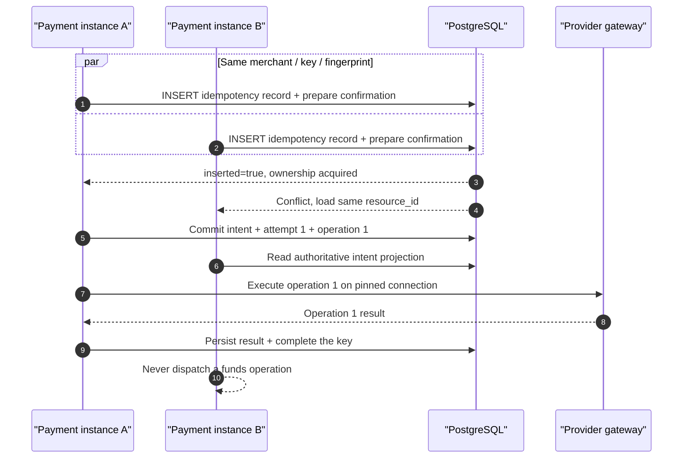
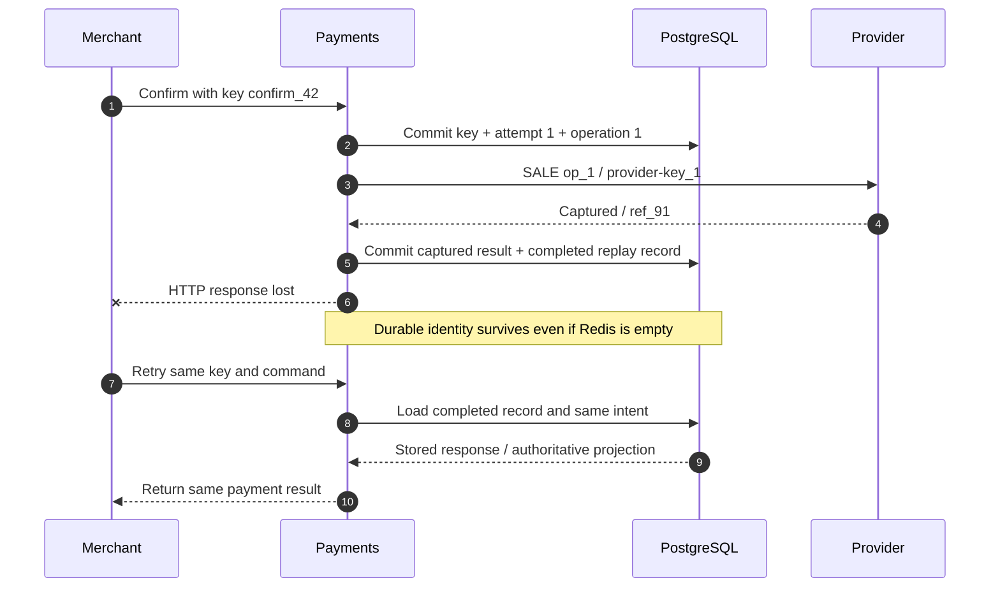
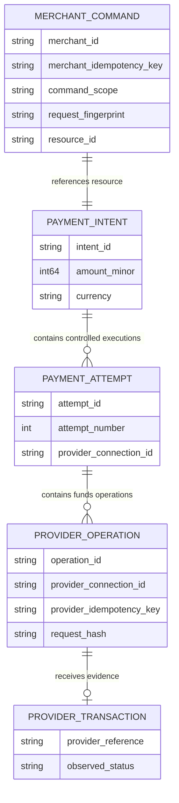
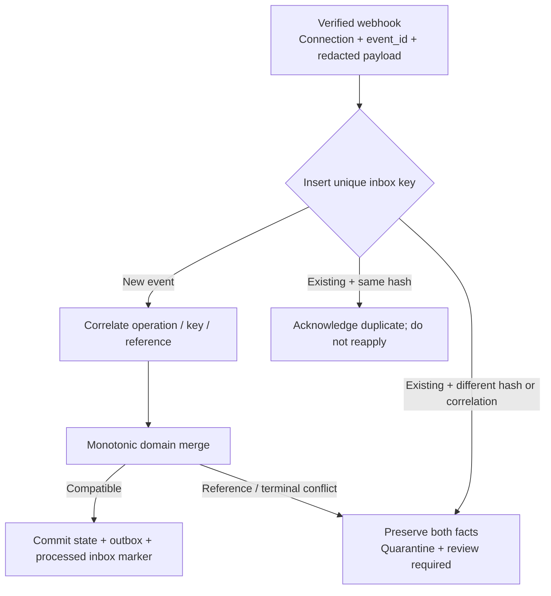

# Chapter 11: Idempotency and Payment Attempts

[中文](../../part-3-reliability/idempotency.md) | **English**

Within the first minute of ticket sales, Aurora receives two nearly simultaneous confirmation requests. They share the merchant, payment intent, and `Idempotency-Key`. The first begins processing on instance A; the load balancer sends the second to B. Later, A completes the provider `SALE` and commits its database transaction, then crashes before returning HTTP. The customer's app retries again.

If “idempotency” is merely a response cached by A in Redis, a cache miss, TTL expiry, failover, or simultaneous misses can execute the same business operation again. The real questions are stricter than “Have we seen this string?” Is this the same business command? Are its parameters identical to the first request? Who owns execution, and which durable resource should other callers read?

This chapter's central proposition is:

> **Idempotency defines durable identity, parameter immutability, and concurrent ownership for one business operation. The merchant key, internal operation ID, provider idempotency key, and provider transaction reference are four distinct identities; none substitutes for another.**

Chapter 10 required `UNKNOWN` recovery to preserve the original operation, connection, key, and payload. Here we explain how those originals are created, persisted, and protected under concurrency. Chapter 12 considers new attempts only after the old attempt definitively has no side effects. Idempotency is not proof that cross-provider fallback is safe. The companion Go system currently supports only automatic-capture `SALE` for tokenized cards; examples do not imply implemented manual capture, void, or refund.

## 11.1 The Problem: A Response Cache Cannot Prevent a Second Funds Path

### 11.1.1 Redis Alone Leaves Three Unclosed Windows

A common first version reads a cache, calls the provider on a miss, and caches the response after success:

```go
package naive

import (
	"context"
	"time"
)

type Cache interface {
	Get(context.Context, string) ([]byte, bool, error)
	Set(context.Context, string, []byte, time.Duration) error
}

type Provider interface {
	Sale(context.Context, int64, string) ([]byte, error)
}

func Confirm(ctx context.Context, cache Cache, provider Provider, key string, amount int64, currency string) ([]byte, error) {
	if response, found, err := cache.Get(ctx, key); err == nil && found {
		return response, nil
	}
	response, err := provider.Sale(ctx, amount, currency)
	if err != nil {
		return nil, err
	}
	if err := cache.Set(ctx, key, response, 24*time.Hour); err != nil {
		return nil, err
	}
	return response, nil
}
```

It has at least three independent failure windows: two instances both miss and call `Sale`; the provider succeeds but the process crashes before `Set`, so the next request executes again; and TTL expiry permits a new operation while the old provider operation remains `UNKNOWN`. A distributed lock only narrows the first window. After lock expiry, partition, or owner crash, a successor still does not know whether remote side effects occurred.

Nor does the cache define same-key/different-parameters conflicts. An attacker or defective client might confirm 129.00 USD using `idem_7`, then request 1,290.00 USD with that key. Returning the old response misleads the caller into believing the new parameters took effect; executing again may charge twice. The correct result rejects the conflict before routing or provider execution.

### 11.1.2 The Duplicate Is a Command, Not Necessarily HTTP Bytes

The same JSON object can have different whitespace and field order; API versions can add default fields. Conversely, byte-identical empty bodies sent to `pi_A/confirm` and `pi_B/confirm` are different business operations. Idempotency identity therefore includes at least merchant, command scope, target resource, and normalized semantic payload—not only a hash of raw request bytes.


These four identities are related along the call chain, but none are inherently equal. A first implementation may set the provider key equal to the operation ID; that is a mapping policy, not a conceptual merger. The provider reference does not exist before the first request and therefore cannot serve as its idempotency key.

## 11.2 The Simple Design: Make the Key a Durable Command Record

The smallest correct design stores an immutable command row in payments' authoritative database; it does not begin with a complex coordination service. The companion system uses primary key `(merchant_id, idempotency_key)` and stores `operation`, `request_hash`, `state`, `resource_id`, and final response in the row. A key is globally occupied within one merchant; scope and fingerprint validate its use rather than allowing the same key to execute once per endpoint.

### 11.2.1 A Canonical Fingerprint Binds Business Semantics

The public API first parses and validates the request, then generates canonical bytes from an explicitly versioned typed command. This example does not hash arbitrary `map[string]any`: the Go type fixes fields and order, and command name and target intent enter the digest.

```go
package command

import (
	"crypto/sha256"
	"encoding/json"
	"fmt"
	"strings"
)

type ConfirmPayment struct {
	SchemaVersion string `json:"schema_version"`
	MerchantID    string `json:"merchant_id"`
	IntentID      string `json:"intent_id"`
	CaptureMethod string `json:"capture_method"`
}

func FingerprintConfirm(input ConfirmPayment) ([32]byte, error) {
	input.MerchantID = strings.TrimSpace(input.MerchantID)
	input.IntentID = strings.TrimSpace(input.IntentID)
	input.CaptureMethod = strings.ToLower(strings.TrimSpace(input.CaptureMethod))
	if input.SchemaVersion == "" || input.MerchantID == "" || input.IntentID == "" {
		return [32]byte{}, fmt.Errorf("incomplete confirm command")
	}
	payload, err := json.Marshal(input)
	if err != nil {
		return [32]byte{}, err
	}
	material := append([]byte("confirm_payment_intent\x00"), payload...)
	return sha256.Sum256(material), nil
}
```

Canonicalization belongs in the API contract, not ad hoc string cleanup. Validate amounts as integer minor units, normalize currencies to supported uppercase codes and enums to canonical values, and fill defaults under versioned rules. Reject or explicitly ignore unknown fields according to strict API policy. The companion implementation combines operation name, a NUL separator, and typed JSON as `command_sha256.v1`, persists `fingerprint_version` on every PostgreSQL idempotency record, and rejects unknown versions on read. Future algorithms require explicit migration; old keys cannot silently acquire new rules. Hashing provides fixed-length comparison, not automatic safety for sensitive payloads. PAN, CVV, and raw credentials still must not enter command records.

### 11.2.2 A Key and Its Durable Record Have Only Four Outcomes

| Durable record | New request | Result | May execute a funds operation? |
| --- | --- | --- | ---: |
| Absent | Valid command + fingerprint | Atomically create `in_progress`; requester becomes owner | Only the owner may proceed |
| Same command/fingerprint, `in_progress` | Same business command | Return the current projection of the same `resource_id` | No reexecution |
| Same command/fingerprint, `completed` | Same business command | Replay saved result or return current projection under the public contract | No reexecution |
| Different command, target, or fingerprint | Key reused | HTTP 409 `idempotency_key_reused` | No |

`in_progress` does not mean “No answer yet; run it again.” It points to a payment intent, attempt, or other resource already owned by the command. Later requests may only read that resource. For confirmation, the first transaction writes the idempotency record, attempt, provider operation, pinned connection, and request hash together. Rollback removes them together, avoiding an occupied key whose resource does not exist.

### 11.2.3 Replay Need Not Preserve Response Bytes Forever

Official provider semantics already demonstrate that idempotent replay need not reproduce the first response verbatim. [Stripe API v1](https://docs.stripe.com/api/idempotent_requests) stores the first request's status and body; [PayPal](https://developer.paypal.com/api/rest/reference/idempotency/) says a repeated request ID returns the prior request's **current status**. The platform must define its own contract per public command. Intent creation often suits replay of the first `201`. If confirmation first returns `202 processing`, later same-key requests may return the same intent's current projection, with a stable result saved at terminal state. Neither approach may create a second attempt.

## 11.3 Problems at Scale: Concurrency, Crashes, and External Scope Intersect

### 11.3.1 Application-Level Read-Then-Insert Cannot Choose One Owner

Twenty requests can all read “absent” in the same microsecond. Mutual exclusion belongs in the authoritative store shared by every instance: let a unique constraint arbitrate `INSERT ... ON CONFLICT DO NOTHING`. Only the successful inserter owns execution; other transactions lock and read the winner's record. PostgreSQL documents that multicolumn `UNIQUE` constraints enforce uniqueness of the combination and that `ON CONFLICT` uses a unique index or constraint to choose conflict behavior. [PostgreSQL unique constraints](https://www.postgresql.org/docs/current/ddl-constraints.html#DDL-CONSTRAINTS-UNIQUE-CONSTRAINTS) [PostgreSQL INSERT](https://www.postgresql.org/docs/current/sql-insert.html)



Even with `SERIALIZABLE` or explicit row locks, serialization conflicts may require transaction retry. Retry the **claim transaction** or reread the winner; do not turn database errors into new business operations. Proving that the database eventually has one row is insufficient. End-to-end acceptance must show that every concurrent caller references the same resource and the gateway sees one operation identity.

### 11.3.2 Successful Commit with a Lost Response Is Idempotency's Main Test



This separates response caching from idempotency facts. Redis may cache hot replays to reduce database reads. A miss only authorizes a PostgreSQL read, never execution. Cache TTL cannot govern deletion of business records.

### 11.3.3 Provider-Key Scope Is Not a Platform Constant

Provider contracts differ in scope, retention, concurrency, and replay content:

| Official contract example | Scope or lifecycle fact | Adapter requirement |
| --- | --- | --- |
| Stripe API v1 | Compares parameters for the same key; records may be pruned after at least 24 hours; concurrent conflicts before endpoint execution do not save a result | Preserve API/account scope, parameters, and first-execution evidence; do not assume perpetual key validity |
| Adyen | Keys unique at company-account level and retained at least 7 days; regional endpoints do not cross-check; concurrent same-key calls may return transient errors or 409/422 | Pin merchant account and region; retry the same key only under official transient-error evidence |
| PayPal | Support and retention for `PayPal-Request-Id` depend on API; key is unique per request/API call type; of two concurrent calls one may succeed and one fail; replay returns current status | Declare support per operation in adapter metadata; a failed second response is not failure of the original operation |

These behaviors can change with API/product versions; current official documentation is authoritative. [Stripe idempotent requests](https://docs.stripe.com/api/idempotent_requests) [Adyen API idempotency](https://docs.adyen.com/development-resources/api-idempotency) [PayPal idempotency](https://developer.paypal.com/api/rest/reference/idempotency/)

The database uniqueness constraint for provider keys must therefore include the external idempotency namespace declared by the adapter under the provider contract. The simulator uses `provider_namespace_id` for this collision domain. Different connections/revisions mapping to the same provider account/region namespace still conflict on a key. The same string in another PSP, account, or region without shared deduplication provides no cross-domain protection. This does not permit changing connections during recovery: the record pins the original connection/revision, namespace, key, and payload; any drift must conflict before gateway egress.

### 11.3.4 Provider Retention Expiry Does Not Erase the Internal Operation

The provider may prune a key while the platform still has unresolved `UNKNOWN`, or years before a transaction reference is needed for refunds and reconciliation. Payment, audit, and compliance needs govern retention of internal operation IDs, hashes, connections, and references; they cannot disappear with an external key TTL.

Adapters should expose versioned metadata: supported operations, key scope, guaranteed minimum retention, same-key concurrency outcomes, parameter-conflict semantics, and query-by-key capability. Beyond the guaranteed window, the system cannot claim resend is safe. It retains the original operation and queries, waits, or enters `review_required`. Deleting the old record before creating a new operation merely hides uncertainty.

### 11.3.5 Webhooks Have Their Own Identity, Not a Fifth Operation Key

At-least-once delivery creates duplicates, and network queues reorder events. Stripe explicitly requires duplicate event-ID handling and does not guarantee generation-order delivery. [Stripe: Webhooks](https://docs.stripe.com/webhooks#handle-duplicate-events) Inbox primary keys therefore follow the provider-declared event namespace; the current simulator uses `(provider_namespace_id, event_id)`. Signature verification still binds the receiving exact connection/revision and secret. A shared namespace grants no cross-connection authentication authority. Inbox identity asks only whether this external evidence has been ingested; it is not the merchant key, operation ID, or provider key.

The same `event_id` with an identical normalized payload is a verifiable duplicate: return 2xx without applying it again. The same ID with a different operation/reference/status is an identity conflict. Preserve the original event and new payload digest, quarantine, and require review; never overwrite the inbox. Different event IDs may describe different moments of one operation and still undergo Chapter 10's monotonic convergence. Late `pending` cannot downgrade confirmed `captured`; incompatible terminal states or references require `review_required`.

## 11.4 Production Design: Four Identity Layers Protect One Funds Operation

### 11.4.1 Separate Intent, Attempt, Operation, and Provider Reference



The authoritative definitions are:

| Identity | Generator | Minimum scope | Lifecycle and use | Conflict semantics |
| --- | --- | --- | --- | --- |
| Merchant idempotency key | Merchant/client | Currently merchant-global; record also binds command/target/fingerprint | Deduplicate public API commands and associate one resource/replay | Same key with different command/parameters returns 409 |
| Internal operation ID | Payment orchestrator | Globally unique logical funds operation | Dispatch, query, webhook, recovery, audit | Changed connection/payload under the same ID is an integrity conflict |
| Provider idempotency key | Platform/adapter | Provider-declared account, region, API-operation namespace; currently `provider_namespace_id` | Resend one provider operation within the official window; execution still pins exact connection/revision | Reject different payloads within one namespace; no cross-namespace deduplication |
| Provider transaction reference | Provider | Provider-declared reference namespace; currently `provider_namespace_id` | Evidence after provider acceptance/creation; query, capture, void, refund, reconciliation | Competing operations claiming one reference in a namespace, or incompatible references on one operation, require review |

One intent can receive multiple merchant commands—`create`, `confirm`, and future `cancel`—and may have multiple attempts under Chapter 12's strict conditions. Merchant key and operation ID must not become permanently one-to-one fields. All network retries of one operation, conversely, retain one operation ID, connection, provider key, and request hash.

### 11.4.2 Ownership Claim, Resource Binding, and Replay Share One Transaction Boundary

Application logic can normalize database claims into four actions. This pure Go classifier assumes a unique constraint has established ownership through `inserted=true`. Existing records permit only resource reads, replay, or conflict rejection; there is no “execute again” branch.

```go
package replay

import (
	"bytes"
	"errors"
)

var ErrKeyConflict = errors.New("idempotency key reused for another command")

type State string

const (
	StateInProgress State = "in_progress"
	StateCompleted  State = "completed"
)

type Action string

const (
	ActionExecute      Action = "execute_as_owner"
	ActionReadResource Action = "read_resource"
	ActionReplayResult Action = "replay_result"
)

type Incoming struct {
	CommandScope string
	Fingerprint  []byte
}

type Record struct {
	CommandScope string
	Fingerprint  []byte
	State        State
	ResourceID   string
}

func Resolve(inserted bool, incoming Incoming, existing Record) (Action, error) {
	if inserted {
		return ActionExecute, nil
	}
	if existing.CommandScope != incoming.CommandScope ||
		!bytes.Equal(existing.Fingerprint, incoming.Fingerprint) {
		return "", ErrKeyConflict
	}
	if existing.State == StateCompleted {
		return ActionReplayResult, nil
	}
	return ActionReadResource, nil
}
```

The transaction must also verify a nonempty `resource_id` belonging to the same merchant. For confirmation, the owner locks the intent, checks that it has no active or winning attempt, creates attempt and operation, and points `resource_id` to the intent in one transaction. Losers read that association; an `attempt_id` or routing decision generated outside the transaction grants them no execution authority.

### 11.4.3 Database Invariants Are the Final Arbiter

| Table or object | Suggested uniqueness | Prevents | Does not prove |
| --- | --- | --- | --- |
| API command record | `(merchant_id, idempotency_key)` | Two commands owning one merchant key | Whether the provider executed |
| Payment attempt | `(payment_intent_id, attempt_number)` | Duplicate attempt numbers | Permission for the next attempt |
| Provider operation | `operation_id`; initially one sale per attempt | Duplicate internal funds-operation creation | External provider-key retention |
| Provider-key mapping | `(provider_idempotency_namespace, provider_idempotency_key)`; currently `(provider_namespace_id, key)` | One external-domain key pointing to two operations, even across connection IDs/revisions | Safe resend outside the provider window |
| Provider reference | `(provider_reference_namespace, provider_reference)`, unique when nonempty; namespace currently reuses `provider_namespace_id` | Two attempts claiming one external transaction | Automatic truth of late conflicting evidence |
| Webhook inbox | `(provider_event_namespace, event_id)`; currently `(provider_namespace_id, event_id)` | Reapplying one external event | Semantic duplication across event IDs; no cross-connection signature authority |

Unique constraints govern cross-process ownership; the domain state machine decides whether execution is currently allowed. Both are necessary. State checks alone race; operation-ID uniqueness alone is unsafe if losers can redispatch the same row. Leases, `FOR UPDATE SKIP LOCKED`, and advisory locks assign work but do not prove remote absence of side effects.

### 11.4.4 The Gateway Validates Command Immutability Again

Payments and gateway are separate persistence boundaries. Even after payments generates a hash, the gateway uses `CreateOrGet(operation_id)` in its own table and compares the complete command digest before egress. The example binds at least attempt, connection, provider, amount, currency, token reference, and capture mode:

```go
package providercommand

import (
	"crypto/sha256"
	"encoding/json"
	"errors"
)

var ErrOperationConflict = errors.New("operation replay changed immutable parameters")

type Command struct {
	OperationID          string `json:"operation_id"`
	AttemptID            string `json:"attempt_id"`
	ProviderConnectionID string `json:"provider_connection_id"`
	Provider             string `json:"provider"`
	AmountMinor          int64  `json:"amount_minor"`
	Currency             string `json:"currency"`
	PaymentTokenRef      string `json:"payment_token_ref"`
	CaptureMethod        string `json:"capture_method"`
}

func Digest(command Command) ([32]byte, error) {
	payload, err := json.Marshal(command)
	if err != nil {
		return [32]byte{}, err
	}
	return sha256.Sum256(payload), nil
}

func VerifyReplay(original, incoming Command) error {
	left, err := Digest(original)
	if err != nil {
		return err
	}
	right, err := Digest(incoming)
	if err != nil {
		return err
	}
	if left != right {
		return ErrOperationConflict
	}
	return nil
}
```

Validation precedes the provider call. Changing amount, token, connection, or capture mode under one operation ID returns a conflict and records an audit event; “the new parameters are more correct” cannot justify overwriting the old row. A provider key may derive from operation ID but must persist separately because adapters may impose length, character-set, operation-namespace, or version requirements. Logs contain digests and nonsensitive IDs, not token values.

### 11.4.5 Distinguish Current Implementation from Further Work

| Capability | Current Go baseline | Unimplemented or not production-ready |
| --- | --- | --- |
| Merchant commands | PostgreSQL `idempotency_records` unique on `(merchant_id,key)`, storing operation, hash, state, resource, response, and `fingerprint_version=command_sha256.v1`; different command/target/payload returns 409 | Multiple fingerprint readers/migrations for public API upgrades and record archival policy |
| Concurrent confirmation | `SERIALIZABLE` preparation with serialization retries, unique keys, and intent row locks; real PostgreSQL tests give 20 concurrent callers one intent, attempt, payment operation, and gateway execution | Chapter 19 covers cross-region ownership; contention thresholds and deadlock/retry metrics need capacity validation |
| Crash/restart replay | Completion record and captured projection commit together; reconstructed service reads durable same-key replay without recalling routing/gateway | Long-term response-schema compatibility and historical-response governance |
| Operation identity | Attempt/operation created together; provider key currently equals operation ID; full connection ID/revision/namespace, key, and hash pinned | Publish key-derivation/version contracts for each real adapter |
| Connection scope | Payments/gateway store exact revisions; key/operation conflict checks cover account namespace | Declare account/region/API scope and retention metadata per real adapter |
| Payload immutability | Gateway v2 hash uses unambiguous typed encoding for operation, attempt, connection revision, amount, currency, token, and capture mode; cross-service golden fixtures and drift tests | Real PSP wire-payload evolution and sensitive-field minimization require adapter contracts |
| Inbox | Both services persist scoped event identity; identical duplicates accepted, changed payload/correlation quarantined; gateway observations also have normalized JSONB hashes | **Payment inbox does not yet persist an explicit normalized payload hash and algorithm version**; both lack retention/cleanup lifecycle and archival proof |
| UNKNOWN recovery | Durable deadline/budget/claims preserve original operation on restart; ordinary 404 creates no second POST | Define API-record and provider-key expiry/cleanup policies and prove cleanup never reopens funds-execution authority |

Twenty-way concurrent confirmation, durable replay after service reconstruction, one attempt/operation/gateway execution, and fingerprint versioning are verifiable baseline capabilities, not future work. Do not overstate provider-retention metadata, normalized payload hash/version in the payment inbox, or idempotency/inbox/outbox cleanup and archival lifecycles. These implementations correspond to the [pinned revision](https://github.com/YouEclipse/payments/commit/bc4afde24da708d22f67da72a90a1557b1477173) and [CI run](https://github.com/YouEclipse/payments/actions/runs/33041147119). Source alone cannot establish completion before real PostgreSQL/Compose gates pass.

### 11.4.6 The Webhook Inbox Saves Facts Before Advancing State



Signature verification, controlled raw-body handling, redaction, and canonical hashing precede state transitions. Inbox record, payment state, and business outbox should commit in one payment-owned transaction. Otherwise a crash can mark an event processed without updating state, or update state before consuming it again. Persist quarantine records for uncorrelatable events too; returning an error must not lose the evidence forever.

## 11.5 Failure Modes: Common False Promises of Idempotency

### 11.5.1 Even a Database Table Can Implement It Incorrectly

| Failure mode | Why dangerous | Correct control |
| --- | --- | --- |
| Duplicate only if Redis key exists | Eviction, TTL, partitions, and crashes reopen execution | PostgreSQL owns facts; Redis caches replay only |
| Execute before inserting idempotency record | Crash after provider success leaves unidentifiable side effects | Claim transactionally and create a durable operation first |
| Same key without command/payload comparison | New amount or endpoint silently treated as old request | Typed canonical fingerprint; mismatch returns 409 |
| `in_progress` recalls routing/gateway | Concurrent loser creates another attempt/connection | Return current projection of the same `resource_id` |
| Delete UNKNOWN when TTL expires | Unresolved old side effects coexist with a new operation | Cleanup obeys terminal-state and audit policies |
| Key unique only by PSP name or connection | PSP name mixes accounts/regions; connection splits aliases/revisions sharing an external domain | Adapter-declared key namespace; recovery separately pins exact connection/revision |
| Change amount/token/mode under one operation ID | Provider may interpret replay as another command | Gateway hash safely rejects before egress |
| Use provider reference as first key | It does not yet exist; provider owns its semantics | Create operation/key first; reference arrives as evidence |
| Globally unique webhook event ID | Connections may share formats or namespaces | Construct inbox identity under provider-declared scope |
| New payload overwrites same event ID | Hides evidence tampering or correlation defects | Preserve hash conflict and both facts; review |
| “Idempotency success” means “payment success” | Deduplication supplies no terminal evidence | Keep `UNKNOWN/pending/succeeded/failed` separate |

Idempotency does not give every later funds action one shared key. Future manual capture, void, and refund each need an internal operation ID and provider key, targeting the original connection and transaction reference. They cannot reroute or reuse the original sale key as another API operation. Reference collisions and contradictory terminal states preserve historical funds facts and require `review_required`.

### 11.5.2 A Falsifiable Test Matrix

These failure tests must have challenged the design before it is more than “something with a key”:

1. Send 20 simultaneous confirmations for one intent, merchant key, and command. Regardless of instance placement, there is one attempt, payment operation, and gateway operation; all successful responses reference one intent, and the provider receives one logical operation.
2. Reuse a merchant key first for `create_payment_intent`, then confirmation; or change amount/currency/token on creation. Each returns HTTP 409 before funds side effects.
3. After the gateway stores an operation, vary amount, token, connection, provider type, and capture mode individually. Every variation conflicts without increasing provider-call count.
4. Crash after captured state and completion record commit together but before HTTP response. Empty the cache and restart; same-key replay returns the same payment without a new attempt.
5. While an operation is `UNKNOWN`, simulate its API record exceeding the ordinary replay window. Recovery still claims the original operation; “record expiry” cannot let the public API create another funds path.
6. Deliver the same `(connection,event_id)` and payload twice: apply once. A third delivery with altered operation/reference/status is quarantined and marks relevant aggregates `review_required`, preserving old evidence.
7. Send captured then late pending under different event IDs: retain captured. A different reference or incompatible terminal state preserves the conflict and stops automatic recovery.

Do not assert only final `succeeded`: either of two charges can make that assertion pass. Check identity counts, connections, hashes, provider-call counts, inbox conflicts, and funds references too.

## 11.6 Tradeoffs: Stable Identity Increases Retention Cost

| Design choice | Benefit | Cost | Recommended boundary |
| --- | --- | --- | --- |
| Merchant-global key uniqueness | Exposes cross-endpoint misuse clearly | Clients need a new key per command | Document scope; stable 409 code |
| Per-endpoint key namespaces | More permissive reuse | Cross-operation key reuse no longer exposes defects | Use only where business needs it; scope enters the unique key |
| Store first complete response | Most deterministic replay | Schema evolution, storage, sensitive-data governance | Store only public redacted responses; define retention/version policy |
| Return current resource projection | Long flows show latest state | Replay not byte-identical | Explicit API contract; always the same resource |
| Long-lived idempotency records | Safer crash/audit windows | Table/index growth and privacy cost | Tiered archives; ordinary TTL never deletes nonterminal operations |
| `SERIALIZABLE` transactions | Clear ownership reasoning | Contention causes aborts/retries | Retry claim transactions, never generate new business identity |
| Unique constraints + short row locks | More controllable throughput | Harder state-machine/lock-order audit | Prove with concurrency/deadlock tests |
| Provider key equals operation ID | Simple correlation | Provider length/format/namespace constraints | Keep concepts distinct; persist mapping/derivation version |
| Redis replay cache | Fewer hot reads of completed records | More invalidation/consistency paths | Misses read database; cache never grants execution |

Fingerprints also carry privacy tradeoffs. Bare SHA-256 over low-entropy fields may be enumerable; full payloads may contain data that should not be retained. Minimize data first, retaining only canonical nonsensitive fields needed for conflict detection. Where low-entropy content must be concealed, use controlled HMAC with rotatable key versions. Regardless of digest, audit logs include only fingerprint, scope, and resource ID—not raw payment tokens, provider credentials, or payment credentials.

Cross-region merchant-key ownership turns uniqueness into a distributed problem, covered in Chapter 19. This chapter requires one explicit authoritative write domain. Recovery beyond a provider-key window still depends on adapter metadata and Chapter 10's evidence thresholds, not a universal retention constant.

## 11.7 Summary: One Claim Ticket Must Refer to One Thing

Starting with Redis-only response-cache races, we derive database-enforceable, testable invariants:

1. Idempotency records belong to payments' authoritative durable state. Redis, distributed locks, and HTTP middleware accelerate or coordinate; none owns funds facts.
2. Merchant key, internal operation ID, provider key, and transaction reference have distinct generators, scopes, lifecycles, and conflict semantics.
3. A merchant key binds command scope, target resource, and canonical fingerprint. Different semantics under the same key return 409 before side effects.
4. Database uniqueness atomically chooses one owner. Concurrent losers read the same `resource_id` or replay; `in_progress` never grants reexecution.
5. Confirmation-key claim, intent lock, attempt/operation creation, and resource binding share a transaction. Durable replay survives a lost response after commit.
6. One provider operation pins ID, connection, provider key, and hash. The gateway safely rejects amount/token/connection/capture-mode drift.
7. Provider idempotency applies only within officially declared account, region, API-operation, and retention scope. Versioned adapter metadata exposes different retention, concurrency, and replay semantics.
8. Webhook inboxes use independent event identity. Exact duplicates apply once; same-ID payload/correlation conflicts preserve evidence and enter `review_required`; reordered evidence merges monotonically.
9. Idempotency proves nonduplication of one logical operation, not payment success, no side effects, or fallback permission. `UNKNOWN` recovers the original operation; Chapter 12 considers new attempts only after definitive absence of old side effects.

The companion Go baseline includes PostgreSQL merchant idempotency records, versioned fingerprints, in-progress resource binding, one owner across 20 concurrent calls, restart replay, stable attempts/operations, `provider_namespace_id`-scoped key/reference/event conflicts, exact connection/revision binding, gateway v2 hashes, and durable inbox/outbox. Its simulator shares one field across three external namespaces; real adapters must separate them when their scopes differ. Remaining boundaries are normalized payload hash/version in the payment inbox, real provider contract/retention metadata, and full proof that cleanup, archival, and expiry never reopen funds execution.

## Further Reading

* [Chapter 3: Responsibilities and Boundaries of a Payment Routing System](../part-1-foundations/routing-system-boundaries.md)
* [Chapter 10: Timeouts, Retries, and Unknown States](timeout-and-retry.md)
* [Chapter 12: Fallback Routing](fallback-routing.md)
* [Chapter 19: Multi-Region Payment Routing](../part-5-global-routing/multi-region.md)
* [Appendix A: Payment Intent, Attempt, and Provider Request State Models](../appendices/payment-state-models.md)
* [Stripe idempotent requests](https://docs.stripe.com/api/idempotent_requests)
* [Adyen API idempotency](https://docs.adyen.com/development-resources/api-idempotency)
* [PayPal idempotency](https://developer.paypal.com/api/rest/reference/idempotency/)
* [PostgreSQL unique constraints](https://www.postgresql.org/docs/current/ddl-constraints.html#DDL-CONSTRAINTS-UNIQUE-CONSTRAINTS)
* [Stripe: Webhooks](https://docs.stripe.com/webhooks)
