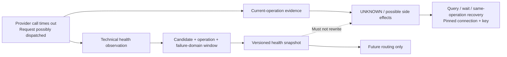
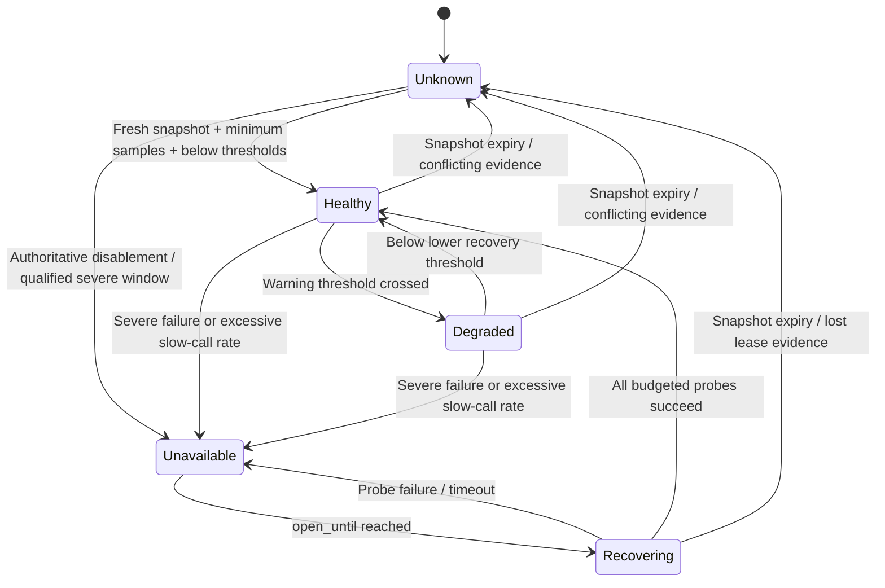
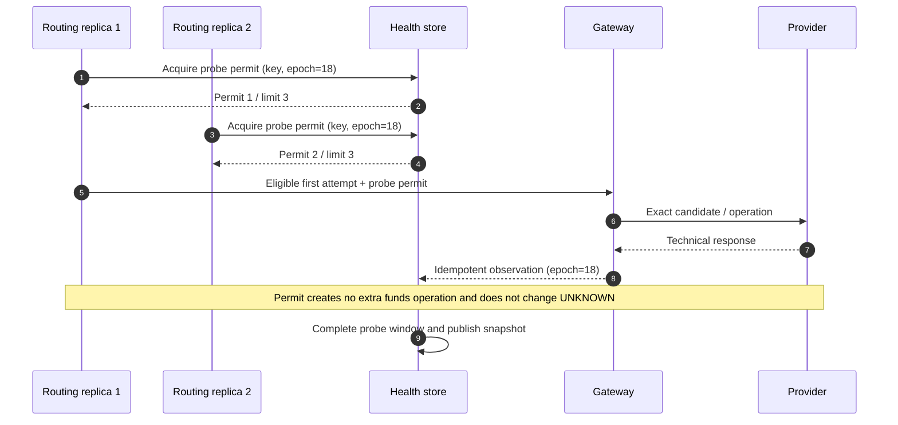
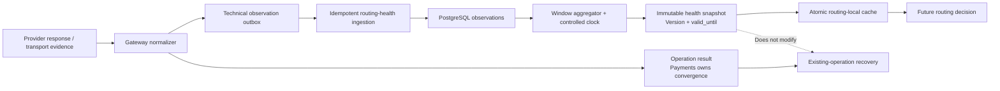

# Chapter 13: Circuit Breakers and Provider Health

[中文](../../part-3-reliability/provider-health.md) | **English**

Aurora's European `SALE` traffic begins timing out heavily. The first timed-out request crossed the gateway's dispatch boundary, putting its operation into `UNKNOWN/possible`; seconds later another request on the connection times out. The on-call engineer wants to mark the first payment failed and switch providers, while marking PSP A globally unhealthy.

Both actions are wrong. The first operation may already be captured with a lost response, so it must query/wait on the original connection. PSP A's US connection and European `QUERY` endpoint still work; a brand-wide switch would widen the incident. What can safely change is **using cross-transaction technical observations to temporarily keep not-yet-routed requests out of the exact affected failure domain**.

This chapter's central proposition is:

> **Provider health is operational state modeled by candidate, operation, and actual failure domain, carrying version, validity, samples, and confidence evidence. It constrains future routing only. It cannot turn current `UNKNOWN` into failure or disguise issuer declines, risk blocks, and 3DS requirements as provider technical failures.**

Chapter 6 capabilities describe what a connection is configured to do; health describes whether it has recently responded reliably within latency budgets. Chapter 12 decides whether a new funds path may follow an old attempt. Health neither proves `side_effect=none` nor authorizes fallback. Chapter 14 preserves health snapshot versions and contemporaneous state in complete decision records.

## 13.1 The Problem: One Timeout Produces Two Different Facts

A gateway timeout is a real technical observation: no valid response arrived within the deadline. It can enter the `candidate_eu + sale + provider_api_eu` health window and affect the **next** selection. For the already dispatched operation, however, it establishes invisibility, not nonexecution.



Likewise, an `insufficient_funds` issuer decline is a business outcome that also proves a parseable provider response arrived before the deadline. It should not increase technical failures. Stripe distinguishes issuer declines, provider/risk blocks, and invalid API calls with different advice; Adyen states that HTTP `200` means receipt and processing, not payment success. Payment outcomes and transport/provider health therefore need separate axes. [Stripe: Declines](https://docs.stripe.com/declines) [Adyen: HTTP status codes](https://docs.adyen.com/development-resources/response-handling)

| Observation | Current operation | Technical health contribution | Triggers new routing? |
| --- | --- | --- | ---: |
| Post-dispatch timeout / reset | `UNKNOWN/possible`, recover original | Technical failure; retain latency/deadline | Subsequent decisions only |
| Valid success / pending response | Follow payment-method state machine | Technical success | No |
| Issuer decline / authentication required | Business result or user continuation | Successful technical response, not failure | No |
| Risk block | Risk terminal state | Outside provider technical window | No |
| Local bulkhead rejection before dispatch | `side_effect=none` | Local capacity, not provider fault | Chapter 12 policy decides new-attempt permission |
| Unknown / unclassifiable response | Conservatively UNKNOWN or review | Classifier unknown; guess neither success nor failure | May make later snapshot low-confidence/unknown |

Health protects latency budgets and resources; it is not another name for authorization-rate optimization. Approval performance by issuer, BIN, card brand, or merchant population belongs to Chapter 8. Tripping circuits on issuer declines misdiagnoses customer-funds or risk issues as provider incidents and may encourage issuer shopping.

## 13.2 The Simple Design: One Global `healthy bool`

The earliest version counts consecutive failures: three errors open the whole PSP, and the next success closes it.

```go
package naivehealth

type Breaker struct {
	Failures int
	Open     bool
}

func (b *Breaker) Record(err error) {
	if err == nil {
		b.Failures = 0
		b.Open = false
		return
	}
	b.Failures++
	if b.Failures >= 3 {
		b.Open = true
	}
}
```

For one provider, endpoint, and process, this improves on waiting through every timeout. It quickly stops pressure on an obviously failed dependency and is easy to unit-test. In production payments, every term becomes ambiguous: provider brand or connection? Does `err` include declines? Three failures out of how many requests? Which operation and region? Does each routing/gateway replica count independently? Is one success enough to restore all traffic?

It also treats circuit state as the source of truth. Restart loses the window. Diverted traffic removes samples, so `Open` may never recover or timers may release every replica simultaneously. The next step is not more conditionals around a global Boolean, but explicit observation classification, failure keys, windows, and snapshot validity.

## 13.3 Problems at Scale: Failures Do Not Follow PSP Brand Boundaries

### 13.3.1 Health Keys Must Identify Actionable Failure Domains

Chapters 3 and 6 pinned `candidate_id` to an exact provider connection. Reuse it with connection revision, operation, and a bounded failure-domain set:

```text
HealthKey = candidate_id
          + connection_revision
          + operation
          + fault_domain
```

`fault_domain` comes from controlled configuration, such as `provider_api/eu-west`, `provider_api/us-east`, or `platform_egress/az-a`. Do not insert payment/merchant IDs, issuers, BINs, or arbitrary error strings. The candidate already includes account and region; the domain expresses shared endpoints/egress across candidates and separates API surfaces within one candidate.

| Observation key | Safe inference | Cannot infer |
| --- | --- | --- |
| `cand_eu/rev7/sale/provider_api_eu` | Recent `SALE` technical problems on this exact connection | Same PSP's US connection is affected |
| `cand_eu/rev7/query/provider_api_eu` | Original-operation query endpoint is impaired | `SALE` failed or never executed |
| `cand_us/rev3/sale/platform_egress_az_a` | Local-AZ path to this connection is impaired | Global provider incident |
| `pspa/global` | Coarse alert aggregate only | Not a direct funds-routing circuit key |
| `issuer=123456` | Approval-performance segment | Not a provider technical failure domain |

Revisions matter. Incompatible credential, endpoint, or connector changes should not inherit old `Healthy` automatically, or permanently inherit a repaired `Unavailable`. The revision needs a new explainable snapshot. Insufficient bootstrap evidence means unknown, not copied brand history.

### 13.3.2 Error Rate Is Meaningless Without Classification

Circuit breakers consume versioned technical observations, not arbitrary Go `error` or HTTP statuses. Adapters/normalizers establish provenance and semantics:

| Signal class | Example | Window treatment | Reason |
| --- | --- | --- | --- |
| `technical_success` | Valid success/pending response or read-only probe | Sample +1, no failure | Technical path completed; business outcome separate |
| `technical_failure` | DNS/TLS, reset, deadline, contract-confirmed provider unavailability | Sample +1, failure +1 | Affects future technical availability |
| `slow` | Valid/failed call beyond operation-specific slow threshold | Slow +1; may overlap either class above | Protect latency before full timeout |
| `business_response` | Issuer decline or user action returned by provider | Sample +1, no failure; save outcome separately | Business decline is not an incident |
| `ignored_business` | Local risk block, user cancellation, no provider call | Excluded | No provider technical observation |
| `integration_error` | Invalid parameters, authentication configuration, schema drift | Isolate, alert / possibly force-disable | Retry or traffic shifts cannot repair code/configuration |
| `local_rejected` | Full bulkhead, caller deadline already expired | No provider failure | Request never reached provider |
| `unclassified` | New code, conflicting evidence, unknown normalizer input | Never promote to success; reduce knowledge state | Safe refusal rather than guessing |

Meanings vary by provider/API version. Adyen documents `429` as too many requests, while `500` may also result from an incorrect request. “All 5xx mean outage; ignore all 4xx” remains too coarse. [Adyen: HTTP status codes](https://docs.adyen.com/development-resources/response-handling) Preserve `classifier_version`; mapping changes replay through contract tests under a new version without rewriting historical rows.

### 13.3.3 Low Traffic, Diversion, and Recovery Create Blind Spots

One failure giving `1/1 = 100%` is not reliable incident evidence. Sliding windows need explicit time/count windows, minimum samples, and thresholds. An empty window does not establish recovery. Resilience4j similarly treats sliding windows, `minimumNumberOfCalls`, failure/slow-call thresholds, and permitted half-open calls as separate parameters, calculating failure rate only after enough calls. [Resilience4j: CircuitBreaker](https://resilience4j.readme.io/docs/circuitbreaker)

An open circuit removes normal passive samples. Closing after “no errors in five minutes” mistakes zero traffic for 100% success; waiting forever for real traffic prevents recovery. Half-open/recovering state needs a separate globally bounded probe budget.

### 13.3.4 Slow Providers Exhaust Local Resources First

Before failures cross a threshold, slow calls occupy goroutines, sockets, connection pools, and upstream deadlines. Unbounded shared concurrency lets one European connection slow US traffic, recovery queries, and gateway readiness. Google SRE explains that latency increases in-flight requests and consumes threads, memory, and file descriptors; retries and shifted traffic spread local overload. [Google SRE: Addressing cascading failures](https://sre.google/sre-book/addressing-cascading-failures/)

Circuit breakers and bulkheads solve different problems: the former reject future calls based on cross-request state; the latter always bound current concurrency. Isolate bulkheads by connection/operation and reserve capacity for UNKNOWN queries and other recovery. Otherwise a `SALE` surge can remove the ability to establish old funds facts.

## 13.4 Production Design: Observations, Windows, State, and Snapshots

### 13.4.1 Observations Are Deduplicable Facts with Bounded Cardinality

The gateway is closest to network and provider-specific semantics and produces technical observations; the health subsystem owns aggregation and state. A target model is:

```go
package health

import "time"

type State string

const (
	StateUnknown     State = "unknown"
	StateHealthy     State = "healthy"
	StateDegraded    State = "degraded"
	StateUnavailable State = "unavailable"
	StateRecovering  State = "recovering"
)

type SignalClass string

const (
	SignalTechnicalSuccess SignalClass = "technical_success"
	SignalTechnicalFailure SignalClass = "technical_failure"
	SignalBusinessResponse SignalClass = "business_response"
	SignalIgnoredBusiness  SignalClass = "ignored_business"
	SignalLocalRejected    SignalClass = "local_rejected"
)

type Key struct {
	CandidateID        string
	ConnectionRevision string
	Operation          string
	FaultDomain        string
}

type Observation struct {
	ID                string
	Key               Key
	Class             SignalClass
	Source            string
	Latency           time.Duration
	OccurredAt        time.Time
	ClassifierVersion string
}

func TechnicalEffect(class SignalClass) (sample, failure bool) {
	switch class {
	case SignalTechnicalFailure:
		return true, true
	case SignalTechnicalSuccess, SignalBusinessResponse:
		return true, false
	default:
		return false, false
	}
}
```

`Observation.ID` identifies one actual network observation. At-least-once gateway-outbox delivery is deduplicated uniquely in ingestion storage. `Source` is a bounded enum for synchronous dispatch, query, read-only probe, or manual incident override; free text never enters aggregate keys. Operation/payment IDs may remain in controlled investigative evidence, not metric labels or health keys. Triple delivery cannot count one timeout three times. A `QUERY` after a `SALE` timeout is another observation under its own operation key, not an overwrite.

Counting `business_response` as a technical sample without failure means the provider returned a contract-valid answer before deadline. It never counts decline as authorization success. If an adapter cannot reliably separate business and technical rejection, emit unclassified and let the snapshot become unknown rather than invent a denominator.

### 13.4.2 Sliding Windows Need Minimum Samples, Hysteresis, and an Explicit Clock

Windows may bucket the last N seconds or retain the last N technical samples. A snapshot version pins algorithm, thresholds, and evaluation time. This pure function shows a conservative baseline: normal windows require `MinSamples`; separate degradation/recovery thresholds provide hysteresis; unavailable state waits through the open interval before recovering; any technical failure in the dedicated recovery-probe window reopens the circuit.

```go
package health

import "time"

type Aggregate struct {
	Samples  uint64
	Failures uint64
	Slow     uint64
	LatestAt time.Time
}

type Config struct {
	MinSamples      uint64
	HalfOpenSamples uint64
	DegradedRate    float64
	OpenRate        float64
	RecoverRate     float64
	OpenFor         time.Duration
	SnapshotTTL     time.Duration
}

type Snapshot struct {
	Key        Key
	State      State
	Version    string
	Confidence string
	ObservedAt time.Time
	ValidUntil time.Time
	OpenUntil  time.Time
	Aggregate  Aggregate
}

func Next(now time.Time, key Key, previous Snapshot, window Aggregate, cfg Config, version string) Snapshot {
	next := Snapshot{
		Key: key, State: StateUnknown, Version: version, Confidence: "low",
		ObservedAt: window.LatestAt, ValidUntil: window.LatestAt.Add(cfg.SnapshotTTL), Aggregate: window,
	}
	previousStateValid := previous.State == "" || previous.State == StateUnknown ||
		previous.State == StateHealthy || previous.State == StateDegraded ||
		previous.State == StateUnavailable || previous.State == StateRecovering
	previousOpenWindowValid := previous.State != StateUnavailable ||
		(!previous.OpenUntil.IsZero() &&
			(previous.ObservedAt.IsZero() || previous.OpenUntil.After(previous.ObservedAt)))
	valid := key.CandidateID != "" && key.ConnectionRevision != "" &&
		key.Operation != "" && key.FaultDomain != "" &&
		previousStateValid && previousOpenWindowValid &&
		(previous.State == "" || previous.Key == key) &&
		version != "" && cfg.MinSamples > 0 && cfg.HalfOpenSamples > 0 &&
		cfg.SnapshotTTL > 0 && cfg.OpenFor > 0 && window.Failures <= window.Samples &&
		window.Slow <= window.Samples && !window.LatestAt.IsZero() && !window.LatestAt.After(now) &&
		cfg.RecoverRate >= 0 && cfg.RecoverRate < cfg.DegradedRate &&
		cfg.DegradedRate < cfg.OpenRate && cfg.OpenRate <= 1
	if !valid {
		return next
	}

	if previous.State == StateUnavailable {
		if now.Before(previous.OpenUntil) {
			next.State, next.OpenUntil = StateUnavailable, previous.OpenUntil
			return next
		}
		next.State = StateRecovering
		return next
	}
	if previous.State == StateRecovering {
		if window.Failures > 0 || window.Slow > 0 {
			next.State, next.OpenUntil = StateUnavailable, now.Add(cfg.OpenFor)
			return next
		}
		if window.Samples < cfg.HalfOpenSamples {
			next.State = StateRecovering
			return next
		}
		next.Confidence = "qualified"
		next.State = StateHealthy
		return next
	}
	if window.Samples < cfg.MinSamples {
		return next
	}

	next.Confidence = "qualified"
	pressure := max(rate(window.Failures, window.Samples), rate(window.Slow, window.Samples))
	if pressure >= cfg.OpenRate {
		next.State, next.OpenUntil = StateUnavailable, now.Add(cfg.OpenFor)
		return next
	}
	if previous.State == StateDegraded && pressure > cfg.RecoverRate {
		next.State = StateDegraded
		return next
	}
	if pressure >= cfg.DegradedRate {
		next.State = StateDegraded
		return next
	}
	next.State = StateHealthy
	return next
}

func (s Snapshot) RoutingState(now time.Time) State {
	if s.Version == "" || s.ValidUntil.IsZero() || !now.Before(s.ValidUntil) {
		return StateUnknown
	}
	return s.State
}

func rate(part, total uint64) float64 { return float64(part) / float64(total) }

func max(a, b float64) float64 {
	if a > b {
		return a
	}
	return b
}
```

No default parameter set suits all PSPs. Determine slow thresholds, windows, minimum samples, open duration, and probe counts by operation/provider contract through load tests and incident replay, and version them as configuration. `confidence` must not be an intuitive decimal. Initial `low/qualified` plus raw sample/failure/slow counts is explainable enough.

Snapshot `observed_at` and `valid_until` derive from the latest valid window observation, never from `time.Now()` on every idle aggregation pass. Otherwise stopped gateway reporting still produces perpetually “fresh” health. `LatestAt` makes evidence expire when nothing new arrives.



Fix snapshot-to-routing semantics:

| Snapshot view | New-routing behavior | Later-stage authority |
| --- | --- | --- |
| Fresh `Healthy` | Enter candidates normally | Rules/scoring may compare |
| Fresh `Degraded` | May remain eligible with explicit state/version; may limit traffic | Chapter 9 profile defines penalties; not a capability disguise |
| Fresh `Unavailable` | Hard-exclude from ordinary new routing | Score, cost, and preference cannot revive it |
| Fresh `Recovering` | Exclude normal traffic; only controlled new requests holding probe permits | No automatic full restoration |
| Missing / `Unknown` / expired | Fail safely with `health_unknown` or `health_snapshot_stale` | No indefinite extension of last validated state |

Before enabling fail-closed health, releases must bootstrap snapshots covering all enabled health keys; otherwise enabling the feature correctly but disastrously excludes everything. Bootstrap uses configuration validation, controlled probes, and minimum real evidence, not copied PSP-brand state. Without real `SALE` samples, an audited activation process may at most move a new connection from unknown to recovering with tiny bootstrap permits, never directly to healthy. Ordinary traffic still fails safely.

### 13.4.3 Half-Open Means a Shared Probe Budget, Not a Few Calls per Replica

Ten replicas allowing five in-memory probes each release fifty calls; scaling adds more. Bind permits to `HealthKey + state_epoch`, claim atomically in shared storage, and bound total count, concurrency, and lease expiry. Results return to the same generation; old-generation late results cannot close a new circuit.



Keep probe claims narrow. A side-effect-free account/status API proves only authentication and that endpoint, not real `SALE`, token, amount, or capture success. If `SALE` requires real traffic, a permit lets one otherwise capability/risk/policy-eligible first attempt choose a recovering candidate. The health subsystem cannot manufacture fake payments. Existing UNKNOWN operations are never probes, and successful probes do not authorize their rerouting.

### 13.4.4 Acquire the Connection Bulkhead Before Dispatch

A minimal Go bulkhead uses a bounded channel. Call `Acquire` with a short queue deadline; only after admission may the operation be marked `sending/possible` and cross the provider boundary.

```go
package bulkhead

import (
	"context"
	"errors"
	"sync"
)

var ErrInvalidLimit = errors.New("bulkhead limit must be positive")

type Limiter struct {
	slots chan struct{}
}

func New(limit int) (*Limiter, error) {
	if limit <= 0 {
		return nil, ErrInvalidLimit
	}
	return &Limiter{slots: make(chan struct{}, limit)}, nil
}

func (l *Limiter) Acquire(ctx context.Context) (release func(), err error) {
	if err := ctx.Err(); err != nil {
		return nil, err
	}
	select {
	case l.slots <- struct{}{}:
		if err := ctx.Err(); err != nil {
			<-l.slots
			return nil, err
		}
		var once sync.Once
		return func() { once.Do(func() { <-l.slots }) }, nil
	case <-ctx.Done():
		return nil, ctx.Err()
	}
}
```

An `Acquire` timeout precedes dispatch and returns `local_bulkhead_rejected/none`, not `provider_timeout/possible`. It does not increase provider technical failures. Chapter 12's evidence gate, allowlist, and budget still decide fallback permission. `Release` must cover success, errors, and exceptional paths. Concurrency tests should prove that 100 requests never exceed configured concurrent provider calls.

Go's `http.Transport` provides `MaxConnsPerHost` and idle-connection limits and expects reusable, concurrently usable transports. Configure these explicitly, but they are not candidate/operation-level funds-call bulkheads, especially with shared hosts or HTTP/2. [Go `net/http.Transport`](https://pkg.go.dev/net/http#Transport) The gateway still needs business-level permits, short queues, and independently reserved recovery capacity.

### 13.4.5 Aggregation Must Not Become a Synchronous Payment Dependency

Propagate health through the gateway's durable outbox asynchronously rather than making provider responses wait for routing-store writes:



Observation backlog does not change payment results. Routing can use an unexpired last-validated snapshot; expiry fails safely rather than silently reverting to healthy. Validate a whole new version and install it atomically. Decisions include at least `health_snapshot_version`, candidate states, and stable reasons such as `health_unavailable`, `health_recovering_probe_only`, `health_unknown`, and `health_snapshot_stale`. Chapter 14 handles append-only envelopes, asynchronous projection, and retention; this chapter does not preimplement the decision store.

Provider status pages, manual incident overrides, and active probes can supply evidence, but all need scope, observation/effective times, and versions. A global status incident may force restriction of mapped affected keys; a green page cannot overwrite account-specific failures. Manual overrides may force-open under version control, not force unknown into healthy.

## 13.5 Boundaries with UNKNOWN, Fallback, and Original-Connection Operations

Health's time arrow points forward only:

1. Dispatched `UNKNOWN/possible` operations query/wait using original `operation_id`, connection, provider key, and payload. An unavailable `SALE` health key cannot turn them into failures.
2. Queries have separate operation/failure-domain keys. An open `SALE` circuit should not block discovering old funds facts; gateways reserve query bulkheads and budget. If query is itself unavailable, remain UNKNOWN/review rather than query through another connection.
3. Chapter 12's `FallbackPlanner` creates successors only after terminal old attempt, `side_effect=none`, allowlisted reason, and every guardrail. Fresh health may **veto** the next unexecuted pinned candidate. It cannot prove no side effects, add candidates, or create attempts.
4. Capture, void, and refund bind existing authorization/provider references. Health may alert, limit concurrency, or delay them, never rescore onto another PSP.
5. Decisions reference the snapshot version used then. Current health cannot recalculate and overwrite historical reasons; Chapter 14 stores contemporaneous evidence, not retrospective guesses.

| Mechanism | Question answered | May change candidates? | May change current funds facts? |
| --- | --- | ---: | ---: |
| Health / circuit breaker | Should future calls to this exact key be protected? | Exclude/degrade for new decisions | No |
| Recovery | What happened to the original operation? | No, original connection pinned | Only monotonic convergence with new evidence |
| Fallback | May a successor follow the closed old attempt? | Pinned plan only, subject to health veto | Cannot rewrite predecessor |
| Decision record | Why selected/excluded then? | No, records only | No |

## 13.6 Failure Proofs: State Machines Under Noise, Concurrency, and Restart

These tests prove that issuer declines are not technical failures and one half-open technical failure reopens the circuit. They use an explicit clock, not `time.Sleep`:

```go
package health

import (
	"testing"
	"time"
)

func TestIssuerDeclineDoesNotOpenAndFailedProbeReopens(t *testing.T) {
	sample, failure := TechnicalEffect(SignalBusinessResponse)
	if !sample || failure {
		t.Fatalf("business response effect = sample %v failure %v", sample, failure)
	}

	now := time.Date(2026, 8, 26, 12, 0, 0, 0, time.UTC)
	key := Key{CandidateID: "cand_eu", ConnectionRevision: "rev7", Operation: "sale", FaultDomain: "provider_api_eu"}
	cfg := Config{
		MinSamples: 20, HalfOpenSamples: 2, DegradedRate: 0.20,
		OpenRate: 0.50, RecoverRate: 0.10, OpenFor: time.Minute, SnapshotTTL: 2 * time.Minute,
	}

	healthy := Next(now, key, Snapshot{}, Aggregate{Samples: 20, LatestAt: now}, cfg, "health_v18")
	if healthy.State != StateHealthy {
		t.Fatalf("declines must not open circuit: %+v", healthy)
	}
	recovering := Snapshot{Key: key, State: StateRecovering, Version: "health_v18"}
	reopened := Next(now, key, recovering, Aggregate{Samples: 2, Failures: 1, LatestAt: now}, cfg, "health_v19")
	if reopened.State != StateUnavailable || !reopened.OpenUntil.After(now) {
		t.Fatalf("failed half-open probe must reopen: %+v", reopened)
	}
}
```

The full failure matrix also covers:

| Injection | Required result |
| --- | --- |
| Repeated `cand_eu/rev7/sale` timeouts, normal `cand_us/rev3/sale` | Open only EU; same PSP's US connection remains available for future decisions |
| Provider captures after timeout; late webhook | Current operation follows UNKNOWN→success; opening circuit creates no second funds path |
| 100 issuer declines | Zero technical failures; circuit does not open from declines |
| Only 1/1 technical failure, `MinSamples=20` | Unknown/low-confidence snapshot, no global incident from one noisy sample |
| Snapshot beyond `valid_until` | Routing excludes with `health_snapshot_stale`, never stale healthy |
| 10 replicas seek half-open permits, global limit 3 | Shared store issues at most 3; others never call gateway |
| One half-open timeout | Same generation returns unavailable with new `open_until` |
| 100 concurrent `SALE`, bulkhead limit 8 | Provider in-flight maximum ≤ 8; queue timeout occurs before dispatch with no side effects |
| Full `SALE` bulkhead, existing UNKNOWN needs query | Reserved query bulkhead works on original connection |
| Observation outbox delivers three times | Unique observation ID enters window once |
| New snapshot contains half configured keys | Reject whole version; use unexpired old version, then fail safely |
| Next pinned fallback candidate unavailable | Health vetoes only; planner adds no candidate |

Assert gateway calls and database funds-path counts, not just enums. Timeout tests must prove both that future decisions exclude EU and that the original UNKNOWN retains one attempt/operation/key.

## 13.7 Failure Modes: Reliability Mechanisms That Cause Incidents

### Circuit Breaking by Provider Brand

A local endpoint, account, or connector fault diverts all traffic and overloads alternatives; recovery cannot identify the repaired domain. Keys must use exact candidate identity, revision, operation, and controlled failure domain.

### Counting Every `err != nil` as Failure

Issuer declines, risk blocks, user cancellations, bad parameters, and local bulkheads pollute technical failure rates. Classification must know provider/API version. Unknown categories reduce knowledge; strings and broad HTTP classes cannot fill the gap.

### Marking Current UNKNOWN Failed After Opening the Circuit

This is the most dangerous boundary violation: aggregate observations cannot prove one operation never executed. Health affects the future; recovery retains the original connection. Otherwise the breaker becomes a duplicate-charge trigger.

### Per-Instance Half-Open Counters

Replica changes alter actual probe traffic; rolling deployment loses open state on new instances. Use shared epochs/permits and atomic snapshots. Local caches are read replicas, not truth.

### Interpreting Zero Traffic as Recovery

Diverted traffic naturally empties the window. No errors is not evidence of success. Enter recovering and obtain fresh samples through limited probes or controlled real first attempts.

### Rejecting at the Bulkhead After `sending`

Recording `possible` before any provider send creates unnecessary UNKNOWN. Sending before acquiring a permit defeats the limit. `Acquire` belongs after durable operation creation but before `first_dispatched_at/sending`; rejection is explicitly local and side-effect-free.

### Defaulting Expired Snapshots to Healthy

This lets pipeline failure automatically remove protection. Missing, invalid, conflicting, and expired data mean unknown, so ordinary new traffic fails safely. Improve availability with replicated stores, early refresh, and unexpired last-known-good (LKG), not guesses.

## 13.8 Tradeoffs: What System Protection Costs

| Choice | Benefit | Cost | Mitigation |
| --- | --- | --- | --- |
| Fine-grained keys | Contain local failures | Sparser samples, more state | Bounded dimensions, minimum samples, explicit parent-domain alerts |
| Fail closed on stale/unknown | No evidence-free health permission | Pipeline failure may reduce payment availability | Bootstrap, redundant storage, early renewal, unexpired LKG |
| Degrade without immediate hard switch | Less oscillation, retains observations | Some calls stay slow | Scoring penalty, traffic caps, hysteresis |
| Hard-exclude unavailable | Protect deadlines/provider quickly | Remaining candidates absorb pressure | Capacity guardrails, per-domain diversion, global budget |
| Tiny half-open budget | Avoid recovery herd | Slower restoration | Shared permits, staged expansion, fake-clock tests |
| Per-connection bulkheads | Isolate resources | Idle capacity, more configuration | Load testing, separate recovery budget, observable rejections |
| Asynchronous observations | Health storage outside synchronous payments | Propagation delay | Outbox age/TTL, versions, expiry |

Sensitive thresholds detect faster but add noise and oscillation; long windows stabilize state but may miss minute-scale faults. Derive parameters from capacity tests, historical incidents, and staged releases rather than library defaults. Chapter 15 covers dashboards/SLOs/alerts; Chapter 16 causal experiments; Chapter 19 local/global signal combinations; Chapter 20 configuration approval/release.

## 13.9 Current Go Boundaries and the Narrow Increment

At writing, the companion repository **does not implement provider health or circuit breakers**. Routing is nevertheless beyond static ordering: v3 validates `routing_context.v2`, applies capability/rule/risk hard constraints to exact `candidate_id + connection_revision`, reads versioned cost/performance, scores deterministically, and emits full optimization details, stable `candidate_order`, and `executable_until`. Payments pins these snapshots in the first-attempt transaction. Missing pieces are `services/router/internal/health`, health PostgreSQL storage, snapshot versions/reasons, and dynamic fault inputs. Runtime incidents do not currently change v3 candidates.

The gateway already has explicit per-call timeouts, UNKNOWN/possible semantics, original-connection queries, idempotent operations, an append-only provider-operation observation ledger, and a durable payment-result outbox. These are reliable future health-input boundaries, not a health pipeline. It currently shares one `http.Client` across all connections and lacks per-connection/operation semaphores, a technical-health outbox, aggregation windows, and probe leases. The simulator validates fault injection, not real PSP health.

The narrowest matching vertical increment is:

1. Add `services/router/internal/health` with pure state machine, controlled clock, bounded-cardinality keys, sliding windows, and snapshot validation.
2. Add PostgreSQL observation/snapshot/probe-lease storage and idempotent internal ingestion. Same observation ID with different payload is quarantined.
3. Generate gateway technical observations through versioned classifiers and deliver nonblocking via its durable outbox; payment results converge independently.
4. Hard-exclude fresh `Unavailable` and unknown/stale; require global probe permits for `Recovering`; expose `Degraded` for existing scoring profiles. Add `health_snapshot_version` and stable reasons to decisions.
5. Acquire per-connection/operation bulkhead permits before `sending/possible`, reserving `QUERY` capacity.
6. Initially cover simulator `sale`/`query`, using same-PSP US/EU connections for local-circuit end-to-end tests. Issuer declines, risk blocks, and existing UNKNOWN never trigger new funds paths.

Until packages, migrations, OpenAPI, race tests, real PostgreSQL integration, and Compose failure tests land, this state machine and bulkhead remain future companion contracts, not deployed capabilities. The implemented v3 constrained pipeline is a framework for future health evidence, not a source of dynamic health by itself. This chapter also adds no real PSP, dashboards, automatic fallback, or full decision store.

## 13.10 Summary: Break Circuits for Future Traffic, Not Past Funds Facts

Starting from a global `healthy bool`, we addressed local failures, classification, low samples, post-diversion blind spots, recovery herds, and resource cascades. The final key is `candidate_id + connection_revision + operation + fault_domain`. Observations have stable ID, class, source, `occurred_at`, and classifier version; snapshots have state, version, validity, samples, and confidence evidence.

`Healthy` participates normally; `Degraded` enters later profiles explicitly; `Unavailable` excludes ordinary new traffic; `Recovering` permits only shared-budget probes; missing/unknown/expired always fails safely. Minimum samples prevent 1/1 misjudgments, hysteresis prevents oscillation, and connection bulkheads protect resources before a circuit forms.

The essential boundary stays unchanged: one timeout may be a technical failure for future health and current-operation `UNKNOWN`, but the former cannot turn the latter into failure. Issuer declines are not technical faults; health cannot authorize fallback; capture/void/refund cannot change connections. Adapters/gateway produce controlled observations, routing consumes versioned snapshots for pure decisions, and payments owns funds state.

The next chapter puts `health_snapshot_version`, contemporaneous candidate states, and exclusions into immutable decision records. It preserves why that connection was avoided then, rather than recalculating yesterday with today's health.

## Further Reading

* [Resilience4j CircuitBreaker: Sliding windows, minimum calls, and half-open state](https://resilience4j.readme.io/docs/circuitbreaker)
* [Google SRE: Addressing cascading failures](https://sre.google/sre-book/addressing-cascading-failures/)
* [Go `net/http.Transport`](https://pkg.go.dev/net/http#Transport)
* [Stripe: Declines](https://docs.stripe.com/declines)
* [Stripe: Decline codes](https://docs.stripe.com/declines/codes)
* [Adyen: HTTP status codes](https://docs.adyen.com/development-resources/response-handling)
* [Chapter 6: Provider Eligibility](../part-2-routing-engine/provider-eligibility.md)
* [Chapter 9: Provider Scoring and Risk-Aware Routing](../part-2-routing-engine/provider-scoring.md)
* [Chapter 10: Timeouts, Retries, and Unknown States](timeout-and-retry.md)
* [Chapter 12: Fallback Routing](fallback-routing.md)
* [Chapter 14: Routing Decision Storage](../part-4-operating-at-scale/routing-decision-store.md)
