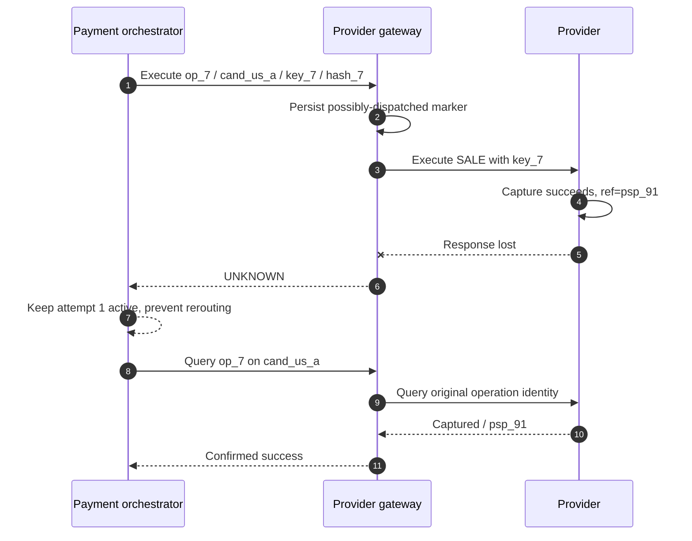
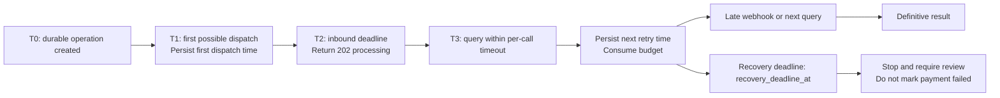
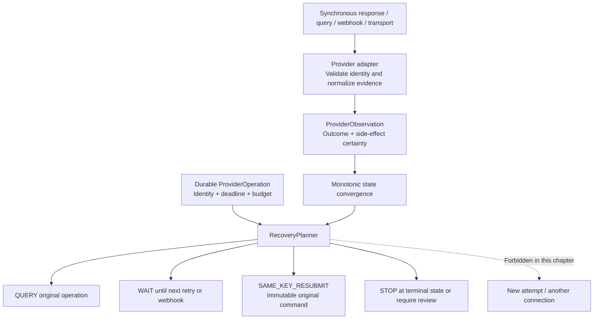
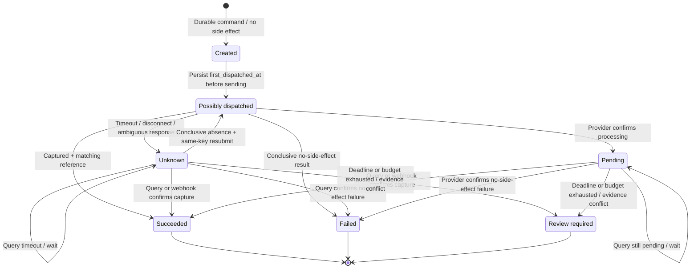

# Chapter 10: Timeouts, Retries, and Unknown States

[中文](../../part-3-reliability/timeout-and-retry.md) | **English**

Aurora sells a concert ticket for 129.00 USD. Routing has selected `cand_us_a`, and the payment orchestrator creates an automatic-capture `SALE`. The provider processes it and generates a transaction reference. As the response returns, the connection between gateway and provider breaks. After 800 milliseconds, the caller sees only `context deadline exceeded`.

The most dangerous response is: “The payment failed; send it again.” The deadline proves only that Aurora did not observe a result within its waiting window. It cannot reverse a request that crossed a process boundary or prove that the provider, acquirer, or issuer did not execute it. This chapter's central proposition is:

> **A timeout is missing observation, not proof of provider nonexecution. Recovery must jointly depend on side-effect certainty, the original provider-operation identity, the original connection/key/payload, and the remaining recovery deadline.**

This chapter covers recovery of the same provider operation: query, wait, resend with the same key when evidence permits, or stop automatic recovery. Chapter 11 provides the full proof across merchant/API/provider idempotency; Chapter 12 covers fallback that creates a new attempt across providers; Chapter 13 covers aggregate health and circuit breaking; Chapter 17 covers reconciliation of independent accounting facts.

The companion Go system implements this safety chain as a narrow but complete `SALE/automatic` baseline. Before calling the gateway it persists the intent, attempt, and provider operation; pins the operation, exact connection revision, provider idempotency key, and request hash; writes `first_dispatched_at` only once before the first possible dispatch; and persists `recovery_deadline_at`, remaining budget, generation-bearing leases/claims, and deterministic jitter. A pure `RecoveryPlanner` then returns only query, wait, same-key resubmit, or stop. After a timeout the API returns HTTP 202/`processing`. Ordinary `UNKNOWN/possible` always queries the original operation; only conflicting evidence, exhausted recovery budget/deadline, or invalid durable state leads to `review_required`. For an **exact registered connection revision**, the gateway can also return structured, time-bounded proof of conclusive absence bound to the full command identity. An ordinary 404 has no such authority.


*Figure: Retain `op_7` and `key_7`. The original connection permits query or same-key recovery; the alternative PSP path is blocked.*

UNKNOWN is fog, not an endpoint. When the result across the bridge is invisible, the system must keep hold of the original operation's identity while gathering evidence. Collecting again along another route turns a knowledge gap into a second funds path.

## 10.1 The Problem: Treating a Timeout as Failure Creates a Second Funds Path

Early implementations often wrap every network error in a retry loop:

```go
package naive

import "context"

type Command struct {
	AmountMinor int64
	Currency    string
}

type Result struct {
	Status string
}

type Provider interface {
	Sale(context.Context, Command) (Result, error)
}

// Confirm deliberately demonstrates an unsafe approach: neither call has a durable logical operation identity,
// so the provider may interpret both as new sale operations.
func Confirm(ctx context.Context, provider Provider, command Command) (Result, error) {
	first, err := provider.Sale(ctx, command)
	if err == nil {
		return first, nil
	}
	return provider.Sale(ctx, command)
}
```

If the provider processed the first request but its response was lost, the second call may become another sale. Identical-looking amount, card, and merchant reference do not prove provider deduplication. HTTP POST has no default business guarantee that a payment executes only once.

RFC 9110 distinguishes HTTP methods' idempotent semantics and says clients should not automatically retry non-idempotent requests unless they know the actual request semantics are idempotent or can detect that the original request was never applied. [RFC 9110 §9.2.2: Idempotent methods](https://www.rfc-editor.org/rfc/rfc9110.html#section-9.2.2) Safe replay of a payment POST comes from an explicit provider idempotency contract and the platform's retained operation identity, not a generic HTTP client.



There is only one funds operation throughout. `UNKNOWN` is not a provider business outcome; it is Aurora's knowledge state about the remote result. Queries add observations without creating an attempt or changing the candidate.

### 10.1.1 Where Failure Occurred Matters More Than the Error String

| Observation point | Proves no side effects? | Normalized result | Next step allowed here |
| --- | --- | --- | --- |
| Local validation fails; persisted operation remains `created/not_dispatched` | Yes: local state proves no dispatch | Definitive failure / `none` | First send of the same persisted command |
| Dispatch marked, then disconnect or read timeout | No | `UNKNOWN` / `possible` | Query or wait |
| Explicit provider decline; contract proves automatic-capture `SALE` produced no funds side effects | Yes | Definitive failure / `none` | Stop; Chapter 12 decides new attempts |
| Provider returns `pending` with an attributable reference | No, but the request is known to exist | `pending` / `possible` | Query or await a webhook |
| Complete captured result with matching reference | Side effect confirmed | `success` / `confirmed` | Stop and converge monotonically |
| Invalid JSON or ambiguous 5xx without identity-conflict evidence | HTTP alone cannot prove it | `UNKNOWN` / `possible` | Query / wait on the original operation |
| Operation / connection / reference identity mismatch | Evidence-integrity conflict exposed | `review_required` | Stop automation and retain both pieces of evidence |
| The query itself times out | Still no | Still `UNKNOWN` | Back off, then query / wait without resetting identity |

A “connection failure” cannot be assumed to precede dispatch from its exception type alone. Proxies, TLS, intermediaries, and connection reuse make it difficult to know whether bytes reached the remote system. Use `SideEffectNone` only when durable local state proves that dispatch never began or the provider supplies contract-backed no-side-effect evidence for the exact operation.

## 10.2 The Simple Design: Separate Outcome from Certainty

A simple system expands `success/failure` into `success/failure/pending/unknown` and models side-effect certainty independently. `pending` means the provider explicitly acknowledges ongoing processing; `unknown` means the platform lacks reliable observation. Both may require queries, but their evidence strength differs.

The Go example deliberately avoids deriving business conclusions from HTTP status. The adapter first normalizes official responses into `ProviderVerdict`. Only a captured result with a reference, a contractually definitive no-side-effect decline, or local nondispatch proof produces certainty. Everything else defaults to `UNKNOWN`:

```go
package observation

type OutcomeClass string

const (
	OutcomeSuccess OutcomeClass = "success"
	OutcomeFailure OutcomeClass = "failure"
	OutcomePending OutcomeClass = "pending"
	OutcomeUnknown OutcomeClass = "unknown"
)

type SideEffectCertainty string

const (
	EffectNone      SideEffectCertainty = "none"
	EffectPossible  SideEffectCertainty = "possible"
	EffectConfirmed SideEffectCertainty = "confirmed"
)

type ProviderVerdict string

const (
	VerdictCaptured         ProviderVerdict = "captured"
	VerdictDeclinedNoEffect ProviderVerdict = "declined_no_effect"
	VerdictPending          ProviderVerdict = "pending"
	VerdictAmbiguous        ProviderVerdict = "ambiguous"
)

type DispatchProof string

const (
	DispatchNever    DispatchProof = "never_dispatched"
	DispatchPossible DispatchProof = "possibly_dispatched"
)

type ProviderObservation struct {
	Verdict           ProviderVerdict
	DispatchProof     DispatchProof
	ProviderReference string
	NormalizedCode    string
}

type Outcome struct {
	Class     OutcomeClass
	Certainty SideEffectCertainty
	Code      string
}

func Normalize(observation ProviderObservation) Outcome {
	switch {
	case observation.Verdict == VerdictCaptured:
		if observation.ProviderReference != "" {
			return Outcome{Class: OutcomeSuccess, Certainty: EffectConfirmed, Code: "captured"}
		}
		return Outcome{Class: OutcomeUnknown, Certainty: EffectPossible, Code: "capture_reference_missing"}
	case observation.Verdict == VerdictDeclinedNoEffect:
		return Outcome{Class: OutcomeFailure, Certainty: EffectNone, Code: observation.NormalizedCode}
	case observation.Verdict == VerdictPending:
		return Outcome{Class: OutcomePending, Certainty: EffectPossible, Code: observation.NormalizedCode}
	case observation.DispatchProof == DispatchNever:
		return Outcome{Class: OutcomeFailure, Certainty: EffectNone, Code: "pre_dispatch"}
	default:
		return Outcome{Class: OutcomeUnknown, Certainty: EffectPossible, Code: "observation_missing"}
	}
}
```

`VerdictDeclinedNoEffect` does not mean “any 4xx.” It is a conclusion the adapter proved using provider documentation, operation type, and response fields. Timeouts, EOF, connection resets, unparseable responses, and generic 5xx responses enter the default branch. An automatic-capture `SALE` receiving only `authorized` cannot be promoted to `captured`; authorization, capture, and settlement remain separate facts.

Go's `context` documentation describes deadlines as cancellation signals propagated across call chains: expiry cancels the `Context`. `net/http.Client.Timeout` likewise bounds client phases such as connection, redirects, and response reads. [Go: context](https://pkg.go.dev/context) [Go: `net/http` client](https://pkg.go.dev/net/http#Client) **The payment-domain inference** is that `context.DeadlineExceeded` tells local work to stop waiting; it is not proof of a rolled-back provider transaction.

## 10.3 Problems at Scale: One Timeout Crosses Multiple Clocks and Crash Windows

### 10.3.1 A Request Timeout Is Not a Recovery Deadline

A merchant may wait only two seconds synchronously. Payments calls routing, the gateway calls the provider, and each layer has its own timeout. If every layer starts a fresh “two seconds,” downstream calls overrun upstream deadlines. If every layer directly inherits the shortest context, a merchant disconnect may interrupt recovery that should run durably.

Distinguish three clocks:

| Time limit | Purpose | Meaning of expiry |
| --- | --- | --- |
| Inbound request deadline | Bounds synchronous waiting for this HTTP request | Return 202 / current projection; do not change provider facts |
| Per-call timeout | Bounds one routing, gateway, or provider-query RPC | This observation ends; possibly dispatched requests remain unknown |
| Recovery deadline | Bounds automatic recovery for this provider operation | Stop automatic recovery + `review_required`; never relabel as failure |

Each downstream call uses only `min(remaining_end_to_end, configured_per_call)`, reserving time to save its result. Recovery workers read durable deadlines from the database rather than relying on a canceled merchant context. They may create a fresh short context per query, but cannot reset the recovery deadline on every scheduling pass.



### 10.3.2 Persist First or Send First: The Crash Window Cannot Be Eliminated

Calling the provider before writing the database risks a crash after capture with no local operation ID, leaving recovery to guess from a vague merchant reference. Writing `sending` before calling also leaves a window: the process may crash between the steps, so local state says “possibly sent” although nothing was sent.

The latter error is conservative and recoverable. Production persists the immutable command transactionally, then writes `first_dispatched_at` and `SideEffectPossible` before dispatch. Beyond that line, crash recovery can only query/wait unless further no-side-effect proof arrives. Some unsent requests may wait longer, but guesses cannot create a second funds path.

The companion implementation follows this direction: payments saves intent/attempt/operation first. The synchronous `MarkOperationSending` transaction, or a recovery claim taking over a `created` crash window, validates execution permission and writes `first_dispatched_at` once before the first gateway I/O. The gateway then claims dispatch through compare-and-swap (CAS), allowing only the winner to move its record to `sending` before calling the provider. Workers query expired `sending/pending/unknown` operations instead of creating new attempts; `first_dispatched_at` is never inferred from `updated_at`.

### 10.3.3 HTTP 5xx Describes a Server Observation, Not a Universal Funds Outcome

A 400 may reject parameters before execution; a 422 may mean that a same-key request is still processing. A 500 may occur before execution or while constructing a response after posting funds. A 502/504 may originate from a proxy between Aurora and the provider. Status codes alone cannot establish side effects across providers.

Where a provider explicitly supplies a no-side-effect error field/category, its adapter may normalize it as definitive failure. Adyen's official idempotency documentation distinguishes retryable transient errors and requires reuse of the same idempotency header after timeouts. It also explains that regional endpoints do not inherently share key deduplication. Same-key resend therefore follows a particular provider/account/region contract, not a platform-wide law. [Adyen API idempotency](https://docs.adyen.com/development-resources/api-idempotency)

Stripe's low-level error documentation likewise describes socket/timeouts as cases without a direct response and recommends retrying the original request with the same idempotency key within its contract. [Stripe advanced error handling](https://docs.stripe.com/error-low-level) These examples support recovery with the same operation, key, and payload. They do not let one provider's key protect another provider or make expired/cross-account keys effective. Chapter 11 proves scope and retention in full.

### 10.3.4 Query 404s Also Need Evidence Levels

A query is a recovery action, not universal truth. Some providers retrieve current state by stable object ID; Stripe, for example, offers retrieval by PaymentIntent ID. [Stripe: Retrieve a PaymentIntent](https://docs.stripe.com/api/payment_intents/retrieve) Other search indexes are eventually consistent, retain data briefly, or lack an API covering the original request key.

A `not found` result supports `same-key resubmit` only if its scope exactly matches the original connection/account/region, its lookup key uniquely identifies the original operation, the provider contract says absence in the current window proves no request was created, and response identity passes validation. If any condition is unknown, 404 is merely another missing observation: wait or query again.

The gateway encodes this as a typed capability. An authoritative query's absence produces structured proof with a half-open validity interval only when conclusive-absence authority is explicitly configured and registered connection ID/revision/namespace/provider all match the original command. The payment client revalidates operation, attempt, connection revision, key, and payload hash. Unconfigured production connections, ordinary HTTP 404s, and ambiguous proofs containing extension fields remain `UNKNOWN` and permit only query/wait. Identity drift is an integrity conflict that stops automation for review. Neither case triggers a second POST. The simulator demonstrates this capability under contract tests; it does not establish equivalent guarantees from a real PSP.

### 10.3.5 Webhooks Can Be Late, Duplicated, Reordered, or Conflict with Queries

Synchronous responses, queries, and webhooks all observe the same operation. None is inherently truer because it arrived last. Stripe's official webhook documentation states that delivery need not follow event-generation order and requires duplicate handling; missing objects can be retrieved through the API. [Stripe: Webhooks](https://docs.stripe.com/webhooks)

State convergence must therefore be monotonic. A confirmed capture cannot be downgraded by a late transport-unknown observation. Duplicate event IDs are not reapplied. Equivalent events for the same reference can merge; different references or conflicting terminal results retain evidence and enter `review_required`. A recovery worker cannot disregard a webhook merely because it just completed a query.

### 10.3.6 Without a Durable Budget, Backoff Is Just a Slower Infinite Loop

If 500,000 UNKNOWN operations query immediately whenever processes start, a recovering provider receives another traffic surge. In-memory counters reset on restart, creating retry storms.

Persist at least `next_retry_at`, `recovery_budget_remaining`, and `recovery_deadline_at` for each operation. Workers claim work through leases or `FOR UPDATE SKIP LOCKED`. Actual queries/resubmissions consume budget; waiting does not. Cap exponential backoff and add jitter. An adapter may incorporate trustworthy `Retry-After` or provider query-frequency constraints into scheduling. This budget limits recovery of one operation; Chapter 13 covers cross-transaction health and circuit breaking.

## 10.4 Production Design: Give the Recovery Planner Only Four Actions

### 10.4.1 Evolve the UNKNOWN Baseline Rather Than Rebuild the Payment Core

| Capability | Current companion system | Remaining production boundary |
| --- | --- | --- |
| Stable identity | Payment/attempt/operation pin connection ID/revision, namespace, provider, key, and hash; gateway revalidates the full tuple | Pin each real PSP's account, region, API operation, and key-retention contract |
| Exact routing | Recovery claims and gateway recovery checks accept no new candidate; first execution is bounded by pinned `executable_until` | Document real-account rotation, disaster-recovery endpoints, and old revisions in provider runbooks |
| Immutable command | Payments stores the request hash; gateway stores a typed command and rejects amount, token, capture-mode, or connection drift | Publish payload/derivation versions and compatible migrations where real adapters reconstruct wire payloads |
| UNKNOWN / observations | Ambiguous transport/protocol results remain unknown; sale, query, and webhook evidence enters an append-only gateway observation ledger without overwriting conflicts | Establish official contracts, replay corpora, and versioned release gates for real PSP normalizers |
| Query / webhook / absence | Original-operation query, durable inbox/outbox, strict identity checks, and typed conclusive absence exist; ordinary 404 never authorizes resend | Prove lookup scope, index-consistency windows, and absence authority per adapter; disable unproved capability |
| Deadline / budget / claim | `first_dispatched_at`, fixed deadline, remaining budget, `next_retry_at`, deterministic jitter, leases, and claim generations persist and advance transactionally | Add production scheduling, capacity isolation, alerts, outage queues, and manual runbooks; in-process workers are not a scheduling platform |
| Planner | Pure `RecoveryPlanner` returns query/wait/same-key resubmit/stop; claim transactions debit budget atomically, and generations fence execution/completion | Validate fairness, provider rate limits, and prolonged backlogs at real traffic scale |

The system now makes “why query now,” “why resend with the same key,” and “why stop” explicit, testable decisions instead of scattered error branches. This is still not a claim of real payment integration: real PSP absence/idempotency contracts, production scheduling, and capacity operations remain unconnected. This chapter's baseline uses the [pinned code revision](https://github.com/YouEclipse/payments/commit/bc4afde24da708d22f67da72a90a1557b1477173) and its [continuous-integration run](https://github.com/YouEclipse/payments/actions/runs/33041147119); source alone cannot replace real database and end-to-end verification.

### 10.4.2 `ProviderObservation` Is Evidence, Not an Exception String

The gateway adapter should represent every synchronous response, query, webhook, or transport failure as a common observation. Suggested fields are:

| Field | Meaning |
| --- | --- |
| `operation_id` / `provider_connection_id` | Original operation and exact connection being observed |
| `source` | `sync_response`, `query`, `webhook`, `transport` |
| `transport_phase` | `pre_dispatch_proven` or `possibly_dispatched` |
| `http_status` | Observed protocol status; insufficient alone to determine funds outcome |
| `provider_status/code/reference` | Adapter-validated original evidence and correlation reference |
| `outcome_class` | `success/failure/pending/unknown` |
| `side_effect_certainty` | `none/possible/confirmed` |
| `observed_at` / `adapter_version` | Time and normalization-rule version |

Raw error text may enter controlled diagnostics, but cannot drive the funds state machine. Only stable classifier codes feed metrics and RecoveryPlanner. PAN, CVV, and full provider requests do not belong in observations, logs, or webhook inboxes.



### 10.4.3 Recovery Records Pin Identity, Time, and Budget

The recovery projection of `ProviderOperation` needs at least:

| Field | First set | Invariant |
| --- | --- | --- |
| `operation_id` | Operation creation | Never changes; correlates all queries/resends/webhooks |
| `provider_connection_id` | After routing decision | Never switch provider, account, connector, or region |
| `provider_idempotency_key` | Before first execution | Reuse unchanged on resend; Chapter 11 defines scope |
| `request_hash` + immutable payload reference | Before first execution | Amount, currency, token reference, and capture mode remain immutable |
| `first_dispatched_at` | Before first possible dispatch | Write once; never substitute each `updated_at` |
| `recovery_deadline_at` | Recovery-policy creation | Fixed absolute time; scheduler restart cannot extend it |
| `next_retry_at` | After each plan | Workers claim only due items |
| `recovery_budget_remaining` | Recovery-policy creation | Atomically debit for query/resend, not waiting |
| `last_observation` / `adapter_version` | Each new evidence item | Merge monotonically; never overwrite conflicts |

To limit drift across layers, the planner is pure: no HTTP, database writes, or latest-route reads. Its caller loads a snapshot transactionally, obtains an action, atomically debits budget, and updates `next_retry_at`; a worker then executes. The Go example limits actions to the four in the contract:

```go
package recovery

import (
	"errors"
	"time"
)

var ErrInvalidSnapshot = errors.New("invalid recovery snapshot")

type Action string

const (
	ActionQuery           Action = "query"
	ActionWait            Action = "wait"
	ActionSameKeyResubmit Action = "same_key_resubmit"
	ActionStop            Action = "stop"
)

type OutcomeClass string

const (
	OutcomeSuccess OutcomeClass = "success"
	OutcomeFailure OutcomeClass = "failure"
	OutcomePending OutcomeClass = "pending"
	OutcomeUnknown OutcomeClass = "unknown"
)

type SideEffectCertainty string

const (
	EffectNone      SideEffectCertainty = "none"
	EffectPossible  SideEffectCertainty = "possible"
	EffectConfirmed SideEffectCertainty = "confirmed"
)

type ResubmitProof string

const (
	ProofNone                     ResubmitProof = "none"
	ProofLocalNeverDispatched     ResubmitProof = "local_never_dispatched"
	ProofProviderConclusiveAbsent ResubmitProof = "provider_conclusive_not_found"
)

type OriginalCommand struct {
	OperationID          string
	ProviderConnectionID string
	ProviderKey          string
	RequestHash          string
}

func (command OriginalCommand) Valid() bool {
	return command.OperationID != "" &&
		command.ProviderConnectionID != "" &&
		command.ProviderKey != "" &&
		command.RequestHash != ""
}

type Snapshot struct {
	Original                OriginalCommand
	Outcome                 OutcomeClass
	Certainty               SideEffectCertainty
	ResubmitProof           ResubmitProof
	QuerySupported          bool
	ReviewRequired          bool
	RecoveryDeadlineAt      time.Time
	NextActionAt            time.Time
	RecoveryBudgetRemaining int
}

type Decision struct {
	Action         Action
	Reason         string
	RequiresReview bool
}

func Plan(now time.Time, snapshot Snapshot) (Decision, error) {
	if !snapshot.Original.Valid() || snapshot.RecoveryDeadlineAt.IsZero() {
		return Decision{}, ErrInvalidSnapshot
	}
	switch snapshot.Outcome {
	case OutcomeSuccess, OutcomeFailure, OutcomePending, OutcomeUnknown:
	default:
		return Decision{}, ErrInvalidSnapshot
	}
	switch snapshot.Certainty {
	case EffectNone, EffectPossible, EffectConfirmed:
	default:
		return Decision{}, ErrInvalidSnapshot
	}
	switch snapshot.ResubmitProof {
	case ProofNone, ProofLocalNeverDispatched, ProofProviderConclusiveAbsent:
	default:
		return Decision{}, ErrInvalidSnapshot
	}
	if snapshot.ReviewRequired {
		return Decision{Action: ActionStop, Reason: "conflicting_evidence", RequiresReview: true}, nil
	}
	if snapshot.Outcome == OutcomeSuccess && snapshot.Certainty == EffectConfirmed {
		return Decision{Action: ActionStop, Reason: "terminal_success"}, nil
	}
	if snapshot.Outcome == OutcomeFailure && snapshot.Certainty == EffectNone {
		return Decision{Action: ActionStop, Reason: "conclusive_failure"}, nil
	}
	if snapshot.Certainty == EffectConfirmed || snapshot.Outcome == OutcomeSuccess ||
		(snapshot.Outcome == OutcomePending && snapshot.ResubmitProof != ProofNone) {
		return Decision{Action: ActionStop, Reason: "conflicting_evidence", RequiresReview: true}, nil
	}
	if !now.Before(snapshot.RecoveryDeadlineAt) {
		return Decision{Action: ActionStop, Reason: "recovery_deadline_exhausted", RequiresReview: true}, nil
	}
	if snapshot.RecoveryBudgetRemaining <= 0 {
		return Decision{Action: ActionStop, Reason: "recovery_budget_exhausted", RequiresReview: true}, nil
	}
	if !snapshot.NextActionAt.IsZero() && now.Before(snapshot.NextActionAt) {
		return Decision{Action: ActionWait, Reason: "backoff_not_elapsed"}, nil
	}
	switch snapshot.ResubmitProof {
	case ProofLocalNeverDispatched, ProofProviderConclusiveAbsent:
		return Decision{Action: ActionSameKeyResubmit, Reason: string(snapshot.ResubmitProof)}, nil
	}
	if snapshot.QuerySupported {
		return Decision{Action: ActionQuery, Reason: "side_effect_possible"}, nil
	}
	return Decision{Action: ActionWait, Reason: "await_provider_evidence"}, nil
}
```

There is no `retry_other_provider`, `new_attempt`, or `choose_candidate`. An `ActionSameKeyResubmit` executor loads the immutable payload corresponding to `OriginalCommand` from the database; it cannot accept an ad hoc request. Before execution it rechecks connection, key, and request hash and consumes one recovery-budget unit in the same transaction. A hash mismatch means `review_required`, not “try again.”

### 10.4.4 Evidence Thresholds for Query, Wait, and Same-Key Resubmit

| Current evidence | Query available? | Resend proof | Planner action |
| --- | ---: | --- | --- |
| `success/confirmed` or `failure/none` | Any | Any | Stop at terminal state |
| `pending/possible`, before `next_retry_at` | Any | None | Wait |
| `unknown/possible`, authoritative query and due | Yes | None | Query original operation |
| `unknown/possible`, no query available | No | None | Await webhook until deadline/budget |
| Durable local state proves never dispatched | Any | Local proof | Resubmit original command with the same key |
| Authoritative query proves exact operation absent | Yes | Conclusive provider absence | Resubmit original command with the same key |
| Only ordinary 404, timeout, or 5xx | Any | None | Query/wait; no resubmit |
| Deadline/budget exhausted while still possible | Any | None | Stop + `review_required` |

Waiting is an active decision, not forgetting a payment. It needs `next_retry_at`, the evidence source awaited, and a recovery deadline. The API continues returning `processing`; operations can see age, remaining budget, and the latest observation. An arriving webhook immediately participates in convergence under the same operation identity without waiting for a timer.



There is no edge from `Unknown` to “new provider attempt.” This is a safety boundary: missing observation of one operation must first be resolved or automation stopped. Chapter 12 addresses whether policy permits a new attempt after a conclusive no-side-effect failure.

### 10.4.5 Worker Leases Solve Concurrency, Not Remote-Outcome Certainty

Recovery workers may claim due operations using `FOR UPDATE SKIP LOCKED` or equivalent leases. A lease proves who owns recovery, not whether the provider executed. The claim transaction validates the version, debits this query/resend's budget, and persists the action, lease expiry, and new `next_retry_at`; network I/O must not hold the transaction open.

A crash after budget debit but before sending conservatively wastes one allowance. A crash after a response but before applying its observation leaves the next worker treating side effects as `possible` and querying the same operation. Neither window justifies rolling back `first_dispatched_at`, increasing budget, or changing keys. Lease expiry allows another worker to take over the same work; it does not authorize parallel funds requests.

## 10.5 Failure Modes: Where Recovery Systems Most Often Misrepresent Reality

### 10.5.1 Passing Technical Classifications Off as Funds Facts

| Failure mode | False conclusion | Correct control |
| --- | --- | --- |
| `context deadline exceeded` → failure | Provider did not execute | Any possible dispatch becomes UNKNOWN |
| Any 500/502/503/504 → safe retry | Server certainly produced no side effect | Require provider-specific no-side-effect evidence |
| Any 4xx → definitive decline | Request certainly did not execute | Adapter classifies using official fields and operation semantics |
| Automatic-capture `SALE` gets `authorized` → success | Capture completed | Keep possible/pending until capture evidence |
| Recovery deadline expires → payment failed | Time proves no charge | Stop + review; unknown facts remain unknown |

“Usually” cannot cover the tail. Even if 99.99% of read timeouts happen before provider execution, automatically resending the other 0.01% as new operations still creates duplicate charges. Reliability must respect side-effect boundaries rather than optimize average error rate alone.

### 10.5.2 A So-Called Retry Silently Changes Operation Identity

None of these changes is an allowed retry here: a new `operation_id`, another provider idempotency key, a different merchant account/region, changed amount/currency, a different payment token, switching automatic capture to `authorize`, or another candidate. Each is an idempotency conflict or a Chapter 12 new attempt; it cannot hide in HTTP retry middleware.

Generic HTTP libraries may also retry connection failures automatically. Audit gateway transport configuration so state-changing POSTs cannot bypass RecoveryPlanner. Even where the provider supports idempotency, the platform explicitly reuses the original key and payload. RFC 9110 also advises against automatically retrying a failed automatic retry, consistent with bounded budgets. [RFC 9110 §9.2.2](https://www.rfc-editor.org/rfc/rfc9110.html#section-9.2.2)

### 10.5.3 Overtrusting Queries and 404s

With a delayed query index, immediate resend after the first 404 may coexist with an original transaction that becomes visible later. Adapter capability metadata should declare lookup keys, covered operations, consistency windows, and absence certainty. Unknown semantics cannot produce `ProofProviderConclusiveAbsent`.

Query responses must also validate provider, connection/account, operation ID, provider idempotency key, and reference. A well-formed success response from another merchant account is a correlation conflict, not a usable result; preserve it and require review.

### 10.5.4 Backoff Resets on Restart

Keeping counters only in goroutine variables sends every operation back to its first retry after a deploy or crash. Persist `next_retry_at`, budget, and deadline in the same source of truth as the operation. Claims and budget debits need transactional ownership to prevent concurrent queries/resends from two replicas. Jitter spreads timing but cannot replace leases, unique identity, or budgets.

### 10.5.5 Last-Write-Wins for Late Evidence

A query may report decline before a webhook reports capture with another reference; or an old pending observation may arrive after capture. The first is a conflict, the second an ignorable old observation. Neither can be handled by overwriting according to `updated_at`. The companion domain already protects confirmed terminal states, rejects reference conflicts, and sets `integrity_status=review_required`. Its append-only gateway observation ledger preserves source, `occurred_at`, adapter version, normalized evidence, and payload hash so sale, query, and webhook observations share monotonic merge rules.

### 10.5.6 A Falsifiable Test Matrix

Fault injection should prove safety:

1. The simulator persists capture, drops the synchronous response, and the payment worker restarts. Recovery only queries the original operation or receives its webhook, eventually succeeds, and always has one attempt, one payment operation, and one gateway operation in the database.
2. Three consecutive query timeouts only advance durable backoff and consume budget. Operation ID, connection, provider key, and hash remain unchanged; no second routing decision occurs.
3. A crash after durable `created` but before `first_dispatched_at` permits same-key resend from the original command. A crash after `first_dispatched_at` permits only query/wait first.
4. Ordinary or eventually consistent 404s produce no resend proof; only adapter-marked conclusive absence allows same-key resend.
5. Queries remain unknown through the recovery deadline. The operation enters `review_required`, without fabricating payment failure.
6. Both a captured webhook and later decline/reference-conflict evidence persist. Automatic recovery stops; last-write-wins cannot erase confirmed funds facts.

Current Compose end-to-end tests cover the core of the first scenario: `timeout_then_succeeded` converges from 202/processing to success and asserts one funds path. Additional PostgreSQL/application/gateway integration tests cover invariant deadlines/budgets/identity after worker restart, consecutive recovery claims, no second POST after ordinary 404, same-key resend only with structured conclusive absence, and safe refusal after route execution permission expires. Releases must still run full CI verification against real PostgreSQL and Compose.

## 10.6 Tradeoffs: Waiting for Certainty Has a Cost

| Choice | Benefit | Cost | Control |
| --- | --- | --- | --- |
| Safe refusal during UNKNOWN | Prevents duplicate funds paths | Customer sees processing longer | Explicit SLA, status lookup, operational explanation |
| Frequent queries | Faster terminal-state discovery | Rate limits, fees, thundering herd | Backoff, jitter, `Retry-After`, budget |
| Primarily await webhooks | Lighter hot path | Delayed/lost webhooks prolong uncertainty | Due-time query + durable inbox |
| Longer recovery deadline | More automatic convergence | Unresolved operations consume attention longer | Age metrics, tiered alerts, explicit stop |
| Shorter recovery deadline | Faster entry to manual queue | More reviews | Configure by payment method/provider contract |
| Very strict absence proof | Strongest safety | Some providers without query support cannot auto-resubmit | Wait/manual handling; no guesses for availability |
| Provider-specific classifiers | Precise evidence | Higher adapter/contract-test cost | Versioned normalization + contract tests |

Recovery deadlines should not be one global constant. Automatic-capture card `SALE`, asynchronous bank transfers, and wallets requiring user action have different terminal-state delays. But the selected deadline must be fixed before dispatch and auditable; persistent uncertainty cannot justify infinite extensions. The first implementation covers only automatic-capture `SALE` for tokenized cards, avoiding a pretense that one clock suits every payment method.

Manual review is not a failure dumping ground. `review_required` should include original operation identity, connection, immutable command hash, latest observations, query count, deadline/budget reasons, and provider references. Operators may trigger audited queries, evidence merges, or repair commands; a console Retry button must not create a new sale.

## 10.7 Summary: Acknowledge Uncertainty Before Resolving It Safely

Starting from a captured payment whose response was lost, this chapter establishes:

1. Timeouts, disconnects, invalid responses, and ambiguous 5xx are missing observations. Once dispatch is possible, classify as `UNKNOWN/possible`, never failure.
2. Outcome class and side-effect certainty remain separate: `success/failure/pending/unknown` does not replace `none/possible/confirmed`.
3. Recovery pins the original `operation_id`, provider connection/account/region, provider key, and immutable payload/hash. Changing them is not a retry of the same operation.
4. `RecoveryPlanner` has only query, wait, same-key resubmit, and stop. It owns no routing and creates no attempts.
5. Same-key resend requires durable local nondispatch proof or conclusive provider absence for the exact operation. Timeout, ordinary 404, and HTTP codes are insufficient.
6. Persist `first_dispatched_at`, `recovery_deadline_at`, `next_retry_at`, and recovery budget. Restart cannot reset clocks or counts.
7. Deadline/budget exhaustion stops automation for `review_required`; it never rewrites unknown funds facts as failure.
8. Queries, synchronous responses, and webhooks converge monotonically on one operation. Merge duplicates/old observations; retain conflicting terminal/reference evidence; forbid last-write-wins.
9. Cross-provider fallback is forbidden during UNKNOWN. Chapter 11 proves keys, payload fingerprints, and concurrent ownership; Chapter 12 considers new attempts only after a definitive no-side-effect terminal result.

The Go system already has UNKNOWN, original-operation queries, webhook convergence, append-only observations, stable connection/key/hash, a pure RecoveryPlanner, fixed deadlines/budgets, and a single-funds-path baseline. The next step is to connect real PSP query/absence/idempotency contracts, production scheduling, and operational SLAs to these verified invariants—not add another generic retry loop. Missing observation becomes an auditable recovery process instead of network uncertainty amplified into duplicate payment.

## Further Reading

* [Chapter 3: Responsibilities and Boundaries of a Payment Routing System](../part-1-foundations/routing-system-boundaries.md)
* [Chapter 9: Provider Scoring and Risk-Aware Routing](../part-2-routing-engine/provider-scoring.md)
* [Chapter 11: Idempotency and Payment Attempts](idempotency.md)
* [Chapter 12: Fallback Routing](fallback-routing.md)
* [Chapter 13: Circuit Breakers and Provider Health](provider-health.md)
* [Chapter 17: Reconciliation](../part-4-operating-at-scale/reconciliation.md)
* [Appendix A: Payment Intent, Attempt, and Provider Request State Models](../appendices/payment-state-models.md)
* [RFC 9110: HTTP Semantics](https://www.rfc-editor.org/rfc/rfc9110.html)
* [Go `context` package](https://pkg.go.dev/context)
* [Adyen API idempotency](https://docs.adyen.com/development-resources/api-idempotency)
* [Stripe: Webhooks](https://docs.stripe.com/webhooks)
