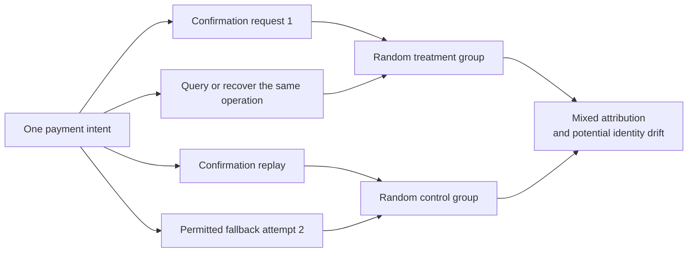
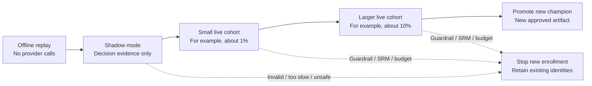
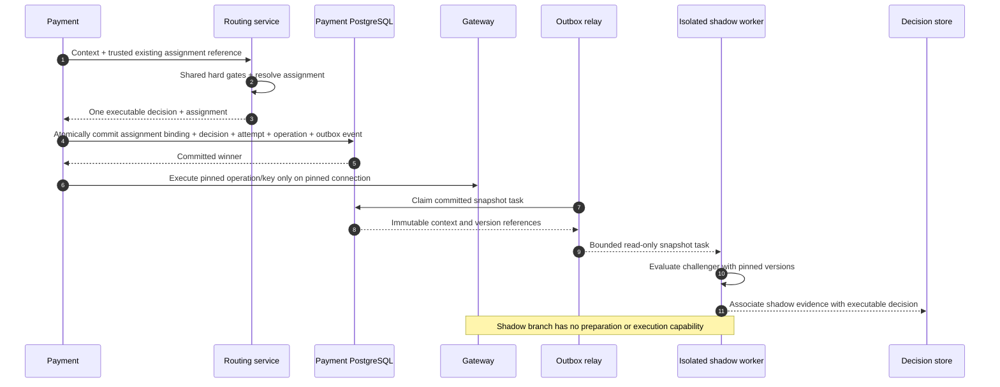

# Chapter 16: Routing Experiments

[中文](../../part-4-operating-at-scale/experimentation.md) | **English**

Aurora is preparing to release a new cost-aware scorer. The team gives 10% of requests to the challenger policy and leaves the rest on the champion. A day later, the dashboard shows an immediate success rate 0.8 percentage points higher for the challenger. Just as engineers prepare a full rollout, they discover that one payment intent appeared in two experimental groups across three confirmations. The new policy's preferred `cand_us_b` is also beginning to hit concurrency limits. Weeks later, fraud alerts and chargebacks start arriving for the earliest payments.

These problems cannot be solved simply by “getting a larger sample.” Unstable experimental units prevent attribution; shared provider capacity creates interference between groups, so small-traffic effects cannot be extrapolated directly; and immediate success treats immature risk and cost as zero. Payment experimentation begins with business identity, execution authority, and evidence. Random numbers and statistical tests come afterward.

The central proposition of this chapter is:

> **Stable business units, immutable versions, and unavoidable guardrails must precede “randomly split off 10%.” By default, pin `ExperimentAssignment` to the payment intent and seal it into the decision. Offline replay and shadow evaluation produce analytical evidence only; shadows never create provider operations. Only an approved, limited live stage allows a decision designated as executable to affect real payments.**

This chapter depends on the immutable facts of [Chapter 14](routing-decision-store.md) and the layered measurements of [Chapter 15](observability.md), without redefining them. External outcome corrections belong to [Chapter 17](reconciliation.md), actual fees to [Chapter 18](settlement.md), cross-region consistency and configuration approval to [Chapter 19](../part-5-global-routing/multi-region.md) and [Chapter 20](../part-5-global-routing/configuration-platform.md), and bandits and off-policy learning to [Chapter 21](../part-5-global-routing/intelligent-routing.md). The current companion system has no experiment package, assignment mechanism, or shadow executor. The Go designs below are explicitly future increments.

## 16.1 The Problem: Requests Are Randomized, but One Intent Pays

The easiest experiment splitter takes only a few lines:

```go
package naiveexperiment

import "math/rand"

// PickStrategy deliberately demonstrates an unsuitable payment-experiment approach:
// Repeated requests for one intent may enter different experimental groups.
func PickStrategy() string {
	if rand.Intn(100) < 10 {
		return "challenger"
	}
	return "champion"
}
```

The random number is not the problem. Treating every HTTP request as an independent experimental unit is. After a confirmation response is lost, the merchant retries with the same idempotency key. After a provider operation becomes UNKNOWN, a worker queries it or recovers it with the same key. If the earlier attempt is definitively free of side effects and policy permits, a fallback attempt may follow. These actions belong to one business objective; they must not draw a new assignment each time.



Even if no double charge occurs, the statistics are already contaminated. If treatment times out more often, it produces more requests, attempts, and reassignment opportunities; counting requests gives it greater weight. If fallback success is credited to the control group drawn last, the original treatment's failure is transferred elsewhere. An apparently random splitter ultimately produces a sample selected by errors, retries, and recovery counts.

| Simple implementation | Experimental damage | Payment risk |
| --- | --- | --- |
| Randomize every HTTP request | One business unit crosses groups; duplicates change its weight | Replays may be mistaken for new execution |
| Bucket by `attempt_id` | The group with more failures produces more samples | Fallback may escape the original policy and route plan |
| Count only successfully dispatched requests | Excludes routing-service or preparation failures caused by treatment itself | Hides real service degradation |
| Send the challenger to the gateway too | Produces two real paths, not a shadow | May duplicate authorization or charging |
| Force an ineligible candidate through experiment rules | Comparison no longer shares the same safety boundaries | Bypasses capability, risk, authentication, or contractual restrictions |

Experiments therefore cannot bypass the routing pipeline. Context validation, eligibility filtering, and rule/risk guardrails still establish the legal set first. The experiment selects a policy version only within its approved scope; that policy then compares soft objectives within the set. Neither a high score nor “statistically significant” improvement can turn `Risk BLOCK`, unknown capabilities, or `UNKNOWN` recovery into permission to execute.

## 16.2 A Simple Design: Freeze the Experiment Contract, Then the Assignment

### 16.2.1 The Hypothesis Must Be More Specific Than “The New Policy Is Better”

Aurora can constrain its first hypothesis: “Among US tokenized-card automatic-capture `SALE` intents that pass shared hard guardrails, scorer v43 reduces mature cost per successful intent relative to v42, without reducing capture completion within the specified window or exceeding risk and reliability limits.” This estimates the effect of a policy change within a defined population, policy, time, and constraints. It does not claim that one provider is inherently better.

| Contract item | Example definition | Why define it first? |
| --- | --- | --- |
| Experiment identity | `exp_cost_v43`, never reused for a different hypothesis | Prevents changing the question midway and combining the data |
| Randomization unit | `merchant_id + payment_intent_id` | Assigns one business objective once |
| Pretreatment population | Specified merchants, regions, currencies, amount ranges, and automatic `SALE` | Enrollment cannot depend on treatment outcomes |
| Control/treatment | Pinned scorer, normalizer, soft-preference rules, and feature-schema versions | One variant cannot change algorithms every day |
| Shared guardrails | Shared eligibility, risk, health semantics, and capacity limits | Experiments cannot alter payment safety fundamentals |
| Primary metric | Either `captured_intent_within_H` or mature cost per successful intent | Prevents selecting the most attractive metric afterward |
| Guardrail metrics | Duplicate side effects, UNKNOWN duration, technical errors, latency, fraud/chargebacks, cost ceiling | Benefits cannot compensate for safety losses |
| Statistical plan | Effect direction, MDE, sample/duration limits, confidence method, multiple comparisons, stopping rules | Prevents changing criteria after seeing results |
| Allocation plan | Bucketing algorithm/key version, actual assignment probability, ramp stage | Gives SRM and replay an exact baseline |
| Ownership | Experiment owner, risk approver, stop authority, incident runbook | Alerts need an accountable owner able to stop new exposure |

Here, `H` is the observation horizon specified by the experiment contract, not a universal payment-finality period. Automatic-capture completion is neither authorization rate nor settlement. Dynamic risk and health values must still be checked and recorded under current safety contracts. “Freezing versions” freezes evaluation semantics and policy artifacts, not an expired risk `ALLOW` forever.

### 16.2.2 Intent Is the Default Unit, Not a Universal Unit

| Bucketing unit | Suitable question | Main cost |
| --- | --- | --- |
| Payment intent | Routing, completion, and cost for one business objective | Payments by the same customer may correlate; analysis must account for clustering |
| Approved customer pseudonym | Continuous experience or behavior across payments | Requires additional data authorization and stable identity; fewer independent samples |
| Merchant / merchant account | Policies strongly affect shared quotas, operations, or contracts | Few merchants and unbalanced clusters complicate inference |
| Region/connection time block | Strong shared-capacity interference with controllable carryover | Requires a dedicated switchback design, not simple hourly rotation |

The book defaults to intent because it matches the payment business boundary and naturally covers repeated confirmations, queries, and fallback. If a customer's payments affect one another, or treatment changes an entire merchant's provider quota, redesign the randomization and analysis units. A million correlated attempts cannot be called a million independent samples.

### 16.2.3 Separate Assignment, Exposure, and Outcomes

`ExperimentAssignment{experiment, variant, version, bucket}` identifies an intent's assigned group. It is neither a provider call nor a success or failure. Retain at least five distinct facts:

| Fact | When it occurs | Purpose |
| --- | --- | --- |
| Enrollment | Predefined inclusion criteria pass | Defines the target population and exclusion reasons |
| Assignment | Variant/version/bucket atomically pinned to intent | SRM, intention-to-treat analysis, stable membership |
| Applied decision | A policy version generates a decision that payment pins as executable | Records guardrails, degradation, and the actual effective path |
| Provider exposure | Operation enters actual dispatch | Analyzes provider technical behavior; distinct from assignment |
| Outcome | Synchronous, query, webhook, reconciliation, or settlement facts mature | Computes business and economic metrics over different windows |

Undispatched assignments are `not_exposed`, not fabricated PSP declines. But treatment-caused no-candidate or preparation failures cannot simply disappear from effect analysis. Intention-to-treat analysis starts with predefined assigned cohorts and uses previously declared intent outcomes and windows. Provider technical success rate considers only operations actually dispatched. These denominators answer different questions and are not interchangeable.

## 16.3 Scaling Problems: Experiments Change the System They Measure

### 16.3.1 Stable Hashing Does Not Prevent Version Drift

Replacing randomness with `hash(intent_id)` is only the first step. Changing the bucketing salt, threshold, experiment version, or policy references at runtime can still change an intent's answer. Production design separates three versions: `bucket_key_version` pins the bucket space; `allocation_version` records the contemporaneous ratio and stage; and `policy_version` pins the control/treatment algorithm. Changing the ramp percentage must not redraw existing intents or replace treatment weights along the way.

Payment must persist assignment and include it in Chapter 14's `DecisionEnvelope` and hash. For an executable route, pin it in the same transaction that creates the first attempt. If assignment is complete but treatment evaluation yields no candidate or an explicitly nonexecutable result, commit only the assignment binding and `not_exposed` evidence, without an attempt or operation. Recording assignments only after successful preparation otherwise deletes failures caused by the policy itself. Requests that have not passed validation, have not formally been assigned, or whose entire local transaction did not commit cannot masquerade as assigned samples merely on a routing-service recommendation.

The database enforces uniqueness on `(merchant_id, experiment_id, payment_intent_id)`, or an equivalent intent-owned binding. Even if concurrent confirmations see old and new artifacts, only one assignment wins. The loser must read the pinned version and obtain a consistent decision; it must not call the gateway using its rejected decision. Execution failures after persistence retain their original membership, even when they caused no funds side effect.

Bucketing inputs must not contain `attempt_id`, request ID, time, current candidate order, or provider health. Those change with recovery or the environment. Public APIs must also prevent merchants from injecting arbitrary variants or versions; these fields come only from trusted experiment artifacts and persisted bindings.

### 16.3.2 Retries, Queries, and Fallback Retain Membership but Execute Differently

| Action | Assignment | Funds identity | Experiment record |
| --- | --- | --- | --- |
| Replay with the same confirmation key | Read original binding, do not recompute | Return original resource/state | No new independent sample |
| Resend the same operation | Do not call `Assigner` | Original operation, connection, provider idempotency key, payload | Record recovery, not a new intent |
| Query / webhook | No assignment or routing | Original operation and references | Update outcome evidence, never assignment |
| Explicitly permitted fallback | Inherit original intent variant/version | New attempt, operation, and key along the fixed plan produced by routing | Payment-created `FallbackExecutionBinding` references the same assignment and original plan, preserving lineage; no new ranking |
| UNKNOWN / `review_required` | Original membership unchanged | New funds paths prohibited | Recovery/review, never reassignment to hide failure |
| Capture / void / refund | Associate with original membership; no new routing experiment | Original connection and transaction reference pinned | Associate subsequent economic outcomes with original intent |

“Fallback stays in treatment” does not let treatment freely choose another PSP. Chapter 12's “terminal state + no side effects + allowlisted reason,” risk, attempt-count, and deadline gates still apply. Treatment is membership, never a license for a new attempt. If a new safety guardrail makes the original plan nonexecutable, stop automation and record why; do not rewrite the intent as control and continue.

### 16.3.3 Check Sample Ratio Mismatch Before Interpreting Gains

Suppose the artifact declares 90/10 control/treatment, but 1,000 enrolled intents contain only 50 treatment assignments. Possible causes include incorrect hash inputs, an instance with stale configuration, missing treatment logs, dropped join rows, or outcome-dependent filtering. SRM diagnoses disagreement between observed and expected allocation, not the precise broken component. Fabijan and colleagues locate causes across assignment, execution, log processing, and analysis, emphasizing that unexplained SRM undermines effect conclusions. [Diagnosing Sample Ratio Mismatch: Original Paper](https://www.microsoft.com/en-us/research/publication/diagnosing-sample-ratio-mismatch-in-online-controlled-experiments-a-taxonomy-and-rules-of-thumb-for-practitioners/)

SRM uses deduplicated assigned intents, not requests, attempts, or counts handled by a particular candidate. If treatment changes ranking only for some eligible candidates, candidate traffic need not equal 10%; treating that as assignment SRM is a measurement error. After ramping from 1% to 10%, stratify by `allocation_version` or aggregate expected counts across stages. Do not test all historical data against today's percentage.

For two groups with fixed expected proportions, Pearson's chi-square goodness-of-fit test offers a teaching starting point:

\[
\chi^2=\frac{(O_C-E_C)^2}{E_C}+\frac{(O_T-E_T)^2}{E_T}
\]

It requires adequate expected counts; the approximation cannot be applied mechanically to buckets with only two or three treatment observations. NIST gives the same statistic and sample-adequacy constraints. [NIST: Chi-Square Goodness-of-Fit Test](https://www.itl.nist.gov/div898/handbook/eda/section3/eda35f.htm) The following code is restricted to one allocation version, two groups, and known probabilities, and explicitly rejects inadequate expected counts. Floating point in statistics does not justify floating point for money.

```go
package srm

import (
	"errors"
	"math"
)

var (
	ErrInvalidPlan = errors.New("invalid SRM plan")
	ErrSparseCount = errors.New("expected count too small for chi-square approximation")
)

type Result struct {
	MethodVersion string
	ChiSquare     float64
	PValue        float64
	Flagged       bool
}

func Check(control, treatment uint64, treatmentProbability, alpha float64) (Result, error) {
	if math.IsNaN(treatmentProbability) || math.IsInf(treatmentProbability, 0) ||
		treatmentProbability <= 0 || treatmentProbability >= 1 ||
		math.IsNaN(alpha) || math.IsInf(alpha, 0) || alpha <= 0 || alpha >= 1 {
		return Result{}, ErrInvalidPlan
	}
	total := float64(control) + float64(treatment)
	expectedTreatment := total * treatmentProbability
	expectedControl := total * (1 - treatmentProbability)
	if expectedTreatment < 5 || expectedControl < 5 {
		return Result{}, ErrSparseCount
	}
	deltaTreatment := float64(treatment) - expectedTreatment
	deltaControl := float64(control) - expectedControl
	statistic := deltaTreatment*deltaTreatment/expectedTreatment +
		deltaControl*deltaControl/expectedControl
	// A two-group experiment with prespecified probabilities has 1 asymptotic degree of freedom.
	pValue := math.Erfc(math.Sqrt(statistic / 2))
	return Result{
		MethodVersion: "pearson-chi-square-df1-v1",
		ChiSquare:     statistic,
		PValue:        pValue,
		Flagged:       pValue < alpha,
	}, nil
}
```

`alpha` must come from a prepublished diagnostic plan, not a threshold chosen after seeing the data. This function is not a sequentially valid experiment stopper; repeated checking still needs a defined alert policy. An SRM alert should first freeze interpretation of gains, then trace count differences through assignment → decision → outbox → projection → analysis. Deleting “abnormal” samples cannot establish a pass.

### 16.3.4 Offline Replay and Shadows Cannot Observe Unexecuted Providers' Outcomes

Historical logs contain outcomes only for selected candidates. Giving the same context to the challenger reveals that it would choose B, but not whether this payment would be approved, time out, or produce a chargeback through B. Copying the champion's success label to the challenger fabricates facts for a path that never occurred. Chapter 8's selection bias does not disappear when experiment fields are added.

Li and colleagues' replay research addresses partial-label feedback and shows that unbiased offline evaluation requires appropriate data collection and matching conditions. It does not license unbiased replay of arbitrary production logs. [Unbiased Offline Evaluation: Original Paper](https://arxiv.org/abs/1003.5956) This chapter uses replay for determinism, guardrail consistency, candidate differences, feature coverage, and resource budgets. Chapter 21's stricter off-policy estimation requires suitable randomized support, action probabilities, and satisfied analytical assumptions.

Online A/B randomization likewise supports comparison only for its target population and actually implemented policies. It does not prove global provider superiority. Keeping only records where both groups successfully route to the same PSP, or excluding treatment-caused no-candidate results, selects on post-treatment variables. Enrollment and stratification should use pretreatment facts wherever possible and be frozen in the contract. Post hoc slices are exploratory findings only.

### 16.3.5 Shared Capacity Lets Treatment Affect Control

Suppose the challenger directs more traffic to B. Once B's account-level rate limit, connector concurrency pool, and network connections fill, control traffic that would already have used B slows too. The groups are no longer independent worlds. Their difference reflects the current mixture and shared capacity, not necessarily the effect of a full rollout.

Stripe's documentation distinguishes rate limits from concurrency limits and identifies account/global, endpoint, and resource signals. Experiment capacity budgets therefore need more than one global TPS number; assess actual provider contracts and exact connection failure domains. [Stripe: Rate Limits](https://docs.stripe.com/rate-limits) The payment-architecture inference is that every ramp must monitor both groups' provider load, 429s, queues, UNKNOWN backlog, and shared bulkheads, not treatment's mean latency alone.

Mitigations include reserved capacity, isolated experimental quotas, per-merchant/connection exposure limits, or cluster/switchback designs when interference is strong. The latter add assumptions about cluster counts, time trends, and carryover. Bojinov and colleagues specifically design and analyze switchbacks around carryover duration; this cannot be reduced to alternating two policies on the hour. [Design and Analysis of Switchback Experiments](https://arxiv.org/abs/2009.00148) Passing at 1% supports the next stage, not capacity at 100%.

### 16.3.6 Immediate Success Is Not Mature Value

| Metric layer | Earliest visible signal | States the report must retain |
| --- | --- | --- |
| Routing service / gateway technical quality | Decision errors, timeouts, dispatch latency, throttling | Immediately visible, but separate routing service from provider |
| Intent completion | Capture outcome or definite business failure | `within_H`, processing/UNKNOWN, observed/effective times |
| Fraud risk | Risk actions, early warnings | Proxy signals separate from final fraud outcomes |
| Chargebacks | Dispute/chargeback evidence | Cohort age, mature proportion, open/closed status |
| Cost | Expected cost, attempt fees, settlement/FX/correction rows | Expected/accrued/actual separate, with explicit currency and version |

Stripe's dispute lifecycle explains that disputes can begin long after payment and take months to resolve. Early fraud warnings and disputes do not even have a guaranteed arrival order. [Stripe: How Disputes Work](https://docs.stripe.com/disputes/how-disputes-work) Thus, “no chargebacks” after two days does not prove treatment has a lower chargeback rate; it indicates an immature cohort.

Align cohorts by age since enrollment and specify the data cutoff and outcome version. `captured_within_H` measures completion within a defined period, not final success rate. An intent lacking actual fees must not contribute zero cost. All fallback attempt fees belong to the original intent, not only the last successful attempt. Chapters 17 and 18 handle factual corrections and actual attribution; this chapter defines how experiments wait for, separate, and consume those results.

### 16.3.7 Stopping at Significance Changes the Test

Checking a fixed-horizon `p < 0.05` daily, stopping whenever it becomes significant, and calling the result “95% confident” does not preserve the test's original error control. Johari, Pekelis, and Walsh discuss always-valid inference under continuous monitoring and the need to match inference to stopping behavior. [Always Valid Inference: Original Paper](https://arxiv.org/abs/1512.04922)

An initial implementation can use a predeclared fixed sample/time and maturity window. If the business requires continuous decisions, adopt a validated sequential method or alpha-spending plan rather than constantly recomputing ordinary p-values on a dashboard. Primary metrics, guardrails, merchant slices, and multistage ramps also raise multiple-comparison issues. Report effect sizes, confidence intervals, and minimum meaningful improvements together, not merely a green significance indicator.

Separate at least three stopping conditions: funds-safety or severe reliability regressions may stop new exposure immediately, without significance; SRM or missing logs suspend inference and trigger investigation; stopping for superiority or futility follows the statistical plan. Reaching the duration or exposure limit without a conclusion returns `inconclusive`, rather than continuing until significance appears.

## 16.4 Production Design: Grant Execution Authority in Stages

### 16.4.1 From Offline to Champion, Each Stage Proves Another Capability



| Stage | Real funds side effects? | What it can prove | Before advancing |
| --- | ---: | --- | --- |
| Offline replay | No | Determinism, eligibility boundaries, version/input coverage, candidate differences | No hard-constraint bypass; missing evidence fails explicitly |
| Shadow | Only normal champion execution | Live context/feature compatibility, latency/resource costs, decision disagreement | Shadow cannot affect champion; zero shadow operations |
| Small live traffic | One executable variant per intent | Actual effects and immediate safety in a narrow population | SRM/data integrity pass; within risk and capacity budgets |
| Expanded live traffic | Same, with staged new enrollment | Load dependence, merchant heterogeneity, mature outcomes | Statistical plan and maturity windows satisfied; residual risk approved |
| Champion promotion | New intents use new production artifact | Makes the accepted policy the default | Retain rollback version; do not reassign old intents |

The 1% and 10% figures are illustrative stages, not production-safety certification. The first Go increment should stop at stable assignment and shadow evaluation: payment still executes only the champion. Live A/B merely designates the assigned policy as the intent's sole executable decision. No stage permits two provider calls as a “control.”

### 16.4.2 A Deterministic, Replayable Go `Assigner`

The example uses 65,536 equal-width buckets, taking the first 16 bits of HMAC-SHA256 directly rather than hiding the actual threshold behind a decimal percentage. `TreatmentBuckets / BucketSpace` is the planned SRM probability. A secrets service supplies the HMAC key by `bucket_key_version`; the key never enters decisions or logs. Go's standard library supplies the implementation. [Go crypto/hmac](https://pkg.go.dev/crypto/hmac)

The existing-assignment branch must return before the enrollment kill switch, so closing enrollment cannot rewrite membership. The function handles no funds state and does not establish that inputs still satisfy execution guardrails; the common safety pipeline always checks those.

```go
package experiment

import (
	"crypto/hmac"
	"crypto/sha256"
	"encoding/binary"
	"errors"
)

const BucketSpace uint32 = 1 << 16

var ErrInvalidAssignment = errors.New("invalid experiment assignment")

type Unit struct {
	MerchantID      string
	PaymentIntentID string
}

type Artifact struct {
	ExperimentID           string
	AllocationVersion      string
	BucketKeyVersion       string
	ControlPolicyVersion   string
	TreatmentPolicyVersion string
	TreatmentBuckets       uint32
}

type Assignment struct {
	ExperimentID           string
	Version                string
	BucketKeyVersion       string
	Unit                   Unit
	Variant                string
	PolicyVersion          string
	Bucket                 uint32
	ProbabilityNumerator   uint32
	ProbabilityDenominator uint32
}

type Result struct {
	Assignment *Assignment
	Reason     string
}

func Resolve(
	unit Unit,
	existing *Assignment,
	active Artifact,
	key []byte,
	preTreatmentEligible bool,
	enrollmentOpen bool,
) (Result, error) {
	if unit.MerchantID == "" || unit.PaymentIntentID == "" || active.ExperimentID == "" {
		return Result{}, ErrInvalidAssignment
	}
	if existing != nil {
		if existing.Unit != unit || existing.ExperimentID != active.ExperimentID ||
			existing.Version == "" || existing.PolicyVersion == "" || existing.BucketKeyVersion == "" ||
			(existing.Variant != "control" && existing.Variant != "treatment") ||
			existing.Bucket >= BucketSpace || existing.ProbabilityDenominator != BucketSpace ||
			existing.ProbabilityNumerator == 0 || existing.ProbabilityNumerator >= BucketSpace {
			return Result{}, ErrInvalidAssignment
		}
		if (existing.Variant == "treatment" && existing.Bucket >= existing.ProbabilityNumerator) ||
			(existing.Variant == "control" && existing.Bucket < BucketSpace-existing.ProbabilityNumerator) {
			return Result{}, ErrInvalidAssignment
		}
		copyOfExisting := *existing
		return Result{Assignment: &copyOfExisting, Reason: "existing_assignment"}, nil
	}
	if !preTreatmentEligible {
		return Result{Reason: "not_enrolled_scope"}, nil
	}
	if !enrollmentOpen {
		return Result{Reason: "not_enrolled_disabled"}, nil
	}
	if len(key) < 32 || active.AllocationVersion == "" || active.BucketKeyVersion == "" ||
		active.ControlPolicyVersion == "" || active.TreatmentPolicyVersion == "" ||
		active.TreatmentBuckets == 0 || active.TreatmentBuckets >= BucketSpace {
		return Result{}, ErrInvalidAssignment
	}
	mac := hmac.New(sha256.New, key)
	parts := []string{
		"aurora-experiment-bucket-v1", active.ExperimentID, active.BucketKeyVersion,
		unit.MerchantID, unit.PaymentIntentID,
	}
	for _, part := range parts {
		if len(part) > 1024 {
			return Result{}, ErrInvalidAssignment
		}
		var length [4]byte
		binary.BigEndian.PutUint32(length[:], uint32(len(part)))
		_, _ = mac.Write(length[:])
		_, _ = mac.Write([]byte(part))
	}
	digest := mac.Sum(nil)
	bucket := uint32(binary.BigEndian.Uint16(digest[:2]))
	variant := "control"
	policyVersion := active.ControlPolicyVersion
	probability := BucketSpace - active.TreatmentBuckets
	if bucket < active.TreatmentBuckets {
		variant = "treatment"
		policyVersion = active.TreatmentPolicyVersion
		probability = active.TreatmentBuckets
	}
	assignment := &Assignment{
		ExperimentID:           active.ExperimentID,
		Version:                active.AllocationVersion,
		BucketKeyVersion:       active.BucketKeyVersion,
		Unit:                   unit,
		Variant:                variant,
		PolicyVersion:          policyVersion,
		Bucket:                 bucket,
		ProbabilityNumerator:   probability,
		ProbabilityDenominator: BucketSpace,
	}
	return Result{Assignment: assignment, Reason: "new_assignment"}, nil
}
```

`allocation_version` is deliberately excluded from the bucket hash: ramping changes thresholds for new intents, not the bucket space. Enrolled intents retain their original variant, probability, and policy version. Changing the bucket key should create a new experiment namespace while keeping old bindings readable, not reshuffle a live population. HMAC provides a stable pseudorandom mapping, not proof of population independence or log completeness. A/A calibration, fixed vectors, and SRM remain necessary.

The stored probability is variant-assignment probability, not candidate-exposure action probability. Guardrails, policy, and route plans also determine the actual candidate. Chapter 21 cannot directly use this value as the provider-selection probability in counterfactual estimates.

### 16.4.3 Pin Assignment with the Decision; Run Shadows on a Separate Read-Only Branch



Derive shadow tasks from committed execution snapshots, avoiding treatment of unapplied routing recommendations as executed decisions. This also bounds the first shadow slice's population. Any future precommit recommendations must be marked `not_applied`, never mixed into applied samples. Workers receive only Chapter 4's permitted context projection, shared guardrail/feature snapshots, and challenger-artifact references. They receive no payment credential tokens, PAN, CVV, provider secrets, or gateway credentials. Separate their concurrency pools and deadlines from the live champion. A full queue may wait within a predetermined deadline or explicitly record `shadow_skipped`; timeouts record `shadow_timeout`. Neither may slow payment or count an empty result as challenger failure.

The following Go types can produce only `Report`. They expose no `PrepareConfirmation`, provider operation, or gateway interface. Production must enforce this boundary with separate service identities, API allowlists, and tests; types alone are not safety certification.

```go
package shadow

import (
	"context"
	"errors"
	"time"
)

type Snapshot struct {
	PaymentIntentID         string
	ContextDigest           string
	AmountMinor             int64
	Currency                string
	Operation               string
	CandidateIDs            []string
	GuardrailVersion        string
	FeatureSnapshotVersion  string
	ChallengerPolicyVersion string
}

type Decision struct {
	ID                  string
	SelectedCandidateID string
	PolicyVersion       string
}

type Evaluator interface {
	Evaluate(context.Context, Snapshot) (Decision, error)
}

type Job struct {
	Snapshot            Snapshot
	ChampionDecisionID  string
	ChampionCandidateID string
}

type Report struct {
	Mode                string
	State               string
	Reason              string
	ParentDecisionID    string
	ShadowDecisionID    string
	SelectedCandidateID string
	Agreement           bool
}

// Run executes in an isolated worker, never consuming the champion latency budget.
func Run(ctx context.Context, evaluator Evaluator, job Job, budget time.Duration) Report {
	report := Report{Mode: "shadow", ParentDecisionID: job.ChampionDecisionID}
	if budget <= 0 || job.ChampionDecisionID == "" || job.Snapshot.ContextDigest == "" {
		report.State, report.Reason = "invalid", "invalid_shadow_job"
		return report
	}
	snapshot := job.Snapshot
	snapshot.CandidateIDs = append([]string(nil), job.Snapshot.CandidateIDs...)
	shadowContext, cancel := context.WithTimeout(ctx, budget)
	defer cancel()
	decision, err := evaluator.Evaluate(shadowContext, snapshot)
	if err == nil {
		err = shadowContext.Err()
	}
	if err != nil {
		report.State, report.Reason = "error", "shadow_evaluation_error"
		if errors.Is(err, context.DeadlineExceeded) {
			report.State, report.Reason = "timeout", "shadow_budget_exhausted"
		} else if errors.Is(err, context.Canceled) {
			report.State, report.Reason = "canceled", "shadow_job_canceled"
		}
		return report
	}
	if decision.ID == "" || decision.ID == job.ChampionDecisionID ||
		decision.PolicyVersion != snapshot.ChallengerPolicyVersion {
		report.State, report.Reason = "invalid", "shadow_version_mismatch"
		return report
	}
	report.State = "evaluated"
	report.ShadowDecisionID = decision.ID
	report.SelectedCandidateID = decision.SelectedCandidateID
	if decision.SelectedCandidateID == "" {
		report.State, report.Reason = "no_candidate", "shadow_no_candidate"
		return report
	}
	allowed := false
	for _, id := range job.Snapshot.CandidateIDs {
		if id == decision.SelectedCandidateID {
			allowed = true
			break
		}
	}
	if !allowed {
		report.State, report.Reason = "invalid", "shadow_candidate_not_allowed"
		report.SelectedCandidateID = ""
		return report
	}
	report.Agreement = decision.SelectedCandidateID == job.ChampionCandidateID
	return report
}
```

`Evaluator` must honor context cancellation; workers also need independent resource and concurrency limits. A deadline cannot forcibly stop uncooperative computation. Shadow results need their own ID, `mode=shadow`, parent decision, context digest, versions, and execution status; they cannot overwrite the champion's `DecisionEnvelope`. Analyses of disagreement must report shadow coverage and timeout distributions too. Restricting analysis to completed shadows may introduce selection bias when complex contexts time out more often.

### 16.4.4 A Kill Switch Stops New Assignments, Not Historical Identity

The most dangerous shutdown implementation changes every treatment row to control or routes UNKNOWN operations through the champion. The first rewrites denominators and historical evidence; the second may create another funds path. A safe switch closes enrollment and records the cutoff, reason, operator, and version. Existing assignments remain unchanged.

| Object at shutdown | Permitted action | Prohibited action |
| --- | --- | --- |
| New, unenrolled intent | No treatment assignment; use normal champion path and record exclusion reason | Include it in the old experiment's control denominator |
| Assigned but undispatched | Retain membership; a separate execution-safety pause may stop execution or require review | Rewrite variant or silently switch provider |
| Dispatched / UNKNOWN | Query/wait/recover original operation, connection, key, and payload | Create a new attempt as “experiment rollback” |
| Permitted fallback | Keep original variant; check current safety guardrails and stop if necessary | Rebucket or cross into the control route plan |
| Successful intent | Continue observing fraud, chargebacks, and costs | Delete cohort or transfer late losses to control |

Closing enrollment and pausing execution for safety are separate authorities. The former stops new assignments; the latter uses payment/risk/capability safety contracts to block new unsafe side effects. Both may activate during an incident, but neither changes an already dispatched operation's identity. Promotion follows the same principle: the new champion is a newly released default artifact; old intents' assignments, decisions, and provider references do not migrate.

### 16.4.5 Current Implementation and the Smallest Engineering Increment

| Component | Current code fact | Proposed increment |
| --- | --- | --- |
| Routing v3 data plane | Executes `routing_context.v2`, risk contract, capability/rule hard gates, versioned cost/performance lookups, constrained scoring, and stable ordering | `internal/experiment` `Assigner`, immutable experiment artifacts, scope validator |
| Routing response | Returns complete candidate order, risk/optimization evidence, executable deadline; no assignment, experiment mode, or shadow results | Return assignment and one executable decision; separate shadow-report type |
| Payment `ConfirmIntent` / `PrepareConfirmation` | Creates one attempt/operation and atomically pins context/decision, risk/optimization, candidate order, executable deadline, and exact connection | Intent-owned assignment binding, atomically pinned with existing execution snapshot/outbox |
| Shadow worker | None | Bounded queue, read-only evaluator, separate budget/identity, zero gateway capability |
| Experiment operations | None | Close enrollment, versioned ramp plan, SRM/maturity evaluation cards, failure tests |

The baseline is no longer a “static router,” but it still has no experiment execution authority. Cost/performance/scoring produce one executable decision, not assignments, action probabilities, or shadow evidence. A minimal vertical slice does not need a complete experiment platform: first validate stable buckets for 1,000 fixed intents, then execute the champion normally while the challenger produces only shadow evidence, and finally verify zero new treatment assignments after emergency closure. These unit tests and simulator results cannot stand in for live A/B, statistical launch decisions, or mature fraud/chargeback and actual-cost pipelines.

### 16.4.6 Proof-Oriented Test Matrix

| Scenario | Injection | Must prove |
| --- | --- | --- |
| Stable assignment | Repeated confirmations, process restart, reordered candidate inputs | Identical variant/version/bucket for the same intent |
| Concurrent versions | Two confirmations see allocation v1/v2 | Database pins one winner; loser never executes gateway |
| Recovery | Treatment operation loses response | Query/same-key recovery retain assignment and connection; only one funds path |
| Fallback | A definitively has no side effects and allowlist permits B | New attempt/operation/key inherit same variant/version and fixed plan |
| Shadow winner | Challenger ranks another candidate first | Gateway has only executable-decision operations; zero shadow operations |
| Shadow overload | Full queue, timeout, missing artifact | Champion stays within budget; explicit coverage/status |
| Kill switch | Assigned and unassigned intents arrive together | Existing membership unchanged, zero new treatment assignments, UNKNOWN never rerouted |
| SRM | Drop some treatment projections | Count diagnostics fail; stop gain interpretation; never fabricate control data |
| Late outcome | Success followed by chargeback/fee correction | Assignment unchanged, cohort outcome version updated, immature values never zero-filled |
| Guardrail bypass | Treatment selects ineligible candidate or risk-blocked request | No executable decision or gateway call; experiment priority grants no exception |

## 16.5 Failure Modes: Experiments Cannot Become a Second Payment State Machine

| Failure mode | Consequence | Controlled action |
| --- | --- | --- |
| Rerandomize by request or attempt | Contamination and drifting sample weights | One intent-level assignment; recovery reads original binding |
| Change same-named treatment midway | One group contains multiple algorithms | Immutable artifacts; new hypothesis gets new version/experiment |
| Analyze only executed or successful samples | Deletes treatment-caused failures | Separate assignment/exposure/outcome; analyze preregistered population |
| Release with unexplained SRM | Data-quality problem masquerades as gain | Suspend inference and trace full evidence chain |
| Shadow sends duplicate provider calls | Real duplicate funds side effects | No gateway authority or operation types; contract/E2E proof of zero execution |
| Extrapolate 1% gains directly to full rollout | Ignores capacity interference and nonlinearity | Staged ramps; observe shared resources for both groups |
| Stop at ordinary daily p-value significance | Stopping rule changes error rate | Fixed plan or valid sequential method; allow inconclusive result |
| Zero-fill immature chargebacks/fees | Premature promotion of risky, low-quality policy | Separate cohort age, maturity, proxies, and final values |
| Convert treatment to control after shutdown | Rewrites history and may change funds path | Stop enrollment only; separate safety pause if needed |
| Experiment overrides eligibility/risk | Optimization breaches hard constraints | Shared guardrails precede every experimental policy |

Safety stops need not await significance, but stopping does not establish that treatment has been “statistically proved harmful.” Incident evidence, operational loss containment, and causal conclusions are different outputs. Preserve stop reasons, exposure counts, immature outcomes, and original decisions to explain the contemporaneous action in later reviews.

## 16.6 Trade-offs: Less Exposure and Stronger Evidence Do Not Always Coincide

**Intent stability and statistical independence.** Intent gives a clear funds-business boundary, but customers, merchants, and provider capacity can create correlation. Cluster randomization reduces contamination but reduces independent units and increases heterogeneity. The hypothesis and interference mechanism should determine this choice, not a desire for smaller p-values.

**Small allocations and detection power.** Small traffic limits potential loss, but treatment samples grow slowly and may never trigger full-scale capacity pressure. With the same total sample and otherwise similar conditions, highly unequal allocation usually makes the group difference less precise. Neither 50/50 nor 1% is a universal default; include loss budget, MDE, maturity window, and stage objectives in the plan.

**Freezing versions and safety updates.** Frozen policies preserve interpretability; dynamic safety facts cannot be frozen. Shared risk/health/capability contracts may still block execution. Retain such nonapplication in assigned-cohort evidence instead of making it disappear through reassignment. Changing the objective or core algorithm requires ending the old experiment and creating a new contract.

**Speed and delayed losses.** Immediate technical metrics support rapid loss containment; mature chargebacks and actual fees support economic judgment. Waiting for every tail outcome slows evolution; waiting for none overstates benefits. Staged provisional promotion and subsequent maturity review are possible, but must specify residual risk, exposure limits, and withdrawal conditions. Proxies cannot impersonate final facts.

**Replayability and data minimization.** Assignment needs internal stable identity, versions, bucket, and probability, not payment credentials or raw risk features. Chapter 14's minimal context projection and immutable references suffice. “Convenience for experiments” must not expand the routing service's sensitive-data boundary.

## 16.7 Recap

This chapter evolved an improvised 90/10 split into a policy experiment with explicit execution authority and evidence boundaries:

1. First fix the hypothesis, population, business unit, versions, primary/guardrail metrics, maturity window, and stopping plan. Default to stable intent-level bucketing.
2. Assignment, applied decision, provider exposure, and outcome are distinct facts. Payment pins assignment in its local transaction. Executable paths commit with decision/attempt; assigned nonexecutable paths retain `not_exposed` evidence. Repeated confirmations, queries, retries, and fallback do not reassign.
3. Offline replay and shadows validate decisions and engineering behavior, not counterfactual success rates for unexecuted providers. Shadows never create provider operations.
4. Address SRM, selection bias, shared-capacity interference, correlated samples, and delayed outcomes before interpreting gains. A 1% result is no full-rollout promise.
5. Fixed-horizon tests cannot be peeked at indefinitely until significant. Separate funds-safety stops, data-quality suspensions, and effect decisions. `inconclusive` is a valid conclusion.
6. Kill switches close enrollment only. They do not rewrite historical variants, change UNKNOWN connections/keys, or reroute capture, void, or refund.
7. Eligibility, risk, and funds safety outrank every experiment. Routing v3 already has constrained cost/performance/scoring, but no experiment/assignment/shadow implementation. Stable bucketing and side-effect-free shadows are the next narrow increment requiring code and failure tests.

Experiments can help choose the next policy, but cannot decide funds facts that have already happened. The next chapter turns to independent provider evidence: when internal state disagrees with the external world, reconciliation must discover, match, and repair it under controls. An experiment dashboard must never directly rewrite payment terminal states.
