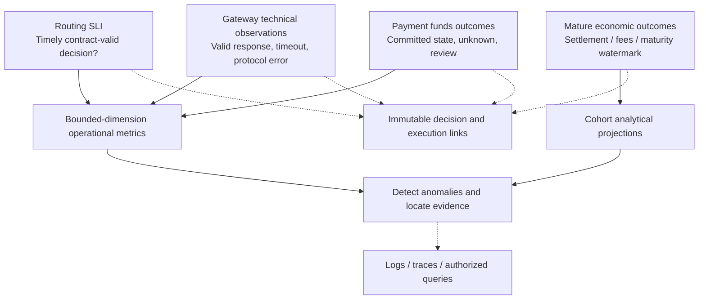
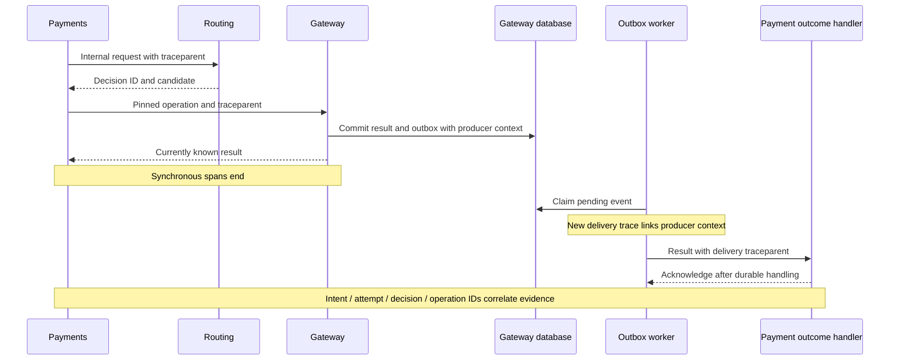
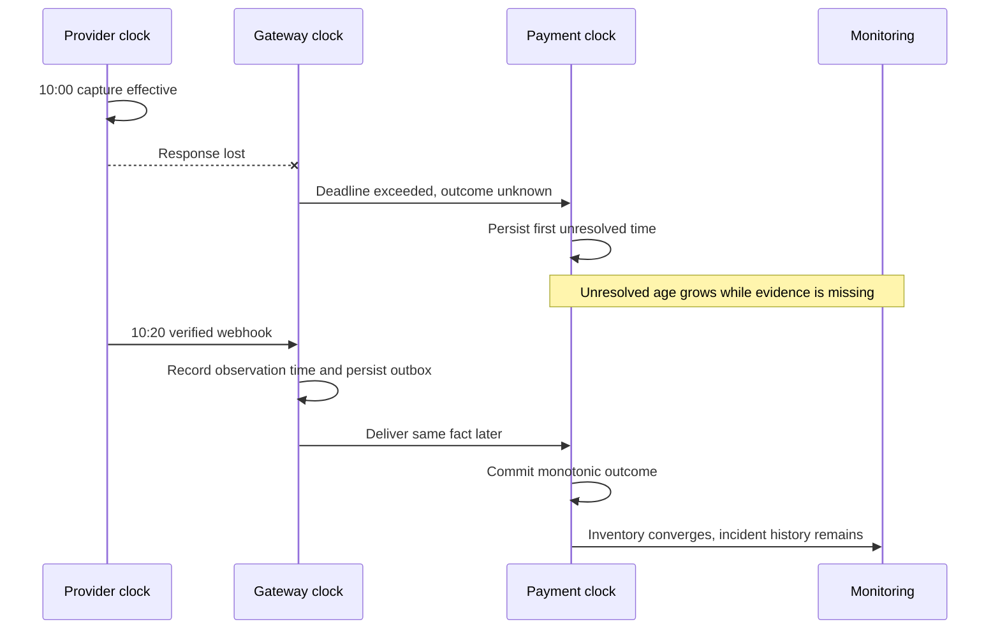
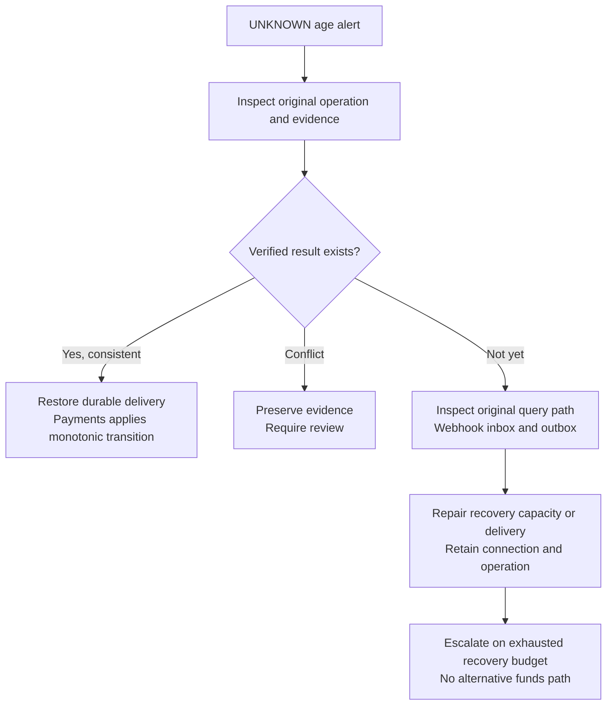

# Chapter 15: Routing Observability

[中文](../../part-4-operating-at-scale/observability.md) | **English**

On Friday evening, Aurora's dashboard still reports “94% success,” while support receives dozens of complaints that customers were charged but orders remain pending. Routing latency is unchanged, but a European connection's `SALE` calls repeatedly time out. The gateway later receives successful webhooks, while its outbox to payments is twenty minutes behind. When settlement files arrive the next day, finance finds actual fees above online estimates.

These four events share a payment chain but not one success rate. Routing may decide correctly while the provider call fails technically, funds have already been captured, and the platform temporarily does not know. Costs await yet another fact. One curve lets each team see the explanation it prefers.

This chapter's central proposition is:

> **Observability must separately answer whether routing fulfilled its contract, what happened to technical provider calls, whether funds state converged, and whether economic outcomes matured. Authorization rate substitutes for none of them. Observability supplies evidence and alerts, not authority to modify funds facts.**

[Chapter 14](routing-decision-store.md) established decision evidence. We now connect operational observations without redesigning that store. [Chapter 16](experimentation.md) covers assignment and causality, [Chapter 17](reconciliation.md) external corrections, [Chapter 18](settlement.md) settlement and actual-cost attribution, and Chapter 22/Appendix C capacity validation.

## 15.1 The Problem: Why One Overall Success Rate Cannot Guide On-Call Work

The first system has `payment_requests_total` and `payment_success_total`. Successful confirmation responses increment the latter; errors produce logs. Easy to ship, but asking what these counters count immediately exposes disagreement.

Repeated merchant confirmation is a new request, not a new intent. Network retry is another HTTP call, perhaps the same provider operation. An issuer decline means business nonapproval, while the provider answered correctly. HTTP `202` may mean waiting for evidence, neither funds failure nor settlement success. Response codes cannot unify these facts without inflated failures and false successes.

The greatest danger is wrong actions driven by wrong charts. Counting issuer declines as service faults prompts restarts of healthy gateways or PSP switching. Hiding UNKNOWN removes the evidence-loss population and may make the worst connection appear better. Stripe separates issuer declines, blocked payments, and invalid API calls, reinforcing that incomplete payment is not one technical error class. [Stripe: Declines](https://docs.stripe.com/declines)

Each metric must answer six questions: What is counted? When? What are numerator and denominator? Which outcomes remain unresolved? Which dimensions are permitted? Who acts on it? A smooth chart without these answers cannot guide production control.

## 15.2 The Simple Design: Split One Boolean into Four Kinds of Facts

This Go function represents first-version instrumentation. It compiles and has no data race, yet cannot express payment semantics:

```go
package naive

func MetricResult(err error) string {
	if err != nil {
		return "failure"
	}
	return "success"
}
```

One adapter may return business decline as `error`; another returns structured `declined` and `nil`. Identical business outcomes land in different metrics. Standardizing Go return values is insufficient; authoritative components must supply facts they understand.



These are four independent statistical contracts, not interchangeable displays:

| Layer | Unit and denominator | Success or anomaly means | Owner |
| --- | --- | --- | --- |
| Routing SLI | Valid requests at the agreed boundary, one count per service call | Valid decision within budget; separate internal errors/timeouts | Routing/SRE |
| Provider technical result | Actually dispatched network calls, separated by API operation | Protocol-valid response, timeout, transport/protocol/unavailability | Gateway/integrations |
| Payment funds outcome | Unique intents, attempts, logical operations with separate denominators | Authorized, captured, declined, UNKNOWN, review, other domain facts | Payments |
| Mature economic result | Payment cohort with creation range, maturity rules, report version | Settled amount, actual fees, refund/chargeback effects | Finance/data |

The book's basic routing availability contract is returning a valid result: both `selected` and fully explained `no_candidate` qualify. Current `422 no_eligible_provider` is not automatically an internal routing error. But separately report `route_usable` and no-candidate reasons, or correctly rejecting every payment appears green. If business SLO requires an executable route, define a separate fulfillment metric rather than retrospectively changing the basic SLI denominator.

Server instrumentation cannot see connection failures before handler entry. Corroborate with the payment caller or ingress to include prearrival timeouts within the agreed boundary; completed handlers alone cannot prove end-to-end availability. Separate invalid authentication and malformed input so malicious traffic cannot redefine the valid-business denominator.

The technical provider layer likewise answers protocol questions only. An issuer decline may count as `response`, never authorization approval. Predispatch risk blocks and bulkhead rejections are not provider failures. A `SALE` timeout simultaneously creates a technical timeout and operation UNKNOWN. These facts feed, respectively, [Chapter 13](../part-3-reliability/provider-health.md) future-health decisions and original-operation recovery.

## 15.3 Problems at Scale: Denominators, Dimensions, and Time Change

### 15.3.1 Fix the Denominator Before Interpreting Change

Suppose an authorization cohort starts 1,000 unique trials: 840 approved, 100 definitively declined, 60 UNKNOWN. Approval among known outcomes is `840 / 940`, about 89.36%. Observed approvals among all started trials is `840 / 1000`, or 84%. The former must display 94% outcome coverage; the latter must show 6% unresolved. Neither is unconditionally a final authorization rate.

The trial unit follows Chapter 8, not HTTP calls. Queries do not increase authorization denominators; same-key network retries do not create logical trials. Legitimate fallback creates another attempt, but intent conversion still counts one objective. Authorization, capture, and settlement remain distinct: approved authorization cannot count as settled payment.

Aggregate change may reflect traffic mix rather than route degradation. Let A approve 98% of easy customers and 80% of difficult customers; B approves 97% and 79%. A is higher in both groups, yet with 90% difficult traffic its overall rate is 81.8%; B with 90% easy traffic reaches 95.2%. Aggregates reverse the comparison. This demonstrates mix effects, not A's causal advantage; experiments belong to the next chapter.

Dashboards therefore show mix, sample size, unresolved proportion, and segment trends together. Merchant/issuer investigations may use controlled analytical queries, without making every segment a permanent Prometheus label.

### 15.3.2 Each Dimension Requests Long-Term Resources

Engineers naturally add merchant, intent, token, full URL, and error text to diagnose changes. Once every payment creates a new time series, monitoring itself starts losing data. Hashing IDs does not lower cardinality or automatically anonymize them.

Prometheus documents that each distinct label set creates a resource-consuming series and recommends starting with small useful dimension sets. [Prometheus: Instrumentation practices](https://prometheus.io/docs/practices/instrumentation/) Aurora therefore defines a bounded-dimension registry as the metrics API's input contract, not a post hoc label scrubber.

| Data | Operational metric rule | Detailed investigation |
| --- | --- | --- |
| Service, deployment region, environment | Controlled deployment resource labels, not request-derived | Release records |
| Candidate, API operation, failure domain | Only approved registry combinations with total caps | Connection snapshot |
| Outcome class, exclusion reason, state | Closed enum; unknown uses fixed anomaly category | Minimal structured logs |
| Policy/capability/connection revision | No new release-generated labels by default; bounded controlled slots if necessary | Decisions, traces, release metadata |
| Intent/attempt/decision/operation IDs | Never metric labels | Controlled log/trace correlation |
| Merchant, user, full issuer/BIN, raw URL | No unbounded metrics; limited analytical groups need separate approval | Access-controlled analytics |
| Token, PAN, CVV/SAD, API keys, raw body | Forbidden in telemetry pipeline | Do not copy payment credentials for debugging |

Candidate IDs are not inherently low-cardinality. A per-merchant connection platform cannot register every connection directly; use fixed operational groups and retain exact identity in evidence. Internal health still isolates `candidate + revision + operation + fault_domain`; metric aggregation must not merge circuit state. At release, calculate active instances × permitted combinations × outcomes × histogram buckets and bound churn throughout retention, not merely one process's current map size.

### 15.3.3 Late Receipts Change Knowledge, Not Historical Waiting

If capture occurs at 10:00 and verified evidence arrives at 10:20, effective event time and platform observation differ by twenty minutes. Keeping only `updated_at=10:20` misplaces business cohorts; keeping only `occurred_at=10:00` hides the wait.

Report corrections also arrive late. Yesterday's cost may be expected, today's partially collected, with settlement/correction lines later. A single “real-time cost” field cannot overwrite these phases, and immature cheap routes cannot immediately be judged better. Later chapters calculate/reconcile costs; here expose fact coverage, processing lag, and maturity watermark.

Maturity does not mean immutable forever. A seven-day observation report specifies cohort, observation period, `as_of`, and version. Later refunds, chargebacks, and fee corrections append analytical facts. Actual cost per successful payment uses the same mature set, defines failed-attempt fees, and keeps currencies consistent. Today's arriving fees divided by today's newly approved authorizations has no stable economic meaning.

## 15.4 Production Design: Testable Observation Contracts

### 15.4.1 Types and Registries Constrain Metric Inputs

Produce metrics from normalized domain observations, not guessed log scans. This teaching implementation counts gateway technical calls only: finite combinations register at startup, all outcome series are precreated, and unregistered dimensions are rejected at runtime. It reads no payment identity, calculates no authorization rate, and modifies no operation. Production connects the boundary to an official metrics client with a restricted internal `/metrics` endpoint; this small exporter is not a full monitoring SDK.

```go
package telemetry

import (
	"errors"
	"fmt"
	"net/http"
	"regexp"
	"sync"
)

type TechnicalOutcome string

const (
	Response     TechnicalOutcome = "response"
	Timeout      TechnicalOutcome = "timeout"
	Transport    TechnicalOutcome = "transport_error"
	Protocol     TechnicalOutcome = "protocol_error"
	Unavailable  TechnicalOutcome = "provider_unavailable"
	Unclassified TechnicalOutcome = "unclassified"
)

var outcomes = [...]TechnicalOutcome{
	Response, Timeout, Transport, Protocol, Unavailable, Unclassified,
}

type ProviderDimensions struct {
	Candidate   string
	Operation   string
	FaultDomain string
}

type Metrics struct {
	mu       sync.Mutex
	keys     []ProviderDimensions
	counts   map[ProviderDimensions]map[TechnicalOutcome]uint64
	rejected uint64
}

func NewMetrics(keys []ProviderDimensions) (*Metrics, error) {
	if len(keys) == 0 || len(keys) > 64 { // Teaching budget, not a universal capacity limit.
		return nil, errors.New("invalid registry size")
	}
	slug := regexp.MustCompile(`^[a-z][a-z0-9_]{0,47}$`)
	m := &Metrics{counts: make(map[ProviderDimensions]map[TechnicalOutcome]uint64)}
	for _, key := range keys {
		if !slug.MatchString(key.Candidate) || !slug.MatchString(key.FaultDomain) ||
			(key.Operation != "sale" && key.Operation != "query") {
			return nil, errors.New("invalid registered dimension")
		}
		if _, exists := m.counts[key]; exists {
			return nil, errors.New("duplicate registered dimension")
		}
		m.keys = append(m.keys, key)
		m.counts[key] = make(map[TechnicalOutcome]uint64, len(outcomes))
		for _, outcome := range outcomes {
			m.counts[key][outcome] = 0
		}
	}
	return m, nil
}

func (m *Metrics) Observe(key ProviderDimensions, outcome TechnicalOutcome) bool {
	m.mu.Lock()
	defer m.mu.Unlock()
	values, registered := m.counts[key]
	if _, known := values[outcome]; !registered || !known {
		m.rejected++ // Increment only a fixed counter; do not record rejected raw values.
		return false
	}
	values[outcome]++
	return true
}

func (m *Metrics) ServeHTTP(w http.ResponseWriter, r *http.Request) {
	if r.Method != http.MethodGet {
		w.Header().Set("Allow", http.MethodGet)
		w.WriteHeader(http.StatusMethodNotAllowed)
		return
	}
	type sample struct {
		key     ProviderDimensions
		outcome TechnicalOutcome
		value   uint64
	}
	m.mu.Lock()
	samples := make([]sample, 0, len(m.keys)*len(outcomes))
	for _, key := range m.keys {
		for _, outcome := range outcomes {
			samples = append(samples, sample{key, outcome, m.counts[key][outcome]})
		}
	}
	rejected := m.rejected
	m.mu.Unlock() // Release the lock before network writes for the scrape response.
	w.Header().Set("Content-Type", "text/plain; version=0.0.4")
	fmt.Fprintln(w, "# HELP payment_provider_api_calls_total Observed provider API calls.")
	fmt.Fprintln(w, "# TYPE payment_provider_api_calls_total counter")
	for _, s := range samples {
		fmt.Fprintf(w, "payment_provider_api_calls_total{candidate=%q,api_operation=%q,fault_domain=%q,outcome=%q} %d\n",
			s.key.Candidate, s.key.Operation, s.key.FaultDomain, s.outcome, s.value)
	}
	fmt.Fprintln(w, "# TYPE payment_telemetry_rejected_observations_total counter")
	fmt.Fprintf(w, "payment_telemetry_rejected_observations_total %d\n", rejected)
}
```

`Response` means identity-validated, parseable, provider-contract-valid output, including explicit issuer decline. An ambiguous 5xx cannot become definitive no-side-effect evidence from status alone. `Unclassified` is neither approval nor healthy success and needs classification-coverage alerts. Predispatch local rejections do not call this counter. `Observe=false` indicates registry violation; it cannot cause an already executed payment to run again.

Extend this into a small set of contracts, not a universal arbitrary-label-map function:

| Metric example | Type and counting point | Bounded dimensions | Visibility lag |
| --- | --- | --- | --- |
| `router_decisions_total` | Counter, each completed valid decision | Selected/no_candidate/internal_error/deadline outcome | Online |
| `router_decision_duration_seconds` | Histogram, routing entry to completion, excluding provider | Operation, fixed outcome | Online |
| `router_candidate_exclusions_total` | Counter, deduplicated reasons per candidate/evaluation | Approved candidate group, reason | Online |
| `router_stale_features_total` | Counter, stale evidence consumed; not hidden under generic no-candidate | Fixed feature type, disposition | Online |
| `payment_provider_api_calls_total` | Counter, each completed actual network call | Registered combination, technical outcome | Online |
| `payment_unknown_operations` / `payment_unknown_oldest_age_seconds` | Gauges, unresolved inventory and oldest age | Fixed operation, deployment region | Bounded refresh |
| `payment_outbox_pending` / `payment_outbox_oldest_age_seconds` | Gauges, committed facts awaiting delivery | Fixed producer, destination, event type | Bounded refresh |
| `economic_cohort_coverage` | Analytical projection field, not online approval metric | Controlled cohort, currency, report version | Source/maturity dependent |

Technical counters may count each network call. Observations delivered through an outbox to an aggregator must first deduplicate stable IDs. Payment state counts update only after committed domain transitions; duplicate-webhook no-ops create no new conversion. A process can crash after commit but before increment, so memory counters are not exact funds accounts. Complete business totals come from durable fact projections with idempotent ingestion, not reconciliation against `increase(counter)`.

### 15.4.2 Traces Connect Work; IDs Correlate Evidence

Metrics identify anomalies; traces show work across services; structured logs retain controlled events; Chapter 14 decisions preserve immutable routing reasons. This division removes the need for per-payment metric labels.

Internal synchronous payments→routing and payments→gateway calls propagate `traceparent`. Each service creates its own span rather than reusing an upstream span ID as local work. W3C Trace Context defines propagation fields and restricts them to correlation, excluding personal/sensitive information. [W3C: Trace Context](https://www.w3.org/TR/trace-context/) Public ingress context is untrusted: bound lengths, validate format, and recreate traces according to trust boundaries. It never substitutes for service authentication, merchant identity, or idempotency keys.

Async delivery may occur long after HTTP completion. Here each outbox delivery starts a short new trace linked to its producer context. Redelivery creates a new delivery span for the same fact. Batch consumers may link multiple sources with bounded link counts; do not hold an HTTP span open for hours of UNKNOWN. OpenTelemetry Links express causal relationships across spans/traces; attach known links when creating spans. [OpenTelemetry: Trace API](https://opentelemetry.io/docs/specs/otel/trace/api/)



The same teaching package's tracing boundary follows. `CaptureProducer` retains only `traceparent` for linking, not arbitrary Baggage/headers. `StartDelivery` uses the worker's cancellation/budget context rather than inheriting the old payment deadline. The example uses OpenTelemetry Go API; real HTTP middleware still names spans by fixed route templates and records bounded outcomes on completion. [OpenTelemetry Go: Trace](https://pkg.go.dev/go.opentelemetry.io/otel/trace) [OpenTelemetry Go: Propagation](https://pkg.go.dev/go.opentelemetry.io/otel/propagation)

```go
package telemetry

import (
	"context"
	"log/slog"
	"net/http"

	"go.opentelemetry.io/otel/propagation"
	"go.opentelemetry.io/otel/trace"
)

type Correlation struct {
	PaymentIntentID string
	AttemptID       string
	DecisionID      string
	OperationID     string
}

func InjectInternal(ctx context.Context, headers http.Header) {
	propagation.TraceContext{}.Inject(ctx, propagation.HeaderCarrier(headers))
}

func CaptureProducer(ctx context.Context) string {
	carrier := propagation.MapCarrier{}
	propagation.TraceContext{}.Inject(ctx, carrier)
	return carrier.Get("traceparent")
}

func StartDelivery(ctx context.Context, tracer trace.Tracer, parent string) (context.Context, trace.Span) {
	extracted := propagation.TraceContext{}.Extract(context.Background(),
		propagation.MapCarrier{"traceparent": parent})
	source := trace.SpanContextFromContext(extracted)
	options := []trace.SpanStartOption{
		trace.WithNewRoot(), trace.WithSpanKind(trace.SpanKindConsumer),
	}
	if source.IsValid() {
		options = append(options, trace.WithLinks(trace.Link{SpanContext: source}))
	}
	return tracer.Start(ctx, "outbox.deliver", options...)
}

func LogCorrelation(ctx context.Context, logger *slog.Logger, ids Correlation) {
	attrs := []slog.Attr{
		slog.String("payment_intent_id", ids.PaymentIntentID),
		slog.String("attempt_id", ids.AttemptID),
		slog.String("decision_id", ids.DecisionID),
		slog.String("operation_id", ids.OperationID),
	}
	if sc := trace.SpanContextFromContext(ctx); sc.IsValid() {
		attrs = append(attrs, slog.String("trace_id", sc.TraceID().String()),
			slog.String("span_id", sc.SpanID().String()))
	}
	logger.LogAttrs(ctx, slog.LevelInfo, "payment.work_observed", attrs...)
}
```

`Correlation` values come from validated internal domain objects, never copied external headers. Request correlation, intent, operation, and trace IDs have different responsibilities. Repeated network calls on one operation may use different spans; restarted recovery may use a new trace. Log permissions, retention, and query auditing remain necessary: a noncredential ID is not automatically public data.

Head sampling can miss conflicts discovered later; tail sampling cannot assume it waits for the entire payment to mature. Critical states and decisions therefore depend on durable facts, not guaranteed trace retention. Exemplars contain controlled trace references, not added metric labels. Production must also prevent HTTP automatic instrumentation from collecting raw bodies, authorization data, full query parameters, or provider keys.

### 15.4.3 Two Timelines and an Age That Cannot Reset

Separate source effective time and first platform observation; async handling adds local commit time. OpenTelemetry logs distinguish `Timestamp` and `ObservedTimestamp`, but payment `effective_at` still follows provider contracts/domain facts, not arbitrary external log timestamps. [OpenTelemetry: Logs data model](https://opentelemetry.io/docs/specs/otel/logs/data-model/)



| Time / watermark | Definition | Forbidden shortcut |
| --- | --- | --- |
| `effective_at` / source `occurred_at` | Source-claimed business time with provenance/trust state | Substitute receive time when missing; arbitrate conflicts by timestamp |
| `observed_at` | Platform's first observation of this fact | Reset to now on every duplicate |
| `processed_at` | Consumer's successful fact/domain-transition commit | Mark complete on receipt |
| `first_unresolved_at` | Durable local start of this unresolved interval | Reset when query/lease/retry updates `updated_at` |
| Cohort maturity watermark | Time ranges/sources/outcomes meeting declared coverage | Treat elapsed time as proof all fees arrived |

UNKNOWN age is inventory: in one database snapshot calculate count, oldest start, and fixed age buckets. Only actual evidence-driven convergence removes an item. For crashed `sending/possible`, separately expose earliest possible dispatch and stuck-sending metrics so missing the UNKNOWN write does not make it invisible. Mutable operation `updated_at` is not an age origin.

Manual review does not resolve the issue. Even outside automatic recovery queues, it belongs in separate open-review inventory/age with the original unresolved origin. On-call work should shorten uncertainty and resolve conflicts, not rename states to zero a red curve.

Outboxes need depth and oldest age. Ten items may include one blocked for three hours; ten thousand with fast consumption and low age may be a transient burst. Redelivery never resets `created_at`. Quarantined poison messages remain quarantine inventory rather than cosmetically disappearing. Use one collector per database shard or explicitly deduplicated collection topology; do not sum ten replicas reporting the same full-database gauge.

Cross-machine differences include clock skew. Flag suspicious negative latency as time-quality error; missing source time is explicitly unknown. Use process-monotonic clocks for durations, but never last-arrival-wins for funds evidence. After recovery, today's processing counts can rise and old cohorts gain correction versions; historical timeouts/waits remain in incident records.

### 15.4.4 Latency Needs Boundaries, Quantiles, and Windows

“Payment p99” changing from 20ms to 800ms may mean slow routing or a changed metric that now includes provider time. Measure routing decision, confirmation endpoint, single gateway network call, and asynchronous completion separately. Separate query/SALE; do not casually mix success, timeout, and local rejection distributions.

Use seconds and histogram precision matched to service budgets; examples are not PSP promises. Timeouts record actual waiting duration to deadline and a timeout outcome. Successful-response-only measurements systematically omit the slow tail. They measure caller waiting, not the true time of remote funds completion.

Completion-only histograms also miss indefinitely hanging work. Monitor in-flight work, queue wait, active leases, and oldest incomplete work. Restart cannot establish recovery merely because memory-held slow requests vanished. Observe the collectors too: scrape success, last successful collection, and exporter drops.

Do not average instance p99s. Aggregate compatible histogram distributions first, then compute the target-window quantile. Classic bucket boundaries must match; native histogram client/backend support also needs verification. Prometheus explains histogram/summary quantile and aggregation differences. [Prometheus: Histograms and summaries](https://prometheus.io/docs/practices/histograms/) Every graph shows sample count and window; no requests means no samples, not 100% healthy. Distinguish preinitialized zero series, scrape failure, and stale data.

## 15.5 Failure Modes: From Alerts to Actionable Runbooks

### 15.5.1 Alerts Express Loss, Not Payment Decisions

Correct metrics do not justify paging on every fluctuation. Define valid-request scope, latency threshold, window, and error budget, then combine short/long windows for rapid degradation and sustained consumption. Google SRE's multiwindow, multiburn-rate approach is useful guidance; Aurora's traffic and response goals determine thresholds, not a presumed payment-industry standard. [Google SRE: Alerting on SLOs](https://sre.google/workbook/alerting-on-slos/)

Low-traffic 100% error rates after one timeout need minimum-sample/absolute-count context, while funds-integrity conflicts must not wait for sample accumulation. Assign separate owners to service-budget, unresolved-funds, and maturity-lag alerts.

| Alert | Check first | Controlled action | Explicitly forbidden |
| --- | --- | --- | --- |
| Rapid routing error/latency-budget burn | Ingress/caller evidence, release, CPU/connections/cache | Roll back faulty build/approved artifact, protect new traffic | Relabel issuer decline as service error |
| No-candidate or stale-feature surge | Reasons, capability/health freshness, affected scope | Repair source or roll back config, retain safe hard constraints | Bypass eligibility to restore conversion |
| Provider timeout surge | Exact connection, operation, failure domain, samples | Gateway investigation; Chapter 13 limits future traffic | Move current UNKNOWN to another PSP |
| Oldest UNKNOWN exceeds budget | Original operation, queries, webhook inbox/outbox, recovery jobs | Restore original-connection query/delivery; review conflicts | Bulk SQL failure updates or new keys |
| Outbox age/depth or quarantine rise | Source commit, destination auth/availability, poison messages | Idempotent redelivery, contract-based quarantine with evidence | Delete unprocessed facts or overwrite conflicts |
| Economic coverage lag | Source files, checkpoints, currency, maturity | Notify finance/data, mark report incomplete | Present estimated fees as actual cost |

Runbooks include metric definition, query window, owner, impact query, read-only diagnostics, authorized actions, stop conditions, and escalation. “Try restarting” is not a runbook. Enforce permissions: monitoring/dashboard accounts cannot write payment state or call the gateway to create funds operations.

Investigations retain original operations and exact connections. A healthier PSP cannot receive another provider's capture, void, or refund; those retain original transaction references. Replaying a fact, retrying the same call, and creating a new funds operation are distinct permissions.



### 15.5.2 Make Instrumentation Errors Reproducible

A scrapeable endpoint does not prove semantic correctness. These tests show that 10,000 unknown candidates cannot expand the registry, and `response` stays separate from timeout. Approval and issuer decline are both protocol-valid responses here; separate domain facts express their business outcomes.

```go
package telemetry

import (
	"fmt"
	"net/http/httptest"
	"strings"
	"testing"
)

func TestBoundedProviderMetrics(t *testing.T) {
	key := ProviderDimensions{"cand_eu_a", "sale", "provider_api_eu"}
	m, err := NewMetrics([]ProviderDimensions{key})
	if err != nil {
		t.Fatal(err)
	}
	for _, observation := range []TechnicalOutcome{Response, Response, Timeout} {
		if !m.Observe(key, observation) {
			t.Fatal("valid observation rejected")
		}
	}
	for i := 0; i < 10000; i++ {
		bad := key
		bad.Candidate = fmt.Sprintf("merchant_private_%d", i)
		if m.Observe(bad, Response) {
			t.Fatal("unknown dimension accepted")
		}
	}
	for _, secret := range []string{"pi_private", "attempt_private", "tok_private"} {
		bad := key
		bad.Candidate = secret
		m.Observe(bad, Response)
	}
	response := httptest.NewRecorder()
	m.ServeHTTP(response, httptest.NewRequest("GET", "/metrics", nil))
	body := response.Body.String()
	for _, forbidden := range []string{"merchant_private", "pi_private", "attempt_private", "tok_private"} {
		if strings.Contains(body, forbidden) {
			t.Fatalf("metrics leaked %q", forbidden)
		}
	}
	if strings.Count(body, "\npayment_provider_api_calls_total{") != len(outcomes) {
		t.Fatal("metric cardinality changed")
	}
	if !strings.Contains(body, `outcome="response"} 2`) ||
		!strings.Contains(body, `outcome="timeout"} 1`) {
		t.Fatal("technical outcomes were mixed")
	}
}
```

The full increment also needs service scenarios: success, decline, and timeout all permit normal routing decisions; only timeout increments provider timeout and temporarily creates UNKNOWN. A later success converges funds without deleting timeout history. Duplicate confirmation adds no intent conversion; duplicate webhooks add no transition; repeated outbox delivery does not triple one fact.

Fake clocks prove query retries do not reset UNKNOWN age. Paused consumers prove oldest outbox age grows; restart proves inventory gauges rebuild from durable state. Trace tests verify synchronous propagation, async consumers as new roots with producer Links, and invalid `traceparent` having no effect on payment authentication. Finally scan scrapes, logs, and exported spans for absence of sensitive fields, not merely label names.

## 15.6 Tradeoffs and Current Implementation Boundaries

Observability fails too. Online payments should not synchronously await unavailable remote collectors. Use bounded queues, export timeouts, and explicit drop counts. With no exporter endpoint, initialize no-op telemetry while retaining local logs/scrapes. This degradation applies only to operational telemetry, never Chapter 14 local execution evidence: failure to persist required attempt, operation, and outbox still prohibits funds execution.

Sampling reduces log/trace cost but weakens single-case visibility. Unsampled counters suit trends but are not transaction-exact. Durable projections supply complete business semantics with lag. Define each data type's purpose rather than demand one dataset serve alerts, audit, and accounting.

The companion Go system (`YouEclipse/payments`) currently has the following baseline. Chapter examples are standalone teaching increments, not evidence of full repository telemetry:

| Location | Implemented | Remaining companion capability |
| --- | --- | --- |
| Routing `internal/httpapi/handler.go` | `/metrics` emits `payment_router_up 1`; distinguishes valid decisions, no eligible candidates, internal errors | Bounded decision counts, latency, exclusions, stale features |
| Payments `internal/httpapi/handler.go` | `/metrics` emits `payment_service_up 1`; error logs and independent readiness | Unified request correlation, state observations, UNKNOWN inventory and age histogram |
| Gateway `internal/gateway/http.go` | `/metrics` emits `provider_gateway_up 1` | Typed per-API technical observations and histograms |
| Three service entry points | `slog` JSON handlers; some errors include operation/event IDs | Unified log allowlist, trace context, sampling/export policy |
| Gateway `RunOutbox`, payment recovery worker | Durable delivery and original-operation recovery; persisted deadline, remaining budget, claim generations/leases, actions | Outbox depth/age, processing watermarks, recovery outcomes, time quality |
| Payment/gateway operation stores | Immutable `created_at`, write-once `first_dispatched_at`; the recovery deadline cannot be extended and consumed budget cannot be replenished | Explicit per-unresolved-interval `first_unresolved_at` and inventory projection |
| Gateway observation ledger | Appends normalized sale/query/webhook observations; raw observations disallow UPDATE/DELETE/TRUNCATE | Stable bounded-result metrics projection, retention/export watermarks |
| Dependencies/contracts | Process-liveness metric endpoints | No shared `internal/telemetry`, OpenTelemetry exporter, or full business SLI |

Three `up=1` values show only that handlers answered a scrape, not provider health, payment convergence, or settlement. Outbox tables have creation timestamps but no inventory collector. Unlike the older baseline, recovery now has durable anchors unaffected by queries, leases, and backoff: immutable `created_at`, write-once `first_dispatched_at`, and nonresettable deadline/budget. These support conservative age since creation/first possible dispatch. Precisely separating repeated unresolved intervals still needs explicit `first_unresolved_at`. Mutable `updated_at` cannot represent age. Existing structured logs and append-only observations do not establish connected cross-service tracing.

A reasonable vertical increment defines shared `internal/telemetry` contracts initialized independently per service, connects synchronous payment/routing/gateway propagation, existing gateway technical observations, and payment inventory collection, then adds scrape/failure tests. Data owners add durable-field migrations; shared packages must not query business tables across databases. Scope remains current automatic-capture SALE and query, with no claim of manual capture, refunds, a complete telemetry platform, or real production PSP integration.

## 15.7 Summary

From an overall success rate unable to guide incidents, we derived four observation contracts, a bounded-dimension registry, cross-service correlation, and dual timelines. Routing fulfillment, provider technical outcomes, funds outcomes, and mature economics each have distinct units, windows, and owners.

Reliable observability does more than add data: it keeps issuer declines out of service-error rates, exposes UNKNOWN, prevents retries resetting age, and excludes high-cardinality/sensitive data from telemetry. Metrics locate anomalies; traces/logs connect work; decisions/domain facts carry audit. Alerts reach authorized owners and never grant a new funds path. The next chapter builds experiments on these explainable definitions rather than treating an upward curve as proof that a new routing policy works.
