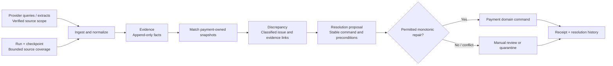
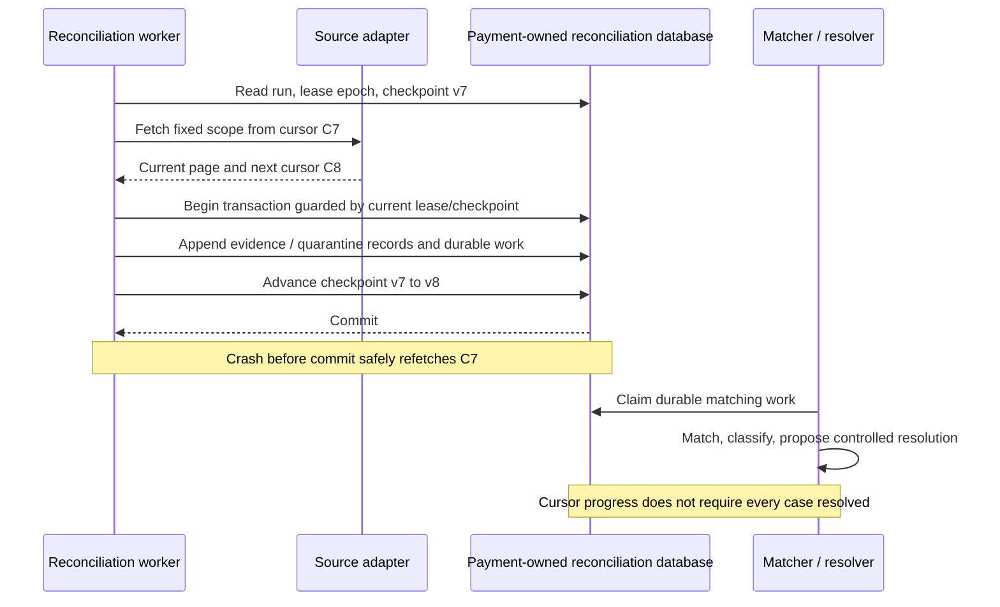
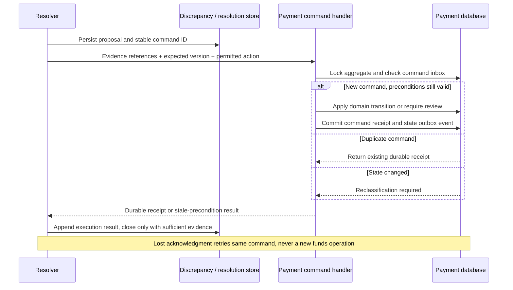

# Chapter 17: Reconciliation

[中文](../../part-4-operating-at-scale/reconciliation.md) | **English**

Aurora's online payment path already handles lost responses. A 129.00 USD SALE times out and remains UNKNOWN; recovery queries the original operation and converges after capture is confirmed. Yet month-end checks reveal three anomalies: a transaction marked failed internally has a provider capture record; operations staff refunded a successful payment in the provider console; and another provider reference has no corresponding internal attempt.

Online recovery did nothing wrong. It was never responsible for discovering every external discrepancy. It knows which internal operations remain unfinished, but not which provider operations the platform never recorded. It recovers pending work without necessarily rechecking records already considered terminal internally.

The central proposition of this chapter is:

> **Reconciliation persistently ingests, matches, classifies, and repairs discrepancies among multiple sources of facts under explicit controls. Runs, checkpoints, evidence, discrepancies, and resolutions must be traceable and replayable. Discovering a contradiction does not authorize reconciliation to bypass the payment domain model and rewrite terminal funds states.**

This chapter builds on [Chapter 15](observability.md)'s observability and [Chapter 16](experimentation.md)'s outcome definitions. It does not redefine [Chapter 10](../part-3-reliability/timeout-and-retry.md)'s same-operation recovery or own ledger adjustments. Settlement rows (`SettlementLine`), fees, FX, and actual cost belong to [Chapter 18](settlement.md); cross-region reconciliation ownership belongs to [Chapter 19](../part-5-global-routing/multi-region.md).

## 17.1 The Problem: Why Waiting for Webhooks Still Leaves Blind Spots

Initially, Aurora trusts successful responses and webhooks to update state. If the API is available, a late webhook seems harmless. This overlooks receiver outages, duplicate events, exhausted delivery retries, processing bugs, and operations initiated directly in the provider console.

Stripe explicitly states that webhook delivery order is not guaranteed and recipients must handle duplicate events. These constraints invalidate the assumption that every payment will eventually receive exactly one correct notification in order. [Stripe: Webhooks](https://docs.stripe.com/webhooks) Adyen's management documentation also shows refunds, cancellations, and captures initiated from its Customer Area. External facts therefore do not always originate in platform API requests. [Adyen: Manage Payments](https://docs.adyen.com/account/manage-payments)

After discovering discrepancies, the tempting patch is to bulk-update status by age: declare anything still processing after a day failed, or directly UPDATE records to success from an operations-provided list. The first confuses “no answer” with “no side effect”; the second bypasses account, amount, reference, and existing terminal-state checks. Either can turn troubleshooting into a new funds error.

The system needs more than bolder repair scripts. It must answer who supplied which evidence within what scope, which internal operation it matches, where it differs, who approved which action, and whether that action actually took effect.

## 17.2 A Simple Design: Add Queries, Then Recognize Their Limits

The first step can add background queries for timed-out payments, but must not turn “timed out too long” into a state-transition function:

```go
package naive

import "time"

// WrongForFunds deliberately shows an unsafe approach: elapsed time is not payment evidence.
func WrongForFunds(updatedAt, now time.Time) string {
	if now.Sub(updatedAt) > 24*time.Hour {
		return "failed"
	}
	return "processing"
}
```

Correct online recovery reads the persisted operation and queries or recovers through its original connection, revision, provider idempotency key, and semantic payload. It remains UNKNOWN until definite evidence arrives and never switches PSP merely because it has waited too long. This capability is necessary, but it still starts from internal pending work.

| Dimension | Online UNKNOWN recovery | Periodic reconciliation |
| --- | --- | --- |
| Starting point | Known, unfinished internal operations | Internal records and independent provider inventory within a fixed scope |
| Main question | Can this operation safely converge now? | What is missing, duplicated, contradictory, or manually changed on either side? |
| Coverage | Recoverable `created`, `sending`, processing, unknown work | Necessary terminal records and external orphans under the contract |
| Progress state | Per-operation recovery time, budget, lease | Runs, partition checkpoints, source coverage watermarks |
| Funds authority | Original-operation actions under existing recovery contract | Submit evidence and controlled domain commands only; no new funds path |
| Completion standard | Known work converges or enters review | Separately demonstrable ingestion, classification, and disposition progress |

Scanning internal UNKNOWN records more frequently will never find “present at provider, absent internally.” Importing only successful provider transactions will not reveal “internally successful, absent from provider inventory.” Periodic reconciliation therefore needs both directions: check external evidence for known internal objects, and match provider inventory to internal records. Align scope, time, and completeness before comparing; sets with different definitions cannot simply be subtracted.

## 17.3 Scaling Problems: Make Evidence Reliable Before Comparing It

### 17.3.1 Sources Have No Universal Priority Ranking

“Settlement files outrank queries, which outrank webhooks” sounds precise but conflates different facts. Authorization events establish approval or reserved funds; capture results establish another stage; settlement files describe funds or accounting entries for a reporting period. These are not three copies of one field.

| Source | Evidence it can provide | What it cannot directly establish |
| --- | --- | --- |
| Synchronous response | Provider-specific outcome for that request | A lost response means no execution |
| Signature-verified webhook | Normalized observation of a specified event or object | Later arrival may overwrite all older facts |
| Exact-object query | Current object/operation state under that API contract | Caches, search indexes, and exact queries have equal consistency |
| Provider transaction extract | Records for an account, period, and operation category | One file is the account's complete lifetime inventory |
| Settlement/fee file | Settlement and economic facts defined in Chapter 18 | Authorization, capture, and settlement are interchangeable |

Every evidence item retains source type, source record identity, parser/API version, authenticated scope, effective time, first-observed time, and necessary integrity information. Explicitly mark missing source timestamps; local receipt time cannot impersonate them. If trusted sources conflict, preserve both rather than granting one source permanent overwrite authority.

“Not found” requires particular care. Stripe's PaymentIntent Search documentation warns against using it for strict read-after-write workflows because index propagation is delayed. [Stripe: Search PaymentIntents](https://docs.stripe.com/api/payment_intents/search) Empty searches, incomplete reports, and query timeouts therefore do not prove the original operation had no side effects. Even if an adapter's exact-query contract establishes definite absence, Chapter 10's contract determines whether same-operation recovery is allowed. Reconciliation workers do not create new attempts from that finding.

### 17.3.2 Matching Is an Identity Problem Before It Is an Amount Problem

Two 129.00 USD payments can occur in the same minute; merchants may reuse order notes. Two merchant accounts at the same PSP may also have identically formatted references. Amount, currency, and time are useful consistency checks, not sufficient primary keys for automatically claiming transactions.

First constrain provider account and stable namespace. Then use contract-validated operation linkage or transaction/operation references. Finally verify exact connection, revision, operation kind, amount, and currency. Automatic association requires one candidate and sufficient proof. Multiple candidates, unknown accounts, conflicting references, or identity drift create discrepancies; never choose “the closest timestamp.”

| Matching layer | Evidence used | Result rule |
| --- | --- | --- |
| Strong internal linkage | Original operation ID validated under provider contract, with complete execution identity | Accept only unique, consistent attributes |
| Strong provider linkage | Payment/operation reference and operation kind within stable namespace | Check all existing owners; never guess across namespaces |
| Controlled composite matching | Approved merchant reference, account, operation, amount/currency, time range | Usually yields investigation candidates; automation requires separate uniqueness proof |
| No match or multiple matches | External orphan, duplicate reference, insufficient information | Preserve evidence and create unmatched/ambiguous discrepancy |

Adyen's reports define PSP, merchant, and modification references separately and advise checking reporting periods and timezones when combining reports. Parent-payment references cannot be substituted mechanically for later capture/refund references, and the platform must guarantee merchant-reference uniqueness itself. [Adyen: Prepare Reports](https://docs.adyen.com/platforms/prepare-reports/)

The current code's `provider_namespace_id` is a collision domain, not a webhook-authorization domain. Recovery aliases in one namespace cannot evade reference uniqueness because their names differ, nor claim another connection's operations merely because they share a namespace. Source paths need explicit authorization; persisted evidence must return to the original operation's canonical identity. This applies Chapters 3 and 11's existing boundary to reconciliation.

### 17.3.3 Passing a Timestamp Does Not Prove Complete Earlier Coverage

An initial scanner often stores the last record's timestamp as its checkpoint. It misses data when several records share a second or the provider later inserts an earlier transaction. OFFSET pagination is also vulnerable to insertions, deletions, and reordered collections.

A run should freeze source, account scope, operation categories, interval, timezone, filters, and adapter version. Fix the upper bound and preserve pagination cursors according to the API's real semantics; do not reuse an imaginary universal `offset`. Stripe list APIs use object-ID cursors, whereas search uses a different pagination token. Source adapters should preserve this distinction. [Stripe: Pagination](https://docs.stripe.com/api/pagination)

Record snapshot tokens or complete file manifests when available. Without a consistent snapshot, use safety delays, overlapping lookback windows, and idempotent ingestion, and honestly describe eventually consistent coverage. Scanning only `created_at` misses changes to old objects, requiring an appropriate change stream, updated-time scan, known-object recheck, or periodic broad lookback. Overlap covers only its declared lateness range; it cannot claim to solve arbitrarily late corrections.

Scan completion and agreement of all outcomes are separate states. A run may finish ingestion while records remain unclassified, external absences await verification, or reviews remain open. Every “missing” classification must reference a coverage contract: account, operation kind, interval, and completeness watermark. Before data is complete, the state is only `awaiting_evidence`.

### 17.3.4 Duplicates and Corrections Need Different Identities

Webhook events, rows in report versions, and query observations each have source identities. A mutable provider object ID cannot serve as an immutable event ID: an object processing today and captured tomorrow represents two legitimate observations, not payload tampering. Every query creates a new observation identity; redelivery of the same observation reuses its ID.

For truly immutable source records, enforce uniqueness on source scope + record ID + record revision. Same key and digest means duplicate; same key and different digest means quarantine while retaining both contents. Official provider corrections append evidence linked to the corrected record, never overwrite old files or normalization results. Parser fixes likewise create new interpretation versions while keeping minimized original evidence traceable.

These records must not become another sensitive-data warehouse. Files and API responses may contain customer data, payment credentials, or secret fields. Apply an allowlist at ingestion; credentials never enter evidence, logs, traces, or events. Necessary original sources follow controlled data classification and authorized access, rather than arbitrary full response bodies in JSONB.

## 17.4 Production Design: Make Reconciliation a Durable Workflow

### 17.4.1 Five Objects, Each Answering One Question



| Object | Core fields | Persistence invariant |
| --- | --- | --- |
| Run | Run ID, source/scope, fixed window, schema/adapter version, snapshot reference, lease epoch, status | Restart preserves scope; a new scope creates a new run |
| Checkpoint | Run/partition, opaque cursor, checkpoint version, ingestion watermark | Advance only past durably accepted work; stale owners cannot overwrite progress |
| Evidence | Evidence ID, source identity/revision, digest, canonical connection, operation/reference, amount/currency, times | Append originals; idempotent duplicates; quarantine conflicts; independent interpretation versions |
| Discrepancy | Discrepancy ID, type, subject, evidence set, classifier version, disposition status | Reruns do not create masses of duplicate tickets; historical classifications retained |
| Resolution | Resolution/command ID, discrepancy ID, action, evidence references, expected domain version, approver, execution receipt | Proposal is not execution; receipt is not conjecture; every disposition audited |

Discrepancy identity normally centers on a stable problem, such as an operation's reference conflict. Subsequent runs append observation links instead of creating a ticket per `run_id`. New contradictions after resolution may explicitly reopen the case or create a linked case; they cannot overwrite the old resolution. These identities support recovery, not high-cardinality metric labels.

An initial deployment can be `services/payment/cmd/reconciler`: a separate process and resource budget, still within payment's data ownership. It obtains external observations through the gateway's read-only contract, without reading the gateway schema. If later separated into a service, it matches payment API/event snapshots and submits commands, without arbitrary cross-database UPDATE privileges.

### 17.4.2 Commit Checkpoints Atomically with Accepted Work

The critical crash window lies between fetching a page and saving progress. Saving the cursor before evidence permanently skips the page after a crash. Repairing payments row by row before recording work leaves no proof of which actions took effect.

The correct boundary is a short local transaction: save page evidence or quarantine items, create idempotent matching work for each processable record, advance the checkpoint, and record page completion. Fetch over the network outside the transaction; classification and funds convergence occur in subsequent durable tasks. A checkpoint means work has been reliably accepted, not that every discrepancy is repaired.



The standard-library Go example expresses page handoff; it does not substitute an in-memory database for durability. `CommitPage` requires a real PostgreSQL transaction, and integration tests must prove the atomicity described in its comments.

```go
package reconciliation

import (
	"context"
	"errors"
)

type Run struct {
	ID             string
	ScopeDigest    string
	AdapterVersion string
	LeaseEpoch     uint64
}

type Checkpoint struct {
	RunID   string
	Version uint64
	Cursor  string
}

type SourceRecord struct {
	RecordID       string
	RecordRevision string
	PayloadDigest  [32]byte
	SanitizedBody  []byte
}

type Page struct {
	ScopeDigest    string
	AdapterVersion string
	FromCursor     string
	NextCursor     string
	Last           bool
	Records        []SourceRecord
}

type Source interface {
	Fetch(context.Context, Run, string) (Page, error)
}

type PageStore interface {
		// One transaction validates the current lease epoch and checkpoint version,
		// durably saves each record or quarantine item and idempotent matching work,
		// then advances the checkpoint; it never calls provider funds APIs.
	CommitPage(context.Context, Run, Checkpoint, Page) (Checkpoint, error)
}

func ScanPage(ctx context.Context, source Source, store PageStore, run Run, current Checkpoint) (Checkpoint, error) {
	if run.ID == "" || run.ScopeDigest == "" || run.AdapterVersion == "" ||
		run.LeaseEpoch == 0 || current.RunID != run.ID {
		return current, errors.New("invalid run or checkpoint")
	}
	page, err := source.Fetch(ctx, run, current.Cursor)
	if err != nil {
		return current, err
	}
	if page.ScopeDigest != run.ScopeDigest || page.AdapterVersion != run.AdapterVersion ||
		page.FromCursor != current.Cursor ||
		(!page.Last && (page.NextCursor == "" || page.NextCursor == current.Cursor)) {
		return current, errors.New("page does not match fixed scan contract")
	}
	return store.CommitPage(ctx, run, current, page)
}
```

`ScopeDigest` references frozen account, operation, window, and filter definitions, not ad hoc request concatenation. Storage must also prevent cursor loops, duplicate work from repeated pages, and commits by workers that lost their lease. Waiting a minute after claiming work provides no fencing. Every commit must validate the current epoch and checkpoint version.

`FOR UPDATE SKIP LOCKED` can assign pending tasks, but finding no rows this time does not prove a whole scope is empty. PostgreSQL explicitly states that skipping locked rows gives an inconsistent view: suitable for queue-like consumption, not general completeness proofs. [PostgreSQL: SELECT](https://www.postgresql.org/docs/current/sql-select.html) Scope completion depends on every partition checkpoint and explicit coverage metadata.

### 17.4.3 Classifiers Propose Actions; They Do Not Execute Them

Store discrepancy types separately from repair actions. A `status_mismatch` may mean sufficient evidence can resolve an unknown state, or it may mean two contradictory terminal states. The same label does not confer the same automation authority.

| Discrepancy type | Trigger | Default disposition boundary |
| --- | --- | --- |
| `missing_internal` | Trusted external record has no unique internal object | Investigate source/linkage; never automatically create payment |
| `missing_external` | Expected external record absent from a declared complete scope | Recheck scope and exact object; absence alone does not prove no side effect |
| `status_mismatch` | Stage/state differs for the same operation | Only sufficient, nonconflicting new facts can propose monotonic convergence |
| `amount_currency_mismatch` | Amount/currency conflict after strong identity matching | Review; no automatic balance adjustment or refund |
| `reference_collision` | Competing owners within one collision domain | Preserve every association and review; never seize reference |
| `awaiting_evidence` | Coverage immature or key attributes missing | Retain work and age; do not pretend agreement |

Untrusted inputs or unverifiable source identities go to quarantine first. An externally claimed operation ID alone cannot mark a payment conflicted. Trusted but unmatched records can form independent discrepancies; only strong linkage established during investigation may involve a payment.

The following pure function covers only the narrow path of automatic-capture SALE with an existing internal operation ID. Reference-based discovery and uniqueness checks precede it. Evidence without strong linkage stays in the unmatched queue. Trusted gateway/source adapters set `Verified`; external callers cannot declare this authority themselves.

```go
package reconciliation

type Connection struct {
	ID        string
	Revision  string
	Namespace string
	Provider  string
}

type Snapshot struct {
	OperationID        string
	Connection         Connection
	Version            int64
	Status             string
	Kind               string
	AmountMinor        int64
	Currency           string
	PaymentReference   string
	OperationReference string
	ReviewRequired     bool
	AuthorizationSeen  bool
}

type Evidence struct {
	ID                 string
	OperationID        string
	Connection         Connection
	Kind               string
	State              string
	Verified           bool
	AmountKnown        bool
	AmountMinor        int64
	Currency           string
	PaymentReference   string
	OperationReference string
	NoSideEffect       bool
	ReferenceCollision bool
}

type Plan struct {
	Action          string
	Reason          string
	EvidenceID      string
	ExpectedVersion int64
}

func Classify(local Snapshot, evidence Evidence) Plan {
	plan := func(action, reason string) Plan {
		return Plan{action, reason, evidence.ID, local.Version}
	}
	if !evidence.Verified || evidence.ID == "" || local.Version <= 0 ||
		local.OperationID == "" || evidence.OperationID != local.OperationID ||
		local.Connection.ID == "" || local.Connection.Revision == "" ||
		local.Connection.Namespace == "" || local.Connection.Provider == "" ||
		evidence.Connection != local.Connection {
		return plan("quarantine", "untrusted_or_unmatched_identity")
	}
	if local.Kind != "sale" || evidence.Kind != local.Kind {
		return plan("review", "unsupported_operation_mapping")
	}
	if local.ReviewRequired {
		return plan("review", "existing_review_is_sticky")
	}
	if evidence.ReferenceCollision ||
		(local.PaymentReference != "" && evidence.PaymentReference != "" &&
			local.PaymentReference != evidence.PaymentReference) ||
		(local.OperationReference != "" && evidence.OperationReference != "" &&
			local.OperationReference != evidence.OperationReference) {
		return plan("review", "reference_conflict")
	}
	if local.AmountMinor <= 0 || local.Currency == "" ||
		(evidence.AmountKnown && (evidence.AmountMinor != local.AmountMinor ||
			evidence.Currency != local.Currency)) {
		return plan("review", "amount_or_currency_mismatch")
	}
	terminal := local.Status == "succeeded" || local.Status == "failed"
	switch evidence.State {
	case "unknown", "pending", "not_found":
		if terminal {
			return plan("no_op", "retain_terminal_against_weaker_evidence")
		}
		return plan("wait", "more_evidence_required")
	case "authorized":
		if local.Status == "failed" {
			return plan("review", "authorization_conflicts_with_failure")
		}
		if local.Status == "succeeded" {
			return plan("no_op", "authorization_is_not_new_capture_evidence")
		}
		return plan("wait", "authorization_is_not_capture")
	case "captured", "declined", "failed":
	default:
		return plan("review", "unsupported_source_state")
	}
	if evidence.State == "captured" && local.Status == "failed" {
		return plan("review", "terminal_status_conflict")
	}
	if evidence.State != "captured" && evidence.NoSideEffect &&
		(local.Status == "succeeded" || local.AuthorizationSeen) {
		return plan("review", "funds_evidence_conflicts_with_failure")
	}
	if !evidence.AmountKnown {
		return plan("wait", "amount_evidence_missing")
	}
	if evidence.State == "captured" {
		if evidence.PaymentReference == "" || evidence.OperationReference == "" {
			return plan("review", "capture_reference_missing")
		}
	} else {
		if !evidence.NoSideEffect {
			return plan("wait", "failure_does_not_prove_no_side_effect")
		}
	}
	if terminal {
		return plan("no_op", "consistent_terminal_evidence")
	}
	switch local.Status {
	case "created", "sending", "pending", "unknown", "retry_scheduled":
		return plan("apply_outcome", "monotonic_evidence_candidate")
	default:
		return plan("review", "unsupported_local_state")
	}
}
```

This function neither treats authorization as capture nor maps arbitrary failure strings to `side_effect=none`. Missing amount differs from zero. A visible terminal contradiction cannot be downgraded to ordinary waiting because amount is absent. Partial capture, refund, and unsupported operations need their corresponding models, not the full-amount SALE success branch. Even `apply_outcome` is only a candidate action; payment revalidates against current transactional state.

`no_op` means only that funds state does not change. It neither deletes evidence nor automatically closes every discrepancy. For example, when an internally successful operation is temporarily absent from search, preserve the terminal state while continuing investigation of source coverage.

### 17.4.4 Automatic Repair Must Cross Payment's Atomic Boundary

After the matcher reads snapshot v8, a webhook may already advance the operation to v9. Direct UPDATE from the stale comparison would overwrite the new fact. Resolution commands therefore carry a stable command ID, discrepancy/evidence references, expected domain version, and allowed action category.

Inside its local transaction, payment checks caller authority, idempotent command identity, evidence binding, and current aggregate; invokes the same `ApplyProviderOutcome` or `RequireManualReview`; persists a receipt; and writes the state outbox. Version changes require rereading and reclassification, not removing the version condition. PostgreSQL isolation does not automatically maintain every business invariant; correct locks, version checks, and necessary whole-transaction retries remain application responsibilities. [PostgreSQL: Transaction Isolation](https://www.postgresql.org/docs/current/transaction-iso.html)



If a command takes effect but its response is lost, the resolver resends the same command ID and payment returns the saved receipt. A crash while saving resolution results is repaired from that receipt, not by “repairing funds” again. Unique constraints cover command identity and source-fact identity. Database unique indexes enforce concurrent deduplication, unlike optimistic query-then-insert conventions. [PostgreSQL: Unique Indexes](https://www.postgresql.org/docs/current/indexes-unique.html)

A repair command ID is neither merchant key nor provider idempotency key, and must not masquerade as a new provider event ID. It belongs to the controlled payment-repair interface's idempotency namespace; real source identity remains in evidence. Automatic repair may add verified facts that already happened. It never initiates a new SALE, capture, void, or refund.

### 17.4.5 Conflict Review Is a First-Class Exit, Not a Dump for Failed Messages

When internal failure conflicts with external capture, preserve both and require integrity review. Do not overwrite to success just to balance a daily report. A late failure likewise cannot overwrite confirmed internal success. Unfinished operations that cannot be safely attributed can stop automatic recovery and enter `review_required`. Confirmed terminal states retain their funds facts with a separate integrity issue.

Manual queues need owners, priorities, ages, investigation steps, and auditable dispositions. Operators can add evidence, confirm a source-mapping error, escalate to a provider, propose controlled domain repair, or send accounting adjustments to an external ledger workflow. They cannot simply write “balance corrected” into a reconciliation table. A refund or other new funds operation is a separately authorized, idempotent workflow bound to the original connection/reference, never a side effect of closing a discrepancy.

A provider record with no known internal object starts as `missing_internal`; never fabricate a payment intent to complete the match. When two attempts claim a reference, retain both ownership relationships and place relevant funds objects under review instead of awarding the reference to the last arrival.

## 17.5 Failure Modes: Prove the Design with Crashes and Contradictions

| Failure scenario | Facts to retain | Correct result |
| --- | --- | --- |
| Lost webhook; query confirms original SALE captured | Original operation, exact identity, amount/currency, necessary references | Converge through payment domain command; original funds path only |
| Internal failure, external capture | Contradictory observations and source times | Review; no terminal overwrite or new payment |
| Empty source search or incomplete report | Query scope, coverage watermark, source quality | `awaiting_evidence`; no inference of no side effects |
| Two connections claim reference in same namespace | All ownership claims, canonical identities, incoming evidence | Reference conflict; aliases cannot bypass detection |
| Crash before page commit | Old checkpoint | Refetch page idempotently; no lost work |
| Crash after page commit, before classification | New checkpoint, evidence, durable work | Resume from task table, not an in-process list |
| ACK lost after repair commit | Same command ID and payment's durable receipt | Idempotent return; no second domain action |
| Old worker commits after lease loss | New epoch and checkpoint version | Fence stale owner; cursor never regresses |
| Corrected file or parser upgrade | Old/new versions and supersession/interpretation links | Append interpretation; preserve original evidence |
| Terminal recheck finds external refund | Original capture plus independent modification evidence | Use supported operation model or review; never rewrite capture as never successful |

Pure-function tests can first establish that classification is not a funds change. These cases cover an UNKNOWN convergence proposal, contradictory terminal states, authorization without capture, ambiguous failure, and namespace drift. They do not replace real-database transaction and crash-window tests.

```go
package reconciliation

import "testing"

func TestClassifyNeverOverwritesFunds(t *testing.T) {
	connection := Connection{"cand_us_a", "rev7", "account_us_a", "psp_a"}
	base := Snapshot{
		OperationID: "op_1", Connection: connection, Version: 8,
		Status: "unknown", Kind: "sale", AmountMinor: 12900, Currency: "USD",
	}
	proof := Evidence{
		ID: "ev_1", OperationID: "op_1", Connection: connection,
		Kind: "sale", State: "captured", Verified: true, AmountKnown: true,
		AmountMinor: 12900, Currency: "USD",
		PaymentReference: "payment_ref_1", OperationReference: "sale_ref_1",
	}
	tests := []struct {
		name   string
		change func(*Snapshot, *Evidence)
		action string
	}{
		{"unknown to captured candidate", func(*Snapshot, *Evidence) {}, "apply_outcome"},
		{"failed conflicts with captured", func(s *Snapshot, _ *Evidence) { s.Status = "failed" }, "review"},
		{"missing amount cannot hide terminal conflict", func(s *Snapshot, e *Evidence) {
			s.Status, e.AmountKnown = "failed", false
		}, "review"},
		{"success conflicts with conclusive failure even without amount", func(s *Snapshot, e *Evidence) {
			s.Status, e.State, e.NoSideEffect, e.AmountKnown = "succeeded", "failed", true, false
		}, "review"},
		{"authorization is not capture", func(_ *Snapshot, e *Evidence) { e.State = "authorized" }, "wait"},
		{"ambiguous failure stays unresolved", func(_ *Snapshot, e *Evidence) { e.State = "failed" }, "wait"},
		{"foreign namespace cannot attach", func(_ *Snapshot, e *Evidence) { e.Connection.Namespace = "other_account" }, "quarantine"},
		{"reference collision", func(_ *Snapshot, e *Evidence) { e.ReferenceCollision = true }, "review"},
		{"amount mismatch", func(_ *Snapshot, e *Evidence) { e.AmountMinor++ }, "review"},
		{"search miss is not failure", func(_ *Snapshot, e *Evidence) { e.State = "not_found" }, "wait"},
		{"existing review stays sticky", func(s *Snapshot, _ *Evidence) { s.ReviewRequired = true }, "review"},
	}
	for _, test := range tests {
		t.Run(test.name, func(t *testing.T) {
			local, evidence := base, proof
			test.change(&local, &evidence)
			before := local
			plan := Classify(local, evidence)
			if plan.Action != test.action || plan.ExpectedVersion != local.Version {
				t.Fatalf("plan=%+v, want action %s", plan, test.action)
			}
			if local != before {
				t.Fatal("classifier mutated payment snapshot")
			}
		})
	}
}
```

Engineering acceptance also needs real PostgreSQL tests for concurrent page ingestion, same key/different digest, checkpoint CAS, stale lease epochs, and lost command receipts. Check evidence counts, open discrepancies, resolution receipts, domain state, and funds-call counts together. A function returning `nil` does not prove records were not lost or actions duplicated.

Operational monitoring separately tracks source coverage lag, oldest unclassified work, open-discrepancy age, review backlog, and automatic-repair rejection reasons. A “green” run must say whether ingestion, classification, or disposition is complete. A job with a thousand unresolved manual issues cannot report only “reconciliation successful.”

## 17.6 Trade-offs and Companion Implementation Boundaries

Frequent exact queries detect changes sooner but consume provider quotas and may crowd out online recovery. Batch extracts cover broad populations but introduce source delays and different report semantics. Separate concurrency budgets and priorities let periodic scans yield instead of starving payments awaiting answers during large lookbacks.

Wide lookback windows improve late-arrival coverage but duplicate ingestion. Idempotent evidence and stable discrepancies reduce repeated-work costs without replacing explicit lateness limits. Complete sources help audits, while minimization and retention rules constrain stored content. Preserve versions, digests, and controlled original-source references rather than copying all provider data into routing or logs.

Automatic repair reduces manual work only under narrow conditions. Relaxing reference matching or ignoring funds conflicts to improve “automatic resolution rate” merely converts visible discrepancies into hidden errors. An explainable review is preferable to a balanced report with untraceable origins.

Separate the current `YouEclipse/payments` implementation from this chapter's target:

| Engineering location | Already present | Still a future increment |
| --- | --- | --- |
| Payment `app.RunReconciler` | Polls known recoverable operations, then queries or recovers original operation under existing contract | Independent periodic runs, bidirectional inventory, terminal rechecks |
| `ClaimRecoverableOperations` | Claims `created`, `sending`, processing, unknown work in PostgreSQL by recovery time | Source-partition checkpoints, fixed scan scope, lease-epoch fencing |
| Gateway `Get(..., reconcile=true)` | Queries original connection for applicable nonterminal states; terminal states return local record | Explicit read-only audit query/extract API that obtains fresh external facts even for terminal states |
| Gateway `provider_operation_observations` | Appends sale/query/webhook and legacy seed observations with source, digest, time, exact operation identity; database blocks UPDATE/DELETE/TRUNCATE | Cross-source inventory, coverage watermarks, revision chains, reconciliation read API |
| Payment `ApplyOutcome` | Durable transaction for inbox, identity validation, transition, outbox; rejected data quarantined | Reconciliation evidence/discrepancy/resolution models and repair-command receipts |
| Domain `ApplyProviderOutcome` / `RequireManualReview` | Monotonic convergence, preservation of confirmed terminal states, conflict-integrity flags, unsafe recovery stopped | Complete manual investigation and approved repair workflow |
| Periodic reconciliation service | No separate implementation yet | `services/payment/cmd/reconciler`, `internal/reconciliation`, migrations, failure tests |

In particular, the current gateway GET short-circuits success, failure, and `review_required` to local results. Repeatedly calling it cannot independently verify those terminal states. A new audit interface must explicitly read the provider without resubmitting. `operation_resubmit_required` cannot become execution authority for a reconciliation worker. The gateway still owns credentials, provider-specific queries, and normalization; payment still owns funds state.

The baseline already tests exact connection/revision/namespace, UNKNOWN query convergence, terminal conflicts, and reference collisions, and now includes a gateway-side append-only raw-observation ledger. That ledger prevents later state from overwriting protocol observations. It does not deliver this chapter's independent reconciliation service: no frozen external inventory scope, runs/checkpoints/discrepancies/resolutions, or repair-command crash windows exist. Observation rows and a teaching classifier cannot impersonate the whole platform.

The recommended first vertical slice covers only full-amount automatic-capture SALE through one provider simulator: import a fixed window through gateway read-only observations, match original operations, persist missing/status/reference discrepancies, then converge or require review through controlled payment commands. Recognizing an external refund record does not mean the current system offers manual-capture, void, refund, or ledger-adjustment APIs.

## 17.7 Recap

This chapter moved from waiting for webhooks and adding queries to a durable fact-comparison chain: freeze run scope, atomically accept paginated work, append evidence, perform strong identity matching, classify discrepancies, and finally cross the payment domain boundary through resolutions with preconditions and idempotent receipts.

Elapsed time, empty searches, late records, or a report row cannot automatically rewrite terminal funds states. Sufficient evidence can monotonically resolve UNKNOWN. Contradictions must remain visible and enter review. Every new funds operation needs its own authorization and idempotency contract. Periodic reconciliation expands fact discovery, not arbitrary authority to change facts. The next chapter attributes settlement and actual fees along this evidence chain instead of inventing another payment truth that merely appears to balance.
