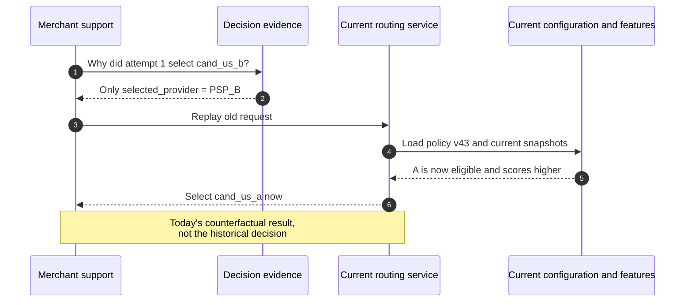
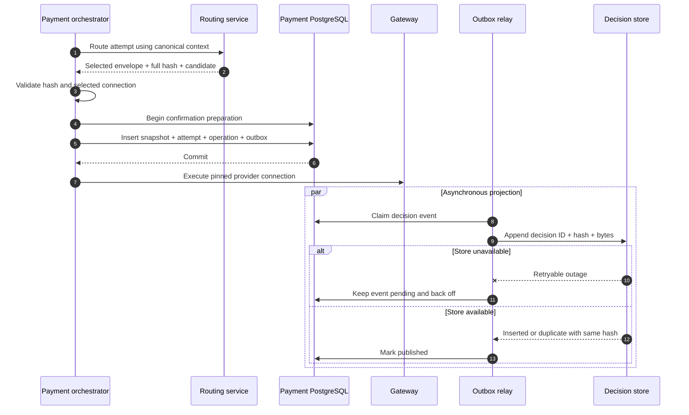
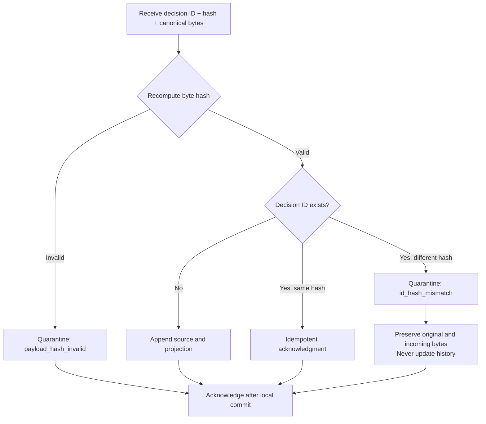
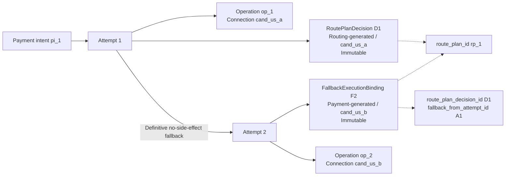

# Chapter 14: Routing Decision Storage

[中文](../../part-4-operating-at-scale/routing-decision-store.md) | **English**

Three months later, an Aurora merchant asks why a 129.00 USD payment used `cand_us_b`. The on-call engineer finds `selected_provider=PSP_B`, reruns the request against current routing configuration, and gets `cand_us_a`. This proves neither that the old choice was wrong nor that today's is right: rules were released, capabilities revised, cost/performance windows rolled forward, and health snapshots expired. Recalculation answers what would be chosen now, not why the historical choice was made.

Fallback makes the question sharper. Attempt 1 may select A from a routing-generated `RoutePlanDecision`; after A definitively has no side effects and pinned next candidate B passes fresh guardrails, attempt 2 binds B through a payment-generated `FallbackExecutionBinding`. Saving only the intent's final provider collapses independent funds paths. Calling the binding a second routing decision confuses ranking authority with permission to create a new funds path. Logs alone may lose evidence through sampling, retention, or field changes.

This chapter establishes Part IV's first invariant:

> **Historical route selection must be explained by immutable facts sealed at decision time, never recomputed with current configuration, features, or code. Routing constructs a canonical `DecisionEnvelope`; payments pins an execution snapshot and outbox event in the local attempt-creation transaction. Remote decision storage is an append-only query projection and must not become a synchronous execution dependency.**

The decision record is a routing flight recorder, not a funds ledger. It records candidates, exclusions, rules, versions, scores, and selection. The orchestrator still owns intents, provider operations, and funds state; balances, accounting entries, and settlement facts remain within ledger, reconciliation, and settlement boundaries. [Chapter 15](observability.md) covers metrics/traces; [Chapter 16](experimentation.md) creates experiment assignments; [Chapter 17](reconciliation.md) handles external discrepancies and repair; [Chapter 19](../part-5-global-routing/multi-region.md) covers retention and cross-region replication; [Chapter 20](../part-5-global-routing/configuration-platform.md) covers configuration release authority.

The companion implementation has completed the **local execution-snapshot baseline**. Routing v3 returns full `routing_context.v2`, risk, optimization, candidate evidence/order, selected connection, and `executable_until`. Payments validates and pins full context/decision JSON snapshots and deadline in the same PostgreSQL transaction as attempt/operation creation; first gateway I/O obeys that authority. The final design remains incomplete: JSONB is not cross-language canonical source bytes; `rtd_` is a truncated content ID, not a persisted full SHA; and there is no decision-specific outbox, append-only decision store, or projector. We distinguish these layers throughout.


*Figure: Inside `decision_7`, the evidence marked “at the time”—context, rules v3, scoring v5, and selected B—remains sealed. Today's v8/v9 configuration outside the box cannot replace it.*

The recorder preserves what was known and what was selected from it. Configuration outside may evolve; evidence inside must not change with it.

## 14.1 The Problem: `selected_provider` Is Not a Historical Explanation

The simplest system writes a structured log after routing returns:

```go
package selectedonly

type Record struct {
	DecisionID       string
	PaymentIntentID  string
	AttemptID        string
	SelectedProvider string
}

func NewRecord(decisionID, paymentIntentID, attemptID, provider string) Record {
	return Record{
		DecisionID:       decisionID,
		PaymentIntentID:  paymentIntentID,
		AttemptID:        attemptID,
		SelectedProvider: provider,
	}
}
```

This proves a logging call saw a provider string, but cannot answer: which account, connector, and region was B? Was A excluded for unsupported currency? Did an `exclude` rule match? What were raw cost/performance values, units, windows, and versions? What broke a tie? Did the executed `provider_connection_id` actually match routing's choice?

Worse, rerunning routing substitutes a counterfactual for a historical question:



An auditable record distinguishes decision-time facts, execution facts, and later outcomes:

| Investigation question | Authoritative evidence | Cannot be replaced by |
| --- | --- | --- |
| What did routing see then? | Context summary/digest, all candidate evidence, artifact/feature versions | Current request/configuration or free-form logs |
| Why exclude a connection? | Eligibility/rule/risk exclusions and stable reasons | Winner-only records or today's capabilities |
| Why did B rank above A? | Raw features, state/unit/window, normalizer, score breakdown, tie-break | Unversioned `score=8120` |
| What was payments authorized to execute? | Selected candidate, route plan, and decision hash pinned in attempt transaction | Routing's temporary memory or asynchronous analytics table |
| What did the gateway call? | Operation's `provider_connection_id`, operation/key/hash | Provider brand |
| What finally happened? | Payment/provider observations, reconciliation, settlement facts | Routing decision record |

The goal is a verifiable fact contract, not enough logs. One `decision_id` always identifies the same canonical bytes. Execution-time versions, candidates, and explanation cannot change later. Lost query projections can be rebuilt; original execution snapshots cannot be recovered by recalculation.

## 14.2 The Simple Design: Expand the Winner into an Immutable `DecisionEnvelope`

First expand the provider string into a document with a decision ID. But putting a raw routing response in JSONB is insufficient: undefined map ordering, floating point, time formats, null/missing distinctions, and set ordering can give identical semantics different bytes. Database serialization can alter representation again. Define facts, then canonical representation, then storage.

### 14.2.1 The Envelope Preserves Decision-Time Evidence, Not Every Upstream Field

A production `DecisionEnvelope` can use these groups. Values are small frozen facts; references point to immutable artifacts. Digests alone are insufficient without explanatory fields showing why constraints applied.

| Group | Key fields | Value or reference | Owner and purpose |
| --- | --- | --- | --- |
| Identity | `schema_version`, `decision_id`, `created_at`, `payment_intent_id`, `attempt_id` | Values | Correlate an attempt's historical decision |
| Context | `context_schema_version`, `context_digest`, amount/currency/operation/capture-mode/nonsensitive category summary | Minimal values + digest | Establish evaluation subject without copying credentials |
| Candidates | All `candidate_id`s, provider, account, connector, region, connection revision | Values | Executable connections, not brands |
| Eligibility | Per-candidate three-valued result, exclusions, `capability_version`, health references | Values + references | Prove how hard constraints shrank the set |
| Policy / risk | Rule matches, actions, priorities, reasons, rule-set version; minimal risk action/reference/version/expiry | Values + references | Prove guardrails without raw fraud features |
| Features | Raw cost/performance/health, units, states, windows, samples/confidence, artifact versions | Values + references | Preserve dimensions and evidence beyond normalized points |
| Scores | Scorer profile, normalizer version, individual contributions, total, stable tie-break | Values + references | Explain ranking, not just winner |
| Outcome | `selected`, `no_eligible_candidate`, `blocked`, `unsupported`, `requires_review`, `risk_unavailable`, `feature_unavailable`, reasons | Values | Audit legitimate nonexecutable decisions without inventing winners |
| Selection / plan | Only `selected` carries ordered candidate IDs, selected snapshot, routing-generated `route_plan_id` | Values | Pin permitted order/winner; negative outcomes create no attempt/operation |
| Assignment | Optional experiment/version/variant/bucket and `assigned` or `not_exposed` | Values | Chapter 16 assignment-only binding without dropping unexecuted samples |

The envelope seals only what was known when deciding. Later provider success, decline, timeout, or reconciliation correction becomes separate outcome/evidence linked by `attempt_id`, `operation_id`, and `decision_id`; it must not rewrite old predictions as final truth.

Do not copy context wholesale either. Chapter 4 already excludes payment tokens, PAN, and CVV/SAD. Decision records still use an explicit allowlist of explanatory minor-unit amount, currency, method category, operation, capture mode, and approved derived categories. PCI SSC prohibits retaining SAD after authorization even encrypted, and limits retention to legal, regulatory, or business need with secure deletion afterward. “It may help debugging someday” does not authorize indefinite collection. [PCI SSC FAQ 1154](https://www.pcisecuritystandards.org/faqs/1154/) [PCI SSC FAQ 1318](https://www.pcisecuritystandards.org/faqs/1318/)

`context_digest` is not anonymization. Unsalted SHA-256 over emails, full addresses, or low-entropy identifiers remains enumerable. First build a versioned minimal projection, then canonicalize/hash. Controlled equality correlation, where needed, requires a security-designed keyed digest with key version, not raw sensitive inputs to routing. Risk contributes only approved `action/reason_ref/version/expires_at`, never device fingerprints, IPs, emails, or model vectors.

### 14.2.2 Canonical Bytes and Hashes Are a Protocol

Define which arrays are ordered: `candidate_order` and rule-evaluation sequence must preserve order; logical sets such as candidate evidence and feature lists sort by stable keys. Amounts, costs, probabilities, and scores use integer/fixed-point units, not `float64`. Times use UTC Unix milliseconds or one fixed text format. Missing, unknown, stale, and known are explicit states, not Go zero values.

This Go example defines a deliberately narrow `aurora-decision-json-v1`. `Outcome` discriminates branches: `selected` requires executable attempt/plan/selection; negative branches have none of those fields but may retain candidates, exclusions, and `not_exposed` assignment. Canonical output has no maps or floats, deep-copies before sorting unordered sets, preserves business `CandidateOrder`, and emits full SHA-256. Production also needs golden vectors in cross-version contract tests.

```go
package envelope

import (
	"crypto/sha256"
	"encoding/json"
	"errors"
	"sort"
)

var ErrInvalidEnvelope = errors.New("invalid decision envelope")

type ContextSummary struct {
	SchemaVersion string `json:"schema_version"`
	AmountMinor   int64  `json:"amount_minor"`
	Currency      string `json:"currency"`
	PaymentMethod string `json:"payment_method"`
	Operation     string `json:"operation"`
	CaptureMode   string `json:"capture_mode"`
}

type CandidateEvidence struct {
	CandidateID        string `json:"candidate_id"`
	ConnectionRevision string `json:"connection_revision"`
	Provider           string `json:"provider"`
	MerchantAccount    string `json:"merchant_account"`
	Connector          string `json:"connector"`
	Region             string `json:"region"`
	Eligibility        string `json:"eligibility"`
	CapabilityVersion  string `json:"capability_version"`
}

type Exclusion struct {
	CandidateID string `json:"candidate_id"`
	Stage       string `json:"stage"`
	ReasonCode  string `json:"reason_code"`
	EvidenceRef string `json:"evidence_ref"`
}

type RuleHit struct {
	EvaluationOrder int64  `json:"evaluation_order"`
	RuleID          string `json:"rule_id"`
	Action          string `json:"action"`
	ReasonCode      string `json:"reason_code"`
}

type FeatureEvidence struct {
	CandidateID     string `json:"candidate_id"`
	Name            string `json:"name"`
	State           string `json:"state"`
	Value           int64  `json:"value"`
	Unit            string `json:"unit"`
	Window          string `json:"window"`
	SampleSize      int64  `json:"sample_size"`
	ArtifactVersion string `json:"artifact_version"`
}

type ScoreComponent struct {
	Name         string `json:"name"`
	RawValue     int64  `json:"raw_value"`
	Points       int64  `json:"points"`
	WeightPPM    int64  `json:"weight_ppm"`
	Contribution int64  `json:"contribution"`
}

type ScoreBreakdown struct {
	CandidateID string           `json:"candidate_id"`
	TotalPoints int64            `json:"total_points"`
	Components  []ScoreComponent `json:"components"`
}

type Selection struct {
	CandidateID     string `json:"candidate_id"`
	Provider        string `json:"provider"`
	MerchantAccount string `json:"merchant_account"`
	Connector       string `json:"connector"`
	Region          string `json:"region"`
	TieBreak        string `json:"tie_break"`
}

type DecisionOutcome string

const (
	OutcomeSelected            DecisionOutcome = "selected"
	OutcomeNoEligibleCandidate DecisionOutcome = "no_eligible_candidate"
	OutcomeBlocked             DecisionOutcome = "blocked"
	OutcomeUnsupported         DecisionOutcome = "unsupported"
	OutcomeRequiresReview      DecisionOutcome = "requires_review"
	OutcomeRiskUnavailable     DecisionOutcome = "risk_unavailable"
	OutcomeFeatureUnavailable  DecisionOutcome = "feature_unavailable"
)

type AssignmentEvidence struct {
	ExperimentID string `json:"experiment_id"`
	Variant      string `json:"variant"`
	Version      string `json:"version"`
	Bucket       int64  `json:"bucket"`
	State        string `json:"state"`
}

type DecisionEnvelope struct {
	SchemaVersion        string              `json:"schema_version"`
	DecisionID           string              `json:"decision_id"`
	CreatedAtUnixMilli   int64               `json:"created_at_unix_milli"`
	PaymentIntentID      string              `json:"payment_intent_id"`
	Outcome              DecisionOutcome     `json:"outcome"`
	ReasonCodes          []string            `json:"reason_codes"`
	AttemptID            string              `json:"attempt_id,omitempty"`
	RoutePlanID          string              `json:"route_plan_id,omitempty"`
	ContextDigest        string              `json:"context_digest"`
	Context              ContextSummary      `json:"context"`
	PolicyVersion        string              `json:"policy_version"`
	ScorerProfileVersion string              `json:"scorer_profile_version"`
	RiskReference        string              `json:"risk_reference"`
	RiskVersion          string              `json:"risk_version"`
	Assignment           *AssignmentEvidence `json:"assignment,omitempty"`
	Candidates           []CandidateEvidence `json:"candidates"`
	Exclusions           []Exclusion         `json:"exclusions"`
	RuleHits             []RuleHit           `json:"rule_hits"`
	Features             []FeatureEvidence   `json:"features"`
	Scores               []ScoreBreakdown    `json:"scores"`
	CandidateOrder       []string            `json:"candidate_order,omitempty"`
	Selected             *Selection          `json:"selected,omitempty"`
}

func CanonicalBytes(input DecisionEnvelope) ([]byte, [32]byte, error) {
	e := input
	e.Candidates = append([]CandidateEvidence(nil), input.Candidates...)
	e.Exclusions = append([]Exclusion(nil), input.Exclusions...)
	e.RuleHits = append([]RuleHit(nil), input.RuleHits...)
	e.Features = append([]FeatureEvidence(nil), input.Features...)
	e.Scores = append([]ScoreBreakdown(nil), input.Scores...)
	e.CandidateOrder = append([]string(nil), input.CandidateOrder...)
	e.ReasonCodes = append([]string(nil), input.ReasonCodes...)

	sort.Strings(e.ReasonCodes)

	sort.Slice(e.Candidates, func(i, j int) bool {
		return e.Candidates[i].CandidateID < e.Candidates[j].CandidateID
	})
	sort.Slice(e.Exclusions, func(i, j int) bool {
		left, right := e.Exclusions[i], e.Exclusions[j]
		if left.CandidateID != right.CandidateID {
			return left.CandidateID < right.CandidateID
		}
		if left.Stage != right.Stage {
			return left.Stage < right.Stage
		}
		if left.ReasonCode != right.ReasonCode {
			return left.ReasonCode < right.ReasonCode
		}
		return left.EvidenceRef < right.EvidenceRef
	})
	sort.Slice(e.RuleHits, func(i, j int) bool {
		if e.RuleHits[i].EvaluationOrder == e.RuleHits[j].EvaluationOrder {
			return e.RuleHits[i].RuleID < e.RuleHits[j].RuleID
		}
		return e.RuleHits[i].EvaluationOrder < e.RuleHits[j].EvaluationOrder
	})
	sort.Slice(e.Features, func(i, j int) bool {
		if e.Features[i].CandidateID == e.Features[j].CandidateID {
			return e.Features[i].Name < e.Features[j].Name
		}
		return e.Features[i].CandidateID < e.Features[j].CandidateID
	})
	for i := range e.Scores {
		e.Scores[i].Components = append([]ScoreComponent(nil), e.Scores[i].Components...)
		sort.Slice(e.Scores[i].Components, func(a, b int) bool {
			return e.Scores[i].Components[a].Name < e.Scores[i].Components[b].Name
		})
	}
	sort.Slice(e.Scores, func(i, j int) bool {
		return e.Scores[i].CandidateID < e.Scores[j].CandidateID
	})

	if err := validate(e); err != nil {
		return nil, [32]byte{}, err
	}
	b, err := json.Marshal(e)
	if err != nil {
		return nil, [32]byte{}, err
	}
	return b, sha256.Sum256(b), nil
}

func validate(e DecisionEnvelope) error {
	if e.SchemaVersion != "aurora-decision-json-v1" ||
		e.DecisionID == "" || e.CreatedAtUnixMilli <= 0 ||
		e.PaymentIntentID == "" || e.ContextDigest == "" ||
		!validOutcome(e.Outcome) || len(e.ReasonCodes) == 0 {
		return ErrInvalidEnvelope
	}
	for i, reason := range e.ReasonCodes {
		if reason == "" || (i > 0 && e.ReasonCodes[i-1] == reason) {
			return ErrInvalidEnvelope
		}
	}
	if e.Assignment != nil {
		if e.Assignment.ExperimentID == "" || e.Assignment.Variant == "" ||
			e.Assignment.Version == "" || e.Assignment.Bucket < 0 ||
			(e.Assignment.State != "assigned" && e.Assignment.State != "not_exposed") {
			return ErrInvalidEnvelope
		}
	}
	if e.Outcome == OutcomeSelected {
		if e.AttemptID == "" || e.RoutePlanID == "" || e.Selected == nil ||
			e.Selected.CandidateID == "" || e.Selected.Provider == "" ||
			len(e.CandidateOrder) == 0 ||
			(e.Assignment != nil && e.Assignment.State != "assigned") {
			return ErrInvalidEnvelope
		}
	} else if e.AttemptID != "" || e.RoutePlanID != "" || e.Selected != nil ||
		len(e.CandidateOrder) != 0 || (e.Assignment != nil && e.Assignment.State != "not_exposed") {
		return ErrInvalidEnvelope
	}

	var selectedID string
	if e.Selected != nil {
		selectedID = e.Selected.CandidateID
	}
	seen := make(map[string]struct{}, len(e.CandidateOrder))
	selectedInOrder := false
	for _, id := range e.CandidateOrder {
		if id == "" {
			return ErrInvalidEnvelope
		}
		if _, ok := seen[id]; ok {
			return ErrInvalidEnvelope
		}
		seen[id] = struct{}{}
		if id == selectedID {
			selectedInOrder = true
		}
	}
	selectedEvidence := false
	candidateSeen := make(map[string]struct{}, len(e.Candidates))
	eligible := make(map[string]bool, len(e.Candidates))
	for _, candidate := range e.Candidates {
		if candidate.CandidateID == "" {
			return ErrInvalidEnvelope
		}
		if _, ok := candidateSeen[candidate.CandidateID]; ok {
			return ErrInvalidEnvelope
		}
		candidateSeen[candidate.CandidateID] = struct{}{}
		eligible[candidate.CandidateID] = candidate.Eligibility == "eligible"
		if candidate.CandidateID == selectedID {
			selectedEvidence = candidate.Provider == e.Selected.Provider &&
				candidate.MerchantAccount == e.Selected.MerchantAccount &&
				candidate.Connector == e.Selected.Connector &&
				candidate.Region == e.Selected.Region
		}
	}
	if e.Outcome == OutcomeSelected {
		if !selectedInOrder || !selectedEvidence {
			return ErrInvalidEnvelope
		}
		for _, id := range e.CandidateOrder {
			if !eligible[id] {
				return ErrInvalidEnvelope
			}
		}
	}
	for i, feature := range e.Features {
		if feature.Name == "" || (i > 0 && e.Features[i-1].CandidateID == feature.CandidateID && e.Features[i-1].Name == feature.Name) {
			return ErrInvalidEnvelope
		}
	}
	for i, score := range e.Scores {
		if score.CandidateID == "" || (i > 0 && e.Scores[i-1].CandidateID == score.CandidateID) {
			return ErrInvalidEnvelope
		}
		for j, component := range score.Components {
			if component.Name == "" || (j > 0 && score.Components[j-1].Name == component.Name) {
				return ErrInvalidEnvelope
			}
		}
	}
	for i, hit := range e.RuleHits {
		if hit.RuleID == "" || (i > 0 && e.RuleHits[i-1].EvaluationOrder == hit.EvaluationOrder && e.RuleHits[i-1].RuleID == hit.RuleID) {
			return ErrInvalidEnvelope
		}
	}
	return nil
}

func validOutcome(outcome DecisionOutcome) bool {
	switch outcome {
	case OutcomeSelected, OutcomeNoEligibleCandidate, OutcomeBlocked,
		OutcomeUnsupported, OutcomeRequiresReview, OutcomeRiskUnavailable,
		OutcomeFeatureUnavailable:
		return true
	default:
		return false
	}
}
```

Maps here validate but never enter output. Go `encoding/json` stably orders map keys, but that alone cannot solve cross-language numbers, Unicode, unordered arrays, time zones, or missing-value semantics. Apparently stable `json.Marshal` is not a protocol. [Go: encoding/json](https://pkg.go.dev/encoding/json) Multilingual producers/verifiers may adopt RFC 8785 JSON Canonicalization Scheme, including its I-JSON, property-order, and number-serialization constraints. RFC 8785 is Informational, not a mandatory standard. [RFC 8785](https://www.rfc-editor.org/rfc/rfc8785.html)

Decision ID and full hash have different jobs. The ID is a stable correlation key for attempts, operations, traces, and support. The hash checks canonical-byte consistency. A truncated ID is not full integrity proof; SHA-256 is not source authentication. Malicious-tampering resistance also needs service identity, access control, authenticated transport, or signatures. Preserve `schema_version + canonicalization_version + canonical_bytes + full_hash` together.

## 14.3 Problems at Scale: Evidence Breaks Between Dual Writes and Reconstruction

### 14.3.1 JSONB Is a Query Structure, Not the Canonical Original

PostgreSQL `jsonb` supports indexing and queries but does not preserve input whitespace, object-key order, or duplicate keys. Reserializing it cannot be compared against routing's original byte hash. [PostgreSQL: JSON types](https://www.postgresql.org/docs/current/datatype-json.html) A sound storage layering is:

| Layer | Content | Authoritative? | Rebuildable? |
| --- | --- | ---: | ---: |
| Payment execution snapshot | Canonical bytes, full hash, selected connection, plan, attempt/operation links | Yes, defines execution | Must not depend on remote reconstruction |
| Payment outbox event | Decision ID/hash, canonical payload or reliable local reference, event ID | Yes, ensures eventual projection | Resend from local snapshot |
| Decision-store source record | Canonical bytes/hash/schema, ingestion metadata | Yes, append-only | Replay payment outbox |
| Decision-store JSONB projection | Query fields/indexes extracted from verified bytes | No, convenience | Yes |
| Logs, traces, dashboards | Correlation and operational observations | No | Completeness not guaranteed |

Schema evolution cannot update old JSON in place. Readers may upcast by `schema_version`, migrate projections, or retain multiple decoders; original bytes/hash remain unchanged. Otherwise a field-backfill migration makes later knowledge appear known historically.

### 14.3.2 Routing Writes Storage, Then Payments Creates an Attempt: A Dangerous Window

Synchronous routing-to-store writes create orphans: storage succeeds but attempt creation fails, leaving an unexecuted decision; or an operation exists but store failure blocks payments on a remote audit database. Committing the attempt before separately writing storage is worse: a crash between writes may leave executed funds with permanently missing evidence.

The atomic boundary belongs in payments' database. Routing returns envelope and canonical hash. Only `outcome=selected` validates the selected candidate against the intended `provider_connection_id` and inserts execution snapshot, attempt, operation, and outbox in one `PrepareConfirmation` transaction; gateway execution follows commit. Negative outcomes can pin decision/outbox locally and bind existing assignments as `not_exposed`, but never create attempts/operations. Remote storage participates in neither transaction nor synchronous funds path.



“Storage failure does not block payments” refers only to remote storage/projection. If the local transaction cannot persist snapshot, attempt, or outbox, there is no authoritative durable execution evidence: fail before the gateway rather than create funds side effects for availability. After local commit, remote downtime merely builds an outbox backlog; payments can execute its pinned operation safely. Redelivery after recovery converges to one projection.

The Go boundary shows only `outcome=selected` and excludes remote storage entirely from `Confirm`. Negative branches stop before this function; a zero-valued selection cannot enter preparation. The `PrepareConfirmation` comment is a teaching contract that implementation must honor with one transaction and prove through integration tests.

```go
package pinning

import (
	"context"
	"crypto/sha256"
	"encoding/json"
	"errors"
)

var (
	ErrDecisionHashMismatch    = errors.New("decision hash mismatch")
	ErrDecisionBindingMismatch = errors.New("decision subject or selection mismatch")
	ErrConnectionMismatch      = errors.New("selected connection mismatch")
)

type CandidateRef struct {
	CandidateID     string `json:"candidate_id"`
	Provider        string `json:"provider"`
	MerchantAccount string `json:"merchant_account"`
	Connector       string `json:"connector"`
	Region          string `json:"region"`
}

type RoutedDecision struct {
	DecisionID     string
	AttemptID      string
	CanonicalBytes []byte
	Hash           [32]byte
	Selected       CandidateRef
}

type PrepareCommand struct {
	PaymentIntentID      string
	AttemptID            string
	OperationID          string
	ProviderConnectionID string
	Provider             string
	DecisionID           string
	DecisionHash         [32]byte
	DecisionBytes        []byte
}

type PreparedOperation struct {
	OperationID          string
	ProviderConnectionID string
	Provider             string
}

type Store interface {
	// PrepareConfirmation atomically inserts the decision snapshot, attempt,
	// provider operation, and decision outbox event before returning.
	PrepareConfirmation(context.Context, PrepareCommand) (PreparedOperation, error)
}

type Gateway interface {
	Execute(context.Context, PreparedOperation) error
}

type Service struct {
	Store   Store
	Gateway Gateway
}

func (s Service) Confirm(
	ctx context.Context,
	paymentIntentID string,
	operationID string,
	decision RoutedDecision,
) error {
	if sha256.Sum256(decision.CanonicalBytes) != decision.Hash {
		return ErrDecisionHashMismatch
	}
	// Bind transport fields to the sealed subject and selected tuple;
	// hashing bytes alone cannot prove that the prepared command matches them.
	var sealed struct {
		DecisionID      string       `json:"decision_id"`
		AttemptID       string       `json:"attempt_id"`
		PaymentIntentID string       `json:"payment_intent_id"`
		Selected        CandidateRef `json:"selected"`
	}
	if err := json.Unmarshal(decision.CanonicalBytes, &sealed); err != nil ||
		decision.DecisionID == "" || decision.AttemptID == "" || paymentIntentID == "" || operationID == "" ||
		sealed.DecisionID != decision.DecisionID || sealed.AttemptID != decision.AttemptID ||
		sealed.PaymentIntentID != paymentIntentID || sealed.Selected != decision.Selected {
		return ErrDecisionBindingMismatch
	}
	providerConnectionID := decision.Selected.CandidateID
	if providerConnectionID == "" || decision.Selected.Provider == "" {
		return ErrConnectionMismatch
	}
	prepared, err := s.Store.PrepareConfirmation(ctx, PrepareCommand{
		PaymentIntentID:      paymentIntentID,
		AttemptID:            decision.AttemptID,
		OperationID:          operationID,
		ProviderConnectionID: providerConnectionID,
		Provider:             decision.Selected.Provider,
		DecisionID:           decision.DecisionID,
		DecisionHash:         decision.Hash,
		DecisionBytes:        append([]byte(nil), decision.CanonicalBytes...),
	})
	if err != nil {
		return err
	}
	if prepared.OperationID != operationID || prepared.ProviderConnectionID != providerConnectionID ||
		prepared.Provider != decision.Selected.Provider {
		return ErrConnectionMismatch
	}
	return s.Gateway.Execute(ctx, prepared)
}
```

Production transactionally validates `attempt_id`, `decision_id`, and intent-version consistency and uniquely prevents two decisions binding one attempt. Serializable conflicts may require retrying the entire preparation transaction **before gateway execution**, never skipping the snapshot. [PostgreSQL: Transaction isolation](https://www.postgresql.org/docs/current/transaction-iso.html)

### 14.3.3 Append-Only Does Not Mean Retry Every INSERT Failure Forever

Outbox relays, networks, and consumer restarts duplicate messages. Ingestion evaluates ID and hash together:



Same ID/hash is normal at-least-once duplication. Same ID/different hash is an integrity incident: neither overwrite nor infinite poison-message retry. In one local transaction preserve the old record and append quarantine with incoming hash/bytes, event identity, and reason; acknowledge after commit and raise a high-priority alert. Evidence survives without permanently blocking a partition.

This pure Go planner closes the action set to three outcomes. Storage uses unique `decision_id` or equivalent primary key to arbitrate concurrent winners. PostgreSQL unique indexes enforce at most one equal key; `INSERT ... ON CONFLICT` provides an atomic conflict entry point. [PostgreSQL: Unique indexes](https://www.postgresql.org/docs/current/indexes-unique.html) [PostgreSQL: INSERT](https://www.postgresql.org/docs/current/sql-insert.html)

```go
package decisionprojection

import (
	"crypto/sha256"
	"errors"
)

var ErrMissingIdentity = errors.New("missing decision identity")

type Action string

const (
	ActionInsert     Action = "insert"
	ActionDuplicate  Action = "duplicate_same_hash"
	ActionQuarantine Action = "quarantine"
)

type Existing struct {
	DecisionID string
	Hash       [32]byte
}

type Incoming struct {
	DecisionID     string
	DeclaredHash   [32]byte
	CanonicalBytes []byte
}

type Plan struct {
	Action Action
	Reason string
}

func PlanIngest(existing *Existing, incoming Incoming) (Plan, error) {
	if incoming.DecisionID == "" {
		return Plan{}, ErrMissingIdentity
	}
	calculated := sha256.Sum256(incoming.CanonicalBytes)
	if calculated != incoming.DeclaredHash {
		return Plan{Action: ActionQuarantine, Reason: "payload_hash_invalid"}, nil
	}
	if existing == nil {
		return Plan{Action: ActionInsert, Reason: "new_decision"}, nil
	}
	if existing.DecisionID != incoming.DecisionID {
		return Plan{}, ErrMissingIdentity
	}
	if existing.Hash == incoming.DeclaredHash {
		return Plan{Action: ActionDuplicate, Reason: "same_id_same_hash"}, nil
	}
	return Plan{Action: ActionQuarantine, Reason: "same_id_different_hash"}, nil
}
```

Successful ingestion means a verifiable historical decision exists in the query projection, not provider success. It changes no payment state. The store's service account must lack write permissions on payment, ledger, and settlement tables.

### 14.3.4 Fallback Creates a Payment Execution Binding, Not a Rewritten Routing Decision

One intent may have several attempts, but routing and payment evidence are different authoritative objects. Attempt 1 selects A through routing's `RoutePlanDecision` D1. Only after Chapter 12's terminal + no-side-effect + allowlisted-reason gates may payments create attempt 2 with a new operation, provider key, and payment-generated `FallbackExecutionBinding` F2. F2 references D1/plan, predecessor/version, pinned B, fresh risk, and routing-owned guardrail-only revalidation. Revalidation may veto B, but cannot choose out-of-plan C, reorder, rank again, or issue D2. Expired/incomplete/unavailable evidence stops execution.



`route_plan_id` and `route_plan_decision_id` explain why F2 binds only B in the pinned allowed sequence; `fallback_from_attempt_id` gives recovery lineage. None authorizes fallback: the payment-owned planner and predecessor evidence do. D1/F2 use distinct schema/source/canonicalization domains, each with its own ID/full hash. Payments cannot impersonate routing to change D1; routing cannot decide for payments whether old evidence permits a new funds path. The repository lacks the dedicated successor transaction, so F2/lineage remains a design contract. Capture, void, and refund do not reroute; they bind original connection/reference.

If late evidence confirms A while B also succeeded, preserve D1, F2, and both execution links. Business state remains `succeeded`, both captured facts survive, and only the independent `integrity_status` enters `review_required`, for Chapter 17 evidence handling. Deleting D1, declaring F2 the “finally correct route,” or last-write-wins destroys evidence.

### 14.3.5 Partitioning, Retention, and Regional Replication Cannot Weaken Global Conflicts

Volume encourages time partitioning and hot/cold tiers, but protect `decision_id` uniqueness first. PostgreSQL requires partitioned-table unique/primary constraints to include every partition key. Partitioning by `created_date` with uniqueness only on `decision_id` cannot enforce cross-partition uniqueness in one constraint. [PostgreSQL: Table partitioning](https://www.postgresql.org/docs/current/ddl-partitioning.html) Options include an unpartitioned identity/hash registry plus time-partitioned payloads, or a validated partition key in the identity constraint with protocol-level global lookup. Compression cannot reduce mismatch checks to “this month only.”

Chapter 19 and the security appendix handle specific retention, legal holds, residency, deletion proof, and cross-region ownership. Here require three things: explicit policies by data category; no claim of full auditability after deleting source bytes; and projection lifecycle never rewriting funds facts.

## 14.4 Production Design: Separate Local Execution Truth from Remote Query Projections

The production flow has six fixed steps:

1. Payments builds a minimal versioned context for a first unexecuted request. Routing validates, filters eligibility, applies rule/risk gates, looks up features, scores/selects as needed, and sets a closed `Outcome` for selected or explicit negative results.
2. Routing constructs the full `DecisionEnvelope` and generates bytes/full hash under its frozen canonicalization version. Only selected includes `RoutePlanDecision`, attempt subject, and selection; negative branches invent none. Routing calls no provider and requires no store write before returning.
3. For selected, payments revalidates hash, attempt subject, candidate, and `provider_connection_id`, rejecting candidate/provider/revision mismatches. Negative outcomes block the gateway and atomically pin decision/outbox and `not_exposed` assignment as needed.
4. Only selected enters one `PrepareConfirmation` transaction pinning snapshot, attempt, operation, and outbox. Commit is required before gateway execution.
5. Gateway executes only the pinned connection/key/payload, never choosing an alternative from health, cost, or errors.
6. Relay projects asynchronously into append-only storage. Outage increases backlog/age only. Recovery converges by object type, ID, and hash; mismatch quarantines. Future allowed fallback separately writes payment-owned `FallbackExecutionBinding`, referencing original routing plan and guardrail veto evidence without reusing routing's schema or issuing a ranking.

### 14.4.1 Source and Projection Records

Model immutable originals separately from query columns:

| Object | Representative fields | Write rules | Typical query |
| --- | --- | --- | --- |
| `decision_source` | ID, schema, canonicalization version, bytes/hash, creation time | First append; never UPDATE payload | Verify/download original by ID |
| `decision_projection` | Intent/attempt, selected candidate, policy/feature versions, reasons | Derive only from verified source; rebuildable | Support, incidents, version impact |
| `decision_quarantine` | Event/decision IDs, existing/incoming hashes, incoming bytes, reason | Append-only, restricted access | Integrity incidents |
| `projection_checkpoint` | Consumer/partition, offset, update time | Mutable operational state | Relay recovery/lag |

Do not put arbitrary merchant/decision IDs into Chapter 15's low-cardinality metric labels. Query authorization is scoped by merchant/region/role. PCI SSC describes audit-log purposes including who did what, where, when, and how; this does not imply copying all payment data into audit tables. Identity, access, and action audits surround controlled data. [PCI SSC FAQ 1081](https://www.pcisecuritystandards.org/faqs/1081/)

### 14.4.2 Query, Verification, and Counterfactual Replay Are Different Operations

Support often needs winner, reasons, and attempt lineage. Audit needs canonical bytes, schema, full hash, and ingestion state. Policy engineers may ask who policy v44 would select. Do not merge their permissions and outcomes into `GET /decision?replay=true`.

| Operation | Input | Output | Permitted change |
| --- | --- | --- | --- |
| Historical query | `decision_id` and caller scope | Sealed projection, source hash/schema, attempt links | None |
| Integrity verification | Source bytes, claimed hash, supported canonicalization version | Verified, unsupported schema, or mismatch | Mismatch appends quarantine only |
| Counterfactual replay | Explicitly chosen historical context projection + new routing/artifact versions | New `analysis_id`, candidate decision, difference report | Analysis domain only; no attempt/operation |

Query `not_found` does not immediately mean routing made no decision. Evidence may remain in payments' outbox, projection may lag, access may be denied, or an event may be quarantined. An authorized support aggregation API can read local payment decision identity/status, then remote projection, distinguishing `pending_projection`, `projected`, `quarantined`, and true absence. The decision store cannot bypass authority by querying payments' database directly.

Counterfactual replay explicitly identifies routing build, context projection, policy/capability/feature versions, and run time, returning analysis rather than reusing `decision_id`. It calls no gateway, updates no old projection, and cannot pronounce historical winners wrong from new results. Unavailable referenced artifacts yield `insufficient_evidence`, never silent latest-version substitution. Chapter 16 shadow/experiments and Chapter 21 offline replay may consume this capability under the same no-side-effect boundary.

### 14.4.3 Current Baseline and Remaining Companion Work

Distinguish implemented facts from the completed-design target. The Go system has reliable foundations but no complete decision store:

| Location | Currently implemented | Still unimplemented |
| --- | --- | --- |
| Routing v3 contract | Full `routing_context.v2`, digest, rule/capability/risk evidence, cost/performance/scoring breakdown, `candidate_order`, exact selected revision, `executable_until`; shared golden fixtures verify wire compatibility | Independent cross-language `DecisionEnvelope` canonical-byte/full-hash protocol; health evidence |
| Routing content ID | Stable typed JSON over all current fields + SHA-256, returning `rtd_` plus first 16 bytes; payments recomputes | Truncated correlation/content ID, not persisted full SHA-256; no canonical source bytes/version |
| Payment `PrepareConfirmation` / SQL | One serializable transaction checks subject/digest, risk, optimization/order, connection/deadline, and atomically inserts full context/decision JSONB, attempt, operation, `routing_executable_until`; triggers prohibit rewriting | JSONB normalizes representation and cannot be canonical originals; no full-hash/schema/canonicalization pair |
| Payment outbox | Preparation writes generic `payment_intent.status_changed` and `provider_operation.created` | No canonical bytes/full-hash `routing_decision.recorded` event or relay/projector |
| Fallback lineage | First attempt pins complete candidate order; UNKNOWN recovery blocks new attempts by default | Formal `RoutePlanDecision`, guardrail-only revalidation, unique successor transaction, payment-generated `FallbackExecutionBinding`, cross-provider tests |
| Decision store | None | Append/query ingestion, ID+hash idempotency, quarantine, source/projection tables, rebuilding |

The narrow increment therefore starts above existing JSON snapshots: define canonical bytes/full SHA/schema protocol, save source bytes/hash and `routing_decision.recorded` in the same preparation transaction, then add an independent append-only PostgreSQL consumer. A dedicated fallback-successor transaction is a separate execution increment, not something to smuggle through storage work. This preserves the existing automatic-capture `SALE` vertical path while completing evidence, without implying manual capture, real PSPs, full experiments, or automatic reconciliation.

### 14.4.4 Failure Tests That Prove the Invariants

Querying one happy-path record is insufficient. At least inject:

| Test | Injection | Required result |
| --- | --- | --- |
| Historical truth | Replace policy, capability, fees, performance, health, scorer versions after decision | Original ID returns original bytes/hash, winner, exclusions, breakdown; no current-routing recalculation |
| Store outage | Stop remote store, then confirm a safe payment | Local snapshot/attempt/operation/outbox commit together; gateway executes; outbox remains pending |
| Recovery | Restore store, redeliver event repeatedly | One source row; same-ID/hash duplicates acknowledged |
| Hash mismatch | Reuse ID, change candidate reason or score bytes | Original unchanged; incoming payload quarantined; no endless poison queue |
| Crash boundaries | Before commit, after commit/before gateway, after publication | No precommit gateway; postcommit execution recoverable from snapshot; duplicate projection converges |
| Fallback lineage | Create B after A's conclusive absence, then late A success | Routing D1 and payment F2 retained with distinct attempts/operations; review without overwriting either |
| Sensitive fields | Insert PAN/CVV/token/secrets/raw risk features at any depth | Contract/forbidden-field checks reject before outbox; logs do not leak payload |
| Unknown schema | Unsupported canonicalization/schema version | No guessed parsing or bad projection; quarantine/alert with source retained |

## 14.5 Failure Modes and Controlled Responses

| Failure mode | Dangerous result | Controlled design |
| --- | --- | --- |
| Replay old context with current config | Counterfactual presented as history | Query immutable envelope; label replay as analysis |
| Winner/total only | Cannot prove hard exclusions, units, versions | All candidates/exclusions, raw features, breakdown |
| Verify reserialized JSONB hash | False corruption alarms or missed tampering | Hash original canonical bytes; JSONB projection only |
| Routing synchronously depends on audit storage | Store outage becomes payment outage | Local payment snapshot/outbox; asynchronous remote projection |
| Gateway call after local snapshot failure | Funds operation with unprovable authority | Stop failed preparation; execute only after commit |
| Upsert same ID/different payload | Overwritten history | Preserve original, quarantine incoming, alert |
| Retry permanent mismatch forever | Poison message blocks partition | Acknowledge after quarantine commit |
| Schema migration UPDATEs old payload | Later facts appear historically known | Immutable bytes/hash; read-time upcast, rebuild projections |
| Digest includes raw sensitive/low-entropy values | Enumerable leakage and wider PCI/privacy scope | Minimize/allowlist first; controlled keyed correlation where needed |
| Fallback replaces original decision or presents successor binding as new ranking | Lost paths, authority boundary, late-success evidence | Retain original plan; separate payment binding and explicit lineage |
| Store treated as ledger | Routing changes balances/terminal funds state | Read/append routing evidence only; separate funds owners |

An organizational mistake is treating records as completed observability, experimentation, or reconciliation. Records establish that decision facts exist. Chapter 15 defines reliable latency/error/outcome measurement; Chapter 16 assignment, shadow, and causality; Chapter 17 independent provider evidence and domain-command repair. All may reference `decision_id`; none changes source bytes.

## 14.6 Tradeoffs: More Evidence, Less Execution Coupling

| Choice | Benefit | Cost / constraint |
| --- | --- | --- |
| Artifact references only | Small payload, simple retention | Unavailable artifacts prevent explanation; embed key result values |
| All upstream documents embedded | Offline self-sufficiency | Sensitive spread, volume, irrelevant data; not adopted here |
| Minimal values + immutable references + digests | Explanation, verification, minimization | Registry must preserve readable immutable references |
| Synchronous remote write | Immediately queryable | Confirmation latency/failure coupling; unsuitable funds prerequisite |
| Payment snapshot + outbox | Atomic execution evidence; storage may degrade | Eventual consistency, backlog/age monitoring, relay operations |
| JSONB only | Convenient query | Loses original representation and canonical integrity |
| Bytes/hash + JSONB projection | Verifiable and indexable | Duplicate storage, decoders, rebuild cost |
| In-place schema update | One query model | Destroys history; unacceptable |
| Append-only source + read-time upcast | Stable history, explicit evolution | Multiversion readers, golden vectors, disciplined migration |

The design deliberately accepts asynchronous query lag. When confirmation returns, remote evidence may not yet be queryable, but payments already has the snapshot and does not depend on projection speed for safety. Operational SLOs track oldest outbox age, quarantine count, and projection lag; the next chapter defines them rather than pulling storage back into the synchronous path.

Complete envelopes cost storage. Reduce duplicated display fields, use stable artifact references, and separate hot projections from cold sources before discarding candidate sets, exclusions, feature states, or lineage. Without those, the stored object is merely an outcome, not a decision.

## 14.7 Summary

From an unexplained `selected_provider` log, we derived a historical evidence chain that respects payment ownership:

1. Routing constructs immutable `DecisionEnvelope` from minimal context, all candidates/exclusions, rules/risk, features, scores, and versions. Current recalculation is not historical truth.
2. Canonicalization is versioned protocol: preserve ordered arrays, sort sets, use integers, and retain bytes, schema/canonicalization versions, and full SHA-256. JSONB is rebuildable projection only.
3. Payments pins execution snapshot/outbox with attempt/operation in one transaction; only after commit may the gateway call exact `provider_connection_id`.
4. Remote storage is append-only query projection. Outage leaves local execution safe and outbox queued. Same-ID/hash delivery is idempotent; differing hashes quarantine without overwrite.
5. Each fallback successor gets a new payment-generated `FallbackExecutionBinding`, operation, and key, linked to routing's plan and predecessor. The binding selects only the pinned next entry and records risk/guardrail veto evidence, never new candidates/ranking. Capture/void/refund retain original connection/reference.
6. The store is not a ledger, metrics backend, assignment engine, or reconciliation state machine. It ensures sealed facts can answer why a route was chosen then.

The companion implementation atomically pins full context/decision/risk/optimization/order/`executable_until` as immutable JSONB with attempt/operation and revalidates before first gateway I/O. It is more than merely a decision ID. Canonical source bytes/full SHA, a decision outbox, append-only projector, and formal plan/revalidation/fallback-successor/binding transactions remain explicit future increments. Only after those and failure tests are complete will historical decisions be cross-language verifiable, queryable, and unable to block payments through remote storage.
