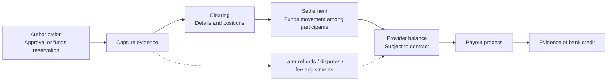
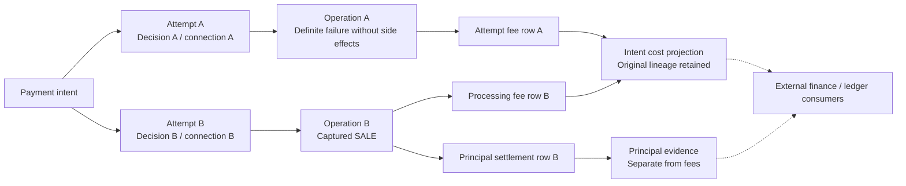
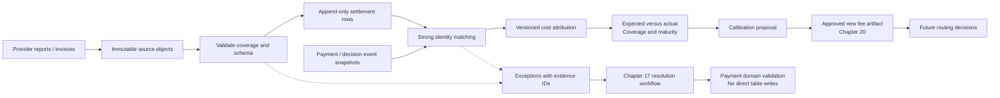

# Chapter 18: Settlement and Cost Attribution

[中文](../../part-4-operating-at-scale/settlement.md) | **English**

Aurora's new routing policy has finally passed a small live experiment. A 100.00 USD payment has an estimated online processing cost of 3.00 USD and is successfully captured. The team records 97.00 USD as “merchant net revenue,” believing the economic loop is complete. Days later, the provider report supplies different numbers: 3.60 USD for the successful route, 0.05 USD for the preceding permitted failed attempt, and a 10.00 USD reserve hold. A fee correction arrives at month-end too.

Treating capture as receipt of funds, every deduction as a fee, and a monthly invoice total as additional to fees already withheld combines three locally plausible actions into an incorrect bill. Worse, someone may turn “this transaction appears in the report” into SQL that changes an internally failed payment to success.

The central proposition of this chapter is:

> **Routing's economic outcomes must be calculated from verifiable settlement and fee facts linked back to the original decision, attempt, operation, and exact connection. Separate expected, accrued, and actual costs. Append settlement facts; handle discrepancies through controlled workflows. Neither overwrite historical decisions nor exceed authority to rewrite payment or ledger state.**

[Chapter 17](reconciliation.md) compares external transaction evidence with internal payment facts, classifies discrepancies, and controls repairs. This chapter consumes those results to answer which routing execution bears which costs. [Chapter 7](../part-2-routing-engine/cost-aware-routing.md)'s estimator still produces expected cost only. The ledger, payout execution, and accounting policies remain external boundaries. Current code contains only an automatic-capture `SALE` vertical slice, with no settlement service. The designs and Go examples below are future increments.

## 18.1 The Problem: One Successful Response Cannot Establish the Final Economics

### 18.1.1 Five Funds Stages Cannot Collapse into One `paid`

| Stage | Meaning in this chapter | What it does not establish |
| --- | --- | --- |
| Authorization | Approval of a payment request, usually with credit or funds reserved | Capture, settlement, or merchant receipt |
| Capture | Initiating and completing the applicable capture processing against an authorized amount, with provider-specific evidence | Every fee confirmed or money received by the bank |
| Clearing | Exchanging and checking transaction details and forming settlement positions | Merchant bank credit has occurred |
| Settlement | Relevant participants discharge settlement obligations | Each transaction has its own independent payout |
| Payout | A separate process transferring available funds from provider to merchant bank or another destination | Initiation equals bank receipt, or no later refunds/disputes |

The CPMI glossary describes clearing as transmission, reconciliation, and related processing before settlement, potentially including netting and establishing final positions. We use these semantic boundaries without forcing all markets into one state machine. [CPMI Glossary](https://www.bis.org/cpmi/glossary.pdf) VisaNet Connect likewise distinguishes authorization requesting approval from capture initiating subsequent clearing/settlement. One API's success cannot mean every stage completed simultaneously. [VisaNet Connect: Acceptance](https://developer.visa.com/capabilities/visanet-connect-acceptance/docs-getting-started)



This shows typical card-payment relationships, not universal time intervals. Automatic `SALE` can combine authorization and capture instructions in one provider operation without removing asynchronous clearing, settlement, and transfers afterward. Proven capture can complete an order-facing payment state without waiting for bank receipt; economic outcomes mature through an independent fact stream.

### 18.1.2 `gross - payout` Is Not the Fee

First restrict Aurora's example to one currency and contractually nonoverlapping fee components:

| Item | USD | Attribution category |
| --- | ---: | --- |
| Successful transaction principal | 100.00 | Principal, not platform fee |
| Successful attempt's processing fee | 3.60 | Actual processing cost |
| Previous failed attempt's fee | 0.05 | Independent fee for that attempt |
| Reserve hold | 10.00 | Restricted-funds movement, not directly a fee |
| Contribution to batch funds available for payout | 86.35 | Balance-movement result in this example, not a payout already received |

Actual processing cost is 3.65 USD, not 13.65 USD. Releasing the reserve is not new operating revenue either. Any separate cost of tied-up capital belongs to an approved economic model and must remain distinct from the original hold. Refund principal, chargeback principal, and dispute fees also need separate categories; not every negative amount belongs in `processing_fee`.

Transaction fee decomposition and batch balance bridging are different checks. The former explains allocation of a fee statement to transactions; the latter explains ending balance from opening balance plus movements minus payouts. A balanced bridge does not prove every detail correct. Stripe's payout-reconciliation documentation links payouts to their batches and notes that some transfer methods cannot automatically identify included transactions, further undermining the assumption that one sale equals one bank credit. [Stripe: Payout Reconciliation](https://docs.stripe.com/reports/payout-reconciliation)

## 18.2 A Simple Design: Separate Estimates from Observed Facts

The first improvement needs no complete finance platform. Aurora can preserve decision-time estimates, ingest one provider's captured-sale and fee reports, and show side-by-side differences.

| Cost layer | Source | What it can claim at that time | Update method |
| --- | --- | --- | --- |
| Expected | Decision-time fee/FX artifacts and context | Estimate under that version and known conditions | Original estimate unchanged; new decisions reference new versions |
| Accrued | Occurred events combined with contractual calculations | Fees may have arisen, but external amounts are not fully confirmed | Retain calculation basis, coverage, and estimate version |
| Actual | Verified reports, invoices, adjustments, and attribution | Externally supported amounts for specified components as of a date | Append sources/corrections and generate new projection version |

Accrual here is a management-analysis definition, not a self-appointed accounting-recognition policy. Nor is it another name for “fees received so far”: verified fees may be partial actuals, while unconfirmed components remain accrued estimates. No report means `missing`, not zero. `not_applicable` requires contractual or explicit evidentiary support.

Actual cost is not one immutable final number either. A capture-fee report may be complete while refund/dispute fees have not yet arisen. Reports should say “processing components confirmed as of this date; dispute cohort not mature,” rather than unconditionally mark an entire intent `final_cost=true`. This aligns with [Chapter 15](observability.md)'s maturity watermarks and [Chapter 16](experimentation.md)'s cohort ages.

The initial data chain can reuse decision IDs sealed in [Chapter 14](routing-decision-store.md). Successful principal links only to the operation producing the successful funds effect. Fees for each attempt return to that attempt before intent-level aggregation:



This is not a recommendation to try again. The second attempt must already have passed Chapter 12's fallback gates. This chapter attributes outcomes after the fact; a lower fee cannot create an operation. Network retries of one operation do not create another logical principal amount, although charging per request depends on the contract and actual fee evidence.

## 18.3 Scaling Problems: Files, Identities, and Amounts Can Tell Half the Truth

### 18.3.1 A Successful Download Does Not Establish Complete Business-Period Coverage

HTTP 200 may deliver half a file, and pagination may miss the last page. Even complete bytes can cover only one merchant account, some dates, or an unclosed batch. `SettlementFile` therefore needs source account, report type/schema, provider report ID/revision, requested window, timezone, generation/retrieval times, content digest, row count, control totals, and completion marker.

Separate transport validation from business coverage. A checksum confirms received content matches its declaration, not that the provider omitted no transactions. A self-computed hash does not authenticate the source either. Download identity, TLS/SFTP trust, or provider signatures are established by the integration contract. Only after all pages/shards arrive and controls pass can the coverage manifest advance from `received` to `accepted_complete`. Without reliable controls, retain `coverage_unverified`.

Group monetary control totals by account, currency, and entry category. At minimum check debits, credits, and counts separately, not merely a net that cancels errors. Parse CSV by versioned headers, not guessed column positions. Validate accounts row by row in multi-account files. Quarantine unknown types, invalid precision, and unexplained signs. A mid-parse failure cannot publish the first half as complete actuals.

### 18.3.2 Duplicate Files, Duplicate Rows, and Fee Corrections Differ

| Input | Handling semantics |
| --- | --- |
| Same source file identity/revision and byte hash | Redelivery; return existing ingestion result |
| Same file identity/revision, different hash | Source conflict; quarantine and investigate, never overwrite |
| Different files contain same economic-entry identity and payload | Row redelivery; add source association, do not charge again |
| Same entry identity/revision, different normalized payload | `payload_mismatch`; no last-write-wins |
| Explicit new revision or correction entry | Preserve new fact and interpret declared adapter revision semantics |

`file_hash + row_number` identifies physical occurrence only; it cannot prevent one economic row appearing in overlapping reports. Prefer provider-guaranteed stable entry IDs. Otherwise the adapter must define a validated composite key and multiplicity rules. Identical fields alone may incorrectly deduplicate two legitimate equal fees. Reports without reliable row identity stay outside automatic attribution in the first version.

Revisions especially cannot simply be summed. An incremental correction adds a delta; a replacement revision explicitly revises an earlier interpretation. Projections can select effective versions only when the source contract provides verifiable linkage and ordering. Keep old facts and connect new ones with `supersedes` or `adjusts`. Opposite invoices without revision semantics are a conflict, not permission to cancel them automatically.

### 18.3.3 The Same Provider Reference May Not Belong to the Same Operation

Matching begins with a trusted mapping from report account to provider namespace, then locates the original reference. Payment-event snapshots supply pinned `provider_connection_id`, revision, namespace, operation, and decision. Do not read current routing configuration and “migrate” an old transaction to today's identically named account. Connection aliases sharing an external account must share the correct reference namespace; creating an alias cannot evade collision checks.

Principal rows validate the original transaction or specific capture amount/currency. A 3.60 USD fee must not be compared to 100.00 USD payment principal. Fees need their own amount plus source-provided parent operation/reference and billing basis. Partial captures, refunds, and chargebacks may each have modification references; payment-level references alone cannot merge them.

A unique reference with conflicting amounts produces an exception. A nonunique reference cannot fall back to “same amount, nearest time.” Late payment snapshots may enter `awaiting_projection` and retry; manual confirmation creates an evidenced, versioned resolution. A successful match identifies the owner of an economic fact. It does not prove internal `failed` should become `succeeded`.

### 18.3.4 Currency, Precision, and Time Are Part of Identity

| Field group | Facts to retain | Common mistake |
| --- | --- | --- |
| Transaction amount | Original amount/currency, unit/precision | Treat provider net as original payment amount |
| Settlement amount | Settlement currency, gross/net and each fee's units | Subtract different currencies directly |
| Reporting amount | Analytical base currency, FX source/version, conversion time, rounding rule | Recalculate history at today's rate and overwrite original |
| Time | Effective/posting/value dates, observation/import times, original timezone/period | Assign fee month from download time |

Currency and minor-unit data from ISO 4217 require maintenance. SIX, the maintenance agency, supplies current and historical lists. Pin a currency-metadata version instead of assuming every report uses two decimal places. [SIX: Currency Code Maintenance](https://www.six-group.com/en/products-services/financial-information/market-reference-data/data-standards.html) Parse decimal CSV strings exactly. Never silently truncate excess precision; check overflow in sums and multiplication too.

Stripe balance transactions separate `amount`, `fee`, `net`, `currency`, `exchange_rate`, `created`, and `available_on`. The net affects the corresponding Stripe balance, not the order total in its original currency. [Stripe: Balance Transaction](https://docs.stripe.com/api/balance_transactions/object) Accordingly, adapters retain original-currency and settlement-currency facts separately rather than forcing everything into USD and discarding provenance.

A reference rate cannot impersonate an actual execution rate. The ECB explicitly limits its reference rates to informational use and discourages transaction use. They may form an analytical benchmark, not fill an unknown provider FX rate. [ECB: Reference Rates](https://www.ecb.europa.eu/stats/policy_and_exchange_rates/euro_reference_exchange_rates/html/index.en.html) Chapter 7 uses `cost_micros`; reports here may use minor units. Convert units and currency explicitly before comparison, retaining conversion version and residuals.

### 18.3.5 Do Not Add the Monthly Invoice Again

Fees may be represented as totals or components. Adyen settlement details can provide Markup, Scheme Fees, and Interchange when breakdowns exist, or Commission alone otherwise. Its documentation also identifies reference rates in some externally settled records as distinct from the external acquirer's actual rate. [Adyen: Settlement Details Report](https://docs.adyen.com/reporting/settlement-reconciliation/transaction-level/settlement-details-report) Adding every number can double-count totals and components while mistaking a reference value for an executed fact.

Monthly fees also overlap with amounts withheld from batches. Adyen invoices distinguish total fees, amounts already deducted from settlement, and amounts due, and explain subsequent differences from monthly tiers and other factors. [Adyen: Payment Processing Invoice](https://docs.adyen.com/reporting/invoice-reconciliation/payment-processing-invoice/) Aurora must distinguish confirmation of existing fees from new adjustments and preserve invoice-line links to existing fee entries. Invoice totals cannot be recorded again as new transaction fees.

## 18.4 Production Design: Append Facts, Then Build Reconstructable Attribution

### 18.4.1 Settlement's Independent Data Boundary

| Model | Main content | Authority it does not own |
| --- | --- | --- |
| `SettlementFile` | Original-object reference/hash, source scope, schema, revision, integrity checks | Approving payment success |
| `SettlementLine` | Economic-entry identity, kind, signed amount, references, source/revision relationships | Overwriting old rows or triggering funds operations |
| `Attribution` | Allocation to intent/attempt/operation/decision, matching/allocation versions | Changing historical expected cost |
| `Exception` | Unmatched items, amount/identity conflicts, coverage gaps, evidence references | Repairing payment through direct SQL |
| `CalibrationReport` | Comparable expected/actual costs, coverage, maturity windows, residuals | Automatically publishing fees or training conclusions |



Settlement consumes minimal operation/decision snapshots through APIs or events and maintains reconstructable projections in its own schema, without cross-database payment-table reads. Authorize raw-report access and download credentials separately. Analytics retains only necessary fields; provider address or card-data columns are not an invitation to copy everything. PAN, CVV/SAD, and secrets never enter this flow.

Ingestion separates staging from publication: preserve originals and check complete scope, then transactionally register accepted files and outbox events. Large files may persist in chunks, but only fact sets released by a complete manifest can support “complete period” reports. Checkpoints and inbox/outbox enable crash recovery; consumers deduplicate by economic-row identity. A settlement outage delays economic reports, not online capture, and cannot make payments fail by itself.

### 18.4.2 Go: Same Identity, Different Content Must Not Overwrite

This pure function shows row-level classification. `PayloadHash` hashes normalized semantics under the adapter's pinned normalization version, not a raw CSV line whose whitespace may vary. The database still needs unique constraints and transactions; this check alone provides no concurrency guarantee.

```go
package settlementfact

import "errors"

type Key struct {
	ProviderNamespaceID string
	EntryID             string
	Revision            string
}

type Fact struct {
	Key         Key
	PayloadHash [32]byte
}

type Action string

const (
	Append     Action = "append"
	Replay     Action = "replay"
	Quarantine Action = "quarantine"
)

func Classify(existing *Fact, incoming Fact) (Action, error) {
	if incoming.Key.ProviderNamespaceID == "" || incoming.Key.EntryID == "" ||
		incoming.Key.Revision == "" || incoming.PayloadHash == ([32]byte{}) {
		return "", errors.New("invalid settlement fact")
	}
	if existing == nil {
		return Append, nil
	}
	if existing.Key != incoming.Key {
		return "", errors.New("lookup returned another fact identity")
	}
	if existing.PayloadHash != incoming.PayloadHash {
		return Quarantine, nil
	}
	return Replay, nil
}
```

`EntryID` must be unique within its declared namespace. Adapters may need entry category, report series, or other qualifiers. After SQL conflicts, read the winning row and compare hashes; never use `ON CONFLICT DO UPDATE amount=...`. A revision's new `Key` may append, but its effect on effective totals still requires explicit replacement/incremental semantics. `Append` does not mean “immediately add to cost.”

### 18.4.3 Go: Matching Creates an Association, Not Payment Success

This narrow matcher covers the initial captured-sale/fee adapter. Inputs have already passed schema, currency, unit, and source verification. `BasisAmountMinor` is the original transaction amount underlying the fee or settlement entry, not the fee amount. Sources lacking a reliable billing basis enter exceptions; do not guess.

```go
package settlementmatch

type Line struct {
	ConnectionID       string
	ConnectionRevision string
	NamespaceID        string
	ProviderReference  string
	Kind               string
	BasisAmountMinor   int64
	BasisCurrency      string
}

type Operation struct {
	ID                 string
	IntentID           string
	AttemptID          string
	DecisionID         string
	ConnectionID       string
	ConnectionRevision string
	NamespaceID        string
	ProviderReference  string
	AmountMinor        int64
	Currency           string
	Kind               string
	Status             string
	Integrity          string
}

type Result struct {
	State     string
	Reason    string
	Operation Operation
}

func Match(line Line, snapshots []Operation) Result {
	if line.ConnectionID == "" || line.ConnectionRevision == "" ||
		line.NamespaceID == "" || line.ProviderReference == "" ||
		line.BasisAmountMinor <= 0 || line.BasisCurrency == "" ||
		(line.Kind != "captured_sale" && line.Kind != "fee") {
		return Result{State: "exception", Reason: "invalid_line_contract"}
	}
	var matches []Operation
	for _, operation := range snapshots {
		if operation.NamespaceID == line.NamespaceID &&
			operation.ProviderReference == line.ProviderReference {
			matches = append(matches, operation)
		}
	}
	if len(matches) == 0 {
		return Result{State: "awaiting_projection", Reason: "reference_not_found"}
	}
	if len(matches) != 1 {
		return Result{State: "exception", Reason: "ambiguous_reference"}
	}
	operation := matches[0]
	reject := func(reason string) Result {
		return Result{State: "exception", Reason: reason, Operation: operation}
	}
	if operation.ConnectionID != line.ConnectionID ||
		operation.ConnectionRevision != line.ConnectionRevision {
		return reject("connection_mismatch")
	}
	if operation.Kind != "sale" || operation.Integrity != "healthy" {
		return reject("unsupported_or_review_required")
	}
	if operation.Currency != line.BasisCurrency {
		return reject("currency_mismatch")
	}
	if operation.AmountMinor != line.BasisAmountMinor {
		return reject("amount_mismatch")
	}
	if operation.ID == "" || operation.IntentID == "" ||
		operation.AttemptID == "" || operation.DecisionID == "" {
		return Result{State: "awaiting_projection", Reason: "lineage_incomplete"}
	}
	if line.Kind == "captured_sale" && operation.Status != "succeeded" {
		return reject("payment_evidence_requires_reconciliation")
	}
	return Result{State: "matched", Operation: operation}
}
```

When a reference appears on two operations, the code reports ambiguous matching before considering amounts. Equal amounts do not make a collision safe. Production projections must also deduplicate by event ID/version, not treat historical versions of one operation as separate operations.

A `fee` may belong to a failed or unresolved operation because billing and capture are different facts. That gives it neither successful principal nor membership in a confirmed-success denominator. If a captured-sale row conflicts with internal state, the exception preserves the settlement row, operation snapshot, and Chapter 17 evidence/discrepancy IDs. Payment domain commands decide convergence or `review_required`. This service cannot update terminal payment states.

### 18.4.4 Go: Fee Allocation Must Conserve Exactly

Prefer direct attribution for fees with explicit operation references. Allocate monthly minimums, batch fees, or other truly untraceable items only under an approved allocation policy. Counts, transaction volume, and other bases are management choices, not provider-supplied transaction facts. Retain original total, target set, weight snapshot, and policy version.

Splitting a 0.05 USD batch fee across equal weights and rounding each to 0.03 USD creates an extra cent. The largest-remainder method below allocates integer shares first, then remaining units by remainder and stable ID. It supports negative adjustments and uses `math/big` to avoid intermediate multiplication overflow. Outputs use the input currency's same minor unit throughout.

```go
package costallocation

import (
	"errors"
	"math/big"
	"sort"
)

type Weight struct {
	TargetID string
	Units    uint64
}

type Share struct {
	TargetID    string
	Currency    string
	AmountMinor int64
}

type portion struct {
	id        string
	amount    *big.Int
	remainder *big.Int
}

func SplitMinor(total int64, currency string, weights []Weight) ([]Share, error) {
	if currency == "" || len(weights) == 0 || len(weights) > 10000 {
		return nil, errors.New("invalid allocation contract")
	}
	seen := make(map[string]bool, len(weights))
	denominator := new(big.Int)
	for _, weight := range weights {
		if weight.TargetID == "" || seen[weight.TargetID] || weight.Units == 0 {
			return nil, errors.New("invalid or duplicate allocation target")
		}
		seen[weight.TargetID] = true
		denominator.Add(denominator, new(big.Int).SetUint64(weight.Units))
	}
	magnitude := new(big.Int).Abs(big.NewInt(total))
	allocated := new(big.Int)
	parts := make([]portion, 0, len(weights))
	for _, weight := range weights {
		product := new(big.Int).Mul(magnitude, new(big.Int).SetUint64(weight.Units))
		quotient, remainder := new(big.Int), new(big.Int)
		quotient.QuoRem(product, denominator, remainder)
		allocated.Add(allocated, quotient)
		parts = append(parts, portion{weight.TargetID, quotient, remainder})
	}
	sort.Slice(parts, func(i, j int) bool {
		comparison := parts[i].remainder.Cmp(parts[j].remainder)
		if comparison != 0 {
			return comparison > 0
		}
		return parts[i].id < parts[j].id
	})
	left := new(big.Int).Sub(magnitude, allocated).Int64()
	for index := int64(0); index < left; index++ {
		parts[index].amount.Add(parts[index].amount, big.NewInt(1))
	}
	result := make([]Share, 0, len(parts))
	for _, part := range parts {
		if total < 0 {
			part.amount.Neg(part.amount)
		}
		if !part.amount.IsInt64() {
			return nil, errors.New("allocation overflow")
		}
		result = append(result, Share{part.id, currency, part.amount.Int64()})
	}
	sort.Slice(result, func(i, j int) bool { return result[i].TargetID < result[j].TargetID })
	return result, nil
}
```

Validate currency and unit metadata before calling. Amount-based weights must share comparable definitions; do not mix USD cents with JPY minor units directly. Remainder allocation is itself a versioned policy. Corrections reference the frozen original target set, rather than assigning last month's difference to merchants added today.

This is exact allocation of one economic row, not double-entry bookkeeping. A complete projection also requires allocations for each effective row to sum to its original amount, explicit retention of unallocated amounts, no double counting of totals/components, and separation of principal, fees, restricted funds, and FX differences. Accounts, journal entries, closing, and reopening periods remain external finance/ledger responsibilities.

### 18.4.5 Feed Only Comparable Actuals Back into the Fee Model

Calibration compares `actual - expected` by connection, contract version, operation, component, currency, and business period. Report matching rate, missing components, exception amounts, and maturity cutoff alongside the difference. If duplicates or exceptions are excluded, report their counts and amounts; missing the most expensive batch must not look like falling cost.

For an attempt estimate, compare actuals for the same attempt and components. For intent economics, aggregate all permitted attempt fees and subsequent attribution afterward. Subtracting an intent total containing B's fallback, dispute principal, and monthly fees from A's estimated single-attempt fee does not establish an error in A's model. Failed-attempt fees stay with their original decisions; experimental membership follows Chapter 16's original assignment.

One management metric might be “all in-scope actual fees for a specified cohort / intents in that cohort successful within the specified window.” Fees from failed intents cannot disappear; a zero denominator is not computable. Define refund principal, net revenue, dispute loss, and cost rate separately, without forcing different maturity levels into one number. Lower observed fees alone do not prove causal provider superiority.

Differences produce calibration proposals containing samples, sources, missing items, suggested rates, and error distributions, then pass through [Chapter 20](../part-5-global-routing/configuration-platform.md)'s approval and release process. Original expected costs remain forever; new artifacts affect future decisions only. [Chapter 21](../part-5-global-routing/intelligent-routing.md) covers machine-learning consumption of these labels. A late invoice cannot automatically change online weights here.

### 18.4.6 Current Code and the Next Verifiable Increment

| Current engineering fact | Capability still to build |
| --- | --- |
| Payment has intents/attempts/operations, amount/currency, exact connections/provider references, and atomically persisted v3 context/decision/risk/optimization snapshots | Publish minimal economic-attribution projection retaining original identities and each attempt's estimate |
| `app.RunReconciler` performs online UNKNOWN recovery | Do not call it settlement or complete report reconciliation |
| Routing v3 reads versioned fee-plan/FX evidence, computes `AttemptCostMicros`, `SucceededCostMicros`, `FailedCostMicros`, and stores selection cost/scoring evidence in decisions | These remain conditional expected costs; calibrate with comparable settlement actuals without changing historical estimates |
| No `services/settlement` or independent settlement schema | Worker/CLI, one versioned CSV/JSON adapter, idempotent facts, exceptions, calibration reports |
| Execution supports automatic-capture `SALE` only | Recognizing other report types does not implement manual-capture/void/refund APIs |

The minimal vertical slice accepts one report with declared row identity and completion semantics, matches captured sales and fees, persists through real PostgreSQL, and reports expected versus actual. Completion requires tests for duplicate files, overlapping rows, hash mismatches, missing snapshots, amount/currency conflicts, negative adjustments, and allocation conservation. Compiling these pure functions, or already calculating expected routing costs, does not deliver persisted actuals, real provider-report integration, or financial operations.

## 18.5 Failure Modes: Exceptions Can Wait; Facts Cannot Be Fabricated

| Failure scenario | Falsifiable acceptance criterion | Controlled action |
| --- | --- | --- |
| Half-downloaded file or missing page | Integrity manifest fails; no complete-actuals report published | Refetch original scope; retain failure evidence |
| File/economic-row redelivery | Original principal, fee totals, and attribution counts unchanged | Replay by identity/hash |
| Same identity, different payload | Old facts unchanged; new content excluded from effective totals | Quarantine and link discrepancy |
| Unmatched fee row | Never matched to another transaction with the “closest amount” | Await snapshot; exception queue after timeout |
| Captured sale conflicts with internal failure | No payment-table write or new gateway call from settlement | Chapter 17 domain review |
| Correction arrives before original | No arrival-order winner or duplicate accumulation | Reproject after relationship chain is complete |
| Success after multiple attempts | Principal only on successful operation; provenance for every fee | Aggregate by intent without changing decision ownership |
| Allocate 5 minor units to two targets | Sum exactly 5; input order irrelevant; same for negatives | Stable remainder rule and version |
| Missing FX or currency conflict | No fabricated unified-currency total | Retain original currency; conversion unavailable |
| Worker crashes before checkpoint | Rerun causes no duplicate fees or lost exceptions | Recover through staging, transactions, outbox |

Closing an exception must identify whether the cause was completed source data, corrected matching rules, provider correction, payment-domain repair, or authorized financial treatment. `resolved` does not mean numbers were changed until equal. Accepted residual differences still need rationale and approval. Compensation, refunds, and ledger adjustments are separately authorized workflows; exception queues must not initiate them automatically.

## 18.6 Trade-offs: Timely Feedback and Provable Completeness

**Earlier visibility and earlier conclusions.** Partial actuals can expose fee anomalies sooner, but require coverage labels and cannot rank alongside complete cohorts. Freezing a cutoff enables reproducible reports without preventing late facts. Those enter a new version rather than altering data behind an old report.

**Exact linkage and allocation estimates.** Strong references give high-confidence attribution; monthly fees may only be allocated by policy. Forcing every cost onto individual transactions creates false precision. Unallocated or account-level costs can be more honest and easier to explain.

**Original retention and minimization.** Originals help validate adapters and resolve disputes without justifying unlimited sensitive-data retention. Prefer necessary columns and controlled sources, separate permissions and retention periods. [Chapter 19](../part-5-global-routing/multi-region.md) covers regional residency and replication. Hashes replace neither access controls nor anonymization.

**Independent services and operational cost.** A separate settlement schema and worker isolate bulk ingestion, recalculation, and permissions, but add projection lag and operational responsibility. Begin with a deployable CLI/worker if appropriate, without immediately introducing a multilayer messaging platform. Offline fee queries must not become synchronous online-payment dependencies.

## 18.7 Recap

Starting from an online fee prematurely considered final, this chapter established an evidence loop for routing economics:

1. Separate authorization, capture, clearing, settlement, and payout. Success, net amounts, and bank receipt are different facts.
2. Separate expected, accrued, and actual cost. Actuals carry sources, coverage, maturity windows, and versions; missing is not zero.
3. Validate file completeness, economic-row idempotency, and revision semantics independently. Quarantine same-identity/different-content conflicts; corrections preserve originals.
4. Attribute through exact connection, namespace, references, amount, and currency. Preserve the semantics of principal, every attempt's fees, holds, and subsequent losses.
5. Every allocation conserves exactly; FX and unit conversions are explicit. Totals, components, and already-deducted invoice amounts must not be charged twice.
6. Errors produce evidence and controlled resolutions, not authority to rewrite payments, generate refunds, or adjust ledgers.
7. Calibration proposes new fee artifacts while preserving historical decisions. The real system does not yet contain this chapter's settlement service.

Economic feedback can now inform the next routing decision. The next chapter addresses another safety boundary: when these decisions, identities, and facts span regions, which instance is entitled to create new funds side effects?
