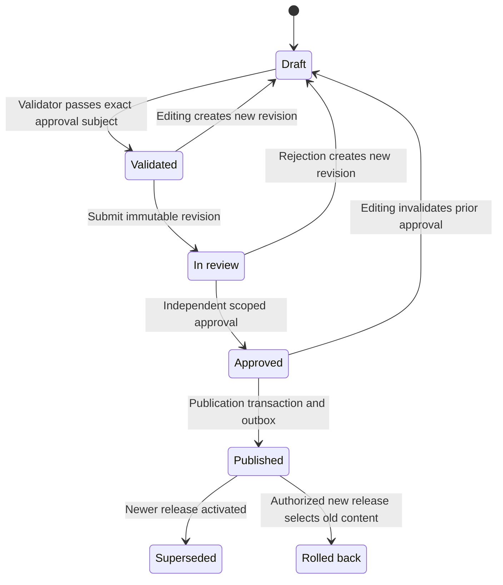
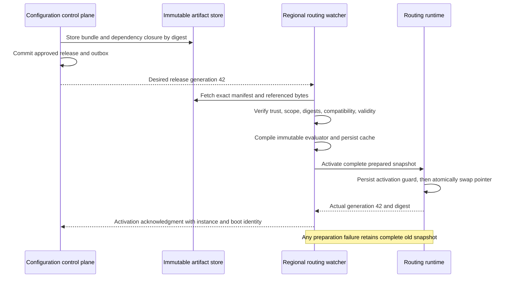
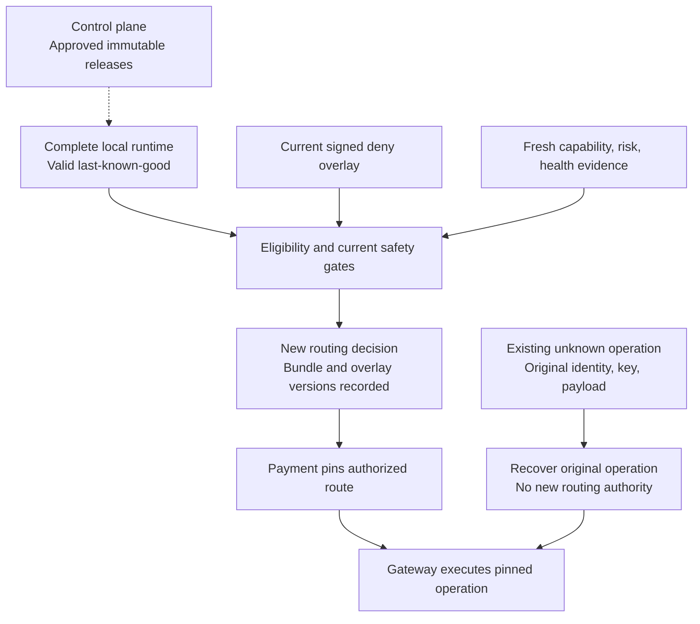

# Chapter 20: The Routing Configuration Platform

[中文](../../part-5-global-routing/configuration-platform.md) | **English**

Aurora plans to change the preferred connection for European EUR traffic from A to B. Operations updates rules, finance submits a new fee model, and the integration team revises B's capability snapshot. Each change passes its own checks, yet some European routing instances receive new rules with old capabilities and fees, while US instances receive nothing. During the review, everyone says “v43 was released,” but nobody can identify exactly which files v43 contained.

Someone then rolls rules back to v42. Success rate does not immediately recover: the old file overwrites B's emergency disablement, and unknown operations already pinned to B are mistaken for payments needing new routes. Configuration never called a PSP directly, but it amplified funds risk by changing future decisions, hiding version differences, and misleading recovery.

The central proposition of this chapter is:

> **Routing configuration is a production artifact, not an arbitrarily writable parameter table. Releases bind complete content, validation evidence, approving identities, and scope. The data plane atomically activates only complete validated versions. The control plane stays outside each payment's critical path, and rollback grants no authority to undo funds facts or bypass hard constraints.**

This chapter builds on [Chapter 19](multi-region.md)'s regional autonomy and governs configuration creation and activation, without redesigning intent ownership. Evaluation, eligibility, and scoring from [Chapters 5–9](../part-2-routing-engine/rule-based-routing.md) remain with their components. [Chapter 16](../part-4-operating-at-scale/experimentation.md) owns assignment semantics, and [Chapter 21](intelligent-routing.md) covers model training and inference.

## 20.1 The Problem: A Successful Database Write Does Not Establish a Safe Change

With two providers, direct database edits initially seem efficient. This counterexample even uses a transaction: both fields change together or neither changes.

```go
package naiveconfig

import (
	"context"
	"database/sql"
)

// UnsafePublish is a counterexample: a database transaction is not a release gate.
func UnsafePublish(ctx context.Context, db *sql.DB, preferred string) error {
	tx, err := db.BeginTx(ctx, nil)
	if err != nil {
		return err
	}
	defer tx.Rollback()
	if _, err := tx.ExecContext(ctx,
		`UPDATE routing_settings SET preferred_candidate=$1, version=version+1`,
		preferred); err != nil {
		return err
	}
	return tx.Commit()
}
```

A transaction maintains only the storage consistency it covers. It does not know whether an operator may change every merchant, whether the preferred connection supports EUR, why the old rule existed, or whether the approver reviewed the final content. It also does not prove when other instances read updates or whether they combine old and new fields.

A culture of “configuration changes need no code release” is more dangerous. Amount limits, percentage units, candidate-inclusion rules, experiment scopes, and degradation policies can affect many real payments. Treating 250 basis points as 250%, or allowing “force B” to bypass eligibility, is no less serious because the file extension is JSON.

The problem is not the absence of an editor page. Change objects, authorization, validation, propagation, and runtime acknowledgment need separate models. A green UI notification proves only that an API returned success, not that every data-plane instance safely runs the same content.

## 20.2 A Simple Design: One Complete File Is Easier to Explain Than Mutable Tables

A sensible first step puts rules and candidate configuration in version control, uses code review, builds complete files, and loads them once at deployment. For few instances and infrequent changes, this works: diffs, authors, rollback targets, and startup rejection of invalid configuration.

The companion routing service starts here, loading complete snapshots at process startup. v1's `loadRoutingConfig` reads `ROUTER_CONFIG_JSON`; v2/v3 load versioned capabilities and rules, with v3 risk, cost, performance, and scoring optimization. All three reject unknown fields and multiple JSON objects. Nondevelopment deployments cannot omit declared required versions. After validation, engines copy complete configuration. Online requests carry nonsensitive context, never caller-supplied policies or artifacts. There is no per-request configuration-database read or runtime hot swap of shared snapshots.

Changing environment variables does not update running processes. Kubernetes documents that ConfigMap-injected environment variables do not follow source updates and generally require Pod restart. Mounted files also propagate over time and require correct application reads. [Kubernetes: ConfigMaps](https://kubernetes.io/docs/concepts/configuration/configmap/) Explicit evidence must connect “cluster object changed” to “router activated.”

As changes become frequent and regions need gradual activation, restarting the entire service is no longer the only desirable path. A watcher can help, but must first fetch a complete verifiable version—not independently watch five tables and assemble the last-arriving fields.

## 20.3 Scaling Problems: Constrain Who May Change What

### 20.3.1 One Bundle Does Not Give One Team Ownership of Every Fact

Capability snapshots derive from account contracts, provider configuration, and trusted probes; fees from commercial terms and economic models; policies express permitted preferences. The platform orchestrates these facts without inventing authentication support to make validation pass.

| Artifact or state | Fact owner | Release checks | Runtime boundary |
| --- | --- | --- | --- |
| Rule/scorer configuration | Routing policy team | Restricted semantics, conflicts, units, default policy | Select only within eligible set |
| Capability snapshot | Integration and contract owners | Exact connection/revision, source, validity | Unknown/expired capabilities remain conservatively rejected under Chapter 6 |
| Fee model | Cost and financial-model owners | Currency, dimensions, integer overflow, scope | Not settled fees or ledger facts |
| Experiment artifact | Experiment owner | Population, stable buckets, budget, stops | Never reassign existing intents |
| Model/feature schema | Model and feature owners | Compatibility, validation report, degradation reference | Cannot override risk or eligibility |
| Dynamic health | Chapter 13 health subsystem | Do not seal live state into long-lived bundles | Independent freshness, failure domains, probe budgets |
| Credentials/secrets | Gateway and security boundary | Check permitted registry references only | Secrets never enter routing artifacts or audit diffs |

The control platform has no arbitrary write access to payment, gateway, or settlement databases. Configuration cannot close discrepancies, reset unknown states, or delete provider references. Data ownership and release ownership are separate boundaries.

### 20.3.2 Validation Needs Layered Proof, Not One “Passed” Flag

Schema validation rejects unknown fields, wrong types, oversized lists, and invalid units. Domain validation checks nonexistent candidates, equal-priority rule conflicts, empty defaults, weight ranges, fee overflow, and model/feature compatibility. Capability source, validity, and execution revision for the same connection must also agree.

Cross-artifact checks are easy to omit. A valid `include B` combined with a USD-only capability snapshot and EUR population can leave an entire segment without candidates. Reject statically provable invalid combinations. Conditions that cannot be proved statically need explicit test matrices and replay; “no conflict found” does not mean correctness for every input. Runtime hard constraints always remain active.

Impact reports show added/removed candidates, no-candidate proportion, expected connection traffic, cost-estimate changes, sparse slices, and execution time. Historical replay can recompute visible context, not invent approvals for unselected providers. Shadows never call the gateway. Expanding real traffic inherits Chapter 16's stable assignment, sample, and mature-outcome contract.

Each validation records input digest, validator build, dependency versions, data window, coverage, and expiration. Last week's pass on old capabilities cannot approve today's changed bundle. Expired evidence requires revalidation and, where necessary, reapproval.

### 20.3.3 Approve an Immutable Proposal, Not an Editable Page

This book prohibits author self-approval and separates publishing from ordinary editing. NIST SP 800-53 AC-5, AC-6, and CM-3 provide references for separation of duties, least privilege, and configuration change control. Applying these principles here does not claim that two clicks satisfy all compliance obligations. [NIST SP 800-53 Rev. 5](https://csrc.nist.gov/pubs/sp/800/53/r5/upd1/final)

Check separation using person identity from the trusted identity system. A second account held by the same person is not another approver. Scope includes environment, region, or approved business population; test reviewers cannot approve global production. Automated validators supply evidence, not an independent human approver.

## 20.4 Production Design: Immutable Artifacts, Separate Release and Activation Records

### 20.4.1 Manage Lifecycle with States; Pin Approval Subjects with Digests



The lifecycle projection changes, not artifact content. Editing a submitted version creates a new draft revision; historical approval remains but does not apply to the new revision. Supersession and rollback do not delete old bundles. Partial regional activation requires per-region status, not one global field hiding divergence.

The approval subject includes bundle digest, target scope, rollout plan, and approval-policy version. Validation records the tested subject's digest; approval binds both that subject and the report digest. The report does not insert its own digest into the tested subject, avoiding a circular definition. Otherwise operations could approve 1% and then deploy globally without changing bundle content. Concurrent edits use expected revisions; stale-page saves and approvals conflict rather than overwrite.

This Go function expresses approval preconditions only. `Review` comes from durable records; `Actor` from server-side authentication and scoped authorization. Neither is a trusted flag supplied arbitrarily by the caller.

```go
package configapproval

import (
	"errors"
	"time"
)

type Review struct {
	ChangeID            string
	Revision            uint64
	State               string
	Scope               string
	SubjectDigest       [32]byte
	ValidatedDigest     [32]byte
	ReportDigest        [32]byte
	ValidatorVersion    string
	ValidationPassed    bool
	ValidationExpiresAt time.Time
	AuthorPersonIDs     []string
}

type Actor struct {
	PersonID   string
	Scope      string
	CanApprove bool
}

type Approval struct {
	ChangeID      string
	Revision      uint64
	SubjectDigest [32]byte
	ReportDigest  [32]byte
	PersonID      string
	ApprovedAt    time.Time
}

var ErrApprovalDenied = errors.New("approval preconditions not met")

func Approve(review Review, actor Actor, expectedRevision uint64, now time.Time) (Approval, error) {
	if review.ChangeID == "" || review.Revision == 0 || review.Revision != expectedRevision ||
		review.State != "in_review" || review.Scope == "" || actor.Scope != review.Scope ||
		actor.PersonID == "" || !actor.CanApprove || len(review.AuthorPersonIDs) == 0 ||
		review.SubjectDigest == ([32]byte{}) || review.SubjectDigest != review.ValidatedDigest ||
		review.ReportDigest == ([32]byte{}) ||
		!review.ValidationPassed || review.ValidatorVersion == "" ||
		!now.Before(review.ValidationExpiresAt) {
		return Approval{}, ErrApprovalDenied
	}
	for _, author := range review.AuthorPersonIDs {
		if author == "" || author == actor.PersonID {
			return Approval{}, ErrApprovalDenied
		}
	}
	return Approval{
		ChangeID: review.ChangeID, Revision: review.Revision,
		SubjectDigest: review.SubjectDigest, ReportDigest: review.ReportDigest,
		PersonID: actor.PersonID, ApprovedAt: now,
	}, nil
}
```

A pure function does not solve persistent concurrency. The approval transaction locks the current revision, checks current authorization, and commits approval, lifecycle projection, and append-only audit event together. Publication rechecks the complete approval subject, valid evidence, and nonrevoked permissions, then atomically creates a release and `config.published` outbox event. A later worker distributes it. After crashes, redeliver the same release, never generate unapproved content.

### 20.4.2 Bundle, Release, and Activation Are Different Versions

| Object | Fact described | Identity and content |
| --- | --- | --- |
| Bundle | Artifacts forming one compatible decision unit | Schema, canonicalization version, exact references, manifest digest |
| Release | Who approved which complete bundle for which scope | Release ID, monotonic generation, bundle digest, scope, rollout plan, approval evidence |
| Activation | What an instance actually began using | Instance/boot identity, release/generation, digest, time, outcome |

The manifest pins rules, capabilities, fees, experiments, models, and feature schemas by content digest, never drifting `latest` references. Explicitly declare absent optional artifacts; do not fill failed loads with a default model from another version. Verify the dependency closure, minimum routing build, and gateway-registry revision compatibility too.

Canonicalization follows Chapter 14: preserve business-significant ordering, normalize unordered sets and numbers, then hash deterministic bytes. A digest detects content changes, not publisher identity. Production distribution also requires trusted signatures and key IDs, scope checks, rotation, and revocation. Do not trust arbitrary public keys supplied by the manifest itself.

Build and validation provenance must be traceable. SLSA provenance relates build platforms, inputs, and outputs. The platform can record compilers, dependencies, and validation reports similarly without claiming a self-authored JSON file achieves a supply-chain security level. [SLSA: Build Provenance](https://slsa.dev/spec/v1.2/build-provenance)

Release generations increase monotonically within a defined scope. If release 42 is faulty, rollback to the bundle used in release 40 creates release 43, not a generation decrease to 40. Instances can reject old messages while accepting a legitimate new rollback. TUF's rollback, freeze, and mix-and-match threat model illustrates why signatures also need version, expiry, and dependency-consistency checks. These are borrowed constraints, not a claim that this simplified loader implements full TUF. [The Update Framework Specification](https://theupdateframework.github.io/specification/latest/)

Rollback does not restore old authority. Approve the new release under current separation of duties, scope authorization, and trust roots. Old bundles cannot revive revoked administrators, signing keys, or permissive approval policies. Validate compatibility at the current time: expired capabilities, retired connections, and unsupported schemas make prior successful operation insufficient for activation now.

If the rollback target is no longer eligible, stop the rollback and serve with an approved safe version or explicit blocking. Refreshing capabilities or replacing incompatible references creates a new bundle and evidence. Never extend an old artifact's validity in place while claiming its digest and historical facts remain unchanged.

### 20.4.3 Prepare Completely, Activate Once, Then Report Facts



Watch events merely announce a possible new release. Duplicates, omissions, and reordering are allowed; workers refetch according to durable desired generation. Correctness does not depend on exactly-once distribution. Downloading, signature checks, and compilation run off the online path; routing never waits for the global control center.

Acknowledgments distinguish fetched, validated, activated, and rejected. Download success is not activation, and a live container does not prove the target version. Every receipt binds instance, boot identity, scope, generation, actual digest, and stable reason. Old-process receipts cannot count a restarted instance as converged.

Regions usually need not switch at the same nanosecond. Each decision must use a complete bundle and explain that region's contemporaneous version. Calculate rollout progress against target instances and effective capacity, not merely “most instances updated.” Critical regions without activation evidence must pause rollout or stop admitting new traffic. Convergence details belong in query tables/logs, without spreading every digest and instance ID into unbounded metric labels.

### 20.4.4 One Request Reads One Complete Runtime Snapshot

This code swaps a fully prepared evaluator and release metadata together. Only a trusted loader constructs `Prepared`, after signature/digest checks, full dependency compilation, and durable local caching. It is not an HTTP request type or an object made trustworthy by `verified=true`.

```go
package configruntime

import (
	"context"
	"errors"
	"sync"
	"sync/atomic"
	"time"
)

type Request struct {
	AmountMinor                 int64
	Currency, Method, Operation string
}

type Decision struct {
	Candidate  string
	ReleaseID  string
	Generation uint64
	Digest     [32]byte
}

type Evaluator interface {
	Evaluate(context.Context, Request) (Decision, error)
}

type Activation struct {
	Scope, ReleaseID     string
	Generation           uint64
	Digest               [32]byte
	NotBefore, ExpiresAt time.Time
}

type Prepared struct {
	Activation Activation
	Engine     Evaluator
}

type ActivationJournal interface {
	// Persist a CAS-protected activation record referencing already durable bytes.
	// Identical retries are idempotent; different content at the same generation fails.
	Commit(context.Context, uint64, Activation) error
}

type snapshot struct {
	activation Activation
	engine     Evaluator
}

type Runtime struct {
	mu      sync.Mutex
	scope   string
	journal ActivationJournal
	active  atomic.Pointer[snapshot]
}

func validPrepared(p Prepared) bool {
	a := p.Activation
	return a.Scope != "" && a.ReleaseID != "" && a.Generation > 0 &&
		a.Digest != ([32]byte{}) && a.NotBefore.Before(a.ExpiresAt) && p.Engine != nil
}

func sameActivation(a, b Activation) bool {
	return a.Scope == b.Scope && a.ReleaseID == b.ReleaseID &&
		a.Generation == b.Generation && a.Digest == b.Digest &&
		a.NotBefore.Equal(b.NotBefore) && a.ExpiresAt.Equal(b.ExpiresAt)
}

// If present, restored must be rebuilt from the exact durable journal record and verified immutable bytes.
// Expired content cannot serve new decisions.
func NewRuntime(scope string, journal ActivationJournal, restored *Prepared) (*Runtime, error) {
	if scope == "" || journal == nil {
		return nil, errors.New("runtime scope and durable journal are required")
	}
	r := &Runtime{scope: scope, journal: journal}
	if restored != nil {
		if !validPrepared(*restored) || restored.Activation.Scope != scope {
			return nil, errors.New("invalid restored activation")
		}
		r.active.Store(&snapshot{restored.Activation, restored.Engine})
	}
	return r, nil
}

func (r *Runtime) Apply(ctx context.Context, next Prepared, now time.Time) error {
	r.mu.Lock()
	defer r.mu.Unlock()
	a := next.Activation
	if !validPrepared(next) || a.Scope != r.scope ||
		now.Before(a.NotBefore) || !now.Before(a.ExpiresAt) {
		return errors.New("invalid, mistargeted or expired activation")
	}
	var expected uint64
	if old := r.active.Load(); old != nil {
		expected = old.activation.Generation
		if a.Generation == expected && sameActivation(a, old.activation) {
			return nil
		}
		if a.Generation <= expected {
			return errors.New("stale or conflicting release generation")
		}
	}
	if err := r.journal.Commit(ctx, expected, a); err != nil {
		return err
	}
	r.active.Store(&snapshot{a, next.Engine})
	return nil
}

func (r *Runtime) Decide(ctx context.Context, req Request, now time.Time) (Decision, error) {
	s := r.active.Load() // Load once for the entire decision.
	if s == nil || now.Before(s.activation.NotBefore) || !now.Before(s.activation.ExpiresAt) {
		return Decision{}, errors.New("no currently usable approved configuration")
	}
	d, err := s.engine.Evaluate(ctx, req)
	d.ReleaseID, d.Generation, d.Digest = s.activation.ReleaseID, s.activation.Generation, s.activation.Digest
	return d, err
}
```

An atomic pointer swaps pointers only; it does not freeze referenced maps, slices, or model weights. The loader must construct exclusive, read-only, concurrency-safe evaluators. The current engine's configuration copying is reusable. A decision cannot load rules, compute halfway, then load a newer fee model. Go documents atomic synchronization semantics; business-object immutability remains the program's responsibility. [Go: sync/atomic](https://pkg.go.dev/sync/atomic)

`ActivationJournal` is not an in-memory switch. Durably store immutable new bytes first, atomically persist activation plus generation high-water mark next, and finally swap the memory pointer. A crash after journal commit but before pointer swap reconstructs the complete bundle from that record on restart. Failed commit leaves the old runtime unchanged. Lost acknowledgments of the same commit can retry idempotently. The code declares this persistence contract; actual disk failures and recovery require separate tests.

Restart restores the acknowledged generation, not whichever cached file appears to have the largest version. The high-water mark survives process restarts; a new boot identity updates receipts without resetting rollback protection. Missing bytes, bad digests, or unverifiable current trust roots cannot be resolved by guessing the “latest file.” New instances stay unready. Existing instances may continue using still-valid old snapshots; these behaviors are compatible.

### 20.4.5 Last-Known-Good Is Conditional; Emergency Disablement Has Boundaries

Control-plane failure need not instantly invalidate running routers, but last-known-good does not mean valid forever. Signatures and release authorization have scopes; capability snapshots expire; health and risk have freshness limits. The example's `now` comes from trusted online time, not arbitrary merchant or replay input. Untrusted time needs safe degradation and alerts.

Bundle-envelope expiry can stop new decisions. One candidate's expired capabilities exclude that candidate through eligibility rather than mechanically disabling every connection. A missing soft model may use a preapproved static scorer only under its degradation contract. Missing hard constraints cannot be assumed true using last-known-good. No trusted cold-start cache or expired hard facts are explicit stop conditions that sacrifice new-request availability.

Emergency disablement can initially be a faster-released complete deny-only bundle. At scale, consider a separate signed deny overlay: it only shrinks the candidate set, has its own monotonic generation, scope, and audit trail, changes no ordinary-bundle bytes, and cannot force enablement. Decisions record both versions; ordinary rollback cannot remove an effective deny.

Specify expiry behavior. Emergency denials passing response deadlines trigger alerts, renewed review, or continued blocking—not automatic restoration of a risky connection when TTL expires. Lifting a denial is a new authorized change, not deleting a cache row. Preapproved incident procedures may shorten approval delays but retain operator, reason, scope, release digest, expiry handling, and retrospective review. They never bypass source authentication, integrity, or payment safety boundaries.

These measures affect eligibility for future routes only. Unknown operations pinned to B continue querying the original connection; capture, void, and refund retain original references. Invalid credentials/accounts may cause the gateway to block unsafe further sends and require review, never switch the operation to A. Retiring a bundle must not delete execution revisions still referenced by recovery tasks or historical decisions.



Ordinary releases update only the complete runtime. Current denials and new evidence still constrain decisions, while existing unknown operations use a separate recovery entry. There is no arrow from configuration rollback to reexecuting every payment.

## 20.5 Failure Modes: Prove Failures Cannot Produce Half a Configuration

| Failure | Required invariant |
| --- | --- |
| Author self-approves through another account | Reject by stable person identity, not display name alone |
| Population, percentage, or content edited after approval | Subject/revision changes; old approval unusable |
| Force an ineligible connection | Reject obvious contradictions at release; runtime still enforces eligibility |
| Wrong fee units or multiplication overflow | Validator rejects; no truncation to zero or maximum score |
| New rules downloaded, fees missing | No activation; retain complete old bundle, never mix versions |
| Different digest arrives for same generation | Quarantine and alert; no last-arrival overwrite |
| New bytes or journal fail to persist | Old runtime unchanged; acknowledgment rejected |
| Process crashes after activation commit | Restore full bundle from durable record, then report current boot facts |
| Control plane offline | Valid last-known-good serves; expired hard constraints never auto-extend |
| Deny overlay remains during rollback | Old content still constrained by current denials; no revoked capability restored |
| Existing unknown operation, entirely new route order released | No new attempt or changes to original key/account/region/payload |

Approval gates can begin with standard-library tests. These prove subject binding and duty separation, not the authentication system or database transactions.

```go
package configapproval

import (
	"crypto/sha256"
	"errors"
	"testing"
	"time"
)

func TestApprovalBindsSubjectAndIndependentPerson(t *testing.T) {
	now := time.Unix(1_800_000_000, 0)
	digest := sha256.Sum256([]byte("fixed review subject"))
	review := Review{
		ChangeID: "change_7", Revision: 3, State: "in_review", Scope: "prod/eu",
		SubjectDigest: digest, ValidatedDigest: digest, ValidatorVersion: "validator_v2",
		ReportDigest:     sha256.Sum256([]byte("validation report for fixed subject")),
		ValidationPassed: true, ValidationExpiresAt: now.Add(time.Hour),
		AuthorPersonIDs: []string{"person_author"},
	}
	author := Actor{PersonID: "person_author", Scope: "prod/eu", CanApprove: true}
	if _, err := Approve(review, author, 3, now); !errors.Is(err, ErrApprovalDenied) {
		t.Fatalf("author self approval: %v", err)
	}
	reviewer := Actor{PersonID: "person_reviewer", Scope: "prod/eu", CanApprove: true}
	if _, err := Approve(review, reviewer, 3, now); err != nil {
		t.Fatal(err)
	}
	review.SubjectDigest[0] ^= 1
	if _, err := Approve(review, reviewer, 3, now); !errors.Is(err, ErrApprovalDenied) {
		t.Fatalf("changed subject reused prior validation: %v", err)
	}
}
```

Atomic switching can use deterministic inputs: each evaluator returns a fixed candidate, and its bundle digest derives from that value. Concurrent reads expose any mixing of evaluator and metadata versions. The journal stub isolates runtime unit tests; it provides no production durability.

```go
package configruntime

import (
	"context"
	"crypto/sha256"
	"errors"
	"fmt"
	"sync"
	"testing"
	"time"
)

type memoryJournal struct {
	current Activation
	reject  bool
}

func (j *memoryJournal) Commit(_ context.Context, expected uint64, next Activation) error {
	if j.reject {
		return errors.New("injected durable-store failure")
	}
	if sameActivation(j.current, next) {
		return nil
	}
	if j.current.Generation != expected || next.Generation <= expected {
		return errors.New("activation CAS conflict")
	}
	j.current = next
	return nil
}

type fixedEvaluator string

func (e fixedEvaluator) Evaluate(context.Context, Request) (Decision, error) {
	return Decision{Candidate: string(e)}, nil
}

func prepared(generation uint64, candidate string, now time.Time) Prepared {
	return Prepared{
		Activation: Activation{
			Scope: "prod/eu", ReleaseID: fmt.Sprintf("release_%d", generation),
			Generation: generation, Digest: sha256.Sum256([]byte(candidate)),
			NotBefore: now.Add(-time.Minute), ExpiresAt: now.Add(time.Hour),
		},
		Engine: fixedEvaluator(candidate),
	}
}

func TestFailedApplyAndConcurrentReadersKeepWholeSnapshots(t *testing.T) {
	now := time.Unix(1_800_000_000, 0)
	ctx := context.Background()
	journal := &memoryJournal{}
	runtime, err := NewRuntime("prod/eu", journal, nil)
	if err != nil {
		t.Fatal(err)
	}
	if err := runtime.Apply(ctx, prepared(1, "a", now), now); err != nil {
		t.Fatal(err)
	}
	journal.reject = true
	if err := runtime.Apply(ctx, prepared(2, "b", now), now); err == nil {
		t.Fatal("store failure was ignored")
	}
	decision, err := runtime.Decide(ctx, Request{}, now)
	if err != nil || decision.Generation != 1 || decision.Candidate != "a" {
		t.Fatalf("failed apply changed active snapshot: %+v, %v", decision, err)
	}
	journal.reject = false
	var readers sync.WaitGroup
	for reader := 0; reader < 8; reader++ {
		readers.Add(1)
		go func() {
			defer readers.Done()
			for iteration := 0; iteration < 500; iteration++ {
				d, err := runtime.Decide(ctx, Request{}, now)
				if err != nil || d.Digest != sha256.Sum256([]byte(d.Candidate)) ||
					d.ReleaseID != fmt.Sprintf("release_%d", d.Generation) {
					t.Errorf("mixed snapshot: %+v, %v", d, err)
					return
				}
			}
		}()
	}
	for generation := uint64(2); generation <= 40; generation++ {
		candidate := "a"
		if generation%2 == 0 {
			candidate = "b"
		}
		if err := runtime.Apply(ctx, prepared(generation, candidate, now), now); err != nil {
			t.Errorf("apply: %v", err)
			break
		}
	}
	readers.Wait()
}
```

Real engineering also tests tampered bytes, unknown signing keys, missing dependencies, expired capabilities, replayed old messages, restart high-water marks, and publication-outbox crash redelivery. Make the control plane unreachable and verify there is no hidden synchronous configuration request online. Then expire last-known-good and confirm declared hard stops instead of continued use merely to keep status green.

Rollback exercises inspect router version, current denials, attempt counts, and provider-operation counts together. New funds paths after rollback mean failure even if configuration versions match perfectly. Audit access, modification, and deletion also need protection. A table publishers can clear themselves is not an independent audit boundary. [NIST SP 800-53: AU-9](https://csrc.nist.gov/pubs/sp/800/53/r5/upd1/final)

## 20.6 Trade-offs and Companion Implementation Boundaries

Git proposals, review, and immutable files can be the first control platform without a complex administration console. A Git commit still does not prove instance activation. Push notifications react quickly; watches/polling recover missed messages more naturally. Both ultimately read the same immutable release. Strict cross-region synchronization couples failures; controlled asynchronous rollout needs explicit permitted lag and deadlines for blocking new traffic.

Long validity improves availability during control-plane loss but extends stale-fact risk. Short validity makes configuration infrastructure an indirect failure source. Set validity by each artifact's factual lifetime, not one arbitrary TTL. Canary releases reduce exposure but do not automatically establish statistical conclusions or waive hard checks.

| Engineering location | Existing baseline | Still to build |
| --- | --- | --- |
| Routing `cmd/server/main.go` / `v3_config.go` | Strict startup parsing of v1/v2/v3 environment configuration; required versions explicit outside development; missing v3 optimization unavailable | Bundle loader, watcher, trusted cache, activation receipts |
| Routing v3 engine | Compiled capability/rule/risk/fee/performance/scoring closure; deterministic candidate order and complete optimization evidence per request | Atomic hot activation of approved bundles, scope checks, generation rollback protection, cross-instance activation watermarks |
| Routing OpenAPI 0.4 | Context excludes caller policies/artifacts; v3 returns policy/risk/cost/performance/scoring evidence and `executable_until` | Bundle/release/activation evidence and independent control API |
| Configuration governance service | No `services/routing-config` | Separate binary/schema, drafts/approval/publication, audit, outbox |
| Existing tests | Reject implicit nondevelopment configuration; strict JSON, v3 golden contracts, expiry/readiness, determinism, concurrency safety | Two-person approval, cross-artifact impact validation, distribution crashes, real durable-cache tests |

These baseline facts come from current Go code inspection; the chapter's interfaces are not running control-plane microservices. A first vertical increment can release the existing complete v3 rule, capability, cost, performance, and scoring snapshot. Use real PostgreSQL for draft revisions, validation, independent approval, and releases; let routing fetch complete artifacts, activate atomically, and acknowledge. Then verify valid last-known-good during control-plane loss. Fees and performance already have data-plane packages. Models, experiments, and `services/routing-config` remain absent; do not invent references to fill a manifest.

Future `services/routing-config/internal/domain` owns lifecycle; storage adapters implement transactions/outbox. Routing's `internal/configbundle` handles validation, cache, and watcher while reusing read-only decision engines. The control plane holds no provider execution credentials and issues no funds commands to payment. Only after this path and its failure tests enter the code repository and pass release gates can the platform be called implemented.

## 20.7 Recap: Release Authority Is Not Funds Execution Authority

The configuration platform turns scattered parameters into production artifacts with provenance, approval, integrity, and activation evidence. Bundles pin content, releases pin authorization and scope, and activations identify what instances actually used. Together they explain where a change took effect.

Each request reads one complete runtime snapshot. A control-plane outage need not interrupt a valid version, but caching cannot hide expired hard facts. Rollback publishes new authorization without changing old bytes, removing emergency denials, or rerouting unknown operations. The next chapter's model is one artifact in this release loop; it cannot take over existing hard constraints or stop authority.
