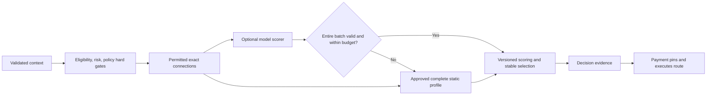
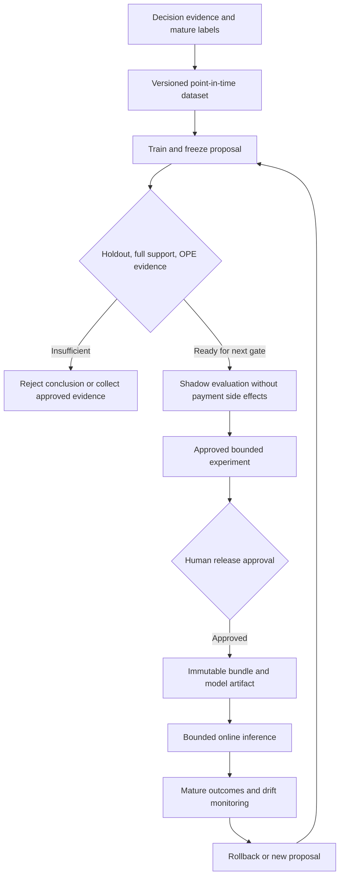
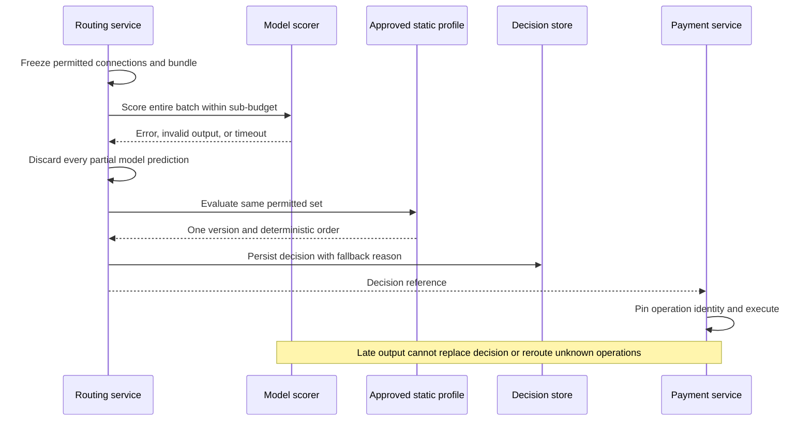

# Chapter 21: Intelligent Routing

[中文](../../part-5-global-routing/intelligent-routing.md) | **English**

Aurora has accumulated several months of routing logs. The data team trains a model to predict payment completion from context and candidate. Offline classification accuracy is high, and the recommended B appears better than A. Release discussion stalls on a simple question: difficult transactions historically went almost entirely to A, while B handled a small familiar population. What proves B will remain better when it receives A's traffic?

Another report records not-yet-observed chargebacks as zero and removes unknown outcomes from evaluation. The model consequently prefers recently added connections whose outcomes have not matured. The problem is not the absence of a deeper network. Training data contains only facts the historical policy allowed us to observe.

The central proposition of this chapter is:

> **A model is a replaceable estimator in the scoring pipeline. It creates no candidates, changes neither eligibility nor risk decisions, and gains no new funds authority. Without trustworthy selection probabilities, complete support, and mature labels, offline numbers cannot establish a new policy's causal advantage. Retaining validated rule-based routing is always a legitimate conclusion.**

This chapter connects [Chapter 8](../part-2-routing-engine/success-rate-routing.md)'s selection bias, [Chapter 9](../part-2-routing-engine/provider-scoring.md)'s scoring interfaces, and [Chapter 16](../part-4-operating-at-scale/experimentation.md)'s experiment contracts. Artifacts still follow [Chapter 20](configuration-platform.md)'s release process; integrated capacity and launch acceptance belong to [Chapter 22](../part-6-case-study/global-payment-routing-platform.md). The companion system has no complete training, model-serving, or off-policy evaluation (OPE) pipeline. These are future designs.

## 21.1 The Problem: Predicting Historical Outcomes Does Not Prove Rerouting Helps

Supervised learning estimates outcomes from observed samples. It does not automatically supply counterfactuals for unselected actions. A transaction through A yields A's evidence. Without executing B, its prediction cannot become an actual approval or capture. Sending payments to both merely to obtain labels crosses the funds-safety boundary.

Classification metrics are not policy metrics. Even excellent prediction of old-policy failures can produce a new ranking that sends large traffic volumes to poorly evidenced connections. AUC, calibration error, offline policy value, and production experiment effects answer different questions. One ROC curve cannot replace release evidence.

Contextual bandits formalize choosing an action from context while observing feedback only for the chosen action. Li and colleagues' news-recommendation research supplies this model and evaluation ideas for randomized logs, but click experiment results do not promise payment gains. Payments also face funds side effects, account capabilities, and risk budgets. [Li et al.: A Contextual-Bandit Approach](https://arxiv.org/abs/1003.0146)

Before introducing a model, establish where existing rules can improve within stable eligible populations, whether labels reliably mature, whether historical selection mechanisms are sufficiently identifiable, and whether expected benefits cover data, model, review, and incident costs. Without these conditions, deferring machine learning is a correct judgment about evidence, not backwardness.

## 21.2 A Simple Design: Replace One Soft Estimate with a Small Model

A minimal model can use a bounded logistic function: `p = sigmoid(b + Σ wj × xj)`. Features are approved, normalized values visible before the decision. The output is a probability with an explicit label definition, not a funds state.

For automatic-capture `SALE`, begin with the label “capture confirmed by evidence within declared H.” Attribute reward to the selected connection's attempt; do not backfill that connection with a later attempt's capture. This is neither a universal authorization rate nor settlement or final economic value. Feed the probability into the matching metric definition, then let Chapter 9's complete scoring profile handle cost, units, and stable ordering.

Models receive only the candidate set produced by hard gates. A disabled connection predicting 99.9% is still ineligible for scoring. Risk `BLOCK`, required authentication, token portability, account contracts, and capacity protection are not negative scores that a probability can offset.



This does not rebuild the fraud engine. PAN, CVV/SAD, tokens, raw device fingerprints, and unapproved personal data never enter model artifacts or routing features. Risk owns its high-dimensional inputs. New fields first undergo purpose, minimization, and schema review; “the model needs it” cannot expand logging boundaries.

## 21.3 Scaling Problems: Establish That the Data Answers the Same Question

### 21.3.1 A Dataset Is an Artifact with Time and Evidence Versions

| Data item | Minimum requirement | Common mistake |
| --- | --- | --- |
| Context/features | Decision-visible values, schema, source, watermark, missingness | Backfill historical online features with post-settlement information |
| Action | Exact candidate + connection revision + operation semantics | Merge different accounts at one PSP into one action |
| Logging policy | Actually applied version, hard gates, degradation path | Record only the model intended for activation |
| Selection probability | True conditional probability of choosing that action then | Substitute success probability or experiment-variant proportion |
| Outcome | Label, H, observation cutoff, evidence/correction version | Zero-fill UNKNOWN or immature chargebacks |
| Evaluation population | Prefrozen population and deduplicated business units | Delete difficult, unfinished, or poor-performing samples |

Separate training, tuning, and final evaluation by time and business identity. Duplicate requests, attempts, and later events for one intent cannot scatter randomly across splits, exposing the evaluation object's future during training. Freeze the target policy before holdout evaluation; repeated selection of the prettiest result cannot retain the original significance interpretation.

Label maturity is not simply “three days elapsed.” Capture, actual fees, and chargebacks have separate observation scopes and evidence watermarks. Unknown funds facts do not become definite failures inside a training table. If a predefined population still lacks outcomes, report mature coverage and reasons, and reject evaluation if necessary. Do not silently retain only answered records. Valid censoring models require their own methods and assumptions; default deletion is not a substitute here.

Chapters 17 and 18's corrections create new dataset/label versions, while old analyses keep original references. A model that performs poorly under new labels can be withdrawn or retrained. Old evaluation files cannot be edited in place to make mistakes disappear.

### 21.3.2 Support Is a Set Relationship for Every Context

Let `μ(a|x)` be the logging policy's probability of choosing action a in context x, and `π(a|x)` the target policy's probability. A key condition for standard importance weighting is:

`For every x in the target population and every a: π(a|x) > 0 ⇒ μ(a|x) > 0.`

This is not a check that selected rows have positive propensity. Historical sampling could not select a zero-probability action anyway. The question is whether the target selects actions the historical policy never allowed in the same context.

| Complete distribution in one context | Historically selected action | Target policy | Conclusion |
| --- | --- | --- | --- |
| μ(A)=1, μ(B)=0 | A, propensity=1 | π(B)=1 | No support; A's positive propensity does not help |
| μ(A)=0.9, μ(B)=0.1 | A or B | π(A)=0.5, π(B)=0.5 | Set support exists; weights and other assumptions still need checking |
| μ(A)=0.999, μ(B)=0.001 | Mostly A | π(B)=1 | Theoretical support, potentially extreme weight concentration |
| Only selected A and p=0.9 stored | A | Target may also select B | Full support cannot be reconstructed; obtain evidence or reject conclusion |

A production replayer reconstructs full distributions from immutable policies, candidate/eligibility snapshots, and all contemporaneous selection conditions. If capacity gates, rule overrides, or model degradation changed selection, record the effective mechanism after that change. Chapter 16's variant-assignment probability is not candidate-exposure probability. Putting the 10% treatment proportion in the denominator computes a different quantity.

A deterministic historical policy may support only one action. Random hash bucketing supplies relevant probabilities only when its assignment mechanism, randomness assumptions, and versions hold. Observing 70% of traffic at A does not make μ(A)=0.7 in every context. Nor can an artificially tiny probability for never-eligible B manufacture coverage.

Restricting the target to evidenced actions can address missing support, but creates another target policy requiring a new version and a newly frozen question. Evaluate a restricted policy, then use its number to endorse the unrestricted original, and the conclusion is invalid. Evidence collection for new connections also needs separate approval; failed offline evaluation does not automatically authorize live-money exploration.

Context-level checks on finite logs establish evaluability only for the reviewed population, not every future country, issuer, or connection. Cold starts and new accounts mean missing evidence, not permission to extrapolate brand averages. The original counterfactual risk minimization research builds learning principles around logged bandit feedback, propensities, and estimator variance, not arbitrary historical logs as complete supervision. [Swaminathan and Joachims: Counterfactual Risk Minimization](https://proceedings.mlr.press/v37/swaminathan15.html)

### 21.3.3 IPS, SNIPS, and ESS Each Establish Only Part of the Picture

For n valid mature observations, define `wi = π(ai|xi) / μ(ai|xi)`, with declared bounded reward `ri`. This chapter uses a fixed `[0,1]` label; monetary and accounting calculations still avoid floating point.

| Quantity | Calculation | Meaning and limitation |
| --- | --- | --- |
| IPS | `Σ wi ri / n` | Estimates target value under selection, support, outcome, and sampling assumptions; finite samples may be unstable |
| SNIPS | `Σ wi ri / Σ wi` | Self-normalized estimate; generally biased in finite samples, cannot repair zero support |
| Weight ESS diagnostic | `(Σ wi)² / Σ wi²` | Measures weight concentration; neither confidence interval nor exact independent sample count |

The original SNIPS paper discusses self-normalization and propensity overfitting, not permission to repeatedly choose policies on one holdout. [The Self-Normalized Estimator](https://proceedings.neurips.cc/paper_files/paper/2015/hash/39027dfad5138c9ca0c474d71db915c3-Abstract.html) Elvira and colleagues examine assumptions and limitations of the common ESS approximation. This book uses it only as a weight-concentration alert. [Rethinking Effective Sample Size](https://arxiv.org/abs/1809.04129)

Consider an extreme teaching example: among 100 observations, one comes from B with probability 0.001, and the target always chooses B. That row has weight 1000. With reward 1, IPS is 10, SNIPS is 1, and weight ESS is 1. Do not silently clip IPS above 1 to “100% success.” These numbers reveal insufficient evidence for a stable conclusion, not tenfold gains from B.

Capping weights can control engineering risk but changes estimator bias. The minimal tool here rejects reports above predeclared thresholds instead of silently clipping to attractive numbers. Doubly robust methods combine reward models and selection-mechanism information and can improve evaluation under their assumptions. The name cannot create observed evidence for entirely unsupported actions. [Dudík et al.: Doubly Robust Policy Evaluation](https://arxiv.org/abs/1103.4601)

### 21.3.4 Go: Without Full Support Evidence, Return No Value Estimate

A trusted replayer must implement `FullDistributions` by reconstructing complete action distributions from the specified context and two pinned policies. Missing original masks, policy versions, or required random mechanisms return errors. A selected action's propensity alone cannot form a supposedly complete map. Real evidence reconstruction remains future work.

```go
package ope

import (
	"context"
	"errors"
	"math"
	"sort"
)

type Row struct {
	UnitID, ContextID, LoggingPolicy, Action, LabelID string
	Propensity, Reward                                float64
	Mature                                            bool
}

type PolicyPair struct {
	ContextID, LoggingPolicy, TargetPolicy string
	Logging, Target                        map[string]float64
}

type Replay interface {
	FullDistributions(context.Context, Row, string) (PolicyPair, error)
}

type Plan struct {
	TargetPolicy, LabelID                string
	MinPropensity, MaxWeight, MinimumESS float64
}

type Report struct {
	N               int
	IPS, SNIPS, ESS float64
	Status          string
}

var ErrInsufficientEvidence = errors.New("insufficient evidence for this target policy")

func finite(value float64) bool {
	return !math.IsNaN(value) && !math.IsInf(value, 0)
}

func distribution(probabilities map[string]float64) bool {
	if len(probabilities) == 0 || len(probabilities) > 64 {
		return false
	}
	actions := make([]string, 0, len(probabilities))
	for action := range probabilities {
		actions = append(actions, action)
	}
	sort.Strings(actions)
	var total float64
	for _, action := range actions {
		probability := probabilities[action]
		if action == "" || !finite(probability) || probability < 0 || probability > 1 {
			return false
		}
		total += probability
	}
	return math.Abs(total-1) <= 1e-9
}

func Estimate(ctx context.Context, replay Replay, rows []Row, plan Plan) (Report, error) {
	if replay == nil || len(rows) == 0 || len(rows) > 1_000_000 ||
		plan.TargetPolicy == "" || plan.LabelID == "" ||
		!finite(plan.MinPropensity) || plan.MinPropensity <= 0 || plan.MinPropensity > 1 ||
		!finite(plan.MaxWeight) || plan.MaxWeight < 1 || plan.MaxWeight > 1_000_000 ||
		!finite(plan.MinimumESS) || plan.MinimumESS < 1 {
		return Report{}, ErrInsufficientEvidence
	}
	seen := make(map[string]bool, len(rows))
	var sumWeight, sumWeightSquared, sumWeightedReward float64
	for _, row := range rows {
		if err := ctx.Err(); err != nil {
			return Report{}, err
		}
		if row.UnitID == "" || seen[row.UnitID] || row.ContextID == "" || row.LoggingPolicy == "" ||
			row.Action == "" || row.LabelID != plan.LabelID || !row.Mature ||
			!finite(row.Propensity) || row.Propensity <= 0 || row.Propensity > 1 ||
			!finite(row.Reward) || row.Reward < 0 || row.Reward > 1 {
			return Report{}, ErrInsufficientEvidence
		}
		seen[row.UnitID] = true
		pair, err := replay.FullDistributions(ctx, row, plan.TargetPolicy)
		if err != nil {
			return Report{}, err
		}
		if pair.ContextID != row.ContextID || pair.LoggingPolicy != row.LoggingPolicy ||
			pair.TargetPolicy != plan.TargetPolicy || !distribution(pair.Logging) || !distribution(pair.Target) {
			return Report{}, ErrInsufficientEvidence
		}
		chosenProbability := pair.Logging[row.Action]
		if chosenProbability <= 0 ||
			math.Abs(chosenProbability-row.Propensity) > 1e-10*math.Max(chosenProbability, row.Propensity) {
			return Report{}, ErrInsufficientEvidence
		}
		// Check every action supported by the target policy, not just this row's action.
		for action, targetProbability := range pair.Target {
			if targetProbability == 0 {
				continue
			}
			loggingProbability := pair.Logging[action]
			if loggingProbability < plan.MinPropensity || targetProbability/loggingProbability > plan.MaxWeight {
				return Report{}, ErrInsufficientEvidence
			}
		}
		weight := pair.Target[row.Action] / row.Propensity
		sumWeight += weight
		sumWeightSquared += weight * weight
		sumWeightedReward += weight * row.Reward
	}
	if sumWeight <= 0 || sumWeightSquared <= 0 || !finite(sumWeight) ||
		!finite(sumWeightSquared) || !finite(sumWeightedReward) {
		return Report{}, ErrInsufficientEvidence
	}
	ess := sumWeight * sumWeight / sumWeightSquared
	if !finite(ess) || ess < plan.MinimumESS {
		return Report{}, ErrInsufficientEvidence
	}
	if err := ctx.Err(); err != nil {
		return Report{}, err
	}
	return Report{
		N: len(rows), IPS: sumWeightedReward / float64(len(rows)),
		SNIPS: sumWeightedReward / sumWeight, ESS: ess, Status: "estimate_only",
	}, nil
}
```

Validation covers the entire frozen population, not row-by-row selection of successes. A missing label, support gap, or duplicate business unit rejects the batch. The replayer cannot remove problem records while retaining the original population name. Durable upstream audits own evidence provenance, population completeness, and context authenticity; Go maps prove none of them.

Even `estimate_only` produces neither “better” nor a confidence interval. Reports also need target/logging policy, dataset, label, and estimator versions, stratified coverage, weight distributions, and dependence/interference assumptions. A model can change shared provider load and affect all transactions; single-step OPE does not simulate full-scale capacity effects. Multistep fallback trajectories cannot directly use these single-step weights either.

Identifiability of selection is equally important. If operators rerouted using unrecorded risk information, replaying the default policy later yields the wrong contemporaneous probabilities. Complete maps and attractive ESS cannot repair distorted evidence. Randomized logs still need verification that assignment and execution agreed; an experiment ID alone does not prove absence of bias.

## 21.4 Production Design: Fit Models Inside Existing Guardrails

### 21.4.1 Training Is Not Publication; Publication Is Not Execution

Aurora now calls training output a proposal. It may seek shadow evaluation, not rewrite production bundles itself. Insufficient evaluation returns for more evidence; a model no better than rules may end the project. The pipeline has no default “training complete, therefore deploy” branch.



Every stage has provenance, owner, and immutable version. Shadows compare predictions and runtime without a second payment. Bounded experiments inherit Chapter 16's assignment, guardrails, and stopping rules. OPE is one input to the next gate, not experiment authorization or an exemption for uncovered populations.

Artifacts pin at least model ID, format, digest, feature schema/order, label and H, training window, applicable candidates/populations, numerical bounds, evaluation report, and expiry. Reports also state calibration population and unsupported regions. Unchanged model version with changed normalization still changes semantics. Feature stores cannot casually supply another version's values online.

Model applicability is an additional soft-estimation gate, not replacement eligibility. A connection may legally accept payments yet fall outside model validation; use the approved static profile instead of extrapolating neighboring-country coefficients. Conversely, strong model validation cannot grant new country, method, or account capabilities.

The data team owns estimators, configuration owns release facts, and payment owns funds operations. Their powers are not interchangeable. NIST AI RMF provides an organizational reference for governance, measurement, and risk management, not payment-compliance certification or a substitute for merchant-specific data-purpose review. [NIST: AI Risk Management Framework](https://www.nist.gov/itl/ai-risk-management-framework)

### 21.4.2 Go: A Reviewable, Bounded Artifact Loader

The first version need not use a remote general-purpose model runtime. A deterministic logistic model over a dozen normalized features makes runtime bounds, artifact content, and offline/online consistency easier to inspect. Complex models are allowed only after proving the same boundaries anew.

This is the semantic layer of strict loading. The byte layer first follows Chapter 20: limit size, reject duplicate/unknown JSON fields, verify digest, signature, and approval, then pass a trusted object to `Load`. Do not decode external requests directly into it. `Schema` comes from an approved registry, where the label ID binds explicit H and maturity rules. The example neither fabricates certificate validation nor implements a feature store.

```go
package model

import (
	"context"
	"errors"
	"math"
	"time"
)

type FeatureSpec struct {
	Name     string
	Min, Max float64
}

type Schema struct {
	ID, LabelID string
	Features    []FeatureSpec
}

type Artifact struct {
	Format, ID, FeatureSchema, LabelID string
	Digest                             [32]byte
	TrainFrom, TrainThrough, ExpiresAt time.Time
	FeatureOrder                       []string
	Weights                            []float64
	Bias                               float64
}

type Vector struct {
	SchemaID  string
	Values    []float64
	Known     []bool
	ExpiresAt time.Time
}

type Model struct {
	id, schemaID string
	digest       [32]byte
	expiresAt    time.Time
	features     []FeatureSpec
	weights      []float64
	bias         float64
}

var ErrUnusable = errors.New("model or feature evidence unusable")

func finite(value float64) bool {
	return !math.IsNaN(value) && !math.IsInf(value, 0)
}

// Load accepts an authenticated artifact and an approved immutable schema.
func Load(artifact Artifact, schema Schema, now time.Time) (*Model, error) {
	n := len(schema.Features)
	if artifact.Format != "bounded_logistic_v1" || artifact.ID == "" || len(artifact.ID) > 128 ||
		artifact.Digest == ([32]byte{}) || schema.ID == "" || schema.LabelID == "" ||
		artifact.FeatureSchema != schema.ID || artifact.LabelID != schema.LabelID ||
		n == 0 || n > 16 || len(artifact.FeatureOrder) != n || len(artifact.Weights) != n ||
		artifact.TrainFrom.IsZero() || !artifact.TrainFrom.Before(artifact.TrainThrough) ||
		artifact.TrainThrough.After(now) || !now.Before(artifact.ExpiresAt) ||
		!finite(artifact.Bias) || math.Abs(artifact.Bias) > 32 {
		return nil, ErrUnusable
	}
	seen := make(map[string]bool, n)
	for i, feature := range schema.Features {
		if feature.Name == "" || len(feature.Name) > 64 || seen[feature.Name] ||
			artifact.FeatureOrder[i] != feature.Name ||
			!finite(feature.Min) || !finite(feature.Max) ||
			feature.Min < -1 || feature.Max > 1 || feature.Min >= feature.Max ||
			!finite(artifact.Weights[i]) || math.Abs(artifact.Weights[i]) > 32 {
			return nil, ErrUnusable
		}
		seen[feature.Name] = true
	}
	return &Model{
		id: artifact.ID, schemaID: schema.ID, digest: artifact.Digest,
		expiresAt: artifact.ExpiresAt,
		features:  append([]FeatureSpec(nil), schema.Features...),
		weights:   append([]float64(nil), artifact.Weights...), bias: artifact.Bias,
	}, nil
}

func (m *Model) Probability(ctx context.Context, vector Vector, now time.Time) (float64, error) {
	if err := ctx.Err(); err != nil {
		return 0, err
	}
	if m == nil || vector.SchemaID != m.schemaID || !now.Before(m.expiresAt) ||
		!now.Before(vector.ExpiresAt) || len(vector.Values) != len(m.features) ||
		len(vector.Known) != len(m.features) {
		return 0, ErrUnusable
	}
	z := m.bias
	for i, feature := range m.features {
		if err := ctx.Err(); err != nil {
			return 0, err
		}
		value := vector.Values[i]
		if !vector.Known[i] || !finite(value) || value < feature.Min || value > feature.Max {
			return 0, ErrUnusable
		}
		z += m.weights[i] * value
	}
	var probability float64
	if z >= 0 {
		probability = 1 / (1 + math.Exp(-z))
	} else {
		exp := math.Exp(z)
		probability = exp / (1 + exp)
	}
	if err := ctx.Err(); err != nil {
		return 0, err
	}
	return probability, nil
}
```

`Known` represents missingness explicitly. Missing age, unavailable health, and unknown account capabilities cannot all become zero. Zero is valid only under the schema's normalization semantics. Unknown hard capabilities were already excluded before this function and cannot return through default features.

`now` is trusted time obtained by routing for this evaluation, not merchant-selected time. The built model copies parameters instead of retaining external mutable slices. Feature vectors also belong to the context snapshot. One decision cannot use old normalization first and new weights just written by training halfway through.

### 21.4.3 Fallback Uses a Complete Profile, Not Half a Prediction

Suppose A receives 0.8 before model timeout while B returns nothing. Keeping A's model score and giving B a rule score mixes units and population definitions in one ranking. Discard the entire model batch and evaluate all eligible candidates through one approved fallback profile.

This batch processor expresses that boundary. The model returns candidate `SuccessPPM`, then passes it to Chapter 9's same-version complete scorer. The static path returns an approved deterministic order, not fabricated probabilities. Load `StaticProfile` and `Scorer` only from the current approved bundle, never payment requests.

```go
package model

import (
	"context"
	"errors"
	"math"
	"sort"
	"time"
)

type Candidate struct {
	ID     string
	Vector Vector
}

type StaticProfile struct {
	Version   string
	Digest    [32]byte
	ExpiresAt time.Time
	Order     []string
}

type Scorer struct {
	Version     string
	Digest      [32]byte
	Probability func(context.Context, Vector, time.Time) (float64, error)
}

type Prediction struct {
	CandidateID string
	SuccessPPM  int64
}

type Batch struct {
	Mode, Version, Reason string
	Digest                [32]byte
	Predictions           []Prediction
	Order                 []string
}

func ScoreBatch(ctx context.Context, allowed []Candidate, scorer *Scorer,
	fallback StaticProfile, now time.Time, budget time.Duration) (Batch, error) {
	if err := ctx.Err(); err != nil {
		return Batch{}, err
	}
	if len(allowed) == 0 || len(allowed) > 64 || budget <= 0 || budget > 50*time.Millisecond ||
		fallback.Version == "" || fallback.Digest == ([32]byte{}) ||
		!now.Before(fallback.ExpiresAt) || len(fallback.Order) > 4096 {
		return Batch{}, ErrUnusable
	}
	ids := make(map[string]bool, len(allowed))
	for _, candidate := range allowed {
		if candidate.ID == "" || ids[candidate.ID] {
			return Batch{}, ErrUnusable
		}
		ids[candidate.ID] = true
	}
	var staticOrder []string
	seen := make(map[string]bool, len(fallback.Order))
	for _, id := range fallback.Order {
		if id == "" || seen[id] {
			return Batch{}, ErrUnusable
		}
		seen[id] = true
		if ids[id] {
			staticOrder = append(staticOrder, id)
		}
	}
	if len(staticOrder) != len(allowed) {
		return Batch{}, ErrUnusable
	}
	useStatic := func(reason string) (Batch, error) {
		if err := ctx.Err(); err != nil {
			return Batch{}, err
		}
		return Batch{Mode: "static", Version: fallback.Version, Digest: fallback.Digest,
			Reason: reason, Order: staticOrder}, nil
	}
	if scorer == nil || scorer.Version == "" || scorer.Digest == ([32]byte{}) || scorer.Probability == nil {
		return useStatic("model_unavailable")
	}
	inferenceCtx, cancel := context.WithTimeout(ctx, budget)
	defer cancel()
	ordered := append([]Candidate(nil), allowed...)
	sort.Slice(ordered, func(i, j int) bool { return ordered[i].ID < ordered[j].ID })
	var predictions []Prediction
	for _, candidate := range ordered {
		probability, err := scorer.Probability(inferenceCtx, candidate.Vector, now)
		if err != nil || inferenceCtx.Err() != nil {
			reason := "model_error"
			if errors.Is(err, context.DeadlineExceeded) || inferenceCtx.Err() != nil {
				reason = "model_budget_exhausted"
			}
			return useStatic(reason)
		}
		if !finite(probability) || probability < 0 || probability > 1 {
			return useStatic("invalid_model_output")
		}
		predictions = append(predictions, Prediction{CandidateID: candidate.ID,
			SuccessPPM: int64(math.Round(probability * 1_000_000))})
	}
	return Batch{Mode: "model", Version: scorer.Version, Digest: scorer.Digest,
		Predictions: predictions}, nil
}
```

The example's fifty milliseconds is a code limit, not a book-wide production SLO. Allocate the real budget from the routing deadline, preserving time for static decisions and durable evidence. A canceled parent request returns an error; exhausted total budget cannot masquerade as successful degradation.

Go `context` supports cooperative cancellation, not forcible termination of functions that ignore it. This bounded local model checks at most sixteen features. Remote inference additionally needs connection/read/concurrency/queue limits and cancellation compliance. Wrapping unlimited work in a goroutine does not create resource bounds. [Go: context](https://pkg.go.dev/context)



Decisions record model, feature, complete scorer, fallback, and bundle versions with bounded reason codes. Do not copy high-dimensional sensitive features into ordinary logs. Fallback changes only new decisions before funds-operation creation. Unknown pinned operations still query and converge through their original connections, regardless of a new model's preference.

## 21.5 Failure Modes: Make Unsupported Cleverness Fail Reliably

One successful prediction test does not establish launch readiness. Valuable cases appear profitable but lack evidence or authority. The following fixed replayer fixture validates rejection paths, not durable reconstruction of complete distributions.

```go
package ope

import (
	"context"
	"errors"
	"math"
	"testing"
)

type fixedReplay struct {
	logging, target map[string]float64
}

func (f fixedReplay) FullDistributions(_ context.Context, row Row, target string) (PolicyPair, error) {
	return PolicyPair{ContextID: row.ContextID, LoggingPolicy: row.LoggingPolicy,
		TargetPolicy: target, Logging: f.logging, Target: f.target}, nil
}

func TestPositiveChosenPropensityDoesNotProveSupport(t *testing.T) {
	rows := []Row{{UnitID: "intent-1", ContextID: "context-1", LoggingPolicy: "old-v1",
		Action: "A@7", LabelID: "capture-h-v1", Propensity: 1, Reward: 1, Mature: true}}
	replay := fixedReplay{logging: map[string]float64{"A@7": 1, "B@3": 0},
		target: map[string]float64{"A@7": 0, "B@3": 1}}
	plan := Plan{TargetPolicy: "new-v1", LabelID: "capture-h-v1",
		MinPropensity: 0.001, MaxWeight: 1000, MinimumESS: 1}
	if report, err := Estimate(context.Background(), replay, rows, plan); !errors.Is(err, ErrInsufficientEvidence) || report.Status != "" {
		t.Fatalf("unsupported B must produce no report: %+v, %v", report, err)
	}
}

func TestEvidenceAndESSGates(t *testing.T) {
	base := []Row{
		{UnitID: "i-1", ContextID: "x-1", LoggingPolicy: "old", Action: "A@7",
			LabelID: "capture-h-v1", Propensity: 0.5, Reward: 1, Mature: true},
		{UnitID: "i-2", ContextID: "x-2", LoggingPolicy: "old", Action: "B@3",
			LabelID: "capture-h-v1", Propensity: 0.5, Reward: 0, Mature: true},
	}
	replay := fixedReplay{logging: map[string]float64{"A@7": 0.5, "B@3": 0.5},
		target: map[string]float64{"A@7": 0.5, "B@3": 0.5}}
	plan := Plan{TargetPolicy: "new", LabelID: "capture-h-v1",
		MinPropensity: 0.01, MaxWeight: 10, MinimumESS: 2}
	report, err := Estimate(context.Background(), replay, base, plan)
	if err != nil || report.IPS != 0.5 || report.SNIPS != 0.5 || report.ESS != 2 ||
		report.Status != "estimate_only" {
		t.Fatalf("valid fixture: %+v, %v", report, err)
	}
	for name, mutate := range map[string]func([]Row){
		"immature":         func(rows []Row) { rows[1].Mature = false },
		"wrong propensity": func(rows []Row) { rows[0].Propensity = 0.25 },
		"duplicate unit":   func(rows []Row) { rows[1].UnitID = rows[0].UnitID },
		"NaN reward":       func(rows []Row) { rows[0].Reward = math.NaN() },
	} {
		t.Run(name, func(t *testing.T) {
			rows := append([]Row(nil), base...)
			mutate(rows)
			if _, err := Estimate(context.Background(), replay, rows, plan); err == nil {
				t.Fatal("invalid evidence accepted")
			}
		})
	}
	plan.MinimumESS = 3
	if _, err := Estimate(context.Background(), replay, base, plan); err == nil {
		t.Fatal("two effective observations cannot meet an ESS gate of three")
	}
}
```

Online tests must prove one bad value cannot contaminate half a ranking. Candidates come from hard gates, so C cannot appear in this response even if the approved static list contains it. Real integration must test that actual eligibility rejects the highest-predicted illegal candidate. A model-package input contract alone cannot prove the full chain.

```go
package model

import (
	"context"
	"errors"
	"math"
	"reflect"
	"testing"
	"time"
)

func fixture(t *testing.T) (*Model, Artifact, Schema, Vector, time.Time) {
	t.Helper()
	now := time.Date(2026, 1, 2, 0, 0, 0, 0, time.UTC)
	schema := Schema{ID: "f-v1", LabelID: "capture-h-v1",
		Features: []FeatureSpec{{Name: "bucket", Min: 0, Max: 1}}}
	artifact := Artifact{Format: "bounded_logistic_v1", ID: "m-v1",
		FeatureSchema: schema.ID, LabelID: schema.LabelID, Digest: [32]byte{1},
		TrainFrom: now.Add(-48 * time.Hour), TrainThrough: now.Add(-24 * time.Hour),
		ExpiresAt: now.Add(time.Hour), FeatureOrder: []string{"bucket"}, Weights: []float64{1}}
	vector := Vector{SchemaID: schema.ID, Values: []float64{0.5},
		Known: []bool{true}, ExpiresAt: now.Add(time.Minute)}
	m, err := Load(artifact, schema, now)
	if err != nil {
		t.Fatal(err)
	}
	return m, artifact, schema, vector, now
}

func TestLoaderAndFeatureBoundaries(t *testing.T) {
	m, artifact, schema, vector, now := fixture(t)
	before, err := m.Probability(context.Background(), vector, now)
	if err != nil || before <= 0.5 || before >= 1 {
		t.Fatalf("invalid bounded inference: %v, %v", before, err)
	}
	artifact.Weights[0] = 20
	schema.Features[0].Max = 0.1
	after, err := m.Probability(context.Background(), vector, now)
	if err != nil || before != after {
		t.Fatal("loaded model retained mutable external slices")
	}
	_, validArtifact, validSchema, _, _ := fixture(t)
	for name, mutate := range map[string]func(*Artifact){
		"NaN":          func(a *Artifact) { a.Bias = math.NaN() },
		"Inf":          func(a *Artifact) { a.Bias = math.Inf(1) },
		"schema":       func(a *Artifact) { a.FeatureSchema = "unknown" },
		"expired":      func(a *Artifact) { a.ExpiresAt = now },
		"future train": func(a *Artifact) { a.TrainThrough = now.Add(time.Second) },
	} {
		t.Run(name, func(t *testing.T) {
			candidate := validArtifact
			mutate(&candidate)
			if _, err := Load(candidate, validSchema, now); err == nil {
				t.Fatal("unusable artifact loaded")
			}
		})
	}
	vector.Values[0] = math.NaN()
	if _, err := m.Probability(context.Background(), vector, now); err == nil {
		t.Fatal("NaN feature accepted")
	}
	vector.Values[0], vector.Known[0] = 0, false
	if _, err := m.Probability(context.Background(), vector, now); err == nil {
		t.Fatal("unknown feature silently filled with zero")
	}
}

func TestWholeBatchFallbackPreservesAllowedSet(t *testing.T) {
	_, _, _, vector, now := fixture(t)
	allowed := []Candidate{{ID: "A@7", Vector: vector}, {ID: "B@3", Vector: vector}}
	fallback := StaticProfile{Version: "static-v4", Digest: [32]byte{4},
		ExpiresAt: now.Add(time.Hour), Order: []string{"C@9", "B@3", "A@7"}}
	for _, mode := range []string{"NaN", "Inf", "timeout"} {
		t.Run(mode, func(t *testing.T) {
			calls := 0
			scorer := &Scorer{Version: "model-v2", Digest: [32]byte{2},
				Probability: func(ctx context.Context, _ Vector, _ time.Time) (float64, error) {
					calls++
					if calls == 1 {
						return 0.8, nil
					}
					if mode == "timeout" {
						<-ctx.Done()
						return 0, ctx.Err()
					}
					if mode == "Inf" {
						return math.Inf(1), nil
					}
					return math.NaN(), nil
				}}
			batch, err := ScoreBatch(context.Background(), allowed, scorer, fallback, now, 50*time.Millisecond)
			if err != nil || calls != 2 || batch.Mode != "static" || batch.Version != fallback.Version ||
				batch.Digest != fallback.Digest || len(batch.Predictions) != 0 ||
				!reflect.DeepEqual(batch.Order, []string{"B@3", "A@7"}) {
				t.Fatalf("partial model or excluded candidate escaped: %+v, %v", batch, err)
			}
		})
	}
	ctx, cancel := context.WithCancel(context.Background())
	cancel()
	if _, err := ScoreBatch(ctx, allowed, nil, fallback, now, time.Millisecond); !errors.Is(err, context.Canceled) {
		t.Fatal("expired parent request must not pretend to succeed through fallback")
	}
}

func TestModelModeCannotCreateCandidate(t *testing.T) {
	m, _, _, vector, now := fixture(t)
	scorer := &Scorer{Version: m.id, Digest: m.digest, Probability: m.Probability}
	fallback := StaticProfile{Version: "static-v4", Digest: [32]byte{4},
		ExpiresAt: now.Add(time.Hour), Order: []string{"C@9", "A@7"}}
	batch, err := ScoreBatch(context.Background(), []Candidate{{ID: "A@7", Vector: vector}},
		scorer, fallback, now, 50*time.Millisecond)
	if err != nil || batch.Mode != "model" || len(batch.Order) != 0 ||
		len(batch.Predictions) != 1 || batch.Predictions[0].CandidateID != "A@7" ||
		batch.Predictions[0].SuccessPPM != 622459 {
		t.Fatalf("model must only estimate the allowed connection: %+v, %v", batch, err)
	}
}
```

| Failure or misuse | Required result | System evidence still needed |
| --- | --- | --- |
| Model favors ineligible candidate | Candidate excluded before model | Combined real rule/risk/eligibility tests |
| Unknown schema, expired model, missing feature | Model rejects; complete approved scorer takes over | Bundle dependency closure and validity tests |
| One candidate returns NaN, Inf, or timeout | Discard all partial predictions; bounded reason recorded | Total deadline, concurrency, queue bounds |
| Selected propensity positive, target action unsupported | No offline value report | Immutable full distributions and frozen-population replay |
| Immature labels, concentrated weights | Not evaluable or insufficient evidence | Label watermarks, stratified coverage, variance analysis |
| Provider timeout produces unknown state | Recover original operation, never invoke model to switch PSP | Payment/gateway/reconciliation failure tests |

Drift monitoring needs more than mean model output. Feature coverage/missingness, calibration, technical failures, mature capture outcomes, and economic outcomes have separate windows. Distinguish pipeline damage, traffic composition change, and genuine concept drift before interpreting decline. None automatically authorizes more exploration or treating immature outcomes as failures.

Rollback follows Chapter 20's monotonic publication. A new release can reference still-valid old model content without lowering generation, restoring revoked signatures, or relaxing hard gates. If its feature schema is no longer supplied, that “last-known-good” is no longer usable. Choose a currently valid rule profile rather than accept unknown inputs to restore historical scores.

## 21.6 Trade-offs: Choose Complexity That Can Be Proven

Rules are explainable, deterministic, and inexpensive to evidence. Supervised models can improve soft estimates within the same legal space. Contextual bandits additionally require explainable propensities and explicit exploration authority. These are not mandatory rungs of a maturity ladder. Offline accuracy cannot alone offset added model risk.

Exploration never sends money randomly to any connection. It operates within shared hard gates and merchant, capacity, amount-exposure, risk, and experiment budgets. Persist exploration policy and propensities with decisions before execution; do not infer them afterward from traffic frequencies. If safety gates override selection, record the effective mechanism. If reconstruction is impossible, mark it unevaluable.

Reinforcement learning that includes retries, authentication, capture, and refund as actions requests new business-control authority, not merely a replacement scorer. This book does not implement autonomous real-money policies of that kind. Future multistep research must still constrain actions through original domain state machines: UNKNOWN is not low reward permitting a PSP switch, and capture cannot justify exploring another payment path.

Routing v3 already feeds versioned costs and observational performance into one constrained scoring pipeline; payment pins full candidate order and optimization snapshots. This is an auditable non-ML baseline, not a model platform. The repository still lacks production `services/router/internal/model`, feature pipelines, experiment/shadow runtime, and complete `tools/routing-replay` OPE tools. These Go blocks are independently compilable future increments: first connect bounded loading and pure scoring to shadows, then add persistent distribution evidence and mature-label replay. Without service integration, cross-component regression, and release CI, intelligent routing is not live.

The narrowest next step chooses a fixed population with existing eligible traffic and maturing labels, freezes schema and a small model, and compares shadow predictions, rejection reasons, and inference budgets. If logs lack support, the output may legitimately be a report of evidence gaps rather than an invented improvement percentage. Chapter 22 places gate-passing capabilities into the platform's launch sequence.

## 21.7 Recap

The difficulty in intelligent routing is not calculating a score but knowing when that score may participate. Eligibility and risk define the action space. Mature labels and true logging propensities define what history can teach. Full-support checks and weight diagnostics identify offline questions that cannot yet be answered.

Model artifacts have immutable provenance, times, and versions; inference has numerical and resource bounds. Any incomplete result returns to one approved scorer. Learning can propose better estimates, but cannot bypass established funds authority, unknown-state recovery, or audit facts. Clear boundaries make worthwhile optimization safer to attempt.
