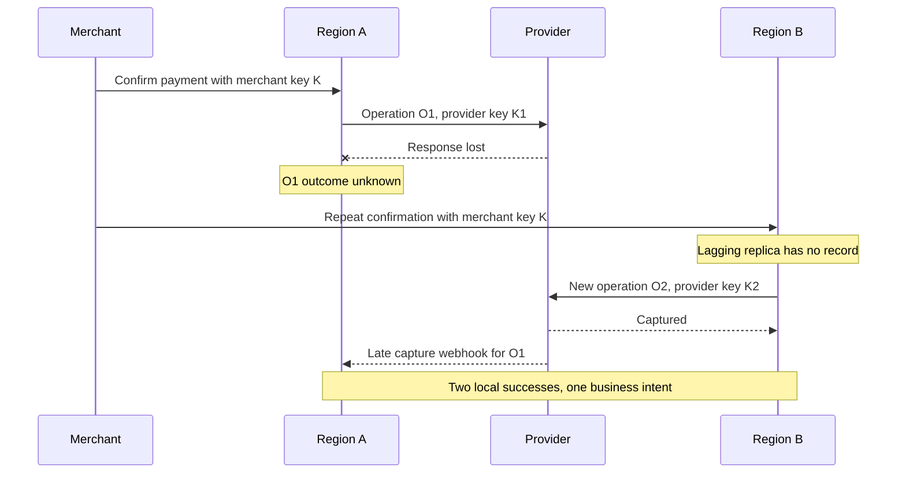
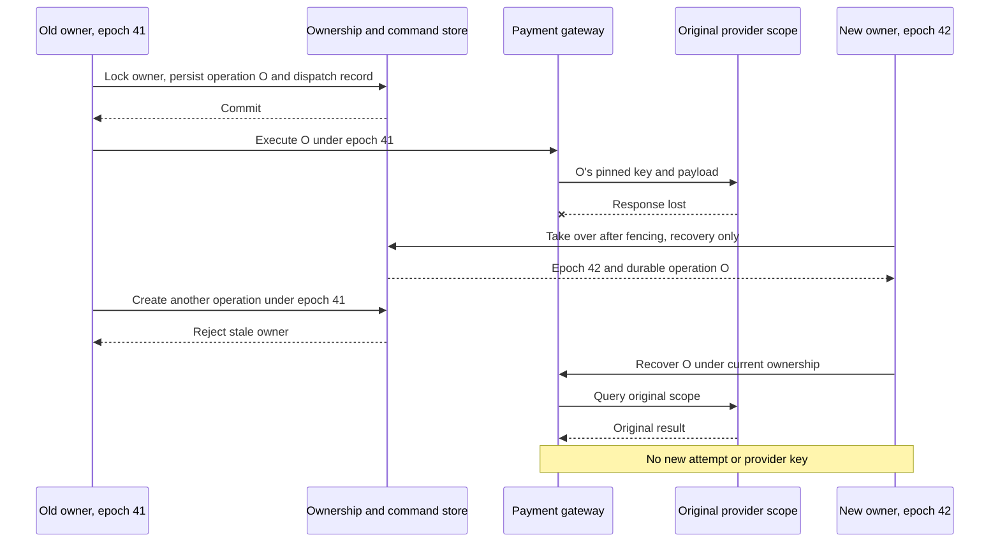
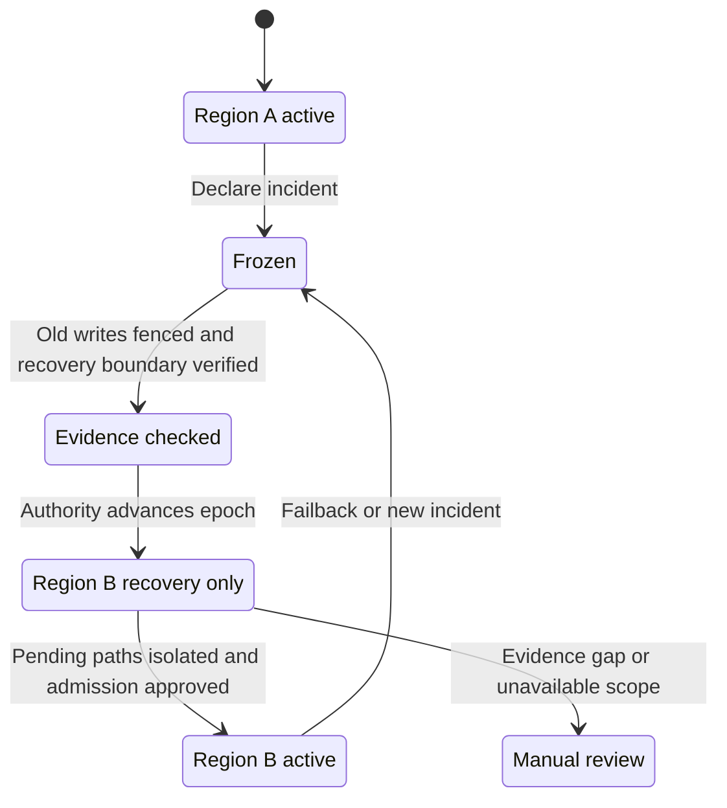
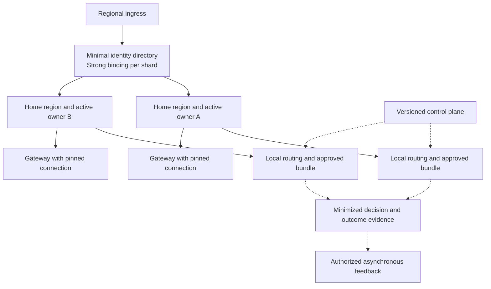

# Chapter 19: Multi-Region Payment Routing

[中文](../../part-5-global-routing/multi-region.md) | **English**

Aurora runs reliably in North America. European merchants complain about transatlantic latency, and the business wants a regional outage to stop affecting every country. Engineers replicate payment, routing, and gateway services into Europe, distribute traffic with geographic DNS, and asynchronously replicate the payment database. In the first exercise, the US ingress becomes unreachable. Europe receives a repeated merchant confirmation, finds no idempotency record, creates a new payment operation, and sends it to the same PSP's European endpoint.

Minutes later, US webhooks resume. Each region has a successful record and believes it respected local uniqueness constraints. The problem is not slow load-balancer failover. Receiving requests and having authority to create funds side effects were treated as the same question.

The central proposition of this chapter is:

> **Routing services may compute independently in several regions, but each payment intent needs one execution owner. Regional failover transfers authority using evidence, versions, and fencing; it is not a DNS change. An already dispatched unknown operation remains bound to its original provider connection, account, provider region, idempotency key, and payload. Moving platform execution regions cannot turn it into a new payment.**

[Chapter 17](../part-4-operating-at-scale/reconciliation.md) establishes fact discovery and repair authority; [Chapter 18](../part-4-operating-at-scale/settlement.md) links economic outcomes. This chapter tests that ownership during cross-region failures. Configuration approval/distribution belongs to [Chapter 20](configuration-platform.md), and complete capacity budgeting to [Chapter 22](../part-6-case-study/global-payment-routing-platform.md). The companion system remains a single-logical-region PostgreSQL slice. Connection identity has entered its design and implementation, but that alone does not implement a multi-region ownership protocol.

## 19.1 The Problem: One DNS Name Cannot Coordinate Two Idempotency Stores

This code captures a dangerous intuition: when the local network fails, try a remote address.

```go
package naiveregion

import "context"

type RegionClient interface {
	Confirm(context.Context, string, string) error
}

// UnsafeFailover is a counterexample, not a payment retry policy.
func UnsafeFailover(ctx context.Context, local, remote RegionClient,
	intentID, merchantKey string) error {
	if err := local.Confirm(ctx, intentID, merchantKey); err == nil {
		return nil
	}
	return remote.Confirm(ctx, intentID, merchantKey)
}
```

Even with the same merchant idempotency key, the remote region must locate the same business identity and prove its execution authority. Independent regional `(merchant_id, key)` indexes prove only local uniqueness, not that another region has not committed. A missing record in a lagging replica is not evidence of absence. A network partition cannot tell the European process whether the US worker is dead, paused, or still communicating with the PSP.



Forcing the provider key to the same string is still insufficient. Adyen's public contract scopes idempotency storage to company accounts and does not check duplicates across regional endpoints. “Same brand, same key, different endpoint” therefore does not establish global deduplication. [Adyen: API Idempotency](https://docs.adyen.com/development-resources/api-idempotency)

Multi-region design must first preserve existing invariants: one business intent, immutable funds operations, explainable evidence, and one writer entitled to advance them. Availability cannot improve by weakening these constraints to regional scope.

## 19.2 A Simple Design: Active-Active Ingress, Single Ownership per Intent

### 19.2.1 Four Regions Are Not One Field

| Name | Meaning | Changes after an ingress failure? |
| --- | --- | --- |
| Ingress region | Location receiving merchant HTTP requests | May change; grants no funds-write authority |
| Home region | Business-data ownership fixed when intent is created | Usually unchanged; formal migration is a separate process |
| Execution region | Platform region currently authorized to execute/recover the intent | May change through controlled handoff |
| Provider region | PSP execution/idempotency scope of pinned connection | Cannot change for an existing operation merely because platform region changes |

European ingress can safely forward confirmation of a US intent to its US owner. This neither recreates the intent nor reroutes payment. If the US owner fails, European ingress can offer read-only queries or explicitly report temporary inability to execute. An ownership protocol, not ingress health checks, determines whether Europe may take over writes.

The smallest useful design partitions single writers by merchant or intent. Different partitions can simultaneously live in several regions, so the overall system serves multi-region traffic while each partition has one authoritative write location at a time. Global arbitrary-node writes to the same row are unnecessary to obtain latency, isolation, and geographic-deployment benefits.

### 19.2.2 Find the Same Intent Before Deciding Who May Execute

A minimal global directory can store `merchant_scope + business_key_digest → intent_id + home_region`, plus creation status and request digest. The key may be a public API idempotency key or predefined merchant business reference, but must preserve [Chapter 11](../part-3-reliability/idempotency.md)'s contract and scope across regions.

The directory needs one linearizable “reserve or read existing binding,” not independent empty reads followed by regional writes. Same key/different digest remains a conflict. Concurrent creates with the same key return one intent ID. If the home database is unavailable, retain `reserved` and materialize idempotently using that ID in the background. Never delete the reservation so another region can allocate a replacement.

This creates a commit gap between directory and regional database, but the gap is explicit: `reserved → materialized` advances only forward; creation is not reported successful before materialization; recovery retries the original ID and digest. The global directory contains no tokens, full merchant requests, or PAN, and digests are not inherently anonymous. Losing write quorum means refusing new business identities, not letting regions create independently and deduplicating later.

Global does not require one central database. Merchant sharding can confine each shard's consistency scope to an approved disaster-recovery group. What matters is one authoritative arbitration point per key, without simultaneously promoting mutually unaware authorities—not whether a product is called a “global database.”

## 19.3 Scaling Problems: Different Data Needs Different Consistency

Putting all state into synchronous intercontinental transactions introduces the slowest link into every payment. Making everything asynchronous loses unique identities and execution history. Ask for each dataset: does losing a record merely slow service, worsen a choice, or risk another charge?

| Data | Consistency and replication principle | Permitted behavior when lagging |
| --- | --- | --- |
| Merchant-key-to-intent directory | Strong consistency and unique binding within shard | Refuse creation when binding cannot be established |
| Intents, attempts, operations, provider keys | Transactional consistency under owner; complete pre-execution evidence on recovery | Read-only/review for missing intervals; never fabricate funds operations |
| Ownership epoch and execution permits | Atomic validation with protected writes | Stop new side effects when current authority cannot be established |
| Rule, capability, fee, model bundles | Complete atomic regional versions; controlled cross-region lag | Use approved last-known-good version and record actual version |
| Provider health | Scoped by execution region, connection, operation, with TTL | Degrade under safety policy on expiry; do not borrow another region's green light |
| Performance and actual-cost aggregates | Asynchronous, with windows, watermarks, coverage | Mark missing/stale estimates instead of pretending current facts |
| Decisions, inbox/outbox, reconciliation evidence | Projections may lag; retain execution linkage and replay idempotently | Show lag and retain recovery entry points |
| Tokens and secret references | Accessible only within authorization/residency boundaries | Stop if inaccessible; never copy across regions to bypass restrictions |

PostgreSQL distinguishes asynchronous replication's data-loss window from synchronous replication's acknowledgment wait. A stricter commit mode must specify replica locations, acknowledgment conditions, and behavior after disconnection. “Replication enabled” does not automatically mean zero data loss. [PostgreSQL: Standby Servers and Synchronous Replication](https://www.postgresql.org/docs/current/warm-standby.html)

### 19.3.1 Payment Execution RPO Cannot Copy the Analytics Warehouse's

If the primary is destroyed after dispatch and the standby lacks the operation, provider key, and request digest, necessary evidence for safe resending is gone. Losing only two seconds overall can still lose requests already producing external side effects. The standby must not generate new keys because its table has no record.

The production contract must therefore protect durable pre-dispatch evidence under its stated failure model. For example, require confirmed replication within approved failure domains before external dispatch, and block new execution for intervals whose completeness cannot be established. Recovery also checks gateway dispatch records, inbox/outbox watermarks, and provider evidence. Preserving acknowledged writes is not an absolute promise against every disaster; replica corruption, operational mistakes, recovery timelines, and configuration still matter.

RTO describes tolerable service interruption; RPO describes tolerable recovery gaps. They are business objectives, not component names. Time payment-ingress restoration, convergence of old unknown operations, and settlement-projection catch-up separately. A green `/readyz` does not establish complete recovery. [AWS: Recovery Objectives](https://aws.amazon.com/disaster-recovery/faqs/)

### 19.3.2 Restoring an Old Backup Also Restores Old Authority

Ownership records are not ordinary rebuildable caches. Restoring yesterday's coordination database may restore an epoch below versions already issued to workers. A simple `epoch + 1` may reuse historical authority. Disaster recovery must prove the authoritative timeline has not regressed, or establish a new authority generation, revoke every old generation, and reconcile evidence for the missing window.

This does not mean every service invents random generations. One authorized recovery process must publish them, and all funds-command boundaries must recognize them. Old gateways, databases, and unupdated egress paths cannot keep accepting old authority. If fencing cannot be completed, extend write downtime instead of equating a successfully extracted backup with safe promotion. Backup, restore, and fencing exercises must be accepted together.

## 19.4 Production Design: Leases Enable Handoff; Epochs Reject Stale Writers

### 19.4.1 Heartbeat Timeout Does Not Prove the Old Process Stopped

Suppose a US worker holds a lease, passes a check, then pauses for ten seconds. After expiry, the coordinator moves ownership to Europe. When the US process resumes, a one-time function-entry lock check still lets it write the database/outbox or call the gateway. A lease determines when handoff may begin; it cannot erase a process's remembered permission.

Each handoff gets a monotonically increasing `ownership_epoch`. Persistence rejects commands below the current epoch, and the gateway cannot treat an arbitrary request-header epoch as authority. Coordination storage determines lease time, without assuming synchronized application clocks. Epochs are versions, not passwords; callers still need service identity and authorization.

The easiest first proof places the ownership row and protected payment writes in one PostgreSQL transaction. Lock ownership, check region/epoch/lease/mode, create attempt/operation/outbox, and commit together. Handoff locks the same row. “Ask etcd, then write another database” does not create atomic fencing. etcd's concurrency API likewise combines lock ownership with transaction conditions; it does not automatically extend transactions to another database or PSP. [etcd: Concurrency API](https://etcd.io/docs/v3.6/dev-guide/api_concurrency_reference_v3/)

```go
package regionownership

import (
	"errors"
	"time"
)

type Permit struct {
	IntentID string
	Region   string
	Epoch    int64
}

type Lease struct {
	IntentID   string
	Region     string
	Epoch      int64
	ValidUntil time.Time
	Mode       string // active, recovery_only, frozen
}

var ErrFenced = errors.New("execution owner is not current")

// Check runs while holding the ownership-row lock and uses database time.
// It does not itself authorize subsequent network requests.
func Check(lease Lease, permit Permit, dbNow time.Time, newFunds bool) error {
	if lease.IntentID == "" || permit.Region == "" || permit.Epoch <= 0 ||
		lease.IntentID != permit.IntentID || lease.Region != permit.Region ||
		lease.Epoch != permit.Epoch || !dbNow.Before(lease.ValidUntil) {
		return ErrFenced
	}
	if lease.Mode != "active" && lease.Mode != "recovery_only" {
		return ErrFenced
	}
	if newFunds && lease.Mode != "active" {
		return ErrFenced
	}
	return nil
}
```

This is a compilable pure predicate, not a distributed lock implementation. Embed it in the storage transaction. Checking a `Lease` cached in-process for ten minutes has different semantics. Database locks protect competing writes; they cannot undo an external charge. [PostgreSQL: Explicit Locking](https://www.postgresql.org/docs/current/explicit-locking.html)

### 19.4.2 Commit Authorization Checks and Durable Commands Together

The interface deliberately omits a convenient “read lease, then let caller write anything” method. The storage adapter locks ownership, reads database time, validates permission, and persists the command in one transaction. `InsertOnce` checks consistency of operation identity and immutable request digest. Event and command commit together.

```go
package fencedcommand

import (
	"context"
	"errors"
)

type Permit struct {
	IntentID string
	Region   string
	Epoch    int64
}

type Command struct {
	OperationID        string
	IntentID           string
	ConnectionID       string
	ConnectionRevision string
	NamespaceID        string
	PayloadDigest      string
	ProviderKey        string
}

type OwnedTx interface {
	InsertOnce(context.Context, Command) error
	AppendDispatchEvent(context.Context, Command) error
}

type Store interface {
	// Implementations must lock ownership and intent, validate the current permit in active mode,
	// and commit fn and outbox records atomically.
	WithActiveOwnership(context.Context, Permit, func(OwnedTx) error) error
}

func Prepare(ctx context.Context, store Store, permit Permit, cmd Command) error {
	if permit.IntentID == "" || permit.Region == "" || permit.Epoch <= 0 ||
		cmd.IntentID != permit.IntentID || cmd.OperationID == "" ||
		cmd.ConnectionID == "" || cmd.ConnectionRevision == "" ||
		cmd.NamespaceID == "" || cmd.PayloadDigest == "" || cmd.ProviderKey == "" {
		return errors.New("incomplete or mismatched command identity")
	}
	return store.WithActiveOwnership(ctx, permit, func(tx OwnedTx) error {
		if err := tx.InsertOnce(ctx, cmd); err != nil {
			return err
		}
		return tx.AppendDispatchEvent(ctx, cmd)
	})
}
```

Storage code is omitted, not constraints. The adapter must validate `cmd.IntentID == permit.IntentID`, required fields, and payment-state permission for a new operation, and ensure duplicate commands do not add duplicate dispatch events. The interface describes a transaction boundary; an in-memory test cannot replace dual-region concurrency tests against a real database.

A durable dispatch event may be delivered at least once or reach the gateway only after handoff. Gateway execution permission must link the operation, current owner, and original funds identity. Reject new commands from stale epochs. The new owner explicitly claims recovery of known operations with original keys and payloads; changing an old message's region field does not make a new request. Separate payment/gateway databases need a provable acceptance/claim protocol. Adding an epoch field to both is not a distributed transaction.

### 19.4.3 Fencing Cannot Recall Bytes Already Sent

The critical counterexample: the gateway passes the send gate under epoch 41 and the PSP request is already in flight; ownership then advances to 42. The database can reject later old-gateway writes, but cannot make the PSP forget the request. Most provider APIs do not understand custom platform epochs.

Operations persisted or possibly sent under epoch 41 must therefore transfer as recovery work for the original operation. The new owner creates no attempt and changes no provider region. Same-key resubmission, where allowed, still requires proof that original scope, payload, and provider retention period remain valid. Otherwise query, await webhooks, or require review. Fencing limits new authorized commands; original identity and provider contracts constrain side effects from repeated network sends. Both are necessary.



## 19.5 Failure Modes: Failover Needs an Executable Runbook

### 19.5.1 Move from Freeze to Recovery, Not Directly from Red to Green



Freezing new traffic does not cancel existing payments. Exercises verify, in order: stop old owners obtaining new permits; fence old writes and old-database promotion paths; verify recovery timeline and dispatch evidence; atomically advance ownership epoch; start the new owner in `recovery_only`; recover/reconcile original operations; and admit new business identities only after evidence, capacity, and authorization conditions pass.

`recovery_only` may receive verified webhooks, read provider facts, and process existing operations, but cannot create another funds path. Some uncertain intents may require long isolation without blocking all new transactions forever. Proven-safe partitions can resume new intents while old ones remain unknown/under review. Persist that partition boundary; an on-call chat note is insufficient.

Failback follows the same protocol. A restored region cannot reclaim writes because it used to be primary. It must honor higher epochs, rebuild projections, verify configuration/event watermarks, then undergo another controlled handoff. Otherwise recovery itself becomes a second incident.

| Failure | Unsafe shortcut | Permitted result |
| --- | --- | --- |
| Directory unreachable | Generate new intent ID locally | Conservatively reject creation; handle existing authoritative bindings under contract |
| Two regions seek ownership | Decide by local time or nearest ingress | Strongly consistent conditional write produces one epoch winner |
| Old worker resumes after pause | Continue cached permission | Persistence rejects old epoch; no new command dispatched |
| PSP request sent, state not replicated | Treat standby miss as failure | Freeze evidence gap; query original provider and execution records |
| Original provider region inaccessible | Same key through another endpoint | Remain unknown; assume no cross-region idempotency |
| Standby routing version lags | Mix new rules with old capabilities | Use complete last-known-good version; refuse new decisions if necessary |
| Webhook reaches old region | Drop it or generate new operation ID | Persist original identity and deliver to current owner, duplicate-safe |
| Old region returns | Automatically reclaim leadership | Read-only catch-up and explicit failback |

### 19.5.2 Regional Routing Autonomy Cannot Rewrite Existing Plans

The routing critical path should prefer regional context, complete bundles, health snapshots, and available features. Control-plane loss need not cause an intercontinental configuration request for every payment. Instances can use still-valid approved versions and record `execution_region`, bundle digest, feature watermark, and local health version in decisions.

Different regional health observations are not inherently contradictory. A PSP timing out from the US but responding from Europe may indicate a network-path problem. Global aggregates can support investigation or versioned proposals, not unconditionally overwrite regional facts. Capability is contractual executability; health is recent path behavior; performance is a selection-biased historical estimate. Cross-region aggregation must not collapse them into one global green light.

Payments with pinned decisions and attempts do not reroute because the new owner sees a newer bundle. Recovery reads original snapshots; only new business decisions use locally valid configuration. Permitted fallback still obeys [Chapter 12](../part-3-reliability/fallback-routing.md)'s no-side-effect, allowlist, retry-budget, and fixed-plan constraints. A regional outage adds no fallback authority.

## 19.6 Data Residency: Minimal Replication Still Needs an Explicit Purpose

“Only tokens,” “only digests,” and “only European disks” do not independently establish compliance. Data-flow review must cover cross-border access, processor relationships, data categories, purposes, key control, logs, and backups. The EDPB emphasizes protection and applicable safeguards for international transfers. Relevant security, privacy, and legal owners determine whether a specific arrangement is a transfer and what mechanisms apply. [EDPB: International Transfers](https://www.edpb.europa.eu/topics/international-transfers-and-international-cooperation_en)

Engineering can first encode constraints as executable configuration: permitted home/execution regions, directory fields, event-projection allowlists, key-resolution locations, backup/analytics destinations, and retention/deletion policies. Routing consumes reviewed regional eligibility conditions instead of guessing legal applicability at runtime. If the original token cannot lawfully be accessed in the standby region, the runbook may require pausing the operation, not copying the entire secrets store.



Cross-region arrows are not default permission. Every data category needs an owner, field inventory, and approval path. Exercises must also inspect logs, trace exports, exception queues, and troubleshooting tools for hidden unreviewed flows.

## 19.7 Trade-offs and Engineering Acceptance

| Approach | Benefit | Required cost |
| --- | --- | --- |
| Single region, multiple failure domains | Simple ownership, clear transactions | Regional failure interrupts writes |
| Multiple regions, one writer per intent | Localization/isolation while preserving provable per-payment semantics | Directory, owner forwarding, controlled handoff |
| Global multiwriter for one intent | Apparently unrestricted ingress and low local latency | Real global arbitration and external-side-effect protocol; async replication cannot supply them |
| All cross-region synchronous | Clearer recovery boundary | WAN latency and quorum failure affect write availability |
| All cross-region asynchronous | Fast local writes | Lost execution evidence forces reduced automatic-recovery availability |

The companion repository should add a verifiable ownership slice before drawing three Kubernetes clusters: `region_id/home_region/ownership_epoch`, payment-owned `RegionOwnership` storage adapter, controlled takeover commands, gateway execution permits, and competing logical-region tests. Tests may share real PostgreSQL to prove transactional isolation. They do not prove geographic disaster recovery, global latency, or residency; those require evidence from the target deployment.

Retain at least these falsifiable acceptance conditions:

1. Concurrent same-merchant-key creation in two regions binds one intent. Same key/different payload conflicts.
2. Concurrent confirmations create funds operations only under the current epoch. A stale owner remains rejected after pause/resume.
3. Kill processes before dispatch, after dispatch, and before result persistence. Takeover preserves operation, connection, revision, namespace, key, and payload.
4. Inject “provider captured, recovered database lacks execution evidence.” The system isolates the interval without creating another `SALE`.
5. After regional transfer, unknown operations only query or legally recover the same operation. Attempt and external-funds-path counts do not increase; unavailable original endpoints leave outcomes unresolved.
6. Lose the control plane or deliver half a bundle. Routing keeps the complete old version or refuses loading; decisions explain regional differences.
7. Insufficient standby capacity, unavailable authorized data, or unreliable old-primary fencing yields “not approved for launch,” not “ingress works.”

Current code lacks this complete multi-region protocol. Connection pinning, single-database concurrency tests, and starting two processes cannot count as disaster-recovery acceptance. Existing recovery deadlines, budgets, leases, and gateway first-dispatch markers provide single-logical-region funds-safety evidence, not cross-region ownership epochs. Attaching these interfaces to existing HTTP requests also does not complete the work. The difficult parts are atomic ownership/business writes, authority recognized by gateway egress, and stop conditions for evidence gaps.

## 19.8 Recap: Another Data Center Does Not Grant Another Right to Charge

This chapter began with service replication and DNS distribution and arrived at identity, transactions, and external facts. Stateless routing regionalizes easily. Unique intent bindings, operation history, and dispatch authority cannot drift with ingress.

Home region defines business ownership, execution region identifies the currently authorized location, and provider region preserves the external scope. Leases assist handoff; epochs reject stale commands; durable operations and provider idempotency contracts constrain in-flight requests. RPO determines which recovered evidence remains trustworthy; RTO determines tolerable waiting. Neither improves by turning unknown into failed.

With those boundaries explicit, regions can load complete decision versions independently without calling a global control center every time. The next chapter addresses who may change those versions, how a configuration proves approval, and how every region receives either a complete new version or continues with an explainable old one.
