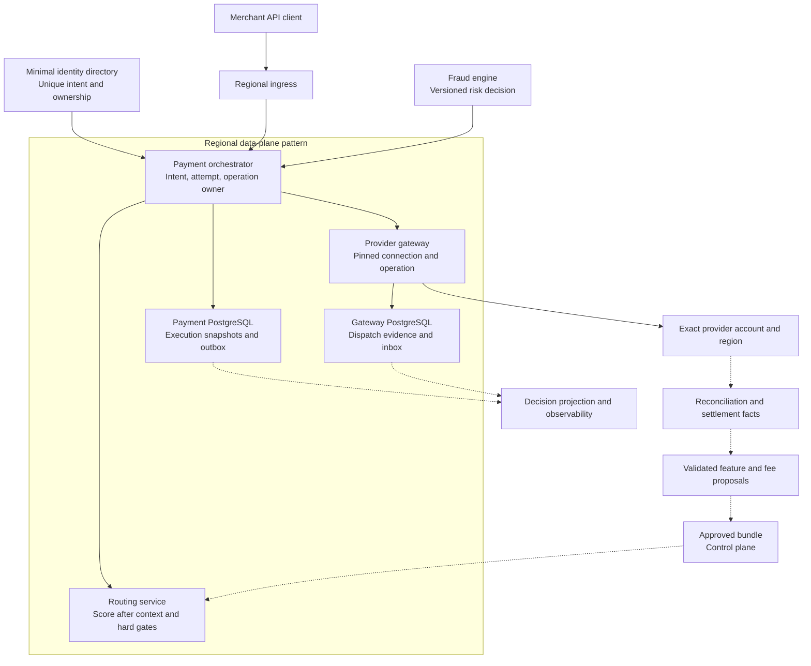
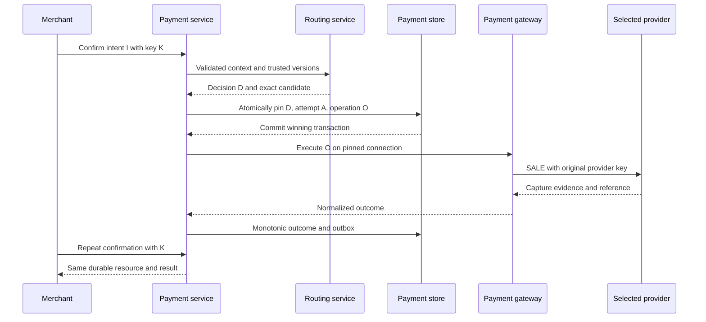
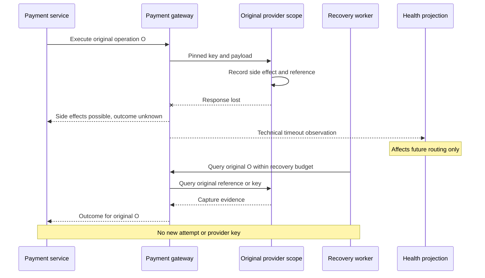
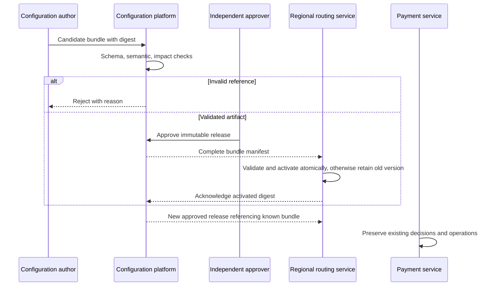
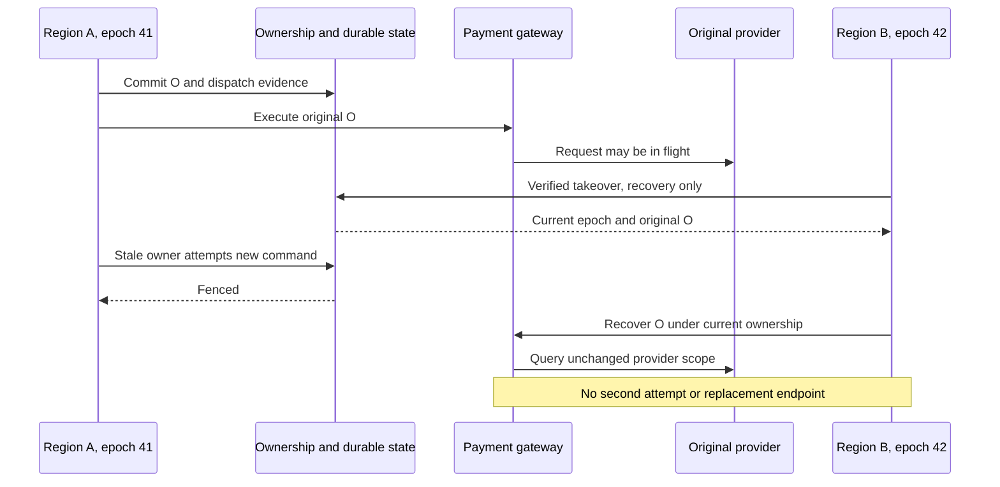

# Chapter 22: Designing a Global Payment Routing Platform from Scratch

[中文](../../part-6-case-study/global-payment-routing-platform.md) | **English**

Aurora's business plan adds a target: serve 10,000 merchants across 50 countries, 30 currencies, 20 payment methods, and 15 PSPs, with a peak of 100,000 TPS. Engineers quickly draw three regions, dozens of services, and a thick event bus. Reviewers ask only four questions: what does TPS count here? What happens if the PSP charges but loses its response? What if a bad configuration is only half distributed? Can the old region charge again when it returns?

A diagram containing every component cannot answer these questions. This chapter invents no new router, idempotency mechanism, or state machine. It uses one set of requirements, capacity budgets, and failure journeys to test whether the first 21 chapters form a system with consistent boundaries.

> **An integrated architecture is valuable when every SLO, capacity assumption, degradation action, and data owner can be tested through concrete scenarios. The 100,000 TPS figure is this case study's requirement, not a measured companion-repository result. Passing design review, code checks, deployment validation, and real-money launch approval are four different kinds of evidence.**

The production design below inherits earlier contracts without claiming every increment is implemented. The current Go system remains a narrow tokenized-card, automatic-capture `SALE`, local-simulator slice. Routing has reached v3: risk, capability/rule gates, versioned cost/performance, and constrained scoring form an auditable pipeline. Payment also has durable recovery deadlines, budgets, and leases. Successor fallback attempts, dynamic health, a book-wide system-test harness, configuration control plane, and global ownership protocol remain absent. The chapter closes by separating existing and target capabilities explicitly.

## 22.1 The Problem: Define Responsibilities Before Discussing Scale

### 22.1.1 Business Scale Is Not a Giant Cartesian Product

| Requirement assumption | Interpretation in this case | What it does not establish |
| --- | --- | --- |
| 10,000 merchants | Scale of identity, contracts, traffic isolation | Uniform merchant traffic |
| 50 countries, 30 currencies | Target coverage, opened combination by combination through eligibility | Every country/currency combination works |
| 20 payment methods | Long-term integration target across lifecycles | Every method supports synchronous `SALE` or identical fallback |
| 15 PSPs | Number of commercial integrations | Only 15 candidates, or 15 calls per request |
| 100,000 peak TPS | 100,000 new payment-intent business objectives arriving per second and seeking admission | 100,000 HTTP RPS, captures per second, or sustained all-day traffic |
| Three regions | Approved geographic deployment and disaster-recovery target | Simultaneous write authority for one intent in three places |

One PSP may have multiple merchant accounts, connectors, regions, and immutable connection revisions. Legal paths form a sparse matrix governed by [Chapter 6](../part-2-routing-engine/provider-eligibility.md). Adding methods requires adapter, authentication, finality, and recovery contracts, not merely another enum value.

Choose a calculable capacity slice first: assume peak traffic is primarily automatic-capture cards, with one initial routing evaluation per new intent. Model other methods as separate workloads before addition. Also supply peak duration, ramp slope, largest merchant share, regional distribution, amount distribution, and duplicate-request ratio. Dividing total volume equally by 10,000 hides merchant hotspots and same-key contention.

### 22.1.2 SLOs Must Bind Observation Boundaries

| Contract | Illustrative target, all requiring target-environment validation | Responsibility and limitation |
| --- | --- | --- |
| Routing service | 99.99% monthly fulfillment of valid requests; p99 decision latency ≤20 ms | Includes explicit no-candidate outcomes; not authorization approval rate |
| First confirmation response | p99 final result or durably persisted processing resource within 1.5 s | 202 is not capture success; waiting cannot masquerade as failure |
| Unknown-state convergence | After provider query recovery becomes available, target 95% definite outcomes within 5 minutes | Others continue recovery/review; never mark failed to meet target |
| Decision projection | Normal-operation lag target ≤60 seconds | Local execution snapshot persists first; remote projection may lag |
| Regional failure | Preserve pre-dispatch execution evidence within approved failure model | RPO/RTO established by evidence/exercises, not DNS health |
| Funds correctness | Zero unintended duplicate funds paths; identity/amount invariants hold | Correctness is not spendable availability error budget |

These numbers are review inputs, not service promises from providers or current code. Business declines, invalid requests, technical failures, unknown states, and immature economics use [Chapter 15](../part-4-operating-at-scale/observability.md)'s separate denominators. Excluding timeouts, counting only dispatched requests, or deleting late outcomes cannot improve an SLO honestly.

State non-goals on the first page: no card-network internal routing, self-built ledger or payout system, replacement fraud engine, autonomous reinforcement learning, default cross-border sensitive-data replication, or simulator substitution for PSP certification and real-money launch review.

## 22.2 A Simple Design: Keep the Starting Point Easiest to Prove Correct

From scratch, begin with one logical region, few connections, static policies, real PostgreSQL, and three clear owners: payment, routing, and gateway. Routing may deploy independently but holds no provider credentials. Payment creates intents, attempts, and operations. Gateway executes only pinned connections. Process count is not architectural maturity. The companion repository has already advanced beyond this historical starting point to v3 constrained scoring. Retaining the starting point here explains why evidence must justify each layer of complexity; it does not recast current code as a static router.

First prove merchant idempotency, definite declines, UNKNOWN after response loss, original-operation queries, and duplicate-event convergence. Without these, more providers create more uncertain paths. Nor must the database immediately adopt another model for eventual 100,000 TPS. Measure transactions, locks, indexes, WAL, pools, and recovery, then partition along defined merchant/intent ownership.

| Stage | Pressure requiring it | Added capability | What can wait |
| --- | --- | --- | --- |
| 0: Safe collection slice | Complete and explain one payment | Chapters 1–3 and 10–11 identity, execution, recovery | Multiobjective scoring, global active-active |
| 1: Explainable routing | Diverging account capabilities and merchant policies | Chapters 4–9 context, eligibility, rules, typed features | ML, real-time big-data platform |
| 2: Reliable operations | Failure spread, unexplained history, delayed feedback | Chapters 12–18 bounded fallback, health, evidence, economics | Automatically moving funds for every exception |
| 3: Multi-region governance | Geographic latency, disaster recovery, multiuser configuration releases | Chapters 19–20 single intent owner, fencing, complete bundles | Arbitrary global writes to one intent |
| 4: Optional optimization | Reliable data proves improvement opportunities | Chapter 21 replaceable model scorer | Causal promises without propensities |

Traffic does not automatically advance stages at an integer threshold. Configuration approval can be necessary at small scale; models may remain unjustified at large scale. Observable pain and corresponding failure tests determine entry, not industry fashion.

## 22.3 Scaling Problems: How Much Work Does One Business Payment Create?

### 22.3.1 Count APIs, Operations, and Recovery Separately

Every coefficient below is an assumption requiring calibration. Let demand for new intents able to form an initial route plan be `λ=100,000/s`. Each intent averages 2.2 merchant API requests, including creation, confirmation, repeats/queries, and adds an average 0.03 permitted fallback attempts. This budget permits at most one legal fallback per intent. Each attempt in this slice has one `SALE`, so logical operation demand is `A=λ×1.03=103,000/s`. This example also assumes exactly one guardrail-only revalidation for each successfully created fallback attempt. Production must also count rejected checks that create no attempt; operation counts cannot reconstruct them.

Full routing evaluations cannot simply equal `A`. The first attempt needs one evaluation. Permitted routing retries before an attempt is pinned, additional `no_candidate` evaluations, and shadows are `R_retry`, `R_no_candidate`, and `R_shadow`, respectively. Thus `R=λ+R_retry+R_no_candidate+R_shadow`. Routing first returns an immutable `RoutePlanDecision` pinning candidate order, versions, budgets, and validity. Fallback generates no new plan. After refreshing risk, payment submits the plan's fixed next candidate to routing-owned `RevalidatePlanCandidate` for guardrail-only checks. It may allow or reject, never add candidates, rerank, rescore, or extend the plan. Expired plans/guardrails or unavailable checks stop execution. If allowed, payment writes its own immutable `FallbackExecutionBinding`, linking original plan, preceding attempt, fixed successor, risk/guardrail evidence, and remaining budget. It is not a routing decision. Fallback therefore adds no full `R`, but adds separate `G_fallback` work; here `G_fallback=λ×0.03=3,000/s`.

Further assume 0.01 same-key resends per operation, 5% entering query-requiring UNKNOWN, and three queries per unknown operation on average. These are expected counts after controlled recovery, not retry authorization. Funds-safety gates still come from Chapters 10–12.

| Work class | Formula | Example demand |
| --- | --- | ---: |
| Merchant API | `λ × 2.2` | 220,000 requests/s |
| Logical `SALE` operations | `A = λ × (1 + 0.03)` | 103,000 operations/s |
| Routing evaluation | `R = λ + R_retry + R_no_candidate + R_shadow` | At least 100,000 evaluations/s; three increments separate |
| Fallback guardrail revalidation | `G_fallback = λ × 0.03` (example assumption) | 3,000 checks/s; extra rejected checks counted separately |
| External execution requests | `A × (1 + 0.01)` | 104,030 calls/s |
| External recovery queries | `A × 0.05 × 3` | 15,450 calls/s |
| Total provider outbound calls | Execution + queries | 119,480 calls/s |
| Inbound webhooks | Assumed 1.1 events per operation | 113,300 events/s |

These quantities are neither interchangeable nor simply additive into one “system TPS.” API replays consume authentication and database reads but create no funds operations. Queries consume provider quotas but are not second payments. Webhooks amplify inbox/outbox and result projection. Manual capture, refunds, reconciliation scans, and other methods need additional workload rows.

`λ` is this selected `SALE` slice. If additional `no_candidate` evaluations originate from new requests outside it, add them to merchant API arrival load too, rather than invent an isolated routing number. Demand includes non-2xx and timed-out requests; successful responses cannot reconstruct input. Full routing, guardrail-only checks, and operations are distinct: no-candidate, permitted pre-attempt retries, and shadows add full evaluations without provider operations; fallback from a fixed plan adds an operation and at least one safety check without rescoring or replanning. None can be inferred from another.

Average fanout is only a starting budget. One failed connection can increase UNKNOWN proportion, query count, and latency together, creating correlated bursts. Recovery needs shared budgets, backoff, per-connection bulkheads, and deadlines; “only 5%” is no protection. Stripe distinguishes account/endpoint rate limits from concurrency limits. Even after aggregate budgeting passes, each real account and endpoint needs individual calculation and approved quotas. [Stripe: Rate Limits](https://docs.stripe.com/rate-limits)

### 22.3.2 Three Regions Are Not Three Freely Interchangeable Capacity Pools

Start with optimistic equal distribution: 119,480 calls/s across three regions is about 39,827 each. Losing one leaves 59,740 per surviving region. At a 65% utilization ceiling, each survivor needs verified capacity of at least `59,740 / 0.65 ≈ 91,908 calls/s`.

If the review assumes only 85,000 calls/s per region, post-failure utilization is about 70.28%. It fails the 65% budget despite remaining below the nominal maximum. The 85,000 figure is illustrative input too, not a local-machine or companion-system measurement.

Reality is usually stricter than equal division. Some data cannot cross regions, some merchants have eligible connections only in their original region, and provider account quotas may not move with compute. [Chapter 19](../part-5-global-routing/multi-region.md) also requires unique ownership and complete execution evidence. Spare CPU cannot grant an old unknown operation a new provider path. Arithmetic headroom is necessary, not sufficient.

### 22.3.3 Go: Include Assumptions and Units in the Capacity Model

This function calculates only the current card `SALE` slice. It calls no service and approves no launch. Rate units are explicit. Floating point estimates capacity, not amounts, settlement fees, or funds identity. The final Boolean indicates only whether balanced arithmetic meets the supplied ceiling.

```go
package capacityplan

import (
	"errors"
	"math"
)

type Input struct {
	NewIntentsPS                  float64
	MerchantRequestsPerIntent     float64
	FallbackAttemptsPerIntent     float64
	FallbackGuardrailChecksPerIntent float64
	AuthorizedRouteRetriesPerIntent float64
	NoCandidateEvaluationsPerIntent float64
	ShadowEvaluationsPerIntent      float64
	SameKeyResubmitsPerOperation  float64
	UnknownFraction               float64
	QueriesPerUnknown             float64
	WebhookEventsPerOperation     float64
	ProviderMeanSeconds           float64
	DecisionBytes                 float64
	OutboxOutageSeconds           float64
	CatchupSeconds                float64
	GatewayCallsCapacityPerRegion float64
	TargetUtilization             float64
	Regions                       int
	LostRegions                   int
}

type Plan struct {
	ModelVersion                   string
	MerchantRequestsPS             float64
	LogicalOperationsPS            float64
	RouterEvaluationsPS            float64
	GuardrailRevalidationsPS        float64
	ExecuteCallsPS                 float64
	QueryCallsPS                   float64
	ProviderCallsPS                float64
	WebhookEventsPS                float64
	CallsPerSurvivingRegionPS      float64
	MinimumCapacityPerRegionPS     float64
	PostLossUtilization            float64
	MeanInflightPerSurvivingRegion float64
	RouterEvaluationBytesPS        float64
	DecisionBytesPS                float64
	BacklogEvents                  float64
	RequiredProjectorEventsPS      float64
	WithinArithmeticBudget         bool
}

func Calculate(input Input) (Plan, error) {
	values := []float64{
		input.NewIntentsPS, input.MerchantRequestsPerIntent,
		input.FallbackAttemptsPerIntent, input.AuthorizedRouteRetriesPerIntent,
		input.FallbackGuardrailChecksPerIntent,
		input.NoCandidateEvaluationsPerIntent, input.ShadowEvaluationsPerIntent,
		input.SameKeyResubmitsPerOperation,
		input.UnknownFraction, input.QueriesPerUnknown, input.WebhookEventsPerOperation,
		input.ProviderMeanSeconds, input.DecisionBytes, input.OutboxOutageSeconds,
		input.CatchupSeconds, input.GatewayCallsCapacityPerRegion, input.TargetUtilization,
	}
	for _, value := range values {
		if math.IsNaN(value) || math.IsInf(value, 0) || value < 0 {
			return Plan{}, errors.New("capacity inputs must be finite and nonnegative")
		}
	}
	if input.NewIntentsPS == 0 || input.MerchantRequestsPerIntent < 1 ||
		input.FallbackAttemptsPerIntent > 1 || input.UnknownFraction > 1 ||
		input.FallbackGuardrailChecksPerIntent < input.FallbackAttemptsPerIntent ||
		input.ProviderMeanSeconds == 0 || input.DecisionBytes == 0 ||
		input.CatchupSeconds == 0 || input.GatewayCallsCapacityPerRegion == 0 ||
		input.TargetUtilization <= 0 || input.TargetUtilization >= 1 ||
		input.Regions <= 0 || input.LostRegions < 0 || input.LostRegions >= input.Regions {
		return Plan{}, errors.New("invalid capacity assumptions")
	}
	operations := input.NewIntentsPS * (1 + input.FallbackAttemptsPerIntent)
	routerEvaluations := input.NewIntentsPS * (1 + input.AuthorizedRouteRetriesPerIntent +
		input.NoCandidateEvaluationsPerIntent + input.ShadowEvaluationsPerIntent)
	guardrailRevalidations := input.NewIntentsPS * input.FallbackGuardrailChecksPerIntent
	execute := operations * (1 + input.SameKeyResubmitsPerOperation)
	queries := operations * input.UnknownFraction * input.QueriesPerUnknown
	provider := execute + queries
	survivors := float64(input.Regions - input.LostRegions)
	perRegion := provider / survivors
	backlog := operations * input.OutboxOutageSeconds
	plan := Plan{
		ModelVersion:                   "card-sale-capacity-v1",
		MerchantRequestsPS:             input.NewIntentsPS * input.MerchantRequestsPerIntent,
		LogicalOperationsPS:            operations,
		RouterEvaluationsPS:            routerEvaluations,
		GuardrailRevalidationsPS:        guardrailRevalidations,
		ExecuteCallsPS:                 execute,
		QueryCallsPS:                   queries,
		ProviderCallsPS:                provider,
		WebhookEventsPS:                operations * input.WebhookEventsPerOperation,
		CallsPerSurvivingRegionPS:      perRegion,
		MinimumCapacityPerRegionPS:     math.Ceil(perRegion / input.TargetUtilization),
		PostLossUtilization:            perRegion / input.GatewayCallsCapacityPerRegion,
		MeanInflightPerSurvivingRegion: perRegion * input.ProviderMeanSeconds,
		RouterEvaluationBytesPS:        routerEvaluations * input.DecisionBytes,
		DecisionBytesPS:                operations * input.DecisionBytes,
		BacklogEvents:                  backlog,
		RequiredProjectorEventsPS:      operations + backlog/input.CatchupSeconds,
	}
	outputs := []float64{
		plan.MerchantRequestsPS, operations, routerEvaluations, guardrailRevalidations, execute, queries, provider,
		plan.WebhookEventsPS, perRegion, plan.MinimumCapacityPerRegionPS,
		plan.PostLossUtilization, plan.MeanInflightPerSurvivingRegion,
		plan.RouterEvaluationBytesPS, plan.DecisionBytesPS, backlog, plan.RequiredProjectorEventsPS,
	}
	for _, value := range outputs {
		if math.IsNaN(value) || math.IsInf(value, 0) {
			return Plan{}, errors.New("capacity calculation overflow")
		}
	}
	plan.WithinArithmeticBudget = plan.PostLossUtilization <= input.TargetUtilization
	return plan, nil
}
```

Use the preceding coefficients, explicitly set all three extra full-evaluation rates to zero, and set guardrail-only revalidation to 3,000 checks/s. With mean provider-call time 0.25 seconds, 2 KiB per routing record, a 600-second projection outage, and desired catch-up in 3,600 seconds, the model yields about 204.8 MB/s of routing-evaluation output. If each fallback operation also retains an execution snapshot of the same fixed plan, operation-side routing evidence is about 210.944 MB/s. After regional loss, each surviving region averages about 14,935 in flight. The outage creates 61.8 million queued records; catch-up requires at least about 120,167 projection events/s. The two byte rates are deliberately distinct: copying an existing plan as new-attempt audit evidence does not rerun routing. Guardrail-check CPU, cache, and RPC budgets remain separate. This teaching model outputs their rate without converting it into full-evaluation bytes. These estimates still omit indexes, WAL, replicas, message envelopes, and other events.

Under stability and finite-mean conditions, average in-flight work follows `L=λW`. Little's original paper discusses the relationship and its conditions. [Little: A Proof for the Queuing Formula](https://pubsonline.informs.org/doi/10.1287/opre.9.3.383) Here W is the relevant mean across execution/query calls, not p99. The formula proves neither tail latency nor that creating that many goroutines provides capacity.

At this example's peak for one hour, 2 KiB routing-execution snapshots alone total about 759.4 GB. Peak duration, compression, retention, and partitioning must feed back into Chapter 14's evidence design. Multiplying average QPS by a day does not establish actual daily traffic. The outbox is not infinite buffering either. Catch-up capacity must exceed fresh input; nearing safe local-storage watermarks requires admission limits, never skipping execution evidence to keep dispatching.

### 22.3.4 Database Budgets Cannot Be Converted Directly from HTTP TPS

Creating records, claiming idempotency, preparing execution, recording send/result state, and consuming inbox/outbox all create distinct transaction/index work. Gateway execution records add another workload. Measure transactions, written bytes, lock waits, and WAL per business operation, then combine workloads. Database TPS, disk IOPS, network RPS, and payment completion rate are different units.

Include merchant hotspots, duplicate confirmations, late webhooks, and recovery scans in pressure distributions. Partitioning must preserve Chapters 11 and 19's unique identities and ownership arbitration. More concurrency cannot come from duplicating one intent's idempotency records into independent truths. Read caches accelerate access; cache misses cannot decide whether to send another funds operation.

## 22.4 Production Design: One Diagram for Responsibilities Already Explained



Regions reuse the data-plane pattern, not independent charging authority. Home region, execution region, provider region, and ownership epoch follow Chapter 19. The directory contains approved minimal identity, not full requests or credentials. Ledger, payout, secrets, and raw fraud data remain in their own boundaries; the diagram does not absorb them into routing.

The online pipeline remains “context validation → eligibility → rule guardrails → risk contract → feature lookup → scoring → stable selection.” Prefer regional reads of complete bundles, capabilities, and approved feature snapshots. Pin one version per request; never assemble versions during a loop. More candidates mainly increase local computation, not probes or funds requests to every PSP.

Routing issues an immutable `RoutePlanDecision` pinning candidate order, versions, maximum attempts, risk boundaries, and validity. Only after proven absence of side effects, explicit policy permission, and valid remaining budget may payment submit the fixed next candidate. It refreshes risk and invokes routing-owned guardrail-only revalidation. That check can veto, never add candidates, rerank, or rescore. Expired plans/guardrails, incomplete evidence, or unavailable checks always stop execution. If allowed, payment writes `FallbackExecutionBinding` linking the original plan, preceding attempt, fixed successor, and current risk/guardrail evidence. It is not a second routing decision.

Stopping is not synonymous with manual review. No next candidate, plan expiry, guardrail veto, or unavailable guardrails stops new side effects and returns an explicit domain result. Manual review applies when funds facts conflict, execution identity/evidence integrity conflicts, or UNKNOWN remains unresolved after recovery budget exhaustion. Wanting another PSP cannot upgrade an ordinary stop into review or use review to bypass the original plan.

Payment verifies the selected candidate, connection revision, and decision hash, then seals execution snapshot and outbox atomically with attempt/operation creation. Gateway dispatch follows commit. Remote decision stores, reporting, and analytics are outside this synchronous transaction chain. Local transaction failure must still stop execution. “Asynchronous projection may lag” does not mean pre-execution evidence may be filled in later.

### 22.4.1 Deadlines and Degradation Share One Execution Contract

Initially partition the 1.5-second first-response budget among ingress/persistence, routing, provider, and overhead. For example, allow at most 800 milliseconds of initial provider waiting while reserving queue/response time. This is a per-request deadline, not the sum of service p99s. Go `http.Client.Timeout` covers connection, redirects, response reading, and related phases. Canceling local waiting cannot retract a request already received by a provider. [Go: HTTP Client](https://pkg.go.dev/net/http#Client)

| Lost dependency or budget | Permitted degradation | Prohibited shortcut |
| --- | --- | --- |
| Optional model/performance features | Validated, still-valid complete rule/static profile, reason recorded | Zero-fill missing values or reinterpret old decisions |
| Required capability/risk facts | Explicit failure, stop new routing, or explicit action/manual review | Offset unknown eligibility with higher scores |
| Control plane | Still-valid complete last-known-good bundle | Combine half a new version or synchronously fetch all artifacts per request |
| Provider `SALE` timeout | Current operation becomes unknown; recover original identity | Switch current payment to a healthy alternative |
| Local provider failure | Health constrains future routes; bulkhead limits failure domain | Turn issuer declines into a global circuit break |
| Outbox/recovery backlog | Reserve recovery budget, limit admission, stop extra experimental exposure | Delete facts, reset UNKNOWN age, expand queues indefinitely |

Degradation is not an arbitrary ranking of service importance. Protect already occurred or possible funds operations first, reduce optional optimization second, and reject new work under approved capacity/fairness policies last. Optimization switches can roll back; original operation, key, payload, and connection cannot become another identity.

## 22.5 Failure Modes: Four End-to-End Acceptance Journeys

These journeys combine a normal/duplicate-delivery baseline with three system failures. They test handoff gaps rather than redesign earlier mechanisms. Each preserves API results, domain snapshots, gateway-call records, versions, and observations. Final `succeeded` alone is insufficient.

### Journey One: Normal Success, with No New Work from Repeated Confirmation

Aurora creates a 129.00 USD intent. Context includes approved facts only. Central risk returns valid `ALLOW`; eligibility first removes nonexecutable connections. Routing selects `cand_us_a`, payment pins decision and unique operation, and gateway executes `SALE` on the corresponding account. Final success evidence contains original reference and captured amount, not an inference that the bank already received funds.



Acceptance checks same-key/different-payload conflicts, the same resource on repeat, and no duplicate application of webhooks. Without fallback, there is one attempt, one logical operation, and one gateway execution copy. If remote decision projection is unavailable, local evidence remains and later backfills by ID/hash without recomputing historical choices.

This journey corresponds to approval/idempotency baselines in `test/e2e/payment_flow_test.go`. Payment now atomically persists v3 context, decision, risk, optimization, candidate order, and `executable_until`, with shared golden contracts preventing routing/payment drift. Remote projection and outage backfill remain future increments. Existing tests cover execution snapshots, not the entire production diagram.

### Journey Two: Provider Success, Lost Response, and a Recovery Storm

Inject failure after the provider records a side effect and before the gateway receives its result. A simulator error before the call cannot prove UNKNOWN safety. The API returns processing within budget. Restart the payment worker, then inject webhook redelivery and query delays.



Check convergence and attempt/operation counts throughout recovery, with connection, revision, namespace, provider key, and request hash unchanged. Under 5% failure load, queries count toward real outbound rate and other connections survive isolated pools. Current code persists a 24-hour local `SALE` recovery deadline, initial 32-call budget, claim epoch/lease, action, and structured absence evidence. Every claim atomically spends budget; neither deadline nor budget resets. These are repository simulator policies, not production PSP retention promises. Continuing query failure or exhausted budget leads to review, never failure merely to trigger fallback.

Provider idempotency cannot be assumed across accounts or regions. Adyen explicitly does not check duplicates across regional endpoints, so a platform recovery-region change must preserve original provider scope. [Adyen: API Idempotency](https://docs.adyen.com/development-resources/api-idempotency/) Capture, void, and refund also retain original connection/reference without rerouting.

### Journey Three: Reject Bad Configuration; Roll Back Valid but Degraded Configuration

Submit a bundle referencing a nonexistent capability version. Validation must prevent approval while all regions keep a complete old version. Then use a semantically valid but poorly performing artifact in an approved canary, inject failure, and check stopping new exposure, rollback authorization, and regional acknowledgments. Do not edit live fee rows directly. Rollback creates a new release referencing a validated old bundle, preserving current emergency denials and hard constraints without reviving revoked routes.



Deliberately interrupt downloads, reorder artifacts, and restart watchers. Each router uses a complete old or new version, with decisions naming the actual version. Authors cannot self-approve; control-plane loss does not erase valid last-known-good. Dispatched operations never reroute after rollback, assigned intents retain their variants, and shadows create no gateway operation even when another candidate wins.

Configuration, stable assignment, and `ModelScorer` designs come from [Chapter 20](../part-5-global-routing/configuration-platform.md), [Chapter 16](../part-4-operating-at-scale/experimentation.md), and [Chapter 21](../part-5-global-routing/intelligent-routing.md). Current code lacks the full release/rollback chain. This journey remains future system acceptance, not something static JSON startup can replace.

### Journey Four: Regional Loss, with No New Charging Authority for a Resurrected Owner

Region A persists and may dispatch O under epoch 41, then is isolated. Region B receives the same merchant key and locates the original intent; a local replica miss cannot create another. Only reliable fencing of old execution plus valid recovery evidence and capacity allow an authoritative transaction to advance epoch and enter `recovery_only`.



The key assertion is not a green B health check. Resumed A cannot create or dispatch new authorized commands. A's in-flight bytes cannot be recalled, so B still recovers the original operation. Missing recovered dispatch records or inaccessible original provider scope isolate the affected intents rather than create another `SALE`.

PostgreSQL distinguishes async replication's loss window from synchronous acknowledgment waits. A standby is not proof that execution evidence is safe. [PostgreSQL: Standby Servers and Replication](https://www.postgresql.org/docs/current/warm-standby.html) At the illustrative 85,000 calls/s per-region capacity, survivors still fail the 65% utilization ceiling. Correct fencing alone cannot justify admitting all new traffic. Failback also requires higher epochs and controlled handoff; old primaries cannot reclaim authority automatically.

### 22.5.5 Load Reports Must Account for Traffic Served Poorly

Run each journey under steady state, slow providers, cold caches/missing dependencies, and regional loss. Generators record offered, started, completed, scheduling lag, timeouts, cancellations, and unsent work. A slower system cannot cause clients to reduce arrivals by waiting for prior requests and then report that lower throughput as stable capacity.

At HTTP level retain each status code and transport error; at business level separately count success, definite decline, processing, UNKNOWN, and review. ApacheBench separates failed requests from non-2xx responses. Zero in the former does not mean no HTTP 502; likewise a decline in 200 or UNKNOWN in 202 is not capture success. [ApacheBench: Output](https://httpd.apache.org/docs/2.4/programs/ab.html)

Database load tests also retain time from scheduled start to actual completion. PostgreSQL `pgbench` rate/latency-limit documentation distinguishes scheduling lag, late transactions, and skipped transactions. Skipped demand cannot disappear, and a database benchmark cannot impersonate the payment chain's capacity. [PostgreSQL: pgbench](https://www.postgresql.org/docs/current/pgbench.html)

| Report dimension | Minimum evidence |
| --- | --- |
| Scenario/version | Workload/seed, duration, failure timeline, code SHA, bundle digest, topology |
| Traffic/responses | Offered/started/completed, every HTTP status, transport failures, business outcomes |
| Latency/resources | Stage p50/p95/p99, queues, CPU/memory/GC, pools, locks/WAL/network |
| Recovery/evidence | Queries/resends/fallback counts, UNKNOWN age, outbox age/depth, projection watermark |
| Funds invariants | Attempt/operation cardinality, pinned identities, conflicts, duplicate-side-effect checks |
| Failure headroom | Surviving-region and per-connection quotas, catch-up rate, admission decisions |

Load traffic enters explicit test environments only. Simulators support deterministic fault injection; real PSP sandboxes validate API semantics. Neither automatically represents production latency or capacity, and neither authorizes 100,000 TPS against real-money endpoints. Only target-environment evidence, real quotas, and approved launch exercises support corresponding production claims.

## 22.6 Trade-offs, Owners, and Actual Delivery Boundaries

### 22.6.1 Who May Press Which Button?

| Owner | Decisions or facts owned | Incident boundary |
| --- | --- | --- |
| Payment team | Intents/attempts/operations, idempotency, transitions, recovery | Never guess UNKNOWN as failed |
| Routing team | Context consumption, eligibility/rules/scoring, explanation | No funds execution or rewriting fraud decisions |
| Gateway/connector team | External execution, references, credentials, provider contracts | No hidden account/region/key replacement |
| Configuration/risk approvers | Artifact releases or risk contracts | Scores, experiments, emergency powers cannot breach hard constraints |
| SRE/on-call | Admission, resources, fencing, approved failover steps | DNS, process liveness, low CPU confer no funds-write authority |
| Reconciliation/settlement team | External evidence, discrepancies, fee attribution, calibration proposals | No direct terminal-state writes or automatic ledger adjustments |
| Security/finance owners | Data purposes, credential boundaries, launch risk, accounting | Tokenization/teaching code are not certification evidence |

Unified incident command does not require a universal database superuser. Cross-team actions use commands with reason, identity, and version. Stopping admission and recovering original UNKNOWN operations can proceed under different budgets. Runbooks need triggers, owners, evidence, rollback, and failure exits, not “contact the relevant team.”

These boundaries determine key trade-offs. Stronger cross-region acknowledgment improves recovery evidence but adds write latency and quorum dependency. Local single writers simplify state semantics but require owner forwarding. Small experiments limit potential loss but mature slowly and cannot prove full capacity. More decision records aid explanation but cost storage and governance. No throughput optimization may discard essential evidence.

### 22.6.2 What the Companion Repository Has Completed

| Capability | Current code fact | Further evidence this chapter cannot replace |
| --- | --- | --- |
| Payment vertical slice | Payment, routing, gateway, simulator, real PostgreSQL; one initial `SALE` | Real PSP sandbox/production connectors, certification, operations |
| Routing | v3 `routing_context.v2`, risk, capability/rules, versioned cost/performance, constrained scoring, stable candidate order, executable deadline | Production artifact provenance, dynamic health, fallback executor, real-data calibration |
| Reliability | Merchant idempotency, inbox/outbox, append-only provider observations, original-operation UNKNOWN recovery, durable deadline/budget/lease, first-dispatch marker, conflict isolation | Bounded successor attempts from fixed plans, production recovery contracts, cross-connection health |
| System regression | Unit/race tests, real PostgreSQL, Compose E2E for approved/declined/response-loss/duplicates/single funds path | Unified `test/system`, bad configuration, ownership failover, combined failure load |
| Operational feedback | Complete local context/decision/risk/optimization snapshots and gateway observation ledger | Telemetry, experiments, remote decision projector, independent reconciliation/settlement |
| Global operation | Connections already carry region identity | Intent ownership, fencing, real cross-region recovery, residency review |
| Capacity/launch | No chapter-wide `test/system` or `tools/capacity-plan` end-to-end tooling | Reproducible capacity reports, 100,000 TPS evidence, go/no-go sign-off |

The supported conclusion is a runnable starting point with important payment-safety boundaries—not an existing global real-money platform spanning 15 PSPs and 20 methods. Files, passing unit tests, and Compose startup cannot turn unimplemented rows into implemented capabilities.

This chapter's engineering increment adds no business abstraction. Orchestrate the four journeys in `test/system`, reuse existing fault injection, add a standard-library capacity CLI, and produce versioned Makefile/CI results. [Appendix C](../appendices/capacity-planning-and-launch-checklist.md) reuses that evidence instead of creating another load-test system. State and security checks refer to [Appendix A](../appendices/payment-state-models.md) and [Appendix B](../appendices/security-compliance.md). These tools remain future work.

Launch gates separately establish code/contracts/real-database checks, invariants across the four journeys, measured throughput/failure headroom, and real-provider/security/operations approval. Missing required evidence means failure. Arithmetic functions, architecture diagrams, and teaching simulators grant no exemptions.

## 22.7 Recap: Prove Boundaries through Failure and Scale through Evidence

We began with the historical single-region static-router `SALE` slice, reached today's v3 constrained-scoring and durable-recovery baseline, and combined earlier mechanisms through business differences, operational failures, delayed feedback, and global ownership. A complete component list is not the key. Every path preserves the same rules:

1. Define business units, SLOs, load distributions, and non-goals first. The 100,000 TPS requirement needs validation; it is not existing measured capacity.
2. Eligibility/risk precede soft scoring. Routing decides, payment owns funds state, and gateway executes pinned connections.
3. Capacity includes APIs, operations, queries/resends/fallback, events, storage, and post-failure survivors—not successful RPS alone.
4. Normal duplicates, lost responses, bad configuration, and regional failure must all preserve identity, evidence, and ownership.
5. Configuration, experiments, and models can change future choices, never rewrite old decisions or move UNKNOWN/capture/void/refund off their original paths.
6. Reconciliation corrects understanding; settlement attributes economics; ledger and funds execution retain separate authorities.
7. Deliver design, code, test-environment, and production-readiness evidence separately. Unevidenced capabilities remain unfinished rather than hidden behind a global diagram.

That is the engineering habit this book aims to leave: before making payment systems smarter, faster, or more global, ensure they still know what they have already done, what they are authorized to do now, and what remains uncertain.
