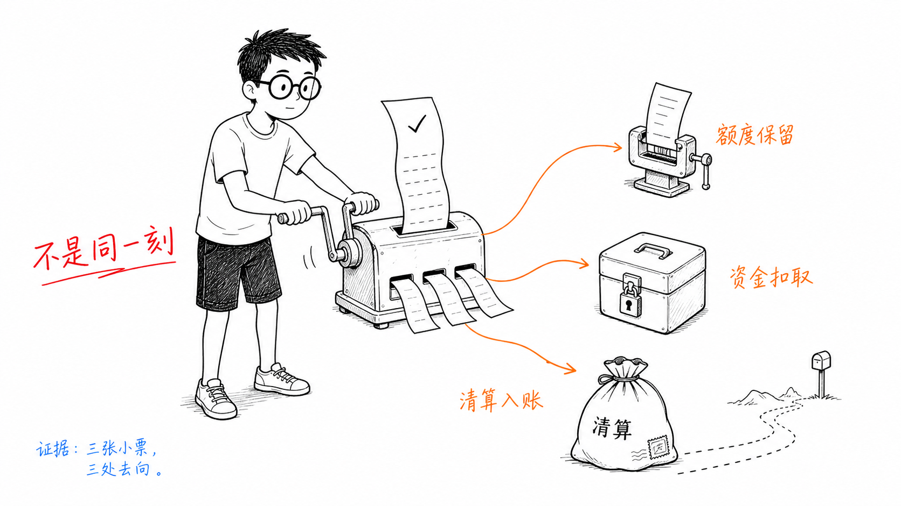
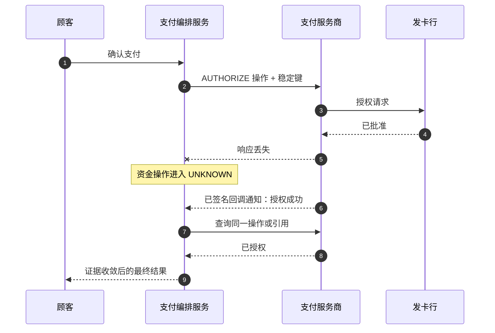
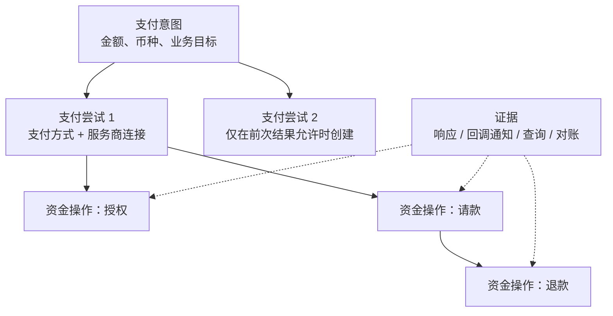
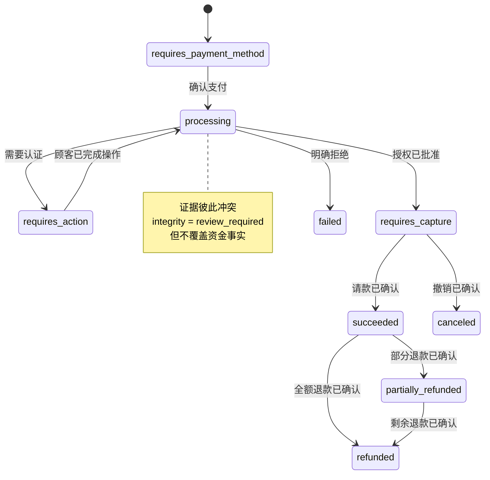

# 第 1 章 一笔支付是如何发生的

顾客点击“支付”时，页面上只有一个按钮；支付系统面对的却不是一个瞬间，而是一段可能持续数秒、数天，甚至数月的生命周期。

一次银行卡支付先要回答“发卡行是否批准”，再回答“商户是否真的要收取这笔钱”，随后还要经过清算、结算、退款与可能发生的拒付。API 返回、订单履约、持卡人账面变化和商户到账，各自运行在不同的时钟上。把它们压缩成一个 `paid = true`，在演示环境里很方便，在生产环境里却会让超卖、重复扣款、错误退款和无法对账同时出现。

本章的核心命题是：**支付不是一次 HTTP 调用，而是一个由业务意图、执行尝试、资金操作和外部证据共同构成的、可审计生命周期。** 我们会从最简单的同步收款开始，观察它为什么失效，再得到一组足以支撑全书后续设计的对象和不变量。本章暂不讨论怎样选择支付服务商；无论只有一家 PSP，还是未来接入多条通道，资金事实都必须先被正确表达。

## 1.1 问题：顾客看到的“成功”究竟是什么

假设在线票务平台 Aurora 售出一张 520.00 BRL 的演唱会门票。顾客提交银行卡令牌后，Aurora 将请求交给 PSP；PSP 可能直接提供收单能力，也可能把请求转给合作的收单机构。收单机构经卡组织找到发卡行，发卡行根据账户、额度、认证和风险等信息批准或拒绝授权。


这条链路中的商业名称经常重叠：一家 PSP 可能同时扮演支付网关、支付处理方和收单机构，另一家则只聚合外部收单机构。系统设计不应根据品牌宣传页划边界，而应追问每一方掌握什么事实、执行什么副作用。

| 参与方                | 在本章关心的职责                | 它的响应不能单独证明什么             |
| ------------------ | ----------------------- | ------------------------ |
| 顾客                 | 提供支付方式并完成必要认证           | 点击完成不代表授权已批准             |
| 商户                 | 创建订单、决定履约、取消或退款         | 订单取消不代表资金已释放或返还          |
| 支付平台               | 持有支付生命周期，调用支付服务商，接收异步证据 | 本地写入成功不代表外部资金操作成功        |
| PSP / 支付处理方 / 收单机构 | 接受并处理操作，连接收单与网络链路       | “请求已接收”不一定是最终资金结果        |
| 卡组织                | 在收单方与发卡方之间传递授权和清算信息     | 网络传输成功不代表发卡行批准           |
| 发卡行                | 对授权作批准或拒绝，并维护持卡人一侧账户事实  | 批准通常只是额度或资金保留，不代表商户已结算到账 |

Visa 的开发者文档把授权、请款、清算与结算明确区分：授权 API 请求批准，后续请款才启动已批准交易的清算和结算流程。这个一手接口模型很好地揭示了领域边界，但不意味着所有支付服务商都使用相同端点或相同状态名；实际能力仍以具体合同和接口为准。[VisaNet Connect — Acceptance](https://developer.visa.com/capabilities/visanet-connect-acceptance/docs-getting-started)

因此，“支付成功”必须带上对象和阶段。以下陈述完全可以同时为真：

* 发卡行已批准授权；
* 商户还没有发货，因此尚未请款；
* 顾客的可用额度已经减少；
* 商户的可结算余额尚未增加；
* Aurora 的订单仍在等待库存确认。

如果 API 只返回 `success`，调用方无法知道它指的是“请求被接收”“授权获批”“已请款”“已结算”，还是仅仅“系统已开始处理”。支付系统的第一项工作不是给所有参与方制造一个相同的布尔值，而是把这些不同事实保留下来。



## 1.2 简单设计：一次同步收款

Aurora 刚上线时只有数字票，付款后立即出票，也只接入一家 PSP。团队可以采用自动请款：一次对外请求表达“若授权获批，立即进入请款”。本书把这种复合业务操作简称为 `SALE`；它是平台统一语义，不假设每家支付服务商都有名为 `/sale` 的 API。

最小 Go 接口可以这样写：

```go
package lifecycle

import "context"

type Money struct {
	AmountMinor int64
	Currency    string
}

type SaleCommand struct {
	PaymentID          string
	PaymentMethodToken string
	Money              Money
	ProviderKey        string
}

type SaleResult struct {
	ProviderReference string
	Authorized        bool
	CaptureSubmitted  bool
}

type Gateway interface {
	Sale(context.Context, SaleCommand) (SaleResult, error)
}
```

这个接口有几个值得保留的优点：金额使用最小货币单位，币种显式存在；平台只接收令牌，不把 PAN 或 CVV 塞进领域对象；结果也没有把 `Authorized` 和 `CaptureSubmitted` 合并。对“立即交付、全额收款、单服务商”的产品，它足以跑通第一条纵向链路。

自动请款只是把两个业务指令靠得很近，并没有让资金生命周期变成原子操作。授权可能成功而请款随后失败；支付服务商可能先接受请款，再通过回调通知报告结果；清算和结算仍在后面发生。Adyen 的当前文档同样说明，自动请款通常在授权后立即触发，而手动请款需要另发请求，且手动请款的结果通过异步事件通知。[Adyen 请款](https://docs.adyen.com/online-payments/capture)

最简单的实现往往还会这样处理网络错误：

```go
result, err := gateway.Sale(ctx, command)
if err != nil {
	return markPaymentFailed(command.PaymentID)
}
return markPaymentPaid(command.PaymentID, result.ProviderReference)
```

这段代码才是真正的危险起点。`err != nil` 只证明调用方没有得到可用响应，不证明 PSP 没有收到请求；`CaptureSubmitted` 也不证明结算已完成。只要系统遇到一次响应丢失，`failed / paid` 两个状态就不再足够。

## 1.3 规模化问题：一个状态开始同时撒四种谎

### 1.3.1 履约时间与收款时间分开了

Aurora 开始销售纸质票和旅行套餐。商户希望在库存确认或供应商接单后再收款，于是需要手动请款：先 `AUTHORIZE`，履约条件满足后再 `CAPTURE`；如果无法履约，则在允许的窗口内 `VOID` 或取消未请款授权。

| 模式            | 第一条资金操作     | 后续操作               | 适合的业务       | 主要代价                  |
| ------------- | ----------- | ------------------ | ----------- | --------------------- |
| 自动请款 / `SALE` | 授权后立即请求请款   | 失败后可能查询、退款         | 数字商品、即时交付   | 简单，但留给履约检查的时间很少       |
| 手动请款          | `AUTHORIZE` | `CAPTURE` 或 `VOID` | 酒店、租车、发货后收款 | 必须管理授权有效窗口、可请款金额与异步结果 |

只有部分支付方式支持分离授权与请款，授权有效窗口、部分请款、多次请款等规则也可能因支付方式、网络、地区和支付服务商而不同。Stripe 的官方文档把手动请款表达为 `capture_method=manual`，并要求在具体授权失效前请款；实现不能把某个支付服务商的天数硬编码成全局规则。[Stripe：分离授权与请款](https://docs.stripe.com/payments/place-a-hold-on-a-payment-method)

手动请款迫使我们承认 `authorized` 不是 `paid`。订单服务可以把库存锁定与“已授权”关联，但最终履约策略必须清楚自己要求的是授权、请款已接受，还是更晚的资金确定性。反过来，订单取消也不是一句 `payment.status = canceled`：

* 尚未向支付服务商发送操作时，业务取消可以阻止后续执行；
* 已授权但未请款时，需要针对原交易执行撤销或冲正；
* 已请款时，通常需要退款，而不是把历史改写成“从未支付”；
* 原操作为 `UNKNOWN` 时，取消意图只能记录为“待补偿”，不能凭空证明外部没有扣款。

### 1.3.2 同步响应不再是唯一证据

三维安全认证可能要求顾客离开当前请求完成挑战验证；一些钱包或银行转账会经历更长的异步处理；即使是普通卡支付，支付服务商的回调通知、主动查询和后续报表也可能补充或纠正平台在同步窗口内掌握的信息。



这里的超时发生在“发卡行已批准、支付服务商响应返回失败”之后。若平台把超时写成 `failed` 并创建另一笔收款，就可能产生两个资金路径。正确分类是 `UNKNOWN`：在证据收敛前，系统既不能向顾客承诺失败，也不能安全地假定可以重新执行一笔新的操作。

回调通知也不是数据库复制流。支付服务商可能重投同一事件，网络可能改变到达顺序，消费进程可能在写库后、确认消息前崩溃。接收端应先验证来源并持久化收件箱，再快速应答，随后幂等处理；Adyen 的官方处理指南也明确要求验证消息、先存储、成功应答后再运行业务逻辑，并提醒重复投递的存在。[Adyen：处理回调通知事件](https://docs.adyen.com/development-resources/webhooks/handle-webhook-events)

### 1.3.3 “一个 ID”无法回答重试和退款问题

早期系统常把 `order_id` 同时当作支付 ID、幂等键和服务商引用。第一次付款失败后顾客更换支付方式，或一次付款发生部分退款时，这个做法立即失效。生产系统至少要区分以下身份：

| 标识             | 标识的对象                                        | 典型作用域                    | 是否可以互相替代              |
| -------------- | -------------------------------------------- | ------------------------ | --------------------- |
| 商户幂等键          | 商户发起的一次逻辑 API 操作                             | 本书实现为商户 + 键，操作名与载荷参与冲突校验 | 不能代替支付 ID，也不能换接口后复用旧键 |
| `payment_id`   | 一次“收取金额与币种”的业务意图                             | 平台全局                     | 不等于订单 ID，也不等于服务商交易号   |
| `attempt_id`   | 使用某个支付方式与具体服务商连接的一次受控尝试                      | 单笔支付                     | 不应在 `UNKNOWN` 时随意新增   |
| `operation_id` | 一次 AUTHORIZE、CAPTURE、VOID、REFUND 或 SALE 资金操作 | 单次支付尝试 / 原交易链            | 网络重试复用同一个资金操作         |
| 服务商幂等键         | 同一服务商契约内对资金操作去重的键                            | 服务商声明的账户、区域与保留期          | 不提供跨 PSP 全局去重         |
| 服务商交易引用        | 服务商已创建的交易或修改操作引用                             | 原服务商连接                   | 请款、撤销、退款、查询必须关联它      |
| 服务商事件 ID       | 一次异步投递所携带的事件身份                               | 服务商回调通知契约                | 只用于事件去重，不代表支付         |

这些 ID 的区别不是命名洁癖。响应丢失时，平台可能拥有服务商幂等键，却还没有拿到服务商交易引用；稍后的回调通知才把两者关联起来。后续请款、撤销、退款必须绑定原获批服务商连接与原交易引用，不能重新“选择一家 PSP”。以 Adyen 当前的关联退款为例，请求路径直接携带原支付的 `paymentPspReference`，退款本身再产生独立引用；结果仍可能异步到达。[Adyen 退款](https://docs.adyen.com/online-payments/refund/)

### 1.3.4 取消和退款不是橡皮擦

设一笔 520.00 BRL 的支付已请款，后来因演出取消而全额退款。若最终只保存 `status = refunded`，审计人员无法知道曾经请款多少、退款是否分批发生、是否已经结算、支付服务商收取过哪些费用，也无法解释顾客为何先看到扣款再看到返还。

资金事实应当追加而不是覆盖：

```
授权已批准：520.00 BRL
请款已成功：520.00 BRL
退款已申请：520.00 BRL
退款已成功：520.00 BRL
```

业务视图可以显示“已全额退款”，但底层历史仍然证明请款曾经发生。拒付更不能被当成普通退款的别名：它是争议流程产生的另一类资金与责任事实，可能在数周或数月后出现。生命周期因此不是从左到右走完就删除旧节点，而是不断吸收新证据并形成新的投影视图。

## 1.4 生产级设计：把意图、尝试、操作与证据分开

一个可演进的最小模型包含四层。它们可以先放在同一个服务和数据库中；这里分的是所有权和不变量，并不是要求立刻拆成四个微服务。



**支付意图（Payment Intent）** 表示商户的业务目标：向某个顾客收取固定金额和币种。金额或币种发生本质变化时，应创建新的意图或走明确的变更协议，而不是静默改写已经执行中的支付。

**支付尝试（Payment Attempt）** 表示用某个支付方式、某个具体服务商连接完成支付意图的一次受控执行。它固定执行路径和凭证可用边界。网络重试不是天然的新支付尝试；尤其当前一操作为 `UNKNOWN` 时，创建新支付尝试会引入第二条潜在资金路径。

**服务商资金操作（Provider Operation）** 表示一次可能产生资金副作用的逻辑动作，例如 `SALE`、`AUTHORIZE`、`CAPTURE`、`VOID`、`REFUND`。同一个资金操作的传输重试必须复用原支付服务商、商户账户、区域、幂等键和语义载荷。`QUERY` 可以作为恢复动作记录，但它读取事实，不应获得新的资金身份。

**证据（Evidence）** 是平台用来判断资金操作结果的事实来源，包括同步响应、经验证的回调通知、状态查询和对账。证据要记录来源、外部身份、接收时间与原始结果摘要；投影视图可以更新，证据本身不能因“新消息看起来更新”而被删除。

### 1.4.1 不要用一个巨型状态机表示所有维度

支付至少有业务推进、资金操作、外部处理和结算四个维度。把它们拼成 `authorized_but_capture_pending_and_order_canceled` 之类的单枚举，会产生状态组合爆炸。更稳妥的做法是保留事实，再按使用者投影：

| 维度       | 示例状态或事实                                                                           | 主要使用者           |
| -------- | --------------------------------------------------------------------------------- | --------------- |
| 支付意图业务状态 | `requires_action`、`processing`、`requires_capture`、`succeeded`、`failed`、`canceled` | 收银台、订单、客服       |
| 完整性状态    | `healthy`、`review_required`，与业务状态独立                                               | 自动恢复、运营复核、审计    |
| 资金操作结果   | `pending`、`succeeded`、`failed`、`unknown`                                          | 编排服务、恢复任务       |
| 资金累计     | 已授权、已请款、已撤销、已退款的金额                                                                | 履约、退款、账本 / 财务接口 |
| 结算证据     | 已提交清算、已结算、已观察费用、已匹配付款                                                             | 财务、对账           |

支付意图的 `succeeded` 必须由产品契约定义。对自动请款卡支付，它可以表示平台已经获得足够证据确认收款流程完成，但不能被解释为“清算、结算和商户银行到账全部终结”。对手动请款，授权成功更适合投影为 `requires_capture`。对异步支付方式，支付意图可能较长时间处于 `processing`。Stripe 的 PaymentIntent 生命周期也用 `requires_action`、`processing`、`requires_capture` 等状态表达这些差异；本书借鉴的是分阶段思想，而不是复制某一家支付服务商的枚举。[Stripe：PaymentIntent 生命周期](https://docs.stripe.com/payments/paymentintents/lifecycle)

### 1.4.2 状态由证据单调收敛，而不是后写覆盖

下面的 Go 示例演示一个窄而关键的规则：重复事件不重复生效；成功与失败证据若冲突，两个事实都保留并进入 `review_required`，而不是按时间戳让最后一条覆盖前面所有证据。

```go
package lifecycle

type OperationState string

const (
	OperationPending   OperationState = "pending"
	OperationUnknown   OperationState = "unknown"
	OperationSucceeded OperationState = "succeeded"
	OperationFailed    OperationState = "failed"
)

type Operation struct {
	ID                   string
	AttemptID            string
	Kind                 string
	AmountMinor          int64
	ProviderConnectionID string
	ProviderKey          string
	OriginalProviderRef  string
	DispatchState        OperationState
}

type Evidence struct {
	EventID              string
	OperationID          string
	Outcome              OperationState
	AmountMinor          int64
	OriginalProviderRef  string
	ProviderOperationRef string
}

type OperationProjection struct {
	Succeeded            bool
	Failed               bool
	Unknown              bool
	ReviewRequired       bool
	ProviderOperationRef string
	EvidenceIDs          []string
}

func ProjectOperation(op Operation, facts []Evidence) OperationProjection {
	projection := OperationProjection{
		Unknown: op.DispatchState == OperationUnknown,
	}
	seen := make(map[string]Evidence, len(facts))

	for _, fact := range facts {
		if fact.OperationID != op.ID {
			continue
		}
		if fact.EventID == "" {
			projection.ReviewRequired = true
			continue
		}
		if previous, duplicate := seen[fact.EventID]; duplicate {
			if previous != fact {
				projection.ReviewRequired = true
			}
			continue
		}
		seen[fact.EventID] = fact
		projection.EvidenceIDs = append(projection.EvidenceIDs, fact.EventID)

		if fact.AmountMinor != op.AmountMinor {
			projection.ReviewRequired = true
		}
		if op.OriginalProviderRef != "" &&
			fact.OriginalProviderRef != "" &&
			fact.OriginalProviderRef != op.OriginalProviderRef {
			projection.ReviewRequired = true
		}
		if fact.ProviderOperationRef != "" {
			if projection.ProviderOperationRef == "" {
				projection.ProviderOperationRef = fact.ProviderOperationRef
			} else if projection.ProviderOperationRef != fact.ProviderOperationRef {
				projection.ReviewRequired = true
			}
		}

		switch fact.Outcome {
		case OperationSucceeded:
			projection.Succeeded = true
			projection.Unknown = false
		case OperationFailed:
			projection.Failed = true
			projection.Unknown = false
		case OperationUnknown:
			if !projection.Succeeded && !projection.Failed {
				projection.Unknown = true
			}
		}
	}

	if projection.Succeeded && projection.Failed {
		projection.ReviewRequired = true
	}
	return projection
}
```

真实实现还需要数据库唯一约束、乐观并发版本、事务内收件箱/发件箱，以及“退款累计不得超过已请款金额”等跨资金操作不变量。重复 ID 只有内容一致才是重放；示例对内容冲突升起复核标志，真实系统还要保留冲突原文的合规摘要并隔离，不能仅保存第一次结果。上面的重点是证据合并方向：`UNKNOWN → succeeded` 是获得确定证据后的收敛；`succeeded + failed` 不是任选其一，而是异常。`review_required` 也不是资金状态，它表示自动投影无法在不丢失事实的前提下做出安全决定，需要查询支付服务商、核对报表或人工处置。

### 1.4.3 一条正常的手动请款路径



这张图是面向业务使用者的投影，不是唯一的底层真相。`canceled` 节点仍保留此前授权和撤销事实；`refunded` 节点仍保留请款与每次退款；结算和拒付另有事实流，不能硬塞成这张图的最后一个终态。

生产路径还要坚持三个绑定关系：

1. 请款和撤销绑定原授权的服务商连接与交易引用；
2. 退款绑定原请款所在的服务商连接与原支付引用；
3. 对同一逻辑资金操作的恢复重试，绑定原服务商键与相同语义载荷。

这些关系使后续路由系统不能擅自“优化”请款、撤销或退款的去向。路由服务最多为尚未执行的新支付尝试选择候选；已经产生的资金链必须沿原连接恢复和补偿。

### 1.4.4 数据边界从第一章就开始

生命周期记录会被长久保存、复制到事件和分析系统，因此它不能携带不必要的原始卡数据。平台应优先让受控收集组件把凭证换成令牌，领域服务只看到令牌引用与必要派生属性。令牌化能减少敏感数据传播，却不自动保证所有相关系统脱离 PCI DSS 范围。

尤其是 CVV/CVC/CID 等敏感认证数据（Sensitive Authentication Data），不应进入支付、支付尝试、资金操作、日志、链路追踪、消息或决策记录。PCI SSC 当前常见问题明确说明，卡验证码在授权后不得保存，即使加密也不例外。[PCI SSC FAQ 1280](https://www.pcisecuritystandards.org/faqs/1280/) 这条限制也解释了为什么系统不能为了未来重试或后备切换，把第一次请求的全部表单原样持久化。

### 1.4.5 从概念模型到可运行切片

本章对应[固定实现 `bc4afde`](https://github.com/YouEclipse/payments/tree/bc4afde24da708d22f67da72a90a1557b1477173)：[领域模型](https://github.com/YouEclipse/payments/blob/bc4afde24da708d22f67da72a90a1557b1477173/services/payment/internal/domain/model.go)把支付意图、支付尝试、资金操作、确定性与完整性分开，[事务存储](https://github.com/YouEclipse/payments/blob/bc4afde24da708d22f67da72a90a1557b1477173/services/payment/internal/postgres/store.go)负责幂等、收件箱/发件箱和资金证据冲突。代码中的 `review_required` 属于独立完整性维度，而不是把已成功收款改成失败。

当前切片只执行令牌化银行卡的自动请款 `SALE`，使用受环境门禁保护的模拟器，不处理真钱。手动请款、撤销、退款、3DS、结算与拒付在本章是设计语义，不是已经开放的 API；上面的状态图也不是代码枚举的逐字抄本。准确枚举和已实现转换见[附录 A](../appendices/payment-state-models.md)。

[此提交的绿色持续集成（CI）](https://github.com/YouEclipse/payments/actions/runs/33041147119)覆盖真实 PostgreSQL 与 Compose：成功、明确拒绝、响应丢失后 `UNKNOWN` 收敛，以及整个未知窗口只有一次支付尝试和一个资金操作。读者可按[交付记录](../deliveries/chapter-01-payment-lifecycle.md)定位对应测试；最终成功不足以证明安全，单资金路径和冲突隔离才是同时需要验证的事实。

## 1.5 故障模式：生命周期在坏天气里是否仍然成立

### 响应丢失后把支付标记为失败

这是最危险的通信与资金语义混淆。处置应是把原资金操作标为 `UNKNOWN`，使用原支付服务商、账户、区域、键和载荷做契约允许的重试或查询，并等待回调通知或对账。获得“明确无副作用”的证据前，不创建另一条资金路径。

### 把业务拒绝和技术失败归为同一种失败

发卡行拒绝是一次已经得到明确回答的业务结果；本地参数校验失败可能说明请求尚未离开平台；连接重置、超时和含糊的服务商 `5xx` 则可能没有确定资金结果。三者的顾客提示、监控归因和恢复动作都不同。适配器应同时保留支付服务商原始码与平台标准化分类，编排服务再根据支付方式、发卡行建议和明确策略决定是否允许顾客补正、原路重试或终止。不能只看 HTTP 状态码，也不能因为拒绝是“软”的就自动换一家支付服务商反复尝试；任何新的支付尝试都必须有可审计的理由和预算。

### 重复确认创建两次资金操作

移动网络重试、浏览器回退或商户自己的超时重试都可能重复提交确认请求。入口应以商户幂等键找到同一个 API 结果；数据库还要约束一个支付意图的同一逻辑操作身份。只在内存或 Redis 缓存响应，无法覆盖进程崩溃和过期后的重复请求。

### 回调通知先到，同步响应后到

两者都写成事件并按资金操作身份合并，而不是假设固定顺序。如果回调通知已确认成功，迟到的同步成功只是重复证据；若迟到响应声称失败，则进入 `review_required`，不能以后写覆盖处理。

### 请款金额与授权不一致

部分请款、增量授权和多次请款是否可用，取决于具体支付方式与支付服务商契约。平台需要用显式能力和金额不变量校验，不能把任何 `amount <= authorized` 都当作全球通用规则。超额、币种变化或找不到原引用时应拒绝执行或进入复核。

### 订单取消覆盖了已请款的事实

订单服务只能表达“不再履约”，不能直接把支付写成“未发生”。编排服务应根据资金事实派生补偿：尚未派发则阻止执行，已授权则撤销，已请款则退款，`UNKNOWN` 则先解析原操作。即使补偿成功，审计历史仍保留原授权和请款。

### 退款接口已接收就向顾客承诺到账

退款本身也可能异步、失败或被反转。平台应区分 `refund_requested`、支付服务商接受、最终确认和顾客侧可见性；客服文案给出的是可验证阶段，而不是把 HTTP 2xx 翻译成“钱已到账”。

### 结算被当成请款的同义词

请款通常启动后续清算与结算，但商户净额、费用、币种转换和付款还可能在更晚时刻确定。面向订单的支付状态不必等待全部结算才完成，但财务系统必须通过支付服务商报告和对账把这些结果关联回来。

## 1.6 权衡：更准确的模型要付出什么

**自动请款还是手动请款。** 自动请款缩短路径、减少过期授权和运营任务，适合立即履约；手动请款让收款跟随履约，却增加状态、调度、失败恢复和能力差异。选择应来自业务承诺，不是架构偏好。

**单一支付状态还是多维事实。** 单枚举查询简单，却会把业务、操作和结算语义耦合；事实加投影更准确，也要求事件去重、版本控制和投影重建。一个实用折中是：对外暴露少量稳定业务状态，对内保存资金操作与证据，不让外部简化反向污染资金事实。

**同步确定性还是接受待定状态。** 延长 HTTP 等待时间偶尔能拿到结果，却无法消除任意网络分区。允许 `processing / UNKNOWN` 会增加客户端轮询和客服解释成本，但它诚实表达系统所知，也是避免重复扣款的必要代价。

**统一服务商接口还是保留差异。** 适配器应统一命令、身份和结果分类，让编排服务不依赖服务商字段；但不能抹掉幂等作用域、授权窗口、部分请款和回调通知语义差异。一个“看起来所有支付服务商都一样”的接口，比少量显式能力描述更危险。

**现在就拆微服务还是先守住领域边界。** 小团队完全可以把 API、编排服务、适配器放在一个可部署单元中，同时在代码和数据库中分清支付、支付尝试、资金操作和证据。只有当数据所有权、独立扩缩容、合规隔离或发布节奏出现真实差异时，再拆服务。网络边界不会自动创造正确的资金语义。

## 1.7 小结：一笔支付是一组不会被抹掉的事实

我们从一次同步 `SALE` 出发。对单市场、即时交付、单支付服务商的产品，它是合理起点；但自动请款仍然包含授权与请款两层语义，清算和结算也不会因为一个 HTTP 200 同时完成。

当履约延后、认证异步、响应丢失、退款和对账出现后，`paid / failed` 失去表达能力。由此得到四层最小模型：支付意图保存商户的业务目标，支付尝试保存一次受控执行及其服务商连接，服务商资金操作保存 AUTHORIZE、CAPTURE、VOID、REFUND 或 SALE 的逻辑资金身份，证据保存同步响应、回调通知、查询与对账观察到的事实。

这套模型有几条贯穿全书的不变量：

* 授权不等于请款，请款不等于结算；
* 超时、断连、响应丢失和含糊的技术错误默认是 `UNKNOWN`，不是明确失败；
* 同一逻辑资金操作的重试复用同一支付服务商路径、幂等键和载荷；
* 请款、撤销、退款绑定原服务商连接与交易引用，不重新路由；
* 取消和退款改变当前业务视图，但不抹除历史授权、请款和资金证据；
* 重复、乱序或冲突证据通过幂等与单调投影收敛，无法自动解释时进入 `review_required`；
* 生命周期只保存完成职责所需的数据，PAN 与 SAD 不应扩散到平台领域、日志和事件中。

[下一章](why-payment-routing.md)会保留这些支付语义，把 Aurora 从单一 PSP 扩展到多个支付服务商。届时我们讨论的不是“哪个 HTTP 端点更快”，而是：在不破坏支付尝试、资金操作和资金事实的前提下，为什么以及何时需要一个独立的支付路由系统。

## 延伸阅读

* [VisaNet Connect — Acceptance：授权、请款、清算与结算](https://developer.visa.com/capabilities/visanet-connect-acceptance/docs-getting-started)
* [Stripe：分离授权与请款](https://docs.stripe.com/payments/place-a-hold-on-a-payment-method)
* [Stripe：PaymentIntent 生命周期](https://docs.stripe.com/payments/paymentintents/lifecycle)
* [Adyen：请款](https://docs.adyen.com/online-payments/capture)
* [Adyen：退款](https://docs.adyen.com/online-payments/refund/)
* [Adyen：处理回调通知事件](https://docs.adyen.com/development-resources/webhooks/handle-webhook-events)
* [PCI SSC FAQ 1280：卡验证码存储](https://www.pcisecuritystandards.org/faqs/1280/)
