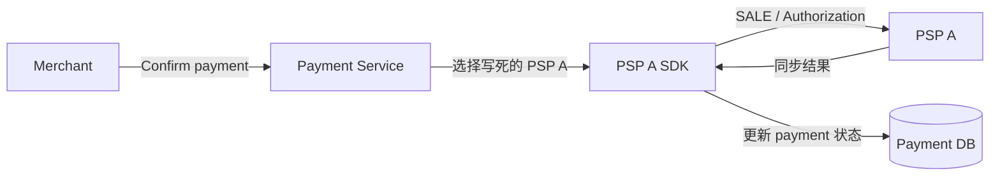
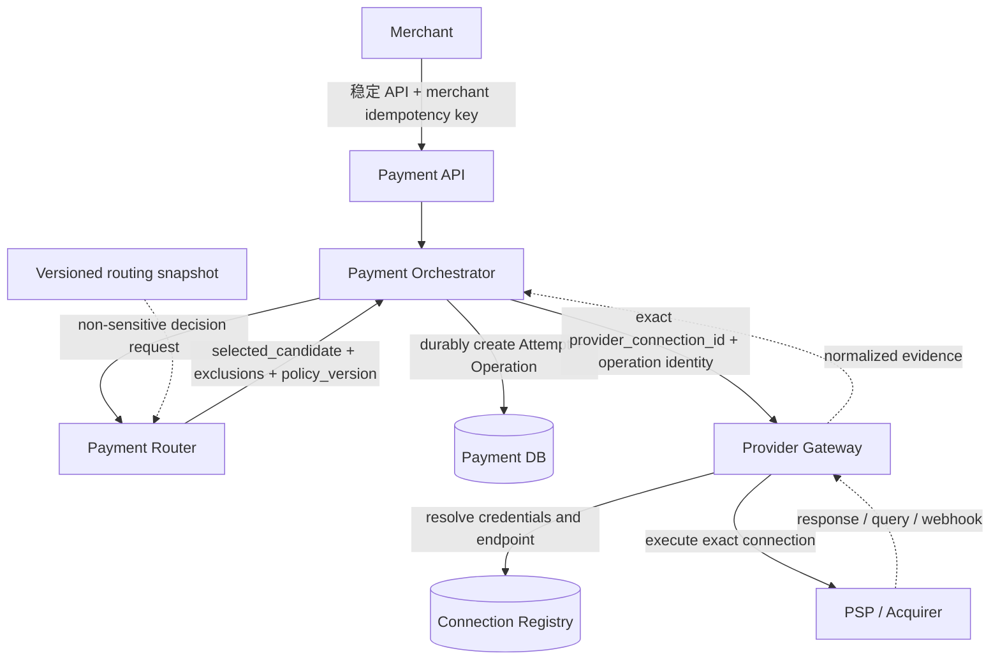
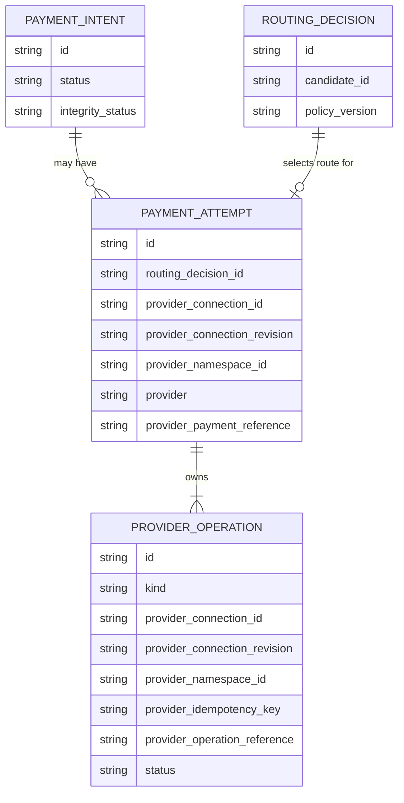
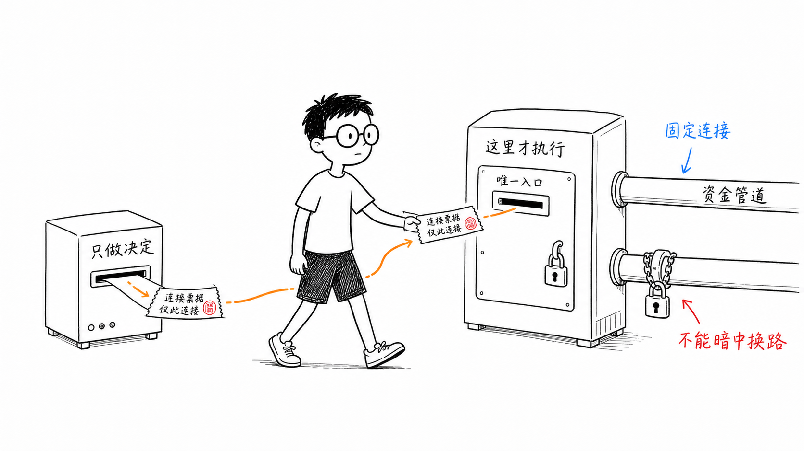
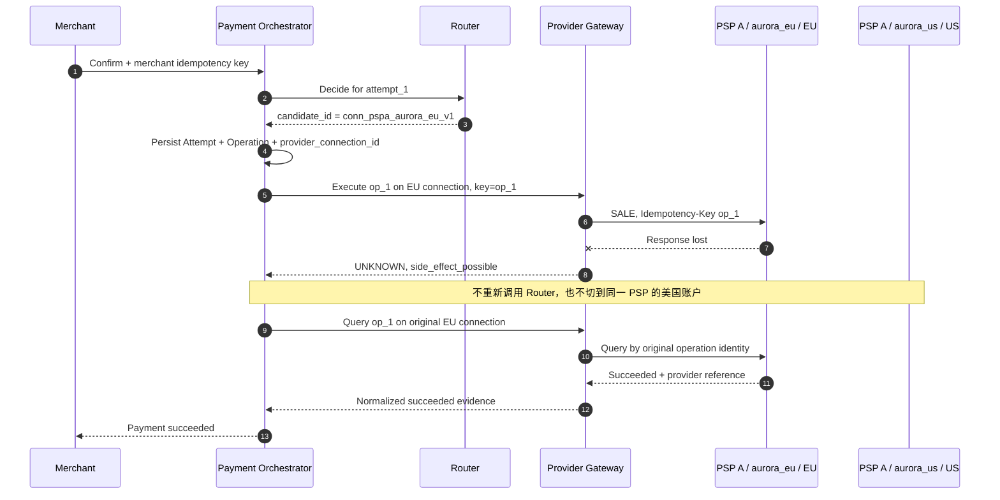
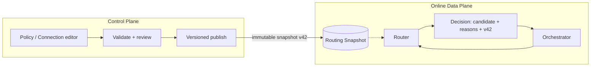

# 第 3 章 Payment Routing System 的职责与边界

第 2 章回答了“为什么需要 Router”：当国家、币种、支付方式和 Provider 增多时，把选择逻辑散落在支付代码里，会让策略变更、故障恢复与审计越来越困难。

但把选择逻辑抽出来，只完成了一半工作。新的危险是，团队很容易继续把 Provider SDK、支付状态机、网络重试、webhook 处理，甚至退款都塞进 Router。它最初只是一个几十行的选择函数，最后却变成所有资金操作都必须经过的中心服务。此时 Router 虽然独立部署了，边界反而比原来更模糊。

本章要建立一个贯穿全书的不变量：

> **Router 生成可解释、可重放的 Routing Decision；它不拥有 Payment 生命周期，也不执行资金副作用。Payment Orchestrator 拥有 Payment、Attempt 与 Operation；Provider Gateway 只在一条已经选定并固定的 Provider Connection 上执行操作。**

这个边界不取决于三个组件是否部署成三个进程。小团队完全可以先把它们实现为一个代码库中的模块；重要的是，谁能改变资金状态、谁能选择路径、谁能接触 Provider 凭证，必须在类型、存储和调用方向上清楚可见。

本章只定义这些职责和最小契约。下一章才会展开 Routing Context；规则、Eligibility、成本、成功率与评分分别留给第 5～9 章；Timeout、Fallback 和完整 Decision Store 则留给可靠性与运营章节。本章也不会把配套系统目前的 automatic-capture `SALE` 夸大成已经支持 manual capture、Void、Refund 或真实 PSP。

## 3.1 一个服务完成所有事情，为什么最初是对的

Aurora 票务平台刚上线时，支付链路只有一家 PSP。Payment Service 接收确认请求，读取订单金额，调用 PSP SDK，然后把返回结果写入数据库：



这套设计没有问题。一次函数调用里既能看到请求，也能看到 Provider 响应；本地事务之外的失败面很少；开发者不需要跨服务追踪一笔支付。所谓“路由”只是常量 `psp_a`，没有必要先建一个独立平台。

接入第二家 PSP 后，团队通常会在同一个服务里加一个函数：

```go
package payment

func selectProvider(currency string) string {
	if currency == "BRL" {
		return "psp_b"
	}
	return "psp_a"
}
```

这仍然是一个合理的中间状态。真正的问题并不是函数太短或架构不够“微服务”，而是选择与执行开始拥有不同的变化原因：运营会频繁调整路径，Provider API 会独立升级，支付状态机则必须以更保守的节奏演进。只要三者仍由同一段过程代码隐式控制，任何一处变化都可能触碰另外两处。

## 3.2 规模增长后，模糊边界会在哪里失效

### 3.2.1 `psp_a` 不是一条可以执行的路径

Aurora 在同一家 PSP 下可能同时拥有美国与欧洲两个 Merchant Account。两者使用不同凭证、合同、结算币种和 Region endpoint，也可能由不同 Connector 版本处理。Router 如果只返回 `psp_a`，执行层还必须再做一次选择：究竟使用哪个账户、哪个 endpoint、哪套凭证？

如果这个“第二次选择”藏在 SDK 工厂或环境变量里，Router 的决定就不是完整决定。排障人员看到“选择了 PSP A”，却无法解释请求实际去了欧洲账户还是美国账户；进程重启或配置更新后，同一操作的 Retry 甚至可能落到另一连接。

本书把可执行路径称为 **Route Candidate**。它至少由下面四个维度共同标识：

| 维度 | 回答的问题 | 为什么不能在执行时临时决定 |
| --- | --- | --- |
| Provider | 使用哪类外部处理方，例如 `psp_a` | 只说明厂商品牌，不能定位合同与故障域 |
| Merchant Account | 以 Provider 下哪个商户账户处理 | 能力、限额、费率、账单和幂等作用域可能不同 |
| Connector | 使用哪套协议映射与 API 版本 | 字段、错误和状态语义可能不同 |
| Region | 请求进入哪个 Provider endpoint / 数据区域 | 延迟、数据驻留、凭证与幂等可见范围可能不同 |

于是，一个 Candidate 不是“PSP A 的别名”，而是一条配置完成、可以被 Gateway 精确执行的 Provider Connection 快照。例如：

```text
candidate_id = conn_pspa_aurora_eu_v1
connection_revision = aurora_eu_credentials_v1
provider_namespace_id = pspa_aurora_eu_account
provider = psp_a
merchant_account = aurora_eu
connector = checkout_v2
region = eu
```

`candidate_id` 是 Router 契约中的稳定身份；当 Orchestrator 接受这个选择并创建 Attempt 时，它把该身份固定为 `provider_connection_id`。两者可以使用同一个不可歧义的值，但语义不同：前者表示“决策候选”，后者表示“这次资金执行已绑定的连接”。`provider` 仍然保留，用来选择相应的 Adapter 类型和做聚合统计，但它不能代替连接身份。

还要防止一种更隐蔽的漂移：ID 没变，背后的账户或 endpoint 却被重新绑定。因此执行身份同时固定 `connection_revision` 与 `provider_namespace_id`。前者引用不可变的连接配置修订；后者表示 Adapter 明确声明的外部身份冲突域，不能从品牌名推测，也不等同于 webhook 的认证域。当前模拟契约让 reference、event 与幂等键共享这一域；若真实 Provider 的三种作用域不同，Adapter 必须分别表达，不能套用模拟器假设。Gateway 只接受已登记的完整身份，旧修订仍可能服务于既有 Operation 的恢复；凭证轮换不能静默重定义一个仍在使用的修订。

### 3.2.2 选择结果与支付结果不是同一种状态

Router 返回 `conn_pspa_aurora_eu_v1`，只表示“在这份输入和策略版本下，下一次 Attempt 应使用这条路径”。它没有证明 PSP 收到了请求，更没有证明 Authorization、Capture 或 Settlement 已完成。

如果 Router 自己调用 PSP，再把 `approved` 返回给 Orchestrator，两个组件都会认为自己拥有状态机：Router 知道外部响应，Orchestrator 知道内部 Payment，但没有任何一个组件能在 crash window 中原子地证明二者已经关联。Router 超时以后，Orchestrator 也无法仅凭 RPC 失败判断外部操作是否发生。

因此，Routing Decision 和 Provider Outcome 必须是两类对象：

| 对象 | 核心问题 | 是否能代表资金事实 | 所有者 |
| --- | --- | --- | --- |
| Routing Decision | 下一次 Attempt 允许走哪条连接，为什么 | 不能 | Router 计算；Orchestrator 关联 |
| Payment Attempt | 为完成同一 Payment 发起的第几次受控执行 | 不能单独代表 | Orchestrator |
| Provider Operation | 在固定连接上的某个逻辑资金操作 | 只有结合结果证据才可以 | Orchestrator |
| Provider Outcome | Provider 对 Operation 的同步、查询或异步证据 | 是证据，但仍需单调收敛 | Gateway 归一化，Orchestrator 应用 |
| Payment State | 商户可见的整体支付生命周期 | 是内部权威状态 | Orchestrator |

### 3.2.3 网络失败会迫使系统回答“谁负责恢复”

设欧洲连接已经收到 `SALE`，并完成了 automatic capture，但响应在返回途中丢失。如果 Router 负责网络 Retry，它需要知道原 operation ID、Provider idempotency key、payload hash 与当前 Attempt；如果 Orchestrator 也进行 Retry，两者可能各发一次。更危险的是，它们可能重新调用 Router，得到另一个 Candidate。

Timeout、连接重置、响应丢失和语义含糊的 `5xx` 都不能证明没有资金副作用。此时 Operation 必须进入 `UNKNOWN`，由拥有 Operation 的 Orchestrator 选择恢复动作；网络重试或查询必须复用原 `provider_connection_id`、operation ID、Provider idempotency key 与语义 payload。Provider 的幂等保证也只在其文档声明的范围内成立。例如 Adyen 明确说明幂等键按 company account 保存，跨 Region endpoint 不互相检查；这正是 Region 和账户不能在 Retry 时漂移的现实原因。[Adyen API idempotency](https://docs.adyen.com/development-resources/api-idempotency)

### 3.2.4 “统一 Adapter”可能暗中变成第二个 Router

Adapter 需要把平台统一操作映射成 Provider API，并归一化响应、错误与 webhook。它可以知道“PSP A 的字段叫法是什么”，但不应该在发现 PSP A 变慢时私自把请求交给 PSP B；也不应该在没有对应能力时悄悄降低语义，例如把 `authorize` 改成 automatic-capture `sale`。

一旦 Adapter 内部拥有独立路由策略，Decision Record 就不再描述真实执行路径，Orchestrator 固定的连接也失去意义。Adapter 的合法输出是“此连接不能执行该操作”或一个归一化 Outcome，而不是“我替你换了一家”。

## 3.3 从职责冲突推导生产边界

把上述问题逐一移出模糊区域，可以得到四个逻辑组件：Payment API、Payment Orchestrator、Payment Router 和 Provider Gateway。它们的调用方向如下：



图中只有 Gateway 需要解析连接到 endpoint 与凭证。Router 使用 Candidate 的非秘密元数据做决定；Orchestrator 只持久化足以固定路径和关联结果的身份；Payment API 不接触 Provider 细节。PAN 属于 Cardholder Data，CVV/CVC 等属于 Sensitive Authentication Data；两类数据都不应进入 Routing Request、Decision、日志或消息，不能把 PAN 与 SAD 混为一类。配套系统当前只传递 tokenized card token，并且 token 只从 Orchestrator 进入 Gateway，不会进入 Router；采用 Tokenization 也不等于系统自动移出 PCI DSS 适用范围，具体范围取决于 Token 类型、系统是否仍接触 Account Data，以及与 Cardholder Data Environment 的连接关系。[PCI SSC FAQ 1326](https://www.pcisecuritystandards.org/faqs/1326/)

### 3.3.1 Payment API：维护商户契约，不泄漏内部拓扑

Payment API 的职责是验证商户身份与请求、执行商户级幂等、创建或读取 Payment，并返回稳定的公开状态。它不应该让商户指定内部 Merchant Account、Region 或凭证，也不应把 `psp_a` 暴露成公开 API 的必填字段。否则内部切换合同或 Connector 会变成破坏性 API 变更。

Payment API 可以接受业务上明确授权的约束，例如“必须使用某个支付方式”或“要求手动 Capture”，但它把这些要求交给 Orchestrator 和 Router 验证，而不是自行拼接 Provider 请求。

### 3.3.2 Orchestrator：资金生命周期的唯一推进者

Orchestrator 拥有 `PaymentIntent`、`PaymentAttempt` 与 `ProviderOperation`。它决定何时请求一次 Routing Decision，何时把选择固化为 Attempt，何时可以执行、查询、等待，以及何时需要人工复核。

最小领域关系可以表示为：



这里要特别区分四种身份：商户的 `Idempotency-Key` 约束一次公开 API 操作；内部 `operation_id` 标识平台的逻辑资金操作；`provider_idempotency_key` 用于在同一 Provider 契约范围内安全重试；`provider_payment_reference` 或 `provider_operation_reference` 是 Provider 返回的交易关联证据。它们不能相互替代。

Orchestrator 还要坚持单调状态收敛：较晚到达的 webhook 不是天然更正确，查询结果也不一定比既有终态更新。当同一 Operation 出现两个不相容的 Provider reference，或已确认成功之后又收到无法解释的失败证据，系统应保留事实并进入 `review_required`，而不是 last-write-wins。

### 3.3.3 Router：纯决策，不是纯算法玩具

Router 接收一次非敏感决策输入，先验证请求，再基于版本化的候选与策略快照生成 Decision。它的输出必须包含完整 Selected Candidate，而不是只有 Provider 字符串：

```go
package routing

type Candidate struct {
	ID              string `json:"candidate_id"`
	Revision        string `json:"connection_revision"`
	NamespaceID     string `json:"provider_namespace_id"`
	Provider        string `json:"provider"`
	MerchantAccount string `json:"merchant_account"`
	Connector       string `json:"connector"`
	Region          string `json:"region"`
}

// CandidateRef omits credentials and mutable capability configuration.
type CandidateRef struct {
	ID              string `json:"candidate_id"`
	Revision        string `json:"connection_revision"`
	NamespaceID     string `json:"provider_namespace_id"`
	Provider        string `json:"provider"`
	MerchantAccount string `json:"merchant_account"`
	Connector       string `json:"connector"`
	Region          string `json:"region"`
}

type Decision struct {
	ID                string       `json:"decision_id"`
	SelectedCandidate CandidateRef `json:"selected_candidate"`
	CandidateOrder    []string     `json:"candidate_order"`
	PolicyVersion     string       `json:"policy_version"`
}
```

“纯决策”并不等于 Router 可以随意返回一个不可追踪的字符串，也不等于进程内部永远不能有缓存。Router 可以缓存已验证的配置快照、能力目录和健康信号；它也可以计算稳定的 `decision_id`。边界在于这些状态服务于决定，而不是替代 Payment 或 Operation 状态。

对同一决策输入、同一策略版本和同一信号快照，结果应可复现。配置发布后，Router 不能拿“当前最新配置”冒充过去使用过的版本。第 14 章会完整设计 Routing Decision Store；本章只要求 Orchestrator 至少持久化 `routing_decision_id`、选中的 `provider_connection_id` 和必要版本引用，使真实执行不会因 Router 的缓存淘汰而失去身份。



### 3.3.4 Gateway：执行精确连接，隔离 Provider 差异

Gateway 接收的不是“帮我找一家能收款的 PSP”，而是“在这条 `provider_connection_id` 上执行这个 Operation”。它用连接注册表解析 endpoint、凭证和 Adapter，然后检查请求身份与持久化 request hash。相同 `operation_id` 若携带不同金额、币种、token、Capture Method 或 connection ID，必须作为冲突拒绝，不能按最后一次请求覆盖。

下面的 Go 示例展示 Orchestrator 如何把 Decision 固定为 Attempt 与 Provider Operation。它刻意不包含评分或 Fallback：

```go
package orchestration

import "errors"

type SelectedCandidate struct {
	CandidateID     string
	Revision        string
	NamespaceID     string
	Provider        string
	MerchantAccount string
	Connector       string
	Region          string
}

type Attempt struct {
	ID                   string
	RoutingDecisionID    string
	ProviderConnectionID string
	ConnectionRevision   string
	ProviderNamespaceID  string
	Provider             string
}

type Operation struct {
	OperationID            string
	AttemptID              string
	ProviderConnectionID   string
	ConnectionRevision     string
	ProviderNamespaceID    string
	Provider               string
	ProviderIdempotencyKey string
}

func PinRoute(decisionID string, selected SelectedCandidate, attemptID, operationID string) (Attempt, Operation, error) {
	if decisionID == "" || attemptID == "" || operationID == "" ||
		selected.CandidateID == "" || selected.Revision == "" || selected.NamespaceID == "" ||
		selected.Provider == "" || selected.MerchantAccount == "" || selected.Connector == "" || selected.Region == "" {
		return Attempt{}, Operation{}, errors.New("incomplete routing decision")
	}

	attempt := Attempt{
		ID:                   attemptID,
		RoutingDecisionID:    decisionID,
		ProviderConnectionID: selected.CandidateID,
		ConnectionRevision:   selected.Revision,
		ProviderNamespaceID:  selected.NamespaceID,
		Provider:             selected.Provider,
	}
	operation := Operation{
		OperationID:            operationID,
		AttemptID:              attemptID,
		ProviderConnectionID:   selected.CandidateID,
		ConnectionRevision:     selected.Revision,
		ProviderNamespaceID:    selected.NamespaceID,
		Provider:               selected.Provider,
		ProviderIdempotencyKey: operationID,
	}
	return attempt, operation, nil
}
```

真实系统中，Attempt 和 Operation 必须先持久化，再允许 Gateway 产生外部副作用；否则进程在外部调用成功、内部写入前崩溃时，就会留下无法可靠关联的交易。Gateway 自己也应先持久化 Operation 和 request hash，再进入可能已经越过网络边界的状态。

### 3.3.5 好边界会让失败发生在哪一侧变得可判断

组件边界的价值之一，是让系统根据“副作用是否可能发生”决定恢复动作，而不是对所有错误统一 Retry：

| 失败位置 | 已知事实 | 允许的下一步 | 明确禁止 |
| --- | --- | --- | --- |
| Routing Request 本地校验失败 | 尚未选择路径，也未创建外部 Operation | 修正请求或向商户返回错误 | 调用任意默认 Provider |
| Router 返回 no eligible candidate | 有完整排除证据，没有资金副作用 | 保存失败原因，结束本次确认 | 绕过 Eligibility 选择最低成本 PSP |
| Router RPC timeout | Router 不执行资金操作 | 在总 deadline 内重试相同决策请求，或安全失败 | 把 timeout 当成 Provider 失败 |
| Operation 已持久化，Gateway 调用前失败 | 有固定连接，但能证明未越过外部边界 | 用同一 Operation 命令继续执行 | 创建另一个 Attempt |
| Gateway dispatch 后 timeout | Provider 副作用可能已发生 | 标记 `UNKNOWN`，沿原连接 query / wait / same-key retry | 重新路由或生成新 key |
| webhook 与既有终态冲突 | 至少有两份不能自动兼容的证据 | 保留证据并进入 `review_required` | 按到达时间覆盖 |

这个表也解释了为什么 Router 的“纯”很重要：Router RPC 失败不会制造资金不确定性，所以它可以拥有比 Provider 调用简单得多的重试语义。反过来，从 Operation 持久化并准备 dispatch 开始，恢复就必须读取权威状态，而不能重新执行一遍完整的 Confirm 流程。

Orchestrator 在接受 Decision 之前也不应预先创建一个假定 Provider 的 Operation。正确顺序是先生成稳定 `attempt_id` 供决策关联，得到完整 Candidate 后，再在同一个持久化边界中写入 Attempt、Operation、连接身份与请求指纹。若 Router 返回 no eligible candidate，系统可以保存 Decision 的排除证据，但数据库里不应该出现一个可能被后台 worker 误执行的 Provider Operation。

### 3.3.6 稳定 ID 不等于把所有配置永久冻结

`candidate_id` 必须稳定指向同一执行身份，但 endpoint 地址、证书和密钥仍需要轮换。判断能否在同一个 ID 下更新配置，要看变化是否保持资金关联和 Provider 契约等价：同一 Merchant Account 内的密钥轮换通常可以由 Connection Registry 版本化处理；把 Region 从 `eu` 改到 `us`、把 Merchant Account 从 `aurora_eu` 改到 `aurora_us`，则改变了幂等、账单或数据边界，应创建新的 Candidate ID，而不是原地覆盖。

连接停用也不能删除历史身份。它可以立即从新支付的 Candidate Set 中移除，但 Gateway 仍需在受控权限下解析旧连接，以完成原交易的 query、Capture、Void、Refund 和 Reconciliation。换言之，“不可用于新路由”与“不可再访问”是两种状态。若把它们合并，最需要恢复旧交易时反而会失去 endpoint、账户和凭证版本线索。

## 3.4 一次选择，如何在失败后仍保持同一连接

用一个可证伪的场景检验边界。Aurora 同时配置两条 PSP A 连接：

| Candidate | Provider | Merchant Account | Connector | Region |
| --- | --- | --- | --- | --- |
| `conn_pspa_aurora_eu_v1` | `psp_a` | `aurora_eu` | `checkout_v2` | `eu` |
| `conn_pspa_aurora_us_v1` | `psp_a` | `aurora_us` | `checkout_v2` | `us` |

一笔 EUR 支付选中欧洲连接。Gateway 发出请求后超时，Operation 进入 `UNKNOWN`。即使此刻 Router 的新配置把美国连接排在第一位，恢复流程也不能重新路由；它必须用原连接查询，或在 Provider 契约允许时用原 key 和原 payload 重发同一个 Operation：



这个验收场景必须能证明以下事实：数据库里只有一个 Attempt 和一个逻辑 Provider Operation；所有 dispatch、query 与同操作重试都使用 `conn_pspa_aurora_eu_v1`；Provider idempotency key 与语义 payload 不变；`conn_pspa_aurora_us_v1` 没有收到请求。只检查最终 Payment 是 `succeeded` 还不够，因为一个有重复扣款风险的实现也可能得到这个终态。

这里讨论的是同一 Operation 的恢复，不是第 12 章的 Fallback。只有前一 Attempt 已得到“明确无副作用且策略允许重新路由”的结论，Orchestrator 才可能创建新 Attempt；`UNKNOWN` 本身从来不是这个结论。

## 3.5 后续 Capture、Void 与 Refund 为什么不能重新路由

Authorization、Capture 与 Settlement 是不同阶段。Authorization 获批只表示额度或资金通常被预留，并不代表 Merchant 已经收到款项。若使用 manual capture，Capture 必须关联原 Authorization 的 Provider transaction reference；例如 Adyen 的官方 Capture API 要求使用原支付的 `paymentPspReference` 调用对应路径，并使用相同 Merchant Account。[Adyen Capture](https://docs.adyen.com/online-payments/capture)

因此，后续操作的目标不是一个新的“最佳 Candidate”，而是原交易所在连接：

```text
Capture target = original provider_connection_id + provider_payment_reference
Void target    = original provider_connection_id + provider_payment_reference
Refund target  = original provider_connection_id + provider_payment_reference
```

这些操作可以拥有各自的内部 operation ID、Provider idempotency key 与 Provider operation reference，但不能改走另一 Merchant Account、Region 或 PSP。Router 可以在最初决定时过滤“是否支持 manual capture”等能力，却不参与给已授权交易重新选择 Capture 路径。

配套 Go 系统在本章阶段仍只支持 tokenized card 的 automatic-capture `SALE`，不提供 manual capture、Void 或 Refund API。上面的约束是后续扩展必须遵守的领域不变量，不是对当前实现范围的虚假声明。

## 3.6 数据平面与控制平面也需要边界

Router 的在线路径只应该消费已经验证、带版本的快照。策略编辑、审批、发布、连接启停与能力维护属于控制平面，不应该在一次支付请求里临时查询多个后台系统并组合出未版本化状态：



控制平面不可用时，数据平面可以继续使用 last-known-good 快照；关键快照不存在或校验失败时，则应明确失败，而不是回到某个隐藏的“默认 PSP”。如何发布、灰度和回滚配置会在第 20 章展开。本章只要求在线决定永远指出它使用了哪个版本。

## 3.7 常见失败模式

### Router 调用 Provider 后才返回决定

这会把“选择”和“副作用”合并。Router RPC timeout 时，Orchestrator 不知道应该创建 Operation、查询 Provider 还是再次路由。修复方法不是增加一次盲目重试，而是让 Router 在外部调用前结束职责。

### Decision 只保存 Provider 名称

同一 PSP 下有多个账户或 Region 时，执行层会被迫二次选择。配置变化后，Retry 可能漂移到另一幂等作用域。Decision、Attempt、Operation 和 Gateway 命令必须贯穿 `candidate_id` / `provider_connection_id`。

### 每次 Retry 都重新请求 Router

Router 正常地返回了当前最优路径，却错误地改变了一个结果未知的资金操作。恢复代码应从持久化 Operation 读取固定连接，而不是从新 Decision 读取候选。

### Gateway 根据健康状态偷偷换 endpoint

如果 endpoint 只是同一连接内、Provider 明确保证共享身份与幂等作用域的透明网络地址，Gateway 可以按连接契约处理；如果变化跨越 Region、Merchant Account 或凭证边界，就已经是路由变化，不能隐藏在客户端负载均衡中。

### `provider_idempotency_key` 被当成全局去重键

Provider 幂等只保护该 Provider 契约声明的范围，不能让 PSP B 知道 PSP A 已经处理过请求。相同字符串跨连接出现，不会自动形成跨 PSP 去重。平台仍需自己的 merchant key、Operation 身份、唯一约束和状态机。Stripe 与 Adyen 对结果保留期、并发请求和 key 作用范围的具体语义并不相同，Adapter 必须按官方契约实现，而不能假定所有 Provider 行为一致。[Stripe Idempotent requests](https://docs.stripe.com/api/idempotent_requests)、[Adyen API idempotency](https://docs.adyen.com/development-resources/api-idempotency)

### 异步证据按到达时间覆盖

同步响应、query 和 webhook 可能重复、延迟或乱序。Gateway 应验证来源并保留原始 Provider code；Orchestrator 按 Operation 身份应用单调状态转换。两个已确认且相互冲突的 reference 需要隔离并进入 `review_required`，不能用数据库最后更新时间决定真相。

## 3.8 边界不等于必须拆成四个微服务

独立服务能提供独立扩缩容、故障隔离、凭证边界和不同发布节奏，但也会引入 RPC timeout、部署、认证、追踪与跨库一致性成本。下面两种部署都可以遵守本章不变量：

| 形态 | 适用阶段 | 必须保持的边界 |
| --- | --- | --- |
| 模块化单体 | Provider 少、团队小、吞吐有限 | 类型上分开 Decision 与 Outcome；只有 Orchestrator 改变 Payment；Gateway 不选路 |
| 独立 Router / Payment / Gateway 服务 | 策略发布频繁、凭证隔离或扩缩容要求明显 | RPC 契约携带完整身份；每个服务有明确权威存储与故障语义 |

不应该仅因为流程图里有四个框，就为每个框创建数据库和 Kubernetes Deployment。拆分的依据应是数据所有权、合规边界、故障域和独立演进需求。反过来，即使所有模块运行在同一进程，也不能让一个便利函数绕过 Operation 持久化后直接调用 Provider。

精确连接身份也有成本。团队必须维护 Candidate 生命周期，避免把可变 endpoint 或密钥直接编码进 ID；连接停用后仍要保留历史解析能力，以便查询、退款和对账；对外日志应记录稳定 ID 而不是秘密配置。这个成本换来的是可审计执行与安全恢复，而不是更多抽象本身。

## 3.9 配套 Go 实现如何映射这些边界

本章对应[已验证实现 `adbdf755`](https://github.com/YouEclipse/payments/tree/adbdf75589dcb7b9ae088aa9f92fde2c2f063aeb)，以三个服务呈现这些契约：

- [Router](https://github.com/YouEclipse/payments/tree/adbdf75589dcb7b9ae088aa9f92fde2c2f063aeb/services/router/internal/routing) 生成确定性 Decision，输出 `selected_candidate`、候选顺序、排除证据和策略版本；Candidate 携带 connection ID、revision、namespace 和 Provider / Account / Connector / Region 元数据。
- [Payment](https://github.com/YouEclipse/payments/blob/adbdf75589dcb7b9ae088aa9f92fde2c2f063aeb/services/payment/internal/app/service.go) 请求 Decision，并在产生外部调用前把 `routing_decision_id` 和完整连接身份固定到 Attempt / Operation；它拥有 Payment 状态与 `UNKNOWN` 恢复。
- [Gateway](https://github.com/YouEclipse/payments/tree/adbdf75589dcb7b9ae088aa9f92fde2c2f063aeb/services/provider-gateway/internal/gateway) 持久化 Operation、request hash 与 insert-only 连接修订登记，拒绝把已有修订绑定到另一配置；query 与同操作重发沿用原身份。恢复别名必须显式配置，不能创建新的资金操作，也不能仅因 namespace 相同就替另一连接认证 webhook。

[该提交的 CI](https://github.com/YouEclipse/payments/actions/runs/32919381068) 已验证真实 PostgreSQL 迁移、连接身份冲突、乱序证据、race 与 Compose E2E；其中 `UNKNOWN` 用例同时检查 Payment/Gateway 的 connection ID、revision、namespace 一致及只有一个资金路径。完整证据映射见[第 3 章交付记录](../deliveries/chapter-03-routing-system-boundaries.md)。

当前纵向切片刻意很窄：只处理 tokenized card、`capture_method=automatic` 和 Provider-native `SALE`；Simulator 只允许 local / development / test 环境。它已经能够表达成功、明确拒绝、响应丢失后的 `UNKNOWN`、query / webhook 收敛，以及冲突证据触发 `review_required`，但不能处理真钱，也没有实现本章明确留给后续的 manual capture、Void、Refund、完整 Routing Context、动态评分或跨 Provider Fallback。

这组范围声明同样属于架构边界。一个系统“知道 Capture 必须绑定原连接”，与它“已经提供 Capture API”是两件不同的事。

## 3.10 小结

Payment Routing System 最重要的边界，不是 HTTP 路径或仓库目录，而是决定与资金事实之间的分界。

Router 接收非敏感的决策输入，使用版本化快照选择一个精确 Route Candidate，并返回可解释、可复现的 Decision。Candidate 由 Provider、Merchant Account、Connector 与 Region 共同构成；只返回 `psp_a` 不足以执行，也不足以安全恢复。

Orchestrator 拥有 Payment、Attempt 和 Operation。它把 `candidate_id` 固定成这次 Attempt 的 `provider_connection_id`，先持久化资金操作，再让 Gateway 执行。Gateway 解析连接、调用相应 Adapter，并把同步响应、query 与 webhook 归一化成证据；它没有权力暗中更换连接。

一旦请求可能越过 Provider 边界，timeout 就是 `UNKNOWN`。同一逻辑 Operation 的恢复必须固定原连接、原 operation ID、原 Provider idempotency key 与原语义 payload。Capture、Void 与 Refund 还必须绑定原获批连接和 Provider transaction reference，不能重新路由。

有了这条边界，后续章节才有稳定地基：下一章可以专注于“Router 做决定需要哪些最小输入”，而不必让 Routing Context 承担 Payment State；规则、Eligibility 和评分可以演进，而不会直接执行资金；Fallback 也只能在 Orchestrator 掌握的 Attempt 结果允许时发生。

## 延伸阅读

- [Adyen Docs：API idempotency](https://docs.adyen.com/development-resources/api-idempotency)
- [Adyen Docs：Capture](https://docs.adyen.com/online-payments/capture)
- [Stripe API Reference：Idempotent requests](https://docs.stripe.com/api/idempotent_requests)
- [PCI SSC Glossary：Cardholder Data 与 Sensitive Authentication Data](https://www.pcisecuritystandards.org/glossary/)
- [PCI SSC FAQ 1326：EMVCo Payment Tokens 与 PCI DSS](https://www.pcisecuritystandards.org/faqs/1326/)
- [第 2 章：为什么需要 Payment Routing](why-payment-routing.md)
- [第 4 章：构建 Routing Context](../part-2-routing-engine/routing-context.md)
- [第 10 章：Timeout、Retry 与 Unknown State](../part-3-reliability/timeout-and-retry.md)
- [第 14 章：Routing Decision Store](../part-4-operating-at-scale/routing-decision-store.md)
