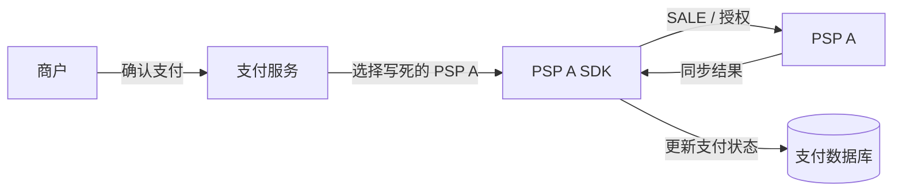
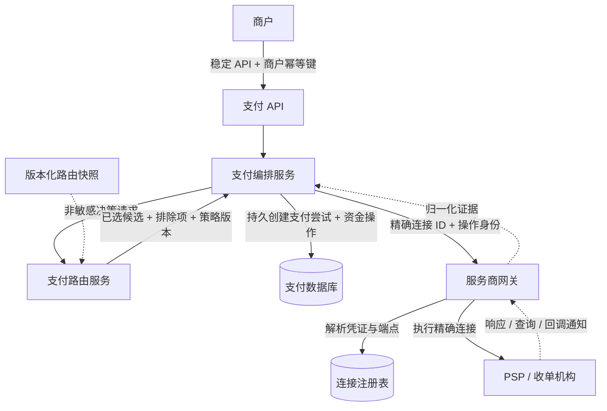
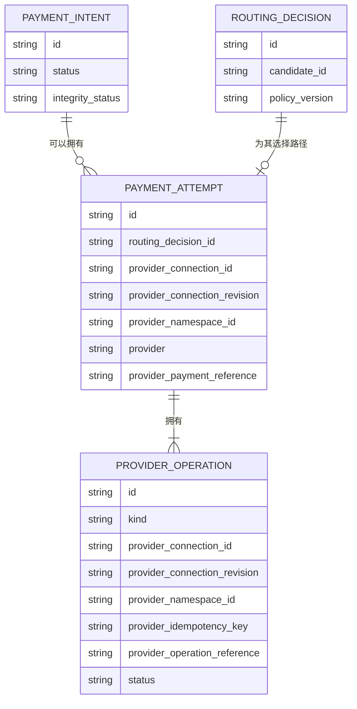
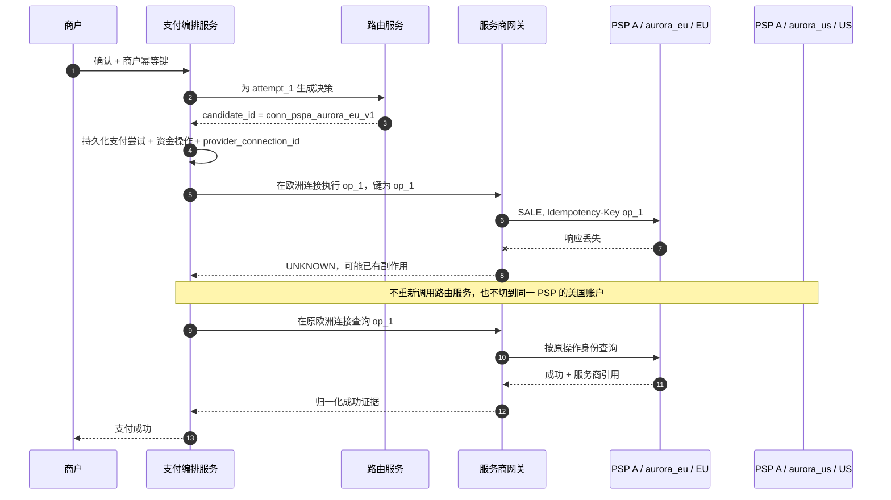
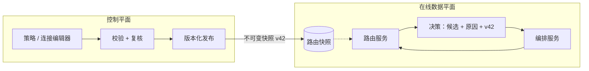

# 第 3 章 支付路由系统的职责与边界

**中文** | [English](../en/part-1-foundations/routing-system-boundaries.md)

第 2 章回答了“为什么需要路由服务”：当国家、币种、支付方式和支付服务商增多时，把选择逻辑散落在支付代码里，会让策略变更、故障恢复与审计越来越困难。

但把选择逻辑抽出来，只完成了一半工作。新的危险是，团队很容易继续把支付服务商 SDK、支付状态机、网络重试、回调通知处理，甚至退款都塞进路由服务。它最初只是一个几十行的选择函数，最后却变成所有资金操作都必须经过的中心服务。此时路由服务虽然独立部署了，边界反而比原来更模糊。

本章要建立一个贯穿全书的不变量：

> **路由服务生成可解释、可重放的路由决策；它不拥有支付生命周期，也不执行资金副作用。支付编排服务拥有支付、支付尝试与资金操作；服务商网关只在一条已经选定并固定的服务商连接上执行操作。**

这个边界不取决于三个组件是否部署成三个进程。小团队完全可以先把它们实现为一个代码库中的模块；重要的是，谁能改变资金状态、谁能选择路径、谁能接触支付服务商凭证，必须在类型、存储和调用方向上清楚可见。

本章只定义这些职责和最小契约。下一章才会展开路由上下文；规则、准入筛选、成本、成功率与评分分别留给第 5～9 章；超时、后备切换和完整决策存储则留给可靠性与运营章节。本章也不会把配套系统目前的自动请款 `SALE` 夸大成已经支持手动请款、撤销、退款或真实 PSP。

## 3.1 一个服务完成所有事情，为什么最初是对的

Aurora 票务平台刚上线时，支付链路只有一家 PSP。支付服务接收确认请求，读取订单金额，调用 PSP SDK，然后把返回结果写入数据库：



这套设计没有问题。一次函数调用里既能看到请求，也能看到支付服务商响应；本地事务之外的失败面很少；开发者不需要跨服务追踪一笔支付。所谓“路由”只是常量 `psp_a`，没有必要先建一个独立平台。

接入第二家 PSP 后，团队通常会在同一个服务里加一个函数：

```go
package payment

func selectProvider(currency string) string {
	if currency == "BRL" {
		return "psp_b"
	}
	return "psp_a"
}
```

这仍然是一个合理的中间状态。真正的问题并不是函数太短或架构不够“微服务”，而是选择与执行开始拥有不同的变化原因：运营会频繁调整路径，支付服务商 API 会独立升级，支付状态机则必须以更保守的节奏演进。只要三者仍由同一段过程代码隐式控制，任何一处变化都可能触碰另外两处。

## 3.2 规模增长后，模糊边界会在哪里失效

### 3.2.1 `psp_a` 不是一条可以执行的路径

Aurora 在同一家 PSP 下可能同时拥有美国与欧洲两个商户账户。两者使用不同凭证、合同、结算币种和区域端点，也可能由不同连接器版本处理。路由服务如果只返回 `psp_a`，执行层还必须再做一次选择：究竟使用哪个账户、哪个端点、哪套凭证？

如果这个“第二次选择”藏在 SDK 工厂或环境变量里，路由服务的决策就不是完整决策。排障人员看到“选择了 PSP A”，却无法解释请求实际去了欧洲账户还是美国账户；进程重启或配置更新后，同一操作的重试甚至可能落到另一连接。

本书把可执行路径称为**候选通道（Route Candidate）**。它至少由下面四个维度共同标识：

| 维度    | 回答的问题                | 为什么不能在执行时临时决定         |
| ----- | -------------------- | --------------------- |
| 支付服务商 | 使用哪类外部处理方，例如 `psp_a` | 只说明厂商品牌，不能定位合同与故障域    |
| 商户账户  | 以支付服务商下哪个商户账户处理      | 能力、限额、费率、账单和幂等作用域可能不同 |
| 连接器   | 使用哪套协议映射与 API 版本     | 字段、错误和状态语义可能不同        |
| 区域    | 请求进入哪个服务商端点或数据区域     | 延迟、数据驻留、凭证与幂等可见范围可能不同 |

于是，一个候选通道不是“PSP A 的别名”，而是一条配置完成、可以被服务商网关精确执行的服务商连接快照。例如：

```
candidate_id = conn_pspa_aurora_eu_v1
connection_revision = aurora_eu_credentials_v1
provider_namespace_id = pspa_aurora_eu_account
provider = psp_a
merchant_account = aurora_eu
connector = checkout_v2
region = eu
```

`candidate_id` 是路由服务契约中的稳定身份；当编排服务接受这个选择并创建支付尝试时，它把该身份固定为 `provider_connection_id`。两者可以使用同一个不可歧义的值，但语义不同：前者表示“决策候选”，后者表示“这次资金执行已绑定的连接”。`provider` 仍然保留，用来选择相应的适配器类型和做聚合统计，但它不能代替连接身份。

还要防止一种更隐蔽的漂移：ID 没变，背后的账户或端点却被重新绑定。因此执行身份同时固定 `connection_revision` 与 `provider_namespace_id`。前者引用不可变的连接配置修订；后者表示适配器明确声明的外部身份冲突域，不能从品牌名推测，也不等同于回调通知的认证域。当前模拟契约让引用、事件与幂等键共享这一域；若真实支付服务商的三种作用域不同，适配器必须分别表达，不能套用模拟器假设。服务商网关只接受已登记的完整身份，旧修订仍可能服务于既有资金操作的恢复；凭证轮换不能静默重定义一个仍在使用的修订。

### 3.2.2 选择结果与支付结果不是同一种状态

路由服务返回 `conn_pspa_aurora_eu_v1`，只表示“在这份输入和策略版本下，下一次支付尝试应使用这条路径”。它没有证明 PSP 收到了请求，更没有证明授权、请款或结算已完成。

如果路由服务自己调用 PSP，再把 `approved` 返回给编排服务，两个组件都会认为自己拥有状态机：路由服务知道外部响应，编排服务知道内部支付，但没有任何一个组件能在崩溃窗口中原子地证明二者已经关联。路由服务超时以后，编排服务也无法仅凭 RPC 失败判断外部操作是否发生。

因此，路由决策和服务商结果必须是两类对象：

| 对象      | 核心问题                  | 是否能代表资金事实   | 所有者             |
| ------- | --------------------- | ----------- | --------------- |
| 路由决策    | 下一次支付尝试允许走哪条连接，为什么    | 不能          | 路由服务计算；编排服务关联   |
| 支付尝试    | 为完成同一笔支付发起的第几次受控执行    | 不能单独代表      | 编排服务            |
| 服务商资金操作 | 在固定连接上的某个逻辑资金操作       | 只有结合结果证据才可以 | 编排服务            |
| 服务商结果   | 支付服务商对资金操作的同步、查询或异步证据 | 是证据，但仍需单调收敛 | 服务商网关归一化，编排服务应用 |
| 支付状态    | 商户可见的整体支付生命周期         | 是内部权威状态     | 编排服务            |

### 3.2.3 网络失败会迫使系统回答“谁负责恢复”

设欧洲连接已经收到 `SALE`，并完成了自动请款，但响应在返回途中丢失。如果路由服务负责网络重试，它需要知道原资金操作 ID、服务商幂等键、载荷摘要与当前支付尝试；如果编排服务也进行重试，两者可能各发一次。更危险的是，它们可能重新调用路由服务，得到另一个候选通道。

超时、连接重置、响应丢失和语义含糊的 `5xx` 都不能证明没有资金副作用。此时资金操作必须进入 `UNKNOWN`，由拥有资金操作的编排服务选择恢复动作；网络重试或查询必须复用原 `provider_connection_id`、资金操作 ID、服务商幂等键与语义载荷。支付服务商的幂等保证也只在其文档声明的范围内成立。例如 Adyen 明确说明幂等键按公司账户保存，跨区域端点不互相检查；这正是区域和账户不能在重试时漂移的现实原因。[Adyen API 幂等](https://docs.adyen.com/development-resources/api-idempotency)

### 3.2.4 “统一适配器”可能暗中变成第二个路由服务

适配器需要把平台统一操作映射成支付服务商 API，并归一化响应、错误与回调通知。它可以知道“PSP A 的字段叫法是什么”，但不应该在发现 PSP A 变慢时私自把请求交给 PSP B；也不应该在没有对应能力时悄悄降低语义，例如把 `authorize` 改成自动请款 `sale`。

一旦适配器内部拥有独立路由策略，决策记录就不再描述真实执行路径，编排服务固定的连接也失去意义。适配器的合法输出是“此连接不能执行该操作”或一个归一化结果，而不是“我替你换了一家”。

## 3.3 从职责冲突推导生产边界

把上述问题逐一移出模糊区域，可以得到四个逻辑组件：支付 API、支付编排服务、支付路由服务和服务商网关。它们的调用方向如下：



图中只有服务商网关需要把连接解析成端点与凭证。路由服务使用候选通道的非秘密元数据做决策；编排服务只持久化足以固定路径和关联结果的身份；支付 API 不接触服务商细节。PAN 属于持卡人数据，CVV/CVC 等属于敏感认证数据；两类数据都不应进入路由请求、决策、日志或消息，不能把 PAN 与 SAD 混为一类。配套系统当前只传递令牌化银行卡令牌，并且令牌只从编排服务进入服务商网关，不会进入路由服务；采用令牌化也不等于系统自动移出 PCI DSS 适用范围，具体范围取决于令牌类型、系统是否仍接触账户数据，以及与持卡人数据环境的连接关系。[PCI SSC FAQ 1326](https://www.pcisecuritystandards.org/faqs/1326/)

### 3.3.1 支付 API：维护商户契约，不泄漏内部拓扑

支付 API 的职责是验证商户身份与请求、执行商户级幂等、创建或读取支付，并返回稳定的公开状态。它不应该让商户指定内部商户账户、区域或凭证，也不应把 `psp_a` 暴露成公开 API 的必填字段。否则内部切换合同或连接器会变成破坏性 API 变更。

支付 API 可以接受业务上明确授权的约束，例如“必须使用某个支付方式”或“要求手动请款”，但它把这些要求交给编排服务和路由服务验证，而不是自行拼接服务商请求。

### 3.3.2 编排服务：资金生命周期的唯一推进者

编排服务拥有 `PaymentIntent`、`PaymentAttempt` 与 `ProviderOperation`。它决定何时请求一次路由决策，何时把选择固化为支付尝试，何时可以执行、查询、等待，以及何时需要人工复核。

最小领域关系可以表示为：



这里要特别区分四种身份：商户的 `Idempotency-Key` 约束一次公开 API 操作；内部 `operation_id` 标识平台的逻辑资金操作；`provider_idempotency_key` 用于在同一服务商契约范围内安全重试；`provider_payment_reference` 或 `provider_operation_reference` 是支付服务商返回的交易关联证据。它们不能相互替代。

编排服务还要坚持单调状态收敛：较晚到达的回调通知不是天然更正确，查询结果也不一定比既有终态更新。当同一资金操作出现两个不相容的服务商引用，或已确认成功之后又收到无法解释的失败证据，系统应保留事实并进入 `review_required`，而不是以后写覆盖处理。

### 3.3.3 路由服务：纯决策，不是纯算法玩具

路由服务接收一次非敏感决策输入，先验证请求，再基于版本化的候选与策略快照生成决策。它的输出必须包含完整的已选候选通道，而不是只有支付服务商字符串：

```go
package routing

type Candidate struct {
	ID              string `json:"candidate_id"`
	Revision        string `json:"connection_revision"`
	NamespaceID     string `json:"provider_namespace_id"`
	Provider        string `json:"provider"`
	MerchantAccount string `json:"merchant_account"`
	Connector       string `json:"connector"`
	Region          string `json:"region"`
}

// CandidateRef 不包含凭证和可变的能力配置。
type CandidateRef struct {
	ID              string `json:"candidate_id"`
	Revision        string `json:"connection_revision"`
	NamespaceID     string `json:"provider_namespace_id"`
	Provider        string `json:"provider"`
	MerchantAccount string `json:"merchant_account"`
	Connector       string `json:"connector"`
	Region          string `json:"region"`
}

type Decision struct {
	ID                string       `json:"decision_id"`
	SelectedCandidate CandidateRef `json:"selected_candidate"`
	CandidateOrder    []string     `json:"candidate_order"`
	PolicyVersion     string       `json:"policy_version"`
}
```

“纯决策”并不等于路由服务可以随意返回一个不可追踪的字符串，也不等于进程内部永远不能有缓存。路由服务可以缓存已验证的配置快照、能力目录和健康信号；它也可以计算稳定的 `decision_id`。边界在于这些状态服务于决策，而不是替代支付或资金操作状态。

对同一决策输入、同一策略版本和同一信号快照，结果应可复现。配置发布后，路由服务不能拿“当前最新配置”冒充过去使用过的版本。第 14 章会完整设计路由决策存储；本章只要求编排服务至少持久化 `routing_decision_id`、选中的 `provider_connection_id` 和必要版本引用，使真实执行不会因路由服务的缓存淘汰而失去身份。


### 3.3.4 服务商网关：执行精确连接，隔离服务商差异

服务商网关接收的不是“帮我找一家能收款的 PSP”，而是“在这条 `provider_connection_id` 上执行这个资金操作”。它用连接注册表解析端点、凭证和适配器，然后检查请求身份与持久化请求摘要。相同 `operation_id` 若携带不同金额、币种、令牌、请款方式或连接 ID，必须作为冲突拒绝，不能按最后一次请求覆盖。

下面的 Go 示例展示编排服务如何把路由决策固定为支付尝试与服务商资金操作。它刻意不包含评分或后备切换：

```go
package orchestration

import "errors"

type SelectedCandidate struct {
	CandidateID     string
	Revision        string
	NamespaceID     string
	Provider        string
	MerchantAccount string
	Connector       string
	Region          string
}

type Attempt struct {
	ID                   string
	RoutingDecisionID    string
	ProviderConnectionID string
	ConnectionRevision   string
	ProviderNamespaceID  string
	Provider             string
}

type Operation struct {
	OperationID            string
	AttemptID              string
	ProviderConnectionID   string
	ConnectionRevision     string
	ProviderNamespaceID    string
	Provider               string
	ProviderIdempotencyKey string
}

func PinRoute(decisionID string, selected SelectedCandidate, attemptID, operationID string) (Attempt, Operation, error) {
	if decisionID == "" || attemptID == "" || operationID == "" ||
		selected.CandidateID == "" || selected.Revision == "" || selected.NamespaceID == "" ||
		selected.Provider == "" || selected.MerchantAccount == "" || selected.Connector == "" || selected.Region == "" {
		return Attempt{}, Operation{}, errors.New("incomplete routing decision")
	}

	attempt := Attempt{
		ID:                   attemptID,
		RoutingDecisionID:    decisionID,
		ProviderConnectionID: selected.CandidateID,
		ConnectionRevision:   selected.Revision,
		ProviderNamespaceID:  selected.NamespaceID,
		Provider:             selected.Provider,
	}
	operation := Operation{
		OperationID:            operationID,
		AttemptID:              attemptID,
		ProviderConnectionID:   selected.CandidateID,
		ConnectionRevision:     selected.Revision,
		ProviderNamespaceID:    selected.NamespaceID,
		Provider:               selected.Provider,
		ProviderIdempotencyKey: operationID,
	}
	return attempt, operation, nil
}
```

真实系统中，支付尝试和资金操作必须先持久化，再允许服务商网关产生外部副作用；否则进程在外部调用成功、内部写入前崩溃时，就会留下无法可靠关联的交易。服务商网关自己也应先持久化资金操作和请求摘要，再进入可能已经越过网络边界的状态。

### 3.3.5 好边界会让失败发生在哪一侧变得可判断

组件边界的价值之一，是让系统根据“副作用是否可能发生”决定恢复动作，而不是对所有错误统一重试：

| 失败位置             | 已知事实              | 允许的下一步                        | 明确禁止             |
| ---------------- | ----------------- | ----------------------------- | ---------------- |
| 路由请求本地校验失败       | 尚未选择路径，也未创建外部资金操作 | 修正请求或向商户返回错误                  | 调用任意默认支付服务商      |
| 路由服务返回无合格候选      | 有完整排除证据，没有资金副作用   | 保存失败原因，结束本次确认                 | 绕过准入筛选选择最低成本 PSP |
| 路由服务 RPC 超时      | 路由服务不执行资金操作       | 在总截止时间内重试相同决策请求，或安全失败         | 把超时当成服务商失败       |
| 资金操作已持久化，网关调用前失败 | 有固定连接，但能证明未越过外部边界 | 用同一资金操作命令继续执行                 | 创建另一次支付尝试        |
| 网关派发后超时          | 服务商副作用可能已发生       | 标记 `UNKNOWN`，沿原连接查询、等待或复用原键重试 | 重新路由或生成新键        |
| 回调通知与既有终态冲突      | 至少有两份不能自动兼容的证据    | 保留证据并进入 `review_required`     | 按到达时间覆盖          |

这个表也解释了为什么路由服务的“纯”很重要：路由服务 RPC 失败不会制造资金不确定性，所以它可以拥有比支付服务商调用简单得多的重试语义。反过来，从资金操作持久化并准备派发开始，恢复就必须读取权威状态，而不能重新执行一遍完整的确认流程。

编排服务在接受路由决策之前也不应预先创建一个假定服务商的资金操作。正确顺序是先生成稳定 `attempt_id` 供决策关联，得到完整候选通道后，再在同一个持久化边界中写入支付尝试、资金操作、连接身份与请求指纹。若路由服务返回无合格候选，系统可以保存路由决策的排除证据，但数据库里不应该出现一个可能被后台任务误执行的服务商资金操作。

### 3.3.6 稳定 ID 不等于把所有配置永久冻结

`candidate_id` 必须稳定指向同一执行身份，但端点地址、证书和密钥仍需要轮换。判断能否在同一个 ID 下更新配置，要看变化是否保持资金关联和服务商契约等价：同一商户账户内的密钥轮换通常可以由连接注册表版本化处理；把区域从 `eu` 改到 `us`、把商户账户从 `aurora_eu` 改到 `aurora_us`，则改变了幂等、账单或数据边界，应创建新的候选通道 ID，而不是原地覆盖。

连接停用也不能删除历史身份。它可以立即从新支付的候选集中移除，但服务商网关仍需在受控权限下解析旧连接，以完成原交易的查询、请款、撤销、退款和对账。换言之，“不可用于新路由”与“不可再访问”是两种状态。若把它们合并，最需要恢复旧交易时反而会失去端点、账户和凭证版本线索。

## 3.4 一次选择，如何在失败后仍保持同一连接

用一个可证伪的场景检验边界。Aurora 同时配置两条 PSP A 连接：

| 候选通道                     | 支付服务商   | 商户账户        | 连接器           | 区域   |
| ------------------------ | ------- | ----------- | ------------- | ---- |
| `conn_pspa_aurora_eu_v1` | `psp_a` | `aurora_eu` | `checkout_v2` | `eu` |
| `conn_pspa_aurora_us_v1` | `psp_a` | `aurora_us` | `checkout_v2` | `us` |

一笔 EUR 支付选中欧洲连接。服务商网关发出请求后超时，资金操作进入 `UNKNOWN`。即使此刻路由服务的新配置把美国连接排在第一位，恢复流程也不能重新路由；它必须用原连接查询，或在服务商契约允许时用原键和原载荷重发同一个资金操作：



这个验收场景必须能证明以下事实：数据库里只有一次支付尝试和一个逻辑服务商资金操作；所有派发、查询与同操作重试都使用 `conn_pspa_aurora_eu_v1`；服务商幂等键与语义载荷不变；`conn_pspa_aurora_us_v1` 没有收到请求。只检查最终支付是 `succeeded` 还不够，因为一个有重复扣款风险的实现也可能得到这个终态。

这里讨论的是同一资金操作的恢复，不是第 12 章的后备切换。只有前一次支付尝试已得到“明确无副作用且策略允许重新路由”的结论，编排服务才可能创建新支付尝试；`UNKNOWN` 本身从来不是这个结论。

## 3.5 后续请款、撤销与退款为什么不能重新路由

授权、请款与结算是不同阶段。授权获批只表示额度或资金通常被预留，并不代表商户已经收到款项。若使用手动请款，请款必须关联原授权的服务商交易引用；例如 Adyen 的官方请款 API 要求使用原支付的 `paymentPspReference` 调用对应路径，并使用相同商户账户。[Adyen 请款](https://docs.adyen.com/online-payments/capture)

因此，后续操作的目标不是一个新的“最佳候选通道”，而是原交易所在连接：

```
Capture target = original provider_connection_id + provider_payment_reference
Void target    = original provider_connection_id + provider_payment_reference
Refund target  = original provider_connection_id + provider_payment_reference
```

这些操作可以拥有各自的内部资金操作 ID、服务商幂等键与服务商操作引用，但不能改走另一商户账户、区域或 PSP。路由服务可以在最初决策时过滤“是否支持手动请款”等能力，却不参与给已授权交易重新选择请款路径。

配套 Go 系统在本章阶段仍只支持令牌化银行卡的自动请款 `SALE`，不提供手动请款、撤销或退款 API。上面的约束是后续扩展必须遵守的领域不变量，不是对当前实现范围的虚假声明。

## 3.6 数据平面与控制平面也需要边界

路由服务的在线路径只应该消费已经验证、带版本的快照。策略编辑、审批、发布、连接启停与能力维护属于控制平面，不应该在一次支付请求里临时查询多个后台系统并组合出未版本化状态：



控制平面不可用时，数据平面可以继续使用最近已知可用快照；关键快照不存在或校验失败时，则应明确失败，而不是回到某个隐藏的“默认 PSP”。如何发布、灰度和回滚配置会在第 20 章展开。本章只要求在线决策永远指出它使用了哪个版本。

## 3.7 常见失败模式

### 路由服务调用支付服务商后才返回决策

这会把“选择”和“副作用”合并。路由服务 RPC 超时时，编排服务不知道应该创建资金操作、查询支付服务商还是再次路由。修复方法不是增加一次盲目重试，而是让路由服务在外部调用前结束职责。

### 路由决策只保存支付服务商名称

同一 PSP 下有多个账户或区域时，执行层会被迫二次选择。配置变化后，重试可能漂移到另一幂等作用域。路由决策、支付尝试、资金操作和服务商网关命令必须贯穿 `candidate_id` / `provider_connection_id`。

### 每次重试都重新请求路由服务

路由服务正常地返回了当前最优路径，却错误地改变了一个结果未知的资金操作。恢复代码应从持久化资金操作读取固定连接，而不是从新路由决策读取候选。

### 服务商网关根据健康状态偷偷更换端点

如果端点只是同一连接内、支付服务商明确保证共享身份与幂等作用域的透明网络地址，服务商网关可以按连接契约处理；如果变化跨越区域、商户账户或凭证边界，就已经是路由变化，不能隐藏在客户端负载均衡中。

### `provider_idempotency_key` 被当成全局去重键

服务商幂等只保护该服务商契约声明的范围，不能让 PSP B 知道 PSP A 已经处理过请求。相同字符串跨连接出现，不会自动形成跨 PSP 去重。平台仍需自己的商户键、资金操作身份、唯一约束和状态机。Stripe 与 Adyen 对结果保留期、并发请求和键作用范围的具体语义并不相同，适配器必须按官方契约实现，而不能假定所有支付服务商行为一致。[Stripe 幂等请求](https://docs.stripe.com/api/idempotent_requests)、[Adyen API 幂等](https://docs.adyen.com/development-resources/api-idempotency)

### 异步证据按到达时间覆盖

同步响应、查询和回调通知可能重复、延迟或乱序。服务商网关应验证来源并保留原始服务商代码；编排服务按资金操作身份应用单调状态转换。两个已确认且相互冲突的引用需要隔离并进入 `review_required`，不能用数据库最后更新时间决定真相。

## 3.8 边界不等于必须拆成四个微服务

独立服务能提供独立扩缩容、故障隔离、凭证边界和不同发布节奏，但也会引入 RPC 超时、部署、认证、追踪与跨库一致性成本。下面两种部署都可以遵守本章不变量：

| 形态                  | 适用阶段                | 必须保持的边界                        |
| ------------------- | ------------------- | ------------------------------ |
| 模块化单体               | 支付服务商少、团队小、吞吐有限     | 类型上分开决策与结果；只有编排服务改变支付；服务商网关不选路 |
| 独立路由 / 支付 / 服务商网关服务 | 策略发布频繁、凭证隔离或扩缩容要求明显 | RPC 契约携带完整身份；每个服务有明确权威存储与故障语义  |

不应该仅因为流程图里有四个框，就为每个框创建数据库和 Kubernetes 部署。拆分的依据应是数据所有权、合规边界、故障域和独立演进需求。反过来，即使所有模块运行在同一进程，也不能让一个便利函数绕过资金操作持久化后直接调用支付服务商。

精确连接身份也有成本。团队必须维护候选通道生命周期，避免把可变端点或密钥直接编码进 ID；连接停用后仍要保留历史解析能力，以便查询、退款和对账；对外日志应记录稳定 ID 而不是秘密配置。这个成本换来的是可审计执行与安全恢复，而不是更多抽象本身。

## 3.9 配套 Go 实现如何映射这些边界

本章对应[已验证实现 `bc4afde`](https://github.com/YouEclipse/payments/tree/bc4afde24da708d22f67da72a90a1557b1477173)，以三个服务呈现这些契约：

* [路由服务](https://github.com/YouEclipse/payments/tree/bc4afde24da708d22f67da72a90a1557b1477173/services/router/internal/routing)生成确定性决策，输出 `selected_candidate`、候选顺序、排除证据和策略版本；候选通道携带连接 ID、修订、命名空间和服务商 / 账户 / 连接器 / 区域元数据。
* [支付服务](https://github.com/YouEclipse/payments/blob/bc4afde24da708d22f67da72a90a1557b1477173/services/payment/internal/app/service.go)请求决策，并在产生外部调用前把 `routing_decision_id` 和完整连接身份固定到支付尝试 / 资金操作；它拥有支付状态与 `UNKNOWN` 恢复。
* [服务商网关](https://github.com/YouEclipse/payments/tree/bc4afde24da708d22f67da72a90a1557b1477173/services/provider-gateway/internal/gateway)持久化资金操作、请求摘要与只增不改的连接修订登记，拒绝把已有修订绑定到另一配置；查询与同操作重发沿用原身份。恢复别名必须显式配置，不能创建新的资金操作，也不能仅因命名空间相同就替另一连接认证回调通知。

[该提交的持续集成（CI）](https://github.com/YouEclipse/payments/actions/runs/33041147119)已验证真实 PostgreSQL 迁移、连接身份冲突、乱序证据、竞态检测与 Compose 端到端测试；其中 `UNKNOWN` 用例同时检查支付服务/服务商网关的连接 ID、修订、命名空间一致及只有一个资金路径。

当前纵向切片刻意很窄：只处理令牌化银行卡、`capture_method=automatic` 和服务商原生 `SALE`；模拟器只允许本地、开发或测试环境。它已经能够表达成功、明确拒绝、响应丢失后的 `UNKNOWN`、查询与回调通知收敛，以及冲突证据触发 `review_required`，但不能处理真钱，也没有实现本章明确留给后续的手动请款、撤销、退款、完整路由上下文、动态评分或跨服务商后备切换。

这组范围声明同样属于架构边界。一个系统“知道请款必须绑定原连接”，与它“已经提供请款 API”是两件不同的事。

## 3.10 小结

支付路由系统最重要的边界，不是 HTTP 路径或仓库目录，而是决策与资金事实之间的分界。

路由服务接收非敏感的决策输入，使用版本化快照选择一个精确候选通道，并返回可解释、可复现的决策。候选通道由支付服务商、商户账户、连接器与区域共同构成；只返回 `psp_a` 不足以执行，也不足以安全恢复。

编排服务拥有支付、支付尝试和资金操作。它把 `candidate_id` 固定成这次支付尝试的 `provider_connection_id`，先持久化资金操作，再让服务商网关执行。服务商网关解析连接、调用相应适配器，并把同步响应、查询与回调通知归一化成证据；它没有权力暗中更换连接。

一旦请求可能越过支付服务商边界，超时就是 `UNKNOWN`。同一逻辑资金操作的恢复必须固定原连接、原资金操作 ID、原服务商幂等键与原语义载荷。请款、撤销与退款还必须绑定原获批连接和服务商交易引用，不能重新路由。

有了这条边界，后续章节才有稳定地基：下一章可以专注于“路由服务做决策需要哪些最小输入”，而不必让路由上下文承担支付状态；规则、准入筛选和评分可以演进，而不会直接执行资金；后备切换也只能在编排服务掌握的支付尝试结果允许时发生。

## 延伸阅读

* [Adyen 文档：API 幂等](https://docs.adyen.com/development-resources/api-idempotency)
* [Adyen 文档：请款](https://docs.adyen.com/online-payments/capture)
* [Stripe API 参考：幂等请求](https://docs.stripe.com/api/idempotent_requests)
* [PCI SSC 术语表：持卡人数据与敏感认证数据](https://www.pcisecuritystandards.org/glossary/)
* [PCI SSC FAQ 1326：EMVCo 支付令牌与 PCI DSS](https://www.pcisecuritystandards.org/faqs/1326/)
* [第 2 章：为什么需要支付路由](why-payment-routing.md)
* [第 4 章：构建路由上下文](../part-2-routing-engine/routing-context.md)
* [第 10 章：超时、重试与未知状态](../part-3-reliability/timeout-and-retry.md)
* [第 14 章：路由决策存储](../part-4-operating-at-scale/routing-decision-store.md)
