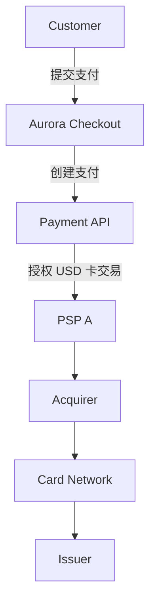
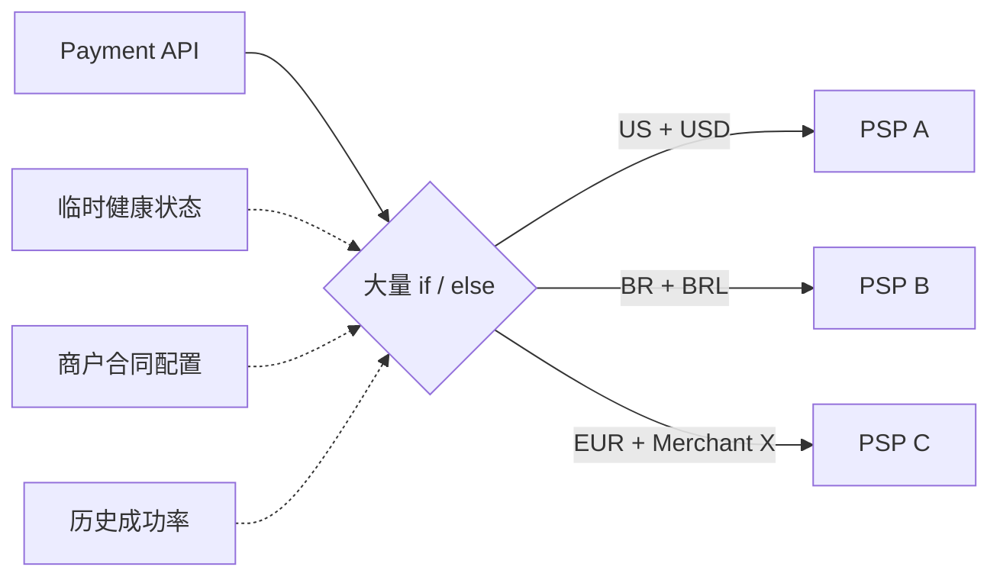
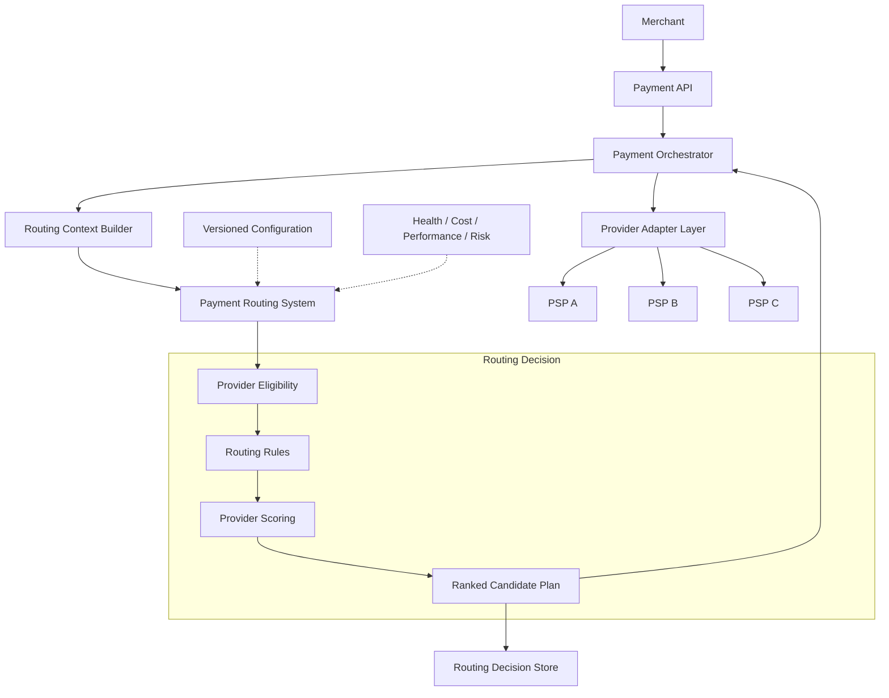
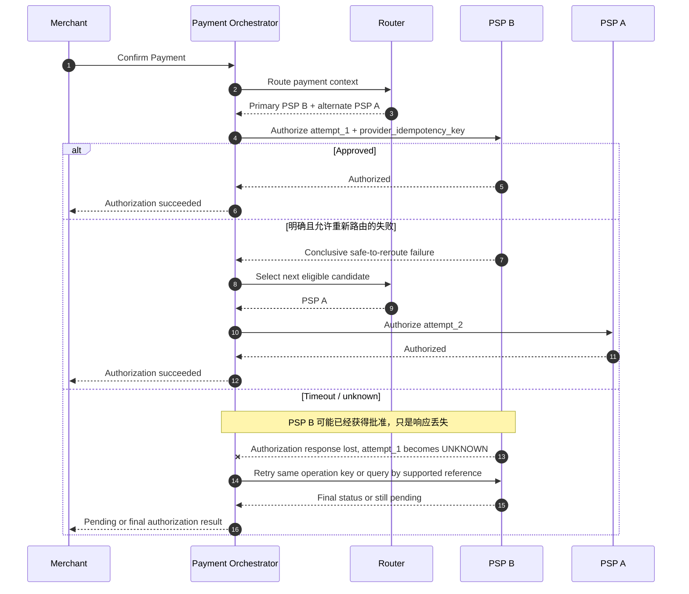

# 第 2 章 为什么需要 Payment Routing

支付路由并不是支付系统一开始就必须拥有的组件。

一家刚上线的电商平台，通常只服务一个市场、接受少量支付方式，并与一家支付服务提供商（Payment Service Provider, PSP）合作。此时最重要的是尽快完成第一笔真实交易，而不是提前搭建一个复杂的决策平台。把所有支付请求发给同一家 PSP，是合理、可维护，而且往往是最正确的起点。

问题在于，业务不会一直停留在这个起点。

当商户进入新的国家，增加本地支付方式，开始比较不同**收单机构（Acquirer）**的费率，并要求支付链路达到更高可用性时，“把请求发给谁”就不再是一个写死在代码里的答案。它变成了一个需要结合交易上下文、合同能力、实时健康状态和历史表现做出的决策。

本章从一个只接入单一 PSP 的系统出发。我们会先保留这个设计的优点，再观察它在哪些业务变化下逐步失效，最后推导出 Payment Routing System 的基本形态。这里讨论的是商户或支付平台一侧的 **Provider Routing**，不是 Card Network 内部的网络路由。后续章节会分别展开规则引擎、成功率模型、成本模型、幂等、fallback 和可观测性；这一章的目标，是先回答一个更基础的问题：**为什么值得把路由设计成一个独立的系统？**

## 2.1 没有 Router 时，路由仍然存在

假设一家名为 Aurora 的在线票务平台首先在美国上线，只接受美元信用卡，并接入 PSP A。简化后的授权（Authorization）链路如下：



这里没有名为 Router 的服务，但系统已经做出了路由决定：

```text
所有交易 → PSP A
```


这个决定只是隐含在配置、SDK 调用或业务代码中。只要所有交易都满足同一组假设，它就不需要成为一个独立组件：

- PSP A 支持商户需要的国家、币种和支付方式；
- PSP A 的可用性能够满足业务目标；
- 商户可以接受 PSP A 的费率和结算安排；
- PSP A 对不同客群的授权表现没有重要差异；
- 支付失败时，商户没有另一条可以尝试的处理路径。

单 PSP 架构还有一些常被低估的优点。它只有一套 API 语义、一种错误码体系、一条 webhook 链路，以及一套 Provider-specific 对账语义和报表体系。退款、拒付、结算和客户支持都可以围绕一个 Provider 建立。此时增加抽象层，反而会提高开发和排障成本。

因此，单 PSP 不是“不够先进”的架构。它是一组业务约束下的最小可行设计。我们需要讨论的，不是如何尽快替换它，而是哪些约束改变后，它不再足够。

## 2.2 第一条裂缝：Provider 的能力并不等价

半年后，Aurora 准备进入德国和巴西。团队最初设想继续使用 PSP A，只需增加 EUR 和 BRL 两种币种。但接入评估很快暴露出一个问题：不同 Provider 不是只有价格不同的同质化 HTTP API。

它们可能在以下方面具有不同边界：

- 获准处理的商户实体和国家；
- 支持的交易币种与结算币种；
- Card、Pix、iDEAL、钱包等 Payment Method；
- Visa、Mastercard 或本地卡组织的覆盖；
- 3-D Secure、网络令牌、分期付款、部分 Capture 等能力；
- 单笔限额、风险政策和商户类别限制；
- 本地收单（Local Acquiring）与跨境收单能力；
- 退款、拒付证据和对账数据的完整程度。

支付凭证本身也可能限制候选。由 PSP A vault 签发的 Card token，通常不能直接交给 PSP B 使用。商户要在多 Provider 之间路由同一 Payment Method，需要预先设计合规的凭证可携带方案，例如受控的独立 vault 与 forwarding、Provider 支持的迁移机制，或适用场景中的 network token。没有可供目标 Provider 使用的凭证，即使它在合同和币种上都合格，也不能成为真实候选。

假设 PSP A 能处理美国和欧洲的 Card，却不支持 Aurora 巴西实体所需的 Pix；PSP B 在巴西具有本地能力，但不支持德国的某种本地支付方式；PSP C 能覆盖两地，却无法为 Aurora 提供所需的分期产品。此时 Provider 的选择首先是一个**资格过滤问题（Eligibility Problem）**，而不是评分问题。

系统要先回答：

> 哪些 Provider 在合同、合规和技术上能够处理这笔交易？

只有进入候选集的 Provider，才有资格比较成功率、成本和延迟。一个手续费很低但不支持当前币种的 PSP，得分再高也不应该被选中。


## 2.3 第二条裂缝：可用性不能由一个外部依赖决定

某个促销日，PSP A 的授权接口开始大量超时。Aurora 自己的 Payment API、数据库和网络都正常，但顾客看到的仍然是“支付失败”。从用户视角看，商户的可用性等于整条同步链路中最弱的一环。

接入第二家 PSP 可以降低对单一 Provider 的依赖，但“有两个账号”并不自动带来冗余。两家 PSP 可能共享同一个 Acquirer、Card Network、云 Region 或 Token Vault，因而仍存在共同故障域；备用账号也可能尚未配置足够限额、凭证、webhook 或处理容量。系统还需要知道：

- PSP A 是全局故障，还是仅某个地区、Payment Method 或 endpoint 异常？
- 当前请求是否已经到达 PSP A？
- PSP A 超时前是否可能已经完成 Authorization？
- 哪些失败可以安全地改走 PSP B？
- 切换后，退款、Capture 和对账应该继续在哪个 Provider 完成？

这里出现了支付可用性与普通读请求 failover 的关键差异。一次支付请求超时，不等于支付没有发生。如果 PSP A 已经获得 Issuer 批准，只是响应在返回途中丢失，此时把同一订单立即提交给 PSP B，可能形成两次 Authorization，甚至两次扣款。

所以，多 Provider 的价值不是“失败就换一家”这么简单。它要求系统识别结果为成功、明确失败还是未知（Unknown），并只在语义允许时 fallback。[第 10 章](../part-3-reliability/timeout-and-retry.md)、[第 11 章](../part-3-reliability/idempotency.md)与[第 12 章](../part-3-reliability/fallback-routing.md)会完整讨论这条边界。

## 2.4 第三条裂缝：平均成功率会掩盖真正的差异

恢复可用性只是接入多 PSP 的一个原因。Aurora 很快发现，即使 PSP A 和 PSP B 都处于健康状态，它们对不同交易的授权表现也并不相同。

假设最近四周的有效样本显示：

| 交易分段 | PSP A Authorization Rate | PSP B Authorization Rate |
| --- | ---: | ---: |
| 德国发行 Visa，EUR | 94% | 88% |
| 巴西发行 Mastercard，BRL | 72% | 91% |
| 美国发行 Visa，USD | 93% | 92% |

这里的数字只是后续推导使用的示意性快照，不是对真实 Provider 的基准评价。可比较口径至少应限定在同一商户、相同时间窗口、相同 first-attempt 分母和近似的金额、认证、令牌与风险策略，并同时查看样本量与不确定性；否则，`94%` 与 `88%` 可能只反映两组流量的难度不同。

如果只看全局平均值，PSP A 可能仍然领先。但对于一笔巴西发行的 Mastercard 交易，全局平均值不是最相关的信息。Provider 与收单路径、Issuer 连接、认证方式、请求字段质量以及本地处理能力之间的组合，可能使结果产生明显差异。

于是，决策从：

```text
route() = PSP_A
```

演进为：

```text
route(issuer_country, card_brand, currency, payment_method, merchant) = provider
```

这也是 Success-Rate Routing 的直觉来源：对当前交易，选择预期授权成功率更高的可用路径。然而，历史成功率不是一个可以直接抄进 `if` 语句的常量。样本量过小、数据延迟、客群差异、Issuer 响应码口径和路由策略本身造成的选择偏差，都会让指标产生噪声。[第 8 章](../part-2-routing-engine/success-rate-routing.md)会说明如何按分段聚合、平滑和回退，以及为什么不能把短窗口内的偶然波动当成真实优势。

## 2.5 第四条裂缝：最便宜的交易不一定最省钱

Provider 成本通常同时包含固定费用、按比例费用、跨境费用、币种转换、卡组织费用，以及失败、退款、拒付或附加服务产生的费用。即使暂时把它们简化成一个数字，也不能只比较“每次请求的手续费”。

为了只说明成本口径，先看另一组金额同为 100 EUR、但卡种与风险分段不同的示意性交易。它有两条候选路径：

| Provider | 单次授权相关预期成本 | 预期成功率 | 每次成功的粗略成本 |
| --- | ---: | ---: | ---: |
| PSP A | 1.10 EUR | 92% | 1.20 EUR |
| PSP B | 0.85 EUR | 75% | 1.13 EUR |

这里假设“单次授权相关预期成本”已经按每次 Attempt 计入可能发生的固定和结果相关费用。在这个简化前提下，粗略的 `cost / success_probability` 已经比单看 0.85 EUR 更接近业务问题，但它仍然没有计算支付失败造成的订单流失、重试成本和客户体验。如果这张票的毛利很高，17 个百分点的成功率差异可能远比 0.25 EUR 的费率差重要；对于低毛利、小额或可延迟支付的场景，结论又可能不同。

因此 Cost-Aware Routing 的目标不是机械地选择最低费率，而是在合同、成功率和业务价值之间优化预期结果。[第 7 章](../part-2-routing-engine/cost-aware-routing.md)会构建更完整的 `expected_cost(transaction, provider)`，[第 18 章](../part-4-operating-at-scale/settlement.md)则会把路由决定与最终结算和成本归因连接起来。

## 2.6 第五条裂缝：风险不是路由结束后的附加检查

支付路由与风控也不能彼此隔离。某个 Provider 可能支持更完整的 3-D Secure 流程，另一个 Provider 对特定钱包拥有更好的令牌能力；高风险交易可能必须经过额外认证，而低风险、低金额交易可能适合摩擦更小的路径。

Risk-Aware Routing 不意味着 Router 自己成为完整的欺诈检测系统。更合理的边界是：Risk Engine 输出结构化信号或约束，Router 将其作为 Eligibility 或 Scoring 的输入。例如：

```text
risk_action = REQUIRE_3DS
```

会排除无法执行所需认证流程的 Provider；

```text
risk_action = BLOCK
```

则应该在进入 Provider 选择之前终止交易，而不是寻找一家“更容易通过”的 PSP。风险信号若只是一个可以被成功率权重抵消的软分数，系统可能为了短期转化率绕过本应执行的控制。

这说明路由目标不是单变量最大化。成功率、成本、延迟、风险和合规中，有些是可以权衡的目标，有些则是不可违反的硬约束。生产系统必须明确二者的区别。

## 2.7 从第二个 SDK 到硬编码路由

Aurora 接入 PSP B 后，最直接的实现是把选择逻辑写进 Payment API：

```go
func selectProvider(currency, issuerCountry string) string {
	if currency == "BRL" || issuerCountry == "BR" {
		return "psp_b"
	}
	return "psp_a"
}
```

对于两个 Provider 和两三个市场，这段代码清晰、快速，而且容易测试。问题会随着维度增长而出现。德国商户实体希望 EUR 交易优先走 PSP A，某个大商户拥有 PSP B 的单独费率，巴西 Visa Debit 要走本地路径，PSP A 在周末维护时又需要临时降级。代码很快变成相互覆盖的条件：

```text
merchant × entity × country × currency × payment_method
× card_brand × amount × risk_action × provider_health
```

这不是单纯的代码美观问题。每次费率调整或运营切流都需要修改、测试和部署 Payment API；规则冲突只能从条件顺序中推断；事后也很难回答某笔支付究竟命中了哪段逻辑。



硬编码路由的拐点通常不是某个确定的 Provider 数量，而是**路由策略的变更节奏开始快于支付应用的发布节奏**。当运营需要安全地预览、审批、发布和回滚策略，工程团队需要独立演进决策逻辑时，把 Routing Policy 从支付执行代码中抽离，才开始产生净收益。


## 2.8 Routing Layer 的出现

抽离后的 Router 接收一个 Routing Context，返回一个 Routing Decision。它不应该只返回 `psp_b`，还应说明候选如何产生、哪些 Provider 被排除、使用了哪个策略版本，以及决定基于什么信号。



图中使用 `PSP A`、`PSP B` 作为简写。生产系统真正选择的目标通常更具体，例如 `provider_connection + merchant_account + region_endpoint`。同一家 PSP 的两个商户账号可能使用不同合同、币种、凭证和故障域，不应因为品牌相同就被视为同一条 route。

这里有一个重要边界：**Router 负责选择，Payment Orchestrator 负责推进支付状态并执行 Provider 调用。** 如果 Router 在决策过程中直接发起 Authorization，它就同时承担了策略评估、外部副作用和支付状态机，timeout、retry 与审计边界都会变得模糊。[第 3 章](routing-system-boundaries.md)会继续讨论 Router 是否应当有状态，以及它与 Orchestrator 的职责划分。

一个最小 Routing Decision 可以表示为：

```json
{
  "decision_id": "rd_01J...",
  "payment_id": "pay_01J...",
  "selected_provider": "psp_b",
  "candidate_order": ["psp_b", "psp_a"],
  "policy_version": "routing-policy-42",
  "reason_codes": ["BR_LOCAL_ACQUIRING", "HIGHER_EXPECTED_SUCCESS"],
  "experiment": null
}
```

它是一个决定，而不是支付结果。`selected_provider = psp_b` 只说明下一次 Attempt 应该走 PSP B，并不说明授权已经成功。一旦 Authorization 在某个 Provider 上获批，后续 Capture、Void 或 Refund 通常必须沿用原 Provider 及其 transaction reference；它们不是可以重新选择任意 PSP 的一次新路由。

`candidate_order` 也只是生成决定时的条件性候选顺序，不是未来 fallback 的执行许可。创建下一次 Attempt 前，系统仍须重新验证当前 Eligibility、Risk、Health，以及前一次 Attempt 是否已得到允许重新路由的结果。

## 2.9 路由策略如何逐步演进

Routing Layer 出现后，也不应立即变成一个复杂的机器学习系统。更稳妥的演进路径是让策略复杂度跟随问题增长。

### 2.9.1 Static Routing

Static Routing 为稳定分段指定固定 Provider，例如美国实体默认走 PSP A，巴西实体默认走 PSP B。它可预测、容易解释，适合合同边界明确、流量稳定的场景。它的缺点是不会响应 Provider 状态和表现变化。

静态路由也可以包含简单的优先级列表或固定比例分流，例如 `90% → PSP A, 10% → PSP B`。比例分流适合逐步迁移和积累对照数据，但随机结果必须按 `payment_id` 或稳定哈希保持一致，否则同一 Payment 的重试可能意外换路。

### 2.9.2 Rule-Based Routing

当例外增多，可以把条件与动作抽成带版本的规则：

```text
IF merchant_entity == "aurora_br"
AND currency == "BRL"
AND payment_method == "card"
THEN prefer [PSP_B, PSP_A]
```

Rule-Based Routing 让策略脱离应用发布，但也引入了优先级、冲突、验证、审批和回滚问题。规则引擎不是为了消灭复杂度，而是为了让复杂度可见、可测试、可审计。[第 5 章](../part-2-routing-engine/rule-based-routing.md)将从 `if / else` 继续演进出完整的规则模型。

### 2.9.3 Success-Rate Routing

系统可以按交易分段估计每个 Provider 的 `expected_success_rate`，在候选之间偏向更可能被授权的路径。这里要避免两个陷阱：一是小样本把偶然的 100% 当成稳定优势；二是只把容易成功的交易发送给某家 Provider，再用结果证明它更好。模型需要最小样本、平滑、探索流量和公平的评估口径。

### 2.9.4 Cost-Aware Routing

系统可以估算固定费用、比例费用、跨境和 FX 等成本，再与成功概率和订单价值结合。最低成本可以作为目标，也可以只是评分中的一个因素。合同价目通常有阶梯、返佣和月度承诺，路由时使用的模型还需要与结算后的真实账单校准。

### 2.9.5 Risk-Aware Routing

风险信号可以形成硬约束，例如必须支持 3DS，也可以形成软偏好，例如在等价路径中选择令牌能力更完整的 Provider。Router 应消费稳定、可解释的 Risk Action，而不是复制 Risk Engine 的全部特征和模型。

### 2.9.6 失败后的 Fallback Routing

Fallback 是第一次 Attempt 失败后的又一次路由决定。它不能只读取“PSP A 不健康”，还必须读取前一次 Attempt 的终态与 Provider 语义。如果能力不支持是在 dispatch 前由本地 Eligibility/Adapter 检出，或者 Provider 契约明确保证某个错误发生在执行前且没有副作用，系统才可以改选候选；仅凭错误名称不能做此推断。明确的硬拒绝通常不应换 PSP 重试；timeout 或连接中断造成的 Unknown，则应先用相同幂等键重试原 Provider、查询状态或等待 webhook，不能假设它失败。

不同策略的适用范围可以概括如下：

| Strategy | 主要输入 | 优点 | 主要风险 | 适合的阶段 |
| --- | --- | --- | --- | --- |
| Static Routing | 国家、实体、币种、固定权重 | 可预测、易解释 | 无法跟随状态变化 | 初期接入、多实体硬边界 |
| Rule-Based Routing | 交易字段、商户配置、优先级 | 灵活、可审计 | 规则冲突与配置爆炸 | 市场和 Provider 增多后 |
| Success-Rate Routing | 分段历史结果、样本量、时间窗口 | 提高转化潜力 | 噪声、偏差、反馈延迟 | 已有足够多 Provider 数据 |
| Cost-Aware Routing | 合同费率、金额、FX、预期成功率 | 控制处理成本 | 成本模型与账单不一致 | 合同和利润目标成熟后 |
| Risk-Aware Routing | Risk Action、认证能力、合规约束 | 协调转化与风险 | 软分数绕过硬约束 | 风控输出已结构化时 |
| Fallback Routing | Attempt 终态、错误分类、Provider Health | 提高故障韧性 | Unknown 状态下重复扣款 | 具备幂等和状态查询后 |

这些策略不是互斥选项。生产决策通常先应用硬性 Eligibility 和 Risk 约束，再应用规则，最后在剩余候选中比较成功率与成本。表中的 Fallback 与前五项并不完全同类：前五项决定初次 Attempt 走哪条路径；Fallback 是前一次 Attempt 之后的恢复策略，只能在失败结果已经被安全分类的前提下重新进入受限决策流程。

## 2.10 一个具体的 Routing Decision

现在看一笔来自 Aurora 巴西站的交易：

```json
{
  "payment_id": "pay_br_2048",
  "merchant_entity": "aurora_br",
  "amount_minor": 52000,
  "currency": "BRL",
  "payment_method": "card",
  "card_brand": "mastercard",
  "issuer_country": "BR",
  "risk_action": "REQUIRE_3DS"
}
```

系统接入了三家 Provider：

| Provider | BRL 本地收单 | 支持所需 3DS | 最近分段成功率 | 估算成本 | 当前健康状态 |
| --- | --- | --- | ---: | ---: | --- |
| PSP A | 否 | 是 | 72% | 7.80 BRL | Healthy |
| PSP B | 是 | 是 | 91% | 6.40 BRL | Healthy |
| PSP C | 是 | 否 | 93% | 5.90 BRL | Healthy |

PSP C 的原始成功率最高、成本最低，但它无法完成这笔交易所需的认证，因此在 Eligibility 阶段被排除。PSP A 和 PSP B 都可用；PSP B 同时具有本地收单、更高的分段成功率和更低的估算成本，于是成为首选。


这个决定的 reason code 可以是：

```text
selected: PSP_B
excluded: PSP_C → REQUIRED_3DS_UNSUPPORTED
preferred: PSP_B → LOCAL_ACQUIRING, HIGHER_EXPECTED_SUCCESS, LOWER_EXPECTED_COST
fallback: PSP_A → only after a conclusive safe-to-reroute failure
```

下面的 Go 代码刻意保持简单，只展示“先过滤，后评分，最后记录原因”的形态：

```go
package routing

import (
	"errors"
	"math"
)

type Candidate struct {
	Name           string
	Eligible       bool
	SuccessRate    float64 // 0.0 ~ 1.0
	NormalizedCost float64 // 0.0 is cheapest, 1.0 is most expensive
	Degraded       bool
}

type Decision struct {
	Provider string
	Score    float64
	Reasons  []string
}

func Route(candidates []Candidate) (Decision, error) {
	best := Decision{Score: math.Inf(-1)}

	for _, candidate := range candidates {
		if !candidate.Eligible {
			continue
		}

		healthPenalty := 0.0
		if candidate.Degraded {
			healthPenalty = 0.30
		}

		score := 0.70*candidate.SuccessRate -
			0.20*candidate.NormalizedCost -
			healthPenalty

		// Provider name is the stable tie-breaker in this teaching example.
		if score > best.Score ||
			(score == best.Score && candidate.Name < best.Provider) {
			best = Decision{
				Provider: candidate.Name,
				Score:    score,
				Reasons:  []string{"ELIGIBLE", "BEST_COMPOSITE_SCORE"},
			}
		}
	}

	if best.Provider == "" {
		return Decision{}, errors.New("no eligible provider")
	}
	return best, nil
}
```

这不是 production-ready 算法。它没有处理样本置信度、费率单位、硬规则和实验分桶；示例中的名称排序也只是最小化的稳定 tie-breaker，真实系统还要处理配置优先级与版本。权重同样不应在代码中随意写死。它表达的核心顺序是：

1. 不可违反的条件先过滤；
2. 可权衡的目标再评分；
3. 选择结果必须带上可解释依据；
4. 没有合格候选是一个显式结果，不能偷偷回到任意默认 PSP。

后续章节会把每一步替换为可独立测试和演进的组件。

配套代码仓库中的[真实 Router 实现](https://github.com/YouEclipse/payments/tree/b5de28105f5de92de1c1226fbed5c57442984906/services/router/internal/routing)目前实现了可运行的 Eligibility 硬约束过滤与版本化静态策略排序，并保留候选排除原因；完整规则求值、成功率、成本与风险评分会随后续章节继续演进。

## 2.11 Fallback 为什么必须理解 Payment Attempt

设 PSP B 被选中后，Authorization 请求超时。下面的时序展示了最危险的一种情况：



如果 Orchestrator 在 timeout 后直接把交易交给 PSP A，Issuer 可能再次批准。两次 Authorization 可能先表现为两个 hold 或 pending entry；若后续又分别 Capture，才可能形成两笔入账交易。Provider 级幂等键通常只在该 Provider 的特定账户、Region 和保留期内约束重复请求，不能让 PSP A 识别 PSP B 已处理的交易。因此系统需要区分至少四种身份：

- 商户请求的 `Idempotency-Key`，防止同一次确认被重复创建；
- 内部的 `payment_id` 与 `attempt_id`，区分业务支付和每次 Provider 尝试；
- Provider operation idempotency key，用于在同一 Provider 上重试同一个操作而不重复产生副作用；
- 请求中的 merchant/provider reference，用于 Provider 支持的关联或搜索；Provider 创建交易后返回的 transaction ID，则用于状态查询以及后续 Capture、Void 或 Refund。这些引用与幂等键不是同一个标识，响应丢失时也可能尚未取得 transaction ID。

只有当原 Attempt 得到明确、可重新路由的失败，或系统能证明请求没有被 Provider 接受处理时，才应创建指向另一 Provider 的新 Attempt。部分 `5xx`、connection reset 和 socket timeout 都可能属于 Unknown；明确的 Issuer decline 也不等于可以任意重试。具体规则还必须结合支付方式、Issuer advice、Card Network 当期规则、retry budget 和 Provider API 语义，不能依赖一张通用的 HTTP 状态码表。


## 2.12 生产环境中的失败模式

Routing System 引入了更高的控制力，也引入了新的故障面。设计时至少要主动考虑以下场景。

### Provider timeout 与 Unknown

网络超时只描述通信结果，不描述资金结果。系统需要暂停危险的 fallback，通过幂等重试、状态查询、webhook 或 reconciliation 收敛状态，并给 Unknown 设置清晰的运营处置流程。

### 指标陈旧或样本失真

昨天的成功率可能无法代表此刻；某个小分段的 4/4 也不能可靠胜过 900/1000。指标服务必须带时间戳、样本量和数据版本。数据过期时，Router 应回退到稳定策略，而不是继续输出看似精确的分数。

### 健康信号抖动

少量 timeout 可能让所有实例同时摘除 PSP A，把流量瞬间压向 PSP B，随后又因 PSP B 变慢而切回，形成路由振荡。健康判断需要最小样本、迟滞、半开恢复、流量坡度和 Provider 容量保护，而不是一个共享布尔值。

### 配置错误

一条范围过大的规则可能把全部流量导向未经验证的 Provider；两条相同优先级的规则可能产生不确定结果。配置平台需要 schema 校验、冲突检测、影响面预览、审批、灰度、版本化和一键回滚。运行时则应保留 last-known-good 配置。

### 依赖失败与级联超时

如果每次路由都同步查询合同数据库、指标仓库和 Risk Engine，Router 的可用性会成为这些依赖可用性的乘积。生产路径通常使用版本化快照、本地或分布式缓存，以及严格的 latency budget。哪些信号过期后可以降级、哪些缺失时必须拒绝，需要逐项定义。

### 重复请求、重复 webhook 与乱序事件

商户可能重试 Confirm，Provider 可能重复投递 webhook，状态查询也可能返回比事件流更旧的信息。Router 的决定、Orchestrator 的 Attempt 和最终 Payment State 必须用幂等写入和单调状态转换连接起来。仅在入口做一次 Redis `SETNX` 并不足以解决整条链路的一致性。

### 优化目标反噬

只优化 Authorization Rate，可能把高风险流量导向更宽松的路径；只优化成本，可能牺牲转化；只看短期转化，又可能忽略拒付和结算损失。目标函数应与业务损益和风险上限一起评审，并通过实验和事后归因校准。

## 2.13 Production Considerations

从上述失败模式，可以得到一组 Routing System 进入生产前必须具备的基本性质。

**确定性与可复现。** 对同一份 Routing Context、配置版本和信号快照，Router 应给出稳定结果。需要随机分流时，使用稳定分桶并记录 experiment assignment。排障人员必须能够重放当时的决定，而不是拿今天的配置猜测昨天发生了什么。

**决策可解释。** Routing Decision Store 至少记录候选集、排除原因、命中规则、评分摘要、Provider 健康快照、配置版本和最终选择。敏感特征应做最小化和脱敏，不能为了审计把完整卡号写进日志。

**低延迟但不依赖实时全量查询。** Router 位于同步支付路径中，额外延迟会直接增加顾客等待时间。规则、能力矩阵和聚合指标应以可控新鲜度分发到决策节点；写入分析系统等非关键操作可以异步执行，但核心 decision record 不能悄悄丢失。

**安全降级。** 配置服务不可用时，可以继续使用已验证的上一版本；动态成功率过期时，可以回退到静态优先级；关键 Eligibility 或风险约束缺失时，则可能必须 fail closed。降级策略需要按信号定义，不能统一写成“使用默认 PSP”。

**幂等贯穿调用链。** 商户请求、Payment、Attempt 和 Provider Request 各有不同作用域。Router 生成新候选不等于授权重试安全；是否创建新 Attempt，应由掌握支付状态的 Orchestrator 决定。

**数据边界清晰。** Routing Context 应优先携带 Payment Method token、卡品牌、Issuer 国家或受控的 IIN/BIN 派生信息，而不是原始 PAN。Tokenization 可以减少敏感卡数据在系统中的扩散，但是否缩小 PCI DSS 范围取决于 token 类型、可逆性、系统连接关系和具体实现，不能把“用了 token”当成自动出域。CVV 等敏感认证数据不应进入 Routing Decision、日志或指标标签，授权完成后也不能为了将来 fallback 而保存。

**配置与代码同等严肃。** Routing Policy 可以不经应用发版而变化，因此它本身就是生产代码。规则需要测试样例、所有者、变更原因、审批记录、生效时间、灰度范围和回滚路径。

**结果闭环。** 一次路由决定只有连接到 Authorization、Capture、Refund、Chargeback、Settlement 和真实费用后，才能判断它是否有效。Technical availability、Authorization approval rate、first-attempt success 与包含恢复后的 eventual payment success 是不同指标，不能用一个含混的 `success_rate` 代替。只看入口流量分布，也无法证明策略改善了业务。

## 2.14 Routing System 的最小职责

走到这里，我们可以给 Payment Routing System 一个初步定义：

> Payment Routing System 根据某次支付的上下文、Provider 资格、版本化策略以及可用的健康、表现、成本和风险信号，选择下一条允许执行的支付路径，并输出足以被系统持久化、解释和重放的 Routing Decision。

这个定义刻意没有说 Router 负责完成支付。完整系统中：

- Payment API 维护对商户稳定的接口与幂等契约；
- Payment Orchestrator 维护 Payment 和 Attempt 状态，决定何时执行、查询或补偿；
- Router 产生 Provider 选择及其理由；
- Provider Adapter 把统一意图转换成不同 PSP 的 API 语义；
- Reconciliation 让内部状态与 Provider、结算数据最终收敛。

这些边界并非唯一答案，但如果全部压进一个同步服务，任何策略变更都可能触碰资金状态机，任何 Provider 差异也可能污染全局决策逻辑。[第 3 章](routing-system-boundaries.md)将专门检验这些边界，并讨论 Router 应该保存什么、不应该保存什么。

## 2.15 小结

我们没有从“需要一个 Rule Engine”开始，而是从一个完全合理的单 PSP 系统开始。

当业务只有一个市场、一组支付方式和一条处理路径时，隐含规则 `all → PSP A` 足够简单。随着国家、币种、商户合同和 Payment Method 增加，Provider 先表现出资格差异；随着可用性要求提高，系统需要冗余，却又必须面对 Unknown 状态下的重复扣款风险；随着交易数据积累，成功率、成本和风险开始要求更细粒度的选择。

硬编码 `if / else` 可以支撑早期阶段，但当策略变化快于应用发布、决策需要审计和回放时，Routing Policy 就需要从支付执行代码中抽离。由此得到的 Router 不是一个随机选择 PSP 的负载均衡器，而是一个受硬约束控制、使用版本化策略、产生可解释决定的支付决策系统。

[下一章](routing-system-boundaries.md)将进一步收紧系统边界：Payment Orchestrator 与 Router 分别拥有什么状态？Router 是否应该调用 PSP？一次 Routing Decision 与一次 Payment Attempt 如何对应？只有先回答这些问题，后续的规则引擎、动态评分和 fallback 才不会建立在模糊的资金语义之上。

## 延伸阅读

- [Stripe API：Idempotent requests](https://docs.stripe.com/api/idempotent_requests)
- [Stripe Documentation：Advanced error handling](https://docs.stripe.com/error-low-level)
- [PayPal REST API：Idempotency](https://developer.paypal.com/api/rest/reference/idempotency/)
- [Stripe Documentation：Orchestration](https://docs.stripe.com/payments/orchestration)
- [Adyen Docs：API idempotency](https://docs.adyen.com/development-resources/api-idempotency)
- [Adyen Docs：Capture](https://docs.adyen.com/online-payments/capture)
- [Adyen Docs：Provider 内部的 Intelligent Payment Routing 与成本/转化优化](https://docs.adyen.com/partners/uplift-enablement)
- [PCI SSC：PCI DSS Document Library](https://www.pcisecuritystandards.org/document_library/)
- [PCI SSC FAQ：CVV 等敏感认证数据的存储限制](https://www.pcisecuritystandards.org/faqs/1280/)
- [PCI SSC FAQ：EMVCo Payment Tokens 与 PCI DSS 范围](https://www.pcisecuritystandards.org/faqs/1326/)
