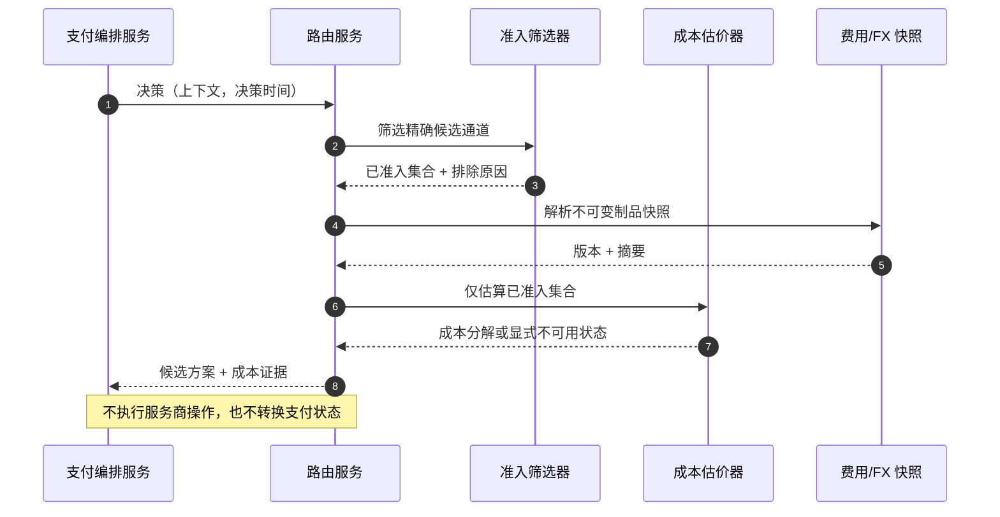
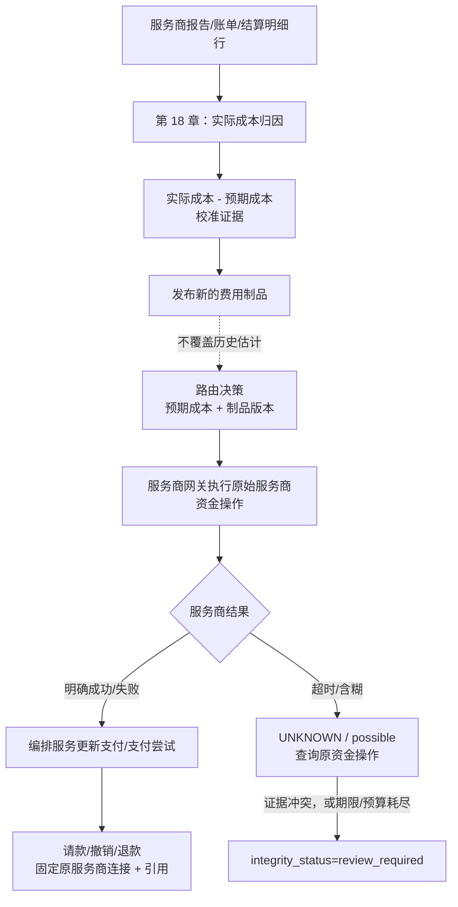

# 第 7 章 成本感知路由

**中文** | [English](../en/part-2-routing-engine/cost-aware-routing.md)

第 6 章完成准入筛选之后，Aurora 已经能排除不支持当前币种、支付方式或资金操作的通道。剩下的候选通道都“可以处理”这笔支付，但它们未必具有相同的经济成本。团队很自然地提出下一个问题：能否选择最便宜的一条？

问题出在“便宜”不是支付服务商网站上的一个百分比。固定处理费、比例费、跨境附加费、外汇转换（FX）、卡组织与交换费（Interchange）、失败尝试计费方式，以及商户账户对应的合同版本，都可能改变比较结果。在线系统看到的也只是决策时可得信息；最终账单还要等请款、清算、结算和服务商报告之后才能确认。

本章建立如下边界：

> **预期成本（Expected Cost）是路由服务在决策时，使用版本化费率与汇率事实，对一个已经通过准入筛选的候选通道计算出的、可分解的成本估计。它只是一项决策特征，不是扣款、入账、结算或利润的资金事实，也绝不覆盖事后归因得到的实际成本（Actual Cost）。**

因此，本章不会用成本突破硬约束，不会因为另一条通道更便宜而改道执行请款、撤销或退款，也不会在服务商结果为 `UNKNOWN` 时创建一笔“更省钱”的新支付。第 8 章才引入成功概率，第 9 章才组合多目标评分，第 18 章再讨论结算与实际成本归因。

配套 Go 系统已经把这一边界落成路由服务 v3 的窄纵向切片：`fee_catalog.v1` 按 `candidate_id + connection_revision + operation + payment_currency` 绑定不可变费率，支持固定费/BPS、显式跨境分类、定向 FX 报价，以及 `attempt / success_only / failure_only` 三种互斥费用情景；每条 `cost.Result` 都随完整成本分解、制品版本/摘要和求值时间进入优化证据。评分器当前明确使用 `SucceededCostMicros`，而不是把成功、失败费用相加，也不把它称为实际成本。

这仍不是生产费率平台。当前开发配置来自仓库内的合成测试固件，没有实时服务商报价、合同同步、审批发布、阶梯价或结算/账单归因；它只能证明契约、算术、身份和降级语义。以下正文中的 Go 代码是为了逐步解释这些不变量而压缩过的教学投影；本章末尾会把每个简化字段映射回真实实现。

## 7.1 问题：最低费率不一定是最低成本

假设两条候选通道都已通过准入筛选，它们的合同费率如下。数字仅用于推导，不代表任何支付服务商的公开报价：

| 候选通道        | 精确执行身份                                   |      固定费 |   比例费 | 10.00 USD 的估计 | 100.00 USD 的估计 |
| ----------- | ---------------------------------------- | -------: | ----: | ------------: | -------------: |
| `cand_us_a` | 服务商 A / `acct_us` / `conn_a` / `us-east` | 0.30 USD | 2.60% |      0.56 USD |       2.90 USD |
| `cand_us_b` | 服务商 B / `acct_us` / `conn_b` / `us-east` | 0.10 USD | 2.90% |      0.39 USD |       3.00 USD |

只比较百分比会始终选择 A，但小额支付上 B 更便宜；只比较固定费则会始终选择 B，但大额支付上 A 更便宜。价格交叉并不是边缘情况，而是“固定项 + 随金额变化项”的直接结果。Adyen 的官方价格页也把处理费与支付方式费用分开，并说明部分卡交易的 Interchange++ 包含可变交换费与其他组成项；这说明生产模型需要表达成本结构，而不是复制一个宣传页百分比。[Adyen 价格说明](https://www.adyen.com/pricing)

即使把固定费加回来，“服务商 A”仍然不是正确的计价键。同一支付服务商下可能有两个商户账户、不同区域或连接器，分别绑定不同合同、结算币种和费率。路由服务比较的是第 6 章产出的精确候选通道，而不是 PSP 品牌。

一次在线估计可以先写成：`C_attempt = C_fixed + C_variable + C_crossborder + C_fx + C_other_known`。

这个式子描述“按当前信息发起一次支付尝试的估计成本”，不等于“得到一笔成功支付的成本”。若一次便宜尝试更容易失败，随后还要重试或后备切换，最终业务成本可能更高；但在第 8 章提供分段成功概率之前，本章不能凭空回答这个问题。


图中最重要的箭头不是“成本 → 排序”，而是“准入筛选 → 仅已准入”。没有合同、违反区域要求或不支持当前资金操作的候选通道，即使估计成本为零也不能进入比较。


## 7.2 简单设计：从一个比例费开始

最小系统可以为每个精确候选通道配置一个 BPS（基点，万分之一）比例费，只在已通过硬约束的集合中选择估计值最小者。下面的例子刻意保留简单模型的限制，但已经做到三件正确的事：金额使用最小货币单位整数；缺费率返回错误而不是当成零；稳定候选通道 ID 打破平局。

```go
package simplecost

import (
	"errors"
	"math"
	"sort"
)

var (
	ErrInvalidAmount = errors.New("invalid payment amount")
	ErrMissingRate   = errors.New("missing candidate rate")
	ErrOverflow      = errors.New("cost arithmetic overflow")
)

type Quote struct {
	CandidateID string
	FeeMinor    int64
}

// CheapestPercentage 只接收已经通过准入筛选的候选通道。
// 这里的整数除法暂时向下取整，后文再加入生产级舍入规则。
func CheapestPercentage(
	amountMinor int64,
	eligibleCandidateIDs []string,
	rateBPS map[string]int64,
) (Quote, error) {
	if amountMinor <= 0 {
		return Quote{}, ErrInvalidAmount
	}
	quotes := make([]Quote, 0, len(eligibleCandidateIDs))
	for _, id := range eligibleCandidateIDs {
		bps, ok := rateBPS[id]
		if !ok || bps < 0 {
			return Quote{}, ErrMissingRate
		}
		if bps != 0 && amountMinor > math.MaxInt64/bps {
			return Quote{}, ErrOverflow
		}
		quotes = append(quotes, Quote{
			CandidateID: id,
			FeeMinor:    amountMinor * bps / 10_000,
		})
	}
	if len(quotes) == 0 {
		return Quote{}, ErrMissingRate
	}
	sort.Slice(quotes, func(i, j int) bool {
		if quotes[i].FeeMinor != quotes[j].FeeMinor {
			return quotes[i].FeeMinor < quotes[j].FeeMinor
		}
		return quotes[i].CandidateID < quotes[j].CandidateID
	})
	return quotes[0], nil
}
```

这个版本适用于费率完全同构、同币种且没有固定项的早期系统。它的价值不是精确，而是建立一个可替换的纯函数边界：输入是已准入 ID、金额和路由服务自己持有的费率快照，输出是估计与稳定次序；函数不读支付数据库，不调用服务商网关，也不改变支付状态。

它也暴露了下一阶段的问题：整数除法究竟向下、向上还是四舍五入；费率何时生效；固定费以什么币种表示；跨境如何判定；FX 用哪一个时间点和来源；某条候选通道缺数据时是否还能比较。把这些问题留给“默认值”会得到一个看似稳定、实际不可审计的成本模型。

## 7.3 规模化问题：成本是带时间和来源的向量

### 7.3.1 每个成本项都有自己的可知性

生产费率不只是多几个字段。不同项目可能来自合同、卡组织规则、服务商估算或事后账单，决策时的确定程度不同：

| 成本项      | 典型计价基础           | 决策时能否精确知道     | 在线模型的安全表达               |
| -------- | ---------------- | ------------- | ----------------------- |
| 处理固定费    | 每次请求或交易的固定额      | 合同明确时通常可知     | 定点金额 + 币种 + 适用资金操作      |
| 服务商加价    | 金额的 BPS、固定额或组合   | 合同和分类明确时可知    | BPS/固定额 + 舍入模式          |
| 交换费/卡组织费 | 卡产品、地区、MCC、清算条件等 | 授权时可能只能估算     | `estimated` 费用项 + 依据/版本 |
| 跨境附加费    | 服务商/卡组织定义的地域组合   | 地理事实和规则都已知时可知 | 显式分类结果 + 分类版本           |
| FX 成本/加价 | 原币、结算币、汇率与加价     | 取决于谁转换以及报价时效  | 有理数汇率 + 观测时间/过期时间/来源    |
| 失败尝试费    | 请求、授权或其他事件       | 取决于合同与最终事件    | 只纳入有合同依据的场景，不猜测         |
| 退款/拒付费   | 后续独立事件           | 路由时通常尚未发生     | 作为单独情景或后续实际成本，不伪装成当前扣款  |

卡费率为何难以压成单个常量，可以从卡组织的一手说明看出：Mastercard 的官方页面列出的适用因素包括商户类别、授权到清算的时间、提交的数据和交易量等，并提醒具体协议问题应与收单机构或支付服务方确认。[Mastercard 商户交换费率](https://www.mastercard.com/us/en/business/support/merchant-interchange-rates.html) 因此，公开费率表可以帮助理解结构，却不能取代 Aurora 与某个商户账户的合同制品。

`CostBreakdown` 必须保留每一项的名称、金额、币种、估算依据和版本。总数只是这些项在同一报价币种下的确定性求和；若无法把某项合法换算到报价币种，就没有可比较的总数，而不是“总数暂时少一点”。

### 7.3.2 费率必须绑定候选通道、合同版本和有效时间

费率发布是时间区间，不是覆盖数据库中的一行。假设旧合同在 `2026-09-01T00:00:00Z` 结束，新合同同时开始，系统应采用半开区间 `[effective_from, effective_until)`：

| `decision_at`              | 命中的费率表             | 原因               |
| -------------------------- | ------------------ | ---------------- |
| `2026-08-31T23:59:59.999Z` | `fee_v17`          | 仍在旧区间内           |
| `2026-09-01T00:00:00Z`     | `fee_v18`          | 旧区间右端不包含，新区间左端包含 |
| 两个版本都命中                    | 配置无效               | 不能靠加载顺序选择        |
| 没有版本命中                     | `missing_schedule` | 不能沿用“最近一个”而不留证据  |

一次决定只能读取一次 `decision_at`，并记录费率表版本与内容摘要。若对 A 估价后调用 `time.Now()`，恰逢版本切换，再对 B 使用新时间，就会比较两个从未同时有效的合同。已发布制品应不可变；修正错误要发布新版本，历史预期成本仍指向当时使用的旧制品。

阶梯价和月度承诺量更棘手。“本月第十万笔交易”可能在多个区域并发到达，在线计数也会因撤销、补录和账单口径变化而修正。本章的安全做法是让控制平面发布一份有来源的当前阶梯快照，或采用经批准的保守档位；它仍是预期成本。逐张账单、阶梯校准和实际分摊留到第 18 章，发布审批与配置治理留到第 20 章。

### 7.3.3 币种代码、精度和舍入都属于合同

`amount_minor = 1000` 只有与币种及最小货币单位指数一起才有意义。ISO 4217 为币种提供三字母代码，并给出有最小货币单位的币种与主单位之间的关系；参考数据会维护更新，因此路由服务应消费版本化币种元数据，而不是假设所有币种都有两位小数。[ISO 4217 币种代码](https://www.iso.org/iso-4217-currency-codes.html)

为了表达低于一个最小货币单位的费用，本章使用 `cost_micros`：报价币种主单位的百万分之一。例如报价币种为 USD 时，`1_000_000 cost_micros = 1 USD`。这是平台内部定点单位，不是服务商 API 的通用格式，也不是“微分币”。所有边界都必须携带 `quote_currency`，界面或报表只能在最后一步按声明的舍入模式展示。

若费用币种与报价币种不同，FX 报价至少要包含基础/报价币种、整数分子/分母、来源、`as_of`、`expires_at` 和版本。浮点 `0.1` 不能进入费用路径。还要区分参考基准与真实成交汇率：欧洲央行明确说明其欧元参考汇率仅供信息使用，并强烈不建议用于交易目的，所以它可以是对照或校准来源，却不能未经合同授权就冒充服务商实际 FX 价格。[欧洲央行欧元外汇参考汇率](https://www.ecb.europa.eu/stats/policy_and_exchange_rates/euro_reference_exchange_rates/html/index.en.html)

### 7.3.4 最低单次成本不等于最低成功支付成本

候选通道 A 的一次授权估计为 20 个成本分，候选通道 B 为 24 个成本分，本章只能说 A 的单次已知成本更低。若 A 的分段成功率更低、技术错误会产生额外尝试，或者某些失败也计费，支付最终完成所需的期望尝试链就不同。

这里不能偷偷加入一个全局成功率，也不应直接输出 `cost / probability`：概率的分桶、窗口、样本量与置信度尚未建立，后备切换还受结果语义和 `UNKNOWN` 约束。第 7 章输出纯成本分解；第 8 章独立输出成功率信号；第 9 章再以显式目标和护栏组合两者。这样，成本配置错误不会伪装成资金失败，成功率模型漂移也不会改写历史费率事实。

### 7.3.5 预期成本与实际成本必须并排存在

| 维度        | 预期成本            | 实际成本                |
| --------- | --------------- | ------------------- |
| 产生时间      | 路由决策时           | 服务商报告、账单、清算/结算数据到达后 |
| 依据        | 费用/FX/分类制品快照    | 实际费用行、结算行和合同归因规则    |
| 主要用途      | 在已准入候选通道间提供决策信号 | 对账、财务归因、校准与模型误差分析   |
| 是否可回写历史值  | 不可；保留原估计/版本     | 可追加修正版本，但不覆盖原预期成本   |
| 是否证明资金已结算 | 否               | 单一费用行也不当然证明整笔支付已结算  |

服务商的交易级报表会出现事前难以完全确定的差异。以 Adyen 官方结算明细报告为例，文档说明报表可用于查看交易级成本，并列出佣金、加价、卡组织费、交换费、汇率等字段；这些是实际成本归因的输入证据，而不是路由服务在授权前已经知道的事实。[Adyen 结算明细报告](https://docs.adyen.com/reporting/settlement-reconciliation/transaction-level/settlement-details-report)

校准流程可以比较 `actual - expected`，定位漏项、错误分类或过期费率，但修正方式是发布新制品并保留差异证据，不是把历史预期成本改成实际成本。否则团队将永远无法知道当时为何选择那条路由。

## 7.4 生产级设计：可解释、定点且可拒绝比较的估价器

### 7.4.1 数据流先过滤，再估价

生产成本估价器消费两个冻结输入：第 4 章路由上下文中与金额、币种、地域分类相关的最小事实，以及第 6 章给出的已准入候选通道集合。它还读取路由服务自有的费用/FX 制品快照，但不向支付服务商临时询价，不读取支付方式令牌，也不接触 PAN 或 CVV。



如果一条候选通道在准入筛选阶段被排除，它连 `FeeSchedule` 都不应参与排序。反过来，成本估价器缺数据也不会暗中改变能力事实：它返回 `missing_schedule`、`stale_fx` 或 `unknown_cross_border`。只有单独、明确发布的护栏才能规定“成本不可比较时拒绝路由”；普通成本代码不能用 `+∞` 把已准入候选通道伪装成不准入。

### 7.4.2 版本化费率表与逐项成本分解

下面的 Go 代码实现一个同币种估价核心：固定费、BPS 比例费和显式跨境附加费都用 `cost_micros`；有效期采用半开区间；乘除通过商与余数拆分，避免先做可能溢出的 `amount * bps`。示例仅接受已规范化的币种指数，跨币种时返回 `ErrFXRequired`，由携带完整来源信息的 FX 层处理。

这是教学简化，不是把仓库实现复制一遍：示例的 `FeeSchedule` 省略了真实键中的 `ConnectionRevision`、`Operation`、`PaymentCurrency`、`FixedCurrency`，也把真实的 `Attempt`、`Success`、`Failure` 三组 `Fee` 压成一个总额。生产 `cost.Estimate` 分别返回 `AttemptCostMicros`、`SucceededCostMicros` 和 `FailedCostMicros`；当前 v3 评分器只消费成功情景的 `SucceededCostMicros`，原始三情景与成本分解仍完整保留。

```go
package cost

import (
	"errors"
	"math"
	"time"
)

var (
	ErrScheduleNotEffective = errors.New("fee schedule is not effective")
	ErrUnknownCrossBorder   = errors.New("cross-border classification is unknown")
	ErrFXRequired           = errors.New("currency conversion is required")
	ErrInvalidCostInput     = errors.New("invalid cost input")
	ErrCostOverflow         = errors.New("cost arithmetic overflow")
)

type RoundingMode string

const (
	RoundDown   RoundingMode = "down"
	RoundHalfUp RoundingMode = "half_up"
	RoundUp     RoundingMode = "up"
)

type FactState string

const (
	FactKnown   FactState = "known"
	FactUnknown FactState = "unknown"
)

type CrossBorderFact struct {
	State       FactState
	Value       bool
	RuleVersion string
}

type FeeSchedule struct {
	ScheduleID      string
	ArtifactVersion string
	CandidateID     string
	QuoteCurrency   string
	EffectiveFrom   time.Time
	EffectiveUntil  time.Time
	FixedMicros     int64
	VariableBPS     int64
	CrossBorderBPS  int64
	PercentageRound RoundingMode
}

type Input struct {
	AmountMinor      int64
	PaymentCurrency  string
	CurrencyExponent uint8
	DecisionAt       time.Time
	CrossBorder      CrossBorderFact
}

type BreakdownItem struct {
	Kind         string
	AmountMicros int64
	Basis        string
}

type Estimate struct {
	CandidateID        string
	QuoteCurrency      string
	TotalMicros        int64
	Breakdown          []BreakdownItem
	ScheduleID         string
	ArtifactVersion    string
	CrossBorderRuleVer string
	EvaluatedAt        time.Time
}

func EstimateSameCurrency(schedule FeeSchedule, in Input) (Estimate, error) {
	if in.AmountMinor <= 0 || schedule.FixedMicros < 0 ||
		schedule.VariableBPS < 0 || schedule.CrossBorderBPS < 0 {
		return Estimate{}, ErrInvalidCostInput
	}
	if in.DecisionAt.Before(schedule.EffectiveFrom) ||
		(!schedule.EffectiveUntil.IsZero() && !in.DecisionAt.Before(schedule.EffectiveUntil)) {
		return Estimate{}, ErrScheduleNotEffective
	}
	if in.PaymentCurrency != schedule.QuoteCurrency {
		return Estimate{}, ErrFXRequired
	}
	if in.CurrencyExponent > 6 {
		return Estimate{}, ErrInvalidCostInput
	}

	factor, err := pow10(6 - in.CurrencyExponent)
	if err != nil || in.AmountMinor > math.MaxInt64/factor {
		return Estimate{}, ErrCostOverflow
	}
	amountMicros := in.AmountMinor * factor
	variable, err := mulDiv(amountMicros, schedule.VariableBPS, 10_000, schedule.PercentageRound)
	if err != nil {
		return Estimate{}, err
	}

	items := []BreakdownItem{
		{Kind: "fixed", AmountMicros: schedule.FixedMicros, Basis: "contract"},
		{Kind: "variable", AmountMicros: variable, Basis: "amount_bps"},
	}
	total, err := checkedAdd(schedule.FixedMicros, variable)
	if err != nil {
		return Estimate{}, err
	}

	if schedule.CrossBorderBPS > 0 {
		if in.CrossBorder.State != FactKnown {
			return Estimate{}, ErrUnknownCrossBorder
		}
		if in.CrossBorder.Value {
			surcharge, calcErr := mulDiv(
				amountMicros,
				schedule.CrossBorderBPS,
				10_000,
				schedule.PercentageRound,
			)
			if calcErr != nil {
				return Estimate{}, calcErr
			}
			total, err = checkedAdd(total, surcharge)
			if err != nil {
				return Estimate{}, err
			}
			items = append(items, BreakdownItem{
				Kind:         "cross_border",
				AmountMicros: surcharge,
				Basis:        "classified_by:" + in.CrossBorder.RuleVersion,
			})
		}
	}

	return Estimate{
		CandidateID:        schedule.CandidateID,
		QuoteCurrency:      schedule.QuoteCurrency,
		TotalMicros:        total,
		Breakdown:          items,
		ScheduleID:         schedule.ScheduleID,
		ArtifactVersion:    schedule.ArtifactVersion,
		CrossBorderRuleVer: in.CrossBorder.RuleVersion,
		EvaluatedAt:        in.DecisionAt,
	}, nil
}

func mulDiv(value, numerator, denominator int64, mode RoundingMode) (int64, error) {
	if value < 0 || numerator < 0 || denominator <= 0 {
		return 0, ErrInvalidCostInput
	}
	q, r := value/denominator, value%denominator
	if numerator != 0 && (q > math.MaxInt64/numerator || r > math.MaxInt64/numerator) {
		return 0, ErrCostOverflow
	}
	whole := q * numerator
	tail := r * numerator
	partial, remainder := tail/denominator, tail%denominator
	if mode == RoundUp && remainder > 0 {
		partial++
	} else if mode == RoundHalfUp && remainder >= denominator/2+denominator%2 {
		partial++
	} else if mode != RoundDown && mode != RoundHalfUp && mode != RoundUp {
		return 0, ErrInvalidCostInput
	}
	return checkedAdd(whole, partial)
}

func checkedAdd(left, right int64) (int64, error) {
	if left < 0 || right < 0 || right > math.MaxInt64-left {
		return 0, ErrCostOverflow
	}
	return left + right, nil
}

func pow10(exponent uint8) (int64, error) {
	value := int64(1)
	for i := uint8(0); i < exponent; i++ {
		if value > math.MaxInt64/10 {
			return 0, ErrCostOverflow
		}
		value *= 10
	}
	return value, nil
}
```

这段实现故意不在估价器里推断 `CrossBorder`。跨境含义可能依赖商户实体、收单机构区域、发卡国和合同定义；一个来自第 4 章上下文与版本化分类规则的结果，必须连同 `RuleVersion` 一起进入。`customer_country != merchant_country` 不是通用真理。

`FeeSchedule` 的发布校验至少应证明：候选通道 ID 存在且精确绑定商户账户/连接器/区域；相同作用域的有效区间不重叠；币种与指数来自允许的参考数据版本；所有适用费用项声明舍入方式；在平台允许的最大金额上不会溢出；版本与规范摘要一一对应。运行时验证不是配置发布校验的替代品，两道门都要保留。

### 7.4.3 缺失和陈旧不能变成免费

估价结果需要 `comparable`、`unavailable` 和原因，而不是只返回一个整数。尤其不能让 Go 映射的零值把缺失配置变成最优路线：

| 情况             | 禁止行为            | 显式结果                      | 可配置的安全动作               |
| -------------- | --------------- | ------------------------- | ---------------------- |
| 候选通道没有有效费率表    | `cost = 0`      | `missing_schedule`        | 整个成本阶段放弃决策，或按已批准静态策略处理 |
| 费率表已过期         | 沿用“最后一版”        | `stale_schedule`          | 失败关闭或退出成本比较            |
| 需要 FX 但报价缺失/过期 | 用 1:1、NaN 或缓存零值 | `missing_fx` / `stale_fx` | 不生成总数；等待或降级            |
| 适用跨境费但事实未知     | 默认境内            | `unknown_cross_border`    | 不比较该估值，记录数据缺口          |
| 算术溢出或非法舍入      | 回绕成负数           | `arithmetic_error`        | 拒绝该次成本求值并告警            |
| 只有部分候选通道可估价    | 只比较有数据者且不留痕     | `incomplete_comparison`   | 按商户策略对整个阶段统一处置         |

“退出成本比较”不等于随机选择。它应回到明确、版本化且仍受准入筛选限制的静态候选通道顺序，并记录 `COST_STAGE_ABSTAINED`；若商户策略要求所有候选成本可比，路由服务则返回受控的无决定结果。哪种策略更合适取决于可用性目标，但必须由配置声明，不能由异常分支临时决定。

如果业务确实要求“缺少可信费率的候选通道禁止执行”，应把 `cost_data_required` 做成独立护栏，并给出稳定排除原因。这样审计者能区分“该通道没有能力处理”和“组织不接受无法计价的通道”，而不是看到成本估价器悄悄把未知值改成无穷大。

### 7.4.4 只对完整估值排序

排序函数必须接收与已准入集合一一对应的完整估值。它不能自己读取配置，也不能忽略缺项：

```go
package costrank

import (
	"errors"
	"sort"
)

var ErrIncompleteComparison = errors.New("incomplete cost comparison")

type Estimate struct {
	CandidateID   string
	TotalMicros   int64
	QuoteCurrency string
}

func RankEligible(eligibleIDs []string, estimates map[string]Estimate) ([]Estimate, error) {
	if len(eligibleIDs) == 0 {
		return nil, ErrIncompleteComparison
	}
	ranked := make([]Estimate, 0, len(eligibleIDs))
	seen := make(map[string]struct{}, len(eligibleIDs))
	quoteCurrency := ""
	for _, id := range eligibleIDs {
		if _, duplicate := seen[id]; id == "" || duplicate {
			return nil, ErrIncompleteComparison
		}
		seen[id] = struct{}{}
		estimate, ok := estimates[id]
		if !ok || estimate.CandidateID != id || estimate.TotalMicros < 0 {
			return nil, ErrIncompleteComparison
		}
		if quoteCurrency == "" {
			quoteCurrency = estimate.QuoteCurrency
		}
		if estimate.QuoteCurrency == "" || estimate.QuoteCurrency != quoteCurrency {
			return nil, ErrIncompleteComparison
		}
		ranked = append(ranked, estimate)
	}
	if len(ranked) != len(estimates) {
		return nil, ErrIncompleteComparison
	}
	sort.Slice(ranked, func(i, j int) bool {
		if ranked[i].TotalMicros != ranked[j].TotalMicros {
			return ranked[i].TotalMicros < ranked[j].TotalMicros
		}
		return ranked[i].CandidateID < ranked[j].CandidateID
	})
	return ranked, nil
}
```

候选通道 ID 作为最终平局裁决键只保证确定性，不表达业务偏好。若成本差小于合同精度或运营设定的重要性阈值，可由第 9 章的评分策略决定是否视为平局；本章不把成功率、风险或延迟偷偷塞进成本数字。

### 7.4.5 决策证据与资金证据走不同链路



预期成本不会让支付变成 `AUTHORIZED` 或 `CAPTURED`，实际成本也不能单凭一条费用行把支付标成 `SETTLED`。若原始调用超时，成本更低的另一个候选通道不是解决不确定性的工具；系统仍要用原 `operation_id` 查询、接收回调通知或对账。普通 `UNKNOWN/possible` 先保持 `processing` 并继续原操作恢复；只有资金证据冲突，或自动恢复的期限/预算耗尽而仍无法安全解释时，才把独立的完整性状态置为 `review_required`。不能把每个暂时未知都预先送入人工复核。

同理，后续请款、撤销和退款是原支付链上的操作，必须使用原服务商连接与服务商引用。重新执行一次成本感知路由也许会选出更便宜的支付服务商，却无法把另一家服务商持有的授权搬过去；这么做只会创建新的资金事实并破坏历史。

## 7.5 故障模式：成本优化如何把系统带偏

| 失败模式                | 表面现象              | 根因与控制                  |
| ------------------- | ----------------- | ---------------------- |
| 先算成本、后做准入筛选         | 不支持币种的候选通道因便宜胜出   | 先冻结已准入集合，成本估价器只消费该集合   |
| 费率只按服务商品牌配置         | 同一 PSP 的不同账户被算成同价 | 以精确候选通道/合同作用域为键        |
| 金额或汇率使用 `float64`   | 边界金额出现跨语言差异       | 最小货币单位 + 定点数 + 显式舍入    |
| 缺失/NaN/解析失败变成零      | 数据最差的候选通道反而最便宜    | 显式不可用，永不默认免费           |
| 两个费率版本同时有效          | 重启或节点顺序改变结果       | 发布时拒绝重叠区间，记录摘要         |
| 把旧 FX 报价无限复用        | 波动时成本严重偏离         | `as_of`、过期时间、来源与降级策略   |
| 用一个 `country` 判断跨境  | 国内交易被加费或跨境漏费      | 命名地理事实，版本化分类规则         |
| 把所有失败都假设为免费或收费      | 估值系统性偏差           | 只按合同与事件口径纳入，保留依据       |
| 用实际成本覆盖预期成本         | 历史决定看起来永远“正确”     | 两条记录不可变关联，以差值校准        |
| 为省钱跨服务商请款/退款        | 原授权与后续操作断链        | 后续资金操作固定原连接/引用         |
| `UNKNOWN` 后立即选更便宜通道 | 顾客可能被重复扣款         | 对原资金操作对账，禁止成本驱动的后备切换   |
| 把成本分数当利润或账本         | 路由服务数字被用于财务入账     | 预期成本只作决策证据，账本/结算各有权威来源 |

还要区分两种“未知”：`cost_estimate_unavailable` 表示无法可靠比较费用；支付尝试的 `UNKNOWN` 表示服务商操作结果不确定。前者可以让成本阶段放弃决策，后者则触发原操作查询与对账。用同一个布尔字段表达两者，会让配置缺失升级成资金状态事故。

测试应围绕可证伪的不变量，而不只验证一条正常路径的金额：低比例高固定费在小额交易上应输给高比例低固定费；恰好位于 `effective_from` 的请求必须只命中新版本；平台最大允许金额不得溢出；缺 FX、缺费率表或跨境事实未知绝不能产生零、负数或 NaN；把一个不准入候选通道配成极低费率也不能让它回到结果集。

## 7.6 权衡：精确、可用与复杂度

| 选择            | 收益        | 代价               | 适用边界             |
| ------------- | --------- | ---------------- | ---------------- |
| 每个候选通道都要求完整估值 | 比较公平，最易审计 | 单个数据缺口可能让成本阶段不可用 | 合同数据成熟、强可比场景     |
| 缺数据时回退静态顺序    | 保留支付可用性   | 暂时放弃成本收益         | 必须记录放弃决策，仍经过准入筛选 |
| 统一报价币种        | 排序直接、解释一致 | 依赖 FX 报价与额外舍入    | 多结算币种平台          |
| 各币种分别排序       | 减少不必要换算   | 不同币种无法形成总序       | 候选天然同币种分组时       |
| 完整复制复杂费率表     | 理论拟合更高    | 发布、测试、解释和漂移成本高   | 只有实际数据能持续校准时     |
| 保守阶梯快照        | 在线确定、易重放  | 可能错过短期折扣         | 阶梯计费但并发口径不稳定时    |
| 逐请求实时询价服务商    | 可能接近最新报价  | 增加延迟、外部依赖与不可重放性  | 通常不放在同步路由服务热路径   |

负成本或返利也需要明确选择。有些合同可能在月末产生返利，但把预计返利直接写成负的单笔费用，会让路由服务为追逐尚未确认的奖励集中流量。更安全的起点是在线费用项非负，返利在第 18 章按可审计规则归因；若未来确需纳入，则要声明封顶、适用区间、置信度和总成本下限，不能只解除 `>= 0` 校验。

成本模型越复杂，越容易给出一个精确到六位小数、却建立在错误分类上的数字。解释性不是附加界面：成本分解、依据、费率表/FX/分类版本和不可用原因都是模型本身。只存 `total = 18342`，就无法判断差异来自新费率、跨境判定、FX 过期还是舍入规则。

最后，最低预期成本不是最终业务目标。成功率、风险、服务商健康度、延迟与流量承诺可能让系统选择并非最便宜的候选通道；这不是成本模型失败，而是职责正确。成本估价器应忠实回答“在当前假设下这次尝试估计花多少”，把“应该选谁”留给显式的多目标决策层。

## 7.7 配套 Go 系统：已实现的 v3 成本边界

本章的[固定实现](https://github.com/YouEclipse/payments/tree/bc4afde24da708d22f67da72a90a1557b1477173/services/router/internal/cost)已经提供 `Compile(Artifact)` 与 `Estimate(at, Query)`。编译阶段拒绝候选通道修订漂移、费率表重叠、未知币种精度、重叠 FX 区间和非法舍入；求值阶段只接受显式冻结的时间、已允许的精确连接、命名过的跨境分类与报价币种。缺失、陈旧、未知和溢出都会返回带类型的状态/原因，失败时 `Estimate=nil`，合法零费用仍保留合同证据。纯成本包可表达 `sale` 与 `authorize` 费率表，但当前路由服务 v3 的优化只承认 `sale + automatic` 群组；这不代表手动请款资金链已经实现。

路由服务的 `routing_optimization.v1` 要求费用、表现与能力三份候选通道清单在 ID 和修订版上完全一致。它只为准入筛选、规则和风险已经允许的集合估价；任一候选通道的费用或表现不可用时，评分配置只能对整批执行已经声明的 `static_order` 或 `reject`，不能只比较数据完整者。最终 `executable_until` 还会被所用费率表、FX、跨境分类、表现窗口、风险与评分配置的最早失效时间缩短，避免一份曾经可算的价格无限授权未来执行。

当前开发制品是合成数据，支付服务商也是模拟器；代码测试证明的是确定性、可解释性和失败边界，不证明真实 PSP 合同价格、实时 FX 或账单精度。真实费率摄取与审批发布留给第 20 章，实际成本与结算归因仍留给第 18 章。

## 7.8 小结：把成本变成证据，而不是资金真相

本章从一个比例费配置出发，先遇到固定费导致的价格交叉，再加入跨境、FX、费率有效期、失败尝试和合同作用域，最终得到一组生产不变量：

1. 准入筛选和护栏永远先于成本；成本不能复活被排除的候选通道。
2. 费率绑定精确候选通道、商户账户/连接器/区域作用域、有效时间和不可变版本，而不是服务商品牌。
3. 金额、BPS、FX 和舍入使用声明过单位的整数/定点运算；任何路径都不用浮点。
4. `CostEstimate` 必须包含报价币种、逐项成本分解、依据、费率表/FX/分类版本和求值时间。
5. 缺失、陈旧、未知与溢出都是显式不可比较状态，绝不变成零费用、NaN、负数或静默默认值。
6. 预期成本是决策时快照；实际成本来自后续报告与归因。二者并排保存，用差异校准，不互相覆盖。
7. 最低单次成本不等于最低成功支付成本。本章不借用未知成功率，第 8 章和第 9 章再组合目标。
8. 成本从不改变授权、请款、结算或 `UNKNOWN` 语义；请款、撤销、退款与不确定结果处理始终固定在原服务商资金操作链上。

做到这些，路由服务才不是“挑一个网页价格最低的 PSP”，而是在合法候选之间产生可解释、可重放、能被实际数据持续校准的经济信号。下一章将在不污染这条成本证据链的前提下，回答另一个独立问题：当前细分交易在每条候选通道上成功的概率有多大。

## 延伸阅读

* [第 4 章：构建路由上下文](routing-context.md)
* [第 6 章：服务商准入筛选](provider-eligibility.md)
* [第 8 章：成功率路由](success-rate-routing.md)
* [第 9 章：服务商评分与风险感知路由](provider-scoring.md)
* [第 18 章：结算与成本归因](../part-4-operating-at-scale/settlement.md)
* [ISO 4217 币种代码](https://www.iso.org/iso-4217-currency-codes.html)
* [欧洲央行欧元外汇参考汇率](https://www.ecb.europa.eu/stats/policy_and_exchange_rates/euro_reference_exchange_rates/html/index.en.html)
* [Adyen 结算明细报告](https://docs.adyen.com/reporting/settlement-reconciliation/transaction-level/settlement-details-report)
