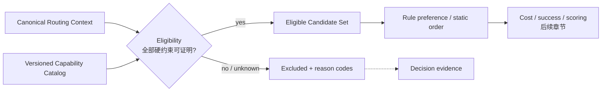
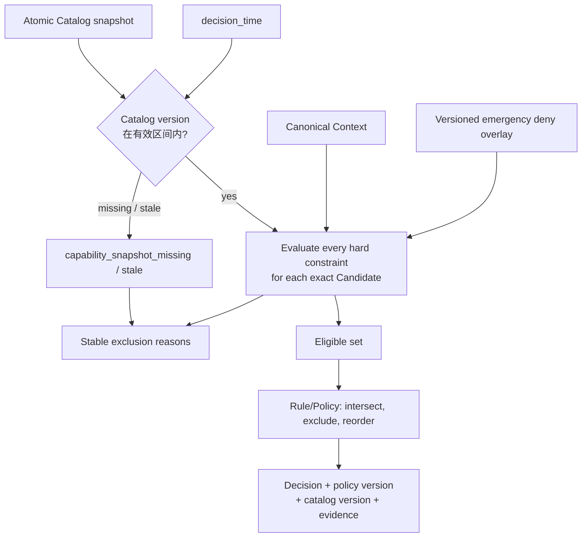
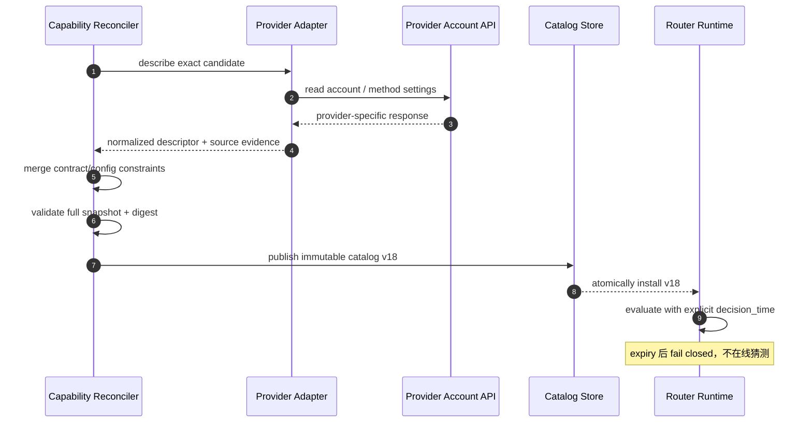
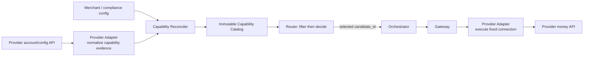

# 第 6 章 Provider Eligibility

Aurora 接入第二个市场时，并没有立刻增加一家新的 PSP。它先在同一家 PSP 下开了第二个 Merchant Account：美国连接继续处理 USD card，新连接负责欧洲实体的 EUR card。两个连接使用同一个 Connector，Dashboard 里也显示同一个 PSP 品牌。团队于是把它们当成“同一种能力”，只在规则里给欧洲连接更高优先级。

第一笔问题交易来自美国站：币种是 USD，客户使用一枚绑定在美国账户下的 Provider Token，但规则因为 Merchant 标签而偏好了欧洲连接。欧洲连接本身在线、延迟很低，甚至历史成功率更好；它只是不能使用这枚 Token，也没有处理这笔交易所需的账户配置。**一个不可执行的 Candidate 无论得分多高，都不应进入比较。**

本章的核心命题是：

> **Eligibility 是一组可证明的硬约束，并且必须在任何 Rule preference 或 scoring 之前完成。Capability 不是 PSP 品牌承诺，而是带版本、来源、有效期的 Provider Connection 级事实；事实为 unknown 或已过期时，系统不得把它猜成 supported。**

这里沿用第 3 章已经定义的精确 Candidate identity，不再重复 Provider、Merchant Account、Connector 与 Region 的建模。本章只回答：面对当前 Routing Context，这条确定的连接是否有资格处理当前操作？成本、成功率、Risk-Aware 综合评分、动态 Health 与 Fallback 分别留给后续章节。Provider Adapter 可以描述和归一化能力，但资金执行仍只能发生在 Gateway。

## 6.1 Problem：偏好无法证明“可以执行”

一个最初的 Router 很容易把所有 Provider 放进同一张评分表：先按业务规则加减分，再取第一名。这个模型隐含了一个危险前提——表中的每个候选都能合法、技术正确地处理当前请求。只要出现本地支付方式、多个收单账户、手动 Capture、Token 绑定或合同地域限制，这个前提就不再成立。

Eligibility 更接近一个合取命题，而不是一个可补偿的分数：

```text
eligible(candidate, context, snapshot) =
    snapshot_known_and_fresh
    AND account_enabled
    AND currency_supported
    AND country_supported
    AND payment_method_supported
    AND operation_supported
    AND amount_in_range
    AND token_portable
    AND merchant_and_compliance_constraints_satisfied
```

任意一项为 false，Candidate 就被排除；任意必需事实为 unknown，也不能进入可选集合。其他维度再优秀都不能补偿“不支持当前币种”或“账户已停用”。这就是硬约束与偏好的分界。



顺序本身是安全属性。若先评分再过滤，某段代码迟早会在“没有满分候选”时返回未过滤的第一名；若 Rule 的 `force` 或 `prefer` 可以把已排除连接加回来，Capability Catalog 就只是注释。接口应让后续阶段只收到 eligible set，而不是同时收到“全部候选 + 请记得忽略某些项”。

## 6.2 Simple Design：从 v1 的四项硬过滤出发

第 3 章留下的 v1 基线位于 `services/router/internal/routing`，把每个精确连接和三组最小能力一起放进启动配置。本节先说明它的性质与不足；本章新增的 v2 Catalog 见 6.8，两者不是同一份能力声明。

```go
type Candidate struct {
	ID                      string   `json:"candidate_id"`
	ConnectionRevision      string   `json:"connection_revision"`
	ProviderNamespaceID     string   `json:"provider_namespace_id"`
	Provider                string   `json:"provider"`
	MerchantAccount         string   `json:"merchant_account"`
	Connector               string   `json:"connector"`
	Region                  string   `json:"region"`
	Enabled                 bool     `json:"enabled"`
	SupportedCurrencies     []string `json:"supported_currencies"`
	SupportedPaymentMethods []string `json:"supported_payment_methods"`
	SupportedOperations     []string `json:"supported_operations"`
}
```

`Engine.Decide` 对每个 Candidate 先调用 `eligibilityReasons`，只有没有原因码的 ID 才会进入静态 Policy 顺序。实现刻意收集所有已知失败原因，而不是遇到第一项失败就停止。下面仅省略现有 `Detail` 文案，约束与 reason code 保持一致：

```go
package routing

import "slices"

type Request struct{ Currency, PaymentMethod, Operation string }
type Reason struct{ Code string }

const (
	ReasonProviderDisabled          = "provider_disabled"
	ReasonCurrencyNotSupported      = "currency_not_supported"
	ReasonPaymentMethodNotSupported = "payment_method_not_supported"
	ReasonOperationNotSupported     = "operation_not_supported"
)

func eligibilityReasons(req Request, candidate Candidate) []Reason {
	reasons := make([]Reason, 0, 4)
	if !candidate.Enabled {
		reasons = append(reasons, Reason{Code: ReasonProviderDisabled})
	}
	if !slices.Contains(candidate.SupportedCurrencies, req.Currency) {
		reasons = append(reasons, Reason{Code: ReasonCurrencyNotSupported})
	}
	if !slices.Contains(candidate.SupportedPaymentMethods, req.PaymentMethod) {
		reasons = append(reasons, Reason{Code: ReasonPaymentMethodNotSupported})
	}
	if !slices.Contains(candidate.SupportedOperations, req.Operation) {
		reasons = append(reasons, Reason{Code: ReasonOperationNotSupported})
	}
	return reasons
}
```

这条基线有几个值得保留的性质：空能力列表不是 wildcard，而是“不支持”；Caller 不能在请求里提交 Candidate 或 Policy；配置在 `NewEngine` 时校验并复制，决定过程中不被原地修改；Exclusion 按 Candidate ID 稳定排序；无合格候选时，HTTP API 返回 `422` 和完整 Decision evidence，而不是暗中使用默认 Provider。

v1 还把 `not_in_policy` 作为一个 Exclusion reason 追加在同一循环中。行为是确定的，但概念上它属于 Policy 约束，不属于 Provider Capability。拆出 Catalog 后，流水线先形成技术上的 eligible set，再交给第 5 章的 Rule/Policy；二者可以共同出现在最终证据里，却不能共用事实所有权。

| v1 基线已证明 | 不能仅从 v1 代码推断 |
| --- | --- |
| 精确 Candidate 已启用 | Provider 账户在远端仍处于可收款状态 |
| 支持请求的三字母币种 | 交易国家、商户实体或发卡国家满足约束 |
| 支持非敏感类别 `card` | 本地支付方式、Card Brand、3DS/SCA 模式 |
| 支持 `sale` 或 `authorize` | Capture mode、Void、Refund 等完整操作能力 |
| 静态 Policy 中包含 Candidate | 金额上下限、合同与 Merchant allowlist |
| 启动时得到一份不可变配置 | Capability 的来源、观测时间、有效期与 Catalog 版本 |
| 不合格时返回稳定原因 | Token 是否能被另一账户或另一 Provider 使用 |

OpenAPI 中保留的 v1 endpoint 反映这条窄边界：Request 只有第 4 章列出的七个非敏感字段，`payment_method` 仅允许 `card`，`operation` 仅允许 `sale` / `authorize`。新增 v2 endpoint 使用 Context envelope 和扩展 Decision evidence；旧接口没有被静默改变。Router 接受 `authorize` 是路由契约的预留，不代表端到端系统已经支持手动 Capture；资金闭环仍是 tokenized card 的 automatic-capture `SALE`。

## 6.3 Problems at Scale：品牌级布尔值为什么会失真

### 6.3.1 同一家 PSP 的两个连接不是同一个能力主体

PSP 文档通常描述产品的可能能力，但生产系统真正调用的是某个账户、凭证、Region 与 Connector 版本组成的连接。Stripe 的官方 Connect 文档明确要求相关 capability 在具体 connected account 上处于 active，并提醒测试环境有时不会强制执行某些 capability；Adyen 的 Management API 则能按 Merchant/Store 查看并调整 Payment Method 的国家、币种与启用状态。这些都是“账户事实”，不是品牌常量。[Stripe：Account capabilities](https://docs.stripe.com/connect/account-capabilities) [Adyen：Manage payment methods with API](https://docs.adyen.com/platforms/payment-methods/api)

考虑下面三条同品牌连接：

| Capability dimension | `conn_pspa_us_primary` | `conn_pspa_eu_main` | `conn_pspa_eu_moto` |
| --- | --- | --- | --- |
| PSP / Connector | PSP A / `pspa_v3` | PSP A / `pspa_v3` | PSP A / `pspa_v3` |
| Merchant Account / Region | Aurora US / `us-east` | Aurora EU / `eu-west` | Aurora EU MOTO / `eu-west` |
| Currency | USD | EUR、GBP | EUR |
| Payment Method | card | card、iDEAL | card |
| Operation | `sale` | `sale`、`authorize` | `sale` |
| Capture mode | automatic | automatic、manual | automatic |
| Token domain | `pspa:acct_us` | `pspa:acct_eu`、network token | `pspa:acct_eu_moto` |
| Account state | enabled | enabled | emergency disabled |

如果 Catalog 只保存 `provider=pspa, supports_card=true`，表中所有关键差异都会消失。第 3 章已经解决“选中的到底是哪条连接”；本章要求 Capability 的主键必须使用同一个 `candidate_id`，否则选择与执行仍会在最后一公里脱节。


### 6.3.2 “支持支付”其实是多维谓词

不同约束需要不同的证据和缺失策略，不能压成一个 `supported=true`：

| 维度 | 要回答的问题 | 典型证据 | 缺失时 |
| --- | --- | --- | --- |
| Currency | 该账户能否用当前 Currency 创建此操作 | 账户配置、合同、Provider API | fail closed |
| Country | 哪一种 country 限制适用：交易、商户实体、客户或发卡地 | Canonical Context + 明确字段定义 | 不猜另一个 country |
| Payment Method | 精确方式及其变体是否已启用 | 账户级 Payment Method 配置 | fail closed |
| Operation / Capture | `sale`、`authorize` 与 capture mode 是否匹配 | Connector 与账户能力 | fail closed |
| Amount | Minor unit 金额是否落在上下限内 | Provider/方法限制、Merchant 合同 | fail closed |
| Account enabled | 账户、凭证与业务线是否允许接收新交易 | Provider account 状态、内部审批 | fail closed |
| Token portability | 当前非敏感 Token domain 是否能被该连接消费 | Vault binding、Token group/network token 事实 | 不做“同 PSP 即可用”推断 |
| Merchant / compliance | Merchant、MCC、实体、区域或认证要求是否满足 | 合同与合规配置 | fail closed |

Country 尤其容易被滥用。`transaction_country`、`merchant_country`、`customer_country` 与 `issuer_country` 不是同义词；Capability constraint 必须引用第 4 章字段注册表中的确切字段及来源。用 Billing Address 补发卡国家，或用请求 IP 补商户实体，会把数据缺失伪装成已知事实。

Operation 也不能只写 `payments=true`。`sale` 表示一次自动 Capture 的新资金操作，`authorize` 表示只授权；未来的 `capture`、`void`、`refund` 可以出现在 Connector 描述里，但它们不能触发重新选路。对已有交易执行这些操作时，Orchestrator 必须沿用原 `provider_connection_id` 与 Provider reference，只能验证原连接是否支持该操作，不能因为另一条连接“更 eligible”而换路。

### 6.3.3 Token 是能力交集的一部分，不是可自由搬运的字符串

Router 不需要、也不应该看到 Token 值，但必须知道足以判断兼容性的非敏感 binding，例如 `token_domain=pspa:acct_us`、`network_token:merchant_aurora` 或 Vault 给出的可用 Candidate 集合。Stripe 的官方 Connect 文档显示，跨 connected account 直接扣款需要显式克隆受支持类型的 PaymentMethod，克隆后得到独立 ID，且不会与原对象保持同步；Adyen 文档则说明 Token 默认只用于一个 Merchant Account，要跨账户共享需启用 Token Groups。这些例子证明“同一家 PSP”并不蕴含“同一枚 Token 可用”。[Stripe：Share payment methods across accounts](https://docs.stripe.com/connect/direct-charges-multiple-accounts) [Adyen：Tokenization](https://docs.adyen.com/online-payments/tokenization/)

因此 Token portability 必须是显式事实。未知 Token domain、过期 binding 或不在 Candidate 接受范围内时，应返回 `token_not_portable` / `token_binding_unknown`，而不是把 Token 发给另一连接试一试。是否迁移、克隆或重新采集凭证是 Vault/Checkout 流程，不是 Router 的在线补救动作。

### 6.3.4 Capability 会变化，布尔值没有时间语义

账户完成 KYC 后可能被启用，合同可能在月底失效，Payment Method 可在 Dashboard 中关闭，Connector 新版本可能补上操作支持。一个没有 `observed_at`、`effective_from` 与 `expires_at` 的 `true` 无法回答“做出这次决定时是否仍然为真”。

更麻烦的是来源冲突：合同配置写着允许 EUR，Provider API 却返回账户 charges disabled；一次探测请求成功连接到 API，但并不能证明某个真实 Payment Method 会被接受。生产系统必须保留来源及其权威范围，而不是让“最后写入者”覆盖所有维度。

## 6.4 Production Design：版本化 Capability Catalog

### 6.4.1 Descriptor 表达事实，Catalog 表达一致快照

不可变 Catalog 的关键不是字段越多越好，而是每项约束都有明确含义。下面是教学模型，展示包括金额和合同在内的可能扩展；它不是 wire schema。实际 `services/router/internal/capability` 首批支持六组集合约束、账户状态与有效期，尚未把金额、Merchant allowlist 或 Compliance Tags 接入 Catalog。

```go
package capability

import "time"

type Support string

const (
	SupportYes     Support = "yes"
	SupportNo      Support = "no"
	SupportUnknown Support = "unknown"
)

type SnapshotMeta struct {
	CatalogVersion string
	PublishedAt    time.Time
	EffectiveFrom  time.Time
	ExpiresAt      time.Time
	Digest         string
}

type Evidence struct {
	Dimension     string
	Source        string
	ObservedAt    time.Time
	EffectiveFrom time.Time
	ExpiresAt     time.Time
}

type CountryConstraint struct {
	ContextField string
	Values       []string
}

type Descriptor struct {
	CandidateID          string
	AccountEnabled       Support
	Currencies           []string
	CountryConstraints   []CountryConstraint
	PaymentMethods       []string
	Operations           []string
	CaptureModes         []string
	AcceptedTokenDomains []string
	MinAmountMinor       int64
	MaxAmountMinor       int64
	AllowedMerchants     []string
	ComplianceTags       []string
	Evidence             []Evidence
}

type Catalog struct {
	Meta        SnapshotMeta
	Descriptors []Descriptor
}
```

这里故意没有 `ProviderSupportsCards bool`。Descriptor 的主键是 Candidate ID；Catalog version 标识一次原子快照；每条 Evidence 指明自己证明的维度、来源、观测时间与有效区间。`CountryConstraint.ContextField` 也明确限制究竟引用哪一种 country。`SupportUnknown` 不是第三种可选偏好，而是“无法完成证明”。实际 wire 用 `Set{state: known/unknown, values: [...]}` 区分空的已知集合与未知集合：前者明确不支持任何值，后者无法证明；两者都不是 `ANY`。

金额上下限必须与具体 Currency/Payment Method 绑定时，实际 schema 应把它们建模为带 key 的 Constraint，而不是沿用示例中的全局字段。示例保持窄小，是为了展示版本和三值语义；不能靠一个结构体假装所有 Provider 的差异都已经被抹平。

### 6.4.2 所有硬约束一次求值，Preference 只看结果

生产过滤器接收 canonical Context、完整 Catalog snapshot 与显式 decision time。它为每个 Candidate 累积稳定原因，最终输出两个集合：Eligible Candidates，以及带全部排除证据的 Exclusions。

Eligibility 自身保留三值结果，进入后续集合则是严格二值边界：

| Eligibility state | 证明条件 | 是否进入 eligible set |
| --- | --- | ---: |
| `eligible` | 所有必需约束都有新鲜证据且结果为 yes | 是 |
| `ineligible` | 至少一项约束被已知事实证明为 no | 否 |
| `unknown` | 没有已知 no，但至少一项缺失、冲突或过期 | 否，fail closed |

如果同一 Candidate 同时有已知 no 与 unknown，顶层状态可归为 `ineligible`，但所有原因都应保留。这样聚合指标不会把明确不支持与数据质量故障混为一谈，也不会因为已有一个 false 就掩盖 Catalog 正在过期。



Evaluator 应采用“拒绝原因单调累积”的实现。它可以提前停止昂贵的外部计算，但输出语义不能依赖检查顺序。下面是可执行的教学子集：只检查快照、启用、金额、币种和 Token domain，再把结果交给只会重排的 Preference。它假定输入已经通过结构校验，不能替代实际 Catalog 的完整编译与三值过滤。

```go
package capability

import (
	"slices"
	"time"
)

type Reason struct {
	Code   string
	Detail string
}

func BasicReasons(now time.Time, amount int64, meta SnapshotMeta, d Descriptor) []Reason {
	reasons := make([]Reason, 0, 4)
	if meta.CatalogVersion == "" || meta.Digest == "" {
		reasons = append(reasons, Reason{Code: "capability_snapshot_missing"})
	}
	if meta.ExpiresAt.IsZero() || !now.Before(meta.ExpiresAt) || now.Before(meta.EffectiveFrom) || now.Before(meta.PublishedAt) {
		reasons = append(reasons, Reason{Code: "capability_snapshot_stale"})
	}
	// Expired facts cannot prove either support or lack of support today.
	if len(reasons) != 0 {
		return reasons
	}
	switch d.AccountEnabled {
	case SupportYes:
	case SupportNo:
		reasons = append(reasons, Reason{Code: "provider_disabled"})
	default:
		reasons = append(reasons, Reason{Code: "capability_unknown"})
	}
	if amount < d.MinAmountMinor {
		reasons = append(reasons, Reason{Code: "amount_out_of_range"})
	}
	if d.MaxAmountMinor <= 0 {
		reasons = append(reasons, Reason{Code: "capability_unknown"})
	} else if amount > d.MaxAmountMinor {
		reasons = append(reasons, Reason{Code: "amount_out_of_range"})
	}
	return reasons
}

type Context struct {
	AmountMinor int64
	Currency    string
	TokenDomain string
}

type FilterResult struct {
	Eligible   []string
	Exclusions map[string][]Reason
}

func FilterSubset(now time.Time, ctx Context, catalog Catalog) FilterResult {
	result := FilterResult{Exclusions: make(map[string][]Reason)}
	for _, d := range catalog.Descriptors {
		reasons := BasicReasons(now, ctx.AmountMinor, catalog.Meta, d)
		if slices.ContainsFunc(reasons, func(r Reason) bool {
			return r.Code == "capability_snapshot_missing" || r.Code == "capability_snapshot_stale"
		}) {
			result.Exclusions[d.CandidateID] = reasons
			continue
		}
		if ctx.Currency == "" || ctx.TokenDomain == "" {
			reasons = append(reasons, Reason{Code: "capability_unknown"})
		} else {
			if !slices.Contains(d.Currencies, ctx.Currency) {
				reasons = append(reasons, Reason{Code: "currency_not_supported"})
			}
			if !slices.Contains(d.AcceptedTokenDomains, ctx.TokenDomain) {
				reasons = append(reasons, Reason{Code: "token_not_portable"})
			}
		}
		if len(reasons) == 0 {
			result.Eligible = append(result.Eligible, d.CandidateID)
		} else {
			result.Exclusions[d.CandidateID] = reasons
		}
	}
	slices.Sort(result.Eligible)
	return result
}

func ApplyPreference(eligible, preference []string) []string {
	ordered := make([]string, 0, len(eligible))
	for _, id := range append(slices.Clone(preference), eligible...) {
		if slices.Contains(eligible, id) && !slices.Contains(ordered, id) {
			ordered = append(ordered, id)
		}
	}
	return ordered
}
```

实际 evaluator 还检查精确 country field、Payment Method、Operation/Capture mode、每个集合的 known/unknown 及 Descriptor 自身有效期；上面的金额、Merchant constraint 与 Compliance tag 则属于后续 Catalog 扩展，不能从字段存在推断已经执行。原因顺序应由固定枚举定义，而不是 map 遍历顺序。`Detail` 用于人读，程序只依赖稳定 Code；对外或跨团队的 Detail 不应泄漏 Merchant Account 名、合同条款或凭证状态。

建议在保留当前 reason code 的基础上扩展，而不是无故改名：

| Reason code | 语义 | 能否由 Rule/Score 覆盖 |
| --- | --- | ---: |
| `provider_disabled` | 当前配置明确禁止该连接接收新流量 | 否 |
| `currency_not_supported` | 已知 Currency 不在支持集合 | 否 |
| `payment_method_not_supported` | 已知方式或变体不受支持 | 否 |
| `operation_not_supported` | 当前操作或 Capture mode 不受支持 | 否 |
| `country_not_supported` | 被明确命名的 country constraint 不满足 | 否 |
| `amount_out_of_range` | Minor unit 金额超出有效范围 | 否 |
| `token_not_portable` | 已知 Token domain 与连接不兼容 | 否 |
| `merchant_constraint_unmet` | Merchant/合同约束不满足 | 否 |
| `compliance_constraint_unmet` | 当前要求缺失或明确不允许 | 否 |
| `capability_snapshot_missing` | 没有该 Candidate 的 Descriptor | 否 |
| `capability_snapshot_stale` | Snapshot 超出有效区间 | 否 |
| `capability_unknown` | 必需维度没有足够证据 | 否 |

`not_in_policy` 仍可保留在最终 Decision evidence 中，但它应在 Eligibility 之后产生。这样运营看到 `currency_not_supported + not_in_policy` 时，能区分“技术上不可能”和“业务策略未允许”，也能分别找到事实 Owner。

### 6.4.3 Snapshot 与 Cache：只能复用仍然有效的事实

Catalog 不应在每笔支付的热路径同步调用 PSP API。那会把外部控制面延迟、限流与故障直接变成 Router 可用性。更稳妥的方式是后台采集、校验并发布完整 snapshot，Router 只读取内存中的不可变版本。



Cache freshness 需要明确规则：

1. Router 只能安装通过结构、引用、时间区间与完整性校验的整版 Catalog，不能把 v17 的一半与 v18 的一半拼起来；
2. `observed_at` 记录何时看见事实，`effective_from` / `expires_at` 决定何时可以使用，两者不能互相替代；
3. 拉取新版本失败时，可以继续使用未过期的 last-known-good snapshot；一旦过期，相关事实变为 unknown 并 fail closed；
4. Decision 必须记录 Catalog version 与 digest。v2 已使用 `capability_catalog_version` / `capability_catalog_digest`，不把 v1 的 `policy_version` 冒充能力版本；
5. 对不同事实使用不同 TTL 是合理的，但一次决定仍要引用一个可重建的逻辑 snapshot，不能只记录“latest”。

| 来源 | 能权威证明什么 | 不能据此证明什么 |
| --- | --- | --- |
| 审批后的内部配置/合同 | Merchant allowlist、实体、合同金额或地域边界 | Provider 账户此刻仍 active |
| Provider account API / webhook | 账户状态、已启用 Payment Method、远端配置 | 内部合同允许将该 Merchant 发往此连接 |
| Connector manifest | 某版本能映射哪些 Operation、字段与错误 | 某个 Merchant Account 已启用这些能力 |
| 受控探测 | 凭证可认证、Endpoint 可达、无副作用查询可用 | 真实卡、金额或 Payment Method 一定被接受 |
| 历史交易指标 | 某段时间内的结果与延迟 | 静态合同/合规资格；其评分用途留给第 8、13 章 |

合并不是简单的 source priority。每个来源只对自己拥有的维度发言，最终资格取这些硬约束的交集。若两个权威来源对同一维度冲突，结果应为 unknown/disabled 并告警，不能按到达时间挑一个“胜者”。

### 6.4.4 紧急禁用是一层只能收缩的覆盖

现有 `Enabled` 只能随启动配置更新，足以支撑最小实现，却不适合分钟级事件。生产 Catalog 可以增加一份版本化 emergency deny overlay：键为 Candidate ID，值包含 reason code、owner、created_at、expires_at 与版本。它在基础 Descriptor 之后应用，只能把 eligible 变成 ineligible，绝不能把 unknown/no 改成 yes。

紧急禁用的 Owner 取决于原因。业务临时停流可以由第 5 章的高优先级 `exclude` Policy 表达；账户凭证失效、合同终止或合规阻断属于 Capability/Eligibility 事实。无论来自哪一层，最终效果都必须是单调删除、版本化、可审计，而且只影响尚未做出决定的新 Attempt。已有 `UNKNOWN` Operation 的 Query，以及后续 Capture/Void/Refund，仍使用原连接；禁用不是改写历史资金身份的许可。

### 6.4.5 Provider Adapter 描述能力，Gateway 执行资金操作

Provider Adapter 最了解 Provider 特有字段，因此适合把 `charges_enabled`、Payment Method 配置、Capture 语义等响应归一化为 Descriptor。这个职责不等于让 Router 持有 PSP 凭证或在 `Decide` 中调用远端 API。



能力采集链与资金执行链可以复用同一 Provider 语义模块，但权限与调用入口必须分离：Reconciler 产出只读、可审计的能力 artifact；Gateway 接收已经固定的 Candidate identity 和幂等 Operation，调用资金 API；Adapter 在执行时不得自行改选另一账户。Router 的输出仍然只是 Decision。

## 6.5 Proof by Failure：测试要证明不可能越过硬边界

最有价值的测试不是“USD 能选 A”，而是构造一个很诱人的错误选择，并证明系统拒绝它。下面的测试直接运行前述子集，不依赖未定义的 fixture DSL：

```go
package capability

import (
	"slices"
	"testing"
	"time"
)

func TestFilter_SameProviderConnectionsCannotBypassEligibility(t *testing.T) {
	now := time.Date(2026, 8, 1, 0, 0, 0, 0, time.UTC)
	ctx := Context{
		AmountMinor: 2599,
		Currency:    "USD",
		TokenDomain: "pspa:acct_us",
	}
	catalog := Catalog{
		Meta: SnapshotMeta{CatalogVersion: "catalog_v1", Digest: "example_digest",
			PublishedAt: now.Add(-time.Hour), EffectiveFrom: now.Add(-time.Hour), ExpiresAt: now.Add(time.Hour)},
		Descriptors: []Descriptor{
			{CandidateID: "conn_pspa_us", AccountEnabled: SupportYes, Currencies: []string{"USD"},
				AcceptedTokenDomains: []string{"pspa:acct_us"}, MinAmountMinor: 1, MaxAmountMinor: 100000},
			{CandidateID: "conn_pspa_eu", AccountEnabled: SupportYes, Currencies: []string{"EUR"},
				AcceptedTokenDomains: []string{"pspa:acct_eu"}, MinAmountMinor: 1, MaxAmountMinor: 100000},
		},
	}
	result := FilterSubset(now, ctx, catalog)
	if !slices.Equal(result.Eligible, []string{"conn_pspa_us"}) {
		t.Fatalf("unexpected eligible set: %v", result.Eligible)
	}
	codes := make([]string, 0)
	for _, reason := range result.Exclusions["conn_pspa_eu"] {
		codes = append(codes, reason.Code)
	}
	if !slices.Contains(codes, "currency_not_supported") || !slices.Contains(codes, "token_not_portable") {
		t.Fatalf("lost rejection evidence: %v", codes)
	}
	ordered := ApplyPreference(result.Eligible, []string{"conn_pspa_eu", "conn_pspa_us"})
	if !slices.Equal(ordered, []string{"conn_pspa_us"}) {
		t.Fatalf("preference resurrected an excluded connection: %v", ordered)
	}
}
```

它证明三件事：同 PSP 的两条连接独立求值；一个 Candidate 可以同时留下多个失败原因；即使 Preference 把欧洲连接排第一，也无法复活它。配套仓库还用真实 Catalog/Rule Engine 重复这个安全命题；教学子集通过，不代替完整生产实现的测试。

至少还需要以下失败矩阵：

| 失败注入 | 预期结果 | 证明的不变量 |
| --- | --- | --- |
| Descriptor 缺失 | `capability_snapshot_missing`，无 Gateway 调用 | missing 不等于 wildcard |
| Catalog 已过 `expires_at` | 所有依赖事实 unknown，返回无候选证据 | stale 不升级为 supported |
| 两个同 Provider Candidate，仅一个支持 USD automatic capture | 只保留精确匹配连接 | 品牌不能覆盖 connection 事实 |
| Rule `force` / `prefer` 指向不合格连接 | 空集或保留其他 eligible 项 | Policy 不能制造能力 |
| Token domain 属于另一账户 | `token_not_portable` | 同 PSP Token 不自动可用 |
| Currency 已知支持，但 country 缺失 | `capability_unknown` | 一个维度不能替另一个维度作证 |
| Emergency deny 在 Catalog 安装后出现 | 新决定排除；旧 Operation 仍查询原连接 | 禁用只影响新选路 |
| 新 Catalog 只有半数 Descriptor | 整版拒绝安装，继续未过期旧版 | Snapshot 原子性 |
| 所有 Candidate 被排除 | `422` + stable exclusions，Gateway 调用为零 | 无隐藏默认 Provider |
| 打乱 Descriptor 与 Candidate 输入顺序 | Decision、Reason 顺序与 digest 不变 | 确定性不依赖 map/文件顺序 |

“Gateway 调用为零”应由跨服务测试直接断言，而不是只看 Router 返回值。否则 Orchestrator 可能在 `422` 后仍执行旧的默认路径，单元测试全部通过，资金边界却已经被绕过。

## 6.6 Failure Modes：Capability 系统常见的自我欺骗

### 空列表被解释为支持全部

配置漏写 `supported_currencies` 时，反序列化得到空 slice；若 evaluator 把它当作“没有限制”，一个部署错误就会扩大流量。当前 Router 的 `contains` 对空列表返回 false，这个 fail-closed 性质应保留。真正的 `ANY` 必须显式、受 schema 校验且有来源。

### 用一次成功探测宣布支付能力完整

凭证能调用账户查询 API，只能证明认证和该 Endpoint；它不能证明某 Currency、真实金额、Token 或 Capture mode 会成功。探测证据只能填自己负责的字段，不得覆盖账户配置与合同事实。

### 把动态故障写进静态 Capability

短时延迟升高、timeout 或某段 BIN 的下降不是“该连接永远不支持 card”。把这些信号直接改写 Capability 会造成抖动并混淆 Owner。动态 Provider Health 与 Circuit Breaker 在第 13 章建模；历史成功率在第 8 章建模。Eligibility 只消费明确被提升为硬禁用的结果。

### 只记录最终 winner，不记录排除证据

当所有 Candidate 都失败时，`no eligible provider` 不能解释是 Catalog 过期、Token 不可移植还是合同不允许。每个 Candidate 的稳定 reason codes、Catalog version、decision time 与 Policy version都是重放所需证据；完整 Decision Store 的持久化结构留给第 14 章。

### Adapter 在执行时偷偷找“兼容账户”

如果 Gateway Adapter 收到 `conn_pspa_eu` 后发现 Token 不兼容，转而使用 `conn_pspa_us`，Router evidence 与实际资金路径立即分叉。执行必须固定 connection；不兼容应在 Eligibility 前暴露，遗漏则作为执行错误返回，绝不能静默重路由。

### 过期后永久使用 last-known-good

last-known-good 只在它仍处于有效期时是“good”。无限延长会让撤销、合同到期和账户关闭永远无法生效。若业务需要更长容忍窗口，应在 Artifact 发布时明确 `expires_at` 与风险 Owner，而不是在故障时临时忽略时效。

## 6.7 Trade-offs：可证明资格需要付出的成本

**Fail closed 与短期可用性。** Catalog 过期时排除连接会增加 `no eligible provider`，但把 unknown 当 yes 会把交易发送到技术上或合规上不可用的路径。可以通过多副本 Catalog Store、提前刷新、分维度 TTL 和未过期 LKG 提高可用性，不能通过猜测能力提高可用性。

**统一模型与 Provider 差异。** 规范化字段让 Router 不必理解每家 PSP 的 API，但过度追求最小公分母会丢失关键语义。Catalog 应有受版本控制的核心字段和 Provider-specific evidence；Eligibility 只消费已定义的规范约束，未知扩展默认不参与“支持”证明。

**Snapshot 粒度与发布频率。** 全量 Catalog 容易原子安装和重放，但 Candidate 很多时 artifact 较大；逐条更新更轻，却容易产生混合版本。可以分片发布，但一次 Decision 必须引用确定的 manifest 与各分片 digest，复杂度不应泄漏成“读取最新行”。

**原因透明度与信息泄漏。** 细粒度原因便于运营和测试，但 Merchant Account、合同条款与合规细节不应进入不受控日志或公共 API。稳定 Code 可以跨边界传播，敏感 evidence 留在受权限保护的内部审计记录。

**同步发现与运行时隔离。** 在线查询 PSP 配置看似最新，却引入外部延迟、限流和级联故障；异步 snapshot 有短暂陈旧窗口，却能明确版本与有效期。支付热路径更适合后者，并用 webhook/轮询缩短观测延迟。

## 6.8 配套 Go 系统的窄纵向增量

本章的[固定实现](https://github.com/YouEclipse/payments/tree/6583e4dc37b391a8ecbe51830780717f1c0f8843/services/router/internal/capability)以 `capability_catalog.v1` 为输入，不要求先建成通用配置平台。`Compile` 要求完整 Candidate manifest 与逐一对应的 Descriptor，拒绝同一执行连接的别名、重复 ID、半快照、非法来源和时间区间；随后复制并规范化整版内容，形成不可变 Catalog 与摘要。

首批 wire 约束有六组：Currency、明确 country field 对应的国家、Payment Method、Operation、Capture Method 和 credential domain，另有 enabled 与 Descriptor 有效期。Country field 只能选 `merchant.country` 或 `payment_method_context.issuer_country`，不能在未知时偷偷换语义。集合显式 known/unknown，已知空集合不支持任何值。金额范围、Merchant allowlist、Compliance Tags 和在线 Provider account 发现仍未接入这个 Catalog；教学模型中的字段不构成已实现声明。

`Catalog.Filter` 在 Context 的 BuiltAt 进行纯函数求值。过期 Catalog/Descriptor 是 unknown，不再用它证明当前 yes 或 no；新鲜事实中只要有已知 no，顶层为 ineligible，其余 unknown 原因仍保留。只有所有必需事实为 yes 的 ID 才进入第 5 章 Rule Engine。Router HTTP 层再检查实际返回时的有效期，防止长暂停后把旧事实用于新执行。

本地固定 Artifact 明确是演示数据：同一个 simulator Provider 的 US primary 支持 USD/BRL，EU backup 支持 EUR，两者共享已声明的 simulator credential domain；GBP 无合格连接。Compose E2E 因而能检查选中精确 connection、无候选不创建 Attempt/Operation，以及响应丢失后仍沿原连接收敛。它不证明真实 PSP 账户、合同或 Token 的兼容性。演示 Catalog 的长有效期也不能照抄为生产 freshness policy。

Decision 同时携带 Catalog version/digest、Rule Set version/digest 和完整 Eligibility evidence；选路成功后由 Payment 将它与 Context 一起固定在 Attempt 事务中。动态 Health、完整 Decision Store、费用与成功率、在线刷新和跨 Region 发布仍分别属于后章。真实数据库与跨服务验证结果以本章 delivery manifest 为准，不以一个纯函数测试代替整个执行边界。

## 6.9 Summary：先证明能走，再讨论值得走

Provider Eligibility 解决的不是“哪一家更好”，而是“哪一条精确连接有证据处理当前操作”。证明必须落到 Candidate identity，并同时考虑 Currency、明确语义的 country、Payment Method、Operation/Capture mode、金额、账户启用、Token portability、Merchant 合同与合规约束。PSP 品牌文档只能提供建模输入，不能替代账户级事实。

Capability Catalog 把这些事实组织成不可变 snapshot：每份 Descriptor 有来源，每版 Catalog 有 version、digest 与有效区间。false 排除，unknown 和 stale 也 fail closed；紧急覆盖只能收缩集合。每个排除留下稳定 reason code，无候选返回可审计失败，不调用 Gateway。Provider Adapter 负责描述和归一化，Router 负责过滤与决定，Gateway 只在确定连接上执行资金操作。

我们保留了 v1 四项硬过滤的 fail-closed 起点，再把它演进为 connection 级、版本化、带时间和来源的 Capability Catalog。尚未支持的维度明确留在边界外，不把更多字段塞进一个品牌级布尔值。到这里，第 5 章的 Rule 才有了不可越过的输入边界。

下一章只会在 eligible set 内计算 Expected Cost。费率再低，也不能让被本章排除的连接重新出现。

## 延伸阅读

- [Stripe Connect：Account capabilities and configurations](https://docs.stripe.com/connect/account-capabilities)
- [Stripe Connect：Share payment methods across multiple accounts](https://docs.stripe.com/connect/direct-charges-multiple-accounts)
- [Stripe：Payment method support](https://docs.stripe.com/payments/payment-methods/payment-method-support)
- [Adyen：Manage payment methods with API](https://docs.adyen.com/platforms/payment-methods/api)
- [Adyen：Tokenization](https://docs.adyen.com/online-payments/tokenization/)
- [第 3 章：Routing System Boundaries](../part-1-foundations/routing-system-boundaries.md)
- [第 4 章：构建 Routing Context](routing-context.md)
- [第 5 章：Rule-Based Routing](rule-based-routing.md)
- [第 7 章：Cost-Aware Routing](cost-aware-routing.md)
- [第 13 章：Provider Health 与 Circuit Breaker](../part-3-reliability/provider-health.md)
- [第 20 章：Routing Configuration Platform](../part-5-global-routing/configuration-platform.md)
