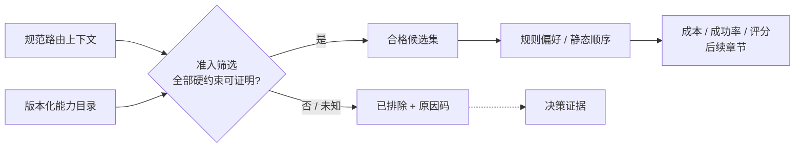
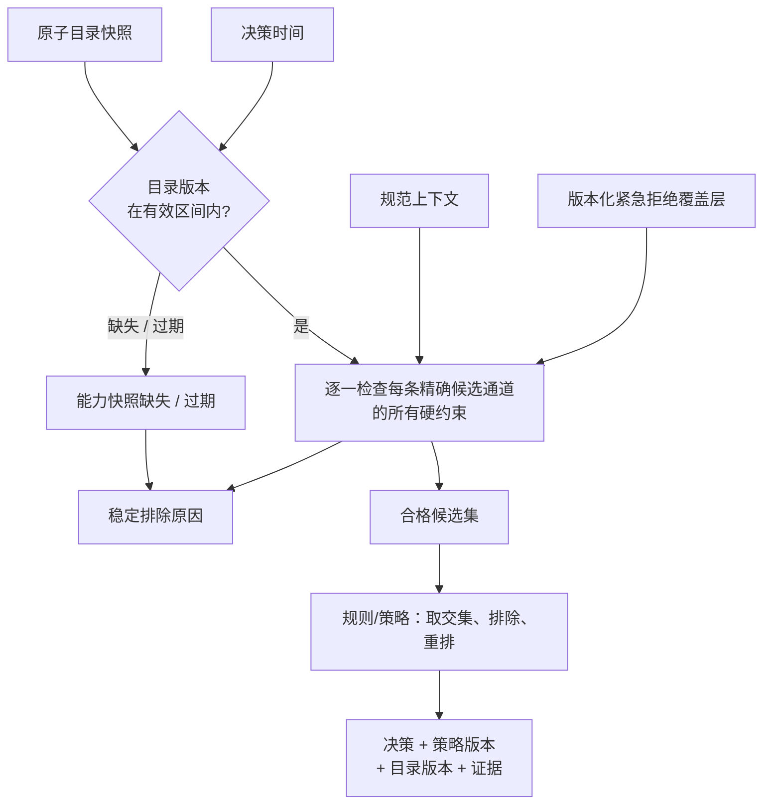
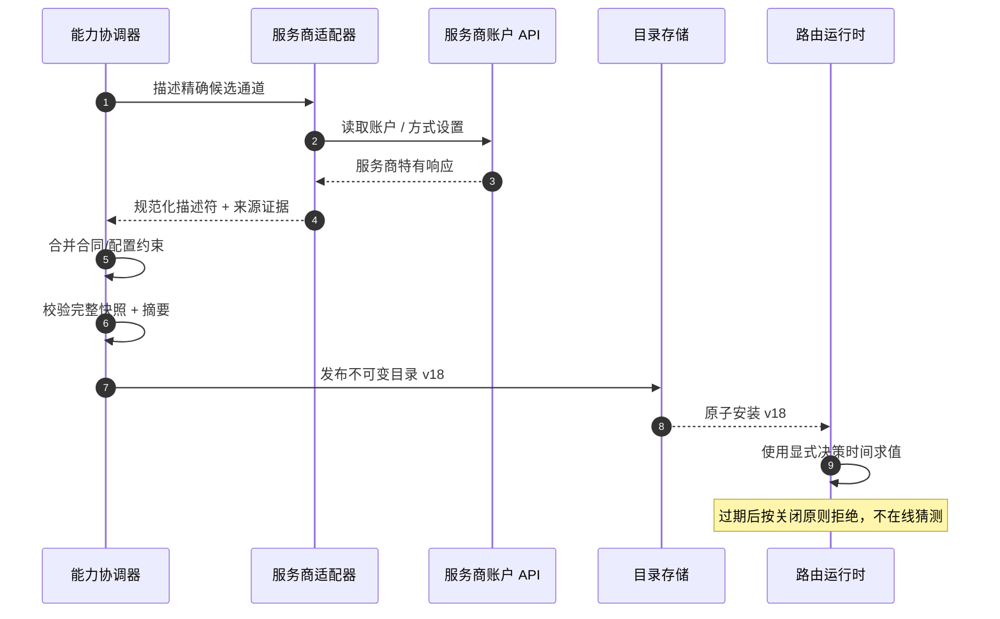
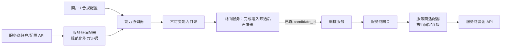

# 第 6 章 服务商准入筛选

**中文** | [English](../en/part-2-routing-engine/provider-eligibility.md)

Aurora 接入第二个市场时，并没有立刻增加一家新的 PSP。它先在同一家 PSP 下开了第二个商户账户：美国连接继续处理 USD 银行卡，新连接负责欧洲实体的 EUR 银行卡。两个连接使用同一个连接器，管理后台里也显示同一个 PSP 品牌。团队于是把它们当成“同一种能力”，只在规则里给欧洲连接更高优先级。

第一笔问题交易来自美国站：币种是 USD，顾客使用一枚绑定在美国账户下的服务商令牌，但规则因为商户标签而偏好了欧洲连接。欧洲连接本身在线、延迟很低，甚至历史成功率更好；它只是不能使用这枚令牌，也没有处理这笔交易所需的账户配置。**一个不可执行的候选通道无论得分多高，都不应进入比较。**

本章的核心命题是：

> **准入筛选是一组可证明的硬约束，并且必须在任何规则偏好或评分之前完成。能力不是 PSP 品牌承诺，而是带版本、来源、有效期的服务商连接级事实；事实未知或已过期时，系统不得把它猜成支持。**

这里沿用第 3 章已经定义的精确候选身份，不再重复支付服务商、商户账户、连接器与区域的建模。本章只回答：面对当前路由上下文，这条确定的连接是否有资格处理当前操作？成本、成功率、风险感知综合评分、动态健康与后备切换分别留给后续章节。服务商适配器可以描述和归一化能力，但资金执行仍只能发生在服务商网关。

## 6.1 问题：偏好无法证明“可以执行”

一个最初的路由服务很容易把所有支付服务商放进同一张评分表：先按业务规则加减分，再取第一名。这个模型隐含了一个危险前提——表中的每个候选都能合法、技术正确地处理当前请求。只要出现本地支付方式、多个收单账户、手动请款、令牌绑定或合同地域限制，这个前提就不再成立。

准入筛选更接近一个合取命题，而不是一个可补偿的分数：

```
eligible(candidate, context, snapshot) =
    snapshot_known_and_fresh
    AND account_enabled
    AND currency_supported
    AND country_supported
    AND payment_method_supported
    AND operation_supported
    AND amount_in_range
    AND token_portable
    AND merchant_and_compliance_constraints_satisfied
```

任意一项为假，候选通道就被排除；任意必需事实为未知，也不能进入可选集合。其他维度再优秀都不能补偿“不支持当前币种”或“账户已停用”。这就是硬约束与偏好的分界。



顺序本身是安全属性。若先评分再过滤，某段代码迟早会在“没有满分候选”时返回未过滤的第一名；若规则的强制包含或偏好动作可以把已排除连接加回来，能力目录就只是注释。接口应让后续阶段只收到合格候选集，而不是同时收到“全部候选 + 请记得忽略某些项”。

## 6.2 简单设计：从 v1 的四项硬过滤出发

第 3 章留下的 v1 基线位于 `services/router/internal/routing`，把每个精确连接和三组最小能力一起放进启动配置。本节先说明它的性质与不足；本章新增的 v2 能力目录见 6.8，两者不是同一份能力声明。

```go
type Candidate struct {
	ID                      string   `json:"candidate_id"`
	ConnectionRevision      string   `json:"connection_revision"`
	ProviderNamespaceID     string   `json:"provider_namespace_id"`
	Provider                string   `json:"provider"`
	MerchantAccount         string   `json:"merchant_account"`
	Connector               string   `json:"connector"`
	Region                  string   `json:"region"`
	Enabled                 bool     `json:"enabled"`
	SupportedCurrencies     []string `json:"supported_currencies"`
	SupportedPaymentMethods []string `json:"supported_payment_methods"`
	SupportedOperations     []string `json:"supported_operations"`
}
```

`Engine.Decide` 对每个候选通道先调用 `eligibilityReasons`，只有没有原因码的 ID 才会进入静态策略顺序。实现刻意收集所有已知失败原因，而不是遇到第一项失败就停止。下面仅省略现有 `Detail` 文案，约束与原因码保持一致：

```go
package routing

import "slices"

type Request struct{ Currency, PaymentMethod, Operation string }
type Reason struct{ Code string }

const (
	ReasonProviderDisabled          = "provider_disabled"
	ReasonCurrencyNotSupported      = "currency_not_supported"
	ReasonPaymentMethodNotSupported = "payment_method_not_supported"
	ReasonOperationNotSupported     = "operation_not_supported"
)

func eligibilityReasons(req Request, candidate Candidate) []Reason {
	reasons := make([]Reason, 0, 4)
	if !candidate.Enabled {
		reasons = append(reasons, Reason{Code: ReasonProviderDisabled})
	}
	if !slices.Contains(candidate.SupportedCurrencies, req.Currency) {
		reasons = append(reasons, Reason{Code: ReasonCurrencyNotSupported})
	}
	if !slices.Contains(candidate.SupportedPaymentMethods, req.PaymentMethod) {
		reasons = append(reasons, Reason{Code: ReasonPaymentMethodNotSupported})
	}
	if !slices.Contains(candidate.SupportedOperations, req.Operation) {
		reasons = append(reasons, Reason{Code: ReasonOperationNotSupported})
	}
	return reasons
}
```

这条基线有几个值得保留的性质：空能力列表不是通配符，而是“不支持”；调用方不能在请求里提交候选通道或策略；配置在 `NewEngine` 时校验并复制，决策过程中不被原地修改；排除项按候选通道 ID 稳定排序；无合格候选时，HTTP API 返回 `422` 和完整决策证据，而不是暗中使用默认支付服务商。

v1 还把 `not_in_policy` 作为一个排除原因追加在同一循环中。行为是确定的，但概念上它属于策略约束，不属于服务商能力。拆出能力目录后，流水线先形成技术上的合格候选集，再交给第 5 章的规则/策略；二者可以共同出现在最终证据里，却不能共用事实所有权。

| v1 基线已证明                | 不能仅从 v1 代码推断          |
| ----------------------- | --------------------- |
| 精确候选通道已启用               | 服务商账户在远端仍处于可收款状态      |
| 支持请求的三字母币种              | 交易国家、商户实体或发卡国家满足约束    |
| 支持非敏感类别 `card`          | 本地支付方式、卡品牌、3DS/SCA 模式 |
| 支持 `sale` 或 `authorize` | 请款方式、撤销、退款等完整操作能力     |
| 静态策略中包含候选通道             | 金额上下限、合同与商户允许列表       |
| 启动时得到一份不可变配置            | 能力的来源、观测时间、有效期与目录版本   |
| 不合格时返回稳定原因              | 令牌是否能被另一账户或另一支付服务商使用  |

OpenAPI 中保留的 v1 端点反映这条窄边界：请求只有第 4 章列出的七个非敏感字段，`payment_method` 仅允许 `card`，`operation` 仅允许 `sale` / `authorize`。新增 v2 端点使用上下文封装和扩展决策证据；旧接口没有被静默改变。路由服务接受 `authorize` 是路由契约的预留，不代表端到端系统已经支持手动请款；资金闭环仍是令牌化银行卡的自动请款 `SALE`。

## 6.3 规模化问题：品牌级布尔值为什么会失真

### 6.3.1 同一家 PSP 的两个连接不是同一个能力主体

PSP 文档通常描述产品的可能能力，但生产系统真正调用的是某个账户、凭证、区域与连接器版本组成的连接。Stripe 的官方 Connect 文档明确要求相关能力在具体连接账户上处于活跃状态，并提醒测试环境有时不会强制执行某些能力；Adyen 的 Management API 则能按商户/门店查看并调整支付方式的国家、币种与启用状态。这些都是“账户事实”，不是品牌常量。[Stripe：账户能力](https://docs.stripe.com/connect/account-capabilities) [Adyen：通过 API 管理支付方式](https://docs.adyen.com/platforms/payment-methods/api)

考虑下面三条同品牌连接：

| 能力维度      | `conn_pspa_us_primary` | `conn_pspa_eu_main`   | `conn_pspa_eu_moto`        |
| --------- | ---------------------- | --------------------- | -------------------------- |
| PSP / 连接器 | PSP A / `pspa_v3`      | PSP A / `pspa_v3`     | PSP A / `pspa_v3`          |
| 商户账户 / 区域 | Aurora 美国 / `us-east`  | Aurora 欧洲 / `eu-west` | Aurora 欧洲 MOTO / `eu-west` |
| 币种        | USD                    | EUR、GBP               | EUR                        |
| 支付方式      | card                   | card、iDEAL            | card                       |
| 操作        | `sale`                 | `sale`、`authorize`    | `sale`                     |
| 请款方式      | 自动                     | 自动、手动                 | 自动                         |
| 令牌域       | `pspa:acct_us`         | `pspa:acct_eu`、网络令牌   | `pspa:acct_eu_moto`        |
| 账户状态      | 已启用                    | 已启用                   | 紧急禁用                       |

如果能力目录只保存 `provider=pspa, supports_card=true`，表中所有关键差异都会消失。第 3 章已经解决“选中的到底是哪条连接”；本章要求能力的主键必须使用同一个 `candidate_id`，否则选择与执行仍会在最后一公里脱节。


### 6.3.2 “支持支付”其实是多维谓词

不同约束需要不同的证据和缺失策略，不能压成一个 `supported=true`：

| 维度      | 要回答的问题                       | 典型证据             | 缺失时             |
| ------- | ---------------------------- | ---------------- | --------------- |
| 币种      | 该账户能否用当前币种创建此操作              | 账户配置、合同、服务商 API  | 按关闭原则拒绝         |
| 国家      | 哪一种国家限制适用：交易、商户实体、顾客或发卡地     | 规范上下文 + 明确字段定义   | 不猜另一个国家         |
| 支付方式    | 精确方式及其变体是否已启用                | 账户级支付方式配置        | 按关闭原则拒绝         |
| 操作 / 请款 | `sale`、`authorize` 与请款方式是否匹配 | 连接器与账户能力         | 按关闭原则拒绝         |
| 金额      | 最小货币单位金额是否落在上下限内             | 服务商/方法限制、商户合同    | 按关闭原则拒绝         |
| 账户启用    | 账户、凭证与业务线是否允许接收新交易           | 服务商账户状态、内部审批     | 按关闭原则拒绝         |
| 令牌可移植性  | 当前非敏感令牌域是否能被该连接消费            | 凭证库绑定、令牌组/网络令牌事实 | 不做“同 PSP 即可用”推断 |
| 商户 / 合规 | 商户、MCC、实体、区域或认证要求是否满足        | 合同与合规配置          | 按关闭原则拒绝         |

国家尤其容易被滥用。`transaction_country`、`merchant_country`、`customer_country` 与 `issuer_country` 不是同义词；能力约束必须引用第 4 章字段注册表中的确切字段及来源。用账单地址补发卡国家，或用请求 IP 补商户实体，会把数据缺失伪装成已知事实。

操作也不能只写 `payments=true`。`sale` 表示一次自动请款的新资金操作，`authorize` 表示只授权；未来的 `capture`、`void`、`refund` 可以出现在连接器描述里，但它们不能触发重新选路。对已有交易执行这些操作时，编排服务必须沿用原 `provider_connection_id` 与服务商引用，只能验证原连接是否支持该操作，不能因为另一条连接“更合格”而换路。

### 6.3.3 令牌是能力交集的一部分，不是可自由搬运的字符串

路由服务不需要、也不应该看到令牌值，但必须知道足以判断兼容性的非敏感绑定，例如 `token_domain=pspa:acct_us`、`network_token:merchant_aurora` 或凭证库给出的可用候选集合。Stripe 的官方 Connect 文档显示，跨连接账户直接扣款需要显式克隆受支持类型的 PaymentMethod，克隆后得到独立 ID，且不会与原对象保持同步；Adyen 文档则说明令牌默认只用于一个商户账户，要跨账户共享需启用令牌组。这些例子证明“同一家 PSP”并不蕴含“同一枚令牌可用”。[Stripe：跨账户共享支付方式](https://docs.stripe.com/connect/direct-charges-multiple-accounts) [Adyen：令牌化](https://docs.adyen.com/online-payments/tokenization/)

因此令牌可移植性必须是显式事实。未知令牌域、过期绑定或不在候选通道接受范围内时，应返回 `token_not_portable` / `token_binding_unknown`，而不是把令牌发给另一连接试一试。是否迁移、克隆或重新采集凭证是凭证库/收银台流程，不是路由服务的在线补救动作。

### 6.3.4 能力会变化，布尔值没有时间语义

账户完成 KYC 后可能被启用，合同可能在月底失效，支付方式可在管理后台中关闭，连接器新版本可能补上操作支持。一个没有 `observed_at`、`effective_from` 与 `expires_at` 的 `true` 无法回答“做出这次决策时是否仍然为真”。

更麻烦的是来源冲突：合同配置写着允许 EUR，服务商 API 却返回账户已禁用收款；一次探测请求成功连接到 API，但并不能证明某个真实支付方式会被接受。生产系统必须保留来源及其权威范围，而不是让“最后写入者”覆盖所有维度。

## 6.4 生产级设计：版本化能力目录

### 6.4.1 描述符表达事实，目录表达一致快照

不可变能力目录的关键不是字段越多越好，而是每项约束都有明确含义。下面是教学模型，展示包括金额和合同在内的可能扩展；它不是线格式模式。实际 `services/router/internal/capability` 首批支持六组集合约束、账户状态与有效期，尚未把金额、商户允许列表或合规标签接入目录。

```go
package capability

import "time"

type Support string

const (
	SupportYes     Support = "yes"
	SupportNo      Support = "no"
	SupportUnknown Support = "unknown"
)

type SnapshotMeta struct {
	CatalogVersion string
	PublishedAt    time.Time
	EffectiveFrom  time.Time
	ExpiresAt      time.Time
	Digest         string
}

type Evidence struct {
	Dimension     string
	Source        string
	ObservedAt    time.Time
	EffectiveFrom time.Time
	ExpiresAt     time.Time
}

type CountryConstraint struct {
	ContextField string
	Values       []string
}

type Descriptor struct {
	CandidateID          string
	AccountEnabled       Support
	Currencies           []string
	CountryConstraints   []CountryConstraint
	PaymentMethods       []string
	Operations           []string
	CaptureModes         []string
	AcceptedTokenDomains []string
	MinAmountMinor       int64
	MaxAmountMinor       int64
	AllowedMerchants     []string
	ComplianceTags       []string
	Evidence             []Evidence
}

type Catalog struct {
	Meta        SnapshotMeta
	Descriptors []Descriptor
}
```

这里故意没有 `ProviderSupportsCards bool`。描述符的主键是候选通道 ID；目录版本标识一次原子快照；每条证据指明自己证明的维度、来源、观测时间与有效区间。`CountryConstraint.ContextField` 也明确限制究竟引用哪一种国家。`SupportUnknown` 不是第三种可选偏好，而是“无法完成证明”。实际线格式用 `Set{state: known/unknown, values: [...]}` 区分空的已知集合与未知集合：前者明确不支持任何值，后者无法证明；两者都不是 `ANY`。

金额上下限必须与具体币种/支付方式绑定时，实际模式应把它们建模为带键的约束，而不是沿用示例中的全局字段。示例保持窄小，是为了展示版本和三值语义；不能靠一个结构体假装所有支付服务商的差异都已经被抹平。

### 6.4.2 所有硬约束一次求值，偏好只看结果

生产过滤器接收规范上下文、完整目录快照与显式决策时间。它为每个候选通道累积稳定原因，最终输出两个集合：合格候选，以及带全部排除证据的排除项。

准入筛选自身保留三值结果，进入后续集合则是严格二值边界：

| 准入状态         | 证明条件                | 是否进入合格候选集 |
| ------------ | ------------------- | --------: |
| `eligible`   | 所有必需约束都有新鲜证据且结果为是   |         是 |
| `ineligible` | 至少一项约束被已知事实证明为否     |         否 |
| `unknown`    | 没有已知否，但至少一项缺失、冲突或过期 | 否，按关闭原则拒绝 |

如果同一候选通道同时有已知否与未知，顶层状态可归为 `ineligible`，但所有原因都应保留。这样聚合指标不会把明确不支持与数据质量故障混为一谈，也不会因为已有一个假值就掩盖能力目录正在过期。



求值器应采用“拒绝原因单调累积”的实现。它可以提前停止昂贵的外部计算，但输出语义不能依赖检查顺序。下面是可执行的教学子集：只检查快照、启用、金额、币种和令牌域，再把结果交给只会重排的偏好函数。它假定输入已经通过结构校验，不能替代实际能力目录的完整编译与三值过滤。

```go
package capability

import (
	"slices"
	"time"
)

type Reason struct {
	Code   string
	Detail string
}

func BasicReasons(now time.Time, amount int64, meta SnapshotMeta, d Descriptor) []Reason {
	reasons := make([]Reason, 0, 4)
	if meta.CatalogVersion == "" || meta.Digest == "" {
		reasons = append(reasons, Reason{Code: "capability_snapshot_missing"})
	}
	if meta.ExpiresAt.IsZero() || !now.Before(meta.ExpiresAt) || now.Before(meta.EffectiveFrom) || now.Before(meta.PublishedAt) {
		reasons = append(reasons, Reason{Code: "capability_snapshot_stale"})
	}
	// 过期事实既不能证明今天支持，也不能证明今天不支持。
	if len(reasons) != 0 {
		return reasons
	}
	switch d.AccountEnabled {
	case SupportYes:
	case SupportNo:
		reasons = append(reasons, Reason{Code: "provider_disabled"})
	default:
		reasons = append(reasons, Reason{Code: "capability_unknown"})
	}
	if amount < d.MinAmountMinor {
		reasons = append(reasons, Reason{Code: "amount_out_of_range"})
	}
	if d.MaxAmountMinor <= 0 {
		reasons = append(reasons, Reason{Code: "capability_unknown"})
	} else if amount > d.MaxAmountMinor {
		reasons = append(reasons, Reason{Code: "amount_out_of_range"})
	}
	return reasons
}

type Context struct {
	AmountMinor int64
	Currency    string
	TokenDomain string
}

type FilterResult struct {
	Eligible   []string
	Exclusions map[string][]Reason
}

func FilterSubset(now time.Time, ctx Context, catalog Catalog) FilterResult {
	result := FilterResult{Exclusions: make(map[string][]Reason)}
	for _, d := range catalog.Descriptors {
		reasons := BasicReasons(now, ctx.AmountMinor, catalog.Meta, d)
		if slices.ContainsFunc(reasons, func(r Reason) bool {
			return r.Code == "capability_snapshot_missing" || r.Code == "capability_snapshot_stale"
		}) {
			result.Exclusions[d.CandidateID] = reasons
			continue
		}
		if ctx.Currency == "" || ctx.TokenDomain == "" {
			reasons = append(reasons, Reason{Code: "capability_unknown"})
		} else {
			if !slices.Contains(d.Currencies, ctx.Currency) {
				reasons = append(reasons, Reason{Code: "currency_not_supported"})
			}
			if !slices.Contains(d.AcceptedTokenDomains, ctx.TokenDomain) {
				reasons = append(reasons, Reason{Code: "token_not_portable"})
			}
		}
		if len(reasons) == 0 {
			result.Eligible = append(result.Eligible, d.CandidateID)
		} else {
			result.Exclusions[d.CandidateID] = reasons
		}
	}
	slices.Sort(result.Eligible)
	return result
}

func ApplyPreference(eligible, preference []string) []string {
	ordered := make([]string, 0, len(eligible))
	for _, id := range append(slices.Clone(preference), eligible...) {
		if slices.Contains(eligible, id) && !slices.Contains(ordered, id) {
			ordered = append(ordered, id)
		}
	}
	return ordered
}
```

实际求值器还检查精确国家字段、支付方式、操作/请款方式、每个集合的已知/未知及描述符自身有效期；上面的金额、商户约束与合规标签则属于后续能力目录扩展，不能从字段存在推断已经执行。原因顺序应由固定枚举定义，而不是映射遍历顺序。`Detail` 用于人读，程序只依赖稳定代码；对外或跨团队的详情不应泄漏商户账户名、合同条款或凭证状态。

建议在保留当前原因码的基础上扩展，而不是无故改名：

| 原因码                            | 语义               | 能否由规则/评分覆盖 |
| ------------------------------ | ---------------- | ---------: |
| `provider_disabled`            | 当前配置明确禁止该连接接收新流量 |          否 |
| `currency_not_supported`       | 已知币种不在支持集合       |          否 |
| `payment_method_not_supported` | 已知方式或变体不受支持      |          否 |
| `operation_not_supported`      | 当前操作或请款方式不受支持    |          否 |
| `country_not_supported`        | 被明确命名的国家约束不满足    |          否 |
| `amount_out_of_range`          | 最小货币单位金额超出有效范围   |          否 |
| `token_not_portable`           | 已知令牌域与连接不兼容      |          否 |
| `merchant_constraint_unmet`    | 商户/合同约束不满足       |          否 |
| `compliance_constraint_unmet`  | 当前要求缺失或明确不允许     |          否 |
| `capability_snapshot_missing`  | 没有该候选通道的描述符      |          否 |
| `capability_snapshot_stale`    | 快照超出有效区间         |          否 |
| `capability_unknown`           | 必需维度没有足够证据       |          否 |

`not_in_policy` 仍可保留在最终决策证据中，但它应在准入筛选之后产生。这样运营看到 `currency_not_supported + not_in_policy` 时，能区分“技术上不可能”和“业务策略未允许”，也能分别找到事实所有者。

### 6.4.3 快照与缓存：只能复用仍然有效的事实

能力目录不应在每笔支付的热路径同步调用 PSP API。那会把外部控制面延迟、限流与故障直接变成路由服务可用性。更稳妥的方式是后台采集、校验并发布完整快照，路由服务只读取内存中的不可变版本。



缓存新鲜度需要明确规则：

1. 路由服务只能安装通过结构、引用、时间区间与完整性校验的整版目录，不能把 v17 的一半与 v18 的一半拼起来；
2. `observed_at` 记录何时看见事实，`effective_from` / `expires_at` 决定何时可以使用，两者不能互相替代；
3. 拉取新版本失败时，可以继续使用未过期的最近已知可用快照；一旦过期，相关事实变为未知并按关闭原则拒绝；
4. 决策必须记录目录版本与摘要。v2 已使用 `capability_catalog_version` / `capability_catalog_digest`，不把 v1 的 `policy_version` 冒充能力版本；
5. 对不同事实使用不同 TTL 是合理的，但一次决策仍要引用一个可重建的逻辑快照，不能只记录“最新”。

| 来源               | 能权威证明什么             | 不能据此证明什么                  |
| ---------------- | ------------------- | ------------------------- |
| 审批后的内部配置/合同      | 商户允许列表、实体、合同金额或地域边界 | 服务商账户此刻仍活跃                |
| 服务商账户 API / 回调通知 | 账户状态、已启用支付方式、远端配置   | 内部合同允许将该商户发往此连接           |
| 连接器清单            | 某版本能映射哪些操作、字段与错误    | 某个商户账户已启用这些能力             |
| 受控探测             | 凭证可认证、端点可达、无副作用查询可用 | 真实卡、金额或支付方式一定被接受          |
| 历史交易指标           | 某段时间内的结果与延迟         | 静态合同/合规资格；其评分用途留给第 8、13 章 |

合并不是简单的来源优先级。每个来源只对自己拥有的维度发言，最终准入结果取这些硬约束的交集。若两个权威来源对同一维度冲突，结果应为未知/禁用并告警，不能按到达时间挑一个“胜者”。

### 6.4.4 紧急禁用是一层只能收缩的覆盖

现有 `Enabled` 只能随启动配置更新，足以支撑最小实现，却不适合分钟级事件。生产能力目录可以增加一份版本化紧急拒绝覆盖层：键为候选通道 ID，值包含原因码、所有者、`created_at`、`expires_at` 与版本。它在基础描述符之后应用，只能把合格变成不合格，绝不能把未知/否改成是。

紧急禁用的所有者取决于原因。业务临时停流可以由第 5 章的高优先级 `exclude` 策略表达；账户凭证失效、合同终止或合规阻断属于能力/准入事实。无论来自哪一层，最终效果都必须是单调删除、版本化、可审计，而且只影响尚未做出决策的新支付尝试。已有 `UNKNOWN` 资金操作的查询，以及后续请款/撤销/退款，仍使用原连接；禁用不是改写历史资金身份的许可。

### 6.4.5 服务商适配器描述能力，服务商网关执行资金操作

服务商适配器最了解服务商特有字段，因此适合把 `charges_enabled`、支付方式配置、请款语义等响应归一化为描述符。这个职责不等于让路由服务持有 PSP 凭证或在 `Decide` 中调用远端 API。



能力采集链与资金执行链可以复用同一服务商语义模块，但权限与调用入口必须分离：协调器产出只读、可审计的能力制品；服务商网关接收已经固定的候选身份和幂等资金操作，调用资金 API；适配器在执行时不得自行改选另一账户。路由服务的输出仍然只是决策。

## 6.5 用失败证明：测试要证明不可能越过硬边界

最有价值的测试不是“USD 能选 A”，而是构造一个很诱人的错误选择，并证明系统拒绝它。下面的测试直接运行前述子集，不依赖未定义的测试固件 DSL：

```go
package capability

import (
	"slices"
	"testing"
	"time"
)

func TestFilter_SameProviderConnectionsCannotBypassEligibility(t *testing.T) {
	now := time.Date(2026, 8, 1, 0, 0, 0, 0, time.UTC)
	ctx := Context{
		AmountMinor: 2599,
		Currency:    "USD",
		TokenDomain: "pspa:acct_us",
	}
	catalog := Catalog{
		Meta: SnapshotMeta{CatalogVersion: "catalog_v1", Digest: "example_digest",
			PublishedAt: now.Add(-time.Hour), EffectiveFrom: now.Add(-time.Hour), ExpiresAt: now.Add(time.Hour)},
		Descriptors: []Descriptor{
			{CandidateID: "conn_pspa_us", AccountEnabled: SupportYes, Currencies: []string{"USD"},
				AcceptedTokenDomains: []string{"pspa:acct_us"}, MinAmountMinor: 1, MaxAmountMinor: 100000},
			{CandidateID: "conn_pspa_eu", AccountEnabled: SupportYes, Currencies: []string{"EUR"},
				AcceptedTokenDomains: []string{"pspa:acct_eu"}, MinAmountMinor: 1, MaxAmountMinor: 100000},
		},
	}
	result := FilterSubset(now, ctx, catalog)
	if !slices.Equal(result.Eligible, []string{"conn_pspa_us"}) {
		t.Fatalf("unexpected eligible set: %v", result.Eligible)
	}
	codes := make([]string, 0)
	for _, reason := range result.Exclusions["conn_pspa_eu"] {
		codes = append(codes, reason.Code)
	}
	if !slices.Contains(codes, "currency_not_supported") || !slices.Contains(codes, "token_not_portable") {
		t.Fatalf("lost rejection evidence: %v", codes)
	}
	ordered := ApplyPreference(result.Eligible, []string{"conn_pspa_eu", "conn_pspa_us"})
	if !slices.Equal(ordered, []string{"conn_pspa_us"}) {
		t.Fatalf("preference resurrected an excluded connection: %v", ordered)
	}
}
```

它证明三件事：同 PSP 的两条连接独立求值；一个候选通道可以同时留下多个失败原因；即使偏好把欧洲连接排第一，也无法复活它。配套仓库还用真实能力目录/规则引擎重复这个安全命题；教学子集通过，不代替完整生产实现的测试。

至少还需要以下失败矩阵：

| 失败注入                          | 预期结果                                   | 证明的不变量         |
| ----------------------------- | -------------------------------------- | -------------- |
| 描述符缺失                         | `capability_snapshot_missing`，无服务商网关调用 | 缺失不等于通配        |
| 目录已过 `expires_at`             | 所有依赖事实未知，返回无候选证据                       | 过期不升级为支持       |
| 两个同服务商候选，仅一个支持 USD 自动请款       | 只保留精确匹配连接                              | 品牌不能覆盖连接事实     |
| 规则 `force` / `prefer` 指向不合格连接 | 空集或保留其他合格项                             | 策略不能制造能力       |
| 令牌域属于另一账户                     | `token_not_portable`                   | 同 PSP 令牌不自动可用  |
| 币种已知支持，但国家缺失                  | `capability_unknown`                   | 一个维度不能替另一个维度作证 |
| 紧急拒绝在目录安装后出现                  | 新决策排除；旧资金操作仍查询原连接                      | 禁用只影响新选路       |
| 新目录只有半数描述符                    | 整版拒绝安装，继续未过期旧版                         | 快照原子性          |
| 所有候选通道被排除                     | `422` + 稳定排除项，服务商网关调用为零                | 无隐藏默认支付服务商     |
| 打乱描述符与候选输入顺序                  | 决策、原因顺序与摘要不变                           | 确定性不依赖映射/文件顺序  |

“服务商网关调用为零”应由跨服务测试直接断言，而不是只看路由服务返回值。否则编排服务可能在 `422` 后仍执行旧的默认路径，单元测试全部通过，资金边界却已经被绕过。

## 6.6 故障模式：能力系统常见的自我欺骗

### 空列表被解释为支持全部

配置漏写 `supported_currencies` 时，反序列化得到空切片；若求值器把它当作“没有限制”，一个部署错误就会扩大流量。当前路由服务的 `contains` 对空列表返回假，这个按关闭原则拒绝的性质应保留。真正的 `ANY` 必须显式、受模式校验且有来源。

### 用一次成功探测宣布支付能力完整

凭证能调用账户查询 API，只能证明认证和该端点；它不能证明某币种、真实金额、令牌或请款方式会成功。探测证据只能填自己负责的字段，不得覆盖账户配置与合同事实。

### 把动态故障写进静态能力

短时延迟升高、超时或某段 BIN 的下降不是“该连接永远不支持银行卡”。把这些信号直接改写能力会造成抖动并混淆所有者。动态服务商健康与断路器在第 13 章建模；历史成功率在第 8 章建模。准入筛选只消费明确被提升为硬禁用的结果。

### 只记录最终胜者，不记录排除证据

当所有候选通道都失败时，`no eligible provider` 不能解释是目录过期、令牌不可移植还是合同不允许。每个候选通道的稳定原因码、目录版本、决策时间与策略版本都是重放所需证据；完整决策存储的持久化结构留给第 14 章。

### 适配器在执行时偷偷找“兼容账户”

如果服务商网关适配器收到 `conn_pspa_eu` 后发现令牌不兼容，转而使用 `conn_pspa_us`，路由证据与实际资金路径立即分叉。执行必须固定连接；不兼容应在准入筛选前暴露，遗漏则作为执行错误返回，绝不能静默重路由。

### 过期后永久使用最近已知可用版本

最近已知可用版本只在它仍处于有效期时才“可用”。无限延长会让撤销、合同到期和账户关闭永远无法生效。若业务需要更长容忍窗口，应在制品发布时明确 `expires_at` 与风险所有者，而不是在故障时临时忽略时效。

## 6.7 权衡：可证明准入需要付出的成本

**按关闭原则拒绝与短期可用性。** 目录过期时排除连接会增加 `no eligible provider`，但把未知当作支持会把交易发送到技术上或合规上不可用的路径。可以通过多副本目录存储、提前刷新、分维度 TTL 和未过期的最近已知可用版本提高可用性，不能通过猜测能力提高可用性。

**统一模型与服务商差异。** 规范化字段让路由服务不必理解每家 PSP 的 API，但过度追求最小公分母会丢失关键语义。能力目录应有受版本控制的核心字段和服务商特有证据；准入筛选只消费已定义的规范约束，未知扩展默认不参与“支持”证明。

**快照粒度与发布频率。** 全量目录容易原子安装和重放，但候选通道很多时制品较大；逐条更新更轻，却容易产生混合版本。可以分片发布，但一次决策必须引用确定的清单与各分片摘要，复杂度不应泄漏成“读取最新行”。

**原因透明度与信息泄漏。** 细粒度原因便于运营和测试，但商户账户、合同条款与合规细节不应进入不受控日志或公共 API。稳定代码可以跨边界传播，敏感证据留在受权限保护的内部审计记录。

**同步发现与运行时隔离。** 在线查询 PSP 配置看似最新，却引入外部延迟、限流和级联故障；异步快照有短暂陈旧窗口，却能明确版本与有效期。支付热路径更适合后者，并用回调通知/轮询缩短观测延迟。

## 6.8 配套 Go 系统的窄纵向增量

本章的[固定实现](https://github.com/YouEclipse/payments/tree/bc4afde24da708d22f67da72a90a1557b1477173/services/router/internal/capability)以 `capability_catalog.v1` 为输入，不要求先建成通用配置平台。`Compile` 要求完整候选通道清单与逐一对应的描述符，拒绝同一执行连接的别名、重复 ID、半快照、非法来源和时间区间；随后复制并规范化整版内容，形成不可变能力目录与摘要。

首批线格式约束有六组：币种、明确国家字段对应的国家、支付方式、操作、请款方式和凭证域，另有启用状态与描述符有效期。国家字段只能选 `merchant.country` 或 `payment_method_context.issuer_country`，不能在未知时偷偷换语义。集合显式区分已知/未知，已知空集合不支持任何值。金额范围、商户允许列表、合规标签和在线服务商账户发现仍未接入这个目录；教学模型中的字段不构成已实现声明。

`Catalog.Filter` 在上下文的构建时刻进行纯函数求值。过期目录/描述符是未知，不再用它证明当前支持或不支持；新鲜事实中只要有已知不支持，顶层为不合格，其余未知原因仍保留。只有所有必需事实都支持的 ID 才进入第 5 章规则引擎。路由服务 HTTP 层再检查实际返回时的有效期，防止长暂停后把旧事实用于新执行。

本地固定制品明确是演示数据：同一个模拟器服务商的美国主连接支持 USD/BRL，欧洲备用连接支持 EUR，两者共享已声明的模拟器凭证域；GBP 无合格连接。Compose 端到端测试因而能检查选中精确连接、无候选不创建支付尝试/资金操作，以及响应丢失后仍沿原连接收敛。它不证明真实 PSP 账户、合同或令牌的兼容性。演示目录的长有效期也不能照抄为生产新鲜度策略。

路由决策同时携带目录版本/摘要、规则集版本/摘要和完整准入证据；选路成功后由支付服务将它与上下文一起固定在支付尝试事务中。动态健康、完整决策存储、费用与成功率、在线刷新和跨区域发布仍分别属于后章。整个执行边界需要真实数据库与跨服务测试验证，不能由一个纯函数测试代替。

## 6.9 小结：先证明能走，再讨论值得走

服务商准入筛选解决的不是“哪一家更好”，而是“哪一条精确连接有证据处理当前操作”。证明必须落到候选身份，并同时考虑币种、明确语义的国家、支付方式、操作/请款方式、金额、账户启用、令牌可移植性、商户合同与合规约束。PSP 品牌文档只能提供建模输入，不能替代账户级事实。

能力目录把这些事实组织成不可变快照：每份描述符有来源，每版目录有版本、摘要与有效区间。假值排除，未知和过期也按关闭原则拒绝；紧急覆盖只能收缩集合。每个排除留下稳定原因码，无候选返回可审计失败，不调用服务商网关。服务商适配器负责描述和归一化，路由服务负责过滤与决策，服务商网关只在确定连接上执行资金操作。

我们保留了 v1 四项硬过滤的按关闭原则拒绝起点，再把它演进为连接级、版本化、带时间和来源的能力目录。尚未支持的维度明确留在边界外，不把更多字段塞进一个品牌级布尔值。到这里，第 5 章的规则才有了不可越过的输入边界。

下一章只会在合格候选集内计算预期成本。费率再低，也不能让被本章排除的连接重新出现。

## 延伸阅读

* [Stripe Connect：账户能力与配置](https://docs.stripe.com/connect/account-capabilities)
* [Stripe Connect：跨多个账户共享支付方式](https://docs.stripe.com/connect/direct-charges-multiple-accounts)
* [Stripe：支付方式支持情况](https://docs.stripe.com/payments/payment-methods/payment-method-support)
* [Adyen：通过 API 管理支付方式](https://docs.adyen.com/platforms/payment-methods/api)
* [Adyen：令牌化](https://docs.adyen.com/online-payments/tokenization/)
* [第 3 章：支付路由系统边界](../part-1-foundations/routing-system-boundaries.md)
* [第 4 章：构建路由上下文](routing-context.md)
* [第 5 章：基于规则的路由](rule-based-routing.md)
* [第 7 章：成本感知路由](cost-aware-routing.md)
* [第 13 章：服务商健康与断路器](../part-3-reliability/provider-health.md)
* [第 20 章：路由配置平台](../part-5-global-routing/configuration-platform.md)
