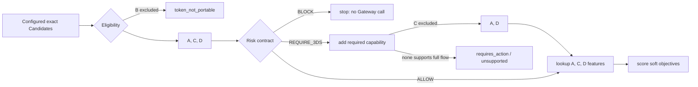
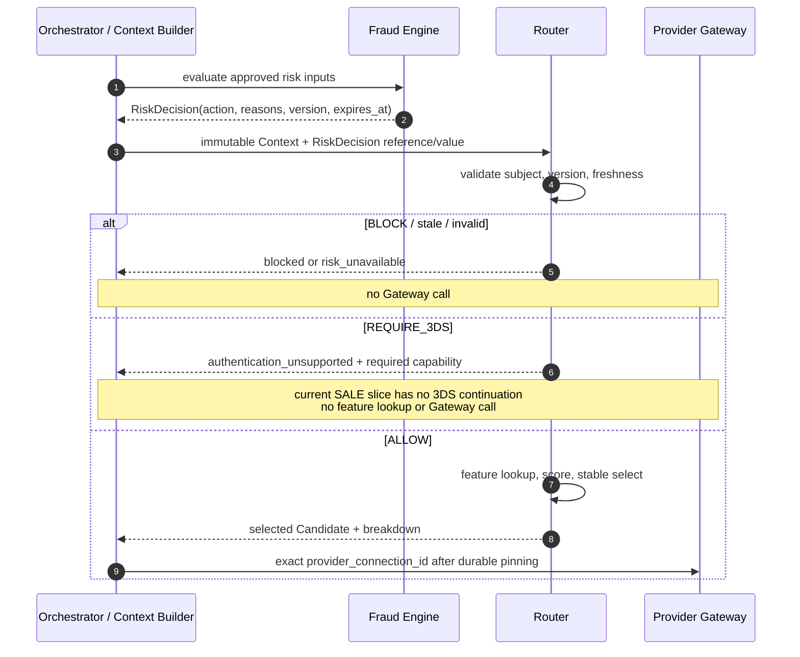

# 第 9 章 Provider Scoring 与 Risk-Aware Routing

Aurora 现在已经能回答三类问题：规则表达业务意图，Eligibility 证明一条精确 Provider Connection 能处理当前操作，Cost 与 Performance 则为合格路径提供带版本的软证据。团队于是写下一个看似完整的公式：

\[
score=0.50\times success-0.25\times cost-0.20\times risk+0.05\times preference
\]

公式很快制造了一个危险问题：某条连接虽然被 Fraud Engine 判定为 `BLOCK`，但它的历史成功率高、成本低，最后仍得到最高分。工程师只好提高 risk 权重；下一次，一条根本不支持当前 Token 或 3DS 流程的连接又因为其他三项表现出色而胜出。

问题不在权重调得不够精细，而在于把两类不同语义塞进了同一个可补偿数字。币种、账户状态、中央 Risk Block 与认证要求是不可违反的 Guardrail；Expected Cost、条件成功率和经过批准的业务偏好才是可权衡 Objective。

本章建立第二部分最后一个不变量：

> **生产路由是按固定阶段执行的受约束优化。Context validation、Eligibility、Rule guardrail 与 Risk contract 先限定允许集合；Feature lookup 和 Scoring 只能在集合内比较软目标；Stable selection 输出完整分解。Risk Decision 归 Fraud Engine 所有，Router 不读取原始欺诈特征，也不重新判断风险。**

完整顺序固定为 `Context validation → Eligibility → Rule guardrail → Risk contract → Feature lookup → Score → Stable selection`。

本章只收束[第 4 章](routing-context.md)到[第 8 章](success-rate-routing.md)的输入与信号。Timeout、Retry、`UNKNOWN` 与 Fallback 留给[第 10 章](../part-3-reliability/timeout-and-retry.md)到[第 12 章](../part-3-reliability/fallback-routing.md)；分钟级 Health 在[第 13 章](../part-3-reliability/provider-health.md)加入；完整 Decision Store、实验和模型分别留给[第 14 章](../part-4-operating-at-scale/routing-decision-store.md)、[第 16 章](../part-4-operating-at-scale/experimentation.md)和[第 21 章](../part-5-global-routing/intelligent-routing.md)。当前 automatic-capture `SALE` 切片也不会因为出现 `REQUIRE_3DS` 字段，就被描述成已经支持完整 3DS、manual Capture 或真实 PSP。

配套 Go 系统已经实现 Router v3 的完整窄流水线：`routing_context.v2` 携带与 subject/expiry 绑定的 `risk_decision.v1`，Router 依次执行 Context、Capability、Rule、Risk、Cost、Performance、整数 Scoring 和稳定选择；Payment 严格验证后，把 Risk/Optimization evidence 与 `candidate_order` 的完整语义固定为 JSONB snapshot，重读时以 typed canonical reconstruction 复验 content ID。这里的“完整”不表示保留 Router response 的原始字节或对象 key 顺序，只指本章定义的 tokenized-card、automatic-capture `SALE` 合同：Risk 来源当前只有 local/test fixture 或 fail-closed unavailable，Cost/Performance 也是合成 Artifact；没有真实 Fraud Engine、动态 Health、生产 Artifact 发布平台、3DS continuation 或真实 PSP。

## 9.1 Problem：最高分为什么可能是一条禁止执行的路径

假设 Aurora 为一笔 120 EUR 的 card payment 得到四条 Candidate。下表中的数字只用于推导，不代表真实 Provider：

| Candidate | Eligibility | 3DS execution capability | Expected Cost | Success Estimate | 直觉结果 |
| --- | --- | --- | ---: | ---: | --- |
| A | eligible | yes | 0.28 EUR | 91% | 可以比较 |
| B | `token_not_portable` | yes | 0.16 EUR | 96% | 必须排除 |
| C | eligible | no | 0.12 EUR | 97% | 只有 Risk `ALLOW` 时可比较 |
| D | eligible | yes | 0.24 EUR | 94% | 可以比较 |

如果把 `eligible=false` 和 `BLOCK` 都转换成惩罚分，就必须发明一个“足够大的负数”。只要以后增加新目标、改变单位或提高权重，这个负数就可能被补偿。若使用 `-Inf`，序列化、跨语言和缺值处理又会出现新的特殊分支。

更安全的表示是集合：B 在 Eligibility 后不再进入后续输入。Fraud Engine 对这次交易只给一个 Risk Action：若为 `BLOCK`，A、C、D 全部停止；若为 `REQUIRE_3DS`，系统加入新的硬能力要求，C 被排除，A、D 才能继续；若为 `ALLOW`，A、C、D 才获得 Cost / Performance Feature 并进入 Scorer。顺序本身就是安全属性，而不是实现细节。



这里还有一个常被忽略的作用域：Risk Decision 通常约束这次 Payment / Attempt 的业务事实，不是 Candidate 自己的“风险属性”。Router 不应为 A、B、C 各跑一遍自制 Fraud 公式；它只消费 Fraud Engine 对当前交易给出的 Action，然后在该 Action 允许的连接中选择。

## 9.2 Simple Design：一个 weighted sum 可以教会我们什么

如果所有 Candidate 已满足硬约束，并且每个 Feature 都完整、同口径、同版本，那么 weighted sum 是合理的第一版。它把多个软目标映射成一个总序，容易解释，也容易做 sensitivity analysis。

最简单的 Go 函数可能是：

```go
package naive

type Features struct {
	SuccessRate float64
	Cost        float64
	RiskScore   float64
}

func Score(f Features) float64 {
	return 0.50*f.SuccessRate - 0.25*f.Cost - 0.20*f.RiskScore
}
```

这段代码可以编译，却没有稳定语义。`SuccessRate` 是 `0.94` 还是 `94`？`Cost` 是 EUR、cent 还是 cost micros？不同 Fraud provider 的 `RiskScore=70` 是否表达同一风险？missing map value 会不会变成零？`NaN` 会让比较器失去总序吗？

即使先把所有值缩放到 `0～1`，动态 min-max 也会产生反直觉结果：一条永远不可能胜出的极高成本 Candidate 加入集合后，其他 Candidate 的 cost range 被压缩，原 winner 可能改变。归一化若依赖“本次恰好有哪些对手”，同一连接的分数便不再可重放。

Weighted sum 真正值得保留的是“显式目标、显式贡献、显式权重”。生产设计需要为它加三道边界：Guardrail 不进入公式；每种 Feature 先保留自己的单位与证据，再用版本化 Normalizer 投影到公共分值；缺失或过期不使用零值，而是切换到一份预先发布的降级策略。

## 9.3 Problems at Scale：不是每个数字都应该成为 Feature

### 9.3.1 先给信号分类，再讨论权重

下面这张表比权重表更重要：

| 信号 | 权威所有者 | 类型 | 能否被其他目标补偿 | 缺失 / 过期时 |
| --- | --- | --- | ---: | --- |
| Context schema、金额、币种、operation | Orchestrator / Context Builder | validation | 否 | 请求失败，不猜默认值 |
| Capability / account / token binding | Capability Catalog | Eligibility guardrail | 否 | unknown 视为不合格 |
| Rule `include` / `exclude` | Routing Policy | policy guardrail | 否 | 使用已验证 Artifact 或拒绝 |
| Fraud `BLOCK` / `REQUIRE_3DS` | Fraud Engine | risk guardrail | 否 | 按 Risk Policy fail closed |
| Rule `prefer` | Routing Policy | objective / stable rank | 可以，语义由 scorer profile 定义 | 回退版本化 default order |
| Expected Cost | Cost Artifact producer | objective | 可以 | stage abstain 或无决定，绝不当零 |
| Performance Estimate | Performance producer | objective | 可以 | stage abstain / prior / 静态顺序，显式记录 |
| Provider Health | Health subsystem | 后章 guardrail / feature | 取决于第 13 章契约 | 本章不提前接入 |
| Payment Outcome / Settlement | Orchestrator / Finance | 事后事实 | 不参加本次在线打分 | 用于后续校准，不回写历史分数 |

分类阻止了“只要是数字就加权”的倾向。AVS 结果、IP、邮箱、设备 fingerprint、完整地址和原始模型向量属于 Fraud Engine 的输入，不应复制进 Router。Router 最多看到获准的 Action、稳定原因类别、决策版本和时效；这既保留所有权，也缩小敏感数据在日志、Trace 和 Decision 证据中的扩散面。

### 9.3.2 Risk-Aware 不等于 Router 再实现一个 Fraud Engine

不同 Fraud provider 的分数范围、阈值和 Action 并不具有天然可比性。Stripe 官方文档就区分 `risk_score`、`risk_level` 与 outcome，并允许配置阈值；Adyen 的 Risk Profile 则可以产生 Allow、Block、Review 或 Check for 3DS 等 Action。这些输出属于各自 Risk 系统的语义，Router 把两个原始数字统一做 `100-score` 并不会得到通用安全指标。[Stripe Radar supported attributes](https://docs.stripe.com/radar/rules/supported-attributes) [Adyen Configure your risk profile](https://docs.adyen.com/risk-management/configure-your-risk-profile)

平台应在 Fraud Engine 边界把具体实现归一化为自己的 `RiskDecision`：

| Action | Router 语义 | 是否进入 Score | 是否可调用 Gateway |
| --- | --- | ---: | ---: |
| `ALLOW` | 风险闸门通过，继续后续阶段 | 否 | 选路完成后可以 |
| `BLOCK` | 终止，不生成可执行 Candidate | 否 | 否 |
| `REQUIRE_3DS` | 加入 `3ds_required` 硬能力，再运行能力交集 | 否 | 只有完整认证流可执行时 |
| `MANUAL_REVIEW` | 返回受控 requires-review，不发起新资金操作 | 否 | 默认否 |

Fraud Engine 可以使用规则、模型和高维信号形成 Action；Router 不知道也不需要知道“为什么设备指纹贡献了 17 分”。稳定 reason code 可以是 `velocity_anomaly` 或 `authentication_required`，但不能带完整邮箱、IP、PAN、CVV/SAD 或自由文本分析。

Risk Decision 还必须绑定 subject 与时间。一个三分钟前对 20 EUR 尝试给出的 `ALLOW`，不能被重放到金额已变为 2,000 EUR 的新 Attempt；过期的 `ALLOW` 也不是“风险较低”，而是没有当前授权。新 Attempt 若在前一笔明确失败后合法创建，应构建新 Context 并获得新 Risk Decision；原 Operation 为 `UNKNOWN` 时则不创建新 Attempt，也不借刷新 Risk 之名重新选路。

### 9.3.3 `REQUIRE_3DS` 是流程要求，不是扣分项

3DS 不是一个布尔标签后再继续普通 `SALE`。EMVCo 的 3-D Secure 文档定义了协议架构、消息和不同交互渠道；具体实现还可能进入 frictionless、challenge 或其他流程。[EMVCo 3-D Secure Documentation](https://www.emvco.com/whitepapers/emv-3-d-secure-whitepaper/3-d-secure-documentation/3-d-secure-specification/) 因此 `REQUIRE_3DS` 至少意味着当前 Connector、Merchant Account、客户端渠道和 Orchestrator 流程都支持所需协议，而不只是 Candidate 配置里写了 `supports_3ds=true`。

欧盟关于 SCA 的监管技术标准规定了强客户认证及其豁免的条件；实际适用性还取决于实体、支付场景、Acquirer 与法律判断，不能由 Router 根据国家和金额自行宣布豁免。[Commission Delegated Regulation (EU) 2018/389](https://eur-lex.europa.eu/legal-content/EN/TXT/?uri=CELEX%3A32018R0389) Router 只执行已归一化 Risk / Authentication 要求与版本化 Capability 事实。

配套系统当前没有完整 3DS challenge 和 continuation 状态机。因此，当前 v3 的安全行为是返回 Risk outcome `authentication_unsupported`、空 Candidate order，且不调用 Gateway；绝不能为了保持转化率把 `REQUIRE_3DS` 降成负五十分后继续 automatic-capture `SALE`。将来的 `requires_action` continuation 必须另有端到端状态机和契约，不能从现有字段推断为已实现。

### 9.3.4 Missing、Stale、Invalid 不是三个不同的分数

Cost 与 Performance 都需要显式 Feature state：

| State | 含义 | 禁止做法 | Scoring 前动作 |
| --- | --- | --- | --- |
| `known` | 值、单位、版本与时效均通过校验 | 只复制裸数值 | 保留 Evidence 后归一化 |
| `missing` | 当前 Candidate / Segment 没有证据 | 使用 Go 零值 | 按 profile 对整个 stage abstain 或失败 |
| `stale` | 曾有证据，但超过有效期 | 当作 last-known-good 无限复用 | 显式降级并记录旧版本 |
| `invalid` | NaN、越界、币种不一致、摘要或计数错误 | clamp 后继续 | 拒绝该 Feature batch 并告警 |

“对整个 stage abstain”非常关键。若只有 B 缺 Cost，而 Scorer 只给 B 的 cost contribution 记零，它其实在惩罚或奖励数据质量；若干脆只比较有 Cost 的 A、C，则 B 被一个软目标悄悄变成不合格。安全做法是由已发布 profile 声明：要求所有允许 Candidate 的 Cost 都可比，否则整段 Cost 不参与；或者返回无决定。若业务确实规定“无可靠费率不得执行”，它应是独立 `cost_data_required` Guardrail，而不是异常分支。

Risk 不使用这种软降级。Risk Decision missing、subject 不匹配或过期时，若平台 Policy 要求风险判定，就必须 fail closed；不能切到 `success_only` profile 绕过中央 Block。

### 9.3.5 归一化本身也是版本化 Policy

Cost 使用 quote currency 的 `cost_micros`，Success 使用带样本与区间的概率；两者的原始单位必须保留。Normalizer 只为评分生成一个例如 `0～10,000` 的定点 points：

\[
success\_points=round(p\times 10{,}000)
\]

\[
cost\_points=10{,}000\times\frac{cost\_ceiling-cost}{cost\_ceiling-cost\_floor}
\]

Cost 超出固定边界时可以 clamp 到 `0` 或 `10,000` points，但原始 `TotalMicros` 仍留在 Breakdown。`cost_floor`、`cost_ceiling`、rounding、权重和适用 Merchant scope 都属于 `scorer_profile_version`；不能根据本次 Candidate 的最小值和最大值临时生成。

Success 的点估计也不能丢掉第 8 章的 `sample_size`、interval、window、`source_segment` 与 snapshot version。Normalizer 得到的是投影，不是替代原证据。历史成功率仍是观察性条件估计，综合分数不会把它升级成因果效果。

### 9.3.6 Expected Margin 与 Cost per Success 都带假设

把 Cost 和 Success 放到同一章后，团队很容易写出 `cost / success_probability`，并把结果命名为“每笔成功支付成本”。这个指标在一个孤立、只执行一次、失败不收费的简化 Attempt 上有直觉价值，但它不是实际账单，也不是完整 Payment 成本。Provider 可能对失败尝试收费；技术错误、软拒绝和明确拒绝允许的后续动作不同；`UNKNOWN` 根本不能立即创建另一 Attempt；多次尝试的结果也不独立。

另一个常见目标是 Expected Margin：

\[
expected\_margin=p_{success}\times order\_margin-expected\_processing\_cost
\]

它比无量纲加权和更贴近业务价值，却新增了更多所有权问题。`order_margin` 来自 Commerce / Finance，而不是 Router 自己用订单金额猜测；退款、拒付、履约和税费是否纳入，必须有版本化定义；第 8 章的概率又是历史策略下的条件估计，并非切换 Candidate 后的因果成功率。若把一个带选择偏差的点估计乘上高毛利，误差也会被同步放大。

因此，第一版可以把 Cost 与 Success 作为独立贡献放进 Breakdown；若以后采用 Cost per Success 或 Expected Margin，应把公式、输入 owner、单位、窗口、缺失策略和适用 Attempt 模型作为新的 `objective_version` 发布。Risk loss 尤其不能为了“经济最优”被塞进 Expected Margin 后抵消 `BLOCK`。拒付、Settlement 和实际费用的最终归因属于[第 17 章](../part-4-operating-at-scale/reconciliation.md)与[第 18 章](../part-4-operating-at-scale/settlement.md)，不能提前伪造成在线已知事实。

## 9.4 Production Design：硬闸门与软评分分栏

生产流水线可以画成两条不能逆流的通道：

```mermaid
flowchart LR
    Context["1 Context validation"] --> Eligibility["2 Eligibility"]
    Eligibility --> Rules["3 Rule guardrail"]
    Rules --> Risk["4 Risk contract"]

    subgraph Hard["Hard gates: only shrink or stop"]
        Eligibility
        Rules
        Risk
    end

    Risk -->|"allowed Candidate set"| Lookup["5 Feature lookup"]
    Lookup --> Batch["validate complete feature batch"]
    Batch --> Normalize["versioned normalizers"]
    Normalize --> Score["6 Score + breakdown"]
    Score --> Select["7 Stable selection"]

    subgraph Soft["Soft objectives: compare only allowed set"]
        Lookup
        Batch
        Normalize
        Score
        Select
    end

    Select --> Decision["Routing Decision<br/>selected candidate + evidence versions"]
    Decision -.-> Orchestrator["Orchestrator later pins Attempt / Operation"]
```



每一阶段只接受上一阶段的输出类型。Scorer 的函数签名不应接收所有 configured Candidates；否则未来的调用者很容易忘记过滤。Feature loader 也只接收 allowed IDs，避免为已经排除的连接浪费 I/O 或留下“高分但不合格”的混淆日志。

### 9.4.1 Risk Contract 只验证与执行 Action

下面的 Go 类型展示 Router 所需的最小 Risk 契约。`SubjectDigest` 绑定规范化 Context，但不是匿名化证明；完整 Risk 特征仍留在 Fraud Engine。Reason codes 必须排序且唯一，使相同输入得到相同证据摘要。为突出 gate，教学类型省略了生产 `SchemaVersion`、`Source` 和 canonical decision digest；Action 行为则与当前 automatic-capture `SALE` 切片一致：`REQUIRE_3DS` 保留所需能力证据，但因尚无认证 continuation 而不可执行。

```go
package riskcontract

import (
	"errors"
	"sort"
	"time"
)

type Action string

const (
	Allow        Action = "allow"
	Block        Action = "block"
	Require3DS   Action = "require_3ds"
	ManualReview Action = "manual_review"
)

var ErrInvalidRiskDecision = errors.New("invalid risk decision")

type Decision struct {
	DecisionID    string
	SubjectDigest string
	Action        Action
	ReasonCodes   []string
	Version       string
	EvaluatedAt   time.Time
	ExpiresAt     time.Time
}

type Gate struct {
	Continue             bool
	RequiredCapabilities []string
	Outcome              string
	ReasonCodes          []string
}

func Evaluate(now time.Time, subjectDigest string, d Decision) (Gate, error) {
	if subjectDigest == "" || d.DecisionID == "" || d.Version == "" || d.SubjectDigest != subjectDigest ||
		d.EvaluatedAt.After(now) || !d.EvaluatedAt.Before(d.ExpiresAt) ||
		!now.Before(d.ExpiresAt) || !sortedUnique(d.ReasonCodes) {
		return Gate{}, ErrInvalidRiskDecision
	}

	reasons := append([]string(nil), d.ReasonCodes...)
	switch d.Action {
	case Allow:
		return Gate{Continue: true, Outcome: "allowed", ReasonCodes: reasons}, nil
	case Require3DS:
		if len(reasons) == 0 {
			return Gate{}, ErrInvalidRiskDecision
		}
		return Gate{
			RequiredCapabilities: []string{"3ds_required"},
			Outcome:              "authentication_unsupported",
			ReasonCodes:          reasons,
		}, nil
	case Block:
		if len(reasons) == 0 {
			return Gate{}, ErrInvalidRiskDecision
		}
		return Gate{Outcome: "blocked", ReasonCodes: reasons}, nil
	case ManualReview:
		if len(reasons) == 0 {
			return Gate{}, ErrInvalidRiskDecision
		}
		return Gate{Outcome: "requires_review", ReasonCodes: reasons}, nil
	default:
		return Gate{}, ErrInvalidRiskDecision
	}
}

func sortedUnique(values []string) bool {
	if !sort.StringsAreSorted(values) {
		return false
	}
	for i, value := range values {
		if value == "" || (i > 0 && values[i-1] == value) {
			return false
		}
	}
	return true
}
```

只有 `ALLOW` 得到 `Continue=true`，而这也不等于允许立即执行 Provider 操作：其后仍要完成允许集合上的 Feature/Score/Selection。当前 `REQUIRE_3DS` 直接返回 `authentication_unsupported`，Optimization 为 absent、Candidate order 为空且 Gateway 调用数为零。将来若端到端 3DS continuation 落地，它仍必须先把 `3ds_required` 与第 6 章 Capability 和 Orchestrator 流程求交；不能仅把这里的布尔值改成 true。



### 9.4.2 用定点 points 组合，不丢失原始证据

第一版 Scorer 可以只组合 Success 与 Cost。Risk 已在 gate 中处理，Rule preference 在最小实现中作为 stable rank；以后若要给 preference 加 points，也必须发布新 profile，而不是修改常量。

下面的 Go 示例使用整数 PPM 表示成功证据，Cost 延续第 7 章的 micros。字段名与当前生产 Objective 对齐：成功侧消费 `Performance Estimate.ConservativePPM`，成本侧消费包含 Attempt 费用的成功情景 `Cost Estimate.SucceededCostMicros`。它拒绝缺失 Feature、币种空值、非法边界和权重；Normalization 参数都来自 `Profile`：

```go
package scoring

import (
	"errors"
	"math"
)

const (
	pointScale     int64 = 10_000
	probabilityPPM int64 = 1_000_000
)

var ErrInvalidScoreInput = errors.New("invalid score input")

type FeatureState string

const FeatureKnown FeatureState = "known"

type Profile struct {
	Version           string
	SuccessWeightBPS  int64
	CostWeightBPS     int64
	CostFloorMicros   int64
	CostCeilingMicros int64
}

type Input struct {
	CandidateID         string
	SuccessState        FeatureState
	ConservativePPM     int64
	PerformanceVer      string
	CostState           FeatureState
	SucceededCostMicros int64
	CostCurrency        string
	CostArtifactVer     string
}

type Breakdown struct {
	CandidateID         string
	TotalPoints         int64
	SuccessPoints       int64
	CostPoints          int64
	SuccessContribution int64
	CostContribution    int64
	ProfileVersion      string
	PerformanceVersion  string
	CostArtifactVersion string
}

func Score(profile Profile, in Input) (Breakdown, error) {
	validWeights := profile.SuccessWeightBPS >= 0 && profile.SuccessWeightBPS <= pointScale &&
		profile.CostWeightBPS >= 0 && profile.CostWeightBPS <= pointScale &&
		profile.SuccessWeightBPS+profile.CostWeightBPS == pointScale
	if profile.Version == "" || !validWeights || profile.CostFloorMicros < 0 ||
		profile.CostCeilingMicros <= profile.CostFloorMicros ||
		profile.CostCeilingMicros-profile.CostFloorMicros > math.MaxInt64/pointScale ||
		in.CandidateID == "" || in.SuccessState != FeatureKnown ||
		in.CostState != FeatureKnown || in.ConservativePPM < 0 ||
		in.ConservativePPM > probabilityPPM || in.SucceededCostMicros < 0 ||
		in.CostCurrency == "" || in.PerformanceVer == "" || in.CostArtifactVer == "" {
		return Breakdown{}, ErrInvalidScoreInput
	}

	successPoints := (in.ConservativePPM*pointScale + probabilityPPM/2) / probabilityPPM
	clampedCost := min(max(in.SucceededCostMicros, profile.CostFloorMicros), profile.CostCeilingMicros)
	costRange := profile.CostCeilingMicros - profile.CostFloorMicros
	costPoints := (profile.CostCeilingMicros - clampedCost) * pointScale / costRange
	successContribution := successPoints * profile.SuccessWeightBPS / pointScale
	costContribution := costPoints * profile.CostWeightBPS / pointScale

	return Breakdown{
		CandidateID:         in.CandidateID,
		TotalPoints:         successContribution + costContribution,
		SuccessPoints:       successPoints,
		CostPoints:          costPoints,
		SuccessContribution: successContribution,
		CostContribution:    costContribution,
		ProfileVersion:      profile.Version,
		PerformanceVersion:  in.PerformanceVer,
		CostArtifactVersion: in.CostArtifactVer,
	}, nil
}
```

这仍是“单行评分”的教学投影。真实 `scoring.Score` 不接受调用方拼出的裸 Input，而是要求 Allowed 集合中的每个 `candidate_id + connection_revision` 都恰有一条完整 `cost.Result` 和一条完整 `performance.Result`；它验证 Artifact digest、Schedule/Cohort、country/network/currency、窗口、求值时间与 quote currency 的整批一致性，再从嵌套 evidence 读取 `SucceededCostMicros` 与 `ConservativePPM`。真实 Breakdown 还保留原始三种费用情景、概率/区间/样本/pending、Profile digest、`ObjectiveVersion=conservative_success_and_success_scenario_cost.v1` 与 rounding version；教学函数没有代替这些 provenance 检查。

Go 1.21 及之后提供内建 `min` / `max`，配套仓库使用的版本应在实现时由 `go.mod` 验证。若要兼容更早版本，可用显式 helper；不能为了方便改回浮点。`CostCurrency` 还必须在 batch 层证明所有 Candidate 使用相同 quote currency，本函数不应把 EUR micros 与 USD micros 直接相加比较。

Breakdown 不能只有归一化 points。Decision evidence 还要关联完整 `CostBreakdown`、Performance sample/window/confidence/source segment、Rule Set / Capability / Risk / Profile 版本及使用的降级 profile。第 14 章才设计持久化结构；本章先保证 Scorer 输出这些引用。

### 9.4.3 Degradation Profile 必须整套切换

Feature 状态组合会形成一张明确决策表。设计上可以发布不同的完整 Profile，但当前 v1 实现故意只支持 `full_v1`，以及证据不可用时对整批执行 `static_order` 或 `reject`；它没有运行时 `success_only` / `cost_only` 模式：

| Cost batch | Performance batch | 当前已发布动作 | 行为 |
| --- | --- | --- | --- |
| 全部 known、可比 | 全部 known、可比 | `full_v1` | 按两个 Objective 评分 |
| 任一合法 evidence row 为 unknown/stale/prior | 任意 | `static_order` | Cost 与 Performance 两段一起 abstain，所有 `Numbers=nil`，按冻结 Rule rank 排序 |
| 任一合法 evidence row 为 unknown/stale/prior | 任意 | `reject` | 返回受控无决定，不产生 Candidate order |
| 缺少/重复 row，revision 漂移，或值/版本/窗口混杂 | 任意 | 无 permissive fallback | `ErrInvalidBatch`，空 order；不能把 malformed input 当普通不可用 |

`static_order` 不是把某个权重临时改成零：它保留全部 raw evidence，但不为任何 Candidate 计算 `Numbers`，并记录 `cost_stage_abstained`、`performance_stage_abstained` 与 `scoring_static_order`。即使只有 Cost 不可用，当前 Profile 也不会用另一半 Feature 建立一个临时目标空间。未来若确需 `success_only` 或 `cost_only`，必须作为新的 schema/profile 行为发布、验证和记录，不能从异常分支偷偷生成。

单 Candidate 也不能跳过前四道门：它仍需 Context 合法、Capability 合格、Rule 允许、Risk 通过。至于是否需要读取所有软 Feature，可以由 profile 优化；若直接选唯一 Candidate，Decision 必须记录 `SINGLE_ALLOWED_CANDIDATE`，而不是伪造比较分数。

### 9.4.4 Stable Selection 不依赖输入顺序

Scorer 产生每个 Candidate 的 Breakdown 后，Selector 使用固定总序：`total_points DESC → policy_rank ASC → candidate_id ASC`。Policy rank 来自同一 Rule/default Artifact；Candidate ID 最终只负责确定性，不表达业务价值。

```go
package selection

import (
	"errors"
	"sort"
)

var ErrInvalidRankedCandidates = errors.New("invalid ranked candidates")

type Candidate struct {
	CandidateID string
	TotalPoints int64
	PolicyRank  int
}

func Select(values []Candidate) (Candidate, error) {
	if len(values) == 0 {
		return Candidate{}, ErrInvalidRankedCandidates
	}
	ranked := append([]Candidate(nil), values...)
	seen := make(map[string]struct{}, len(ranked))
	for _, value := range ranked {
		if value.CandidateID == "" || value.TotalPoints < 0 || value.PolicyRank < 0 {
			return Candidate{}, ErrInvalidRankedCandidates
		}
		if _, exists := seen[value.CandidateID]; exists {
			return Candidate{}, ErrInvalidRankedCandidates
		}
		seen[value.CandidateID] = struct{}{}
	}
	sort.Slice(ranked, func(i, j int) bool {
		if ranked[i].TotalPoints != ranked[j].TotalPoints {
			return ranked[i].TotalPoints > ranked[j].TotalPoints
		}
		if ranked[i].PolicyRank != ranked[j].PolicyRank {
			return ranked[i].PolicyRank < ranked[j].PolicyRank
		}
		return ranked[i].CandidateID < ranked[j].CandidateID
	})
	return ranked[0], nil
}
```

Selector 不能调用 `time.Now()`、随机数或外部服务，也不能从 map 取“第一个”。如果业务需要实验或流量分配，应由第 16 章的稳定 assignment 产生显式输入；Selector 本身仍然确定。

### 9.4.5 “没有选择”也要有稳定契约

Router 不是每次都应返回 Selected Candidate。下面先使用当前 v3 wire 的 reason/outcome 名称；将来增加可继续的 3DS `requires_action` 时必须发布新契约，而不是改变现有 `authentication_unsupported` 的含义：

| Decision outcome | 典型原因 | Selected Candidate | Orchestrator 动作 |
| --- | --- | ---: | --- |
| `selected` | `scoring_full_v1` / `scoring_stable_tie_break` | 有 | 固定连接后创建 Operation |
| `no_eligible_candidate` | capability no / unknown | 无 | 不调用 Gateway，返回受控失败 |
| `blocked` | `risk_blocked` | 无 | 保留 Risk reference，终止执行 |
| `unsupported` | `risk_authentication_unsupported` | 无 | 保留 `3ds_required`，不把要求降级，显式失败 |
| `requires_review` | `risk_requires_review` | 无 | 保留 Fraud owner 的 pre-execution review，不创建资金操作 |
| `risk_unavailable` | missing / stale / subject mismatch | 无 | 按 fail-closed Policy 处理 |
| `feature_unavailable` | strict profile 下批次不完整 | 无 | 重试数据读取或走声明的上层降级 |

Outcome 与 reason code 都来自受限枚举，不把内部错误栈或 Fraud 自由文本暴露给 Merchant。若启用了 degradation profile，最终 Outcome 仍可为 `selected`，但必须同时记录 `cost_stage_abstained`、`performance_stage_abstained` 与 `scoring_static_order`，使一次安全降级不会在报表里伪装成完整优化。

Decision ID 应覆盖 Context digest、allowed Candidate IDs、全部 Artifact / Risk / scorer versions、Feature states、Breakdown 与 tie-break 输入。Canonical form 必须排序集合、固定整数与 UTC 时间表示；只 hash Selected Candidate 无法发现证据变化。完整保存与索引留给第 14 章，但本章产生的对象必须已经足以构造稳定摘要。

## 9.5 Routing Decision 到资金执行仍有一道边界

Scoring 完成只说明“在这些固定证据下，A 是允许集合中的首选”。Router 不创建 Payment Attempt、不调用 Provider，也不把 Candidate order 当成自动 Fallback 许可。它返回至少这些决策证据：

| 证据组 | 最小内容 |
| --- | --- |
| 输入 | Context schema / digest、decision time |
| 硬闸门 | Capability Catalog、Rule Set、Risk Decision/version/expiry、每条 exclusion |
| Feature | Cost / Performance 原始值、状态、单位、窗口与 Artifact versions |
| Scoring | Profile version、normalizer 参数引用、每项 points / weight / contribution |
| Selection | allowed order、stable tie-break、selected `candidate_id`、reason codes |

Orchestrator 接受 Decision 后，才把 `candidate_id` 固定为本次 Attempt / Operation 的 `provider_connection_id`。Gateway 只执行这个精确连接。如果调用 timeout、断连或返回含糊 `5xx`，Operation 进入 `UNKNOWN`，系统沿原 connection、operation ID、payload 与 Provider key 查询或恢复；不能因为 Feature 更新或分数变化重新跑 Router。

后续 Capture、Void、Refund 同样绑定原 connection 与 Provider transaction reference。Risk Block 也不能被第 12 章 Fallback 绕过：若一次明确无副作用失败后允许创建新 Attempt，Orchestrator 必须构建新的 Context，并刷新 Risk、Health 与 Capability 等**执行时安全 veto**；旧 `ALLOW` 不是新尝试的通行证。但新 Attempt 不重新生成 Candidate set，不重新读取 Cost/Performance，也不重新评分。它只能从初次 Decision 已固定的 Route Plan 中取下一条尚未尝试的 Candidate；新鲜安全证据可以否决这条候选或停止 Fallback，不能加入新候选、改变顺序或把新的 winner 插到队首。

## 9.6 Failure Modes：分数如何掩盖边界错误

| Failure Mode | 表面做法 | 真实风险 | 防线 |
| --- | --- | --- | --- |
| 先打分再过滤 | winner 最后做一次 capability check | 异常分支可能漏过滤 | 类型化阶段，只把 allowed set 交给 Scorer |
| Risk 作为负权重 | 高成功率补偿高风险 | 中央 Block 被绕过 | Risk Action 先 gate，不进入 Score |
| Router 重算 Fraud | 用 AVS、IP、邮箱再算小模型 | 双重所有者、隐私扩散、结果不一致 | 只消费 Fraud Engine Decision |
| `REQUIRE_3DS` 扣分 | 未认证路径仍可能胜出 | 违反认证/合规要求 | 转成 hard capability；unsupported 不执行 |
| 缺 Cost 当零 | 没数据的路径最便宜 | 奖励数据缺口 | typed state + 整段 abstain |
| 过期 Performance 当当前值 | 分数仍精确 | 用旧证据驱动新流量 | expiry + degradation profile |
| 动态 min-max | 加一个候选后旧 winner 改变 | 分数依赖对手集合 | 固定 versioned bounds |
| 混合 quote currency | 直接比较 EUR 与 USD micros | 量纲错误 | batch currency validation |
| Float NaN / Inf | comparator 不满足总序 | 重启或排序库产生不同 winner | 边界拒绝，在线 points 用整数 |
| 同分取输入第一项 | 测试环境正常 | map / DB 顺序导致流量漂移 | score、policy rank、ID 固定总序 |
| 唯一 Candidate 跳过 Risk | “反正没得选” | Block 仍被执行 | 单候选也走全部硬闸门 |
| `UNKNOWN` 后重新评分 | 新 winner 看起来更好 | 重复 Authorization / 扣款 | 原 Operation 恢复，不重新选路 |
| Fallback 复用旧 ALLOW | 上次风险已过期 | 新 Attempt 绕过当前风控 | 新 Context + Risk/Health/Capability veto；仍绑定固定 Route Plan |
| Fallback 重新跑 Feature/Score | 当前指标产生新 winner | 同一 Intent 的计划漂移并绕过已审计顺序 | 不重排；只从固定 Plan 取下一候选 |

还要避免把 Risk `MANUAL_REVIEW` 与资金完整性的 `review_required` 混成一个状态。前者是 Fraud Engine 在执行前要求人工判断；后者只由不相容、身份冲突或无法安全归属的资金证据触发。迟到但重复、较弱且不冲突的观察仍追加保存并按领域归约 no-op，不会仅因到达较晚便进入复核。两类 review 可能进入同一个运营界面，却必须保留不同 owner、reason 和状态迁移。

## 9.7 Testing：证明高分不能越权

本章最重要的不是某组权重算出多少，而是下面这些失败测试：

| 测试 | 构造 | 必须证明 |
| --- | --- | --- |
| Eligibility over score | 不合格 Candidate 配置最高 Success、最低 Cost | 不进入 Feature lookup，更不可能被选中 |
| Risk Block | Risk Action 为 `BLOCK` | 返回 block evidence，Gateway 调用数为零 |
| Risk stale / subject mismatch | 过期 `ALLOW` 或 Context digest 不同 | fail explicit，不降级成 allow |
| Require 3DS unsupported | 允许集合都缺完整 3DS capability | requires-action / unsupported，无 `SALE` 调用 |
| Feature missing | 一个 Candidate 缺 Cost | 整个 Cost stage abstain 或无决定，不只惩罚该 Candidate |
| Feature invalid | Probability 越界、币种混合、算术溢出 | 不产生 Score，记录稳定错误 |
| Stable tie | 同分、同 rank，Candidate 输入反复洗牌 | 始终选择字典序固定 ID |
| Restart determinism | 同 Context 与全部版本重启多次 | Breakdown、order、reason codes 和 winner 一致 |
| Single candidate | 只有一条 eligible 路径但 Risk block | 仍不执行 Gateway |
| UNKNOWN isolation | 已选 Operation timeout 后 Feature 版本更新 | 不调用 Router，不创建第二资金路径 |
| Fallback safety renewal | 前 Attempt 明确无副作用失败且允许新 Attempt | 新 Context 必须带有效 Risk/Health/Capability veto；Candidate set/order 与初始 Route Plan 不变 |

Scorer 还应做 property test：任意合法权重的贡献与总分不越界；任意 Candidate permutation 不改变输出；非法 Feature state、重复 ID、负 points 和未知 profile 都失败。Golden test 固定 Context、Catalog、Rule、Risk、Cost、Performance 与 Scorer profile versions，验证完整 `ScoreBreakdown`，而不只断言 selected ID。

端到端测试应在 Router 返回 Block、stale Risk 或 3DS unsupported 时证明 Payment 服务没有创建可执行 Provider Operation，Gateway / Simulator 也没有收到请求。仅检查 HTTP 状态码不足以证明资金副作用没有发生。

## 9.8 Trade-offs：受约束优化也需要保持克制

**硬 Gate 与可用性。** Risk 缺失时 fail closed 会降低转化，却保护中央控制不被网络故障绕过；若业务允许特定低风险场景使用预先签名、未过期的离线 Decision，也必须由 Fraud Engine 契约定义，不能由 Router 临时放行。

**统一分数与 Pareto 信息。** 单一总分便于稳定选择，却会隐藏“成功率略高但成本显著更高”这类边界。完整 Breakdown、materiality threshold 与 shadow report 能让业务评审权重；更复杂的多目标搜索不应牺牲线上可解释性。

**固定 Normalizer 与环境漂移。** 固定 bounds 保证重放，但市场价格和表现分布会变化；更新方式应是发布新 profile 并 shadow 比较，而不是节点自行学习最新最小值。控制平面治理留给[第 20 章](../part-5-global-routing/configuration-platform.md)。

**严格完整批次与降级。** 要求所有 Candidate Feature 完整最公平，却可能让一个数据缺口影响整个优化阶段；整段 abstain 保留支付可用性，却暂时放弃收益。关键不是统一选 fail open 或 fail closed，而是每个 stage 的选择都已版本化、可观测、不可越过 Risk/Eligibility。

**整数 points 与精度。** 定点数提供确定性和溢出边界，但会发生可控舍入。应把 scale 与 rounding 写入 profile，并用 materiality threshold 避免把一个 point 的差异包装成显著业务优势。

**中央 Risk 与路由延迟。** 同步调用 Fraud Engine 可以获得新鲜 Action，却增加尾延迟和级联失败；由 Context Builder 使用带时效投影可以隔离 Router，但需要严格 subject binding 与 expiry。无论采用哪种部署，Risk 所有权都不转给 Router。

## 9.9 配套 Go 系统的本章实现边界

本章的[固定实现](https://github.com/YouEclipse/payments/tree/bc4afde24da708d22f67da72a90a1557b1477173/services/router/internal/decision)已经把 v3 固定为 reader-first 合同，且不会在错误时降级到 v2/v1。Payment 的 `routing_context.v2` Builder 先调用显式 `RiskSource`，以 `risk_subject.v1` digest 绑定 payment/attempt、金额币种、Merchant 和 Payment Method provenance；Router 与 Payment 共享 `riskdecision` 校验，重新计算 action evidence 和 digest。`ALLOW` 才继续 Optimization；`BLOCK`、`MANUAL_REVIEW` 与当前无法执行的 `REQUIRE_3DS` 都返回空 Candidate order、无 Optimization，并在创建 Provider Operation 之前停止。

允许集合随后进入 `routing_optimization.v1`：Fee、Performance 与 Capability manifest 必须精确覆盖同一组 Candidate ID/revision；Cost 与 Performance 在同一个 `context.built_at` 求值；`scoring_profile.v1` 对完整 batch 使用 `ConservativePPM` 与 `SucceededCostMicros` 生成整数 Breakdown，再按 `total_points DESC → rule_rank ASC → candidate_id ASC` 返回稳定顺序。证据 unavailable 只能触发 Profile 声明的整批 `static_order` 或 `reject`；身份、版本、窗口或数值 malformed 则直接拒绝。Router 的 content-derived Decision ID 和 exclusive `executable_until` 绑定 Risk、Optimization、所有硬闸门与所用证据的最早失效时间。

Payment v3 client 使用严格 JSON 边界验证 Decision、Risk、Optimization、candidate order、精确 connection revision、digest、score 状态和执行期限，再把完整 Context/Decision 语义以 JSONB snapshot 固定到 Attempt 事务；它不重算 Router 的费用或统计数学。由于 JSONB 可以重排对象成员，重读时 Payment 严格解析 Optimization，并按 Router 的 typed wire shape 重建 content-ID material：仅对象 key 重排不会使合法 Decision 失配，字段值或业务有序数组变化仍会失败，duplicate/escaped duplicate、case alias 和 trailing value 也会被拒绝。这项机制不保存 raw canonical bytes，也不是 full SHA 或跨语言 canonicalization protocol。单元、race、contract 与 PostgreSQL 测试覆盖 non-allow Risk 在 Feature overflow 前停止、Optimization 不能复活 hard exclusion、manifest revision 漂移、整批降级、稳定 tie、失效边界，以及持久化后的 evidence 语义不可改写。

实现边界同样重要。当前 `DevelopmentRisk` 仅在 local/test 可启用，其他未配置来源 fail closed；它不是 Fraud Engine。Fee/Performance 来自合成 fixture，不是 Provider 报价和真实 outcome。系统没有动态 Health、生产 Artifact Store/签名/审批/热发布、完整 3DS、manual Capture、实验或 ML，也没有真实 PSP sandbox/live 连接。Payment 已保存完整决策快照，但第 14 章所说的独立可查询 Decision Store 与 outbox projector 仍未实现；第 12 章的 Fallback successor transaction 也不能从本章的 Candidate order 自动推断为已交付。

## 9.10 Summary

Provider Scoring 不是把所有信号压成一个数字，而是先决定哪些东西根本不允许被权衡。Context validation 保证输入可解释；Eligibility 证明连接能执行；Rule 与 Risk Guardrail 收缩允许集合；Feature lookup 只读取集合内的版本化软证据；Scorer 使用固定单位、Normalizer 和 profile 生成 Breakdown；Selector 最后用稳定总序选出精确 Candidate。

从本章可以保留七条规则：

1. 固定流水线不可交换：`Context → Eligibility → Rule → Risk → Feature → Score → Selection`。
2. Risk Decision 由 Fraud Engine 产生；Router 只验证并执行 Action，不读取原始特征或重做欺诈判断。
3. `BLOCK`、`REQUIRE_3DS`、Capability 与合规要求是 Gate，不是可被成功率或成本补偿的权重。
4. Cost 与 Performance 保留原单位、窗口、样本和 Artifact 版本；归一化 points 只是带版本的投影。
5. missing、stale、invalid 必须显式；降级切换整套 profile，不能把缺值当零或只比较有数据的 Candidate。
6. 同分按 `score DESC → policy rank ASC → candidate_id ASC` 选择，输入顺序、map 遍历和重启不能改变结果。
7. Decision 不代表资金结果；`UNKNOWN` 恢复和 Capture、Void、Refund 始终固定原 connection 与 Provider reference。

第二部分至此得到一条完整而克制的初次选路流水线。[下一章](../part-3-reliability/timeout-and-retry.md)会从“Decision 已经选出一条路径”继续，处理最危险的执行现实：调用超时只说明观察失败，并不能证明 Provider 没有完成资金操作。
