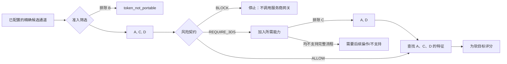
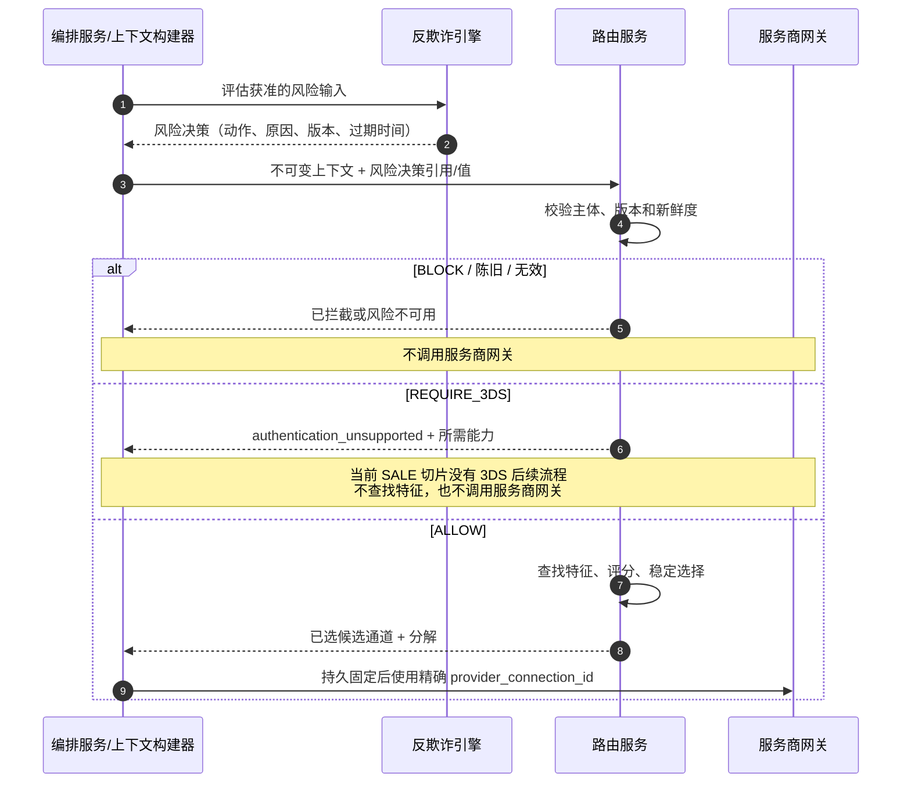

# 第 9 章 服务商评分与风险感知路由

Aurora 现在已经能回答三类问题：规则表达业务意图，准入筛选证明一条精确服务商连接能处理当前操作，成本与表现则为合格路径提供带版本的软证据。团队于是写下一个看似完整的公式：

\[
score=0.50\times success-0.25\times cost-0.20\times risk+0.05\times preference
\]

公式很快制造了一个危险问题：某条连接虽然被反欺诈引擎判定为 `BLOCK`，但它的历史成功率高、成本低，最后仍得到最高分。工程师只好提高风险权重；下一次，一条根本不支持当前令牌或 3DS 流程的连接又因为其他三项表现出色而胜出。

问题不在权重调得不够精细，而在于把两类不同语义塞进了同一个可补偿数字。币种、账户状态、中央风险拦截与认证要求是不可违反的护栏；预期成本、条件成功率和经过批准的业务偏好才是可权衡目标。

本章建立第二部分最后一个不变量：

> **生产路由是按固定阶段执行的受约束优化。上下文校验、准入筛选、规则护栏与风险契约先限定允许集合；特征查找和评分只能在集合内比较软目标；稳定选择输出完整分解。风险决策归反欺诈引擎所有，路由服务不读取原始欺诈特征，也不重新判断风险。**

完整顺序固定为“上下文校验 → 准入筛选 → 规则护栏 → 风险契约 → 特征查找 → 评分 → 稳定选择”。

本章只收束[第 4 章](routing-context.md)到[第 8 章](success-rate-routing.md)的输入与信号。超时、重试、`UNKNOWN` 与后备切换留给[第 10 章](../part-3-reliability/timeout-and-retry.md)到[第 12 章](../part-3-reliability/fallback-routing.md)；分钟级健康度在[第 13 章](../part-3-reliability/provider-health.md)加入；完整路由决策库、实验和模型分别留给[第 14 章](../part-4-operating-at-scale/routing-decision-store.md)、[第 16 章](../part-4-operating-at-scale/experimentation.md)和[第 21 章](../part-5-global-routing/intelligent-routing.md)。当前自动请款 `SALE` 切片也不会因为出现 `REQUIRE_3DS` 字段，就被描述成已经支持完整 3DS、手动请款或真实 PSP。

配套 Go 系统已经实现路由服务 v3 的完整窄流水线：`routing_context.v2` 携带与主体/过期时间绑定的 `risk_decision.v1`，路由服务依次执行上下文、能力、规则、风险、成本、表现、整数评分和稳定选择；支付服务严格验证后，把风险/优化证据与 `candidate_order` 的完整语义固定为 JSONB 快照，重读时以带类型的规范重建复验内容 ID。这里的“完整”不表示保留路由响应的原始字节或对象键顺序，只指本章定义的令牌化卡、自动请款 `SALE` 合同：风险来源当前只有本地/测试固件或失败关闭的不可用状态，成本/表现也是合成制品；没有真实反欺诈引擎、动态健康度、生产制品发布平台、3DS 后续流程或真实 PSP。

## 9.1 问题：最高分为什么可能是一条禁止执行的路径

假设 Aurora 为一笔 120 EUR 的卡支付得到四条候选通道。下表中的数字只用于推导，不代表真实支付服务商：

| 候选通道 | 准入筛选 | 3DS 执行能力 | 预期成本 | 成功率估计 | 直觉结果 |
| --- | --- | --- | ---: | ---: | --- |
| A | 已准入 | 是 | 0.28 EUR | 91% | 可以比较 |
| B | `token_not_portable` | 是 | 0.16 EUR | 96% | 必须排除 |
| C | 已准入 | 否 | 0.12 EUR | 97% | 只有风险决策为 `ALLOW` 时可比较 |
| D | 已准入 | 是 | 0.24 EUR | 94% | 可以比较 |

如果把 `eligible=false` 和 `BLOCK` 都转换成惩罚分，就必须发明一个“足够大的负数”。只要以后增加新目标、改变单位或提高权重，这个负数就可能被补偿。若使用负无穷，序列化、跨语言和缺值处理又会出现新的特殊分支。

更安全的表示是集合：B 在准入筛选后不再进入后续输入。反欺诈引擎对这次交易只给一个风险动作：若为 `BLOCK`，A、C、D 全部停止；若为 `REQUIRE_3DS`，系统加入新的硬能力要求，C 被排除，A、D 才能继续；若为 `ALLOW`，A、C、D 才获得成本/表现特征并进入评分器。顺序本身就是安全属性，而不是实现细节。



这里还有一个常被忽略的作用域：风险决策通常约束这次支付/支付尝试的业务事实，不是候选通道自己的“风险属性”。路由服务不应为 A、B、C 各跑一遍自制反欺诈公式；它只消费反欺诈引擎对当前交易给出的动作，然后在该动作允许的连接中选择。

## 9.2 简单设计：加权和可以教会我们什么

如果所有候选通道已满足硬约束，并且每个特征都完整、同口径、同版本，那么加权和是合理的第一版。它把多个软目标映射成一个总序，容易解释，也容易做敏感性分析。

最简单的 Go 函数可能是：

```go
package naive

type Features struct {
	SuccessRate float64
	Cost        float64
	RiskScore   float64
}

func Score(f Features) float64 {
	return 0.50*f.SuccessRate - 0.25*f.Cost - 0.20*f.RiskScore
}
```

这段代码可以编译，却没有稳定语义。`SuccessRate` 是 `0.94` 还是 `94`？`Cost` 是 EUR、分还是成本微单位？不同反欺诈服务商的 `RiskScore=70` 是否表达同一风险？映射中缺失的值会不会变成零？`NaN` 会让比较器失去总序吗？

即使先把所有值缩放到 `0～1`，动态最小值—最大值归一化也会产生反直觉结果：一条永远不可能胜出的极高成本候选通道加入集合后，其他候选通道的成本范围被压缩，原赢家可能改变。归一化若依赖“本次恰好有哪些对手”，同一连接的分数便不再可重放。

加权和真正值得保留的是“显式目标、显式贡献、显式权重”。生产设计需要为它加三道边界：护栏不进入公式；每种特征先保留自己的单位与证据，再用版本化归一化器投影到公共分值；缺失或过期不使用零值，而是切换到一份预先发布的降级策略。

## 9.3 规模化问题：不是每个数字都应该成为特征

### 9.3.1 先给信号分类，再讨论权重

下面这张表比权重表更重要：

| 信号 | 权威所有者 | 类型 | 能否被其他目标补偿 | 缺失 / 过期时 |
| --- | --- | --- | ---: | --- |
| 上下文模式、金额、币种、资金操作 | 编排服务/上下文构建器 | 校验 | 否 | 请求失败，不猜默认值 |
| 能力/账户/令牌绑定 | 能力目录 | 准入护栏 | 否 | 未知视为不合格 |
| 规则 `include` / `exclude` | 路由策略 | 策略护栏 | 否 | 使用已验证制品或拒绝 |
| 反欺诈 `BLOCK` / `REQUIRE_3DS` | 反欺诈引擎 | 风险护栏 | 否 | 按风险策略失败关闭 |
| 规则 `prefer` | 路由策略 | 目标/稳定排名 | 可以，语义由评分配置定义 | 回退到版本化默认顺序 |
| 预期成本 | 成本制品生产者 | 目标 | 可以 | 阶段放弃决策或无决定，绝不当零 |
| 表现估计 | 表现数据生产者 | 目标 | 可以 | 阶段放弃决策/先验/静态顺序，显式记录 |
| 服务商健康度 | 健康度子系统 | 后章护栏/特征 | 取决于第 13 章契约 | 本章不提前接入 |
| 支付结果/结算 | 编排服务/财务 | 事后事实 | 不参加本次在线打分 | 用于后续校准，不回写历史分数 |

分类阻止了“只要是数字就加权”的倾向。AVS 结果、IP、邮箱、设备指纹、完整地址和原始模型向量属于反欺诈引擎的输入，不应复制进路由服务。路由服务最多看到获准的动作、稳定原因类别、决策版本和时效；这既保留所有权，也缩小敏感数据在日志、链路追踪和决策证据中的扩散面。

### 9.3.2 风险感知不等于路由服务再实现一个反欺诈引擎

不同反欺诈服务商的分数范围、阈值和动作并不具有天然可比性。Stripe 官方文档就区分 `risk_score`、`risk_level` 与结果，并允许配置阈值；Adyen 的风险配置则可以产生允许、拦截、复核或要求 3DS 等动作。这些输出属于各自风险系统的语义，路由服务把两个原始数字统一做 `100-score` 并不会得到通用安全指标。[Stripe Radar 支持的属性](https://docs.stripe.com/radar/rules/supported-attributes) [Adyen 风险配置说明](https://docs.adyen.com/risk-management/configure-your-risk-profile)

平台应在反欺诈引擎边界把具体实现归一化为自己的 `RiskDecision`：

| 动作 | 路由服务语义 | 是否进入评分 | 是否可调用服务商网关 |
| --- | --- | ---: | ---: |
| `ALLOW` | 风险闸门通过，继续后续阶段 | 否 | 选路完成后可以 |
| `BLOCK` | 终止，不生成可执行候选通道 | 否 | 否 |
| `REQUIRE_3DS` | 加入 `3ds_required` 硬能力，再运行能力交集 | 否 | 只有完整认证流可执行时 |
| `MANUAL_REVIEW` | 返回受控的需要复核状态，不发起新资金操作 | 否 | 默认否 |

反欺诈引擎可以使用规则、模型和高维信号形成动作；路由服务不知道也不需要知道“为什么设备指纹贡献了 17 分”。稳定原因码可以是 `velocity_anomaly` 或 `authentication_required`，但不能带完整邮箱、IP、PAN、CVV/SAD 或自由文本分析。

风险决策还必须绑定主体与时间。一个三分钟前对 20 EUR 尝试给出的 `ALLOW`，不能被重放到金额已变为 2,000 EUR 的新支付尝试；过期的 `ALLOW` 也不是“风险较低”，而是没有当前授权。新支付尝试若在前一笔明确失败后合法创建，应构建新上下文并获得新风险决策；原资金操作为 `UNKNOWN` 时则不创建新支付尝试，也不借刷新风险之名重新选路。

### 9.3.3 `REQUIRE_3DS` 是流程要求，不是扣分项

3DS 不是加一个布尔标签后再继续普通 `SALE`。EMVCo 的 3-D Secure 文档定义了协议架构、消息和不同交互渠道；具体实现还可能进入无摩擦、挑战或其他流程。[EMVCo 3-D Secure 文档](https://www.emvco.com/whitepapers/emv-3-d-secure-whitepaper/3-d-secure-documentation/3-d-secure-specification/) 因此 `REQUIRE_3DS` 至少意味着当前连接器、商户账户、客户端渠道和编排服务流程都支持所需协议，而不只是候选通道配置里写了 `supports_3ds=true`。

欧盟关于 SCA 的监管技术标准规定了强客户认证及其豁免条件；实际适用性还取决于实体、支付场景、收单机构与法律判断，不能由路由服务根据国家和金额自行宣布豁免。[欧盟委员会授权条例 (EU) 2018/389](https://eur-lex.europa.eu/legal-content/EN/TXT/?uri=CELEX%3A32018R0389) 路由服务只执行已归一化风险/认证要求与版本化能力事实。

配套系统当前没有完整 3DS 挑战和后续状态机。因此，当前 v3 的安全行为是返回风险结果 `authentication_unsupported`、空候选通道顺序，且不调用服务商网关；绝不能为了保持转化率把 `REQUIRE_3DS` 降成负五十分后继续自动请款 `SALE`。将来的 `requires_action` 后续流程必须另有端到端状态机和契约，不能从现有字段推断为已实现。

### 9.3.4 缺失、陈旧、无效不是三个不同的分数

成本与表现都需要显式特征状态：

| 状态 | 含义 | 禁止做法 | 评分前动作 |
| --- | --- | --- | --- |
| `known` | 值、单位、版本与时效均通过校验 | 只复制裸数值 | 保留证据后归一化 |
| `missing` | 当前候选通道/分段没有证据 | 使用 Go 零值 | 按配置对整个阶段放弃决策或失败 |
| `stale` | 曾有证据，但超过有效期 | 当作最近已知可用值无限复用 | 显式降级并记录旧版本 |
| `invalid` | NaN、越界、币种不一致、摘要或计数错误 | 截断后继续 | 拒绝该特征批次并告警 |

“对整个阶段放弃决策”非常关键。若只有 B 缺成本，而评分器只给 B 的成本贡献记零，它其实在惩罚或奖励数据质量；若干脆只比较有成本的 A、C，则 B 被一个软目标悄悄变成不合格。安全做法是由已发布配置声明：要求所有允许候选通道的成本都可比，否则整段成本不参与；或者返回无决定。若业务确实规定“无可靠费率不得执行”，它应是独立的 `cost_data_required` 护栏，而不是异常分支。

风险不使用这种软降级。风险决策缺失、主体不匹配或过期时，若平台策略要求风险判定，就必须失败关闭；不能切到 `success_only` 配置绕过中央拦截。

### 9.3.5 归一化本身也是版本化策略

成本使用报价币种的 `cost_micros`，成功率使用带样本与区间的概率；两者的原始单位必须保留。归一化器只为评分生成一个例如 `0～10,000` 的定点分值：

\[
success\_points=round(p\times 10{,}000)
\]

\[
cost\_points=10{,}000\times\frac{cost\_ceiling-cost}{cost\_ceiling-cost\_floor}
\]

成本超出固定边界时可以截断到 `0` 或 `10,000` 分，但原始 `TotalMicros` 仍留在成本分解中。`cost_floor`、`cost_ceiling`、舍入、权重和适用商户范围都属于 `scorer_profile_version`；不能根据本次候选通道的最小值和最大值临时生成。

成功率的点估计也不能丢掉第 8 章的 `sample_size`、区间、窗口、`source_segment` 与快照版本。归一化器得到的是投影，不是替代原证据。历史成功率仍是观察性条件估计，综合分数不会把它升级成因果效果。

### 9.3.6 预期利润与单次成功成本都带假设

把成本和成功率放到同一章后，团队很容易写出 `cost / success_probability`，并把结果命名为“每笔成功支付成本”。这个指标在一个孤立、只执行一次、失败不收费的简化支付尝试上有直觉价值，但它不是实际账单，也不是完整支付成本。支付服务商可能对失败尝试收费；技术错误、软拒绝和明确拒绝允许的后续动作不同；`UNKNOWN` 根本不能立即创建另一支付尝试；多次尝试的结果也不独立。

另一个常见目标是预期利润：

\[
expected\_margin=p_{success}\times order\_margin-expected\_processing\_cost
\]

它比无量纲加权和更贴近业务价值，却新增了更多所有权问题。`order_margin` 来自商业/财务系统，而不是路由服务自己用订单金额猜测；退款、拒付、履约和税费是否纳入，必须有版本化定义；第 8 章的概率又是历史策略下的条件估计，并非切换候选通道后的因果成功率。若把一个带选择偏差的点估计乘上高毛利，误差也会被同步放大。

因此，第一版可以把成本与成功率作为独立贡献放进分解；若以后采用单次成功成本或预期利润，应把公式、输入所有者、单位、窗口、缺失策略和适用支付尝试模型作为新的 `objective_version` 发布。风险损失尤其不能为了“经济最优”被塞进预期利润后抵消 `BLOCK`。拒付、结算和实际费用的最终归因属于[第 17 章](../part-4-operating-at-scale/reconciliation.md)与[第 18 章](../part-4-operating-at-scale/settlement.md)，不能提前伪造成在线已知事实。

## 9.4 生产级设计：硬闸门与软评分分栏

生产流水线可以画成两条不能逆流的通道：


每一阶段只接受上一阶段的输出类型。评分器的函数签名不应接收所有已配置候选通道；否则未来的调用者很容易忘记过滤。特征加载器也只接收允许的 ID，避免为已经排除的连接浪费 I/O 或留下“高分但不合格”的混淆日志。

### 9.4.1 风险契约只验证与执行动作

下面的 Go 类型展示路由服务所需的最小风险契约。`SubjectDigest` 绑定规范化上下文，但不是匿名化证明；完整风险特征仍留在反欺诈引擎。原因码必须排序且唯一，使相同输入得到相同证据摘要。为突出闸门，教学类型省略了生产 `SchemaVersion`、`Source` 和规范决策摘要；动作行为则与当前自动请款 `SALE` 切片一致：`REQUIRE_3DS` 保留所需能力证据，但因尚无认证后续流程而不可执行。

```go
package riskcontract

import (
	"errors"
	"sort"
	"time"
)

type Action string

const (
	Allow        Action = "allow"
	Block        Action = "block"
	Require3DS   Action = "require_3ds"
	ManualReview Action = "manual_review"
)

var ErrInvalidRiskDecision = errors.New("invalid risk decision")

type Decision struct {
	DecisionID    string
	SubjectDigest string
	Action        Action
	ReasonCodes   []string
	Version       string
	EvaluatedAt   time.Time
	ExpiresAt     time.Time
}

type Gate struct {
	Continue             bool
	RequiredCapabilities []string
	Outcome              string
	ReasonCodes          []string
}

func Evaluate(now time.Time, subjectDigest string, d Decision) (Gate, error) {
	if subjectDigest == "" || d.DecisionID == "" || d.Version == "" || d.SubjectDigest != subjectDigest ||
		d.EvaluatedAt.After(now) || !d.EvaluatedAt.Before(d.ExpiresAt) ||
		!now.Before(d.ExpiresAt) || !sortedUnique(d.ReasonCodes) {
		return Gate{}, ErrInvalidRiskDecision
	}

	reasons := append([]string(nil), d.ReasonCodes...)
	switch d.Action {
	case Allow:
		return Gate{Continue: true, Outcome: "allowed", ReasonCodes: reasons}, nil
	case Require3DS:
		if len(reasons) == 0 {
			return Gate{}, ErrInvalidRiskDecision
		}
		return Gate{
			RequiredCapabilities: []string{"3ds_required"},
			Outcome:              "authentication_unsupported",
			ReasonCodes:          reasons,
		}, nil
	case Block:
		if len(reasons) == 0 {
			return Gate{}, ErrInvalidRiskDecision
		}
		return Gate{Outcome: "blocked", ReasonCodes: reasons}, nil
	case ManualReview:
		if len(reasons) == 0 {
			return Gate{}, ErrInvalidRiskDecision
		}
		return Gate{Outcome: "requires_review", ReasonCodes: reasons}, nil
	default:
		return Gate{}, ErrInvalidRiskDecision
	}
}

func sortedUnique(values []string) bool {
	if !sort.StringsAreSorted(values) {
		return false
	}
	for i, value := range values {
		if value == "" || (i > 0 && values[i-1] == value) {
			return false
		}
	}
	return true
}
```

只有 `ALLOW` 得到 `Continue=true`，而这也不等于允许立即执行服务商操作：其后仍要完成允许集合上的特征查找、评分与选择。当前 `REQUIRE_3DS` 直接返回 `authentication_unsupported`，优化结果缺失、候选通道顺序为空且服务商网关调用数为零。将来若端到端 3DS 后续流程落地，它仍必须先把 `3ds_required` 与第 6 章能力和编排服务流程求交；不能仅把这里的布尔值改成 `true`。



### 9.4.2 用定点分值组合，不丢失原始证据

第一版评分器可以只组合成功率与成本。风险已在闸门中处理，规则偏好在最小实现中作为稳定排名；以后若要给偏好加分，也必须发布新配置，而不是修改常量。

下面的 Go 示例使用整数 PPM 表示成功证据，成本延续第 7 章的微单位。字段名与当前生产目标对齐：成功侧消费 `Performance Estimate.ConservativePPM`，成本侧消费包含支付尝试费用的成功情景 `Cost Estimate.SucceededCostMicros`。它拒绝缺失特征、币种空值、非法边界和权重；归一化参数都来自 `Profile`：

```go
package scoring

import (
	"errors"
	"math"
)

const (
	pointScale     int64 = 10_000
	probabilityPPM int64 = 1_000_000
)

var ErrInvalidScoreInput = errors.New("invalid score input")

type FeatureState string

const FeatureKnown FeatureState = "known"

type Profile struct {
	Version           string
	SuccessWeightBPS  int64
	CostWeightBPS     int64
	CostFloorMicros   int64
	CostCeilingMicros int64
}

type Input struct {
	CandidateID         string
	SuccessState        FeatureState
	ConservativePPM     int64
	PerformanceVer      string
	CostState           FeatureState
	SucceededCostMicros int64
	CostCurrency        string
	CostArtifactVer     string
}

type Breakdown struct {
	CandidateID         string
	TotalPoints         int64
	SuccessPoints       int64
	CostPoints          int64
	SuccessContribution int64
	CostContribution    int64
	ProfileVersion      string
	PerformanceVersion  string
	CostArtifactVersion string
}

func Score(profile Profile, in Input) (Breakdown, error) {
	validWeights := profile.SuccessWeightBPS >= 0 && profile.SuccessWeightBPS <= pointScale &&
		profile.CostWeightBPS >= 0 && profile.CostWeightBPS <= pointScale &&
		profile.SuccessWeightBPS+profile.CostWeightBPS == pointScale
	if profile.Version == "" || !validWeights || profile.CostFloorMicros < 0 ||
		profile.CostCeilingMicros <= profile.CostFloorMicros ||
		profile.CostCeilingMicros-profile.CostFloorMicros > math.MaxInt64/pointScale ||
		in.CandidateID == "" || in.SuccessState != FeatureKnown ||
		in.CostState != FeatureKnown || in.ConservativePPM < 0 ||
		in.ConservativePPM > probabilityPPM || in.SucceededCostMicros < 0 ||
		in.CostCurrency == "" || in.PerformanceVer == "" || in.CostArtifactVer == "" {
		return Breakdown{}, ErrInvalidScoreInput
	}

	successPoints := (in.ConservativePPM*pointScale + probabilityPPM/2) / probabilityPPM
	clampedCost := min(max(in.SucceededCostMicros, profile.CostFloorMicros), profile.CostCeilingMicros)
	costRange := profile.CostCeilingMicros - profile.CostFloorMicros
	costPoints := (profile.CostCeilingMicros - clampedCost) * pointScale / costRange
	successContribution := successPoints * profile.SuccessWeightBPS / pointScale
	costContribution := costPoints * profile.CostWeightBPS / pointScale

	return Breakdown{
		CandidateID:         in.CandidateID,
		TotalPoints:         successContribution + costContribution,
		SuccessPoints:       successPoints,
		CostPoints:          costPoints,
		SuccessContribution: successContribution,
		CostContribution:    costContribution,
		ProfileVersion:      profile.Version,
		PerformanceVersion:  in.PerformanceVer,
		CostArtifactVersion: in.CostArtifactVer,
	}, nil
}
```

这仍是“单行评分”的教学投影。真实 `scoring.Score` 不接受调用方拼出的裸输入，而是要求允许集合中的每个 `candidate_id + connection_revision` 都恰有一条完整 `cost.Result` 和一条完整 `performance.Result`；它验证制品摘要、费率表/群组、国家/卡组织/币种、窗口、求值时间与报价币种的整批一致性，再从嵌套证据读取 `SucceededCostMicros` 与 `ConservativePPM`。真实分解还保留原始三种费用情景、概率/区间/样本/待定结果、配置摘要、`ObjectiveVersion=conservative_success_and_success_scenario_cost.v1` 与舍入版本；教学函数没有代替这些来源检查。

Go 1.21 及之后提供内建 `min` / `max`，配套仓库使用的版本应在实现时由 `go.mod` 验证。若要兼容更早版本，可用显式辅助函数；不能为了方便改回浮点。`CostCurrency` 还必须在批次层证明所有候选通道使用相同报价币种，本函数不应把 EUR 微单位与 USD 微单位直接相加比较。

分解不能只有归一化分值。决策证据还要关联完整 `CostBreakdown`、表现样本/窗口/置信度/来源分段、规则集/能力/风险/评分配置版本及使用的降级配置。第 14 章才设计持久化结构；本章先保证评分器输出这些引用。

### 9.4.3 降级配置必须整套切换

特征状态组合会形成一张明确决策表。设计上可以发布不同的完整配置，但当前 v1 实现故意只支持 `full_v1`，以及证据不可用时对整批执行 `static_order` 或 `reject`；它没有运行时 `success_only` / `cost_only` 模式：

| 成本批次 | 表现批次 | 当前已发布动作 | 行为 |
| --- | --- | --- | --- |
| 全部已知、可比 | 全部已知、可比 | `full_v1` | 按两个目标评分 |
| 任一合法证据行处于未知/陈旧/先验状态 | 任意 | `static_order` | 成本与表现两段一起放弃决策，所有 `Numbers=nil`，按冻结规则排名排序 |
| 任一合法证据行处于未知/陈旧/先验状态 | 任意 | `reject` | 返回受控无决定，不产生候选通道顺序 |
| 缺少/重复行、修订版漂移，或值/版本/窗口混杂 | 任意 | 无宽松回退 | `ErrInvalidBatch`，空顺序；不能把畸形输入当普通不可用 |

`static_order` 不是把某个权重临时改成零：它保留全部原始证据，但不为任何候选通道计算 `Numbers`，并记录 `cost_stage_abstained`、`performance_stage_abstained` 与 `scoring_static_order`。即使只有成本不可用，当前配置也不会用另一半特征建立一个临时目标空间。未来若确需 `success_only` 或 `cost_only`，必须作为新的模式/配置行为发布、验证和记录，不能从异常分支偷偷生成。

单个候选通道也不能跳过前四道门：它仍需上下文合法、能力合格、规则允许、风险通过。至于是否需要读取所有软特征，可以由配置优化；若直接选唯一候选通道，路由决策必须记录 `SINGLE_ALLOWED_CANDIDATE`，而不是伪造比较分数。

### 9.4.4 稳定选择不依赖输入顺序

评分器产生每个候选通道的分解后，选择器使用固定总序：`total_points DESC → policy_rank ASC → candidate_id ASC`。策略排名来自同一规则/默认制品；候选通道 ID 最终只负责确定性，不表达业务价值。

```go
package selection

import (
	"errors"
	"sort"
)

var ErrInvalidRankedCandidates = errors.New("invalid ranked candidates")

type Candidate struct {
	CandidateID string
	TotalPoints int64
	PolicyRank  int
}

func Select(values []Candidate) (Candidate, error) {
	if len(values) == 0 {
		return Candidate{}, ErrInvalidRankedCandidates
	}
	ranked := append([]Candidate(nil), values...)
	seen := make(map[string]struct{}, len(ranked))
	for _, value := range ranked {
		if value.CandidateID == "" || value.TotalPoints < 0 || value.PolicyRank < 0 {
			return Candidate{}, ErrInvalidRankedCandidates
		}
		if _, exists := seen[value.CandidateID]; exists {
			return Candidate{}, ErrInvalidRankedCandidates
		}
		seen[value.CandidateID] = struct{}{}
	}
	sort.Slice(ranked, func(i, j int) bool {
		if ranked[i].TotalPoints != ranked[j].TotalPoints {
			return ranked[i].TotalPoints > ranked[j].TotalPoints
		}
		if ranked[i].PolicyRank != ranked[j].PolicyRank {
			return ranked[i].PolicyRank < ranked[j].PolicyRank
		}
		return ranked[i].CandidateID < ranked[j].CandidateID
	})
	return ranked[0], nil
}
```

选择器不能调用 `time.Now()`、随机数或外部服务，也不能从映射取“第一个”。如果业务需要实验或流量分配，应由第 16 章的稳定分配产生显式输入；选择器本身仍然确定。

### 9.4.5 “没有选择”也要有稳定契约

路由服务不是每次都应返回已选候选通道。下面先使用当前 v3 传输契约的原因/结果名称；将来增加可继续的 3DS `requires_action` 时必须发布新契约，而不是改变现有 `authentication_unsupported` 的含义：

| 路由决策结果 | 典型原因 | 已选候选通道 | 编排服务动作 |
| --- | --- | ---: | --- |
| `selected` | `scoring_full_v1` / `scoring_stable_tie_break` | 有 | 固定连接后创建资金操作 |
| `no_eligible_candidate` | 能力不支持/未知 | 无 | 不调用服务商网关，返回受控失败 |
| `blocked` | `risk_blocked` | 无 | 保留风险引用，终止执行 |
| `unsupported` | `risk_authentication_unsupported` | 无 | 保留 `3ds_required`，不把要求降级，显式失败 |
| `requires_review` | `risk_requires_review` | 无 | 保留反欺诈所有者的执行前复核，不创建资金操作 |
| `risk_unavailable` | 缺失/陈旧/主体不匹配 | 无 | 按失败关闭策略处理 |
| `feature_unavailable` | 严格配置下批次不完整 | 无 | 重试数据读取或走声明的上层降级 |

结果与原因码都来自受限枚举，不把内部错误栈或反欺诈自由文本暴露给商户。若启用了降级配置，最终结果仍可为 `selected`，但必须同时记录 `cost_stage_abstained`、`performance_stage_abstained` 与 `scoring_static_order`，使一次安全降级不会在报表里伪装成完整优化。

路由决策 ID 应覆盖上下文摘要、允许的候选通道 ID、全部制品/风险/评分器版本、特征状态、分解与平局裁决输入。规范形式必须排序集合、固定整数与 UTC 时间表示；只散列已选候选通道无法发现证据变化。完整保存与索引留给第 14 章，但本章产生的对象必须已经足以构造稳定摘要。

## 9.5 从路由决策到资金执行仍有一道边界

评分完成只说明“在这些固定证据下，A 是允许集合中的首选”。路由服务不创建支付尝试、不调用支付服务商，也不把候选通道顺序当成自动后备切换许可。它返回至少这些决策证据：

| 证据组 | 最小内容 |
| --- | --- |
| 输入 | 上下文模式/摘要、决策时间 |
| 硬闸门 | 能力目录、规则集、风险决策/版本/过期时间、每条排除原因 |
| 特征 | 成本/表现原始值、状态、单位、窗口与制品版本 |
| 评分 | 配置版本、归一化器参数引用、每项分值/权重/贡献 |
| 选择 | 允许顺序、稳定平局裁决、已选 `candidate_id`、原因码 |

编排服务接受路由决策后，才把 `candidate_id` 固定为本次支付尝试/资金操作的 `provider_connection_id`。服务商网关只执行这个精确连接。如果调用超时、断连或返回含糊 `5xx`，资金操作进入 `UNKNOWN`，系统沿原连接、资金操作 ID、载荷与服务商键查询或恢复；不能因为特征更新或分数变化重新运行路由服务。

后续请款、撤销、退款同样绑定原连接与服务商交易引用。风险拦截也不能被第 12 章后备切换绕过：若一次明确无副作用失败后允许创建新支付尝试，编排服务必须构建新的上下文，并刷新风险、健康度与能力等**执行时安全否决信号**；旧 `ALLOW` 不是新尝试的通行证。但新支付尝试不重新生成候选通道集合，不重新读取成本/表现，也不重新评分。它只能从初次路由决策已固定的路由方案中取下一条尚未尝试的候选通道；新鲜安全证据可以否决这条候选或停止后备切换，不能加入新候选、改变顺序或把新的赢家插到队首。

## 9.6 故障模式：分数如何掩盖边界错误

| 故障模式 | 表面做法 | 真实风险 | 防线 |
| --- | --- | --- | --- |
| 先打分再过滤 | 赢家最后做一次能力检查 | 异常分支可能漏过滤 | 类型化阶段，只把允许集合交给评分器 |
| 风险作为负权重 | 高成功率补偿高风险 | 中央拦截被绕过 | 风险动作先过闸门，不进入评分 |
| 路由服务重算反欺诈 | 用 AVS、IP、邮箱再算小模型 | 双重所有者、隐私扩散、结果不一致 | 只消费反欺诈引擎决策 |
| `REQUIRE_3DS` 扣分 | 未认证路径仍可能胜出 | 违反认证/合规要求 | 转成硬能力；不支持则不执行 |
| 缺成本当零 | 没数据的路径最便宜 | 奖励数据缺口 | 带类型状态 + 整段放弃决策 |
| 把过期表现当作当前值 | 分数仍精确 | 用旧证据驱动新流量 | 过期时间 + 降级配置 |
| 动态最小值—最大值归一化 | 加一个候选后旧赢家改变 | 分数依赖对手集合 | 固定版本化边界 |
| 混合报价币种 | 直接比较 EUR 与 USD 微单位 | 量纲错误 | 批次币种校验 |
| 浮点 NaN/无穷 | 比较器不满足总序 | 重启或排序库产生不同赢家 | 边界拒绝，在线分值用整数 |
| 同分取输入第一项 | 测试环境正常 | 映射/数据库顺序导致流量漂移 | 分数、策略排名、ID 固定总序 |
| 唯一候选通道跳过风险 | “反正没得选” | 拦截仍被执行 | 单候选也走全部硬闸门 |
| `UNKNOWN` 后重新评分 | 新赢家看起来更好 | 重复授权/扣款 | 原资金操作恢复，不重新选路 |
| 后备切换复用旧 `ALLOW` | 上次风险已过期 | 新支付尝试绕过当前风控 | 新上下文 + 风险/健康度/能力否决；仍绑定固定路由方案 |
| 后备切换重新查特征/评分 | 当前指标产生新赢家 | 同一支付意图的计划漂移并绕过已审计顺序 | 不重排；只从固定方案取下一候选 |

还要避免把风险 `MANUAL_REVIEW` 与资金完整性的 `review_required` 混成一个状态。前者是反欺诈引擎在执行前要求人工判断；后者只由不相容、身份冲突或无法安全归属的资金证据触发。迟到但重复、较弱且不冲突的观察仍追加保存并按领域归约为空操作，不会仅因到达较晚便进入复核。两类复核可能进入同一个运营界面，却必须保留不同所有者、原因和状态迁移。

## 9.7 测试：证明高分不能越权

本章最重要的不是某组权重算出多少，而是下面这些失败测试：

| 测试 | 构造 | 必须证明 |
| --- | --- | --- |
| 准入筛选优先于评分 | 不合格候选通道配置最高成功率、最低成本 | 不进入特征查找，更不可能被选中 |
| 风险拦截 | 风险动作为 `BLOCK` | 返回拦截证据，服务商网关调用数为零 |
| 风险陈旧/主体不匹配 | 过期 `ALLOW` 或上下文摘要不同 | 显式失败，不降级成允许 |
| 不支持所需 3DS | 允许集合都缺完整 3DS 能力 | 需要后续操作/不支持，无 `SALE` 调用 |
| 特征缺失 | 一个候选通道缺成本 | 整个成本阶段放弃决策或无决定，不只惩罚该候选通道 |
| 特征无效 | 概率越界、币种混合、算术溢出 | 不产生评分，记录稳定错误 |
| 稳定平局 | 同分、同排名，候选通道输入反复洗牌 | 始终选择字典序固定 ID |
| 重启确定性 | 同一上下文与全部版本重启多次 | 分解、顺序、原因码和赢家一致 |
| 单候选通道 | 只有一条已准入路径但风险拦截 | 仍不执行服务商网关 |
| `UNKNOWN` 隔离 | 已选资金操作超时后特征版本更新 | 不调用路由服务，不创建第二资金路径 |
| 后备切换安全续期 | 前一支付尝试明确无副作用失败且允许新支付尝试 | 新上下文必须带有效风险/健康度/能力否决；候选集合/顺序与初始路由方案不变 |

评分器还应做属性测试：任意合法权重的贡献与总分不越界；任意候选通道排列不改变输出；非法特征状态、重复 ID、负分值和未知配置都失败。黄金测试固定上下文、目录、规则、风险、成本、表现与评分器配置版本，验证完整 `ScoreBreakdown`，而不只断言已选 ID。

端到端测试应在路由服务返回拦截、陈旧风险或不支持 3DS 时证明支付服务没有创建可执行服务商资金操作，服务商网关/模拟器也没有收到请求。仅检查 HTTP 状态码不足以证明资金副作用没有发生。

## 9.8 权衡：受约束优化也需要保持克制

**硬闸门与可用性。** 风险缺失时失败关闭会降低转化，却保护中央控制不被网络故障绕过；若业务允许特定低风险场景使用预先签名、未过期的离线决策，也必须由反欺诈引擎契约定义，不能由路由服务临时放行。

**统一分数与帕累托信息。** 单一总分便于稳定选择，却会隐藏“成功率略高但成本显著更高”这类边界。完整分解、重要性阈值与影子报告能让业务评审权重；更复杂的多目标搜索不应牺牲线上可解释性。

**固定归一化器与环境漂移。** 固定边界保证重放，但市场价格和表现分布会变化；更新方式应是发布新配置并做影子比较，而不是节点自行学习最新最小值。控制平面治理留给[第 20 章](../part-5-global-routing/configuration-platform.md)。

**严格完整批次与降级。** 要求所有候选通道特征完整最公平，却可能让一个数据缺口影响整个优化阶段；整段放弃决策保留支付可用性，却暂时放弃收益。关键不是统一选失败开放或失败关闭，而是每个阶段的选择都已版本化、可观测、不可越过风险/准入筛选。

**整数分值与精度。** 定点数提供确定性和溢出边界，但会发生可控舍入。应把刻度与舍入写入配置，并用重要性阈值避免把一个分值的差异包装成显著业务优势。

**中央风险与路由延迟。** 同步调用反欺诈引擎可以获得新鲜动作，却增加尾延迟和级联失败；由上下文构建器使用带时效投影可以隔离路由服务，但需要严格主体绑定与过期时间。无论采用哪种部署，风险所有权都不转给路由服务。

## 9.9 配套 Go 系统的本章实现边界

本章的[固定实现](https://github.com/YouEclipse/payments/tree/bc4afde24da708d22f67da72a90a1557b1477173/services/router/internal/decision)已经把 v3 固定为读取方优先合同，且不会在错误时降级到 v2/v1。支付服务的 `routing_context.v2` 构建器先调用显式 `RiskSource`，以 `risk_subject.v1` 摘要绑定支付/支付尝试、金额币种、商户和支付方式来源；路由服务与支付服务共享 `riskdecision` 校验，重新计算动作证据和摘要。只有 `ALLOW` 才继续优化；`BLOCK`、`MANUAL_REVIEW` 与当前无法执行的 `REQUIRE_3DS` 都返回空候选通道顺序、无优化结果，并在创建服务商资金操作之前停止。

允许集合随后进入 `routing_optimization.v1`：费用、表现与能力清单必须精确覆盖同一组候选通道 ID/修订版；成本与表现在同一个 `context.built_at` 求值；`scoring_profile.v1` 对完整批次使用 `ConservativePPM` 与 `SucceededCostMicros` 生成整数分解，再按 `total_points DESC → rule_rank ASC → candidate_id ASC` 返回稳定顺序。证据不可用只能触发配置声明的整批 `static_order` 或 `reject`；身份、版本、窗口或数值畸形则直接拒绝。路由服务基于内容生成的决策 ID 和不含右端点的 `executable_until` 绑定风险、优化、所有硬闸门与所用证据的最早失效时间。

支付服务 v3 客户端使用严格 JSON 边界验证路由决策、风险、优化、候选通道顺序、精确连接修订版、摘要、评分状态和执行期限，再把完整上下文/决策语义以 JSONB 快照固定到支付尝试事务；它不重算路由服务的费用或统计数学。由于 JSONB 可以重排对象成员，重读时支付服务严格解析优化结果，并按路由服务的带类型传输结构重建内容 ID 材料：仅对象键重排不会使合法决策失配，字段值或业务有序数组变化仍会失败，重复/转义重复键、大小写别名和尾随值也会被拒绝。这项机制不保存原始规范字节，也不是完整 SHA 或跨语言规范化协议。单元、竞态、契约与 PostgreSQL 测试覆盖非允许风险在特征溢出前停止、优化不能复活硬排除、清单修订版漂移、整批降级、稳定平局、失效边界，以及持久化后的证据语义不可改写。

实现边界同样重要。当前 `DevelopmentRisk` 仅在本地/测试环境可启用，其他未配置来源失败关闭；它不是反欺诈引擎。费用/表现来自合成测试固件，不是支付服务商报价和真实结果。系统没有动态健康度、生产制品库/签名/审批/热发布、完整 3DS、手动请款、实验或机器学习，也没有真实 PSP 沙盒/线上连接。支付服务已保存完整决策快照，但第 14 章所说的独立可查询决策库与发件箱投影器仍未实现；第 12 章的后备切换后继事务也不能从本章的候选通道顺序自动推断为已交付。

## 9.10 小结

服务商评分不是把所有信号压成一个数字，而是先决定哪些东西根本不允许被权衡。上下文校验保证输入可解释；准入筛选证明连接能执行；规则与风险护栏收缩允许集合；特征查找只读取集合内的版本化软证据；评分器使用固定单位、归一化器和配置生成分解；选择器最后用稳定总序选出精确候选通道。

从本章可以保留七条规则：

1. 固定流水线不可交换：上下文 → 准入筛选 → 规则 → 风险 → 特征 → 评分 → 选择。
2. 风险决策由反欺诈引擎产生；路由服务只验证并执行动作，不读取原始特征或重做欺诈判断。
3. `BLOCK`、`REQUIRE_3DS`、能力与合规要求是闸门，不是可被成功率或成本补偿的权重。
4. 成本与表现保留原单位、窗口、样本和制品版本；归一化分值只是带版本的投影。
5. 缺失、陈旧、无效必须显式；降级切换整套配置，不能把缺值当零或只比较有数据的候选通道。
6. 同分按 `score DESC → policy rank ASC → candidate_id ASC` 选择，输入顺序、映射遍历和重启不能改变结果。
7. 路由决策不代表资金结果；`UNKNOWN` 恢复和请款、撤销、退款始终固定原连接与服务商引用。

第二部分至此得到一条完整而克制的初次选路流水线。[下一章](../part-3-reliability/timeout-and-retry.md)会从“路由决策已经选出一条路径”继续，处理最危险的执行现实：调用超时只说明观察失败，并不能证明支付服务商没有完成资金操作。
