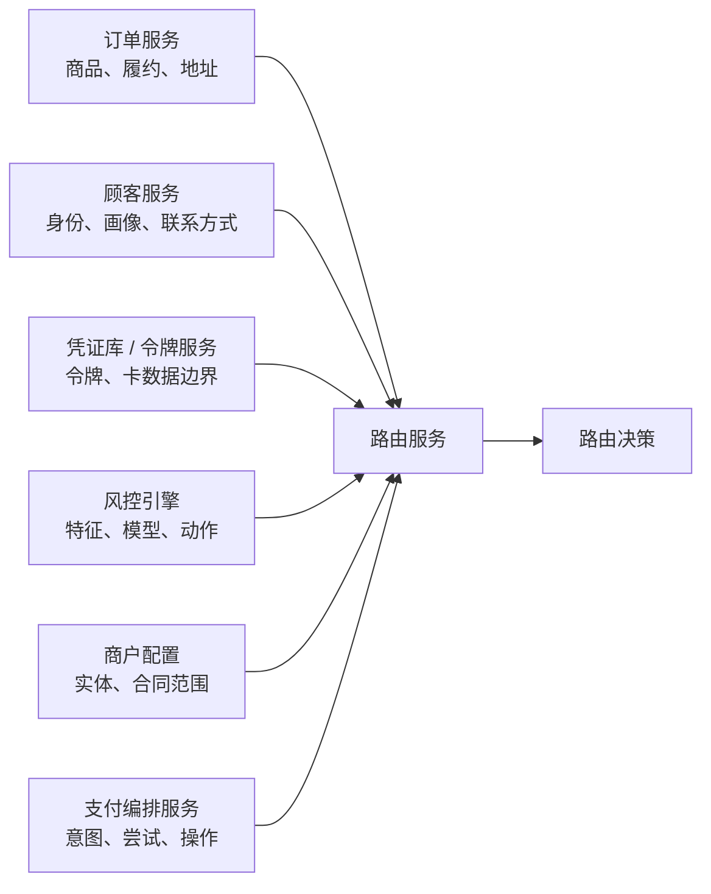
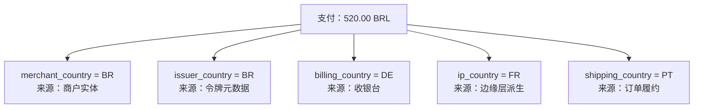
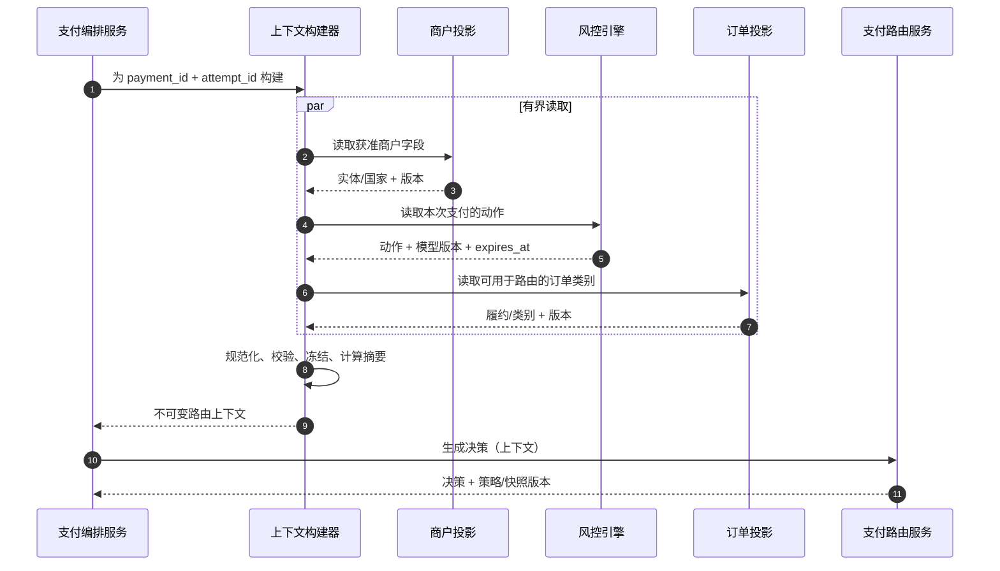

# 第 4 章 构建路由上下文

**中文** | [English](../en/part-2-routing-engine/routing-context.md)

第 3 章把路由服务限定为纯决策组件：它选择一条精确候选通道，却不拥有支付，也不执行资金操作。这个边界随即带来一个问题：路由服务做决策时，究竟应该看到什么？

一种直觉答案是“把支付、订单、顾客和支付方式全部传进去”。这看似信息最完整，实际上会让路由服务同时继承所有上游模型、隐私数据和字段歧义。另一种答案是“路由服务缺什么就实时查什么”，结果则是同一笔支付在不同时间得到不同输入，调用链的可用性也变成所有上游服务可用性的乘积。

本章建立一个更窄的定义：

> **路由上下文是为一次路由决策构建的、最小化且不可变的决策输入快照。它只包含准入筛选或后续评分需要的规范化、非敏感事实，并明确记录模式、来源和观察时间；它不是支付、订单、顾客或支付凭证对象的副本。**

这一章只解决“输入契约”问题。规则 DSL 留给第 5 章，准入筛选的求值逻辑留给第 6 章，成本、成功率和评分留给第 7～9 章，完整决策存储留给第 14 章。我们会提到这些消费者需要哪些输入，但不会提前实现它们。

## 4.1 问题：`route(...)` 的参数为什么会无限增长

Aurora 最初只处理美国发行的美元卡，所有交易都走一条服务商连接。接入巴西和德国后，团队开始给选择函数增加参数：

```go
package naive

func route(
	merchantID string,
	amountMinor int64,
	currency string,
	paymentMethod string,
	issuerCountry string,
	riskAction string,
) string {
	return "" // 省略服务商选择；这里要展示的正是不断增长的函数签名。
}
```

很快又有人要求加入商户法律实体、订单履约类型、卡组织、设备渠道、顾客所在地和 3DS 要求。团队为了避免修改函数签名，干脆把完整对象传给路由服务：

```go
package naive

type Payment struct{}
type Order struct{}
type Customer struct{}
type PaymentMethod struct{}

func route(payment Payment, order Order, customer Customer, method PaymentMethod) string {
	return "" // 简短的函数签名如今隐藏了四个大型所有权边界。
}
```

参数少了，耦合却更深。`Payment` 可能包含服务商资金操作和资金状态，`Order` 可能包含商品明细与收货地址，`Customer` 可能包含姓名、邮箱和账户画像，`PaymentMethod` 则可能带令牌，甚至来自错误边界的 PAN 或 CVV。路由服务并不需要这些数据，却会在序列化、日志、链路追踪、错误报告和决策留存中复制它们。

更隐蔽的问题是字段名称相同、含义却不同。`country` 可能指商户法律实体所在国、发卡行国家、账单地址国家、收货国家、IP 推断国家或当前设备所在国家；`amount` 可能是订单展示金额、支付意图金额、税后金额或结算金额；`risk_score` 可能来自不同模型版本。没有所有者与来源的字段，比没有字段更危险，因为它会让错误决策看起来合理。



如果每次决策都由路由服务扇出查询这些服务，路由服务就不再消费一个输入，而是在请求途中临时拼装世界状态。订单在第一次查询后被取消、风控模型在第二次查询前发布新版本、商户配置在第三次查询时切换，最终组合出来的是一个现实中从未同时存在过的“混合快照”。它既难测试，也无法可靠重放。

## 4.2 简单设计：从既有 v1 七字段请求出发

第 3 章的 v1 基线只运行一条很窄的纵向链路：令牌化银行卡、自动请款 `SALE`、版本化静态候选顺序。支付编排服务持有令牌，但发给路由服务的请求只有七个非敏感字段；这个兼容入口仍被保留，本章随后将它演进为 v2：

```go
package routing

// Request 对应保留下来的旧版路由服务 v1 契约。
// 支付凭证按设计不属于这里。
type Request struct {
	PaymentID     string `json:"payment_id"`
	AttemptID     string `json:"attempt_id"`
	MerchantID    string `json:"merchant_id"`
	AmountMinor   int64  `json:"amount_minor"`
	Currency      string `json:"currency"`
	PaymentMethod string `json:"payment_method"`
	Operation     string `json:"operation"`
}
```

这正是一个好起点，而不是“字段不够多”的缺陷：

| 字段 | 当前语义 | 为什么属于上下文 |
| --- | --- | --- |
| `payment_id` | 支付意图的稳定身份 | 关联一次决策，不携带完整支付状态 |
| `attempt_id` | 编排服务预先生成的本次受控尝试身份 | 支持稳定关联与未来确定性分桶，不代表资金结果 |
| `merchant_id` | 平台内部商户身份 | 选择商户适用的配置范围，不暴露服务商账户 |
| `amount_minor` | 支付意图金额的最小货币单位整数 | 避免浮点金额，同时保留金额约束输入 |
| `currency` | 三位大写币种代码 | 表达交易币种，不等于结算币种 |
| `payment_method` | 非敏感方式类别，当前只能是 `card` | 不是令牌、PAN 或服务商特有的支付方式对象 |
| `operation` | `sale` 或为未来保留的 `authorize` | 区分自动请款与只授权所需能力 |

v1 OpenAPI 使用 `additionalProperties: false`，因此调用方偷偷加入 `payment_method_token` 会被拒绝；路由服务测试也明确覆盖这个场景。支付服务实际发送 `operation = sale`，虽然路由服务契约可验证 `authorize`，配套系统还没有因此获得手动请款、撤销或退款能力。

这个请求已经具备快照的雏形：一次函数调用所需值都在入参中，路由服务不去读取支付数据库，也拿不到支付凭证。对静态策略，它足够产生确定性结果。但它没有上下文模式版本、构建时间和字段来源；后文的 v2 正是为补上这三个缺口，而不是向旧端点无条件增加字段。

## 4.3 规模化问题：字段增加不是复制对象

### 4.3.1 每个事实都必须有一个权威所有者

上下文构建器可以组装事实，但不能重新发明事实。金额与操作身份来自编排服务；商户法律实体来自商户配置；订单分类来自商务域；支付方式的安全派生属性来自受控的凭证库 / 令牌边界；风控动作来自反欺诈引擎。路由服务只消费这些所有者已经定义好的、稳定输出。

| 字段组 | 可以进入上下文的示例 | 权威所有者 | 默认不应进入的原始数据 |
| --- | --- | --- | --- |
| 商户 | `merchant_id`、法律实体引用、业务国家、策略范围 | 商户配置 | 联系人、合同全文、服务商凭证 |
| 支付 | `payment_id`、`attempt_id`、金额、币种、操作、请款方式 | 支付编排服务 | 支付完整状态机、历史服务商结果、幂等密钥 |
| 订单 | 粗粒度商品类别、履约模式、订单价值分段 | 订单 / 商务服务 | SKU 列表、商品描述、客服备注、完整收货地址 |
| 支付方式 | `card` / `wallet` / `bank_transfer` 类别、卡组织、受控的发卡行国家派生值 | 凭证库 / 令牌化边界 | 令牌、PAN、有效期、CVV、完整磁道数据 |
| 地理信息 | 商户国家、发卡行国家、账单/收货国家、IP 派生国家，各自命名 | 对应业务所有者或受控派生服务 | 没有来源的通用 `country`、原始 IP、完整地址 |
| 设备 | `web` / `ios` / `android` 渠道、设备平台族、粗粒度可信等级 | 边缘层 / 设备智能服务 | User-Agent 全文、广告 ID、持久化指纹 |
| 风险 | `ALLOW`、`BLOCK`、`REQUIRE_3DS` 等动作、原因类别、模型版本与时效 | 反欺诈 / 风控引擎 | 全量特征、模型内部向量、未经校准的任意分数 |

“权威所有者”不等于路由服务必须同步调用该服务。更可靠的做法是让编排服务或专门的上下文构建器在明确截止时间内读取已验证投影，冻结成一次输入；路由服务只接受快照。某个字段若没有稳定的所有者，就还不具备成为长期路由契约的条件。

顾客对象尤其不应默认进入上下文。若路由确实需要账户存续时间或会员类型，应由顾客域输出诸如 `account_age_band = established` 的最小派生值，并记录定义版本；`customer_id`、姓名和邮箱不会因为“以后模型也许有用”而获得合理性。设备数据也遵循同样原则：风控引擎可以在自己的边界内处理高维信号，路由服务通常只需要它给出的动作或粗粒度要求。

### 4.3.2 地理信息不是一个 `country`

Aurora 的巴西商户实体可以向一位居住在德国、正从法国 IP 访问、使用巴西发卡行银行卡、要求把纸质票寄往葡萄牙的顾客售票。此时至少存在五个地理事实，且没有哪一个天然代表“交易国家”。



字段名必须把语义写出来，不能让每个规则作者自行猜测 `country`。国家代码可以规范为 ISO 3166-1 二字母代码；ISO 官方说明二字母代码是通用用途的推荐形式，并由维护机构持续更新，因此系统应使用版本化参考数据，而不是在代码里永久复制一张旧表。[ISO 3166 国家代码](https://www.iso.org/iso-3166-country-codes.html)

规范化只解决表示方式，不解决真实性。`issuer_country` 可能来自令牌元数据，`ip_country` 是带误差的推断，`billing_country` 可能是顾客自报。上下文必须记录来源和必要的观察时间，消费者才能区分合同事实、派生事实和用户输入。把它们都变成两个字母，并不会让可信度自动相同。

### 4.3.3 空值、缺失、未知与不适用不是同一个值

很多 API 用空字符串同时表示“调用方忘了传”“系统查不到”“不适用于当前支付方式”和“出于隐私没有提供”。随后规则把空字符串当成默认国家或默认风险等级，未知事实就悄悄变成肯定事实。

| 状态 | 精确定义 | 示例 | 安全处理原则 |
| --- | --- | --- | --- |
| `known` | 值存在且通过格式与来源校验 | `issuer_country = BR` | 可以按声明语义消费 |
| `missing` | 契约要求调用方提供，但请求中没有 | 银行卡请求缺少 `payment_method.category` | 请求校验失败，不猜默认值 |
| `unknown` | 字段适用，但所有者目前无法确定 | 令牌元数据未解析出发卡行国家 | 显式保留未知，由后续策略定义动作 |
| `not_applicable` | 此字段对当前类别没有含义 | 银行转账没有卡组织 | 不应被计作数据质量失败 |
| `redacted` | 值存在，但按隐私或权限边界不向路由服务披露 | 精确设备标识只留在风控引擎 | 路由服务只能使用获准的派生输出 |
| `stale` | 曾经有值，但已超过声明的新鲜度 | 过期的风控动作 | 不能伪装成当前已知值 |

必填标量适合直接拒绝缺失，例如当前 v1 的 `merchant_id`、金额和币种。未来可选字段则应使用显式存在状态，而不是 Go 零值。`amount_minor = 0` 不能同时表示免费订单、未知金额和解析失败；`risk_score = 0` 也不能同时表示最低风险与没有模型结果。

### 4.3.4 “当前最新值”会破坏决定的确定性

假设构建器在 10:00:00 读取商户实体，在 10:00:01 读取风控动作，又在 10:00:02 读取订单。若其中一个值在请求期间更新，路由服务收到的组合可能无法对应任何一致时点。更糟的是，如果路由服务自己在求值过程中再次查询风控或商户服务，重试同一请求就可能得到新输入。

我们需要的不是跨所有服务的全球事务快照，而是可解释的一致性契约：每个字段说明来源与观察时间，上下文记录构建完成时间；有严格时效的信号还记录 `expires_at` 或 TTL。构建器在总截止时间内组装完成后冻结对象，不允许路由服务再向调用方持有的业务服务补字段。

这里还要区分两类输入：商户、支付、订单、支付方式和风险是调用方构建的路由上下文；候选通道能力、策略与服务商健康状态属于路由服务自己的版本化决策环境。**相同上下文 + 相同路由服务代码 + 相同策略/能力/信号快照**才应产生相同决策。只保存上下文，不能证明未来拿“最新健康状态”能够精确重放过去。

### 4.3.5 丰富输入会放大隐私与 PCI 风险

上下文会经过在线 RPC、日志、链路追踪、缓存和未来的决策证据链。每增加一个字段，就扩大一次复制面和保留面。欧盟 GDPR 第 5(1)(c) 条把数据最小化表述为：个人数据应当与目的相关、适当，并限于必要范围；具体适用性和法律基础仍需由组织的隐私与法律团队判断，但这条原则与“只为明确决策目的加入字段”的工程门禁一致。[EUR-Lex：欧盟法规 2016/679 第 5 条](https://eur-lex.europa.eu/legal-content/EN/TXT/?uri=CELEX%3A32016R0679)

对卡数据，边界更严格：路由服务不需要也不应获得支付方式令牌、PAN 或 CVV。令牌留在编排服务到服务商网关的执行命令中；路由服务只接收 `payment_method = card` 及获准的非凭证派生属性。PCI SSC 说明，只有满足特定 EMV 支付令牌条件且位于相应环境之外时，令牌才可能不被视为账户数据；与存储、处理或传输账户数据的系统相连仍可能处于 PCI DSS 范围，因此“用了令牌”不能被当成普遍出域证明。[PCI SSC FAQ 1326](https://www.pcisecuritystandards.org/faqs/1326/)

CVV/CVC/CID 属于敏感认证数据，授权后不得保存，即使加密也不例外；它既不应进入上下文，也不应出现在调试载荷、日志或未来重放样本里。[PCI SSC FAQ 1280](https://www.pcisecuritystandards.org/faqs/1280/)

## 4.4 生产级设计：构建一份可验证的输入快照

### 4.4.1 上下文构建器位于所有者与路由服务之间

上下文构建器的职责是读取已授权的最小投影、规范化、验证、标注来源，并在截止时间内冻结结果。它通常由编排服务调用，也可以是同一部署单元中的模块；它不改变支付状态，不拥有路由策略，也不读取服务商凭证。



图中的并行读取不是强制要求。若支付创建时已经保存了合法的商户与风险投影，构建器可以直接使用本地快照，减少在线依赖。关键是路由服务只收到一个完成的对象；它不会发现 `issuer_country` 缺失后再回调凭证库，也不会发现风险过期后自行运行另一套反欺诈逻辑。

构建器应有字段级允许列表，而不是通过反射把上游对象的所有 JSON 字段复制进去。这样，上游新增 `customer_email` 或 `payment_method_token` 时，不会因为一次普通模型升级悄悄穿过路由服务边界。

### 4.4.2 用显式状态和来源表达最小可用快照

下面的 Go 类型对应本章 `routing_context.v1` 封装的最小形态，由 `/internal/v2/routing-decisions` 接收。`Base` 保留旧七字段并增加显式 `capture_method`；商户和支付方式只带当前消费者确实需要的派生事实。订单、设备、地理信息和风险的所有权已在前文划清，但没有消费者的字段暂不进入线格式；扩展概念模型不等于现在就收集全部数据。

```go
package routingcontext

import "time"

type FieldState string

const (
	FieldKnown         FieldState = "known"
	FieldUnknown       FieldState = "unknown"
	FieldNotApplicable FieldState = "not_applicable"
	FieldRedacted      FieldState = "redacted"
	FieldStale         FieldState = "stale"
)

type Observed[T any] struct {
	State      FieldState `json:"state"`
	Value      *T         `json:"value,omitempty"`
	Source     string     `json:"source"`
	SourceVer  string     `json:"source_version"`
	ObservedAt time.Time  `json:"observed_at"`
	ExpiresAt  *time.Time `json:"expires_at,omitempty"`
}

// ContextBase 保留旧版语义，并显式表达请款语义。
type ContextBase struct {
	PaymentID     string `json:"payment_id"`
	AttemptID     string `json:"attempt_id"`
	MerchantID    string `json:"merchant_id"`
	AmountMinor   int64  `json:"amount_minor"`
	Currency      string `json:"currency"`
	PaymentMethod string `json:"payment_method"`
	Operation     string `json:"operation"`
	CaptureMethod string `json:"capture_method"`
}

type MerchantContext struct {
	EntityID string           `json:"entity_id"`
	Country  Observed[string] `json:"country"`
}

type PaymentMethodContext struct {
	Category         string           `json:"category"`
	Network          Observed[string] `json:"network"`
	IssuerCountry    Observed[string] `json:"issuer_country"`
	CredentialDomain Observed[string] `json:"credential_domain"`
}

type ContextV1 struct {
	SchemaVersion string               `json:"context_schema_version"`
	BuiltAt       time.Time            `json:"built_at"`
	Base          ContextBase          `json:"base"`
	Merchant      MerchantContext      `json:"merchant"`
	PaymentMethod PaymentMethodContext `json:"payment_method_context"`
}
```

`Observed[T]` 让未知值无法只靠 Go 零值混过去。`known` 必须有值、来源及其版本、观察时间和未过期的 `expires_at`；`stale` 有原值和已经到期的有效期；`unknown/not_applicable/redacted` 不携带值，包括不允许用显式空值伪装缺失。`missing` 是构建器的错误诊断，不是这版线格式允许的状态。实际校验器按字段定义允许的状态：商户国家必须已知，而发卡行国家可以未知；令牌域由受控来源给出，不能看令牌字符串猜测。

这个类型刻意没有令牌、PAN、CVV、原始 IP、完整地址、姓名、邮箱、User-Agent 或自由文本。`PaymentMethodContext.Category` 与当前 `Base.PaymentMethod` 在迁移期看似重复；升级时必须校验二者相等，待旧字段淘汰后再移除，不能让两个值分别驱动不同分支。

### 4.4.3 规范化是契约，不是字符串清理

规范化的目标是让同一业务事实只有一种线格式，并在进入路由服务前拒绝含糊值。它不应该“尽力猜测”调用方意图。

| 类型 | 规范形式 | 应拒绝或显式处理的输入 |
| --- | --- | --- |
| 金额 | 正整数 `amount_minor` + 独立三位币种代码 | 浮点金额、带符号字符串、缺少币种 |
| 币种 | 大写 ISO 4217 代码，例如 `BRL` | 仅凭三位格式但不在已发布参考数据中的代码 |
| 国家 | 带语义字段名的 ISO 3166-1 二字母代码（alpha-2），例如 `issuer_country = BR` | 自由文本 `Brazil`、通用 `country`、用户自定义代码 |
| 支付方式 | 版本化小写枚举，例如 `card` | 令牌、服务商 SDK 对象、未知字符串自动降级 |
| 操作 | 平台统一枚举，例如 `sale`、`authorize` | 服务商端点名称、用默认值猜请款方式 |
| 时间 | UTC、明确精度与来源；动态值附 `expires_at` | 本地时区裸字符串、没有观察时间的“实时”值 |
| 集合 / 列表 | 定义顺序是否有语义；无语义集合先排序再编码 | 同一集合因映射遍历产生不同字节 |

ISO 4217 不只定义三字母代码，也维护币种最小单位等元数据；代码表会演进。当前路由服务只校验 `^[A-Z]{3}$`，这是对 v1 输入形式的保护，不等于已经验证代码成员资格或每种币种指数。生产构建器应引用带版本的币种目录，并在金额创建处统一转换，而不是让路由服务解析 `"520.00"`。[ISO 4217 币种代码](https://www.iso.org/iso-4217-currency-codes.html)

不要对所有字符串统一 `strings.ToLower`。`merchant_id`、`payment_id` 和外部标准代码有各自大小写规则，盲目转换可能把两个合法身份合并。规范化逻辑应按字段实现，并与模式版本一起测试。

冻结后的上下文可以计算摘要，用于发现传输或留存时的意外变化。摘要不是加密或匿名化，也不能替代保存可解释的获准字段：

```go
package routingcontext

import (
	"crypto/sha256"
	"encoding/hex"
	"encoding/json"
)

func SnapshotDigest(context ContextV1) (string, error) {
	payload, err := json.Marshal(context)
	if err != nil {
		return "", err
	}
	digest := sha256.Sum256(payload)
	return "sha256:" + hex.EncodeToString(digest[:]), nil
}
```

该片段只展示摘要步骤，调用前必须完成前述校验；配套代码的 `Context.Digest` 会先调用 `Validate`。两端固定字段顺序，使用规范 UTC RFC3339Nano 和完整 SHA-256；共享黄金样例同时约束支付服务与路由服务，不能把任意 JSONB 文本直接拿来计算摘要。若未来加入无序映射、浮点数或自定义 JSON 编码器，就必须定义对应规范形式。摘要不是匿名化：输入可枚举或仍关联支付时，它依然可能属于受控数据。

### 4.4.4 校验分四层，默认值必须有名字

构建器与路由服务都应校验契约，但职责不同。构建器负责来源和规范化，路由服务在信任边界再次验证线格式载荷：

1. **结构校验**：必填字段、类型、大小限制、未知字段和模式版本；
2. **语义校验**：金额大于零、币种/国家属于版本化目录、枚举组合有意义；
3. **来源校验**：`known` 值有来源与观察时间，时间不来自未来，动态信号未过期；
4. **安全校验**：字段与值通过允许列表，拒绝类似令牌的凭证字段和超长自由文本。

“缺失时使用 US”不是默认值，而是一条隐藏规则。真正合法的默认应当有明确业务语义、所有者和版本，例如商户配置声明 `default_fulfillment_mode = digital`，构建器可以记录 `source = merchant_profile`；它不能因为字段为空就自行选择。未知风险也不能自动变成 `ALLOW`，未知地理也不能为了保持流量而自动变成商户国家。

### 4.4.5 模式演进需要部署协议

当前 API 拒绝未知字段，这能阻止意外数据泄漏，也意味着不能先让支付服务发送下一版本封装，再期待旧路由服务忽略。安全升级顺序是：


可以使用新端点、版本化媒体类型，或在现有模式中先加入明确可选字段；无论选择哪种方式，都要让读取方先就绪，并把 `context_schema_version` 写入请求证据。破坏字段语义时必须升级版本，不能保持相同字段名却把 `country` 从账单国家改成发卡行国家。

新增字段也不等于立刻允许规则消费。先观察填充率、未知比例、来源分布和隐私影响，再在后续章节的策略发布流程中启用。这样，模式发布与策略发布是两个可独立回滚的变化。

### 4.4.6 重放能回答什么，不能回答什么

上下文快照提高可复现性，但“保存一份 JSON”不等于完整重放。精确复现至少还需要路由服务代码版本、策略、能力、健康/特征快照，以及确定性分桶所用的算法版本。若这些制品缺失，系统最多解释输入，不能证明当时一定会得到相同候选通道。

| 可用证据 | 可以回答 | 不能回答 |
| --- | --- | --- |
| 只有当前支付 | 现在业务状态是什么 | 当时路由服务看到了什么 |
| 上下文快照 + 模式解码器 | 当时调用方声明了哪些输入 | 当时哪些候选通道可用、使用了哪版策略 |
| 上下文 + 路由决策环境版本 | 在保留的实现上复现原决策 | 如果使用今天的新数据会发生什么 |
| 只有上下文摘要 | 检查某份已知载荷是否一致 | 从摘要还原字段或解释决策 |

重放也不能凌驾于数据最小化和保留政策。不要为了未来可能的实验，把原始 IP、地址、令牌或高维设备特征永久塞进上下文。更合适的方式是保存获准的派生值、定义版本、来源引用和摘要，并按明确期限删除不再必要的数据。第 14 章会讨论决策记录如何保存候选、原因和版本；本章只要求输入本身可识别、可验证且不会被事后修改。

## 4.5 故障模式：输入错误如何伪装成策略错误

### 把空字符串当成未知

某个调用方忘记发送 `issuer_country`，另一个调用方确实无法识别发卡行。如果二者都编码为 `""`，数据质量事故会被误认为真实未知分布。必填字段缺失应拒绝；可选字段使用显式状态，并分别统计 `missing` 与 `unknown`。

### 使用一个无来源的 `country`

规则作者以为它是发卡行国家，构建器却在上个月改成 IP 国家。代码仍能编译，决策悄悄改变。修复方法是使用语义化字段名、字段定义版本和来源测试；改变含义必须升级模式。

### 把支付方式令牌放入上下文

团队为了判断令牌能否被某个支付服务商使用，把整个令牌交给路由服务。更好的边界是由凭证库 / 令牌化域输出非凭证能力，例如 `credential_portability = network_token` 或受控的候选兼容性引用；原令牌只在选定连接的服务商网关命令中出现。当前配套路由服务对未知 `payment_method_token` 字段直接拒绝，正是这个边界的可执行证明。

### 记录原始 IP、地址或设备指纹以便“以后优化”

这些字段会进入日志、链路追踪和长期证据，增加泄漏与合规风险，却没有当前明确消费者。先让风控或设备智能服务在受控边界内派生所需动作或分段；只有经过目的、权限、保留和公平性评审的最小输出才进入上下文。

### 上下文构建完成后仍可变

构建器返回指向共享映射或上游对象的指针，另一个协程随后更新字段，路由服务计算的摘要与日志中的内容不一致。线格式模型应使用值语义或深拷贝，构建后不暴露可变集合；在持久化或发送前对最终规范载荷计算一次摘要。

### 动态信号没有观察时间

`risk_action = ALLOW` 看起来是已知值，却可能来自三小时前、已经被新模型撤回的判断。时间敏感字段必须有 `observed_at`、来源版本和新鲜度契约；过期是 `stale`，不是 `known`。具体过期后的动作属于后续策略，但输入层必须让状态可见。

### 路由服务为补字段同步调用多个上游

一次上下文不完整就触发实时查询，会使相同请求的重试看到不同值，也把路由服务变成集成编排器。路由服务应返回结构化校验错误；由构建器修复输入或显式失败。服务商健康等路由服务自有信号可以来自本地版本化快照，但不能与调用方业务数据混为一谈。

### 新支付尝试复用旧上下文并修改 `attempt_id`

上下文是一次路由决策的快照，不是支付级永久配置。只有在前一次支付尝试已得到允许重新路由的确定结果时，编排服务才可能创建新支付尝试；届时商户、风险或订单事实可能已经变化，应构建一份新的上下文。旧上下文保持不变，不能就地替换 ID 或刷新部分字段。`UNKNOWN` 场景仍沿原资金操作恢复，不应通过重建上下文绕到新候选通道。

### 只保存上下文，不保存版本引用

排障人员拿到当时输入，却用今天的策略和能力重跑，得出另一个支付服务商，然后误判历史系统不确定。重放工具必须区分“原版本复现”和“新版本反事实评估”；后者可以帮助分析，但不能改写原路由决策。

## 4.6 权衡：最小上下文不等于最少思考

**丰富度与边界。** 更多字段可能提高细分能力，也会增加延迟、数据质量、隐私和选择偏差。加入字段前应先写清消费者、失败语义、所有者、保留期限和可证伪收益；“模型以后可能会用”不是充分理由。

**内联值与版本引用。** 内联获准的小字段最容易保证决策时可用；大型配置和路由服务自有信号更适合记录不可变版本引用。只存引用会依赖历史快照长期可解析，只存全量值又可能复制敏感信息。实践中通常组合使用：上下文内联最小业务事实，路由决策关联路由环境版本。

**严格拒绝与渐进迁移。** `additionalProperties: false`、枚举和必填字段能阻止拼写错误与数据泄漏，但要求读取方优先的部署协议。宽松忽略未知字段更易滚动升级，却可能让调用方以为新字段已经生效。支付路由更适合显式版本和严格失败。

**细粒度与可观测样本。** 精确 SKU、设备型号或地址可能形成大量稀疏组合，使后续成功率估计不稳定，也增加重新识别风险。粗粒度类别或分段更易解释和运营，但可能隐藏真实差异。分桶定义必须版本化，并由字段所有者维护。

**构建时延与快照新鲜度。** 每次同步查询所有者可以更及时，却增加尾延迟和级联失败；读取本地投影更稳定，却需要定义复制延迟与过期行为。没有一种方案对所有字段都正确：商户实体通常变化慢，风控动作可能需要短时效，订单履约则应与本次支付的业务版本绑定。

**可重放性与数据保留。** 保留更多数据能让离线分析更自由，但不代表拥有无限期保存的合法性或必要性。应优先保留最小派生事实、模式/来源版本和安全摘要，并让隐私、合规和业务所有者共同定义期限。

## 4.7 配套实现：一次构建、两端验证、原子固定

本章的工程增量可在[固定实现快照](https://github.com/YouEclipse/payments/tree/bc4afde24da708d22f67da72a90a1557b1477173)中查看。支付服务的 `internal/routingcontext` 从已保存意图、受控商户资料和支付方式元数据构建 `routing_context.v1`；路由服务的 `/internal/v2/routing-decisions` 严格解码同一线格式。两端类型分属各自边界，但共享黄金 JSON 与完整摘要测试，避免某端修改字段顺序后静默破坏证据。

这次实现没有假装已经接入商户服务或生产凭证库。本地演示仅为 `merchant_demo` 提供有版本、启动后 24 小时到期的资料；自定义商户和非本地环境必须显式提供覆盖所有已认证商户的配置。模拟器元数据只识别已声明的演示令牌，输出非凭证域；无法获得可靠元数据时保持未知，不按字符串前缀猜可移植性。资料到期会拒绝构建，而不是在每笔请求上自动延长。

路由服务除了校验构建时刻的事实，还会在在线入口检查五分钟新鲜度，并在返回成功前再次检查已知字段和配置快照是否仍有效。这样一次排队或 GC 暂停不会把已经过期的事实带进执行。纯函数求值使用显式构建时刻，在线时钟检查在外层；二者服务于不同问题，不应混在一起。

成功路由决策返回后，支付服务在准备支付尝试的数据库事务内重新绑定意图金额、币种、商户、请款语义与精确连接，同时保存上下文/决策 JSONB 快照，再创建服务商资金操作与发件箱。触发器拒绝事后修改快照；旧记录的双空值保持旧记录，不伪造历史上下文。只有事务提交后才调用服务商网关。`UNKNOWN` 恢复读取原资金操作，不再次调用构建器或路由服务。

部署采用显式的读取方优先顺序：先部署可读 v2 的路由服务，再通过 `PAYMENT_ROUTER_API_VERSION` 切换支付服务。v2 错误不会自动退回 v1。负向决策的独立持久化、完整历史制品库与重放查询仍属于第 14、20 章；本章只固定已经进入执行链的输入证据。上下文摘要不能代替真实数据库与跨服务测试构成的完整发布门禁。

## 4.8 小结：路由服务需要的是快照，不是整个世界

既有路由服务的七字段请求是正确起点：`payment_id`、`attempt_id`、`merchant_id`、整数金额、币种、非敏感支付方式类别和资金操作足够支撑最初令牌化银行卡 `SALE` 的静态路由。v2 在保留这些语义的同时增加模式、构建时间、请款方式和有来源的最小事实。令牌仍只进入选定连接的服务商网关命令，路由服务会拒绝凭证字段。

业务扩展后，我们没有把支付、订单、顾客、设备或风险对象整体搬进路由服务，而是推导出一份上下文快照：

- 每个字段有唯一语义与权威所有者；
- 金额、币种、国家、支付方式和时间使用字段级规范形式；
- `known`、`missing`、`unknown`、`not_applicable`、`redacted` 与 `stale` 不互相冒充；
- 动态事实携带来源、来源版本、`observed_at` 和必要的 `expires_at`；
- 上下文构建完成后不可变，并带显式模式版本与可验证摘要；
- 令牌、PAN、CVV、原始 IP、完整地址和高维设备特征不进入路由服务；
- 精确重放还需要原路由服务代码、策略、能力与信号快照，上下文本身不是完整决策记录。

最重要的是，路由上下文没有夺走任何上游所有权。编排服务仍拥有支付/支付尝试/资金操作，订单域仍解释履约，风控引擎仍做欺诈判断，凭证库仍保护凭证；上下文构建器只把一次决策真正需要的、获准的事实冻结下来。

[下一章](rule-based-routing.md)会在这份稳定输入上，从少量硬编码条件演进出版本化规则模型。因为字段含义、缺失语义与模式已经明确，规则才不会建立在一个随时漂移的 `map[string]any` 上。

## 延伸阅读

- [ISO 3166 国家代码](https://www.iso.org/iso-3166-country-codes.html)
- [ISO 4217 币种代码](https://www.iso.org/iso-4217-currency-codes.html)
- [EUR-Lex：欧盟法规 2016/679 第 5 条](https://eur-lex.europa.eu/legal-content/EN/TXT/?uri=CELEX%3A32016R0679)
- [PCI SSC FAQ 1326：EMVCo 支付令牌与 PCI DSS](https://www.pcisecuritystandards.org/faqs/1326/)
- [PCI SSC FAQ 1280：卡验证码存储](https://www.pcisecuritystandards.org/faqs/1280/)
- [第 3 章：支付路由系统的职责与边界](../part-1-foundations/routing-system-boundaries.md)
- [第 14 章：路由决策存储](../part-4-operating-at-scale/routing-decision-store.md)
