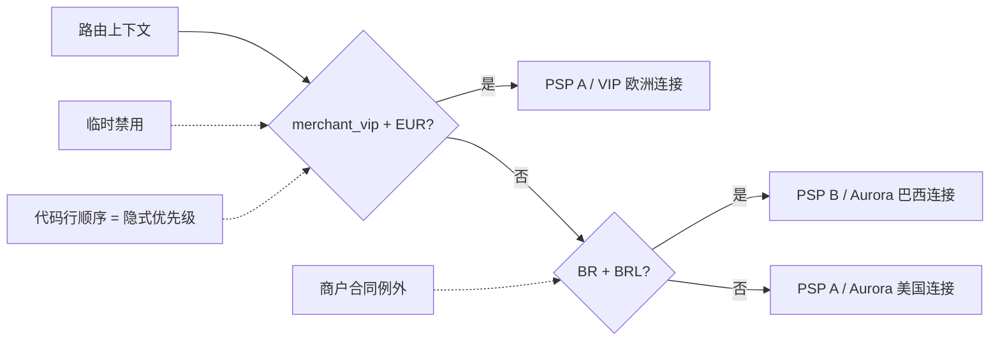
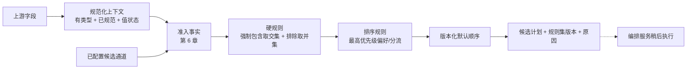
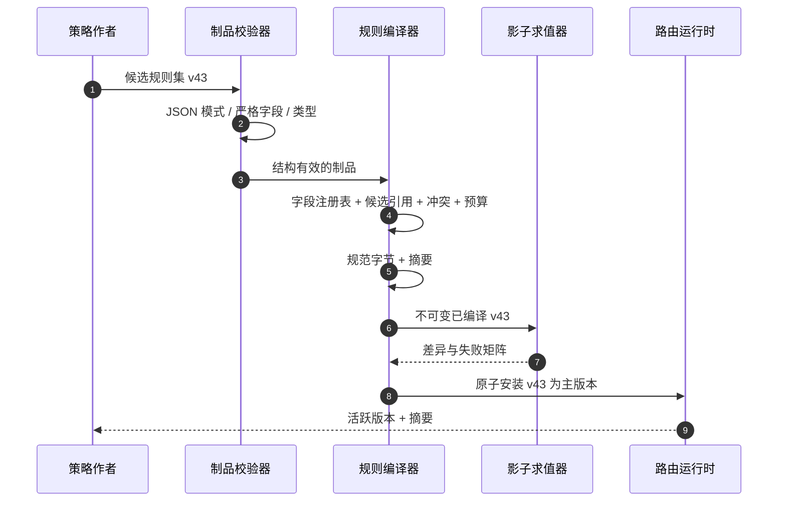
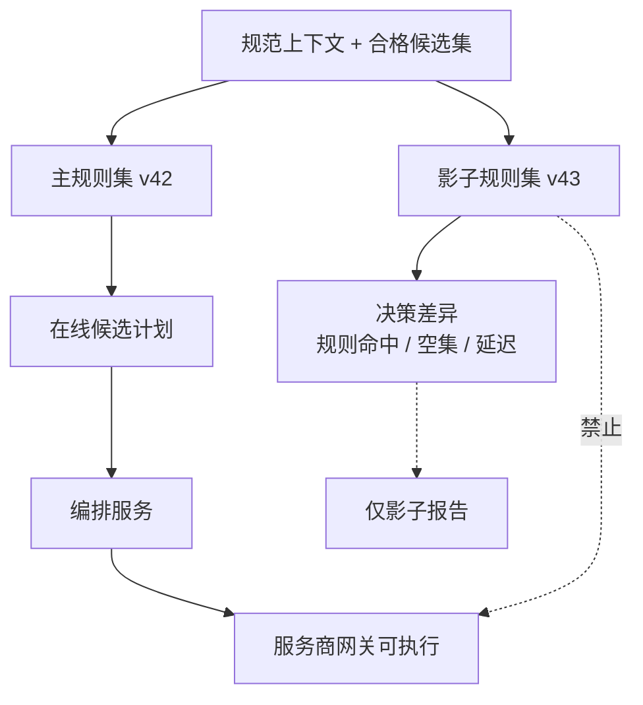

# 第 5 章 基于规则的路由

第 2 章里，Aurora 用几段 `if / else` 把巴西流量交给本地收单路径，把其他交易留给默认支付服务商。只要市场少、例外少，而且每次修改都由同一组工程师发布，这种代码简单、透明，也容易测试。

真正的拐点不是规则数量达到某个神奇阈值，而是**业务策略的变化速度开始快于路由服务代码的发布速度**。某个大商户要求 EUR 交易只走其专属账户；运营需要在 PSP 维护前排除一条连接；财务团队希望履行某个合同流量承诺。若每个要求都变成新的分支，代码顺序就会悄悄承担优先级，紧急开关会绕过评审，事后也没人能准确回答某笔支付为什么走了这条路径。

本章的核心命题是：

> **路由规则不是从代码搬到 JSON 的 `if / else`，而是一份版本化、不可变、确定性、可解释且可审计的策略制品。它只能约束或偏好候选，不能制造支付服务商能力事实，更不能执行资金副作用。**

我们会从一个完全合理的顺序分支开始，逐步引入受限条件、`exclude` / `force` / `prefer` / `split` 动作、三值逻辑、冲突语义、默认策略、规则集版本、影子求值和紧急禁用。本章不构建完整配置平台：审批、跨区域分发和组织治理留到[第 20 章](../part-5-global-routing/configuration-platform.md)。服务商连接是否真实支持某币种、操作或认证方式，是[第 6 章](provider-eligibility.md)的能力与准入问题；成本、成功率和多目标评分分别留给第 7～9 章；后备切换与完整决策存储也分别留给第 12、14 章。

## 5.1 问题：代码能运行，却无法说明策略

Aurora 最初在路由服务中加入下面的选择逻辑：

```go
package routing

func route(merchantID, country, currency string) string {
	if merchantID == "merchant_vip" && currency == "EUR" {
		return "conn_pspa_vip_eu"
	}
	if country == "BR" && currency == "BRL" {
		return "conn_pspb_aurora_br"
	}
	return "conn_pspa_aurora_us"
}
```

这段代码有明确顺序，甚至比一套通用规则语言更容易读。问题从第三个例外开始出现：`merchant_vip` 在巴西站用 BRL 支付时应该命中哪条？如果 PSP A 的欧洲连接紧急停用，第一段还应不应该返回它？某个开发者把巴西分支移到文件顶部，究竟是在重构，还是在改变生产流量？



这里缺失的不是“动态配置”四个字，而是一个正式策略契约：条件引用哪些规范字段，缺失值如何处理，多条规则命中时怎样合并，哪些动作是硬约束，结果如何解释，以及所有路由服务实例究竟使用哪一版。

## 5.2 简单设计：有顺序的分支仍是好起点

过早抽象规则语言也有代价。两条稳定策略若半年才改一次，保留 Go 分支可以获得编译器、代码评审、单元测试和普通发布流程的全部保护。它不需要新的解析器、制品模式、配置发布或运行时诊断。

简单设计真正值得继承的是三点：

1. 输入字段有明确类型，而不是任意 `map[string]any`；
2. 求值顺序明确，相同输入不会随机选择；
3. 默认路径写在代码里，读者能看到没有分支命中时会发生什么。

规则引擎的目标不是抛弃这些性质，而是让它们在策略独立发布后仍然成立。如果新的设计允许运营上传一段脚本、在求值时访问网络、读取 `time.Now()` 或遍历无序映射，那么它只是把原来的可见复杂度换成了更难复现的复杂度。

## 5.3 规模化问题：声明式规则也会失控

### 5.3.1 多条规则命中后，谁覆盖谁

假设团队把两个分支改写成规则：

```text
R1: merchant_id = merchant_vip        → prefer conn_pspa_vip_eu
R2: country = BR AND currency = BRL   → prefer conn_pspb_aurora_br
```

一笔同时满足 R1、R2 的交易会产生两个相反偏好。若求值器采用“文件中最后一条获胜”，规则文件排序就变成隐藏 API；若采用“条件更具体者获胜”，团队还要定义两个等值条件与一个范围条件谁更具体。没有显式优先级和冲突协议，声明式配置并不比 `if / else` 更安全。

### 5.3.2 缺失不是空字符串，未知也不是假

一条规则可能写成：

```text
issuer_country != "US" → prefer conn_pspa_eu
```

如果 `issuer_country` 因 BIN/IIN 元数据暂时不可用而缺失，许多普通表达式引擎会让空字符串满足 `!= "US"`，于是“系统不知道发卡国家”被误解释成“发卡国家确定不是美国”。同样，过期字段、上游查询失败和业务上确实不存在该字段，代表的事实也不同。

因此，条件不能只有布尔结果。上下文至少要区分：

| 值状态 | 含义 | `equals("US")` | `not equals("US")` | 默认处置 |
| --- | --- | ---: | ---: | --- |
| 已知 | 字段存在且通过校验 | 真或假 | 与相等判断相反 | 正常求值 |
| 缺失 | 当前模式 / 场景没有提供该字段 | 未知 | 未知 | 规则不命中，记录原因 |
| 未知 | 理应有值，但来源失败、过期或可信度不足 | 未知 | 未知 | 不把未知升级成肯定事实 |

三值逻辑最重要的一条是：`NOT Unknown` 仍然是 `Unknown`，不是 `True`。如果未来允许 `is_missing` / `is_unknown`，必须另行定义动作边界；当前抽象语法树不开放这些运算符。表中的缺失用于解释一般模型，v2 线格式中省略必需字段会先被结构校验拒绝，不会带着一个空字符串进入规则引擎；合法的显式未知则保留到条件结果中。

### 5.3.3 同一份规则可能在不同实例得到不同结果

Go 语言规范明确说明，映射的遍历顺序未定义，也不保证两次遍历相同。如果求值器把规则或候选通道放进映射后取“第一个”，同一规则集在两个进程上可能选择不同连接。[Go 语言规范：遍历映射](https://go.dev/ref/spec#For_statements)

其他常见非确定性来源还包括：在求值过程中读取当前时间；用随机数处理同优先级；把数据库返回顺序当作优先级；使用依赖地区设置的字符串比较；让调用方指定“想用的规则版本”；或在一半请求完成时原地修改共享规则集。

这些错误不一定立刻失败。它们更可能表现为少量难以重现的流量漂移：日志显示相同上下文与版本，结果却不同。对于需要解释单笔支付的系统，这种差异本身就是缺陷。

### 5.3.4 规则不能宣布一条连接“有能力”

运营可能希望写：

```text
BRL → include conn_pspa_us
```

但一条策略不能证明 `conn_pspa_us` 的商户账户支持 BRL、本地收单、所需请款方式或这张令牌。能力是连接器、合同与支付服务商事实；规则只是业务意图。若 `include` 能把不合格候选通道加回集合，任何紧急规则都可能绕过合规与技术边界。

所以本章把规则引擎的输入定义为“已经由准入筛选给出的候选集”，把输出定义为这个集合的子集与顺序。第 6 章解释与规则一同交付的能力目录和三值准入筛选；前章的 v1 启用状态、币种、支付方式、操作过滤只是演进起点，不能被描述成完整能力事实系统。

## 5.4 生产级设计：把策略编译成不可变制品

生产链路可以分成五步：规范化输入、获得合格候选集、执行硬策略、应用偏好、落到显式默认顺序。



图中的规则引擎到路由决策为止。它不创建支付尝试，不调用服务商网关，也不处理服务商超时。输出的候选顺序只描述当前决策的偏好，不是按顺序自动尝试所有连接的后备切换许可。尤其是已有资金操作进入 `UNKNOWN` 后，新的紧急规则不能改变原 `provider_connection_id`；是否创建新支付尝试是第 12 章的后备切换语义。

### 5.4.1 使用受限规则模型，不执行任意脚本

一个最小规则集可以由下面的对象组成：

| 对象 | 关键字段 | 不变量 |
| --- | --- | --- |
| `RuleSet` | 模式版本、规则集版本、摘要、生效时间、规则、默认顺序 | 已发布版本不可变；版本与摘要一一对应 |
| `Rule` | 稳定 ID、所有者、优先级、条件、动作、原因码 | ID 唯一；较大优先级先处理；不访问外部系统 |
| `Condition` | 规范字段、运算符、有类型操作数 | 只引用字段注册表；类型和运算符兼容 |
| `Action` | `exclude`、`force`、`prefer`、`split`，以及候选 ID / 权重 | 只收缩或重排合格候选集；不产生外部副作用 |
| `RuleHit` | 规则 ID、真值、动作、受影响候选、原因码 | 足以解释命中、未命中或未知 |

条件语言应刻意受限。本章实现只有字符串等值 `eq`、集合包含 `in`、整数闭区间 `range` 与合取 `all`；它们保留未知，不提供把未知事实变成真值的隐式默认。更丰富的缺失检查或否定操作需要另行定义语义。本例的 `Not` 只用于解释三值真值表，不代表当前抽象语法树已开放这个运算符。

`force [X]` 表示“新决策只允许 X”，不是“强制执行 X”：它仍与合格候选集取交集，X 不可用就返回无候选。`split` 则按固定权重在允许集合中稳定分配，不调用随机数。策略分流与实验不同：第 16 章还要增加业务单元、分配/曝光、指标和停止规则；一个配置了 75/25 的规则不能自行宣称获得了可归因实验。

### 5.4.2 规范输入先于规则求值

规则不应自己把 `brl` 转成 `BRL`，也不应猜测 `52000` 是分还是元。上一章定义的上下文构建器负责金额单位、币种、国家码、枚举和字段来源；规则引擎只消费规范字段 ID 与有类型的值。这样，条件 `base.currency == "BRL"` 才在所有实例上具有相同含义。字段注册表也不提供支付方式令牌、PAN、CVV/SAD 或服务商秘密；规则制品既不能引用这些字段，也不能把它们写进操作数、原因或影子报告。[PCI SSC FAQ 1280](https://www.pcisecuritystandards.org/faqs/1280/)

下面的 Go 类型展示三值条件的最小语义：

```go
package rules

type ValueState uint8

const (
	ValueMissing ValueState = iota
	ValueUnknown
	ValueKnown
)

type Truth uint8

const (
	False Truth = iota
	True
	Unknown
)

type StringValue struct {
	State ValueState
	Value string
}

func Equal(actual StringValue, expected string) Truth {
	if actual.State != ValueKnown {
		return Unknown
	}
	if actual.Value == expected {
		return True
	}
	return False
}

func Not(value Truth) Truth {
	switch value {
	case True:
		return False
	case False:
		return True
	default:
		return Unknown
	}
}

func All(values ...Truth) Truth {
	result := True
	for _, value := range values {
		if value == False {
			return False
		}
		if value == Unknown {
			result = Unknown
		}
	}
	return result
}
```

规则只有在条件结果为 `True` 时命中。`False` 表示已知事实不满足；`Unknown` 表示系统缺少足够事实，求值结果必须留下 `RULE_INPUT_UNKNOWN` 之类的稳定原因码。把二者分开，才能判断一条规则没有命中是正常业务分支，还是上游数据质量正在退化。

### 5.4.3 硬动作先收缩，偏好只能重排

四个动作的语义必须精确：

| 动作 | 集合语义 | 能否恢复被准入筛选排除的候选通道 | 典型用途 |
| --- | --- | ---: | --- |
| `force [A]` | 最高优先级命中的强制包含动作将允许集合与 `{A}` 取交集 | 不能 | 仅允许一条明确签约路径 |
| `exclude [C]` | 从当前允许集合删除 C；多个排除动作取并集 | 不能 | 法务限制、商户禁用、紧急停止新流量 |
| `prefer [B,A]` | 只重排仍允许的候选通道 | 不能 | 表达稳定商业偏好 |
| `split {A:7500,B:2500}` | 限定在仍允许的权重成员中稳定分桶，权重重新归一 | 不能 | 确定性合同/策略分配，不自动构成实验 |

所有命中的排除动作形成并集，然后应用最高优先级命中的强制包含动作；任何偏好都不能把候选通道加回去。若硬规则把集合缩成空集，记录 `no_candidate_after_rules` 并返回无候选，不回退到隐藏默认支付服务商。若存在多个强制包含动作，优先级是显式覆盖语义；同优先级且可能同时命中的互斥目标在编译时拒绝。

偏好在硬集合确定后执行。规则按 `priority DESC, rule_id ASC` 形成稳定序列，但仅采用最高优先级命中的一个偏好/分流排序动作，低优先级动作不拼接覆盖它。偏好动作提前排列仍允许的目标，再追加默认顺序的剩余项；分流动作先删去不在权重成员中的连接，再按 `(rule_set.version,rule_id,payment_id)` 的 SHA-256 稳定分桶，剩余权重总和为零就拒绝。同一笔支付只在相同制品和有效集合下承诺相同分配；已经存在的支付尝试不会因再次分桶而改变路径。

下面的 Go 片段演示确定排序与默认补全。真实增量还需要硬集合、三值条件和冲突诊断，但不会依赖映射遍历选择胜者：

```go
package rules

import "sort"

type PreferRule struct {
	ID         string
	Priority   int
	Candidates []string
}

func StablePreference(hits []PreferRule, allowed map[string]bool, defaults []string) []string {
	orderedRules := append([]PreferRule(nil), hits...)
	sort.Slice(orderedRules, func(i, j int) bool {
		if orderedRules[i].Priority != orderedRules[j].Priority {
			return orderedRules[i].Priority > orderedRules[j].Priority
		}
		return orderedRules[i].ID < orderedRules[j].ID
	})

	seen := make(map[string]bool, len(allowed))
	result := make([]string, 0, len(allowed))
	appendCandidate := func(candidateID string) {
		if allowed[candidateID] && !seen[candidateID] {
			seen[candidateID] = true
			result = append(result, candidateID)
		}
	}

	if len(orderedRules) > 0 {
		for _, candidateID := range orderedRules[0].Candidates {
			appendCandidate(candidateID)
		}
	}
	for _, candidateID := range defaults {
		appendCandidate(candidateID)
	}
	return result
}
```

### 5.4.4 优先级不能代替冲突检查

优先级解决的是有意的覆盖顺序，不应该成为清理错误配置的垃圾桶。制品在启用前至少要拒绝以下语义冲突：

- 两条可能同时命中、同优先级的 `prefer` 对同一对候选通道给出相反顺序；
- 同优先级且作用域重叠的两条强制包含动作指向不同目标，或强制包含目标不在同时命中的分流成员中；
- 同优先级且可能同时命中的两条分流，即使权重一样也因规则 ID 参与哈希而有不同分桶语义；
- 动作引用不存在或已退役的候选通道 ID；
- 条件引用未知字段、类型错误或不可比较的范围；
- 默认顺序缺少可能保留下来的候选通道，或包含重复 ID；
- 两个不同制品声称同一 `version`，但规范摘要不同。

受限的相等、集合和范围抽象语法树可以做相当多的静态重叠检查，但不必假装所有条件交集都能被完整证明。无法静态判定的组合可以进入离线测试矩阵和影子求值；运行时若仍检测到不允许的冲突，应返回显式错误和规则 ID，而不是用文件顺序消解。

### 5.4.5 默认策略必须属于版本，而不是藏在代码里

没有规则命中是一条正常路径。规则集应包含显式 `default_candidate_order`，或者引用同一发布包中的静态策略版本。路由决策记录 `DEFAULT_POLICY_APPLIED`，并仍然只在合格候选集内补全顺序。

默认策略解决的是“没有业务例外时偏好谁”，不是“所有信息都坏了时随便找一家”。若规范上下文无效、关键准入事实未知，或硬规则得到空集，路由服务应返回相应失败或降级结果；它不能用默认值掩盖上游事实缺失。

### 5.4.6 已发布规则集是不可变事实

规则制品先经过结构校验，再经过语义编译：



JSON Schema 可以约束必填字段、类型、枚举和额外字段，但跨规则冲突、候选引用和优先级关系仍需要领域校验器。[JSON Schema 2020-12 草案](https://json-schema.org/draft/2020-12) 若摘要用于签名或跨实现比对，就必须定义规范表示；RFC 8785 给出了 JSON 规范化方案，核心目的正是让哈希和签名面对不变的序列化形式。[RFC 8785](https://www.rfc-editor.org/rfc/rfc8785.html)

JCS 会规范对象属性顺序，却不会改写数组的业务顺序。因此编译器还要先规范化语义上无序的集合：规则按稳定 ID 排列，`AND` 条件与集合操作数按规范值排列；`prefer` 目标和 `default_candidate_order` 的先后具有业务含义，必须保留。只有这一步完成后再计算 JCS 摘要，才能同时做到“交换规则文件位置不改版本事实”和“不小心重排偏好会改变摘要”。

发布 `v43` 不是修改内存里的 `v42`。运行时完整校验新快照后，以原子指针切换；正在执行的一次求值始终看到一个完整版本。回滚是重新激活已验证的旧制品，并产生新的激活审计事件，而不是把旧文件内容原地改掉。审批、签名、灰度、跨区域确认与长期存储在第 20 章展开，本章只固定运行时必须看到不可变的版本与摘要。

求值时间也必须是显式输入。若规则有 `effective_from` / `effective_until`，一次决策使用编排服务提供并记录的决策时间，而不是在不同条件中多次调用 `time.Now()`。这样重放时才能得到同样的有效规则集合。

### 5.4.7 影子求值只能观察，不能执行

候选规则集在成为主版本之前，可以对同一规范上下文与同一合格候选集做影子求值：



影子结果可以统计选路差异、空集合比例、未知输入与求值延迟，但不能创建支付尝试、服务商资金操作或后备切换，也不能把“如果选择 B”写成真实资金事实。第 14 章会设计完整决策记录，第 16 章会处理受控实验；本章只要求影子求值器纯函数化，并让测试能证明服务商网关调用次数没有变化。

### 5.4.8 原因码是 API，不是日志文案

一次可解释的规则求值至少应输出：

```text
rule_set_version: rules_v43
rule_set_digest:  sha256:...
matched_rules:    [merchant_vip_eur, emergency_exclude_conn_c]
unknown_rules:    [issuer_country_preference]
allowed:          [conn_a, conn_b]
candidate_order:  [conn_b, conn_a]
reason_codes:     [POLICY_INCLUDED, POLICY_EXCLUDED, POLICY_PREFERRED]
default_applied:  false
```

稳定代码用于测试、聚合和审计；详情可以面向人解释，但不能成为下游程序的唯一判断依据。规则 ID、版本、受影响候选通道和条件真值同样重要。完整保存位置与保留策略留给决策存储，本章先保证求值器能产生这些证据。

### 5.4.9 紧急禁用仍然是一条受控策略变更

“马上停止把新支付送往 `conn_c`”是合理需求，但不能实现成某台实例内存里的布尔开关。最小安全做法是生成一条高优先级 `exclude [conn_c]` 规则，经过严格校验、版本化和原子启用，并返回 `EMERGENCY_CANDIDATE_EXCLUDED` 原因码。事后可以缩短审批链路，但不能省略操作者、原因、版本和回滚目标。

紧急规则只影响**尚未做出决策的新支付尝试**。它不能把已经选中 `conn_c`、尤其处于 `UNKNOWN` 的资金操作移到别处；请款、撤销、退款也继续绑定原连接与服务商交易引用。若禁用来源是服务商技术故障，动态健康与断路器的长期模型属于第 13 章；若来源是能力、合同或凭证失效，第 6 章的准入事实也必须更新。规则不是所有禁用原因的真相来源。

## 5.5 故障模式：规则系统如何悄悄破坏支付边界

### 调用方可以在请求里带规则或版本

如果支付服务能提交临时规则、候选顺序或 `rule_set_version`，它就能绕过路由控制面，重试请求也可能选择另一个版本。路由服务的 HTTP 解码器应拒绝未知字段；策略只能由已验证运行时快照提供。当前配套路由服务已有“调用方提交的策略被严格解码器拒绝”的测试，这条边界应在引入规则集后继续保留。

### 用映射或数据库返回顺序解决同分

这会让重启、编译器变化或数据布局影响支付路径。规则、动作目标、默认候选通道与原因输出都要在明确维度上排序；任何映射只用于查找，不能提供业务顺序。

### `prefer` 被实现成 `force`

某候选通道被能力或硬策略排除后，偏好不得把它复活。接口最好接收合格候选集并返回其子集排列，让类型和测试同时约束这个不变量，而不是让每个调用者记住“先过滤后评分”。

### 未知被当成条件不等式成立

缺失的发卡行国家、过期商户国家或失败的派生字段若命中 `!=`，会把数据质量故障变成流量变化。三值逻辑、字段级缺失策略和 `RULE_INPUT_UNKNOWN` 指标必须一起存在。

### 修改已发布制品而不改版本

这会让历史 `rules_v42` 无法重放，也会让实例报告同一版本却执行不同内容。运行时必须验证版本与摘要；相同版本不同摘要直接拒绝并告警。

### 影子求值共享了执行回调

若求值器接口可以直接调用服务商网关，影子求值一次就可能产生第二条资金路径。规则引擎应返回纯数据计划，唯一允许执行服务商资金操作的仍是编排服务；影子消费者没有执行权限和凭证。

### 紧急禁用覆盖已有资金身份

规则集只决定新支付尝试的候选。若恢复任务每次查询前重新求值，紧急排除可能让 `UNKNOWN` 资金操作无法查询原支付服务商，或者错误改走新连接。恢复链路必须读取持久化 `provider_connection_id`，不读取当前规则集。

## 5.6 测试矩阵：不仅证明某条规则会命中

生产规则引擎的测试对象是语义，而不是解析器覆盖率：

| 测试层 | 关键案例 | 必须证明的性质 |
| --- | --- | --- |
| 模式 | 未知字段、错误类型、重复 ID、非法运算符 | 制品在启用前失败，错误定位稳定 |
| 语义校验 | 同优先级冲突、无效候选通道、默认项缺失 | 冲突不能靠文件顺序解决 |
| 真值表 | 已知 / 未知与 eq/in/range/all；教学用 Not 真值表 | 未知不被提升为真；未开放运算符直接拒绝 |
| 确定性 | 打乱规则、候选、映射插入顺序并重复运行 | 计划、命中、原因与摘要稳定 |
| 硬约束先于偏好 | 高优先级偏好动作指向已排除候选 | 候选通道不被复活 |
| 默认策略 | 无规则命中、硬规则得到空集 | 前者显式默认，后者显式失败 |
| 版本 | 整版编译与稳定摘要；跨发布版本登记、回滚见第 20 章 | 每次求值只看到一个完整版本，不假称本地编译器有历史版本库 |
| 影子求值 | 主版本与影子版本结果不同 | 在线计划不变、服务商网关调用仍只有一次 |
| 紧急规则 | 新决策排除连接，已有 `UNKNOWN` 继续恢复 | 禁用不改写原支付尝试/资金操作 |
| API 边界 | 调用方注入规则、版本或令牌 | 严格解码器拒绝，不进入求值器 |

一个可证伪的验收场景是：构造两条同优先级、作用域重叠且偏好顺序相反的规则，制品必须在安装前失败；把文件中两条规则交换位置，失败类型和冲突规则 ID 不变。修复优先级后，对同一规范上下文重复求值一千次并随机打乱候选输入，路由决策必须始终选择同一个 `candidate_id`、输出同一规则命中顺序与规则集摘要。

第二个验收场景针对安全边界：合格候选集只有 `conn_b`，高优先级规则却 `force [conn_a]` 或 `prefer [conn_a]`。前者无候选，后者仍选择 `conn_b`，绝不能把 `conn_a` 发送给服务商网关。分流动作也必须先移除不合格成员；比例不能成为准入豁免。这个测试为下一章的完整准入筛选留下不可突破的接口。

## 5.7 权衡：把策略当代码会增加什么成本

**表达能力与可验证性。** 任意脚本最灵活，却难以做静态冲突检查、复杂度预算和跨语言重放；受限抽象语法树会让某些策略需要多条规则或产品改模。支付在线路径通常更值得选择可预测性，真正无法表达的需求应推动规则模型有版本地演进，而不是开放逃生脚本。

**严格冲突与运营速度。** 拒绝模糊制品可能让紧急变更慢几分钟，但静默挑一个胜者会把错误直接放大成资金流量。可以为紧急 `exclude` 设计较短的审批与验证路径，却不应取消模式、语义检查和审计身份。

**全量重叠分析与保守诊断。** 对受限等值/集合条件，静态交集容易证明；复杂范围与多维组合会迅速昂贵。实用方案是对可证明冲突强制拒绝，对不确定重叠发出诊断并要求测试矩阵、历史回放和影子证据，不宣称校验器能解决所有逻辑问题。

**规则集粒度。** 每个商户一套独立制品容易隔离，却会产生版本爆炸和缓存压力；全平台一套规则便于分发，却让影响面和冲突扩大。可以采用平台基线加受限商户覆盖层，但合并顺序本身必须版本化，不能在实例上临时拼接。

**即时生效与可重放。** 直接读取最新数据库行看似实时，却无法证明某次决策看见了什么；不可变快照和原子切换会引入发布延迟，却换来确定性、回滚和审计。对于紧急变更，应优化制品生成和传播延迟，而不是让在线求值回到无版本数据库查询。

## 5.8 配套 Go 系统的当前边界与本章增量

本章的[固定实现](https://github.com/YouEclipse/payments/tree/bc4afde24da708d22f67da72a90a1557b1477173/services/router/internal/rules)位于 `internal/rules`，由 `internal/decision` 接入 v2 流水线。原 `internal/routing` 的静态 v1 仍保留，不通过升级静默改变旧端点。线上服务只接收上下文，不接收调用方临时提交的规则、候选列表或版本选择。

`Compile` 对 `routing_rules.v1` 执行严格结构和语义校验：仅四种条件、四种动作；完整默认清单；唯一规则 ID；有效时间区间；引用存在；复杂度有界；可重叠的同优先级强制包含/排序冲突在启用前拒绝。它复制输入、规范化无序集合并计算完整摘要，求值时不读取网络或当前时钟。相同上下文、合格候选集和制品会产生相同计划与证据。

v2 路由决策记录 `rule_set_version`、`rule_set_digest`、规则命中、准入结果与排除原因。`force`、`exclude`、`prefer`、`split` 都有不能复活不合格连接的回归测试；同权重分流也不能因规则 ID 改变分桶种子而被误判为等价。无候选保留证据返回 `422`，支付服务不创建资金路径。规则只处理新决策，原资金操作的查询/恢复不再次求值。

本次尚未交付历史版本注册库、热更新、审批、跨区域确认或线上影子调度。纯函数可用于离线比较，但这不等于已有实验平台；版本与摘要能识别内容，不能独自阻止另一次部署重用同一版本。这些治理约束在第 20 章落地，实验归第 16 章。资金端仍仅支持令牌化银行卡自动请款 `SALE`，模拟器不代表真实 PSP 沙箱或真钱支付。

## 5.9 小结：规则把业务意图变成可验证事实

我们从三个顺序明确的 Go 分支出发。它们在早期合理，但随着商户例外、地区策略与紧急禁用增加，代码行顺序开始偷偷承担优先级，缺失字段被误当成业务值，策略版本也无法独立审计。

生产规则引擎不是一台执行任意脚本的机器。它消费规范、有类型且区分缺失与未知的上下文，在合格候选集上执行不可变规则集。强制包含取交集，排除动作单调删除，偏好动作只重排，分流动作只在允许的权重成员内稳定分配；任何动作都不能复活不合格连接，更不能创建支付尝试、调用支付服务商或改变已有资金身份。

确定性来自显式语义：规则按优先级和稳定 ID 排序，冲突在启用前被拒绝，默认顺序属于版本，求值时间是输入，版本与规范摘要一起标识制品。影子求值只能比较，紧急禁用也必须产生新版本与原因码。相同上下文、合格候选集、决策时间和规则集，必须得到同一计划与解释。

下一章会补上本章刻意不回答的问题：候选通道为什么有资格进入输入集合？只有当支付服务商、商户账户、连接器与区域的能力、合同和有效期被建模为三值准入事实后，规则偏好才真正有一条不可越过的硬边界。

## 延伸阅读

- [Go 语言规范：映射遍历顺序](https://go.dev/ref/spec#For_statements)
- [JSON Schema 2020-12 草案](https://json-schema.org/draft/2020-12)
- [RFC 8785：JSON 规范化方案](https://www.rfc-editor.org/rfc/rfc8785.html)
- [PCI SSC FAQ 1280：卡验证码存储](https://www.pcisecuritystandards.org/faqs/1280/)
- [第 4 章：构建路由上下文](routing-context.md)
- [第 6 章：服务商准入筛选](provider-eligibility.md)
- [第 9 章：服务商评分与风险感知路由](provider-scoring.md)
- [第 12 章：后备路由](../part-3-reliability/fallback-routing.md)
- [第 14 章：路由决策存储](../part-4-operating-at-scale/routing-decision-store.md)
- [第 20 章：路由配置平台](../part-5-global-routing/configuration-platform.md)
