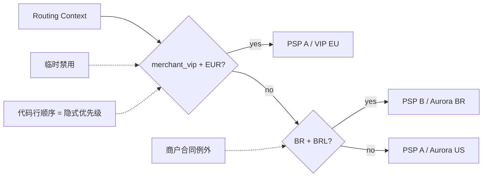
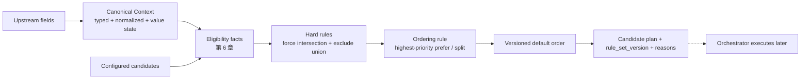
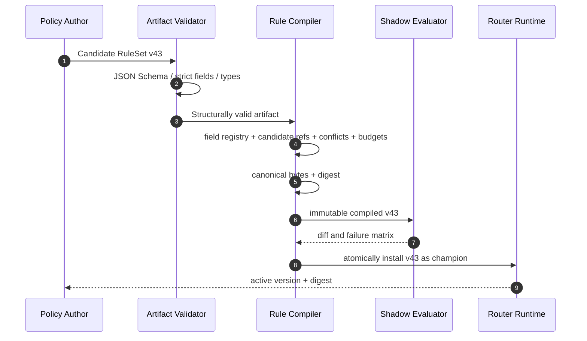
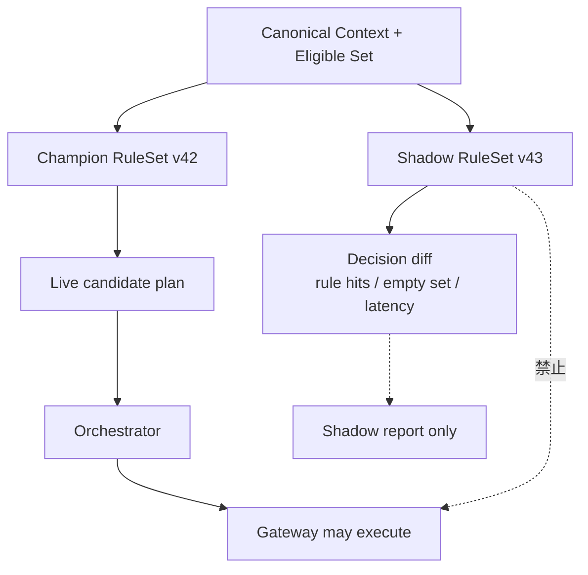

# 第 5 章 Rule-Based Routing

第 2 章里，Aurora 用几段 `if / else` 把巴西流量交给本地收单路径，把其他交易留给默认 Provider。只要市场少、例外少，而且每次修改都由同一组工程师发布，这种代码简单、透明，也容易测试。

真正的拐点不是规则数量达到某个神奇阈值，而是**业务策略的变化速度开始快于 Router 代码的发布速度**。某个大商户要求 EUR 交易只走其专属账户；运营需要在 PSP 维护前排除一条连接；财务团队希望履行某个合同流量承诺。若每个要求都变成新的分支，代码顺序就会悄悄承担优先级，紧急开关会绕过评审，事后也没人能准确回答某笔支付为什么走了这条路径。

本章的核心命题是：

> **Routing Rule 不是从代码搬到 JSON 的 `if / else`，而是一份版本化、不可变、确定性、可解释且可审计的 Policy artifact。它只能约束或偏好候选，不能制造 Provider 能力事实，更不能执行资金副作用。**

我们会从一个完全合理的顺序分支开始，逐步引入受限的 Condition、`exclude` / `force` / `prefer` / `split` Action、三值逻辑、冲突语义、默认策略、Rule Set 版本、shadow evaluation 和紧急禁用。本章不构建完整配置平台：审批、跨 Region 分发和组织治理留到[第 20 章](../part-5-global-routing/configuration-platform.md)。Provider connection 是否真实支持某币种、操作或认证方式，是[第 6 章](provider-eligibility.md)的 Capability / Eligibility 问题；成本、成功率和多目标评分分别留给第 7～9 章；Fallback 与完整 Decision Store 也分别留给第 12、14 章。

## 5.1 Problem：代码能运行，却无法说明 Policy

Aurora 最初在 Router 中加入下面的选择逻辑：

```go
package routing

func route(merchantID, country, currency string) string {
	if merchantID == "merchant_vip" && currency == "EUR" {
		return "conn_pspa_vip_eu"
	}
	if country == "BR" && currency == "BRL" {
		return "conn_pspb_aurora_br"
	}
	return "conn_pspa_aurora_us"
}
```

这段代码有明确顺序，甚至比一套通用规则语言更容易读。问题从第三个例外开始出现：`merchant_vip` 在巴西站用 BRL 支付时应该命中哪条？如果 PSP A 的欧洲连接紧急停用，第一段还应不应该返回它？某个开发者把巴西分支移到文件顶部，究竟是在重构，还是在改变生产流量？



这里缺失的不是“动态配置”四个字，而是一个正式 Policy 契约：条件引用哪些规范字段，缺失值如何处理，多条规则命中时怎样合并，哪些动作是硬约束，结果如何解释，以及所有 Router 实例究竟使用哪一版。

## 5.2 Simple Design：有顺序的分支仍是好起点

过早抽象规则语言也有代价。两条稳定策略若半年才改一次，保留 Go 分支可以获得编译器、代码评审、单元测试和普通发布流程的全部保护。它不需要新的 parser、artifact schema、配置发布或运行时诊断。

简单设计真正值得继承的是三点：

1. 输入字段有明确类型，而不是任意 `map[string]any`；
2. 求值顺序明确，相同输入不会随机选择；
3. 默认路径写在代码里，读者能看到没有分支命中时会发生什么。

Rule Engine 的目标不是抛弃这些性质，而是让它们在策略独立发布后仍然成立。如果新的设计允许运营上传一段脚本、在求值时访问网络、读取 `time.Now()` 或遍历无序 map，那么它只是把原来的可见复杂度换成了更难复现的复杂度。

## 5.3 Problems at Scale：声明式规则也会失控

### 5.3.1 多条规则命中后，谁覆盖谁

假设团队把两个分支改写成规则：

```text
R1: merchant_id = merchant_vip        → prefer conn_pspa_vip_eu
R2: country = BR AND currency = BRL   → prefer conn_pspb_aurora_br
```

一笔同时满足 R1、R2 的交易会产生两个相反偏好。若求值器采用“文件中最后一条获胜”，规则文件排序就变成隐藏 API；若采用“条件更具体者获胜”，团队还要定义两个等值条件与一个范围条件谁更具体。没有显式优先级和冲突协议，声明式配置并不比 `if / else` 更安全。

### 5.3.2 缺失不是空字符串，未知也不是 false

一条规则可能写成：

```text
issuer_country != "US" → prefer conn_pspa_eu
```

如果 `issuer_country` 因 BIN/IIN 元数据暂时不可用而缺失，许多普通表达式引擎会让空字符串满足 `!= "US"`，于是“系统不知道发卡国家”被误解释成“发卡国家确定不是美国”。同样，过期字段、上游查询失败和业务上确实不存在该字段，代表的事实也不同。

因此 Condition 不能只有布尔结果。Context 至少要区分：

| Value State | 含义 | `equals("US")` | `not equals("US")` | 默认处置 |
| --- | --- | ---: | ---: | --- |
| Known | 字段存在且通过校验 | 真或假 | 与 equals 相反 | 正常求值 |
| Missing | 当前 schema / 场景没有提供该字段 | Unknown | Unknown | 规则不命中，记录原因 |
| Unknown | 理应有值，但来源失败、过期或可信度不足 | Unknown | Unknown | 不把未知升级成肯定事实 |

三值逻辑最重要的一条是：`NOT Unknown` 仍然是 `Unknown`，不是 `True`。如果未来允许 `is_missing` / `is_unknown`，必须另行定义动作边界；当前 AST 不开放这些 operator。表中的 Missing 用于解释一般模型，v2 wire 中省略必需字段会先被结构校验拒绝，不会带着一个空字符串进入 Rule Engine；合法的显式 unknown 则保留到条件结果中。

### 5.3.3 同一份规则可能在不同实例得到不同结果

Go 语言规范明确说明，map 的遍历顺序未定义，也不保证两次遍历相同。如果求值器把规则或 Candidate 放进 map 后取“第一个”，同一 Rule Set 在两个进程上可能选择不同连接。[Go Language Specification：range over maps](https://go.dev/ref/spec#For_statements)

其他常见非确定性来源还包括：在求值过程中读取当前时间；用随机数处理同优先级；把数据库返回顺序当作优先级；使用 locale-sensitive 字符串比较；让调用方指定“想用的规则版本”；或在一半请求完成时原地修改共享 Rule Set。

这些错误不一定立刻失败。它们更可能表现为少量难以重现的流量漂移：日志显示相同 Context 与版本，结果却不同。对于需要解释单笔支付的系统，这种差异本身就是缺陷。

### 5.3.4 规则不能宣布一条连接“有能力”

运营可能希望写：

```text
BRL → include conn_pspa_us
```

但一条 Policy 不能证明 `conn_pspa_us` 的 Merchant Account 支持 BRL、本地收单、所需 Capture Mode 或这张 Token。能力是 Connector、合同与 Provider 事实；规则只是业务意图。若 `include` 能把不合格 Candidate 加回集合，任何紧急规则都可能绕过合规与技术边界。

所以本章把 Rule Engine 的输入定义为“已经由 Eligibility 给出的 Candidate Set”，把输出定义为这个集合的子集与顺序。第 6 章解释与规则一同交付的 Capability Catalog 和三值 Eligibility；前章的 v1 enabled、currency、payment method、operation 过滤只是演进起点，不能被描述成完整能力事实系统。

## 5.4 Production Design：把 Policy 编译成不可变 Artifact

生产链路可以分成五步：规范化输入、获得 eligible set、执行硬 Policy、应用偏好、落到显式默认顺序。



图中的 Rule Engine 到 Decision 为止。它不创建 Payment Attempt，不调用 Gateway，也不处理 Provider timeout。输出的 Candidate order 只描述当前决定的偏好，不是按顺序自动尝试所有连接的 Fallback 许可。尤其是已有 Operation 进入 `UNKNOWN` 后，新的紧急规则不能改变原 `provider_connection_id`；是否创建新 Attempt 是第 12 章的 Fallback 语义。

### 5.4.1 使用受限 Rule Model，不执行任意脚本

一个最小 Rule Set 可以由下面的对象组成：

| 对象 | 关键字段 | 不变量 |
| --- | --- | --- |
| `RuleSet` | schema version、rule set version、digest、effective time、rules、default order | 已发布版本不可变；版本与 digest 一一对应 |
| `Rule` | stable ID、owner、priority、conditions、action、reason code | ID 唯一；较大 priority 先处理；不访问外部系统 |
| `Condition` | canonical field、operator、typed operands | 只引用字段注册表；类型和 operator 兼容 |
| `Action` | `exclude`、`force`、`prefer`、`split`，以及 Candidate IDs / weights | 只收缩或重排 eligible set；不产生外部副作用 |
| `RuleHit` | rule ID、truth、action、affected candidates、reason code | 足以解释命中、未命中或 unknown |

Condition 语言应刻意受限。本章实现只有字符串等值 `eq`、集合包含 `in`、整数闭区间 `range` 与合取 `all`；它们保留 unknown，不提供把未知事实变成真值的隐式默认。更丰富的 missing 检查或否定操作需要另行定义语义。本例的 `Not` 只用于解释三值真值表，不代表当前 AST 已开放这个 operator。

`force [X]` 表示“新决定只允许 X”，不是“强制执行 X”：它仍与 eligible set 取交集，X 不可用就返回无候选。`split` 则按固定权重在允许集合中稳定分配，不调用随机数。策略分流与实验不同：第 16 章还要增加业务单元、assignment/exposure、指标和停止规则；一个配置了 75/25 的规则不能自行宣称获得了可归因实验。

### 5.4.2 Canonical Input 先于 Rule Evaluation

Rule 不应自己把 `brl` 转成 `BRL`，也不应猜测 `52000` 是分还是元。上一章定义的 Context Builder 负责金额单位、币种、国家码、枚举和字段来源；Rule Engine 只消费 canonical field ID 与 typed value。这样，条件 `base.currency == "BRL"` 才在所有实例上具有相同含义。字段注册表也不提供 payment method token、PAN、CVV/SAD 或 Provider secret；Rule Artifact 既不能引用这些字段，也不能把它们写进 operand、reason 或 shadow report。[PCI SSC FAQ 1280](https://www.pcisecuritystandards.org/faqs/1280/)

下面的 Go 类型展示三值 Condition 的最小语义：

```go
package rules

type ValueState uint8

const (
	ValueMissing ValueState = iota
	ValueUnknown
	ValueKnown
)

type Truth uint8

const (
	False Truth = iota
	True
	Unknown
)

type StringValue struct {
	State ValueState
	Value string
}

func Equal(actual StringValue, expected string) Truth {
	if actual.State != ValueKnown {
		return Unknown
	}
	if actual.Value == expected {
		return True
	}
	return False
}

func Not(value Truth) Truth {
	switch value {
	case True:
		return False
	case False:
		return True
	default:
		return Unknown
	}
}

func All(values ...Truth) Truth {
	result := True
	for _, value := range values {
		if value == False {
			return False
		}
		if value == Unknown {
			result = Unknown
		}
	}
	return result
}
```

规则只有在 Condition 结果为 `True` 时命中。`False` 表示已知事实不满足；`Unknown` 表示系统缺少足够事实，求值结果必须留下 `RULE_INPUT_UNKNOWN` 之类的稳定原因码。把二者分开，才能判断一条规则没有命中是正常业务分支，还是上游数据质量正在退化。

### 5.4.3 硬 Action 先收缩，Preference 只能重排

四个 Action 的语义必须精确：

| Action | 集合语义 | 能否恢复被 Eligibility 排除的 Candidate | 典型用途 |
| --- | --- | ---: | --- |
| `force [A]` | 最高优先级命中的 force 将允许集合与 `{A}` 取交集 | 不能 | 仅允许一条明确签约路径 |
| `exclude [C]` | 从当前允许集合删除 C；多个 exclude 取并集 | 不能 | 法务限制、商户禁用、紧急停止新流量 |
| `prefer [B,A]` | 只重排仍允许的 Candidate | 不能 | 表达稳定商业偏好 |
| `split {A:7500,B:2500}` | 限定在仍允许的权重成员中稳定分桶，权重重新归一 | 不能 | 确定性合同/策略分配，不自动构成实验 |

所有命中的 `exclude` 形成并集，然后应用最高优先级命中的 `force`；任何 preference 都不能把 Candidate 加回去。若硬规则把集合缩成空集，记录 `no_candidate_after_rules` 并返回无候选，不回退到隐藏默认 Provider。若存在多个 force，优先级是显式覆盖语义；同优先级且可能同时命中的互斥目标在编译时拒绝。

Preference 在硬集合确定后执行。规则按 `priority DESC, rule_id ASC` 形成稳定序列，但仅采用最高优先级命中的一个 prefer/split 排序动作，低优先级动作不拼接覆盖它。prefer 提前排列仍允许的目标，再追加 default order 的剩余项；split 先删去不在权重成员中的连接，再按 `(rule_set.version,rule_id,payment_id)` 的 SHA-256 稳定分桶，剩余权重总和为零就拒绝。同一个 Payment 只在相同 artifact 和有效集合下承诺相同分配；已经存在的 Attempt 不会因再次分桶而改变路径。

下面的 Go 片段演示确定排序与默认补全。真实增量还需要硬集合、三值 Condition 和冲突诊断，但不会依赖 map 遍历选 winner：

```go
package rules

import "sort"

type PreferRule struct {
	ID         string
	Priority   int
	Candidates []string
}

func StablePreference(hits []PreferRule, allowed map[string]bool, defaults []string) []string {
	orderedRules := append([]PreferRule(nil), hits...)
	sort.Slice(orderedRules, func(i, j int) bool {
		if orderedRules[i].Priority != orderedRules[j].Priority {
			return orderedRules[i].Priority > orderedRules[j].Priority
		}
		return orderedRules[i].ID < orderedRules[j].ID
	})

	seen := make(map[string]bool, len(allowed))
	result := make([]string, 0, len(allowed))
	appendCandidate := func(candidateID string) {
		if allowed[candidateID] && !seen[candidateID] {
			seen[candidateID] = true
			result = append(result, candidateID)
		}
	}

	if len(orderedRules) > 0 {
		for _, candidateID := range orderedRules[0].Candidates {
			appendCandidate(candidateID)
		}
	}
	for _, candidateID := range defaults {
		appendCandidate(candidateID)
	}
	return result
}
```

### 5.4.4 Priority 不能代替冲突检查

Priority 解决的是有意的覆盖顺序，不应该成为清理错误配置的垃圾桶。Artifact 在启用前至少要拒绝以下语义冲突：

- 两条可能同时命中、同优先级的 `prefer` 对同一对 Candidate 给出相反顺序；
- 同优先级且作用域重叠的两条 force 指向不同目标，或 force 目标不在同时命中的 split 成员中；
- 同优先级且可能同时命中的两条 split，即使权重一样也因 rule ID 参与 hash 而有不同分桶语义；
- Action 引用不存在或已退役的 Candidate ID；
- Condition 引用未知字段、类型错误或不可比较的范围；
- 默认顺序缺少可能保留下来的 Candidate，或包含重复 ID；
- 两个不同 Artifact 声称同一 `version`，但 canonical digest 不同。

受限的 equals、set 和 range AST 可以做相当多的静态重叠检查，但不必假装所有条件交集都能被完整证明。无法静态判定的组合可以进入离线测试矩阵和 shadow evaluation；运行时若仍检测到不允许的冲突，应返回显式错误和 Rule IDs，而不是用文件顺序消解。

### 5.4.5 Default Policy 必须属于版本，而不是藏在代码里

没有规则命中是一条正常路径。Rule Set 应包含显式 `default_candidate_order`，或者引用同一发布包中的静态 Policy 版本。Decision 记录 `DEFAULT_POLICY_APPLIED`，并仍然只在 eligible set 内补全顺序。

默认策略解决的是“没有业务例外时偏好谁”，不是“所有信息都坏了时随便找一家”。若 canonical Context 无效、关键 Eligibility 为 unknown，或硬规则得到空集，Router 应返回相应失败或降级结果；它不能用 default 掩盖上游事实缺失。

### 5.4.6 已发布 Rule Set 是不可变事实

Rule Artifact 先经过结构校验，再经过语义编译：



JSON Schema 可以约束 required field、类型、枚举和额外字段，但跨规则冲突、Candidate 引用和优先级关系仍需要领域 validator。[JSON Schema Draft 2020-12](https://json-schema.org/draft/2020-12) 若 digest 用于签名或跨实现比对，就必须定义 canonical representation；RFC 8785 给出了 JSON Canonicalization Scheme，核心目的正是让哈希和签名面对不变的序列化形式。[RFC 8785](https://www.rfc-editor.org/rfc/rfc8785.html)

JCS 会规范对象属性顺序，却不会改写数组的业务顺序。因此 Compiler 还要先规范化语义上无序的集合：Rules 按 stable ID 排列，AND Conditions 与 set operands 按 canonical value 排列；`prefer` 目标和 `default_candidate_order` 的先后具有业务含义，必须保留。只有这一步完成后再计算 JCS digest，才能同时做到“交换规则文件位置不改版本事实”和“不小心重排偏好会改变 digest”。

发布 `v43` 不是修改内存里的 `v42`。Runtime 完整校验新快照后，以原子指针切换；正在执行的一次求值始终看到一个完整版本。回滚是重新激活已验证的旧 Artifact，并产生新的激活审计事件，而不是把旧文件内容原地改掉。审批、签名、灰度、跨 Region ACK 与长期存储在第 20 章展开，本章只固定 Runtime 必须看到不可变的 version + digest。

Evaluation time 也必须是显式输入。若规则有 `effective_from` / `effective_until`，一次决定使用 Orchestrator 提供并记录的 decision time，而不是在不同 Condition 中多次调用 `time.Now()`。这样重放时才能得到同样的有效规则集合。

### 5.4.7 Shadow Evaluation 只能观察，不能执行

候选 Rule Set 在成为 champion 之前，可以对同一 canonical Context 与同一 eligible set 做 shadow evaluation：



Shadow 结果可以统计选路差异、空集合比例、unknown 输入与求值延迟，但不能创建 Attempt、Provider Operation 或 Fallback，也不能把“如果选择 B”写成真实资金事实。第 14 章会设计完整 Decision Record，第 16 章会处理受控实验；本章只要求 shadow evaluator 纯函数化，并让测试能证明 Gateway 调用次数没有变化。

### 5.4.8 Reason Code 是 API，不是日志文案

一个可解释的 Rule Evaluation 至少应输出：

```text
rule_set_version: rules_v43
rule_set_digest:  sha256:...
matched_rules:    [merchant_vip_eur, emergency_exclude_conn_c]
unknown_rules:    [issuer_country_preference]
allowed:          [conn_a, conn_b]
candidate_order:  [conn_b, conn_a]
reason_codes:     [POLICY_INCLUDED, POLICY_EXCLUDED, POLICY_PREFERRED]
default_applied:  false
```

稳定 code 用于测试、聚合和审计；Detail 可以面向人解释，但不能成为下游程序的唯一判断依据。Rule ID、版本、受影响 Candidate 和 Condition truth 同样重要。完整保存位置与保留策略留给 Decision Store，本章先保证 evaluator 能产生这些证据。

### 5.4.9 紧急禁用仍然是一条受控 Policy 变更

“马上停止把新支付送往 `conn_c`”是合理需求，但不能实现成某台实例内存里的布尔开关。最小安全做法是生成一条高优先级 `exclude [conn_c]` 规则，经过严格校验、版本化和原子启用，并返回 `EMERGENCY_CANDIDATE_EXCLUDED` 原因码。事后可以缩短审批链路，但不能省略操作者、原因、版本和回滚目标。

紧急规则只影响**尚未做出决定的新 Attempt**。它不能把已经选中 `conn_c`、尤其处于 `UNKNOWN` 的 Operation 移到别处；Capture、Void、Refund 也继续绑定原 connection 与 Provider transaction reference。若禁用来源是 Provider 技术故障，动态 Health 与 Circuit Breaker 的长期模型属于第 13 章；若来源是能力、合同或凭证失效，第 6 章的 Eligibility 事实也必须更新。Rule 不是所有禁用原因的真相来源。

## 5.5 Failure Modes：规则系统如何悄悄破坏支付边界

### Caller 可以在请求里带 Rule 或版本

如果 Payment Service 能提交临时规则、候选顺序或 `rule_set_version`，它就能绕过 Router 控制面，重试请求也可能选择另一个版本。Router 的 HTTP decoder 应拒绝未知字段；Policy 只能由已验证 Runtime 快照提供。当前配套 Router 已有“caller-supplied policy 被 strict decoder 拒绝”的测试，这条边界应在引入 Rule Set 后继续保留。

### 用 map 或数据库返回顺序解决同分

这会让重启、编译器变化或数据布局影响支付路径。规则、Action 目标、默认 Candidate 与 reason 输出都要在明确维度上排序；任何 map 只用于查找，不能提供业务顺序。

### `prefer` 被实现成 `force`

某 Candidate 被 Capability 或硬 Policy 排除后，Preference 不得把它复活。接口最好接收 eligible set 并返回其子集排列，让类型和测试同时约束这个不变量，而不是让每个调用者记住“先过滤后评分”。

### Unknown 被当成条件不等式成立

缺失的 issuer country、过期 merchant country 或失败的派生字段若命中 `!=`，会把数据质量故障变成流量变化。三值逻辑、字段级 missing policy 和 `RULE_INPUT_UNKNOWN` 指标必须一起存在。

### 修改已发布 Artifact 而不改版本

这会让历史 `rules_v42` 无法重放，也会让实例报告同一版本却执行不同内容。Runtime 必须验证 version + digest；相同 version 不同 digest 直接拒绝并告警。

### Shadow 共享了执行回调

若 evaluator 接口可以直接调用 Gateway，shadow 一次就可能产生第二条资金路径。Rule Engine 应返回纯数据 plan，唯一允许执行 Provider Operation 的仍是 Orchestrator；shadow consumer 没有执行权限和凭证。

### 紧急禁用覆盖已有资金身份

Rule Set 只决定新 Attempt 的候选。若恢复 worker 每次 query 前重新求值，紧急 exclude 可能让 `UNKNOWN` Operation 无法查询原 Provider，或者错误改走新连接。恢复链路必须读取持久化 `provider_connection_id`，不读取当前 Rule Set。

## 5.6 测试矩阵：不仅证明某条规则会命中

生产 Rule Engine 的测试对象是语义，而不是 parser 覆盖率：

| 测试层 | 关键案例 | 必须证明的性质 |
| --- | --- | --- |
| Schema | 未知字段、错误类型、重复 ID、非法 operator | Artifact 在启用前失败，错误定位稳定 |
| Semantic validation | 同优先级冲突、无效 Candidate、default 缺项 | 冲突不能靠文件顺序解决 |
| Truth table | Known / Unknown 与 eq/in/range/all；教学 Not 真值表 | Unknown 不被提升为 True；未开放 operator 直接拒绝 |
| Determinism | 打乱 Rule、Candidate、map 插入顺序并重复运行 | plan、hits、reason 与 digest 稳定 |
| Hard-before-prefer | 高优先级 prefer 指向已排除 Candidate | Candidate 不被复活 |
| Default | 无规则命中、硬规则得到空集 | 前者显式 default，后者显式失败 |
| Version | 整版编译与稳定 digest；跨发布版本登记、回滚见第 20 章 | 每次求值只看到一个完整版本，不假称本地 compiler 有历史版本库 |
| Shadow | champion 与 shadow 结果不同 | live plan 不变、Gateway 调用仍只有一次 |
| Emergency | 新决定排除连接，已有 UNKNOWN 继续恢复 | 禁用不改写原 Attempt / Operation |
| API boundary | caller 注入 Rule、version 或 token | strict decoder 拒绝，不进入 evaluator |

一个可证伪的验收场景是：构造两条同优先级、作用域重叠且偏好顺序相反的规则，Artifact 必须在安装前失败；把文件中两条规则交换位置，失败类型和冲突 Rule IDs 不变。修复优先级后，对同一 canonical Context 重复求值一千次并随机打乱 Candidate 输入，Decision 必须始终选择同一个 `candidate_id`、输出同一 Rule Hit 顺序与 Rule Set digest。

第二个验收场景针对安全边界：eligible set 只有 `conn_b`，高优先级规则却 `force [conn_a]` 或 `prefer [conn_a]`。前者无候选，后者仍选择 `conn_b`，绝不能把 `conn_a` 发送给 Gateway。split 也必须先移除不合格成员；比例不能成为资格豁免。这个测试为下一章的完整 Eligibility 留下不可突破的接口。

## 5.7 Trade-offs：把 Policy 当代码会增加什么成本

**表达能力与可验证性。** 任意脚本最灵活，却难以做静态冲突检查、复杂度预算和跨语言重放；受限 AST 会让某些策略需要多条规则或产品改模。支付在线路径通常更值得选择可预测性，真正无法表达的需求应推动 Rule Model 有版本地演进，而不是开放逃生脚本。

**严格冲突与运营速度。** 拒绝模糊 Artifact 可能让紧急变更慢几分钟，但静默挑一个 winner 会把错误直接放大成资金流量。可以为紧急 `exclude` 设计较短的审批与验证路径，却不应取消 schema、语义检查和审计身份。

**全量重叠分析与保守诊断。** 对受限等值/集合条件，静态交集容易证明；复杂范围与多维组合会迅速昂贵。实用方案是对可证明冲突强制拒绝，对不确定重叠发出诊断并要求测试矩阵、历史回放和 shadow 证据，不宣称 validator 能解决所有逻辑问题。

**Rule Set 粒度。** 每个 Merchant 一套独立 Artifact 容易隔离，却会产生版本爆炸和缓存压力；全平台一套规则便于分发，却让影响面和冲突扩大。可以采用平台 baseline 加受限 Merchant overlay，但合并顺序本身必须版本化，不能在实例上临时拼接。

**即时生效与可重放。** 直接读取最新数据库行看似实时，却无法证明某次决定看见了什么；不可变快照和原子切换会引入发布延迟，却换来确定性、回滚和审计。对于紧急变更，应优化 artifact 生成和传播延迟，而不是让在线求值回到无版本数据库查询。

## 5.8 配套 Go 系统的当前边界与本章增量

本章的[固定实现](https://github.com/YouEclipse/payments/tree/6583e4dc37b391a8ecbe51830780717f1c0f8843/services/router/internal/rules)位于 `internal/rules`，由 `internal/decision` 接入 v2 pipeline。原 `internal/routing` 的静态 v1 仍保留，不通过升级静默改变旧 endpoint。线上服务只接收 Context，不接收调用方临时提交的 Rule、Candidate 列表或版本选择。

`Compile` 对 `routing_rules.v1` 执行严格结构和语义校验：仅四种 Condition、四种 Action；完整 default manifest；唯一 Rule ID；有效时间区间；引用存在；复杂度有界；可重叠的同优先级 force/排序冲突在启用前拒绝。它复制输入、规范化无序集合并计算完整摘要，求值时不读取网络或当前时钟。相同 Context、eligible set 和 Artifact 会产生相同 plan 与 evidence。

v2 Decision 记录 `rule_set_version`、`rule_set_digest`、Rule Hits、Eligibility 与排除原因。`force`、`exclude`、`prefer`、`split` 都有不能复活不合格连接的回归测试；同权重 split 也不能因 Rule ID 改变分桶种子而被误判为等价。无候选保留证据返回 `422`，Payment 不创建资金路径。规则只处理新决定，原 Operation 的 Query/恢复不再次求值。

本次尚未交付历史版本注册库、热更新、审批、跨 Region ACK 或线上 shadow 调度。纯函数可用于离线比较，但这不等于已有实验平台；`version + digest` 能识别内容，不能独自阻止另一次部署重用同一 version。这些治理约束在第 20 章落地，实验归第 16 章。资金端仍仅支持 tokenized card automatic-capture `SALE`，Simulator 不代表真实 PSP sandbox 或 live payment；工程验证状态与命题到测试的映射见本章 delivery manifest。

## 5.9 Summary：规则把业务意图变成可验证事实

我们从三个顺序明确的 Go 分支出发。它们在早期合理，但随着 Merchant 例外、地区策略与紧急禁用增加，代码行顺序开始偷偷承担优先级，缺失字段被误当成业务值，策略版本也无法独立审计。

生产 Rule Engine 不是一台执行任意脚本的机器。它消费 canonical、typed 且区分缺失与未知的 Context，在 eligible Candidate Set 上执行不可变 Rule Set。force 取交集，exclude 单调删除，prefer 只重排，split 只在允许的权重成员内稳定分配；任何 Action 都不能复活不合格连接，更不能创建 Attempt、调用 Provider 或改变已有资金身份。

确定性来自显式语义：Rule 按 priority 和 stable ID 排序，冲突在启用前被拒绝，default order 属于版本，evaluation time 是输入，version 与 canonical digest 一起标识 Artifact。Shadow 只能比较，紧急禁用也必须产生新版本与 reason code。相同 Context、eligible set、decision time 和 Rule Set，必须得到同一 plan 与解释。

下一章会补上本章刻意不回答的问题：Candidate 为什么有资格进入输入集合？只有当 Provider、Merchant Account、Connector 与 Region 的能力、合同和有效期被建模为三值 Eligibility 事实后，Rule 偏好才真正有一条不可越过的硬边界。

## 延伸阅读

- [Go Language Specification：map iteration order](https://go.dev/ref/spec#For_statements)
- [JSON Schema Draft 2020-12](https://json-schema.org/draft/2020-12)
- [RFC 8785：JSON Canonicalization Scheme](https://www.rfc-editor.org/rfc/rfc8785.html)
- [PCI SSC FAQ 1280：Card verification code storage](https://www.pcisecuritystandards.org/faqs/1280/)
- [第 4 章：构建 Routing Context](routing-context.md)
- [第 6 章：Provider Eligibility](provider-eligibility.md)
- [第 9 章：Provider Scoring 与 Risk-Aware Routing](provider-scoring.md)
- [第 12 章：Fallback Routing](../part-3-reliability/fallback-routing.md)
- [第 14 章：Routing Decision Store](../part-4-operating-at-scale/routing-decision-store.md)
- [第 20 章：Routing Configuration Platform](../part-5-global-routing/configuration-platform.md)
