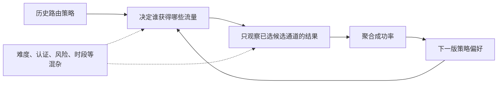
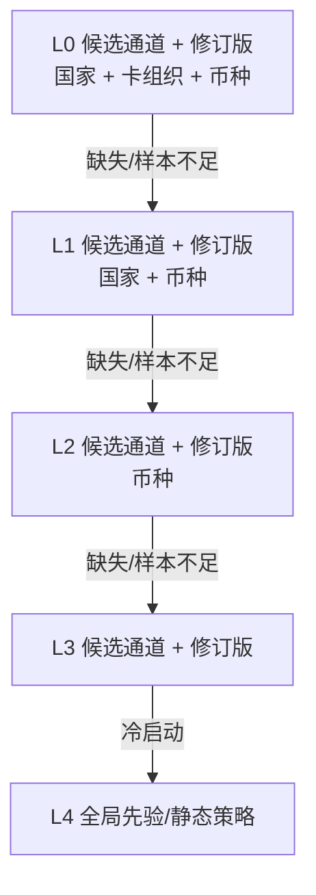
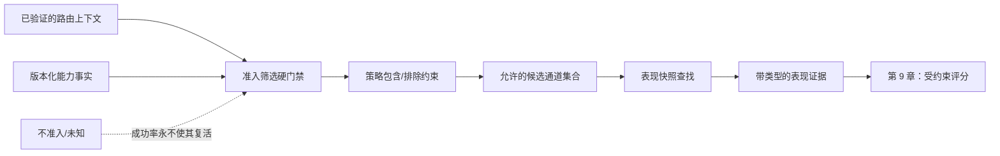

# 第 8 章 成功率路由

第 2 章里，Aurora 看到一张很诱人的表：德国发行的 Visa、EUR 交易中，PSP A 的授权率是 `94%`，PSP B 是 `88%`。一个看似自然的结论是：“今后这类交易都走 A。”

这个结论可能有用，也可能完全错误。两组流量是否来自同一商户、相近金额与相同认证策略？B 是否只在 A 拒绝后才收到更难的重试流量？A 的样本是九千笔，还是十六笔？尚未收敛的超时被算成失败了吗？更根本地说，我们只观察了历史策略实际选择的连接；没有被选择的候选通道对同一笔交易会有什么结果，日志中不存在。

所以，本章的主命题不是“用历史成功率选择最高者”，而是：

> **成功率路由消费的是一份不可变、带版本的条件表现估计。每个估计必须绑定精确候选通道、分段、样本量、统计窗口、不确定性、新鲜度和回退来源；它只描述历史策略下的证据，不能伪装成支付服务商的因果优势。准入筛选永远先于表现比较。**

本章会从一个总体排行榜开始，让它依次撞上口径差异、流量构成、选择偏差、稀疏样本、延迟结果与时间漂移，最后推导出只读 `PerformanceSnapshot`、固定分层回退和显式收缩。成本与成功率的组合留给[第 9 章](provider-scoring.md)，分钟级服务商健康度留给[第 13 章](../part-3-reliability/provider-health.md)，指标生产、因果实验和反事实学习分别留给第 15、16、21 章。本章不会提前搭建流处理平台，也不会把开发用服务商模拟器的结果包装成真实 PSP 基准。

配套 Go 系统已经实现这个读取边界：路由服务 v3 的 `services/router/internal/performance` 会编译不可变 `performance.v1`，按精确 `candidate_id + connection_revision`、命名国家字段、`payment_method_context.network` 与币种走固定层级，校验各层样本门槛、`pending_count` 覆盖率、窗口年龄和发布年龄，并输出收缩估计、Wilson 区间与保守 PPM。当前制品只来自仓库内的合成测试固件；系统没有真实 PSP 结果生产器、流处理作业或生产制品发布链，因此“实现了观测证据契约”不等于“拥有可信的线上服务商排名”。

## 8.1 问题：`94%` 与 `88%` 回答不了“换过去会怎样”

授权率的普通定义是：

\[ \text{授权率}=\frac{\text{已批准授权\}}{\text{符合口径的授权尝试\}} ]

公式本身没有错，困难在于每个词都需要契约。`approved` 是发卡机构或卡组织明确批准，还是 HTTP `2xx`？一次逻辑授权的网络重发算一笔还是三笔？一个结果仍为 `UNKNOWN` 的支付尝试是失败，还是尚未完成观测？自动请款的 `SALE` 同时包含授权与请款语义，能否与纯授权混在一起？

即使口径完全一致，总体比例也可能把流量构成误认成连接能力。考虑下面这组示意数据；它不是任何真实支付服务商的表现：

| 历史交易难度分层  |                  候选通道 A |                  候选通道 B |
| --------- | ----------------------: | ----------------------: |
| 相对容易的已知分层 |         855 / 900 = 95% |          96 / 100 = 96% |
| 相对困难的已知分层 |          70 / 100 = 70% |         675 / 900 = 75% |
| 不分层的总计    | **925 / 1,000 = 92.5%** | **771 / 1,000 = 77.1%** |

B 在两个已知分层中都高于 A，但总体榜却显示 A 高出十五个百分点。原因不是算术出错，而是旧策略把九成容易流量给了 A，把九成困难流量给了 B。总体比例同时测量了候选通道表现与历史分流构成。

把数据按国家、卡品牌和币种分层可以减少这种混合，却仍不能推出因果关系。即使两个桶都叫 `DE + visa + EUR`，其中也可能有不同金额、商户、3DS 路径、令牌类型、发卡机构、时段或风险策略。分层只控制已经记录且语义稳定的字段；它不能自动控制未知混杂因素，更不能制造“同一笔交易同时走 A 与 B”的反事实结果。

历史路由因此形成一个闭环：



如果系统把这个闭环的输出直接解释为“B 换到 A 的流量上也会保持高成功率”，它就在用选择后的样本回答未观测问题。后面的平滑、置信区间和更复杂模型都不能凭空修复没有覆盖的反事实。


## 8.2 简单设计：总体排行榜为什么仍是合理起点

在一家商户、单一市场、统一请求语义和稳定流量分配下，按最近一天统计每条连接的批准数与尝试数，是很有价值的第一版诊断。它实现简单，出现大范围集成错误时也能快速暴露异常。

最小系统可能每隔一小时生成如下快照：

| 候选通道                     | 窗口       |   已批准 |  已定稿尝试 | 原始成功率 |
| ------------------------ | -------- | ----: | -----: | ----: |
| `conn_pspa_aurora_eu_v1` | 最近 24 小时 | 9,400 | 10,000 | 94.0% |
| `conn_pspb_aurora_eu_v1` | 最近 24 小时 |   880 |  1,000 | 88.0% |

路由服务只需在可用候选通道中选择比例最高者。然而，这张表适合回答“昨天各自收到的流量发生了什么”，不适合直接回答“今天这笔交易换到另一条连接会怎样”。它至少丢失了四类证据：样本来自什么交易分段；流量为何被分到这里；有多少结果尚未完成；比例在抽样噪声下有多不确定。

简单设计值得保留的不是排行榜，而是离线聚合：路由服务位于同步支付路径，不应该为每笔交易扫描明细、同步查询分析仓库或现算窗口。生产设计仍会把统计工作放到路径之外，只是把产物升级成经过校验、可回放的快照。

## 8.3 规模化问题：一个 `success_rate` 字段如何失真

### 8.3.1 支付服务商品牌不是统计主体

同一个 PSP 下的两个商户账户可能拥有不同收单关系、合同、凭证、区域端点和连接器版本。把它们都聚合成 `psp_a`，会让表现较好的连接掩盖表现较差的连接，也无法解释路由服务最终执行的是哪条路径。

本书因此始终按稳定 `candidate_id` 聚合，它标识“支付服务商 + 商户账户 + 连接器 + 区域”这一条精确服务商连接。`provider` 可以保留为运营汇总维度，却不能充当线上查找键。连接退役后，旧 ID 仍要能解释历史；若新连接器或新账户改变了执行语义，应发布新候选通道或明确的身份迁移，而不是把旧时间序列静默拼接到新连接上。

### 8.3.2 分子与分母必须先于模型固定

“失败”不是一个统一结果。发卡机构明确拒绝、服务商参数校验失败、本地准入筛选排除、反欺诈引擎拦截、套接字超时和未完成查询，代表完全不同的阶段。若团队把 HTTP 非 `2xx` 都放进分母，又把同步 `2xx` 都放进分子，它测到的更像连接器 HTTP 表现，而不是授权批准率。

本章建议先给每个指标写一份口径合同：

| 事件                     | 是否进入授权分母 | 是否进入批准分子 | 处理理由            |
| ---------------------- | -------: | -------: | --------------- |
| 已发往候选通道，得到明确批准         |        是 |        是 | 有确定授权结果         |
| 已发往候选通道，得到明确发卡机构/卡组织拒绝 |        是 |        否 | 有确定授权结果         |
| 请求在本地准入筛选/风险阶段被拦截      |        否 |        否 | 没有发送授权          |
| 同一逻辑资金操作的传输重发          |      不新增 |      不新增 | 防止把网络重试当独立样本    |
| 超时/断连，状态仍为 `UNKNOWN`   |     暂不定稿 |        否 | 缺少最终结果，不能先当拒绝   |
| 纯连接器参数或协议错误            |   单列技术指标 |        否 | 不与发卡机构批准率混成一个比例 |
| 请款、撤销、退款或结算结果          |        否 |        否 | 属于不同资金阶段        |

这里的“暂不定稿”不等于永远丢弃。快照生产器应设置结果水位线：只发布已经越过结果等待期、或已由明确证据收敛的观测窗口；迟到的回调通知、查询或对账证据进入后续版本，而不是原地改写已经发布的快照。仍未收敛的样本要以 `pending_count` / `coverage_ratio` 暴露，完整性低于门槛时整桶降级，不能简单删掉这些慢结果。第 17、18 章会处理最终事实校正，本章只要求线上读取者知道 `observed_at` 与窗口是否完整。

若业务希望优化端到端首次尝试成功率，还应另建明确命名的指标：已定稿的技术失败可以进入它的分母，但这个指标不能继续叫“发卡机构授权批准率”。`outcome_definition` 与 `denominator_version` 必须成为快照模式的一部分；选择哪一个目标由业务与第 9 章评分契约决定，不能让看板查询语句临时改变。

支付服务商和卡组织的响应码/建议码还需要由每个连接器按版本化数据字典归一化，不能凭 HTTP 状态猜测。比如 Visa 的官方开发者资料把授权响应码、认证结果和其他响应字段分别定义；这说明“请求成功”和“授权获批”本来就是不同层级的事实。[Visa 请求与响应代码](https://developer.visa.com/request_response_codes)

当前配套系统只支持令牌化卡的自动请款 `SALE` 纵向切片。`SALE` 可能在支付服务商侧包含授权与请款，因此，在配套模型尚未拆出可靠授权事实前，不能把 `sale_succeeded / sale_attempted` 命名为通用授权率。

### 8.3.3 高维分桶很快变成空桶

国家、发卡机构、BIN/IIN、卡品牌、币种、支付方式、金额带、3DS、令牌类型、商户与时段都可能影响结果。若每个维度都有十个取值，笛卡尔积会迅速产生大量低流量桶。此时 `1 / 1 = 100%`、`0 / 1 = 0%` 虽然计算正确，却几乎没有区分能力。

继续扩大窗口可以增加样本，但会把上月的连接器、发卡机构和认证环境带到今天；缩短窗口能追踪变化，却增加方差与空桶。这个矛盾不能靠一个全局“最近七天”解决。每个估计必须同时公开窗口、样本量和不确定性，路由服务才能决定它是否适合作为证据。

BIN/IIN 也不应被硬编码成固定位数或直接写进高基数日志标签。线上上下文可以携带受控的非敏感派生类别或元数据版本；原始 PAN、CVV/SAD 与服务商密钥不进入表现键、路由决策或指标。若细粒度字段的质量、合规边界或覆盖率不可靠，就从更稳定的国家、卡品牌和币种开始。

### 8.3.4 时间漂移与反馈延迟制造“新鲜的旧事实”

最近二十四小时的窗口未必新鲜：聚合任务可能已经停了六小时，最近两小时的大量 `UNKNOWN` 还没收敛，或者连接器刚刚升级。单看 `window_end` 无法区分这些情况。

快照至少需要三个时间概念：`window_end` 表示统计事件截止点，`observed_at` 表示结果事实已经观测到哪里，`produced_at` 表示制品何时生成。路由服务使用明确的最大年龄与完整性策略验证它们；过期时输出 `PERFORMANCE_SNAPSHOT_STALE` 并降级，而不是继续返回四位小数的假精确值。

分钟级超时、延迟和错误突增属于运行健康，不应塞进一份按天聚合的成功率窗口。否则长期表现与短期故障会相互重复计权。动态健康度在[第 13 章](../part-3-reliability/provider-health.md)进入硬约束或独立信号，本章只处理较慢变化的历史表现。

## 8.4 生产级设计：发布证据，不发布排行榜

生产链路把“结果事实生产”与“在线读取”分开。路由服务只读取已验证快照，不连接明细库，也不在请求中等待聚合作业：


这张图不是要求本章立刻引入 Kafka、Flink 或在线特征库。低到中等规模完全可以从 PostgreSQL 中的最终事实按小时批量生成一个严格 JSON 制品，再通过部署或配置分发给路由服务。自然边界是：生产者拥有统计口径和制品；路由服务拥有验证、查找与降级；编排服务仍然拥有支付尝试、资金操作与资金状态。

### 8.4.1 `PerformanceSnapshot` 是一次不可变观察

快照中不能只有 `candidate_id → rate`。最小契约如下：

| 字段                            | 示例                           | 为什么在线必须保留         |
| ----------------------------- | ---------------------------- | ----------------- |
| `schema_version`              | `performance.v1`             | 拒绝不兼容结构           |
| `snapshot_version` / 摘要       | `perf_2026-08-26T10`         | 决策回放与防止同版本异内容     |
| `segment_schema_version`      | `segment.v1`                 | 解释维度、通配和规范化规则     |
| `outcome_definition` / 分母版本   | `authorization_approval.v1`  | 固定分子、分母、去重和待定结果处置 |
| `window_start` / `window_end` | UTC 时间区间                     | 明确样本覆盖期           |
| `observed_at`                 | 结果水位线                        | 识别结果延迟与截尾         |
| `produced_at`                 | 制品生成时间                       | 检测发布停滞            |
| `candidate_id` + 分段键          | 精确连接与规范字段                    | 找到当前交易的条件证据       |
| `approved` / `sample_size`    | `675 / 900`                  | 区分 1/1 与 900/1000 |
| `estimate`                    | 平滑后的概率                       | 线上比较使用的点估计        |
| `confidence` / 区间             | `high`, `[0.72, 0.78]`       | 暴露不确定性而非隐藏噪声      |
| `source_segment` / 回退层级       | `candidate+country+currency` | 解释为何没有使用最细桶       |

已发布制品不原地更新。同一个 `snapshot_version` 必须对应唯一规范摘要；路由服务启动时验证概率范围、计数关系、时间顺序、候选通道引用、重复键与层级完整性，然后一次性替换内存指针。请求方不能在路由请求中指定一个更“有利”的快照版本。

### 8.4.2 固定分层回退，避免挑选最漂亮的桶

第一个可交付版本按第 4 章已经规范化的国家、`payment_method_context.network` 与币种查询，并始终绑定精确候选通道修订版。制品的 `country_field` 必须明确选择 `merchant.country` 或 `payment_method_context.issuer_country`，不能把两者混成一个无名 `country`。回退链是分段模式的一部分：



为什么不能在 L1 同时查询“保留国家”与“保留卡品牌”，然后选成功率更高的那个？因为这样会让查找过程根据观测结果挑桶，产生新的赢家诅咒，也使同一请求难以解释。哪些维度先丢弃，应基于离线验证与业务语义确定，并随 `segment_schema_version` 发布；线上只走一条固定链。

每一层还要有版本化最小样本门槛。最细桶只有一笔且成功时，不把 `100%` 直接送入评分，而是输出 `PERFORMANCE_INSUFFICIENT_SAMPLE` 并回退到父层。若所有层都不足，可以返回经过声明的全局先验，或退出成功率比较并使用稳定静态策略；不能把缺失默认为 `0%`，也不能把候选通道配置数组里的第一项当隐式赢家。

下面的 Go 示例展示只读快照的确定性查找。它保留与生产传输契约对齐的 `ConnectionRevision`、`Network`、逐层门槛、待定结果覆盖率和两种年龄上限，但仍刻意省略观测状态、群组与制品编译，以便突出固定回退。`map` 只做精确键查询，从不依赖遍历顺序选择赢家：

```go
package performance

import (
	"errors"
	"math/big"
	"time"
)

var (
	ErrSnapshotStale   = errors.New("performance snapshot is stale")
	ErrInvalidSnapshot = errors.New("performance snapshot is invalid")
	ErrNoEvidence      = errors.New("no performance evidence")
)

const (
	any      = "*"
	ppmScale = uint64(1_000_000)
)

type SegmentKey struct {
	CandidateID        string
	ConnectionRevision string
	Country            string
	Network            string
	Currency           string
}

type Bucket struct {
	Estimate     float64
	Lower95      float64
	Upper95      float64
	SampleSize   uint64
	PendingCount uint64
	Confidence   string
}

type Snapshot struct {
	SchemaVersion        string
	SegmentSchemaVersion string
	OutcomeDefinition    string
	Version              string
	WindowStart          time.Time
	WindowEnd            time.Time
	ObservedAt           time.Time
	ProducedAt           time.Time
	MinSamples           [4]uint64
	MinCoveragePPM       uint64
	MaxAge               time.Duration
	MaxWindowAge         time.Duration
	Buckets              map[SegmentKey]Bucket
}

type Query struct {
	CandidateID        string
	ConnectionRevision string
	Country            string
	Network            string
	Currency           string
}

type Result struct {
	Bucket
	SnapshotVersion string
	SourceSegment   SegmentKey
	FallbackLevel   int
	CoveragePPM     uint64
	WindowStart     time.Time
	WindowEnd       time.Time
	ObservedAt      time.Time
}

func (s Snapshot) Lookup(now time.Time, q Query) (Result, error) {
	invalidTimeline := !s.WindowStart.Before(s.WindowEnd) ||
		s.ObservedAt.Before(s.WindowEnd) ||
		s.ProducedAt.Before(s.ObservedAt) ||
		s.ProducedAt.After(now)
	if s.SchemaVersion == "" || s.SegmentSchemaVersion == "" ||
		s.OutcomeDefinition == "" || s.Version == "" ||
		s.MinCoveragePPM == 0 || s.MinCoveragePPM > ppmScale ||
		s.MaxAge <= 0 || s.MaxWindowAge <= 0 || invalidTimeline ||
		q.CandidateID == "" || q.ConnectionRevision == "" ||
		q.Country == "" || q.Network == "" || q.Currency == "" {
		return Result{}, ErrInvalidSnapshot
	}
	for _, minimum := range s.MinSamples {
		if minimum == 0 {
			return Result{}, ErrInvalidSnapshot
		}
	}
	if now.Sub(s.ProducedAt) > s.MaxAge || now.Sub(s.WindowEnd) > s.MaxWindowAge {
		return Result{}, ErrSnapshotStale
	}

	levels := []SegmentKey{
		{q.CandidateID, q.ConnectionRevision, q.Country, q.Network, q.Currency},
		{q.CandidateID, q.ConnectionRevision, q.Country, any, q.Currency},
		{q.CandidateID, q.ConnectionRevision, any, any, q.Currency},
		{q.CandidateID, q.ConnectionRevision, any, any, any},
	}
	for level, key := range levels {
		bucket, ok := s.Buckets[key]
		coverage := coveragePPM(bucket.SampleSize, bucket.PendingCount)
		if !ok || bucket.SampleSize < s.MinSamples[level] || coverage < s.MinCoveragePPM {
			continue
		}
		return Result{
			Bucket:          bucket,
			SnapshotVersion: s.Version,
			SourceSegment:   key,
			FallbackLevel:   level,
			CoveragePPM:     coverage,
			WindowStart:     s.WindowStart,
			WindowEnd:       s.WindowEnd,
			ObservedAt:      s.ObservedAt,
		}, nil
	}
	return Result{}, ErrNoEvidence
}

func coveragePPM(samples, pending uint64) uint64 {
	if samples == 0 {
		return 0
	}
	numerator := new(big.Int).Mul(new(big.Int).SetUint64(samples), new(big.Int).SetUint64(ppmScale))
	denominator := new(big.Int).Add(new(big.Int).SetUint64(samples), new(big.Int).SetUint64(pending))
	return numerator.Quo(numerator, denominator).Uint64()
}
```

这段代码与真实实现的映射必须明确：`Query.Network` 来自 `payment_method_context.network`，不是另外发明的“卡品牌别名”字段；`Query.Country` 只代表快照的 `country_field` 所指定的那一种地理事实；候选通道 ID 与修订版必须同时命中；`MinSamples[0..3]`、`MinCoveragePPM`、`pending_count`、`window_start/end`、`observed_at`、`produced_at`、`MaxAge` 与 `MaxWindowAge` 都是制品合同。教学代码假定国家/卡组织已知，并在无桶时返回 `ErrNoEvidence`；生产实现还携带 `known`/`unknown`/`stale`/`redacted`/`not-applicable` 状态，跳过不能使用的细层，并只在已批准的策略下返回显式 `global_prior`。

真实加载器还验证 `0 ≤ estimate ≤ 1`、`0 ≤ lower ≤ upper ≤ 1`、时间为 UTC、计数不超过精确浮点边界、通配符只出现在模式允许的位置，以及所有桶的候选通道 ID/修订版都存在于对应能力清单。当前生产 `EstimatorVersion` 还规定每层独立样本门槛、覆盖率门槛和置信度阈值；教学函数没有把这些策略常量伪装成通用统计定理。

### 8.4.3 收缩与置信区间解决的是噪声，不是偏差

固定门槛容易解释，却会在门槛两侧形成跳变。另一个常用方法是把细桶向父层收缩。设细桶有 `s` 次批准、`n` 次已定稿尝试，父层估计为 `p₀`，父层等效样本强度为 `k`，则一个透明的工程估计是：

\[ \hat p=\frac{s+k p\_0}{n+k} ]

当 `n` 很小，结果接近父层；当 `n` 增大，细桶证据逐渐占主导。`k` 不是放之四海皆准的常数，它应按离线校准和分段模式版本发布，不能由每个路由服务实例自行调整。

点估计仍不足以表达不确定性。下面的 Go 代码同时返回收缩后的点估计和原始二项样本的 Wilson 得分区间。Wilson 在 1927 年的原始论文中给出了基于得分的比例推断思路；它能避免 `1/1` 得到零宽度区间，但不应被误解为支付样本独立同分布的证明。[E. B. Wilson，《Probable Inference, the Law of Succession, and Statistical Inference》](https://doi.org/10.1080/01621459.1927.10502953)

```go
package performance

import (
	"errors"
	"math"
)

type Estimate struct {
	Probability     float64
	SampleSize      uint64
	ObservedLower95 float64
	ObservedUpper95 float64
}

func SmoothedEstimate(
	successes, trials uint64,
	parentRate, priorStrength float64,
) (Estimate, error) {
	if successes > trials || math.IsNaN(parentRate) || math.IsInf(parentRate, 0) ||
		math.IsNaN(priorStrength) || math.IsInf(priorStrength, 0) ||
		parentRate < 0 || parentRate > 1 || priorStrength < 0 {
		return Estimate{}, errors.New("invalid performance evidence")
	}
	denominator := float64(trials) + priorStrength
	if denominator == 0 {
		return Estimate{}, errors.New("estimate has no evidence or prior")
	}

	probability := (float64(successes) + priorStrength*parentRate) / denominator
	lower, upper := wilson95(successes, trials)
	return Estimate{
		Probability:     probability,
		SampleSize:      trials,
		ObservedLower95: lower,
		ObservedUpper95: upper,
	}, nil
}

func wilson95(successes, trials uint64) (float64, float64) {
	if trials == 0 {
		return 0, 1
	}
	z := 1.959963984540054
	n := float64(trials)
	p := float64(successes) / n
	z2 := z * z
	denominator := 1 + z2/n
	center := (p + z2/(2*n)) / denominator
	radius := z * math.Sqrt((p*(1-p)+z2/(4*n))/n) / denominator
	return math.Max(0, center-radius), math.Min(1, center+radius)
}
```

这个教学函数只返回收缩点估计与原始区间。当前生产 `performance.Estimate` 还会计算 `ConservativeProbability = min(Probability, ObservedLower95)`，再向下投影为 `ConservativePPM`；第 9 章的 v3 评分器消费的是这个保守 PPM，而不是裸 `ProbabilityPPM`。这是一项版本化工程目标，不是“真实成功率下界”的保证；`EstimatorVersion`、`IntervalMethodVersion`、样本、待定结果覆盖率与“仅限观测”的解释仍随结果保留。

置信区间回答“在给定样本模型下，原始比例有多不稳定”；收缩回答“低样本桶应在多大程度上借用父层证据”。所以上例刻意把区间字段命名为 `ObservedLower95` / `ObservedUpper95`：它不保证围绕收缩点估计。若生产者需要收缩模型自身的区间，就应选择可校准的方法并发布 `interval_method_version`，不能混用两个统计对象。无论采用哪种方法，它们都不回答“如果把历史上给 A 的交易改给 B，B 会怎样”。选择偏差是数据生成机制的问题，不是给比例加误差条就能消除的问题。

快照可以把 `confidence` 定义成由样本量、区间宽度、结果完整性和回退层级共同派生的枚举，但阈值必须版本化。路由服务返回原始字段与原因码，不能只给一个无法解释的 `0.8734`。

### 8.4.4 先完成准入筛选，表现数据只给合格者附证据

成功率估计是软目标，不是能力证明。一条连接即使在 `DE + visa + EUR` 桶中有很高历史批准率，只要它的商户账户已停用、不支持当前资金操作、请款模式、币种或认证要求，就不能进入表现比较。

正确顺序是：



查找最好先按 `candidate_id` 排序，再为每个允许的候选通道附加证据；排序只保证结果可重放，不代表按字典序偏好。缺失证据的处置由版本化策略决定：可以对该候选通道标记 `PERFORMANCE_NO_EVIDENCE` 并退出成功率比较，也可以使用声明过的先验。高成功率不能覆盖 `capability_unknown`，低成功率也不应偷偷把一条合法连接永久禁用；后者是评分偏好或运营策略，不是准入事实。

第 9 章才会决定成本、成功率、风险与平局裁决如何组合。本章输出的带类型特征至少分成四组：

| 证据组    | 字段                                                                          |
| ------ | --------------------------------------------------------------------------- |
| 身份     | `candidate_id`、`snapshot_version`                                           |
| 点估计与样本 | `estimate`、`sample_size`、`confidence`                                       |
| 不确定性   | `observed_lower_95`、`observed_upper_95`、`interval_method_version`           |
| 时间与回退  | `window_start`、`window_end`、`observed_at`、`source_segment`、`fallback_level` |

这些字段是决策证据，不是服务商结果。路由服务不会因为查询到一个估计就创建支付尝试、调用服务商网关或修改支付状态。

### 8.4.5 冷启动与新连接：未知不能伪装成平均

新候选通道没有历史，常见错误有两个：把它设为 `0%`，从此永远得不到流量；或给它一个很高默认值，让未经验证的路径突然接管生产。更稳妥的冷启动顺序是：

1. 准入筛选、合同、连接测试和运营护栏先证明它允许接收这类新授权；
2. 使用明确的父层先验或静态策略，而不是伪造本连接的观测数据；
3. 若业务批准探索，仅给受控小流量，记录分配结果与暴露概率；
4. 样本达到发布门槛后，新快照才逐步采用更细的候选通道证据。

先验只能表达“在没有本连接证据时采用什么保守假设”，不能在路由决策中写成“该连接历史成功率为 90%”。`source_segment=global_prior`、`sample_size=0` 和 `PERFORMANCE_COLD_START` 必须一起出现。

## 8.5 选择偏差与探索：先承认日志里缺了什么

路由日志是一种部分反馈：系统只看到被选择候选通道的结果，看不到其他候选通道对同一交易的结果。Swaminathan 与 Joachims 对已记录老虎机反馈的研究把历史策略选择动作的概率记为倾向概率，并说明反事实估计既依赖该记录，也会在倾向概率很小时出现高方差。[反事实风险最小化原始论文](https://www.jmlr.org/papers/v16/swaminathan15a.html)

这给支付路由带来三个直接边界：

* 若旧策略在某个上下文下选择 B 的概率为零，日志就没有该区域的 B 结果；任何离线方法都不能仅靠这些日志可靠证明“改走 B 更好”。
* 即使记录了非零倾向概率，历史中尚未记录的混杂、结果延迟和策略变更仍需处理；逆倾向概率加权也可能因小概率样本产生很大方差。
* 普通确定性策略若没有记录可重放的分配规则，就不能事后编造暴露概率。

Li 等人的重放方法在特定随机日志与匹配条件下可以给出无偏离线评估；关键前提正是日志策略提供了适当随机覆盖，而不是“历史数据足够大”。[基于上下文老虎机的新闻推荐算法无偏离线评估](https://arxiv.org/abs/1003.5956) 支付的损失函数、风险与资金副作用远比新闻点击更敏感，所以本章只借用“记录选择机制与支持范围”这一原则，不把推荐系统实验结论直接移植成支付上线方案。

### 8.5.1 探索只能发生在很窄的安全区域

探索不是为了让统计模型吃到数据就随机发送资金请求。它必须位于全部硬约束之后，并由商户、风险、容量和实验护栏明确授权：

| 场景                 | 能否为表现数据探索另一候选通道 | 原因                     |
| ------------------ | --------------: | ---------------------- |
| 尚未创建服务商资金操作的首次支付尝试 |            条件允许 | 仅在已准入集合、风险允许和流量上限内     |
| 同一幂等请求的重复到达        |           不重新抽签 | 必须复用稳定分配/既有路由决策        |
| 原资金操作为 `UNKNOWN`   |               否 | 可能已经产生资金副作用，先在原连接查询或恢复 |
| 超时后的传输重发           |               否 | 复用原连接、资金操作 ID、载荷与服务商键  |
| 请款、撤销、退款           |               否 | 必须绑定原连接与服务商交易引用        |
| 候选通道不合格或风险拦截       |               否 | 探索和高分都不能越过硬约束          |

即使在第一行，系统也需要稳定分桶、最大流量占比、最小商户样本保护、容量上限、紧急停止开关和可审计的实验版本。分配结果必须在发送前记录，结果必须关联同一次暴露，未执行的分配不能被当成失败。完整实验设计、显著性、方差缩减和上线判定属于[第 16 章](../part-4-operating-at-scale/experimentation.md)；离策略学习与模型策略属于[第 21 章](../part-5-global-routing/intelligent-routing.md)。

在没有这些前提时，本章的估计应被准确命名为“历史策略下、给定已观测分段的条件表现估计”。它可以帮助稳定决策、发现数据问题和生成候选假设，但不能宣称 A 对 B 的因果提升是六个百分点。

## 8.6 故障模式：看起来精确的错误最危险

| 故障模式              | 表面现象         | 系统后果           | 防线/原因码                            |
| ----------------- | ------------ | -------------- | --------------------------------- |
| 按支付服务商品牌聚合        | PSP A 全局 94% | 混合不同账户、连接器与区域  | 精确 `candidate_id`                 |
| 不记录历史分流           | A 总体高于 B     | 把流量构成当连接优势     | `PERFORMANCE_OBSERVATIONAL_ONLY`  |
| 1/1 直接胜过 900/1000 | 小桶显示 100%    | 流量追逐噪声并振荡      | `PERFORMANCE_INSUFFICIENT_SAMPLE` |
| 从多个父桶挑最高值         | 查找总能找到漂亮数字   | 数据依赖回退、无法回放    | 固定层级 + `source_segment`           |
| `UNKNOWN` 先算拒绝    | 短窗口成功率骤降     | 惩罚结果较慢的连接、截尾偏差 | 结果水位线                             |
| 网络重发重复计数          | 超时多的连接样本激增   | 分母与拒绝数被放大      | 逻辑资金操作去重                          |
| 快照停更              | 成功率仍有四位小数    | 用旧环境指导新流量      | `PERFORMANCE_SNAPSHOT_STALE`      |
| 候选通道身份静默复用        | 新连接器继承旧样本    | 混合不同执行语义       | 新 ID 或显式迁移                        |
| 高成功率复活不合格路径       | “转化更好”覆盖能力缺失 | 技术、合同或合规违规     | 准入先于评分测试                          |
| 确定性旧策略无覆盖         | 某分层从未走 B     | 无法评估 B 的反事实    | 标记不支持，不编造结论                       |

另一个常见错误是目标泄漏：把授权之后才知道的响应码、服务商引用或最终支付状态放进路由特征。离线回放会异常漂亮，线上却根本无法在决策时获得这些字段。分段模式只能引用路由决策时已经存在、来源和时效明确的路由上下文；生产者应在制品构建时验证字段的 `available_at` 边界。

## 8.7 测试：证明系统会拒绝诱人的坏证据

成功率模块的测试不能只断言“较大成功率排在前面”。至少需要下面的矩阵：

| 测试     | 构造                         | 必须证明                        |
| ------ | -------------------------- | --------------------------- |
| 小样本保护  | 精细桶 1/1；父层 900/1000        | 1/1 不会无条件击败稳定证据；按门槛回退或显式低置信 |
| 固定层级   | L0 缺失，L1/L2 同时存在           | 只选择模式规定的下一层，不挑最高成功率         |
| 快照陈旧   | `produced_at` 超过 `max_age` | 返回陈旧降级，不继续输出普通特征            |
| 输入乱序   | 候选通道配置多次洗牌                 | 证据顺序、版本与最终稳定平局输入一致          |
| 准入筛选优先 | 不合格候选通道估计为 99%             | 查找/评分器都不能把它选回               |
| 结果延迟   | 一个 `UNKNOWN` 后续批准          | 首版不先算拒绝；新事实只进入后续快照          |
| 去重     | 同一资金操作三次网络投递               | 分母只增加一次                     |
| 冷启动    | 候选通道无任何桶                   | 显式先验或退出比较，绝不默认为 0/1         |
| 身份边界   | 同 PSP 两个商户账户               | 统计与查找互不串桶                   |
| 无支持区域  | 历史倾向概率为零                   | 报告不能离线推断反事实优势               |

属性测试还应生成任意 `successes ≤ trials`、时间边界和桶排列，验证概率不越界、回退终止、序列化摘要稳定。黄金测试固定一份快照与上下文，记录 `snapshot_version`、`source_segment`、`sample_size`、区间和原因码；同一输入跨进程重启应得到相同输出。

统计测试之外还要验证支付不变量：表现查找失败不会直接调用服务商网关；`UNKNOWN` 的查询/重试仍使用原 `provider_connection_id`；请款、撤销、退款不调用路由服务重新选择。成功率优化绝不能改变资金恢复语义。

## 8.8 权衡：更细、更快、更“智能”不能同时免费获得

**分段精度与统计功效。** 细分能减少已知流量混合，却制造稀疏样本；粗分有稳定样本，却可能隐藏真实异质性。固定层级与收缩是可解释折中，不是找到唯一真粒度。

**新鲜度与结果完整性。** 短窗口能更快反映变化，但更多支付尝试尚未收敛；等待水位线提高结果完整性，却增加滞后。分钟级故障交给健康度信号，表现快照承担较慢变化，可以避免一个信号同时做两份工作。

**探索与资金风险。** 没有探索，旧策略可能长期让某些候选通道缺少支持；探索过多，又会把不确定路径暴露给真实顾客。支付系统应先明确可接受损失、已准入范围和停止条件，而不是为了统计纯度追求均匀随机。

**稳健性与响应速度。** 较强先验、较大门槛和较宽窗口减少抖动，也可能延迟识别真实改进。版本化参数、影子报告与第 16 章受控实验，比在生产中不断手调 `k` 更可审计。

**解释性与模型复杂度。** 分层比例、固定回退与显式区间容易回放；高维模型可能提高预测力，却需要训练数据、校准、漂移与反事实评估。第 21 章即使引入模型，也必须输出同一类带类型特征与版本证据，并继续服从准入筛选和护栏。

## 8.9 配套 Go 系统的本章实现边界

本章的[固定实现](https://github.com/YouEclipse/payments/tree/bc4afde24da708d22f67da72a90a1557b1477173/services/router/internal/performance)已经提供严格的 `performance.v1` 制品编译器与只读查找。它把 `candidate_id + connection_revision` 作为不可拆的统计身份；分段模式固定为“国家 + 卡组织 + 币种 → 国家 + 币种 → 币种 → 候选通道 → 全局先验”，其中 `network` 只来自 `payment_method_context.network`。`country_field` 显式选择商户国家或发卡国家，查询还携带资金操作/请款群组，避免把自动请款 `SALE` 统计冒充通用授权率。表现包能校验 `authorize + manual` 的统计模式，但当前路由服务 v3 优化只安装 `sale + automatic` 快照；它没有实现手动请款执行链。

制品同时固定 `window_start/end`、结果水位线、`produced_at`、发布年龄上限、窗口年龄上限、四层样本门槛、待定结果覆盖率门槛、先验与估价器版本。查找不选最漂亮的父桶：它只沿固定链检查样本和覆盖率，再由合格祖先逐层收缩；冷启动返回 `prior` 状态、零观测样本和“仅限观测”原因。路由服务 v3 只为准入筛选、规则与风险已经允许的精确修订版查询这些证据；批量评分再验证所有候选通道的快照、群组、国家/卡组织/币种、窗口和求值时间一致。

测试覆盖 1/1 小样本、固定层级、待定结果覆盖率、未知/陈旧元数据、过期发布与旧窗口、修订版/群组隔离、晚到证据的新制品、输入排列、并发重放和数值边界。它们证明的是读取方契约与确定性。仓库内快照和结果都是合成测试固件；没有真实 PSP 结果归一化、逻辑资金操作去重生产器、流处理集群、生产制品库或发布审批，也没有因果实验与反事实支持。配套实现因此只能被描述为**由测试固件支撑的观测表现**，不能被外推成真实服务商基准、机器学习能力或线上流量收益。

## 8.10 小结

成功率路由的难点从来不是除法，而是证据边界。一个可用于单笔路由的表现估计，必须同时回答：统计的是哪条精确连接、哪类交易、什么资金阶段、多少已定稿样本、哪个窗口、结果观测到哪里、用了哪层回退、还有多大不确定性，以及这份证据由哪版制品发布。

从本章可以保留六条不变量：

1. 总体 `94%` 与 `88%` 是历史描述，不是因果结论；分层能减少已知混合，却不能消除选择偏差。
2. 分子、分母、去重单位与结果水位线先于任何统计方法；授权、技术可用性、`SALE`、请款与结算不混用。
3. `candidate_id` 而非支付服务商品牌是在线统计主体；同 PSP 的账户、连接器和区域不能静默串桶。
4. 小样本必须通过固定门槛、收缩、区间和父层回退表达不确定性；`1/1` 不能自动成为赢家。
5. 准入筛选和风险护栏先决定允许集合，表现数据只给集合内候选通道附加软证据；它不执行资金副作用。
6. 探索只发生在被授权的新首次支付尝试安全区域；`UNKNOWN` 恢复以及请款、撤销、退款始终固定原连接与交易引用。

至此，我们得到的仍然不是最终选择器，而是一项可解释、可版本化、可降级的成功率特征。下一章会把它与预期成本、风险决策和稳定平局裁决放进同一条受约束评分流水线，并继续坚持：硬约束不能被一个漂亮分数覆盖。
