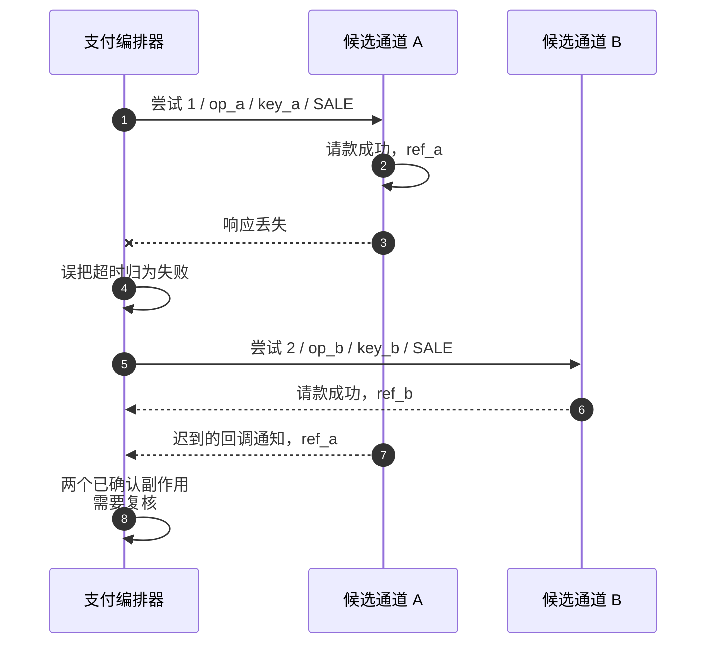
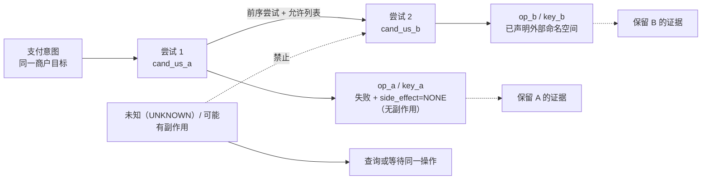
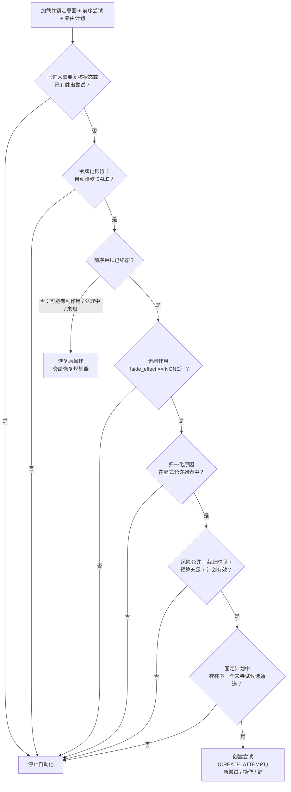
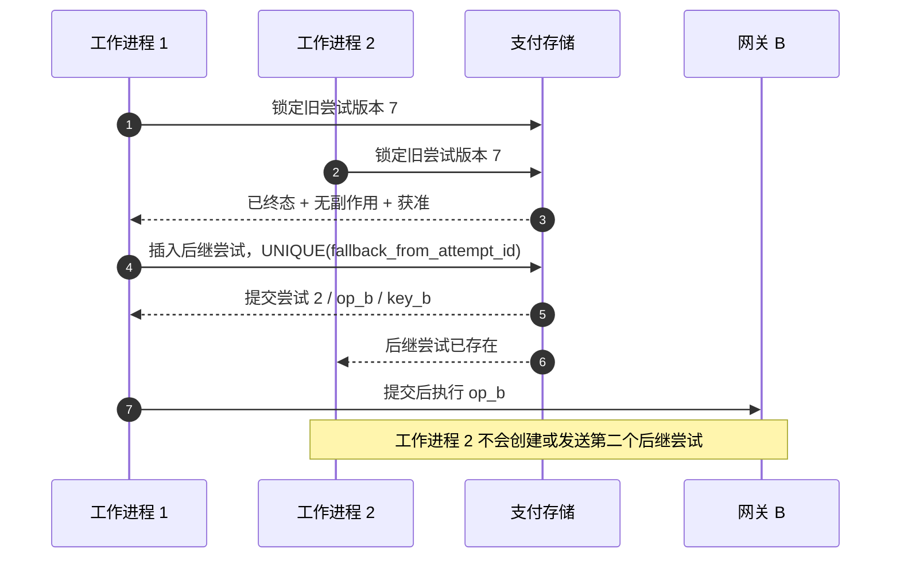

# 第 12 章 后备路由

Aurora 的路由服务为一笔 129.00 USD 的令牌化银行卡自动请款支付返回了有序路由计划：`cand_us_a`、`cand_us_b`。支付编排器用第一个候选通道创建尝试 1 和 `SALE` 操作。几百毫秒后，网关返回“服务商暂时不可用”。系统是否应该立刻调用 `cand_us_b`？

只看“暂时不可用”无法回答。若适配器能证明请求在越过服务商边界前就被拒绝，旧操作的 `side_effect_certainty` 是 `none`；若请求可能已经到达服务商，只是响应丢失，同一句错误意味着 `possible` 和 `UNKNOWN`。即使确实是 `none`，发卡机构拒绝、风险阻断、需要 3DS 的 `action` 也不应被自动换路绕过。因此本章的核心命题是：

> **后备路由是支付编排器在旧尝试已明确终结、`side_effect=NONE`，且版本化策略的原因允许列表明确许可后，创建新尝试的恢复动作。它不是超时后换一家 PSP 重试，也不是与静态、成本、成功率路由并列的选路策略。**

第 10 章处理同一操作的查询、等待与同键重送，第 11 章定义不同层的稳定身份；本章只回答“何时有资格产生第二条资金路径”。服务商健康度对未来新交易的影响留到第 13 章，完整决策记录留到第 14 章。首个工程增量仍限定为令牌化银行卡、自动请款 `SALE`，不会假装同一规则适用于银行转账、钱包或人工请款。

## 12.1 问题：错误不是创建第二条资金路径的许可证

最直观的后备路由实现，是依次调用候选列表，任何错误都继续下一项：

```go
package naivefallback

import "context"

type Command struct {
	AmountMinor int64
	Currency    string
}

type Provider interface {
	Sale(context.Context, Command) error
}

// Charge 有意展示不安全做法：err 不能证明上一次调用
// 没有产生副作用。
func Charge(ctx context.Context, providers []Provider, command Command) error {
	var lastErr error
	for _, provider := range providers {
		if err := provider.Sale(ctx, command); err != nil {
			lastErr = err
			continue
		}
		return nil
	}
	return lastErr
}
```

这个循环把进程可见的 `error` 当成远端资金事实。假设 A 已完成请款，只是响应在返回途中丢失；循环会调用 B，顾客可能看到两笔成功扣款。服务商 A 的幂等键也保护不了服务商 B，因为两者没有共享去重域。



这里真正需要区分的是三种机制：

| 机制 | 触发时点 | 身份是否改变 | 所有者 | 是否可创建资金路径 |
| --- | --- | --- | --- | --- |
| 路由 | 新尝试执行前 | 选择一个具体候选通道 | 路由服务决策，支付固定 | 只产生决策，不执行资金副作用 |
| 重试 / 恢复 | 原操作结果尚未确定 | 固定操作、连接、键、载荷 | 支付恢复 + 网关 | 不创建新尝试 |
| 后备路由 | 旧尝试已有明确无副作用终态 | 新尝试、操作、服务商幂等键 | 支付后备规划器 | 通过全部闸门后才允许 |
| 服务商健康度 | 多笔交易的技术观测已形成快照 | 影响后续新请求的准入候选集合或分数 | 健康度子系统/路由服务 | 不改写正在恢复的旧操作 |

成本感知或成功率路由比较的是“一个新尝试应选哪个合格候选通道”；后备路由判断的是“旧尝试之后是否允许存在一个新尝试”。把两者放进同一个策略枚举，会让评分结果看起来可以抵消副作用不确定性，这是职责层面的错误。

## 12.2 简单设计：`side_effect=NONE` 是必要条件，不是充分条件

比“遇错切换”更好的第一步，是只在旧操作没有副作用时继续。但“没有副作用”仍不足以代表“应该再次尝试”。一个明确的发卡机构拒绝通常可以被适配器归一为 `failure/none`，它却可能携带不得重试、需要顾客修正信息或完成认证的业务含义。若后备规划器只检查确定性，就会把技术安全误当成业务许可。

因此至少要连续通过两道独立闸门：

1. **证据门**：旧尝试已终结，且可信证据给出 `side_effect_certainty=none`。超时、断连、无效响应、含糊 5xx、处理中都不能通过。
2. **策略门**：归一化原因位于当前路由计划所引用策略的显式允许列表。发卡机构拒绝、风险阻断、`review_required`、3DS 或钱包 `action` 默认不在列表中。

之后还要检查操作类型、后备路由次数、总截止时间、已尝试候选通道、风险护栏和并发所有权；任何字段缺失或未知都明确失败，而不是猜测为允许。

| 旧尝试的证据 | `side_effect` | 默认动作 | 为什么 |
| --- | --- | --- | --- |
| 本地持久化的状态证明请求从未派发，原因为在允许列表中技术失败 | `none` | 可继续检查预算、截止时间、风险与下一个候选通道 | 证据门和策略门都可能通过 |
| 服务商对精确操作给出契约化的“未处理”终态 | `none` | 只有该规范化原因在允许列表时才可后备路由 | HTTP 代码本身不够 |
| 发卡机构拒绝，包括看似“软”的拒绝 | `none` | 停止，默认不后备路由 | 应遵守原因/建议与顾客动作，不进行 PSP 猎取 |
| 超时、EOF、连接重置、含糊 5xx | `possible` | 恢复原操作：查询/等待/同键证据化重送 | 不知道 A 是否已执行 |
| 服务商返回处理中或异步受理引用 | `possible` | 查询/等待原操作 | 已知旧操作存在，不能换路 |
| `requires_action` / 3DS 挑战 | `possible` 或流程态 | 继续原尝试的认证流程 | 交互状态与事务上下文不可随意迁移 |
| 风险 `block`、过期且安全拒绝、`review_required` | 任意 | 停止自动恢复 | 后备路由不能绕过中央护栏或证据冲突 |
| 已请款/已授权/有确认的服务商引用 | `confirmed` | 停止；后续操作绑定原交易 | 已存在资金事实 |

Stripe 的官方拒绝代码表同时给出拒绝代码、建议代码和不同的下一步：有的要求认证，有的要求更换支付方式，有的要求联系发卡机构，并不存在一个可跨服务商套用的“软拒绝一律换路”规则。[Stripe：拒绝代码](https://docs.stripe.com/declines/codes) Mastercard 官方交换规则也定义了商户建议代码（Merchant Advice Code）及“不要重试”等商户动作。[Mastercard：交换规则](https://www.mastercard.com/content/dam/mccom/shared/business/support/rules-pdfs/mastercard-switch-rules-manual.pdf) 因而适配器可以保存服务商/卡组织原始代码，策略只能消费经过版本化映射的稳定原因；不认识的代码必须拒绝，而不能按字符串包含 `temporary` 来猜。

### 12.2.1 结果分类不能是服务商返回的一个布尔值

服务商不应直接决定平台是否后备路由。适配器只拥有对协议响应的解释权，例如“请求可能已派发”“这个服务商代码在该 API 版本中表示明确拒绝”；由支付服务持有的策略才拥有“这个业务是否允许新尝试”的决定权。一个可持久化的 `OutcomeClassification` 可以包含以下字段：

| 字段 | 产生者 | 含义 |
| --- | --- | --- |
| `outcome_class` | 适配器归一化器 | 成功、失败、处理中或未知 |
| `side_effect_certainty` | 适配器 + 持久化的派发证据 | 无、可能或已确认 |
| `normalized_reason` | 版本化归一化器 | 稳定原因代码，不是原始错误字符串 |
| `retryable_same_route` | 恢复策略 | 是否可在原连接/键/载荷上恢复 |
| `fallback_allowed` | 后备路由策略 | 当前原因是否命中明确允许列表 |
| `requires_user_action` | 适配器/支付方式流程 | 是否存在 3DS、跳转等续程 |
| `source` / `normalizer_version` | 网关 | 证据来自同步响应、查询、回调通知还是本地证明 |

`fallback_allowed=true` 仍不是立即发请求的命令，它只是策略门的结果；规划器还要重新检查确定性、旧尝试终态、风险、计划、预算和并发所有权。这样既避免适配器越权路由，也避免支付只凭一个服务商原始字段跨通道执行。相反，`retryable_same_route` 只授权第 10 章的原操作恢复，不能被解释成新尝试。

## 12.3 规模化问题：一次新尝试会重开整条执行链

### 12.3.1 UNKNOWN 不会因为备选通道健康而变安全

`cand_us_b` 延迟更低、成功率更高，甚至 A 正在发生事故，都不能改变尝试 1 的资金事实。进入 `UNKNOWN/possible` 后，恢复仍固定 A 的 `operation_id`、`provider_connection_id`、服务商幂等键与请求哈希。第 13 章的健康度快照可以让下一笔新支付避开 A，却不能追溯性地把旧请求标成未执行。

Adyen 的官方幂等性文档明确要求超时后复用同一个键，并说明不同区域端点之间不会检查重复键。[Adyen API 幂等性](https://docs.adyen.com/development-resources/api-idempotency) 这个具体契约揭示了一个通用平台边界：同一操作恢复必须固定原连接和键；跨候选通道的新尝试必须获得自己的操作与键，不能声称旧键提供跨 PSP 保护。

### 12.3.2 “软拒绝”与“硬拒绝”不是平台可凭感觉划的两堆错误

同一个文案可能来自网关、本地适配器、PSP、收单机构或发卡机构；同一个 HTTP 402/422 也可能包裹完全不同的建议。生产分类必须至少携带 `source`、服务商/卡组织代码、归一化器版本、操作类型和副作用证据。首个后备路由允许列表应极窄，例如只接受 `provider_unavailable_pre_dispatch`；扩大列表必须有目标适配器的官方语义、契约测试、风险审核和回滚方案。

发卡机构拒绝即使是确凿 `none`，本章仍默认阻断。让顾客更正 CVC、完成认证、换卡或稍后主动重试，是新的产品/网络语义，不等于后台在同一次确认中自动向多家 PSP 扫射。这样的限制会牺牲一部分即时转化，却能避免违反建议、重复认证和“直到某家批准为止”的发卡机构挑选。

### 12.3.3 3DS `action` 是续程，不是失败

需要跳转（Redirect）、挑战（Challenge）或原生 3DS SDK 时，支付已经进入由服务商交易、认证会话、返回 URL 和客户端状态共同组成的流程。Adyen 官方结果代码文档把带 `action` 的结果与后续 `/payments/details` 明确串成认证续程。[Adyen：支付结果代码](https://docs.adyen.com/online-payments/build-your-integration/payment-result-codes) 把 `requires_action` 解释成“候选通道 A 失败”并切到 B，会丢失认证关联，也可能同时留下一个仍可完成的 A。

因此 `requires_action`、`challenge_in_progress`、`redirect_pending` 默认都令后备路由停止。若将来要做跨服务商的顾客可见重启，必须创建新的用户旅程和明确同意，并证明旧认证/授权已安全终结；它不是本章的自动后备路由。

### 12.3.4 路由计划要固定允许集合，但不能冻结已失效的安全护栏

如果每次失败后重新调用实时评分器，候选通道的成本、成功率和健康度可能已经变化，同一支付的候选序列便不可解释；更危险的是新配置可能引入最初未通过准入筛选的连接。路由服务应在首次决策时签发不可变的 `RoutePlanDecision`：它带 `plan_id`/摘要、策略/能力/特征版本、稳定顺序、最大尝试数和有效期；支付在创建尝试 1 的事务中固定原件。**一次后备路由不重新请求路由决策，也不重新执行成本、表现或评分来产生新的候选通道集合或排名。**

后备规划器只能沿该计划选择“未尝试且已列入”的**下一项**，不能跳到一个重新评分后的胜出项、临时追加服务商，也不能让网关自选备用账户。创建新尝试前，支付取得新的版本化风险决策，并调用由路由服务持有的仅护栏重新校验接口（例如 `RevalidatePlanCandidate`），核对计划中这一个候选通道的能力/健康度硬门禁。该接口只返回 `allow` 或带证据的 `veto`，不得新增候选、改变原顺序、计算分数或签发新路由计划；支付也不自行复制准入筛选/健康度求值语义。风险为 `block`、`require_3ds`、`review`，任一重新校验证据过期/不完整，或接口不可用时，规划器都必须停止。当前教学规划器只把风险过期时间显式放进快照，仅护栏重新校验是待配套合同，不是第二次路由。

后备路由获准时，支付在后继尝试事务中生成自己的不可变 `FallbackExecutionBinding`。它引用原 `RoutePlanDecision`、旧尝试/版本、固定的下一候选通道、刷新后的风险/护栏证据、规划器动作/原因与预算变化；它不是路由服务决策，也没有新候选通道集合或排名。路由服务继续拥有首次计划与准入筛选语义，支付继续拥有“是否基于旧尝试证据创建新资金路径”的唯一权限。

### 12.3.5 新尝试必须拥有全新的执行身份

后备路由不是把旧尝试的服务商字段改成 B。一个被允许的后继尝试至少满足：

| 身份或事实 | 尝试 1 → 尝试 2 | 理由 |
| --- | --- | --- |
| `payment_intent_id`、金额、币种、请款模式 | 保持不变 | 仍服务同一个商户业务目标 |
| `attempt_id` / `attempt_number` | 新 ID，序号递增 | 每条资金路径独立审计 |
| `operation_id` | 新 ID | B 的销售操作不是 A 的操作重试 |
| `provider_connection_id` | 来自固定计划的下一个具体候选通道 | 服务商、商户账户、连接器、区域均可不同 |
| `provider_idempotency_key` | 新键，唯一约束落在适配器为 B 声明的外部幂等命名空间；执行仍固定 B 的精确连接/修订 | 不复用 A 的键，也不把连接 ID 错当成所有服务商的外部去重域 |
| `routing_plan_id` / 候选通道快照 | 引用同一固定计划与实际执行项 | 解释为什么 B 有资格被选择 |
| `fallback_from_attempt_id` | 指向旧尝试 | 形成不可变尝试链 |
| 服务商交易引用 | 不复制 | B 只能产生自己的引用；A 的证据仍属于 A |



### 12.3.6 并发工作进程会把一个许可放大成多个后继尝试

同步请求、恢复工作进程、回调通知使用方和运营命令都可能同时观察到旧尝试的失败终态。纯规划器得到相同的 `CREATE_ATTEMPT` 并不意味着它们都可以写入。支付存储必须在一个事务里锁定意图/旧尝试，验证旧版本、`active_attempt_id`、胜出尝试和计划预算，然后插入唯一后继尝试、操作与发件箱事件。数据库应对 `fallback_from_attempt_id` 建立唯一约束或等价的比较交换，保证 20 个竞争者最多创建一个尝试 2。

锁和租约只决定谁创建后继尝试，不是副作用证明。旧尝试若为 UNKNOWN，即使某工作进程拿到全局锁，也仍然不能进入后备路由。

### 12.3.7 预算与截止时间必须覆盖整条尝试链

若每个候选通道都重新获得三秒超时和两次后备路由，包含五个候选通道的计划会把商户的一次确认拖成长尾瀑布；进程重启后若计数归零，还可能回到 A 形成循环。路由计划因此要固化绝对的 `fallback_deadline_at` 和 `max_attempts`，其中尝试 1 也计入总数。每次后继尝试事务递增持久化计数，不能按单工作进程、单服务商分别计数。

已尝试集合使用稳定 `candidate_id`，而不是服务商品牌名：同一 PSP 的不同商户账户/连接器/区域是不同连接，但规划器也不能因为别名或配置重载再次选中同一候选通道。计划顺序耗尽、截止时间到期或预算用完都返回停止；这些条件只是停止新尝试的理由，不会反向证明某个 UNKNOWN 已失败。入站 HTTP 截止时间到期同样不能重置后备路由截止时间，API 可以返回当前处理中投影，后台仍遵守最初固定的绝对时钟。

## 12.4 生产级设计：让由支付服务持有的规划器只回答三个动作

### 12.4.1 固定的判定顺序

生产路径不能让允许列表、预算和确定性以不同顺序散落在多个处理器中。建议把旧尝试与路由计划组成不可变快照，由纯 `FallbackPlanner` 按固定顺序求值：



先检查 `review_required` 和胜出尝试，可以阻止迟到证据已经暴露冲突时继续自动化；再检查操作范围，避免请款/退款借用销售操作的策略；非终态的可能/处理中/未知统一回到原操作恢复。只有“终态 + 无副作用 + 原因在允许列表中”才进入预算与候选通道选择。

下面的 Go 设计把动作空间限制为 `stop`、`recover_original` 和 `create_attempt`。示例允许列表刻意只有一个派发前技术原因；映射只做成员检查，候选通道始终按计划顺序遍历，因此结果可重放。

```go
package fallback

import (
	"errors"
	"time"
)

var ErrInvalidSnapshot = errors.New("invalid fallback snapshot")

type Action string

const (
	ActionStop            Action = "stop"
	ActionRecoverOriginal Action = "recover_original"
	ActionCreateAttempt   Action = "create_attempt"
)

type SideEffect string

const (
	SideEffectNone      SideEffect = "none"
	SideEffectPossible  SideEffect = "possible"
	SideEffectConfirmed SideEffect = "confirmed"
)

type RiskAction string

const (
	RiskAllow      RiskAction = "allow"
	RiskBlock      RiskAction = "block"
	RiskRequire3DS RiskAction = "require_3ds"
	RiskReview     RiskAction = "review"
)

type Candidate struct {
	ID string
}

type RoutePlan struct {
	ID          string
	Version     string
	Candidates  []Candidate
	MaxAttempts int
	DeadlineAt  time.Time
}

type PriorAttempt struct {
	ID                 string
	Number             int
	CandidateID        string
	OperationKind      string
	Terminal           bool
	SideEffect         SideEffect
	NormalizedReason   string
	ReviewRequired     bool
	RequiresUserAction bool
	TriedCandidates    map[string]struct{}
}

type Snapshot struct {
	Prior       PriorAttempt
	Plan        RoutePlan
	Risk        RiskAction
	RiskExpires time.Time
	Allowed     map[string]struct{}
}

type Decision struct {
	Action          Action
	Reason          string
	NextCandidateID string
}

func Plan(now time.Time, snapshot Snapshot) (Decision, error) {
	prior, routePlan := snapshot.Prior, snapshot.Plan
	if prior.ID == "" || prior.Number < 1 || prior.CandidateID == "" ||
		routePlan.ID == "" || routePlan.Version == "" ||
		routePlan.MaxAttempts < 1 || routePlan.DeadlineAt.IsZero() ||
		snapshot.RiskExpires.IsZero() {
		return Decision{}, ErrInvalidSnapshot
	}
	if prior.ReviewRequired {
		return Decision{Action: ActionStop, Reason: "review_required"}, nil
	}
	if prior.OperationKind != "sale" || prior.RequiresUserAction {
		return Decision{Action: ActionStop, Reason: "unsupported_or_user_action"}, nil
	}
	if !prior.Terminal {
		return Decision{Action: ActionRecoverOriginal, Reason: "prior_not_terminal"}, nil
	}
	if prior.SideEffect != SideEffectNone {
		return Decision{Action: ActionStop, Reason: "side_effect_not_none"}, nil
	}
	if _, ok := snapshot.Allowed[prior.NormalizedReason]; !ok {
		return Decision{Action: ActionStop, Reason: "reason_not_allowed"}, nil
	}
	if _, tried := prior.TriedCandidates[prior.CandidateID]; !tried {
		return Decision{}, ErrInvalidSnapshot
	}
	if snapshot.Risk != RiskAllow || !now.Before(snapshot.RiskExpires) {
		return Decision{Action: ActionStop, Reason: "risk_guardrail"}, nil
	}
	if prior.Number >= routePlan.MaxAttempts || !now.Before(routePlan.DeadlineAt) {
		return Decision{Action: ActionStop, Reason: "budget_or_deadline"}, nil
	}
	planIDs := make(map[string]struct{}, len(routePlan.Candidates))
	for _, candidate := range routePlan.Candidates {
		if _, duplicate := planIDs[candidate.ID]; candidate.ID == "" || duplicate {
			return Decision{}, ErrInvalidSnapshot
		}
		planIDs[candidate.ID] = struct{}{}
	}
	for id := range prior.TriedCandidates {
		if _, inPlan := planIDs[id]; !inPlan {
			return Decision{}, ErrInvalidSnapshot
		}
	}
	for _, candidate := range routePlan.Candidates {
		if _, tried := prior.TriedCandidates[candidate.ID]; !tried {
			return Decision{
				Action:          ActionCreateAttempt,
				Reason:          "allowlisted_no_effect_failure",
				NextCandidateID: candidate.ID,
			}, nil
		}
	}
	return Decision{Action: ActionStop, Reason: "plan_exhausted"}, nil
}
```

`ActionRecoverOriginal` 不包含查询/等待/重送的细节；它只是把控制权交回第 10 章的 `RecoveryPlanner`。普通 `UNKNOWN/possible` 必须保持 `processing` 并查询/等待原操作，不能因后备路由护栏不通过就进入复核；只有证据冲突、状态完整性冲突，或恢复预算/截止时间耗尽才设置独立的 `integrity_status=review_required`。`ActionStop` 也不把支付一律改成失败，调用者必须根据原因使用领域状态机，而不是用一个布尔值覆盖资金事实。

### 12.4.2 原子创建后继尝试，而不是修改旧记录

规划器通过后，编排器先生成新 `attempt_id`、`operation_id` 和服务商幂等键；该键的唯一约束使用适配器为新候选通道声明的外部幂等命名空间，执行身份则另行固定精确连接/修订。随后它在事务中调用 `CreateFallbackAttempt`。命令必须绑定旧尝试版本、计划 ID/版本、不可变的意图命令和所选候选通道快照；存储重新执行全部关键不变量，并用唯一约束判定赢家。网络 I/O 只能发生在事务提交之后。

```go
package successor

import "errors"

var ErrIdentityReuse = errors.New("fallback must use new execution identities")

type Prior struct {
	PaymentID   string
	AttemptID   string
	AttemptNo   int
	OperationID string
	ProviderKey string
	CandidateID string
	AmountMinor int64
	Currency    string
}

type NewIDs struct {
	AttemptID   string
	OperationID string
	ProviderKey string
}

type Successor struct {
	PaymentID             string
	AttemptID             string
	AttemptNo             int
	FallbackFromAttemptID string
	OperationID           string
	ProviderKey           string
	CandidateID           string
	AmountMinor           int64
	Currency              string
}

func Build(prior Prior, ids NewIDs, nextCandidateID string) (Successor, error) {
	if prior.PaymentID == "" || prior.AttemptID == "" || prior.AttemptNo < 1 ||
		prior.AttemptNo == int(^uint(0)>>1) || prior.CandidateID == "" ||
		prior.OperationID == "" || prior.ProviderKey == "" ||
		ids.AttemptID == "" || ids.OperationID == "" || ids.ProviderKey == "" ||
		nextCandidateID == "" || prior.AmountMinor <= 0 || prior.Currency == "" {
		return Successor{}, ErrIdentityReuse
	}
	if ids.AttemptID == prior.AttemptID || ids.OperationID == prior.OperationID ||
		ids.ProviderKey == prior.ProviderKey || nextCandidateID == prior.CandidateID {
		return Successor{}, ErrIdentityReuse
	}
	return Successor{
		PaymentID:             prior.PaymentID,
		AttemptID:             ids.AttemptID,
		AttemptNo:             prior.AttemptNo + 1,
		FallbackFromAttemptID: prior.AttemptID,
		OperationID:           ids.OperationID,
		ProviderKey:           ids.ProviderKey,
		CandidateID:           nextCandidateID,
		AmountMinor:           prior.AmountMinor,
		Currency:              prior.Currency,
	}, nil
}
```

`Build` 只是构造器，不替代数据库事务；它强调支付业务身份保持不变，而每条执行路径获得独立身份。实际存储还要验证请款模式、支付方式令牌引用、计划摘要、风险引用、旧尝试终态/版本和 `integrity_status`。

### 12.4.3 意图不能在两个尝试之间短暂说谎

旧尝试的确定失败是尝试事实，不必立即等同于整个支付意图失败。若策略可能创建后继尝试，应用结果与后继尝试创建应在同一支付事务中收敛：尝试 1 进入终态失败/无；计划通过时意图保持 `processing`，清除旧 `active_attempt_id` 后立即绑定尝试 2；只有停止且没有活跃或胜出尝试时，意图才能进入失败。否则 API 可能先对商户返回终态失败，几毫秒后又悄悄恢复处理中，破坏商户幂等重放和事件顺序。

| 事件 | 尝试状态 | 意图投影 | 允许的后续 |
| --- | --- | --- | --- |
| 尝试 1 为 UNKNOWN/可能 | 尝试 1 活跃/未知 | 处理中 | 只恢复尝试 1 |
| 尝试 1 为失败/无，全部闸门通过 | 尝试 1 终态；尝试 2 已创建 | 处理中，活跃尝试为尝试 2 | 提交后执行 B |
| 尝试 1 为失败/无，但策略/预算阻断 | 尝试 1 终态 | 失败 | 返回明确失败原因 |
| 任一尝试确认请款 | 胜出尝试固定 | `succeeded`，已请款业务事实保持 | 停止所有后备路由 |
| 两个尝试都出现已确认证据 | 两条尝试与两份已请款事实均保留 | 业务状态仍为 `succeeded`；独立 `integrity_status=review_required` | 停止自动化，进入证据处置 |

后继尝试事务还应与发件箱事件原子提交。这样消费者不会只看到“尝试 1 失败”却看不到已经创建的尝试 2，也不会在数据库回滚后收到一条不存在的后备路由事件。完整的跨服务决策投影属于第 14 章，但支付自己的执行事实不能等到异步决策存储才安全。

### 12.4.4 请款、撤销、退款永不进入后备规划器

授权之后的请款、撤销/冲正，以及请款之后的退款，都以原服务商交易引用为目标，而不是重新购买一次。它们必须固定原 `provider_connection_id`、商户账户/区域、原事务引用，并为“这次请款/退款操作”生成自己的操作 ID 与服务商幂等键；键的冲突域仍由适配器对应的 API 操作命名空间声明，不能从连接 ID 猜测。若原连接不可用，只能查询、等待、同路恢复或进入运营处置，绝不能交给评分器选择另一个 PSP。

Adyen 的官方请款 API 要求使用原授权的 `paymentPspReference`；取消与撤销同样引用原支付；退款也以原支付的 PSP 引用为路径参数。[Adyen：请款](https://docs.adyen.com/online-payments/capture) [Adyen：取消](https://docs.adyen.com/online-payments/cancel) [Adyen：撤销](https://docs.adyen.com/online-payments/reversal) [Adyen：退款](https://docs.adyen.com/online-payments/refund) 这些具体 API 说明了为什么后续操作必须保持事务关联。不同服务商的字段名会变，但“不能让 B 请款/退款 A 的交易”是平台不变量。

本章首个实现只覆盖自动请款 `SALE`，因此最安全的接口是让 `FallbackPlanner` 对 `authorize`、`capture`、`void`、`refund` 全部返回 `unsupported_operation`。未来增加人工请款时，也应在独立操作状态机中沿原连接执行，不扩大后备路由的范围。

### 12.4.5 从当前 Go 基线演进

当前配套系统已经具备重要的安全拒绝基线：支付先持久化意图、尝试、服务商操作；精确连接 ID/修订/命名空间贯穿支付与网关；`side_effect_certainty` 区分 `none/possible/confirmed`；UNKNOWN 由 `RecoveryPlanner` 查询原操作；领域模型即使收到明确拒绝或技术失败，也仍把 `RerouteDisposition` 设为 `blocked`。Compose 端到端测试证明响应丢失后最终收敛且始终只有一个尝试、一条支付操作和一条网关操作。

路由服务 v3 当前响应已经包含 `routing_context.v2`、风险证据、完整优化明细、`candidate_order`、已选候选通道与排他的 `executable_until`。支付在创建尝试/操作的同一 PostgreSQL 事务中固定完整上下文与决策快照，并校验上下文摘要、风险允许、优化顺序、已选连接修订与截止时间；这些事实已经足够让首次资金路径不被后来配置重算。但它们还不是可执行后备路由：仓库仍没有 `services/payment/internal/fallback`、带 `fallback_from_attempt_id` 唯一约束的后继尝试事务、计划级 `max_attempts/deadline` 或跨服务商后备路由端到端测试。

因此最小的后续纵向切片应把现有 v3 候选通道顺序升格为有独立 ID、摘要、最大尝试数和后备路由截止时间的 `RoutePlanDecision`，但不重新请求选路：只让一个经过契约测试的 `provider_unavailable_pre_dispatch` 产生 `failure/none`；通过由路由服务持有的仅护栏端点对固定下一项做只减不增的重新校验；`FallbackPlanner` 通过允许列表后原子创建尝试 2、操作与由支付服务生成的 `FallbackExecutionBinding`；其余原因、过期证据和重新校验不可用全部停止。真实 PSP、人工请款和通用支付方式后备路由仍不在这个切片里。

这个切片还需要一份最小执行回执：`payment_id`、旧/新尝试 ID、计划 ID/版本、旧结果/确定性/原因、规划器动作/原因、所选 `candidate_id`、预算前后值和发生时间。它由支付与尝试事实一起保存并写入发件箱，既不包含 PAN/CVV，也不把日志当事实源。运营人员才能回答“为什么没有切换”和“为什么只切换一次”，而不是从两条网关日志猜测。第 14、15 章会扩展为完整决策记录与观测体系；本章只要求安全执行所需的有限证据不能丢。

对外 API 也不应暴露“已尝试两个 PSP，所以一定失败”这样的推断。处理中、需要用户动作、失败与 `review_required` 分别来自领域状态，而不是尝试数量；商户的同一幂等确认重放必须读取既有意图/尝试链，不能再次触发规划器或重置后备路由预算。

## 12.5 故障模式：看似提高成功率，实际绕过证据

### 12.5.1 只检查确定性，或只检查允许列表

只检查 `none` 会让发卡机构拒绝、风险阻断和用户动作进入后备路由；只检查原因允许列表又可能把适配器误归类但仍为 `possible` 的结果放行。两个条件必须同时成立，且来自版本化、可审计的不同事实：确定性说明“旧操作是否可能产生副作用”，策略说明“业务是否允许新尝试”。

### 12.5.2 把 HTTP 状态码直接放进策略

`5xx`、`timeout`、`card_declined` 都太粗。网关/适配器必须先验证响应身份和特定服务商的语义，再输出规范化原因、确定性、来源与归一化器版本。未知代码安全拒绝；更改映射需要契约测试和发布版本。否则一次服务商 API 变更就可能无声扩大资金路径。

### 12.5.3 后备路由时复用旧操作或键

复用会把两个服务商请求伪装成同一执行，破坏唯一作用域、查询、回调通知关联和审计；而生成新键却仍写回旧尝试，又会隐藏真实的第二条资金路径。正确模型是“一次允许的后备路由 = 新尝试 + 新操作 + 新键”，旧记录只追加证据。

### 12.5.4 重新评分后加入计划外候选通道

实时评分器可能得到一个当前分数更高但不在原准入筛选/风险快照中的连接。支付不应自行调用“当前最佳服务商”替换下一个候选通道，也不应复制路由服务的准入筛选/健康度求值器。它只能请求仅护栏重新校验来否决固定下一项；该调用不是路由决策，不能生成新候选通道集合或排名。若计划、风险或重新校验证据失效，或重新校验不可用，就停止，而不是悄悄改变已固定的执行合同。动态健康度如何提供这个只减不增的否决属于下一章。

### 12.5.5 迟到成功采用后写覆盖

即使当时的无副作用证据看似权威，服务商缺陷、查询索引延迟或错误适配器映射仍可能让 A 的成功晚于 B。系统必须保留 A、B 各自的操作、引用、观测与发生时间；若两个尝试都确认资金副作用，意图进入 `review_required`，停止自动化并交给对账/运营流程。不能让最后到达的事件覆盖另一个成功，也不能自动退款其中一笔来掩盖分类缺陷。

### 12.5.6 可证伪的测试矩阵

| 故障注入 | 预期不变量 |
| --- | --- |
| A 在持久化的派发前返回在允许列表中技术失败/`none` | 恰有两个尝试、两个操作、两个新键；尝试 2 使用计划中 B |
| A 已请款后丢响应，B 完全健康 | 一直只有一个尝试/操作；查询/等待 A，绝不调用 B |
| A 返回发卡机构拒绝/`none` | 一个尝试；`reason_not_allowed`，不后备路由 |
| A 返回 3DS `action` | 原尝试进入需要用户动作的流程；不创建 B |
| 风险为阻断、复核、`require_3ds` 或过期安全拒绝 | 不创建后继尝试，也不调用网关 B |
| 20 个工作进程同时规划同一旧尝试 | 唯一/CAS 只允许一个后继尝试；其余读取同一结果 |
| 计划候选乱序输入、进程重启 | 按已持久化计划顺序得到相同下一候选通道 |
| 截止时间或最大尝试数耗尽 | 停止，不重置时钟，不循环回 A |
| A 的迟到已请款与 B 的已请款并存 | 两条证据与业务 `succeeded/captured` 均保留；独立 `integrity_status=review_required`，禁止后写覆盖 |
| 对请款/撤销/退款请求调用规划器 | 明确拒绝；仍绑定原连接与引用 |

第一条成功用例不能替代第二条安全用例。只有同时证明“允许时恰好创建一个新路径”和“不确定时永不创建新路径”，后备路由才不是一个只在正常路径上工作的转化率开关。



## 12.6 权衡：严格后备路由会放弃一部分即时转化

| 选择 | 收益 | 代价 | 控制方式 |
| --- | --- | --- | --- |
| 极窄允许列表 | 重复扣款与发卡机构挑选风险最低 | 可后备路由的失败较少 | 从一个适配器/场景开始，用证据逐项扩展 |
| 固定路由计划 | 可解释、可重放，不受实时分数漂移影响 | 计划过期时可能没有可用 B | 明确 TTL；安全依赖失效即停止 |
| UNKNOWN 安全拒绝 | 保持单一资金路径 | 顾客更久看到处理中 | 查询/回调通知、恢复 SLA、运营可见性 |
| 发卡机构拒绝默认停止 | 遵守建议与顾客动作语义 | 某些稍后可成功的请求不自动切换 | 给顾客准确下一步，而非后台扫 PSP |
| 每次后备路由新身份 | 审计、幂等与对账边界清楚 | 数据量和状态机复杂度增加 | 尝试链、唯一约束、有限预算 |
| 原子后继尝试创建 | 并发下最多一个新资金路径 | 事务与模式更复杂 | 短事务、发件箱、I/O 在提交后执行 |
| 冲突进入复核 | 不丢失真实资金事实 | 增加运营与对账成本 | 完整证据包、明确修复权限与 SLA |

严格策略常被质疑“降低成功率”，但把重复扣款、争议、退款成本和顾客信任排除在成功率之外，本身就是错误指标。后备路由的目标不是让每次确认都尽快得到批准，而是在可证明安全且策略许可时，受控地再打开一次执行机会。

另一个代价是特定服务商的维护。每增加一个在允许列表中原因，团队都要证明它对特定操作、API 版本、商户账户/区域和查询窗口的语义。这个成本无法靠一个全局 `retryable=true` 消除；后者只是把复杂度藏进事故。

## 12.7 小结：先关闭旧路径，才能打开新路径

本章从“服务商 A 出错就调用 B”的简单循环出发，建立了以下不变量：

1. 后备路由是尝试后的恢复，不是静态、规则、成本、成功率或评分的同级策略；路由服务不执行资金副作用。
2. 旧尝试必须明确终结且 `side_effect=none`，然后规范化原因还必须命中显式允许列表；两道闸门缺一不可。
3. 超时、断连、含糊 5xx、处理中和 UNKNOWN 默认走原操作的查询/等待/同键恢复，永不直接换服务商。
4. 发卡机构拒绝即使为 `none` 也默认阻断；风险阻断、`review_required` 与 3DS/用户动作不能被后备路由绕过。
5. `RoutePlanDecision` 由路由服务生成并由支付固定；`FallbackPlanner` 不重新请求选路/评分，只取其中下一条未尝试候选通道。由路由服务持有的仅护栏重新校验只能否决该项，不能新增候选或改变顺序；过期或不可用即停止。
6. 每个后继尝试由支付生成 `FallbackExecutionBinding`，引用原计划、旧尝试、固定下一候选通道与刷新证据；它不冒充路由服务决策。
7. 每次允许的后备路由都创建新尝试、新操作和新服务商幂等键，同时保留同一支付意图与 `fallback_from_attempt_id`；旧证据不可改写。
8. 后继尝试必须在数据库事务中以旧版本、胜出/活跃尝试护栏和唯一约束原子创建；工作进程租约不构成无副作用证明。
9. 请款、撤销与退款始终固定原连接与服务商交易引用，绝不重新评分或跨 PSP 后备路由。
10. 若 A 的迟到成功与 B 的成功并存，两条已请款证据和业务 `succeeded` 状态都保留，独立 `integrity_status` 进入 `review_required`；禁止后写覆盖和未经审核的自动补偿。
11. 当前 Go 系统已有 UNKNOWN 单路径、完整 v3 上下文/决策/风险/优化/顺序/截止时间原子快照、稳定连接与默认阻断基线；专用 `FallbackPlanner`、`RoutePlanDecision`、仅护栏重新校验、`FallbackExecutionBinding`、后继尝试事务和跨服务商端到端测试仍是明确未实现项。

后备路由的价值来自克制：它不是“还有一家可以试”，而是“旧路径已被证据关闭，且策略明确允许打开一条有新身份、有限预算、可审计的新路径”。下一章会把视角从单笔尝试后恢复提升到跨交易的服务商健康度，让未来的新请求更早避开局部故障，但仍不会改写本章的证据门。

## 延伸阅读

* [第 3 章：支付路由系统的职责与边界](../part-1-foundations/routing-system-boundaries.md)
* [第 9 章：服务商评分与风险感知路由](../part-2-routing-engine/provider-scoring.md)
* [第 10 章：超时、重试与未知状态](timeout-and-retry.md)
* [第 11 章：幂等性与支付尝试](idempotency.md)
* [第 13 章：熔断器与服务商健康度](provider-health.md)
* [第 14 章：路由决策存储](../part-4-operating-at-scale/routing-decision-store.md)
* [第 17 章：对账](../part-4-operating-at-scale/reconciliation.md)
* [附录 A：支付意图、尝试与服务商请求状态模型](../appendices/payment-state-models.md)
* [Stripe：拒绝代码](https://docs.stripe.com/declines/codes)
* [Mastercard：交换规则](https://www.mastercard.com/content/dam/mccom/shared/business/support/rules-pdfs/mastercard-switch-rules-manual.pdf)
* [Adyen API 幂等性](https://docs.adyen.com/development-resources/api-idempotency)
* [Adyen：支付结果代码](https://docs.adyen.com/online-payments/build-your-integration/payment-result-codes)
* [Adyen：请款](https://docs.adyen.com/online-payments/capture)
* [Adyen：退款](https://docs.adyen.com/online-payments/refund)
