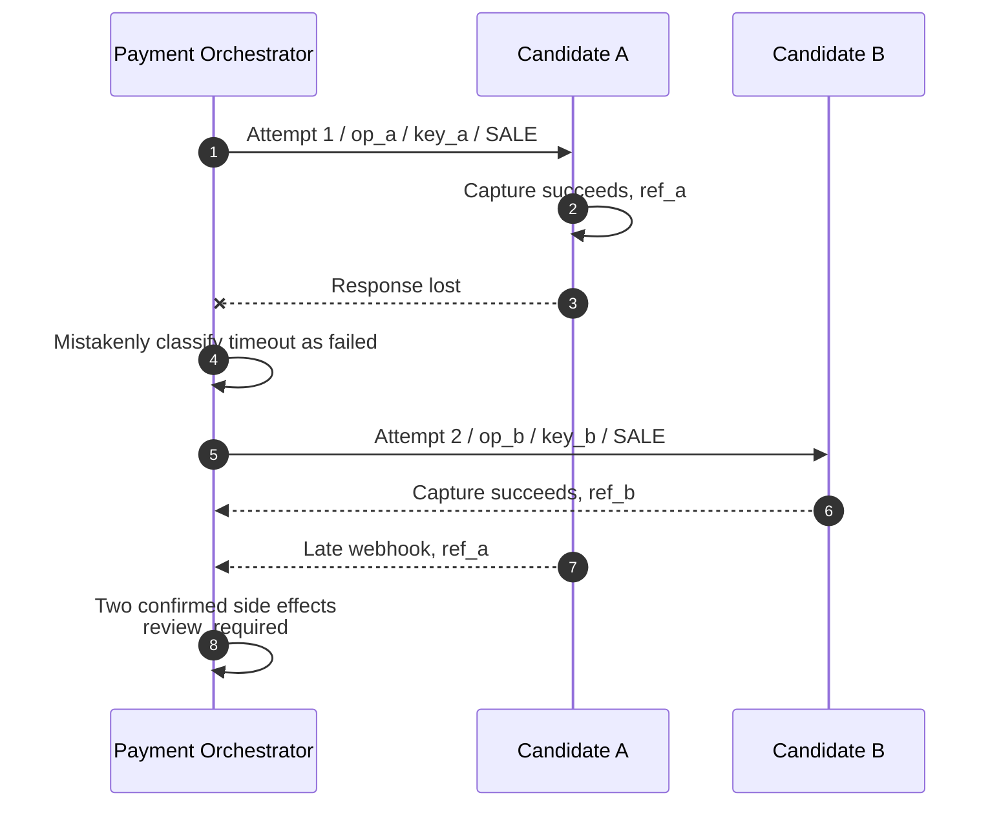
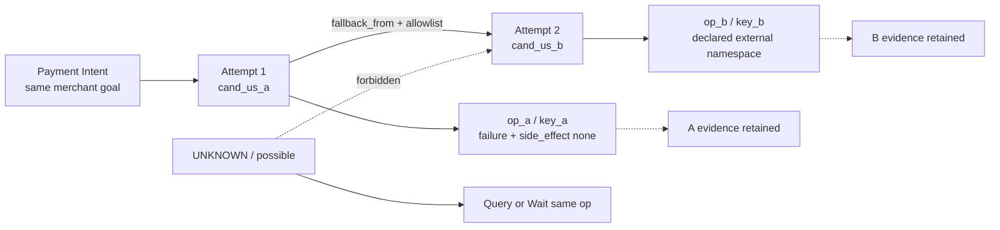
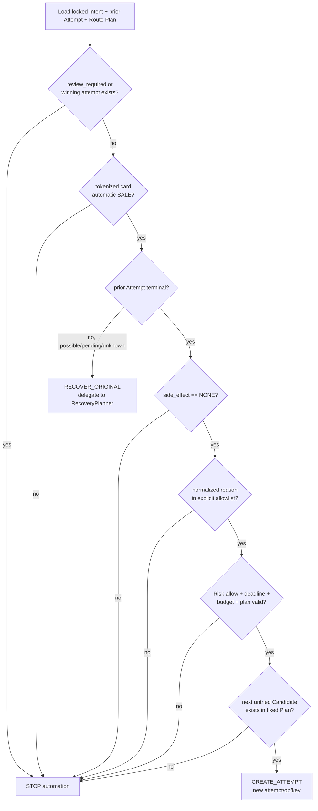
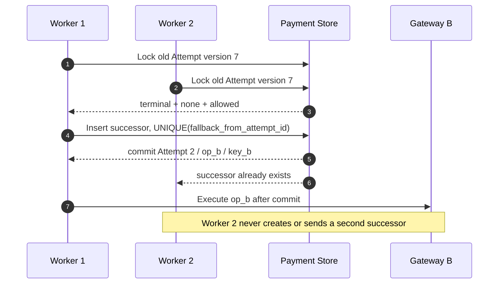

# 第 12 章 Fallback Routing

Aurora 的 Router 为一笔 129.00 USD 的 tokenized card automatic-capture 支付返回了有序 Route Plan：`cand_us_a`、`cand_us_b`。Payment Orchestrator 用第一个 Candidate 创建 Attempt 1 和 `SALE` Operation。几百毫秒后，Gateway 返回“Provider 暂时不可用”。系统是否应该立刻调用 `cand_us_b`？

只看“暂时不可用”无法回答。若 Adapter 能证明请求在越过 Provider 边界前就被拒绝，旧 Operation 的 `side_effect_certainty` 是 `none`；若请求可能已经到达 Provider，只是响应丢失，同一句错误意味着 `possible` 和 `UNKNOWN`。即使确实是 `none`，Issuer Decline、Risk Block、需要 3DS 的 `action` 也不应被自动换路绕过。因此本章的核心命题是：

> **Fallback 是 Payment Orchestrator 在旧 Attempt 已明确终结、`side_effect=NONE`，且版本化 Policy 的 reason allowlist 明确许可后，创建新 Attempt 的恢复动作。它不是 timeout 后换一家 PSP 重试，也不是与 Static、Cost、Success-Rate 并列的选路策略。**

第 10 章处理同一 Operation 的 Query、Wait 与 Same-Key Resubmit，第 11 章定义不同层的稳定身份；本章只回答“何时有资格产生第二条资金路径”。Provider Health 对未来新交易的影响留到第 13 章，完整 Decision Record 留到第 14 章。首个工程增量仍限定为 tokenized card、automatic-capture `SALE`，不会假装同一规则适用于银行转账、钱包或 manual capture。

## 12.1 Problem：错误不是创建第二条资金路径的许可证

最直观的 Fallback 实现，是依次调用候选列表，任何错误都继续下一项：

```go
package naivefallback

import "context"

type Command struct {
	AmountMinor int64
	Currency    string
}

type Provider interface {
	Sale(context.Context, Command) error
}

// Charge is intentionally unsafe: err cannot prove that the previous call
// had no side effect.
func Charge(ctx context.Context, providers []Provider, command Command) error {
	var lastErr error
	for _, provider := range providers {
		if err := provider.Sale(ctx, command); err != nil {
			lastErr = err
			continue
		}
		return nil
	}
	return lastErr
}
```

这个循环把进程可见的 `error` 当成远端资金事实。假设 A 已完成 Capture，只是响应在返回途中丢失；循环会调用 B，顾客可能看到两笔成功扣款。Provider A 的 idempotency key 也保护不了 Provider B，因为两者没有共享去重域。



这里真正需要区分的是三种机制：

| 机制 | 触发时点 | 身份是否改变 | 所有者 | 是否可创建资金路径 |
| --- | --- | --- | --- | --- |
| Routing | 新 Attempt 执行前 | 选择一个具体 Candidate | Router 决策，Payment 固定 | 只产生决策，不执行资金副作用 |
| Retry / Recovery | 原 Operation 结果尚未确定 | 固定 operation、connection、key、payload | Payment Recovery + Gateway | 不创建新 Attempt |
| Fallback | 旧 Attempt 已有明确无副作用终态 | 新 Attempt、Operation、Provider key | Payment FallbackPlanner | 通过全部闸门后才允许 |
| Provider Health | 多笔交易的技术观测已形成快照 | 影响后续新请求的 eligible set 或 score | Health subsystem / Router | 不改写正在恢复的旧 Operation |

Cost-Aware 或 Success-Rate Routing 比较的是“一个新 Attempt 应选哪个合格 Candidate”；Fallback 判断的是“旧 Attempt 之后是否允许存在一个新 Attempt”。把两者放进同一个策略枚举，会让评分结果看起来可以抵消副作用不确定性，这是职责层面的错误。

## 12.2 Simple Design：`side_effect=NONE` 是必要条件，不是充分条件

比“遇错切换”更好的第一步，是只在旧 Operation 没有副作用时继续。但“没有副作用”仍不足以代表“应该再次尝试”。一个明确的 Issuer Decline 通常可以被 Adapter 归一为 `failure/none`，它却可能携带不得重试、需要顾客修正信息或完成认证的业务含义。若 FallbackPlanner 只检查 certainty，就会把技术安全误当成业务许可。

因此至少要连续通过两道独立闸门：

1. **证据门**：旧 Attempt 已终结，且可信证据给出 `side_effect_certainty=none`。Timeout、断连、无效响应、含糊 5xx、pending 都不能通过。
2. **策略门**：归一化 reason 位于当前 Route Plan 所引用 Policy 的显式 allowlist。Issuer Decline、Risk Block、`review_required`、3DS 或钱包 `action` 默认不在列表中。

之后还要检查 operation 类型、Fallback 次数、总 deadline、已尝试 Candidate、Risk guardrail 和并发所有权；任何字段缺失或未知都 fail explicit，而不是猜测为允许。

| 旧 Attempt 的证据 | `side_effect` | 默认动作 | 为什么 |
| --- | --- | --- | --- |
| 本地 durable state 证明请求从未 dispatch，reason 为 allowlisted technical failure | `none` | 可继续检查 budget、deadline、Risk 与下一个 Candidate | 证据门和策略门都可能通过 |
| Provider 对精确 Operation 给出契约化的“未处理”终态 | `none` | 只有该 normalized reason 在 allowlist 时才可 Fallback | HTTP code 本身不够 |
| Issuer Decline，包括看似 “soft” 的 decline | `none` | Stop，默认不 Fallback | 应遵守 reason/advice 与顾客动作，不进行 PSP 猎取 |
| Timeout、EOF、连接重置、含糊 5xx | `possible` | Recovery 原 Operation：Query/Wait/同 key 证据化重送 | 不知道 A 是否已执行 |
| Provider 返回 pending 或异步受理引用 | `possible` | Query/Wait 原 Operation | 已知旧操作存在，不能换路 |
| `requires_action` / 3DS Challenge | `possible` 或流程态 | 继续原 Attempt 的认证流程 | 交互状态与 transaction context 不可随意迁移 |
| Risk `block`、过期且 fail-closed、`review_required` | 任意 | Stop automation | Fallback 不能绕过中央护栏或证据冲突 |
| 已 Capture / Authorized / 有确认的 Provider reference | `confirmed` | Stop；后续操作绑定原交易 | 已存在资金事实 |

Stripe 的官方 decline code 表同时给出 decline code、advice code 和不同的下一步：有的要求认证，有的要求更换支付方式，有的要求联系 Issuer，并不存在一个可跨 Provider 套用的“soft decline 一律换路”规则。[Stripe Decline Codes](https://docs.stripe.com/declines/codes) Mastercard 官方 Switch Rules 也定义了 Merchant Advice Code 及 “Do not try again” 等商户动作。[Mastercard Switch Rules](https://www.mastercard.com/content/dam/mccom/shared/business/support/rules-pdfs/mastercard-switch-rules-manual.pdf) 因而 Adapter 可以保存 Provider/Network 原始 code，Policy 只能消费经过版本化映射的 stable reason；不认识的 code 必须落到 deny，而不能按字符串包含 `temporary` 来猜。

### 12.2.1 Outcome Classification 不能是 Provider 返回的一个布尔值

Provider 不应直接决定平台是否 Fallback。Adapter 只拥有对协议响应的解释权，例如“请求可能已 dispatch”“这个 Provider code 在该 API 版本中表示 conclusive decline”；Payment-owned Policy 才拥有“这个业务是否允许新 Attempt”的决定权。一个可持久化的 `OutcomeClassification` 可以包含以下字段：

| 字段 | 产生者 | 含义 |
| --- | --- | --- |
| `outcome_class` | Adapter normalizer | success、failure、pending 或 unknown |
| `side_effect_certainty` | Adapter + durable dispatch evidence | none、possible 或 confirmed |
| `normalized_reason` | 版本化 normalizer | 稳定 reason code，不是原始错误字符串 |
| `retryable_same_route` | Recovery Policy | 是否可在原 connection/key/payload 上恢复 |
| `fallback_allowed` | Fallback Policy | 当前 reason 是否命中明确 allowlist |
| `requires_user_action` | Adapter / Payment Method flow | 是否存在 3DS、Redirect 等续程 |
| `source` / `normalizer_version` | Gateway | 证据来自同步响应、Query、webhook 还是本地证明 |

`fallback_allowed=true` 仍不是立即发请求的命令，它只是策略门的结果；Planner 还要重新检查 certainty、旧 Attempt 终态、Risk、Plan、预算和并发所有权。这样既避免 Adapter 越权路由，也避免 Payment 只凭一个 Provider 原始字段跨通道执行。相反，`retryable_same_route` 只授权第 10 章的原 Operation 恢复，不能被解释成新 Attempt。

## 12.3 Problems at Scale：一次新 Attempt 会重开整条执行链

### 12.3.1 UNKNOWN 不会因为备选通道健康而变安全

`cand_us_b` 延迟更低、成功率更高，甚至 A 正在发生事故，都不能改变 Attempt 1 的资金事实。进入 `UNKNOWN/possible` 后，恢复仍固定 A 的 `operation_id`、`provider_connection_id`、Provider key 与 request hash。第 13 章的 Health Snapshot 可以让下一笔新支付避开 A，却不能追溯性地把旧请求标成未执行。

Adyen 的官方 idempotency 文档明确要求 timeout 后复用同一个 key，并说明不同 regional endpoint 之间不会检查重复 key。[Adyen API Idempotency](https://docs.adyen.com/development-resources/api-idempotency) 这个具体契约揭示了一个通用平台边界：same-operation recovery 必须固定原 connection 和 key；跨 Candidate 的新 Attempt 必须获得自己的 Operation 与 key，不能声称旧 key 提供跨 PSP 保护。

### 12.3.2 “Soft” 与 “Hard” 不是平台可凭感觉划的两堆错误

同一个文案可能来自 Gateway、本地 Adapter、PSP、Acquirer 或 Issuer；同一个 HTTP 402/422 也可能包裹完全不同的 advice。生产分类必须至少携带 `source`、Provider/Network code、normalizer version、operation kind 和 side-effect evidence。首个 Fallback allowlist 应极窄，例如只接受 `provider_unavailable_pre_dispatch`；扩大列表必须有目标 Adapter 的官方语义、contract test、风险审核和回滚方案。

Issuer Decline 即使是 conclusive `none`，本章仍默认阻断。让顾客更正 CVC、完成认证、换卡或稍后主动重试，是新的产品/网络语义，不等于后台在同一次 confirm 中自动向多家 PSP 扫射。这样的限制会牺牲一部分即时转化，却能避免违反 advice、重复认证和“直到某家批准为止”的 issuer shopping。

### 12.3.3 3DS `action` 是续程，不是失败

需要 Redirect、Challenge 或原生 3DS SDK 时，Payment 已经进入由 Provider transaction、认证 session、return URL 和客户端状态共同组成的流程。Adyen 官方 result code 文档把带 `action` 的结果与后续 `/payments/details` 明确串成认证续程。[Adyen Payment Result Codes](https://docs.adyen.com/online-payments/build-your-integration/payment-result-codes) 把 `requires_action` 解释成“Candidate A 失败”并切到 B，会丢失认证关联，也可能同时留下一个仍可完成的 A。

因此 `requires_action`、`challenge_in_progress`、`redirect_pending` 默认都令 Fallback 停止。若将来要做跨 Provider 的顾客可见重启，必须创建新的用户旅程和明确同意，并证明旧认证/授权已安全终结；它不是本章的自动 Fallback。

### 12.3.4 Route Plan 要固定允许集合，但不能冻结已失效的安全护栏

如果每次失败后重新调用实时 scorer，Candidate 的成本、成功率和 Health 可能已经变化，同一 Payment 的候选序列便不可解释；更危险的是新配置可能引入最初未通过 Eligibility 的 connection。Router 应在首次决策时签发不可变的 `RoutePlanDecision`：它带 `plan_id`/digest、Policy/Capability/Feature 版本、稳定顺序、最大 Attempt 数和有效期；Payment 在创建 Attempt 1 的事务中固定原件。**一次 Fallback 不重新请求 Route Decision，也不重新执行 Cost、Performance 或 Scoring 来产生新的 Candidate Set/Ranking。**

FallbackPlanner 只能沿该 Plan 选择“未尝试且已列入”的**下一项**，不能跳到一个重新评分后的 winner、临时追加 Provider，也不能让 Gateway 自选备用账户。创建新 Attempt 前，Payment 取得新的版本化 Risk Decision，并调用 Router-owned 的 guardrail-only revalidation（例如 `RevalidatePlanCandidate`）核对 Plan 中这一个 Candidate 的 Capability/Health 硬门禁。该接口只返回 `allow` 或带证据的 `veto`，不得新增候选、改变原顺序、计算分数或签发新 Route Plan；Payment 也不自行复制 Eligibility/Health 求值语义。Risk 为 `block`、`require_3ds`、`review`，任一 revalidation 证据过期/不完整，或接口不可用时，Planner 都必须 Stop。当前教学 Planner 只把 Risk expiry 显式放进 Snapshot，guardrail-only revalidation 是待配套合同，不是第二次路由。

Fallback 获准时，Payment 在 successor 事务中生成自己的不可变 `FallbackExecutionBinding`。它引用原 `RoutePlanDecision`、旧 Attempt/version、固定的下一 Candidate、刷新后的 Risk/guardrail evidence、Planner action/reason 与预算变化；它不是 Router Decision，也没有新 Candidate Set 或排名。Router 继续拥有首次 Plan 与 Eligibility 语义，Payment 继续拥有“是否基于旧 Attempt 证据创建新资金路径”的唯一权限。

### 12.3.5 新 Attempt 必须拥有全新的执行身份

Fallback 不是把旧 Attempt 的 Provider 字段改成 B。一个被允许的 successor 至少满足：

| 身份或事实 | Attempt 1 → Attempt 2 | 理由 |
| --- | --- | --- |
| `payment_intent_id`、amount、currency、capture mode | 保持不变 | 仍服务同一个 Merchant 业务目标 |
| `attempt_id` / `attempt_number` | 新 ID，序号递增 | 每条资金路径独立审计 |
| `operation_id` | 新 ID | B 的 Sale 不是 A 的 Operation Retry |
| `provider_connection_id` | 来自固定 Plan 的下一个具体 Candidate | Provider、Merchant Account、Connector、Region 均可不同 |
| `provider_idempotency_key` | 新 key，唯一约束落在 Adapter 为 B 声明的外部幂等 namespace；执行仍固定 B 的精确 connection/revision | 不复用 A 的 key，也不把 connection ID 错当成所有 Provider 的外部去重域 |
| `routing_plan_id` / Candidate snapshot | 引用同一固定 Plan 与实际执行项 | 解释为什么 B 有资格被选择 |
| `fallback_from_attempt_id` | 指向旧 Attempt | 形成不可变 Attempt chain |
| Provider transaction reference | 不复制 | B 只能产生自己的 reference；A 的证据仍属于 A |



### 12.3.6 并发 worker 会把一个许可放大成多个 successor

同步请求、Recovery worker、webhook consumer 和运营命令都可能同时观察到旧 Attempt 的失败终态。纯 Planner 得到相同的 `CREATE_ATTEMPT` 并不意味着它们都可以写入。Payment Store 必须在一个事务里锁定 Intent/旧 Attempt，验证旧 version、`active_attempt_id`、winning Attempt 和 Plan budget，然后插入唯一 successor、Operation 与 outbox。数据库应对 `fallback_from_attempt_id` 建立唯一约束或等价的比较交换，保证 20 个竞争者最多创建一个 Attempt 2。

锁和 lease 只决定谁创建 successor，不是 side-effect proof。旧 Attempt 若为 UNKNOWN，即使某 worker 拿到全局锁，也仍然不能进入 Fallback。

### 12.3.7 Budget 与 Deadline 必须覆盖整条 Attempt chain

若每个 Candidate 都重新获得三秒 timeout 和两次 Fallback，包含五个 Candidate 的 Plan 会把商户的一次确认拖成长尾瀑布；进程重启后若计数归零，还可能回到 A 形成循环。Route Plan 因此要固化绝对的 `fallback_deadline_at` 和 `max_attempts`，其中 Attempt 1 也计入总数。每次 successor 事务递增持久化计数，不能按单 worker、单 Provider 分别计数。

已尝试集合使用稳定 `candidate_id`，而不是 Provider 品牌名：同一 PSP 的不同 Merchant Account/Connector/Region 是不同 connection，但 Planner 也不能因为别名或配置重载再次选中同一 Candidate。Plan 顺序耗尽、deadline 到期或 budget 用完都返回 Stop；这些条件只是停止新 Attempt 的理由，不会反向证明某个 UNKNOWN 已失败。Inbound HTTP deadline 到期同样不能重置 Fallback deadline，API 可以返回当前 processing 投影，后台仍遵守最初固定的绝对时钟。

## 12.4 Production Design：让 Payment-owned Planner 只回答三个动作

### 12.4.1 固定的判定顺序

生产路径不能让 allowlist、预算和 certainty 以不同顺序散落在多个 handler。建议把旧 Attempt 与 Route Plan 组成不可变 Snapshot，由纯 `FallbackPlanner` 按固定顺序求值：



先检查 `review_required` 和 winning Attempt，可以阻止迟到证据已经暴露冲突时继续自动化；再检查 operation 范围，避免 Capture/Refund 借用 Sale 的策略；非终态的 possible/pending/unknown 统一回到原 Operation 恢复。只有 `terminal + none + allowlisted reason` 才进入预算与 Candidate 选择。

下面的 Go 设计把动作空间限制为 `stop`、`recover_original` 和 `create_attempt`。示例 allowlist 刻意只有一个 pre-dispatch technical reason；map 只做 membership test，Candidate 始终按 Plan 顺序遍历，因此结果可重放。

```go
package fallback

import (
	"errors"
	"time"
)

var ErrInvalidSnapshot = errors.New("invalid fallback snapshot")

type Action string

const (
	ActionStop            Action = "stop"
	ActionRecoverOriginal Action = "recover_original"
	ActionCreateAttempt   Action = "create_attempt"
)

type SideEffect string

const (
	SideEffectNone      SideEffect = "none"
	SideEffectPossible  SideEffect = "possible"
	SideEffectConfirmed SideEffect = "confirmed"
)

type RiskAction string

const (
	RiskAllow      RiskAction = "allow"
	RiskBlock      RiskAction = "block"
	RiskRequire3DS RiskAction = "require_3ds"
	RiskReview     RiskAction = "review"
)

type Candidate struct {
	ID string
}

type RoutePlan struct {
	ID          string
	Version     string
	Candidates  []Candidate
	MaxAttempts int
	DeadlineAt  time.Time
}

type PriorAttempt struct {
	ID                 string
	Number             int
	CandidateID        string
	OperationKind      string
	Terminal           bool
	SideEffect         SideEffect
	NormalizedReason   string
	ReviewRequired     bool
	RequiresUserAction bool
	TriedCandidates    map[string]struct{}
}

type Snapshot struct {
	Prior       PriorAttempt
	Plan        RoutePlan
	Risk        RiskAction
	RiskExpires time.Time
	Allowed     map[string]struct{}
}

type Decision struct {
	Action          Action
	Reason          string
	NextCandidateID string
}

func Plan(now time.Time, snapshot Snapshot) (Decision, error) {
	prior, routePlan := snapshot.Prior, snapshot.Plan
	if prior.ID == "" || prior.Number < 1 || prior.CandidateID == "" ||
		routePlan.ID == "" || routePlan.Version == "" ||
		routePlan.MaxAttempts < 1 || routePlan.DeadlineAt.IsZero() ||
		snapshot.RiskExpires.IsZero() {
		return Decision{}, ErrInvalidSnapshot
	}
	if prior.ReviewRequired {
		return Decision{Action: ActionStop, Reason: "review_required"}, nil
	}
	if prior.OperationKind != "sale" || prior.RequiresUserAction {
		return Decision{Action: ActionStop, Reason: "unsupported_or_user_action"}, nil
	}
	if !prior.Terminal {
		return Decision{Action: ActionRecoverOriginal, Reason: "prior_not_terminal"}, nil
	}
	if prior.SideEffect != SideEffectNone {
		return Decision{Action: ActionStop, Reason: "side_effect_not_none"}, nil
	}
	if _, ok := snapshot.Allowed[prior.NormalizedReason]; !ok {
		return Decision{Action: ActionStop, Reason: "reason_not_allowed"}, nil
	}
	if _, tried := prior.TriedCandidates[prior.CandidateID]; !tried {
		return Decision{}, ErrInvalidSnapshot
	}
	if snapshot.Risk != RiskAllow || !now.Before(snapshot.RiskExpires) {
		return Decision{Action: ActionStop, Reason: "risk_guardrail"}, nil
	}
	if prior.Number >= routePlan.MaxAttempts || !now.Before(routePlan.DeadlineAt) {
		return Decision{Action: ActionStop, Reason: "budget_or_deadline"}, nil
	}
	planIDs := make(map[string]struct{}, len(routePlan.Candidates))
	for _, candidate := range routePlan.Candidates {
		if _, duplicate := planIDs[candidate.ID]; candidate.ID == "" || duplicate {
			return Decision{}, ErrInvalidSnapshot
		}
		planIDs[candidate.ID] = struct{}{}
	}
	for id := range prior.TriedCandidates {
		if _, inPlan := planIDs[id]; !inPlan {
			return Decision{}, ErrInvalidSnapshot
		}
	}
	for _, candidate := range routePlan.Candidates {
		if _, tried := prior.TriedCandidates[candidate.ID]; !tried {
			return Decision{
				Action:          ActionCreateAttempt,
				Reason:          "allowlisted_no_effect_failure",
				NextCandidateID: candidate.ID,
			}, nil
		}
	}
	return Decision{Action: ActionStop, Reason: "plan_exhausted"}, nil
}
```

`ActionRecoverOriginal` 不包含 Query/Wait/Resubmit 的细节；它只是把控制权交回第 10 章的 RecoveryPlanner。普通 `UNKNOWN/possible` 必须保持 `processing` 并 Query/Wait 原 Operation，不能因 Fallback guardrail 不通过就进入 review；只有证据冲突、状态完整性冲突，或 Recovery budget/deadline 耗尽才设置独立的 `integrity_status=review_required`。`ActionStop` 也不把 Payment 一律改成 failed，调用者必须根据 reason 使用领域状态机，而不是用一个布尔值覆盖资金事实。

### 12.4.2 原子创建 successor，而不是修改旧记录

Planner 通过后，Orchestrator 先生成新 `attempt_id`、`operation_id` 和 Provider key；该 key 的唯一约束使用 Adapter 为新 Candidate 声明的外部幂等 namespace，执行身份则另行固定精确 connection/revision。随后它在事务中调用 `CreateFallbackAttempt`。命令必须绑定旧 Attempt version、Plan ID/version、immutable Intent command 和所选 Candidate snapshot；Store 重新执行全部关键不变量，并用唯一约束判定赢家。网络 I/O 只能发生在事务提交之后。

```go
package successor

import "errors"

var ErrIdentityReuse = errors.New("fallback must use new execution identities")

type Prior struct {
	PaymentID   string
	AttemptID   string
	AttemptNo   int
	OperationID string
	ProviderKey string
	CandidateID string
	AmountMinor int64
	Currency    string
}

type NewIDs struct {
	AttemptID   string
	OperationID string
	ProviderKey string
}

type Successor struct {
	PaymentID             string
	AttemptID             string
	AttemptNo             int
	FallbackFromAttemptID string
	OperationID           string
	ProviderKey           string
	CandidateID           string
	AmountMinor           int64
	Currency              string
}

func Build(prior Prior, ids NewIDs, nextCandidateID string) (Successor, error) {
	if prior.PaymentID == "" || prior.AttemptID == "" || prior.AttemptNo < 1 ||
		prior.AttemptNo == int(^uint(0)>>1) || prior.CandidateID == "" ||
		prior.OperationID == "" || prior.ProviderKey == "" ||
		ids.AttemptID == "" || ids.OperationID == "" || ids.ProviderKey == "" ||
		nextCandidateID == "" || prior.AmountMinor <= 0 || prior.Currency == "" {
		return Successor{}, ErrIdentityReuse
	}
	if ids.AttemptID == prior.AttemptID || ids.OperationID == prior.OperationID ||
		ids.ProviderKey == prior.ProviderKey || nextCandidateID == prior.CandidateID {
		return Successor{}, ErrIdentityReuse
	}
	return Successor{
		PaymentID:             prior.PaymentID,
		AttemptID:             ids.AttemptID,
		AttemptNo:             prior.AttemptNo + 1,
		FallbackFromAttemptID: prior.AttemptID,
		OperationID:           ids.OperationID,
		ProviderKey:           ids.ProviderKey,
		CandidateID:           nextCandidateID,
		AmountMinor:           prior.AmountMinor,
		Currency:              prior.Currency,
	}, nil
}
```

`Build` 只是构造器，不替代数据库事务；它强调 Payment 业务身份保持不变，而每条执行路径获得独立身份。实际 Store 还要验证 capture mode、payment method token reference、Plan digest、Risk reference、old Attempt terminal/version 和 `integrity_status`。

### 12.4.3 Intent 不能在两个 Attempt 之间短暂说谎

旧 Attempt 的 conclusive failure 是 Attempt 事实，不必立即等同于整个 Payment Intent 失败。若 Policy 可能创建 successor，应用结果与 successor 创建应在同一 Payment 事务中收敛：Attempt 1 进入 terminal failed/none；Plan 通过时 Intent 保持 `processing`，清除旧 `active_attempt_id` 后立即绑定 Attempt 2；只有 Stop 且没有 active/winning Attempt 时，Intent 才能进入 failed。否则 API 可能先对 Merchant 返回 terminal failed，几毫秒后又悄悄恢复 processing，破坏商户幂等 replay 和事件顺序。

| 事件 | Attempt 状态 | Intent 投影 | 允许的后续 |
| --- | --- | --- | --- |
| Attempt 1 为 UNKNOWN/possible | Attempt 1 active/unknown | processing | 只恢复 Attempt 1 |
| Attempt 1 为 failure/none，全部闸门通过 | Attempt 1 terminal；Attempt 2 created | processing，active=Attempt 2 | 提交后执行 B |
| Attempt 1 为 failure/none，但 Policy/预算阻断 | Attempt 1 terminal | failed | 返回明确失败 reason |
| 任一 Attempt 确认 Capture | winning Attempt 固定 | `succeeded`，captured 业务事实保持 | Stop 所有 Fallback |
| 两个 Attempt 都出现 confirmed evidence | 两条 Attempt 与两份 captured 事实均保留 | 业务状态仍为 `succeeded`；独立 `integrity_status=review_required` | 停止自动化，进入证据处置 |

successor transaction 还应与 outbox 事件原子提交。这样消费者不会只看到 “Attempt 1 failed” 却看不到已经创建的 Attempt 2，也不会在数据库回滚后收到一条不存在的 fallback event。完整的跨服务 Decision 投影属于第 14 章，但 Payment 自己的执行事实不能等到异步 Decision Store 才安全。

### 12.4.4 Capture、Void、Refund 永不进入 FallbackPlanner

Authorization 之后的 Capture、Void/Reversal 与 Capture 之后的 Refund 都以原 Provider transaction reference 为目标，而不是重新购买一次。它们必须固定原 `provider_connection_id`、Merchant Account/Region、原 transaction reference，并为“这次 Capture/Refund Operation”生成自己的 operation ID 与 Provider key；key 的冲突域仍由 Adapter 的对应 API-operation namespace 声明，不能从 connection ID 猜测。若原 connection 不可用，只能 Query、Wait、同路恢复或进入运营处置，绝不能交给 scorer 选择另一个 PSP。

Adyen 的官方 Capture API 要求使用原 authorization 的 `paymentPspReference`；Cancel 与 Reversal 同样引用原 payment；Refund 也以原 payment 的 PSP reference 为路径参数。[Adyen Capture](https://docs.adyen.com/online-payments/capture) [Adyen Cancel](https://docs.adyen.com/online-payments/cancel) [Adyen Reversal](https://docs.adyen.com/online-payments/reversal) [Adyen Refund](https://docs.adyen.com/online-payments/refund) 这些具体 API 说明了为什么后续操作必须保持 transaction correlation。不同 Provider 的字段名会变，但“不能让 B Capture/Refund A 的交易”是平台不变量。

本章首个实现只覆盖 automatic-capture `SALE`，因此最安全的接口是让 FallbackPlanner 对 `authorize`、`capture`、`void`、`refund` 全部返回 `unsupported_operation`。未来增加 manual capture 时，也应在独立 operation 状态机中沿原 connection 执行，不扩大 Fallback 的范围。

### 12.4.5 从当前 Go 基线演进

当前配套系统已经具备重要的 fail-closed 基线：Payment 先持久化 Intent、Attempt、Provider Operation；精确 connection ID/revision/namespace 贯穿 Payment 与 Gateway；`side_effect_certainty` 区分 `none/possible/confirmed`；UNKNOWN 由 RecoveryPlanner 查询原 operation；领域模型即使收到 conclusive decline 或 technical failure，也仍把 `RerouteDisposition` 设为 `blocked`。Compose E2E 证明响应丢失后最终收敛且始终只有一个 Attempt、一条 Payment Operation 和一条 Gateway Operation。

Router v3 当前响应已经包含 `routing_context.v2`、Risk evidence、完整 Optimization breakdown、`candidate_order`、selected Candidate 与排他的 `executable_until`。Payment 在创建 Attempt/Operation 的同一 PostgreSQL transaction 中固定完整 Context 与 Decision snapshots，并校验 Context digest、Risk ALLOW、Optimization order、selected connection revision 与 deadline；这些事实已经足够让首次资金路径不被后来配置重算。但它们还不是可执行 Fallback：仓库仍没有 `services/payment/internal/fallback`、带 `fallback_from_attempt_id` 唯一约束的 successor transaction、Plan-level `max_attempts/deadline` 或跨 Provider Fallback E2E。

因此最小的后续纵向切片应把现有 v3 Candidate order 升格为有独立 ID/digest/max attempts/fallback deadline 的 `RoutePlanDecision`，但不重新请求选路：只让一个 contract-tested 的 `provider_unavailable_pre_dispatch` 产生 `failure/none`；通过 Router-owned guardrail-only endpoint 对固定下一项做只减不增的 revalidation；FallbackPlanner 通过 allowlist 后原子创建 Attempt 2、Operation 与 Payment-authored `FallbackExecutionBinding`；其余 reason、过期证据和 revalidation 不可用全部 Stop。真实 PSP、manual capture 和通用 Payment Method fallback 仍不在这个切片里。

这个切片还需要一份最小执行回执：`payment_id`、旧/新 Attempt ID、Plan ID/version、old outcome/certainty/reason、Planner action/reason、所选 `candidate_id`、budget 前后值和发生时间。它由 Payment 与 Attempt 事实一起保存并写入 outbox，既不包含 PAN/CVV，也不把日志当事实源。运营人员才能回答“为什么没有切换”和“为什么只切换一次”，而不是从两条 Gateway 日志猜测。第 14、15 章会扩展为完整 Decision Record 与观测体系；本章只要求安全执行所需的有限证据不能丢。

对外 API 也不应暴露“已尝试两个 PSP，所以一定失败”这样的推断。processing、requires-action、failed 与 `review_required` 分别来自领域状态，而不是 Attempt 数量；Merchant 的同一幂等 confirm 重放必须读取既有 Intent/Attempt chain，不能再次触发 Planner 或重置 Fallback budget。

## 12.5 Failure Modes：看似提高成功率，实际绕过证据

### 12.5.1 只检查 certainty，或只检查 allowlist

只检查 `none` 会让 issuer decline、Risk Block 和用户动作进入 Fallback；只检查 reason allowlist 又可能把 Adapter 误归类但仍为 `possible` 的结果放行。两个条件必须是逻辑 AND，且来自版本化、可审计的不同事实：certainty 说明“旧操作是否可能产生副作用”，Policy 说明“业务是否允许新尝试”。

### 12.5.2 把 HTTP 状态码直接放进 Policy

`5xx`、`timeout`、`card_declined` 都太粗。Gateway/Adapter 必须先验证响应身份和 Provider-specific 语义，再输出 normalized reason、certainty、source 与 normalizer version。未知 code fail closed；更改映射需要 contract test 和发布版本。否则一次 Provider API 变更就可能无声扩大资金路径。

### 12.5.3 Fallback 时复用旧 Operation 或 key

复用会把两个 Provider 请求伪装成同一执行，破坏 unique scope、Query、webhook correlation 和审计；而生成新 key 却仍写回旧 Attempt，又会隐藏真实的第二条资金路径。正确模型是“一次允许的 Fallback = 新 Attempt + 新 Operation + 新 key”，旧记录只追加证据。

### 12.5.4 重新评分后加入 Plan 外 Candidate

实时 scorer 可能得到一个当前分数更高但不在原 Eligibility/Risk 快照中的 connection。Payment 不应自行调用“当前最佳 Provider”替换 next Candidate，也不应复制 Router 的 Eligibility/Health evaluator。它只能请求 guardrail-only revalidation 来否决固定下一项；该调用不是 Route Decision，不能生成新 Candidate Set/Ranking。若 Plan、Risk 或 revalidation evidence 失效，或 revalidation 不可用，就 Stop，而不是悄悄改变已固定的执行合同。动态 Health 如何提供这个只减不增的 veto 属于下一章。

### 12.5.5 迟到成功采用 Last-Write-Wins

即使当时的 no-effect 证据看似权威，Provider bug、查询索引延迟或错误 Adapter 映射仍可能让 A 的成功晚于 B。系统必须保留 A、B 各自的 Operation、reference、Observation 与发生时间；若两个 Attempt 都确认资金副作用，Intent 进入 `review_required`，停止自动化并交给对账/运营流程。不能让最后到达的事件覆盖另一个成功，也不能自动 Refund 其中一笔来掩盖分类缺陷。

### 12.5.6 可证伪的测试矩阵

| 故障注入 | 预期不变量 |
| --- | --- |
| A 在 durable dispatch 前返回 allowlisted technical failure/`none` | 恰有两个 Attempt、两个 Operation、两个新 key；Attempt 2 使用 Plan 中 B |
| A 已 Capture 后丢响应，B 完全健康 | 一直只有一个 Attempt/Operation；Query/Wait A，绝不调用 B |
| A 返回 issuer decline/`none` | 一个 Attempt；`reason_not_allowed`，不 Fallback |
| A 返回 3DS `action` | 原 Attempt 进入 requires-action 流程；不创建 B |
| Risk 为 block、review、require_3ds 或过期 fail-closed | 不创建 successor，也不调用 Gateway B |
| 20 个 worker 同时规划同一旧 Attempt | unique/CAS 只允许一个 successor；其余读取同一结果 |
| Plan 候选乱序输入、进程重启 | 按已持久化 Plan 顺序得到相同 next Candidate |
| Deadline 或最大 Attempt 数耗尽 | Stop，不重置时钟，不循环回 A |
| A 的迟到 captured 与 B 的 captured 并存 | 两条证据与业务 `succeeded/captured` 均保留；独立 `integrity_status=review_required`，禁止 last-write-wins |
| 对 Capture/Void/Refund 请求调用 Planner | 明确拒绝；仍绑定原 connection 与 reference |

第一条成功用例不能替代第二条安全用例。只有同时证明“允许时恰好创建一个新路径”和“不确定时永不创建新路径”，Fallback 才不是一个只在 happy path 上工作的转化率开关。



## 12.6 Trade-offs：严格 Fallback 会放弃一部分即时转化

| 选择 | 收益 | 代价 | 控制方式 |
| --- | --- | --- | --- |
| 极窄 allowlist | 重复扣款与 issuer shopping 风险最低 | 可 Fallback 的失败较少 | 从一个 Adapter/场景开始，用证据逐项扩展 |
| 固定 Route Plan | 可解释、可重放，不受实时分数漂移影响 | Plan 过期时可能没有可用 B | 明确 TTL；安全依赖失效即 stop |
| UNKNOWN fail closed | 保持单一资金路径 | 顾客更久看到 processing | Query/webhook、恢复 SLA、运营可见性 |
| Issuer Decline 默认 stop | 遵守 advice 与顾客动作语义 | 某些稍后可成功的请求不自动切换 | 给顾客准确下一步，而非后台扫 PSP |
| 每次 Fallback 新身份 | 审计、幂等与对账边界清楚 | 数据量和状态机复杂度增加 | Attempt chain、唯一约束、有限 budget |
| 原子 successor 创建 | 并发下最多一个新资金路径 | 事务与 schema 更复杂 | 短事务、outbox、I/O 在提交后执行 |
| 冲突进入 review | 不丢失真实资金事实 | 增加运营与对账成本 | 完整证据包、明确修复权限与 SLA |

严格策略常被质疑“降低成功率”，但把重复扣款、争议、退款成本和顾客信任排除在成功率之外，本身就是错误指标。Fallback 的目标不是让每个 confirm 都尽快得到 approved，而是在可证明安全且 Policy 许可时，受控地再打开一次执行机会。

另一个代价是 Provider-specific 维护。每增加一个 allowlisted reason，团队都要证明它对特定 operation、API 版本、Merchant Account/Region 和查询窗口的语义。这个成本无法靠一个全局 `retryable=true` 消除；后者只是把复杂度藏进事故。

## 12.7 Summary：先关闭旧路径，才能打开新路径

本章从“Provider A 出错就调用 B”的简单循环出发，建立了以下不变量：

1. Fallback 是 Attempt-after 恢复，不是 Static、Rule、Cost、Success-Rate 或 Scoring 的同级策略；Router 不执行资金副作用。
2. 旧 Attempt 必须明确终结且 `side_effect=none`，然后 normalized reason 还必须命中显式 allowlist；两道闸门缺一不可。
3. Timeout、断连、含糊 5xx、pending 和 UNKNOWN 默认走原 Operation 的 Query/Wait/Same-Key Recovery，永不直接换 Provider。
4. Issuer Decline 即使为 `none` 也默认阻断；Risk block、`review_required` 与 3DS/user action 不能被 Fallback 绕过。
5. `RoutePlanDecision` 由 Router 生成并由 Payment 固定；FallbackPlanner 不重新请求选路/Scoring，只取其中下一条未尝试 Candidate。Router-owned guardrail-only revalidation 只能否决该项，不能新增候选或改变顺序；过期或不可用即 Stop。
6. 每个 successor 由 Payment 生成 `FallbackExecutionBinding`，引用原 Plan、旧 Attempt、固定 next Candidate 与刷新证据；它不冒充 Router Decision。
7. 每次允许的 Fallback 都创建新 Attempt、新 Operation 和新 Provider key，同时保留同一 Payment Intent 与 `fallback_from_attempt_id`；旧证据不可改写。
8. successor 必须在数据库事务中以 old version、winning/active guard 和唯一约束原子创建；worker lease 不构成无副作用证明。
9. Capture、Void、Reversal、Refund 始终固定原 connection 与 Provider transaction reference，绝不重新评分或跨 PSP Fallback。
10. 若 A 的迟到成功与 B 的成功并存，两条 captured 证据和业务 `succeeded` 状态都保留，独立 `integrity_status` 进入 `review_required`；禁止 last-write-wins 和未经审核的自动补偿。
11. 当前 Go 系统已有 UNKNOWN 单路径、完整 v3 Context/Decision/Risk/Optimization/order/deadline 原子快照、稳定 connection 与默认 blocked 基线；专用 FallbackPlanner、RoutePlanDecision、guardrail-only revalidation、FallbackExecutionBinding、successor transaction 和跨 Provider E2E 仍是明确未实现项。

Fallback 的价值来自克制：它不是“还有一家可以试”，而是“旧路径已被证据关闭，且策略明确允许打开一条有新身份、有限预算、可审计的新路径”。下一章会把视角从单笔 Attempt 后恢复提升到跨交易的 Provider Health，让未来的新请求更早避开局部故障，但仍不会改写本章的证据门。

## 延伸阅读

* [第 3 章：Payment Routing System 的职责与边界](../part-1-foundations/routing-system-boundaries.md)
* [第 9 章：Provider Scoring 与 Risk-Aware Routing](../part-2-routing-engine/provider-scoring.md)
* [第 10 章：Timeout、Retry 与 Unknown State](timeout-and-retry.md)
* [第 11 章：Idempotency 与支付尝试](idempotency.md)
* [第 13 章：Circuit Breaker 与 Provider Health](provider-health.md)
* [第 14 章：Routing Decision Store](../part-4-operating-at-scale/routing-decision-store.md)
* [第 17 章：Reconciliation](../part-4-operating-at-scale/reconciliation.md)
* [附录 A：Payment Intent、Attempt 与 Provider Request 状态模型](../appendices/payment-state-models.md)
* [Stripe Decline Codes](https://docs.stripe.com/declines/codes)
* [Mastercard Switch Rules](https://www.mastercard.com/content/dam/mccom/shared/business/support/rules-pdfs/mastercard-switch-rules-manual.pdf)
* [Adyen API Idempotency](https://docs.adyen.com/development-resources/api-idempotency)
* [Adyen Payment Result Codes](https://docs.adyen.com/online-payments/build-your-integration/payment-result-codes)
* [Adyen Capture](https://docs.adyen.com/online-payments/capture)
* [Adyen Refund](https://docs.adyen.com/online-payments/refund)
