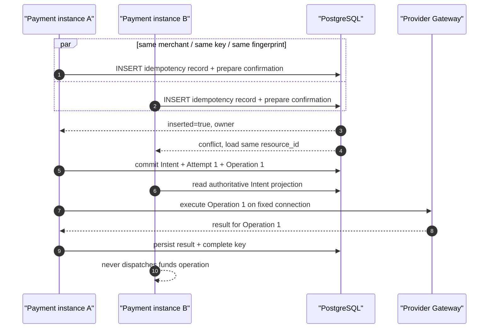
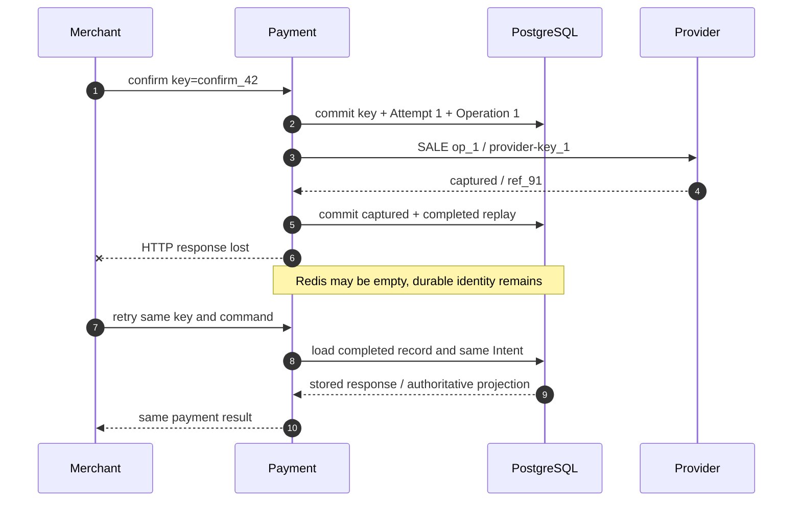
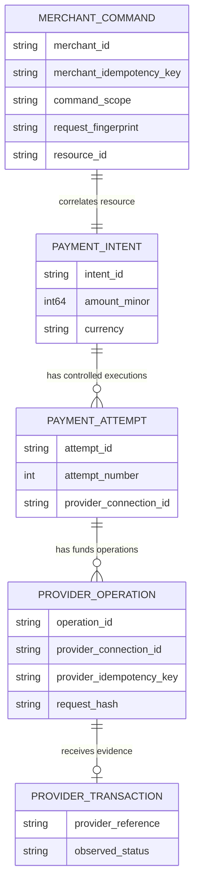
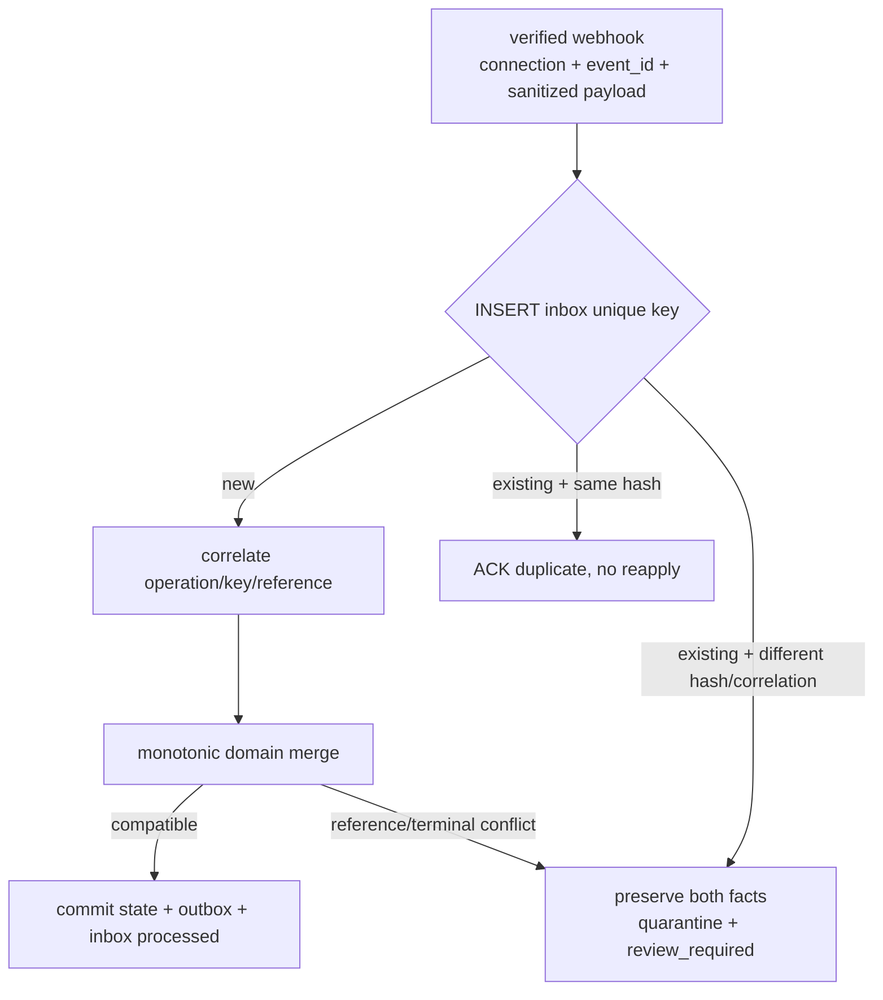

# 第 11 章 Idempotency 与支付尝试

Aurora 的购票页在开售一分钟内收到两条几乎同时到达的确认请求。它们来自同一个 Merchant、同一个 Payment Intent，也携带同一个 `Idempotency-Key`：第一条已经在实例 A 中开始处理，第二条被负载均衡器送到实例 B。稍后，实例 A 完成了 Provider `SALE`，提交数据库后却在返回 HTTP 响应前崩溃。顾客的 App 于是又重试了一次。

如果“幂等”只是实例 A 在 Redis 里写过的一份响应缓存，那么缓存 miss、TTL 到期、主从切换或两个实例同时读取 miss，都可能让同一笔业务操作再次执行。支付系统真正要回答的不是“这个字符串见过吗”，而是三个更严格的问题：这是不是同一个业务命令；命令参数是否与第一次完全相同；当前谁拥有执行权，其他调用方应读取哪一个持久化资源。

本章的核心命题是：

> **幂等是对同一业务操作的持久化身份、参数不变性和并发所有权定义。Merchant key、内部 operation ID、Provider idempotency key 与 Provider transaction reference 是四种不同身份，不能相互代替。**

第 10 章已经规定：`UNKNOWN` 只能恢复原 Operation、原 connection、原 key 与原 payload。本章解释这些“原值”如何被创建、持久化并在并发中守住。第 12 章才讨论旧 Attempt 已明确无副作用后是否允许创建新 Attempt；本章不会把幂等包装成跨 Provider Fallback 的安全证明。配套 Go 系统当前只支持 tokenized card 的 automatic-capture `SALE`，不应把示例外推为 manual Capture、Void 或 Refund 已经实现。

## 11.1 Problem：响应缓存挡不住第二条资金路径

### 11.1.1 Redis-only 设计有三个无法补齐的窗口

一个常见的第一版实现是：先查缓存，没有结果就调用 Provider，成功后缓存响应。

```go
package naive

import (
	"context"
	"time"
)

type Cache interface {
	Get(context.Context, string) ([]byte, bool, error)
	Set(context.Context, string, []byte, time.Duration) error
}

type Provider interface {
	Sale(context.Context, int64, string) ([]byte, error)
}

func Confirm(ctx context.Context, cache Cache, provider Provider, key string, amount int64, currency string) ([]byte, error) {
	if response, found, err := cache.Get(ctx, key); err == nil && found {
		return response, nil
	}
	response, err := provider.Sale(ctx, amount, currency)
	if err != nil {
		return nil, err
	}
	if err := cache.Set(ctx, key, response, 24*time.Hour); err != nil {
		return nil, err
	}
	return response, nil
}
```

这段代码至少有三个独立故障窗口：两个实例都读到 miss，因而同时调用 `Sale`；Provider 已成功但进程在 `Set` 前崩溃，下一次请求重新执行；TTL 到期后，旧 Provider Operation 可能仍处于 `UNKNOWN`，缓存却已经允许创建新操作。再加一个分布式锁只能缩小第一个窗口：锁到期、锁服务分区或持锁进程崩溃后，接管者仍不知道远端是否已产生副作用。

缓存还没有保存“同 key、不同参数”的冲突语义。攻击者或客户端 bug 可以先用 `idem_7` 确认 129.00 USD，随后用同一个 key 请求 1,290.00 USD。若代码只返回旧响应，调用方会误以为新参数生效；若代码重新执行，就可能多扣款。正确结果应是在到达 Router 或 Provider 之前拒绝冲突。

### 11.1.2 重复的是命令，不一定是 HTTP 字节

同一 JSON 对象可以有不同字段顺序和空白；同一公开 endpoint 也可能随 API 版本增加默认字段。反过来，两个字节完全相同的空 body，分别发送到 `pi_A/confirm` 和 `pi_B/confirm`，显然不是同一业务操作。因此幂等身份至少要包含 Merchant、命令作用域、目标资源和规范化后的语义 payload，不能只 hash 原始 request body。


图中的四种身份沿调用链相关，却没有哪两个天然相等。首版实现可以令 Provider key 等于 operation ID，这是一个映射策略，不是概念合并；Provider reference 在首次请求前尚不存在，更不可能充当首次调用的幂等键。

## 11.2 Simple Design：把 key 变成持久化命令记录

最小正确设计不是先上复杂协调服务，而是在 Payment 的权威数据库中保存一行不可变命令记录。当前配套系统采用 `(merchant_id, idempotency_key)` 主键；行内另存 `operation`、`request_hash`、`state`、`resource_id` 和最终响应。也就是说，key 在一个 Merchant 内全局占用，命令作用域和参数指纹用于验证，而不是让同一个 key 在不同 endpoint 各执行一次。

### 11.2.1 规范化指纹绑定业务语义

公开 API 应先解析和校验请求，再从显式版本的 typed command 生成规范化字节。下面的示例不 hash 任意 `map[string]any`，而是让字段集合与顺序由 Go 类型固定；命令名和目标 Intent 也进入摘要。

```go
package command

import (
	"crypto/sha256"
	"encoding/json"
	"fmt"
	"strings"
)

type ConfirmPayment struct {
	SchemaVersion string `json:"schema_version"`
	MerchantID    string `json:"merchant_id"`
	IntentID      string `json:"intent_id"`
	CaptureMethod string `json:"capture_method"`
}

func FingerprintConfirm(input ConfirmPayment) ([32]byte, error) {
	input.MerchantID = strings.TrimSpace(input.MerchantID)
	input.IntentID = strings.TrimSpace(input.IntentID)
	input.CaptureMethod = strings.ToLower(strings.TrimSpace(input.CaptureMethod))
	if input.SchemaVersion == "" || input.MerchantID == "" || input.IntentID == "" {
		return [32]byte{}, fmt.Errorf("incomplete confirm command")
	}
	payload, err := json.Marshal(input)
	if err != nil {
		return [32]byte{}, err
	}
	material := append([]byte("confirm_payment_intent\x00"), payload...)
	return sha256.Sum256(material), nil
}
```

“规范化”必须是 API 契约的一部分，而不是临时清理字符串。金额先校验为整数最小货币单位，币种转成受支持的大写代码，枚举转成 canonical value，缺省值在版本规则中补齐；未知字段按 API 的严格策略拒绝或显式忽略。当前配套实现把 `operation + NUL + typed JSON bytes` 固定为 `command_sha256.v1`，在每条 PostgreSQL idempotency record 上持久化 `fingerprint_version`，读取时拒绝未知版本；未来变更算法必须显式迁移，不能让旧 key 静默改用新规则。hash 只方便固定长度比较，不会让含敏感数据的 payload 自动变安全；PAN、CVV 和原始凭证仍不得进入命令记录。

### 11.2.2 key 与持久记录的组合只有四种结论

| 持久记录 | 新请求 | 结论 | 是否可执行资金操作 |
| --- | --- | --- | ---: |
| 不存在 | 合法 command + fingerprint | 原子创建 `in_progress`，请求成为 owner | 仅 owner 可以继续 |
| 存在且 command/fingerprint 相同，`in_progress` | 同一业务命令 | 返回同一 `resource_id` 的当前投影 | 不可以重新执行 |
| 存在且 command/fingerprint 相同，`completed` | 同一业务命令 | Replay 已保存结果，或按公开契约返回当前投影 | 不可以重新执行 |
| 存在但 command、target 或 fingerprint 不同 | key 被复用 | HTTP 409 `idempotency_key_reused` | 不可以 |

`in_progress` 不是“暂时没有答案，可以再跑一次”。它是一张指路牌：这条命令已经拥有一个 Payment Intent、Attempt 或其他资源，后来的请求只能读取同一个资源。对 Confirm 而言，第一次事务应同时写入 idempotency record、Attempt、Provider Operation、固定 connection 和 request hash；如果事务回滚，这些事实一起消失，不会留下“key 已占用但资源不存在”的半状态。

### 11.2.3 Replay 不要求响应字节永远不变

不同 Provider 的官方语义已经说明，幂等 Replay 未必逐字返回首次响应：[Stripe API v1](https://docs.stripe.com/api/idempotent_requests) 保存首次请求的状态码和 body，而 [PayPal](https://developer.paypal.com/api/rest/reference/idempotency/) 说明重复 request ID 返回先前请求的**当前状态**。因此平台必须为每个公开 command 固定自己的契约：创建 Intent 通常适合重放首次 `201`；Confirm 若首次返回 `202 processing`，后续相同 key 可以返回同一 Intent 的当前投影，终态后再保存稳定结果。无论采用哪一种，都不能创建第二个 Attempt。

## 11.3 Problems at Scale：并发、崩溃与外部作用域同时出现

### 11.3.1 应用层的“先查再插”不能选出唯一 owner

20 个请求可以在同一微秒读到“记录不存在”。互斥必须落到所有实例共享的权威存储：以唯一约束作为裁判，执行 `INSERT ... ON CONFLICT DO NOTHING`；只有插入成功者成为 owner，其余事务锁定并读取胜者记录。PostgreSQL 官方文档说明多列 `UNIQUE` 约束保证组合值唯一，`ON CONFLICT` 使用唯一索引或约束选择冲突动作。[PostgreSQL Unique Constraints](https://www.postgresql.org/docs/current/ddl-constraints.html#DDL-CONSTRAINTS-UNIQUE-CONSTRAINTS) [PostgreSQL INSERT](https://www.postgresql.org/docs/current/sql-insert.html)



在 `SERIALIZABLE` 或显式行锁下，事务仍可能因序列化冲突被数据库要求重试。服务应重试**领取事务**或重新读取胜者，而不是把数据库错误变成新的业务 operation。只验证“数据库最终有一行”还不够；端到端验收要断言所有并发调用都关联同一资源，并且 Gateway 只看到一个 operation identity。

### 11.3.2 提交成功、响应丢失是幂等的主战场



这个序列解释了为什么“响应缓存”与“幂等事实”必须分离。Redis 可以保存热 Replay，减少数据库读取；cache miss 只能回源 PostgreSQL，不能获得执行权。缓存 TTL 也不能决定业务记录的删除时刻。

### 11.3.3 Provider key 的作用域不是平台常量

Provider 的幂等契约在作用域、保留期、并发结果和 Replay 内容上并不相同：

| 官方契约示例 | 作用域或生命周期事实 | 对 Adapter 的要求 |
| --- | --- | --- |
| Stripe API v1 | 同 key 比较参数；记录至少 24 小时后可被清理；并发冲突在 endpoint 尚未开始执行时不保存结果 | 保存 API/账户作用域、参数与首次执行证据，不能假设 key 永久有效 |
| Adyen | key 在 company account 级别唯一，至少保留 7 天；不同 Region endpoint 不互查；同 key 并发可能返回 transient error 或 409/422 | connection 必须固定 Merchant Account 与 Region；只按官方 transient 证据重试同 key |
| PayPal | `PayPal-Request-Id` 是否支持及保留期由具体 API 决定；key 对 request/API call type 唯一；两条并发请求可能一条成功、一条失败，Replay 返回当前状态 | Adapter metadata 按 operation 声明支持范围，不能把失败的第二响应当作原操作失败 |

这些都是会随 API 与产品版本变化的 Provider 行为，应以当前官方资料为准：[Stripe Idempotent Requests](https://docs.stripe.com/api/idempotent_requests) [Adyen API Idempotency](https://docs.adyen.com/development-resources/api-idempotency) [PayPal Idempotency](https://developer.paypal.com/api/rest/reference/idempotency/)

因此 Provider idempotency key 的数据库唯一约束必须包含 Adapter 按 Provider 契约声明的外部幂等 namespace。当前模拟契约使用 `provider_namespace_id` 表达该冲突域；两个不同 connection/revision 若映射到同一个 Provider 账户与 Region namespace，同一个 key 仍然冲突。相反，同一个字符串处在另一个 PSP、另一个账户或另一个不共享去重的 Region namespace 时，才不提供跨域保护。这不表示恢复时可以换 connection：恢复记录仍固定原 connection/revision、namespace、key 与 payload，任何漂移都应在 Gateway 出站前成为冲突。

### 11.3.4 Provider retention 到期，不会消除内部 Operation

Provider 可以清理 key，平台却可能仍有一条未解决的 `UNKNOWN`，或者多年后仍需用 transaction reference 发起 Refund 和 Reconciliation。内部 operation ID、request hash、connection 与 Provider reference 的保留策略由支付、审计和合规需求决定，不能跟随外部 key TTL 一起删除。

Adapter 应暴露版本化 metadata，例如：哪些 operation 支持 key、key 作用域、已知的最短保留期、同 key 并发结果、参数冲突语义、是否能按 key 查询。超出有保证的窗口后，系统不能宣称 resubmit 安全；它仍保留原 Operation 并 Query、Wait 或进入 `review_required`。把旧 idempotency record 清掉后再创建新 Operation，只是把不确定性藏起来。

### 11.3.5 Webhook 有自己的身份，不是第五个 operation key

Webhook 至少一次投递会产生重复，网络队列又会导致乱序。Stripe 官方文档明确要求处理重复 event ID，并说明事件不保证按生成顺序送达。[Stripe Webhooks](https://docs.stripe.com/webhooks#handle-duplicate-events) 因此 inbox 的主键应按 Provider 契约声明的 event namespace 构造；当前模拟契约使用 `(provider_namespace_id, event_id)`。Webhook 验签仍绑定接收它的精确 connection/revision 与密钥，namespace 相同绝不授予跨连接认证权限。Inbox identity 只回答“这份外部证据是否已经摄取”，不等于 merchant key、operation ID 或 Provider key。

同一个 `event_id` 携带完全相同的规范化 payload 是可确认的重复，应返回 2xx 而不重复应用；同一个 ID 携带不同 operation/reference/status，则是身份冲突，必须保存原事件与新 payload 的 digest，隔离并进入复核，绝不能覆盖 inbox。两个不同 event ID 可能描述同一 Operation 的不同时间点，仍要经过第 10 章的单调状态收敛：迟到 `pending` 不能降级已确认 `captured`，不相容终态或 reference 则进入 `review_required`。

## 11.4 Production Design：用四层身份守住一条资金操作

### 11.4.1 Intent、Attempt、Operation 与 Provider reference 分层



四种身份的权威定义如下：

| 身份 | 生成者 | 最小作用域 | 生命周期与用途 | 冲突语义 |
| --- | --- | --- | --- | --- |
| Merchant idempotency key | Merchant/client | 当前实现为 Merchant 内全局；记录再绑定 command/target/fingerprint | 去重公开 API 命令，关联同一资源与 Replay | 同 key 不同 command/参数返回 409 |
| Internal operation ID | Payment Orchestrator | 平台全局唯一的逻辑资金操作 | 贯穿 dispatch、Query、webhook、恢复与审计 | 同 ID 的 connection 或 payload 变化为完整性冲突 |
| Provider idempotency key | 平台/Adapter | Provider 声明的账户、Region、API operation 幂等 namespace；当前代码以 `provider_namespace_id` 表达 | 在官方窗口内重送同一 Provider 操作；执行仍固定精确 connection/revision | 同 namespace 不同 payload 拒绝；跨 namespace 不提供去重 |
| Provider transaction reference | Provider | Provider 声明的 reference namespace；当前代码以 `provider_namespace_id` 表达 | Provider 已接收或创建交易后的证据；用于 Query、Capture、Void、Refund、Reconciliation | 不同 Operation 在同 namespace 抢占同 reference，或一条 Operation 出现不相容 reference，进入复核 |

一个 Intent 可以先后收到 `create`、`confirm`、将来的 `cancel` 等多个 Merchant 命令；一个 Intent 也可能在第 12 章的严格前提下拥有多个 Attempt。因此 Merchant key 与 operation ID 不应做成永久一对一字段。反过来，同一 Operation 的所有网络重试都必须保持一个 operation ID、一个 connection、一个 Provider key 和一个 request hash。

### 11.4.2 Claim、关联资源与 Replay 必须在同一事务边界

应用逻辑可以把数据库领取结果归一化为四种动作。下面的纯 Go 分类器假设 `inserted=true` 已由唯一约束选出 owner；对于已有记录，它只允许读取资源、重放或拒绝冲突，没有“再执行一次”的分支。

```go
package replay

import (
	"bytes"
	"errors"
)

var ErrKeyConflict = errors.New("idempotency key reused for another command")

type State string

const (
	StateInProgress State = "in_progress"
	StateCompleted  State = "completed"
)

type Action string

const (
	ActionExecute      Action = "execute_as_owner"
	ActionReadResource Action = "read_resource"
	ActionReplayResult Action = "replay_result"
)

type Incoming struct {
	CommandScope string
	Fingerprint  []byte
}

type Record struct {
	CommandScope string
	Fingerprint  []byte
	State        State
	ResourceID   string
}

func Resolve(inserted bool, incoming Incoming, existing Record) (Action, error) {
	if inserted {
		return ActionExecute, nil
	}
	if existing.CommandScope != incoming.CommandScope ||
		!bytes.Equal(existing.Fingerprint, incoming.Fingerprint) {
		return "", ErrKeyConflict
	}
	if existing.State == StateCompleted {
		return ActionReplayResult, nil
	}
	return ActionReadResource, nil
}
```

数据库事务还必须验证 `resource_id` 非空且属于同一 Merchant。对于 Confirm，owner 在同一事务中锁定 Intent、检查它没有 active/winning Attempt、写入 Attempt 和 Operation，再把 `resource_id` 指向该 Intent。loser 读取这条关联；它不能根据自己在事务外生成的 `attempt_id` 或 Routing Decision 继续执行。

### 11.4.3 数据库不变量是最终裁判

| 表或对象 | 建议唯一约束 | 它防止什么 | 它不能证明什么 |
| --- | --- | --- | --- |
| API command record | `(merchant_id, idempotency_key)` | 同 Merchant 的 key 被两条命令占有 | Provider 是否已执行 |
| Payment Attempt | `(payment_intent_id, attempt_number)` | 同一序号出现两次 | 是否允许创建下一 Attempt |
| Provider Operation | `operation_id`；首版一个 Attempt 一个 Sale Operation | 同一内部资金操作重复创建 | Provider key 的外部保留期 |
| Provider key mapping | `(provider_idempotency_namespace, provider_idempotency_key)`；当前为 `(provider_namespace_id, key)` | 同一外部去重域的 key 指向两条 Operation，即使连接 ID/revision 不同 | Provider 窗口外是否仍安全重送 |
| Provider reference | `(provider_reference_namespace, provider_reference)`，非空时唯一；当前 namespace 复用 `provider_namespace_id` | 两笔 Attempt 认领同一外部交易 | 迟到冲突证据的自动真伪 |
| Webhook inbox | `(provider_event_namespace, event_id)`；当前为 `(provider_namespace_id, event_id)` | 同一外部事件被重复应用 | 不同 event ID 是否语义重复；也不授予跨连接验签权限 |

唯一约束负责跨进程所有权，领域状态机负责“现在是否允许执行”。两者缺一不可：只靠状态检查会有并发竞态；只靠 operation ID 唯一，却允许 loser 对同一行再次 dispatch，也会产生风险。worker lease、`FOR UPDATE SKIP LOCKED` 或 advisory lock 只决定谁处理当前任务，不能证明远端没有副作用。

### 11.4.4 Gateway 再做一次不可变命令校验

Payment 与 Gateway 是两个持久化边界。即使 Payment 已生成 request hash，Gateway 仍应在自己的 operation 表执行 `CreateOrGet(operation_id)`，比较完整 command digest，再决定是否出站。下面的示例展示 digest 至少绑定 Attempt、connection、Provider、金额、币种、Token reference 与 capture mode：

```go
package providercommand

import (
	"crypto/sha256"
	"encoding/json"
	"errors"
)

var ErrOperationConflict = errors.New("operation replay changed immutable parameters")

type Command struct {
	OperationID          string `json:"operation_id"`
	AttemptID            string `json:"attempt_id"`
	ProviderConnectionID string `json:"provider_connection_id"`
	Provider             string `json:"provider"`
	AmountMinor          int64  `json:"amount_minor"`
	Currency             string `json:"currency"`
	PaymentTokenRef      string `json:"payment_token_ref"`
	CaptureMethod        string `json:"capture_method"`
}

func Digest(command Command) ([32]byte, error) {
	payload, err := json.Marshal(command)
	if err != nil {
		return [32]byte{}, err
	}
	return sha256.Sum256(payload), nil
}

func VerifyReplay(original, incoming Command) error {
	left, err := Digest(original)
	if err != nil {
		return err
	}
	right, err := Digest(incoming)
	if err != nil {
		return err
	}
	if left != right {
		return ErrOperationConflict
	}
	return nil
}
```

校验必须发生在 Provider 调用前。相同 operation ID 若改变 amount、token、connection 或 capture mode，都返回冲突并记录审计事件；不能以“新参数更正确”为由覆盖旧行。Provider key 可由 operation ID 派生，但需要单独持久化，因为 Adapter 可能有长度、字符集、operation-type namespace 或版本要求。日志只记录 digest 与非敏感 ID，不记录 Token 原值。

### 11.4.5 当前配套实现与本章增量要分开

| 能力 | 当前 Go 系统基线 | 仍未实现或未生产化 |
| --- | --- | --- |
| Merchant command | PostgreSQL `idempotency_records` 以 `(merchant_id,key)` 唯一，保存 operation、request hash、state、resource、response 与 `fingerprint_version=command_sha256.v1`；相同 key 不同 command/target/payload 返回 409 | 公开 API 版本升级时的多 fingerprint reader/migration 与记录归档策略 |
| 并发 Confirm | `SERIALIZABLE` prepare transaction 带 serialization retry、唯一 key 与 Intent 行锁；真实 PostgreSQL 测试让 20 个并发 caller 共享一个 Intent、一个 Attempt、一个 Payment Operation 和一次 Gateway execute | 跨 Region owner 留第 19 章；生产争用阈值、deadlock/重试指标仍需容量验证 |
| Crash/restart Replay | idempotency completion 与 captured 投影同事务提交；重建 Service 后同 key 读取 durable replay，不重新调用 Router/Gateway | API response schema 的长期兼容与历史 response 数据治理 |
| Operation identity | Payment 同事务创建 Attempt/Operation；Provider key 当前等于 operation ID，完整 connection ID/revision/namespace、key 与 request hash 固定 | 为每个真实 Adapter 发布 Provider key derivation/version 合同 |
| Connection scope | Payment 与 Gateway 都保存精确 connection revision，Gateway 的 key/operation 冲突校验覆盖账户命名空间 | 为每个真实 Adapter 声明账户/Region/API operation scope 与 retention metadata |
| Payload immutability | Gateway v2 hash 使用无歧义 typed encoding，覆盖 operation、Attempt、connection revision、金额、币种、Token、capture mode，并有跨 Payment/Gateway golden 与漂移测试 | 真实 PSP wire payload 的字段演进与敏感字段最小化仍需 Adapter contract |
| Inbox | Gateway 与 Payment 都持久化 scoped event identity；重复 payload 接受，不同 payload/correlation 隔离，Gateway observation 另有 canonical JSONB hash | **Payment inbox 尚未持久化显式 canonical payload hash 与算法版本**；两边还缺 retention/cleanup lifecycle 与归档证明 |
| UNKNOWN recovery | 持久 deadline/budget/claim 在重启后仍领取原 Operation，普通 404 不会生成第二次 POST | 明确 API idempotency record 与 Provider key 过期/清理策略，并证明 cleanup 永不重新开放资金执行权 |

因此，20 路并发 Confirm、进程重建后的 durable Replay、单 Attempt/Operation/Gateway execute 与 fingerprint version 已经是配套代码的可验证基线，不再列为待办。仍不能夸大的部分是 Provider retention metadata、Payment inbox 的 canonical payload hash/version、以及 idempotency/inbox/outbox 的清理与归档生命周期。代码是否成为本章的已发布证据，以 delivery manifest 固定的 commit 与绿色 CI run 为准；真实 PostgreSQL/Compose 门禁未成功前不能只凭源码宣布完成。

### 11.4.6 Webhook inbox 先保存事实，再推进状态



验签、原始 body 的受控处理、sanitization 与 canonical hash 都发生在状态迁移前。inbox 行、Payment 状态和业务 outbox 应在一个 Payment-owned 事务中提交；否则 crash 可能造成“事件已标记处理但状态没更新”，或状态已更新却再次消费。对于无法关联的事件，也要持久化 quarantine，而不是返回错误后永远丢失证据。

## 11.5 Failure Modes：幂等最常见的错误承诺

### 11.5.1 一张表也可能实现错误

| 失败模式 | 为什么危险 | 正确控制 |
| --- | --- | --- |
| Redis key 存在才算重复 | eviction、TTL、分区和 crash 会重新开放执行权 | PostgreSQL 是事实源；Redis 只缓存 Replay |
| 先执行、后插 idempotency record | Provider 成功后崩溃会留下无身份副作用 | 先事务性 claim 并创建 durable Operation |
| 相同 key 不比较 command/payload | 新金额或另一 endpoint 被静默当成旧请求 | typed canonical fingerprint；不一致返回 409 |
| `in_progress` 请求再次调用 Router/Gateway | 并发 loser 生成第二个 Attempt 或 connection | 返回同一 `resource_id` 当前投影 |
| idempotency TTL 到期就删除 UNKNOWN | 未解决的旧副作用与新 Operation 并存 | record 清理受 Operation 终态和审计策略约束 |
| Provider key 只按 PSP 名称或 connection 唯一 | 前者混合不同账户/Region，后者又会拆开共享同一外部去重域的 alias/revision | Adapter 声明 key namespace；恢复另行固定精确 connection/revision |
| 相同 operation ID 改 amount/token/mode | Provider 可能把重放解释为不同命令 | Gateway request hash 在出站前 fail closed |
| 用 Provider reference 当首次 key | 首次请求前 reference 不存在；其语义由 Provider 决定 | operation/key 先创建，reference 作为后到证据 |
| webhook event ID 全局唯一 | 不同 connection 可能有相同格式或命名空间 | 按 Provider 契约作用域组成 inbox identity |
| 相同 event ID 的新 payload 覆盖旧 payload | 证据被篡改或关联 bug 被隐藏 | 保存 hash 冲突与两份证据，进入复核 |
| “幂等成功”被解释为“支付成功” | 幂等只限制重复执行，不提供终态证据 | 保持 `UNKNOWN/pending/succeeded/failed` 分离 |

幂等也不会让所有后续资金动作共享一个 key。未来 manual Capture、Void 与 Refund 都应有自己的 internal operation ID 与 Provider key，同时使用原 `provider_connection_id + provider transaction reference` 作为目标。它们不能重新路由，也不能用最初 Sale 的 key 冒充另一种 API operation。Provider reference 碰撞或相互矛盾的终态必须保留历史资金事实并进入 `review_required`。

### 11.5.2 可证伪的测试矩阵

本章设计至少要被以下失败测试推翻过一次，才能证明实现不是“看起来有 key”：

1. 对同一 Intent、Merchant key 和 Confirm command 同时发起 20 个请求。无论实例分布如何，数据库只有一个 Attempt、一个 Payment Operation、一个 Gateway Operation；所有成功响应关联同一个 Intent，Provider 只收到一条逻辑 Operation。
2. 同一个 Merchant key 先用于 `create_payment_intent`，再用于 Confirm；或对 Create 改 amount/currency/token；两者都在任何资金副作用前返回 HTTP 409。
3. Gateway 已保存某 operation 后，依次改变 amount、token、connection、Provider kind、capture mode。每个变体都得到 idempotency conflict，Provider 调用计数保持不变。
4. Payment 在 captured 状态和 idempotency completion 同一事务提交后、HTTP 响应前崩溃。缓存清空并重启后，相同 key Replay 同一 Payment，不产生新的 Attempt。
5. Operation 为 `UNKNOWN` 时模拟 API idempotency record 超出普通 Replay 窗口。recovery worker 仍领取原 operation；公开 API 不允许借“记录过期”创建第二条资金路径。
6. 同一 `(connection,event_id)` 投递相同 payload 两次，只应用一次；第三次改 operation/reference/status，被 quarantine 并把相关聚合标记为 `review_required`，旧证据不被覆盖。
7. 两个不同 event ID 先后发送 captured 与迟到 pending，终态保持 captured；若发送另一个 reference 或不相容终态，保存冲突并停止自动恢复。

测试断言不能只看 Payment 最终为 `succeeded`。两次扣款中的任意一次成功，也能让这个断言变绿；必须同时检查身份数量、connection、request hash、Provider 调用次数、inbox 冲突和资金 reference。

## 11.6 Trade-offs：越稳定的身份，保留成本越高

| 设计选择 | 收益 | 代价 | 建议边界 |
| --- | --- | --- | --- |
| Merchant 内 key 全局唯一 | 最容易发现跨 endpoint 误用 | 客户端必须为每个 command 生成新 key | 公开文档明确作用域；409 提供稳定错误码 |
| 每个 endpoint 各自 key namespace | 客户端复用更宽松 | 同 key 跨操作不再暴露 bug | 只有业务确实需要时采用，并把 scope 放入唯一键 |
| 保存首次完整响应 | Replay 最确定 | schema 演进、存储与敏感字段治理更复杂 | 只存公开、脱敏响应；定义保留和版本策略 |
| 返回资源当前投影 | 长流程能显示最新状态 | Replay 不再字节级相同 | 在 API 契约中明确，始终关联同一资源 |
| 长期保存 idempotency record | crash/审计窗口更安全 | 表增长、索引与隐私成本 | 分层归档；未终态 Operation 不随普通 TTL 删除 |
| `SERIALIZABLE` 事务 | 所有权推理清晰 | 高争用时会 abort，需要重试 | 重试领取事务，不生成新业务身份 |
| 唯一约束 + 短行锁 | 吞吐更可控 | 状态机与锁顺序更难审计 | 用并发和 deadlock 测试证明，而非凭经验 |
| Provider key 直接等于 operation ID | 简单、易关联 | 受 Provider 长度/格式/namespace 限制 | 概念仍分开；持久化映射和 derivation version |
| 增加 Redis Replay cache | 降低完成记录热读 | 失效与一致性路径增多 | miss 回源数据库；cache 永不授予执行权 |

指纹本身也有隐私权衡。对低熵字段做裸 SHA-256 可能被枚举，完整 payload 又可能包含不应保留的数据。更安全的方式是先执行数据最小化，只保留完成冲突判断所需的规范化非敏感字段；需要隐藏低熵内容时使用受控 HMAC 与可轮换 key version。无论采用何种摘要，审计日志都只输出 fingerprint、scope 和资源 ID，不输出原 Token、Provider credential 或支付凭证。

跨 Region 的 Merchant key 所有权会让“唯一约束”变成分布式问题，这属于第 19 章；本章只要求一个明确的权威写入域。Provider key 窗口之外是否能自动恢复，也必须由 Adapter metadata 和第 10 章的证据门槛决定，不能用一个全球 retention 常量解决。

## 11.7 Summary：同一张取号单，只能指向同一件事

本章从 Redis-only response cache 的竞态出发，得到了一组可以落入数据库和测试的不变量：

1. 幂等记录属于 Payment 的权威持久化状态；Redis、分布式锁和 HTTP middleware 都只能加速或协调，不能成为资金事实源。
2. Merchant key、internal operation ID、Provider idempotency key 和 Provider transaction reference 是四类身份；生成者、作用域、生命周期与冲突语义各不相同。
3. 相同 Merchant key 必须绑定 command scope、目标资源和 canonical fingerprint；同 key 不同语义在副作用前返回 409。
4. 数据库唯一约束原子选出一个 owner。并发 loser 读取同一 `resource_id` 或 Replay，同一个 `in_progress` 绝不授权再次执行。
5. Confirm 的 key claim、Intent 锁定、Attempt/Operation 创建和资源关联必须在同一事务边界；事务提交后响应丢失仍能从 durable record 重放。
6. 同一 Provider Operation 固定 operation ID、connection、Provider key 与 request hash。Gateway 对 amount、token、connection 或 capture mode 漂移 fail closed。
7. Provider 幂等只在官方声明的账户、Region、API operation 与保留窗口内成立；不同 Provider 的 retention、并发和 Replay 语义由版本化 Adapter metadata 暴露。
8. Webhook inbox 使用独立 event identity；精确重复只应用一次，同 ID 不同 payload/correlation 保留冲突并进入 `review_required`，乱序证据按单调状态机合并。
9. 幂等证明的是“同一逻辑操作不被重复执行”，不是支付成功、无副作用或允许 Fallback。`UNKNOWN` 继续恢复原 Operation；第 12 章只有在旧 Attempt 明确无副作用时才讨论新的 Attempt。

当前配套 Go 系统已经拥有 PostgreSQL merchant idempotency record、版本化 request fingerprint、in-progress resource correlation、20 路并发唯一 owner、重启 Replay、稳定 Attempt/Operation、`provider_namespace_id` 作用域的 Provider key/reference/event 冲突约束、精确 connection/revision 执行绑定、Gateway v2 request hash 与持久化 inbox/outbox 基线。当前模拟契约让三种外部 namespace 共用一个字段；真实 Adapter 若三者作用域不同，必须分别表达。剩余边界是 Payment inbox 的 canonical payload hash/version、真实 Provider contract/retention metadata，以及记录清理、归档和过期后仍不重新开放资金路径的完整 lifecycle 证明。

## 延伸阅读

* [第 3 章：Payment Routing System 的职责与边界](../part-1-foundations/routing-system-boundaries.md)
* [第 10 章：Timeout、Retry 与 Unknown State](timeout-and-retry.md)
* [第 12 章：Fallback Routing](fallback-routing.md)
* [第 19 章：Multi-Region Payment Routing](../part-5-global-routing/multi-region.md)
* [附录 A：Payment Intent、Attempt 与 Provider Request 状态模型](../appendices/payment-state-models.md)
* [Stripe Idempotent Requests](https://docs.stripe.com/api/idempotent_requests)
* [Adyen API Idempotency](https://docs.adyen.com/development-resources/api-idempotency)
* [PayPal Idempotency](https://developer.paypal.com/api/rest/reference/idempotency/)
* [PostgreSQL Unique Constraints](https://www.postgresql.org/docs/current/ddl-constraints.html#DDL-CONSTRAINTS-UNIQUE-CONSTRAINTS)
* [Stripe Webhooks](https://docs.stripe.com/webhooks)
