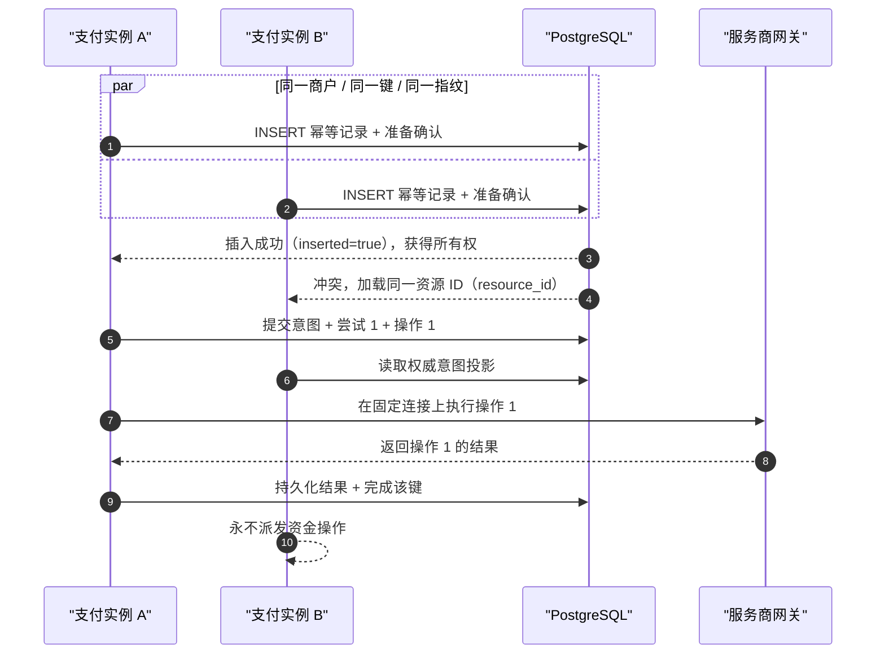
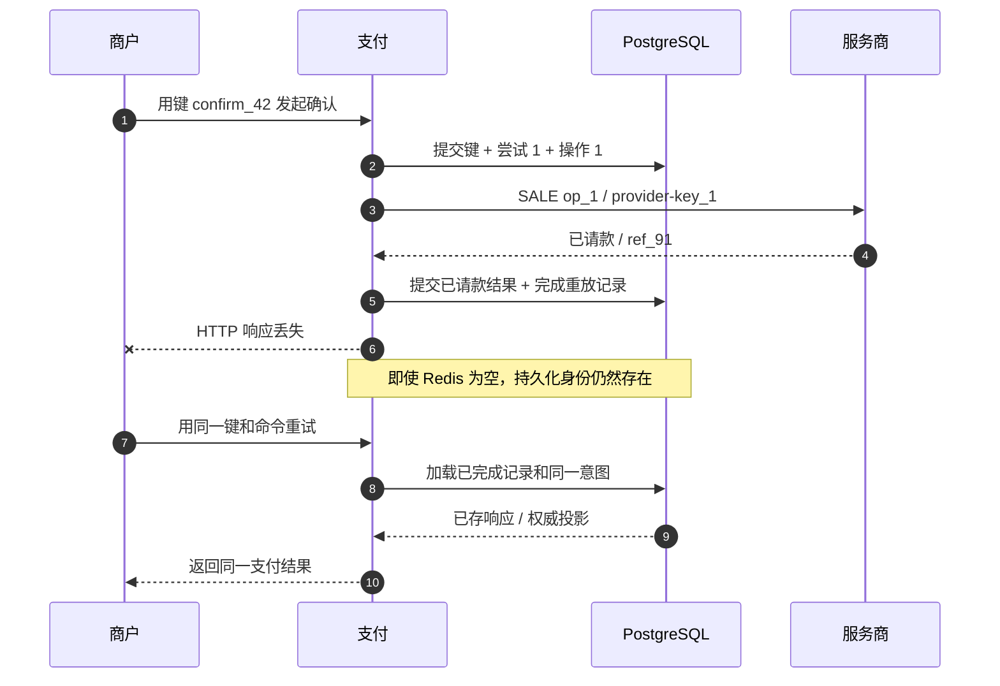
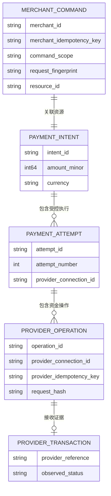
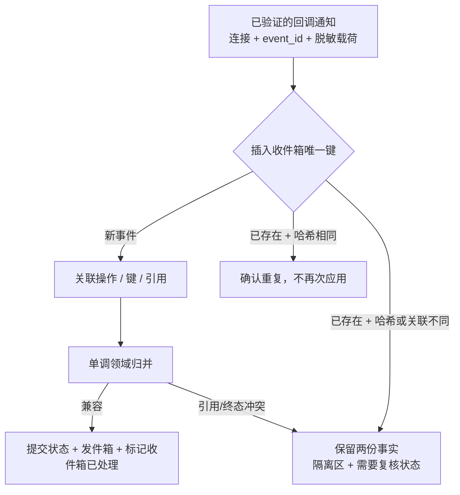

# 第 11 章 幂等性与支付尝试

Aurora 的购票页在开售一分钟内收到两条几乎同时到达的确认请求。它们来自同一个商户、同一个支付意图，也携带同一个 `Idempotency-Key`：第一条已经在实例 A 中开始处理，第二条被负载均衡器送到实例 B。稍后，实例 A 完成了服务商 `SALE`，提交数据库后却在返回 HTTP 响应前崩溃。顾客的应用于是又重试了一次。

如果“幂等”只是实例 A 在 Redis 里写过的一份响应缓存，那么缓存未命中、TTL 到期、主从切换或两个实例同时读取未命中，都可能让同一笔业务操作再次执行。支付系统真正要回答的不是“这个字符串见过吗”，而是三个更严格的问题：这是不是同一个业务命令；命令参数是否与第一次完全相同；当前谁拥有执行权，其他调用方应读取哪一个持久化资源。

本章的核心命题是：

> **幂等是对同一业务操作的持久化身份、参数不变性和并发所有权定义。商户键、内部操作 ID、服务商幂等键与服务商交易引用是四种不同身份，不能相互代替。**

第 10 章已经规定：`UNKNOWN` 只能恢复原操作、原连接、原键与原载荷。本章解释这些“原值”如何被创建、持久化并在并发中守住。第 12 章才讨论旧尝试已明确无副作用后是否允许创建新尝试；本章不会把幂等包装成跨服务商后备路由的安全证明。配套 Go 系统当前只支持令牌化银行卡的自动请款 `SALE`，不应把示例外推为人工请款、撤销或退款已经实现。

## 11.1 问题：响应缓存挡不住第二条资金路径

### 11.1.1 仅使用 Redis 的设计有三个无法补齐的窗口

一个常见的第一版实现是：先查缓存，没有结果就调用服务商，成功后缓存响应。

```go
package naive

import (
	"context"
	"time"
)

type Cache interface {
	Get(context.Context, string) ([]byte, bool, error)
	Set(context.Context, string, []byte, time.Duration) error
}

type Provider interface {
	Sale(context.Context, int64, string) ([]byte, error)
}

func Confirm(ctx context.Context, cache Cache, provider Provider, key string, amount int64, currency string) ([]byte, error) {
	if response, found, err := cache.Get(ctx, key); err == nil && found {
		return response, nil
	}
	response, err := provider.Sale(ctx, amount, currency)
	if err != nil {
		return nil, err
	}
	if err := cache.Set(ctx, key, response, 24*time.Hour); err != nil {
		return nil, err
	}
	return response, nil
}
```

这段代码至少有三个独立故障窗口：两个实例都读到未命中，因而同时调用 `Sale`；服务商已成功但进程在 `Set` 前崩溃，下一次请求重新执行；TTL 到期后，旧服务商操作可能仍处于 `UNKNOWN`，缓存却已经允许创建新操作。再加一个分布式锁只能缩小第一个窗口：锁到期、锁服务分区或持锁进程崩溃后，接管者仍不知道远端是否已产生副作用。

缓存还没有保存“同键、不同参数”的冲突语义。攻击者或客户端缺陷可以先用 `idem_7` 确认 129.00 USD，随后用同一个键请求 1,290.00 USD。若代码只返回旧响应，调用方会误以为新参数生效；若代码重新执行，就可能多扣款。正确结果应是在到达路由服务或服务商之前拒绝冲突。

### 11.1.2 重复的是命令，不一定是 HTTP 字节

同一 JSON 对象可以有不同字段顺序和空白；同一公开端点也可能随 API 版本增加默认字段。反过来，两个字节完全相同的空请求体，分别发送到 `pi_A/confirm` 和 `pi_B/confirm`，显然不是同一业务操作。因此幂等身份至少要包含商户、命令作用域、目标资源和规范化后的语义载荷，不能只哈希原始请求体。


图中的四种身份沿调用链相关，却没有哪两个天然相等。首版实现可以令服务商幂等键等于操作 ID，这是一个映射策略，不是概念合并；服务商引用在首次请求前尚不存在，更不可能充当首次调用的幂等键。

## 11.2 简单设计：把键变成持久化命令记录

最小正确设计不是先上复杂协调服务，而是在支付的权威数据库中保存一行不可变命令记录。当前配套系统采用 `(merchant_id, idempotency_key)` 主键；行内另存 `operation`、`request_hash`、`state`、`resource_id` 和最终响应。也就是说，键在一个商户内全局占用，命令作用域和参数指纹用于验证，而不是让同一个键在不同端点各执行一次。

### 11.2.1 规范化指纹绑定业务语义

公开 API 应先解析和校验请求，再从显式版本的类型化命令生成规范化字节。下面的示例不哈希任意 `map[string]any`，而是让字段集合与顺序由 Go 类型固定；命令名和目标意图也进入摘要。

```go
package command

import (
	"crypto/sha256"
	"encoding/json"
	"fmt"
	"strings"
)

type ConfirmPayment struct {
	SchemaVersion string `json:"schema_version"`
	MerchantID    string `json:"merchant_id"`
	IntentID      string `json:"intent_id"`
	CaptureMethod string `json:"capture_method"`
}

func FingerprintConfirm(input ConfirmPayment) ([32]byte, error) {
	input.MerchantID = strings.TrimSpace(input.MerchantID)
	input.IntentID = strings.TrimSpace(input.IntentID)
	input.CaptureMethod = strings.ToLower(strings.TrimSpace(input.CaptureMethod))
	if input.SchemaVersion == "" || input.MerchantID == "" || input.IntentID == "" {
		return [32]byte{}, fmt.Errorf("incomplete confirm command")
	}
	payload, err := json.Marshal(input)
	if err != nil {
		return [32]byte{}, err
	}
	material := append([]byte("confirm_payment_intent\x00"), payload...)
	return sha256.Sum256(material), nil
}
```

“规范化”必须是 API 契约的一部分，而不是临时清理字符串。金额先校验为整数最小货币单位，币种转成受支持的大写代码，枚举转成规范值，缺省值在版本规则中补齐；未知字段按 API 的严格策略拒绝或显式忽略。当前配套实现把操作名、NUL 分隔符和类型化 JSON 字节固定组合为 `command_sha256.v1`，在每条 PostgreSQL 幂等性记录上持久化 `fingerprint_version`，读取时拒绝未知版本；未来变更算法必须显式迁移，不能让旧键静默改用新规则。哈希只方便固定长度比较，不会让含敏感数据的载荷自动变安全；PAN、CVV 和原始凭证仍不得进入命令记录。

### 11.2.2 键与持久记录的组合只有四种结论

| 持久记录 | 新请求 | 结论 | 是否可执行资金操作 |
| --- | --- | --- | ---: |
| 不存在 | 合法命令 + 指纹 | 原子创建 `in_progress`，请求成为所有者 | 仅所有者可以继续 |
| 存在且命令/指纹相同，`in_progress` | 同一业务命令 | 返回同一 `resource_id` 的当前投影 | 不可以重新执行 |
| 存在且命令/指纹相同，`completed` | 同一业务命令 | 重放已保存结果，或按公开契约返回当前投影 | 不可以重新执行 |
| 存在但命令、目标或指纹不同 | 键被复用 | HTTP 409 `idempotency_key_reused` | 不可以 |

`in_progress` 不是“暂时没有答案，可以再跑一次”。它是一张指路牌：这条命令已经拥有一个支付意图、尝试或其他资源，后来的请求只能读取同一个资源。对确认而言，第一次事务应同时写入幂等性记录、尝试、服务商操作、固定连接和请求哈希；如果事务回滚，这些事实一起消失，不会留下“键已占用但资源不存在”的半状态。

### 11.2.3 重放不要求响应字节永远不变

不同服务商的官方语义已经说明，幂等重放未必逐字返回首次响应：[Stripe API v1](https://docs.stripe.com/api/idempotent_requests) 保存首次请求的状态码和响应体，而 [PayPal](https://developer.paypal.com/api/rest/reference/idempotency/) 说明重复请求 ID 返回先前请求的**当前状态**。因此平台必须为每个公开命令固定自己的契约：创建意图通常适合重放首次 `201`；确认若首次返回 `202 processing`，后续相同键可以返回同一意图的当前投影，终态后再保存稳定结果。无论采用哪一种，都不能创建第二个尝试。

## 11.3 规模化问题：并发、崩溃与外部作用域同时出现

### 11.3.1 应用层的“先查再插”不能选出唯一所有者

20 个请求可以在同一微秒读到“记录不存在”。互斥必须落到所有实例共享的权威存储：以唯一约束作为裁判，执行 `INSERT ... ON CONFLICT DO NOTHING`；只有插入成功者成为所有者，其余事务锁定并读取胜者记录。PostgreSQL 官方文档说明多列 `UNIQUE` 约束保证组合值唯一，`ON CONFLICT` 使用唯一索引或约束选择冲突动作。[PostgreSQL 唯一约束](https://www.postgresql.org/docs/current/ddl-constraints.html#DDL-CONSTRAINTS-UNIQUE-CONSTRAINTS) [PostgreSQL INSERT](https://www.postgresql.org/docs/current/sql-insert.html)



在 `SERIALIZABLE` 或显式行锁下，事务仍可能因序列化冲突被数据库要求重试。服务应重试**领取事务**或重新读取胜者，而不是把数据库错误变成新的业务操作。只验证“数据库最终有一行”还不够；端到端验收要断言所有并发调用都关联同一资源，并且网关只看到一个操作身份。

### 11.3.2 提交成功、响应丢失是幂等的主战场



这个序列解释了为什么“响应缓存”与“幂等事实”必须分离。Redis 可以保存热重放，减少数据库读取；缓存未命中只能回源 PostgreSQL，不能获得执行权。缓存 TTL 也不能决定业务记录的删除时刻。

### 11.3.3 服务商幂等键的作用域不是平台常量

服务商的幂等契约在作用域、保留期、并发结果和重放内容上并不相同：

| 官方契约示例 | 作用域或生命周期事实 | 对适配器的要求 |
| --- | --- | --- |
| Stripe API v1 | 同键比较参数；记录至少 24 小时后可被清理；并发冲突在端点尚未开始执行时不保存结果 | 保存 API/账户作用域、参数与首次执行证据，不能假设键永久有效 |
| Adyen | 键在公司账户级别唯一，至少保留 7 天；不同区域端点不互查；同键并发可能返回暂时性错误或 409/422 | 连接必须固定商户账户与区域；只按官方暂时性错误证据重试同键 |
| PayPal | `PayPal-Request-Id` 是否支持及保留期由具体 API 决定；键对请求/API 调用类型唯一；两条并发请求可能一条成功、一条失败，重放返回当前状态 | 适配器元数据按操作声明支持范围，不能把失败的第二响应当作原操作失败 |

这些都是会随 API 与产品版本变化的服务商行为，应以当前官方资料为准：[Stripe 幂等请求](https://docs.stripe.com/api/idempotent_requests) [Adyen API 幂等性](https://docs.adyen.com/development-resources/api-idempotency) [PayPal 幂等性](https://developer.paypal.com/api/rest/reference/idempotency/)

因此服务商幂等键的数据库唯一约束必须包含适配器按服务商契约声明的外部幂等命名空间。当前模拟契约使用 `provider_namespace_id` 表达该冲突域；两个不同连接/修订若映射到同一个服务商账户与区域命名空间，同一个键仍然冲突。相反，同一个字符串处在另一个 PSP、另一个账户或另一个不共享去重的区域命名空间时，才不提供跨域保护。这不表示恢复时可以换连接：恢复记录仍固定原连接/修订、命名空间、键与载荷，任何漂移都应在网关出站前成为冲突。

### 11.3.4 服务商保留期到期，不会消除内部操作

服务商可以清理键，平台却可能仍有一条未解决的 `UNKNOWN`，或者多年后仍需用事务引用发起退款和对账。内部操作 ID、请求哈希、连接与服务商引用的保留策略由支付、审计和合规需求决定，不能跟随外部键 TTL 一起删除。

适配器应暴露版本化元数据，例如：哪些操作支持键、键作用域、已知的最短保留期、同键并发结果、参数冲突语义、是否能按键查询。超出有保证的窗口后，系统不能宣称重送安全；它仍保留原操作并查询、等待或进入 `review_required`。把旧幂等性记录清掉后再创建新操作，只是把不确定性藏起来。

### 11.3.5 回调通知有自己的身份，不是第五个操作键

回调通知至少一次投递会产生重复，网络队列又会导致乱序。Stripe 官方文档明确要求处理重复事件 ID，并说明事件不保证按生成顺序送达。[Stripe：回调通知](https://docs.stripe.com/webhooks#handle-duplicate-events) 因此收件箱的主键应按服务商契约声明的事件命名空间构造；当前模拟契约使用 `(provider_namespace_id, event_id)`。回调通知验签仍绑定接收它的精确连接/修订与密钥，命名空间相同绝不授予跨连接认证权限。收件箱身份只回答“这份外部证据是否已经摄取”，不等于商户键、操作 ID 或服务商幂等键。

同一个 `event_id` 携带完全相同的规范化载荷是可确认的重复，应返回 2xx 而不重复应用；同一个 ID 携带不同操作/引用/状态，则是身份冲突，必须保存原事件与新载荷的摘要，隔离并进入复核，绝不能覆盖收件箱。两个不同事件 ID 可能描述同一操作的不同时间点，仍要经过第 10 章的单调状态收敛：迟到 `pending` 不能降级已确认 `captured`，不相容终态或引用则进入 `review_required`。

## 11.4 生产级设计：用四层身份守住一条资金操作

### 11.4.1 意图、尝试、操作与服务商引用分层



四种身份的权威定义如下：

| 身份 | 生成者 | 最小作用域 | 生命周期与用途 | 冲突语义 |
| --- | --- | --- | --- | --- |
| 商户幂等键 | 商户/客户端 | 当前实现为商户内全局；记录再绑定命令/目标/指纹 | 去重公开 API 命令，关联同一资源与重放 | 同键不同命令/参数返回 409 |
| 内部操作 ID | 支付编排器 | 平台全局唯一的逻辑资金操作 | 贯穿派发、查询、回调通知、恢复与审计 | 同 ID 的连接或载荷变化为完整性冲突 |
| 服务商幂等键 | 平台/适配器 | 服务商声明的账户、区域、API 操作幂等命名空间；当前代码以 `provider_namespace_id` 表达 | 在官方窗口内重送同一服务商操作；执行仍固定精确连接/修订 | 同命名空间不同载荷拒绝；跨命名空间不提供去重 |
| 服务商交易引用 | 服务商 | 服务商声明的引用命名空间；当前代码以 `provider_namespace_id` 表达 | 服务商已接收或创建交易后的证据；用于查询、请款、撤销、退款、对账 | 不同操作在同命名空间抢占同引用，或一条操作出现不相容引用，进入复核 |

一个意图可以先后收到 `create`、`confirm`、将来的 `cancel` 等多个商户命令；一个意图也可能在第 12 章的严格前提下拥有多个尝试。因此商户键与操作 ID 不应做成永久一对一字段。反过来，同一操作的所有网络重试都必须保持一个操作 ID、一个连接、一个服务商幂等键和一个请求哈希。

### 11.4.2 所有权声明、关联资源与重放必须在同一事务边界

应用逻辑可以把数据库领取结果归一化为四种动作。下面的纯 Go 分类器假设 `inserted=true` 已由唯一约束选出所有者；对于已有记录，它只允许读取资源、重放或拒绝冲突，没有“再执行一次”的分支。

```go
package replay

import (
	"bytes"
	"errors"
)

var ErrKeyConflict = errors.New("idempotency key reused for another command")

type State string

const (
	StateInProgress State = "in_progress"
	StateCompleted  State = "completed"
)

type Action string

const (
	ActionExecute      Action = "execute_as_owner"
	ActionReadResource Action = "read_resource"
	ActionReplayResult Action = "replay_result"
)

type Incoming struct {
	CommandScope string
	Fingerprint  []byte
}

type Record struct {
	CommandScope string
	Fingerprint  []byte
	State        State
	ResourceID   string
}

func Resolve(inserted bool, incoming Incoming, existing Record) (Action, error) {
	if inserted {
		return ActionExecute, nil
	}
	if existing.CommandScope != incoming.CommandScope ||
		!bytes.Equal(existing.Fingerprint, incoming.Fingerprint) {
		return "", ErrKeyConflict
	}
	if existing.State == StateCompleted {
		return ActionReplayResult, nil
	}
	return ActionReadResource, nil
}
```

数据库事务还必须验证 `resource_id` 非空且属于同一商户。对于确认，所有者在同一事务中锁定意图、检查它没有活跃或胜出尝试、写入尝试和操作，再把 `resource_id` 指向该意图。落选项读取这条关联；它不能根据自己在事务外生成的 `attempt_id` 或路由决策继续执行。

### 11.4.3 数据库不变量是最终裁判

| 表或对象 | 建议唯一约束 | 它防止什么 | 它不能证明什么 |
| --- | --- | --- | --- |
| API 命令记录 | `(merchant_id, idempotency_key)` | 同商户的键被两条命令占有 | 服务商是否已执行 |
| 支付尝试 | `(payment_intent_id, attempt_number)` | 同一序号出现两次 | 是否允许创建下一尝试 |
| 服务商操作 | `operation_id`；首版一个尝试对应一个销售操作 | 同一内部资金操作重复创建 | 服务商幂等键的外部保留期 |
| 服务商幂等键映射 | `(provider_idempotency_namespace, provider_idempotency_key)`；当前为 `(provider_namespace_id, key)` | 同一外部去重域的键指向两条操作，即使连接 ID/修订不同 | 服务商窗口外是否仍安全重送 |
| 服务商引用 | `(provider_reference_namespace, provider_reference)`，非空时唯一；当前命名空间复用 `provider_namespace_id` | 两笔尝试认领同一外部交易 | 迟到冲突证据的自动真伪 |
| 回调通知收件箱 | `(provider_event_namespace, event_id)`；当前为 `(provider_namespace_id, event_id)` | 同一外部事件被重复应用 | 不同事件 ID 是否语义重复；也不授予跨连接验签权限 |

唯一约束负责跨进程所有权，领域状态机负责“现在是否允许执行”。两者缺一不可：只靠状态检查会有并发竞态；只靠操作 ID 唯一，却允许落选项对同一行再次派发，也会产生风险。工作进程租约、`FOR UPDATE SKIP LOCKED` 或数据库咨询锁只决定谁处理当前任务，不能证明远端没有副作用。

### 11.4.4 网关再做一次不可变命令校验

支付与网关是两个持久化边界。即使支付已生成请求哈希，网关仍应在自己的操作表执行 `CreateOrGet(operation_id)`，比较完整命令摘要，再决定是否出站。下面的示例展示摘要至少绑定尝试、连接、服务商、金额、币种、支付凭证令牌引用与请款模式：

```go
package providercommand

import (
	"crypto/sha256"
	"encoding/json"
	"errors"
)

var ErrOperationConflict = errors.New("operation replay changed immutable parameters")

type Command struct {
	OperationID          string `json:"operation_id"`
	AttemptID            string `json:"attempt_id"`
	ProviderConnectionID string `json:"provider_connection_id"`
	Provider             string `json:"provider"`
	AmountMinor          int64  `json:"amount_minor"`
	Currency             string `json:"currency"`
	PaymentTokenRef      string `json:"payment_token_ref"`
	CaptureMethod        string `json:"capture_method"`
}

func Digest(command Command) ([32]byte, error) {
	payload, err := json.Marshal(command)
	if err != nil {
		return [32]byte{}, err
	}
	return sha256.Sum256(payload), nil
}

func VerifyReplay(original, incoming Command) error {
	left, err := Digest(original)
	if err != nil {
		return err
	}
	right, err := Digest(incoming)
	if err != nil {
		return err
	}
	if left != right {
		return ErrOperationConflict
	}
	return nil
}
```

校验必须发生在服务商调用前。相同操作 ID 若改变金额、支付凭证令牌、连接或请款模式，都返回冲突并记录审计事件；不能以“新参数更正确”为由覆盖旧行。服务商幂等键可由操作 ID 派生，但需要单独持久化，因为适配器可能有长度、字符集、操作类型命名空间或版本要求。日志只记录摘要与非敏感 ID，不记录支付凭证令牌原值。

### 11.4.5 当前配套实现与本章增量要分开

| 能力 | 当前 Go 系统基线 | 仍未实现或未生产化 |
| --- | --- | --- |
| 商户命令 | PostgreSQL `idempotency_records` 以 `(merchant_id,key)` 唯一，保存操作、请求哈希、状态、资源、响应与 `fingerprint_version=command_sha256.v1`；相同键不同命令/目标/载荷返回 409 | 公开 API 版本升级时的多指纹读取器/迁移与记录归档策略 |
| 并发确认 | `SERIALIZABLE` 准备事务带序列化重试、唯一键与意图行锁；真实 PostgreSQL 测试让 20 个并发调用方共享一个意图、一个尝试、一个支付操作和一次网关执行 | 跨区域所有者留第 19 章；生产争用阈值、死锁/重试指标仍需容量验证 |
| 崩溃/重启重放 | 幂等完成记录与已请款投影在同一事务提交；重建服务后同键读取持久化重放，不重新调用路由服务/网关 | API 响应模式的长期兼容与历史响应数据治理 |
| 操作身份 | 支付同事务创建尝试/操作；服务商幂等键当前等于操作 ID，完整连接 ID/修订/命名空间、键与请求哈希固定 | 为每个真实适配器发布服务商幂等键推导/版本合同 |
| 连接作用域 | 支付与网关都保存精确连接修订，网关的键/操作冲突校验覆盖账户命名空间 | 为每个真实适配器声明账户/区域/API 操作作用域与保留期元数据 |
| 载荷不可变性 | 网关 v2 哈希使用无歧义类型化编码，覆盖操作、尝试、连接修订、金额、币种、支付凭证令牌、请款模式，并有跨支付/网关黄金样例与漂移测试 | 真实 PSP 线格式载荷的字段演进与敏感字段最小化仍需适配器契约 |
| 收件箱 | 网关与支付都持久化有作用域的事件身份；重复载荷接受，不同载荷/关联隔离，网关观测另有规范化 JSONB 哈希 | **支付收件箱尚未持久化显式规范化载荷哈希与算法版本**；两边还缺保留期/清理生命周期与归档证明 |
| UNKNOWN 恢复 | 持久截止时间/预算/领取在重启后仍领取原操作，普通 404 不会生成第二次 POST | 明确 API 幂等性记录与服务商幂等键过期/清理策略，并证明清理永不重新开放资金执行权 |

因此，20 路并发确认、进程重建后的持久化重放、单尝试/操作/网关执行与指纹版本已经是配套代码的可验证基线，不再列为待办。仍不能夸大的部分是服务商保留期元数据、支付收件箱的规范化载荷哈希/版本，以及幂等性收件箱/发件箱的清理与归档生命周期。这些实现对应[固定代码版本](https://github.com/YouEclipse/payments/commit/bc4afde24da708d22f67da72a90a1557b1477173)及其[持续集成记录](https://github.com/YouEclipse/payments/actions/runs/33041147119)；真实 PostgreSQL/Compose 门禁未成功前不能只凭源码宣布完成。

### 11.4.6 回调通知收件箱先保存事实，再推进状态



验签、原始请求体的受控处理、脱敏与规范哈希都发生在状态迁移前。收件箱记录、支付状态和业务发件箱应在一个由支付服务持有的事务中提交；否则崩溃可能造成“事件已标记处理但状态没更新”，或状态已更新却再次消费。对于无法关联的事件，也要持久化隔离项，而不是返回错误后永远丢失证据。

## 11.5 故障模式：幂等最常见的错误承诺

### 11.5.1 一张表也可能实现错误

| 失败模式 | 为什么危险 | 正确控制 |
| --- | --- | --- |
| Redis 键存在才算重复 | 缓存驱逐、TTL、分区和崩溃会重新开放执行权 | PostgreSQL 是事实源；Redis 只缓存重放 |
| 先执行、后插幂等性记录 | 服务商成功后崩溃会留下无身份副作用 | 先事务性领取并创建持久化的操作 |
| 相同键不比较命令/载荷 | 新金额或另一端点被静默当成旧请求 | 类型化的规范化的指纹；不一致返回 409 |
| `in_progress` 请求再次调用路由服务/网关 | 并发落选项生成第二个尝试或连接 | 返回同一 `resource_id` 当前投影 |
| 幂等性 TTL 到期就删除 UNKNOWN | 未解决的旧副作用与新操作并存 | 记录清理受操作终态和审计策略约束 |
| 服务商幂等键只按 PSP 名称或连接唯一 | 前者混合不同账户/区域，后者又会拆开共享同一外部去重域的别名/修订 | 适配器声明键命名空间；恢复另行固定精确连接/修订 |
| 相同操作 ID 改金额/支付凭证令牌/模式 | 服务商可能把重放解释为不同命令 | 网关请求哈希在出站前安全拒绝 |
| 用服务商引用当首次键 | 首次请求前引用不存在；其语义由服务商决定 | 操作/键先创建，引用作为后到证据 |
| 回调通知事件 ID 全局唯一 | 不同连接可能有相同格式或命名空间 | 按服务商契约作用域组成收件箱身份 |
| 相同事件 ID 的新载荷覆盖旧载荷 | 证据被篡改或关联缺陷被隐藏 | 保存哈希冲突与两份证据，进入复核 |
| “幂等成功”被解释为“支付成功” | 幂等只限制重复执行，不提供终态证据 | 保持 `UNKNOWN/pending/succeeded/failed` 分离 |

幂等也不会让所有后续资金动作共享一个键。未来人工请款、撤销与退款都应有自己的内部操作 ID 与服务商幂等键，同时使用原服务商连接 ID 与服务商交易引用作为目标。它们不能重新路由，也不能用最初销售操作的键冒充另一种 API 操作。服务商引用碰撞或相互矛盾的终态必须保留历史资金事实并进入 `review_required`。

### 11.5.2 可证伪的测试矩阵

本章设计至少要被以下失败测试推翻过一次，才能证明实现不是“看起来有键”：

1. 对同一意图、商户键和确认命令同时发起 20 个请求。无论实例分布如何，数据库只有一个尝试、一个支付操作、一个网关操作；所有成功响应关联同一个意图，服务商只收到一条逻辑操作。
2. 同一个商户键先用于 `create_payment_intent`，再用于确认；或对创建命令改金额/币种/支付凭证令牌；两者都在任何资金副作用前返回 HTTP 409。
3. 网关已保存某操作后，依次改变金额、支付凭证令牌、连接、服务商类型、请款模式。每个变体都得到幂等性冲突，服务商调用计数保持不变。
4. 支付在已请款状态和幂等完成记录同一事务提交后、HTTP 响应前崩溃。缓存清空并重启后，相同键重放同一支付，不产生新的尝试。
5. 操作为 `UNKNOWN` 时模拟 API 幂等性记录超出普通重放窗口。恢复工作进程仍领取原操作；公开 API 不允许借“记录过期”创建第二条资金路径。
6. 同一 `(connection,event_id)` 投递相同载荷两次，只应用一次；第三次改操作/引用/状态，被隔离区并把相关聚合标记为 `review_required`，旧证据不被覆盖。
7. 两个不同事件 ID 先后发送已请款与迟到处理中，终态保持已请款；若发送另一个引用或不相容终态，保存冲突并停止自动恢复。

测试断言不能只看支付最终为 `succeeded`。两次扣款中的任意一次成功，也能让这个断言变绿；必须同时检查身份数量、连接、请求哈希、服务商调用次数、收件箱冲突和资金引用。

## 11.6 权衡：越稳定的身份，保留成本越高

| 设计选择 | 收益 | 代价 | 建议边界 |
| --- | --- | --- | --- |
| 商户内键全局唯一 | 最容易发现跨端点误用 | 客户端必须为每个命令生成新键 | 公开文档明确作用域；409 提供稳定错误码 |
| 每个端点各自键命名空间 | 客户端复用更宽松 | 同键跨操作不再暴露缺陷 | 只有业务确实需要时采用，并把作用域放入唯一键 |
| 保存首次完整响应 | 重放最确定 | 模式演进、存储与敏感字段治理更复杂 | 只存公开、脱敏响应；定义保留和版本策略 |
| 返回资源当前投影 | 长流程能显示最新状态 | 重放不再字节级相同 | 在 API 契约中明确，始终关联同一资源 |
| 长期保存幂等性记录 | 崩溃/审计窗口更安全 | 表增长、索引与隐私成本 | 分层归档；未终态操作不随普通 TTL 删除 |
| `SERIALIZABLE` 事务 | 所有权推理清晰 | 高争用时会中止，需要重试 | 重试领取事务，不生成新业务身份 |
| 唯一约束 + 短行锁 | 吞吐更可控 | 状态机与锁顺序更难审计 | 用并发和死锁测试证明，而非凭经验 |
| 服务商幂等键直接等于操作 ID | 简单、易关联 | 受服务商长度/格式/命名空间限制 | 概念仍分开；持久化映射和推导版本 |
| 增加 Redis 重放缓存 | 降低完成记录热读 | 失效与一致性路径增多 | 未命中时回源数据库；缓存永不授予执行权 |

指纹本身也有隐私权衡。对低熵字段做裸 SHA-256 可能被枚举，完整载荷又可能包含不应保留的数据。更安全的方式是先执行数据最小化，只保留完成冲突判断所需的规范化非敏感字段；需要隐藏低熵内容时使用受控 HMAC 与可轮换键版本。无论采用何种摘要，审计日志都只输出指纹、作用域和资源 ID，不输出原支付凭证令牌、服务商凭据或支付凭证。

跨区域的商户键所有权会让“唯一约束”变成分布式问题，这属于第 19 章；本章只要求一个明确的权威写入域。服务商幂等键窗口之外是否能自动恢复，也必须由适配器元数据和第 10 章的证据门槛决定，不能用一个全球保留期常量解决。

## 11.7 小结：同一张取号单，只能指向同一件事

本章从仅用 Redis 缓存响应的竞态出发，得到了一组可以落入数据库和测试的不变量：

1. 幂等记录属于支付的权威持久化状态；Redis、分布式锁和 HTTP 中间件都只能加速或协调，不能成为资金事实源。
2. 商户键、内部操作 ID、服务商幂等键和服务商交易引用是四类身份；生成者、作用域、生命周期与冲突语义各不相同。
3. 相同商户键必须绑定命令作用域、目标资源和规范化的指纹；同键不同语义在副作用前返回 409。
4. 数据库唯一约束原子选出一个所有者。并发落选项读取同一 `resource_id` 或重放，同一个 `in_progress` 绝不授权再次执行。
5. 确认的键领取、意图锁定、尝试/操作创建和资源关联必须在同一事务边界；事务提交后响应丢失仍能从持久化的记录重放。
6. 同一服务商操作固定操作 ID、连接、服务商幂等键与请求哈希。网关对金额、支付凭证令牌、连接或请款模式漂移安全拒绝。
7. 服务商幂等只在官方声明的账户、区域、API 操作与保留窗口内成立；不同服务商的保留期、并发和重放语义由版本化适配器元数据暴露。
8. 回调通知收件箱使用独立事件身份；精确重复只应用一次，同 ID 不同载荷/关联保留冲突并进入 `review_required`，乱序证据按单调状态机合并。
9. 幂等证明的是“同一逻辑操作不被重复执行”，不是支付成功、无副作用或允许后备路由。`UNKNOWN` 继续恢复原操作；第 12 章只有在旧尝试明确无副作用时才讨论新的尝试。

当前配套 Go 系统已经拥有 PostgreSQL 商户幂等性记录、版本化请求指纹、处理中资源关联、20 路并发唯一所有者、重启重放、稳定尝试/操作、`provider_namespace_id` 作用域的服务商幂等键/引用/事件冲突约束、精确连接/修订执行绑定、网关 v2 请求哈希与持久化收件箱/发件箱基线。当前模拟契约让三种外部命名空间共用一个字段；真实适配器若三者作用域不同，必须分别表达。剩余边界是支付收件箱的规范化载荷哈希/版本、真实服务商契约/保留期元数据，以及记录清理、归档和过期后仍不重新开放资金路径的完整生命周期证明。

## 延伸阅读

* [第 3 章：支付路由系统的职责与边界](../part-1-foundations/routing-system-boundaries.md)
* [第 10 章：超时、重试与未知状态](timeout-and-retry.md)
* [第 12 章：后备路由](fallback-routing.md)
* [第 19 章：多区域支付路由](../part-5-global-routing/multi-region.md)
* [附录 A：支付意图、尝试与服务商请求状态模型](../appendices/payment-state-models.md)
* [Stripe 幂等请求](https://docs.stripe.com/api/idempotent_requests)
* [Adyen API 幂等性](https://docs.adyen.com/development-resources/api-idempotency)
* [PayPal 幂等性](https://developer.paypal.com/api/rest/reference/idempotency/)
* [PostgreSQL 唯一约束](https://www.postgresql.org/docs/current/ddl-constraints.html#DDL-CONSTRAINTS-UNIQUE-CONSTRAINTS)
* [Stripe：回调通知](https://docs.stripe.com/webhooks)
