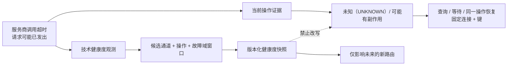
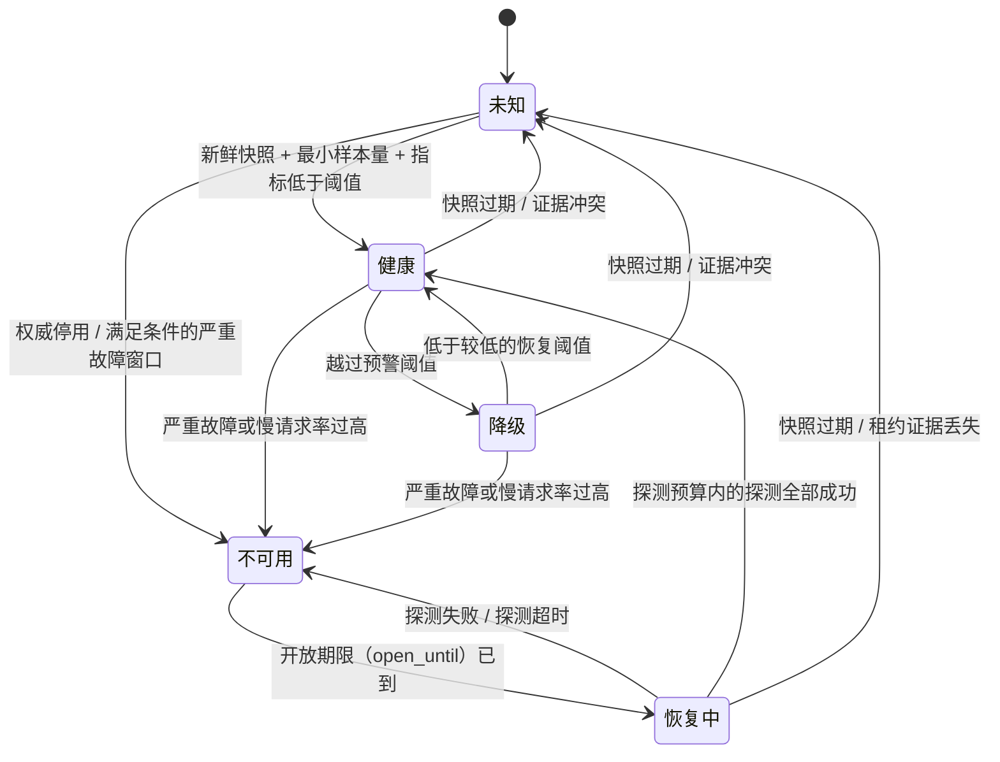
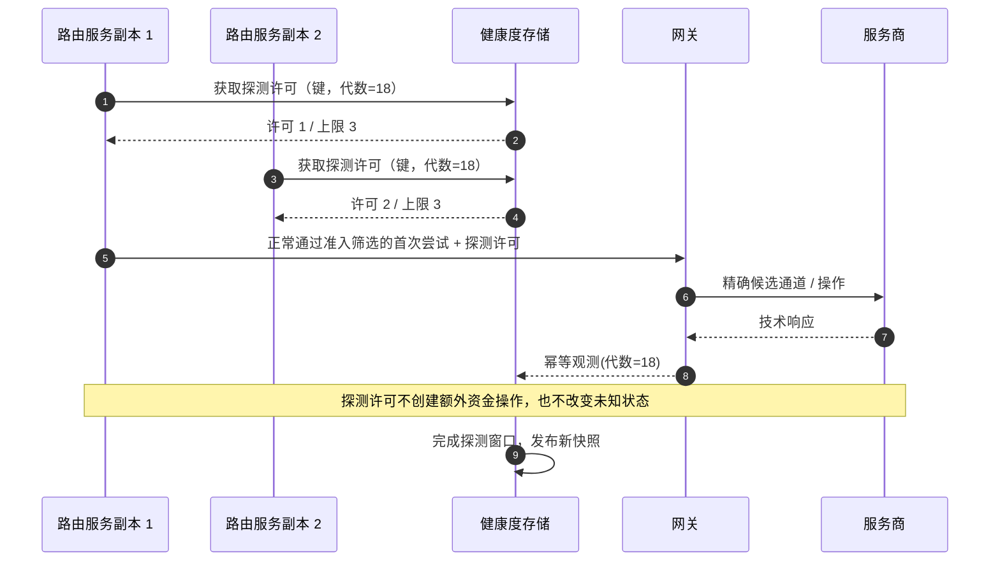
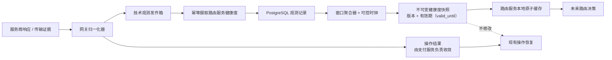

# 第 13 章 熔断器与服务商健康度

**中文** | [English](../en/part-3-reliability/provider-health.md)

Aurora 的欧洲 `SALE` 流量开始大量超时。第一笔超时已经越过网关的派发边界，因此对应操作进入 `UNKNOWN/possible`；几秒后，另一笔相同连接的请求也超时。值班工程师希望立即做两件事：把第一笔标记为失败并切到备用服务商，同时把 PSP A 全局设为不健康。

两件事都错了。第一笔可能已经在服务商端请款，只是响应丢失，它必须继续查询/等待原连接；而 PSP A 的美国连接和欧洲 `QUERY` 端点仍然正常，按品牌全局切走会扩大事故。真正可以安全改变的是：**利用跨交易的技术观测，暂时阻止尚未做出路由决定的新请求进入受影响的精确故障域。**

本章的核心命题是：

> **服务商健康度是按候选通道、操作与真实故障域建模，且带版本、时效、样本与置信证据的运行状态。它只约束未来新路由，不能把当前 `UNKNOWN` 改成失败，也不能把发卡机构拒绝、风险阻断或 3DS 要求伪装成服务商技术故障。**

第 6 章的能力描述“这条连接被配置为能做什么”；健康度描述“它最近是否能在延迟预算内可靠响应”。第 12 章决定旧尝试之后能否创建新的资金路径；健康度既不提供 `side_effect=none` 证明，也不授权后备路由。第 14 章再把本章的快照版本与当时状态保存进完整决策记录。

## 13.1 问题：一次超时同时产生两种不同事实

网关调用服务商超时时，平台得到的是一条真实技术观测：在给定截止时间内没有收到有效响应。它可以进入 `candidate_eu + sale + provider_api_eu` 的健康窗口，影响**下一次**选择。但对已经派发的那条操作，超时只说明结果不可见，不说明服务商没有执行。



同样，一笔 `insufficient_funds` 发卡机构拒绝是业务结果，却也证明服务商 API 在截止时间内返回了可解析响应。它不应增加技术失败计数器。Stripe 官方文档把发卡机构拒绝、服务商/风险阻断和无效 API 调用区分为不同失败类型，并附带不同建议；Adyen 也明确指出 HTTP `200` 只表示请求被接收和处理，不等于支付业务成功。这些契约说明支付结果与传输层/服务商健康度必须分轴建模。[Stripe：拒绝](https://docs.stripe.com/declines) [Adyen：HTTP 状态码](https://docs.adyen.com/development-resources/response-handling)

| 单次观测 | 当前操作 | 技术健康度贡献 | 是否触发新路由 |
| --- | --- | --- | ---: |
| 派发后超时 / 连接重置 | `UNKNOWN/possible`，恢复原操作 | 技术失败；保留延迟/截止时间 | 只影响后续决定 |
| 有效服务商成功 / 处理中响应 | 按支付方式状态机处理 | 技术成功 | 否 |
| 发卡机构拒绝 / 需要认证 | 明确业务结果或用户续程 | 技术响应成功，不是失败 | 否 |
| 风险阻断 | 风控/风险终态 | 不进入服务商技术窗口 | 否 |
| 本地舱壁隔离在派发前拒绝 | `side_effect=none` | 本地容量，不能怪服务商 | 由第 12 章策略决定是否允许新尝试 |
| 未知或无法分类的响应 | 保守进入 `UNKNOWN` 或复核 | 分类器未知，不猜失败/成功 | 后续快照可因此低置信/未知 |

健康度的目标是保护延迟预算和资源，不是提高授权速率的另一种名字。按发卡机构、BIN、卡品牌或商户人群统计的批准表现属于第 8 章；让发卡机构拒绝触发熔断器，会把顾客资金或风控问题误诊成服务商事故，并可能形成发卡机构挑选。

## 13.2 简单设计：一个全局 `healthy bool`

最早的实现通常只有连续失败数：三次错误就把 PSP 全局打开，下一次成功再关闭。

```go
package naivehealth

type Breaker struct {
	Failures int
	Open     bool
}

func (b *Breaker) Record(err error) {
	if err == nil {
		b.Failures = 0
		b.Open = false
		return
	}
	b.Failures++
	if b.Failures >= 3 {
		b.Open = true
	}
}
```

在一个服务商、一个端点、一个进程里，这比让每笔请求都等完整超时更好。它能迅速停止向明显故障的依赖增加压力，也容易用单元测试理解。但进入支付生产环境后，每个概念都不明确：这里的服务商是品牌还是连接？`err` 是否包括拒绝？三次失败来自多少总请求？哪个操作？哪个区域？每个路由服务/网关副本是否各自计数？成功一笔就全量恢复是否安全？

这个模型还把熔断状态当成事实源。进程重启会丢失窗口；流量切走后没有新样本，`Open` 既可能永远不恢复，也可能因定时器到点在所有实例同时放量。下一步不是给全局布尔值加更多 `if`，而是先固定观测分类、故障主键、窗口和快照时效。

## 13.3 规模化问题：故障不沿 PSP 品牌边界发生

### 13.3.1 健康度键必须指向可操作的故障域

第 3、6 章已经把 `candidate_id` 固定为精确服务商连接，本章继续复用它，并加入连接修订、操作与有限集合的故障域：

```text
HealthKey = candidate_id
          + connection_revision
          + operation
          + fault_domain
```

`fault_domain` 必须来自受控配置，例如 `provider_api/eu-west`、`provider_api/us-east`、`platform_egress/az-a`，不能把支付 ID、商户 ID、发卡机构、BIN 或任意错误字符串塞进键。候选通道已经包含商户账户与区域；故障域用来表达多个候选通道可能共享的端点/出口，也用于隔离同一候选通道的不同服务商 API 面。

| 观测主键 | 能安全推断什么 | 不能推断什么 |
| --- | --- | --- |
| `cand_eu/rev7/sale/provider_api_eu` | 该精确连接的 `SALE` 最近技术异常 | 同 PSP 美国连接也异常 |
| `cand_eu/rev7/query/provider_api_eu` | 原操作查询接口异常 | `SALE` 一定失败或未执行 |
| `cand_us/rev3/sale/platform_egress_az_a` | 本地 AZ 到该连接的路径异常 | 服务商全球事故 |
| `pspa/global` | 只是一条过粗告警聚合 | 不能直接成为资金路由熔断键 |
| `issuer=123456` | 批准表现分段 | 不是服务商技术故障域 |

连接修订很重要。凭证、端点或连接器语义发生不兼容变更后，新修订不应自动继承旧版本的 `Healthy`，也不应永久继承已经修复的 `Unavailable`。它必须获得新的、可解释的快照；引导证据不足时状态为未知，而不是复制品牌历史。

### 13.3.2 错误率没有分类就没有意义

熔断器只能消费版本化技术观测，而不是任意 Go `error` 或 HTTP 状态。适配器/归一化器要先说明信号来源与语义：

| 信号类别 | 示例 | 窗口处理 | 理由 |
| --- | --- | --- | --- |
| `technical_success` | 有效成功/处理中响应或只读探测 | 样本 +1，失败不增加 | 技术链路完成；业务结果另算 |
| `technical_failure` | DNS/TLS、连接重置、截止时间、契约确认的服务商不可用 | 样本 +1，失败 +1 | 影响未来调用的技术可用性 |
| `slow` | 超过特定操作慢调用阈值的有效或失败调用 | 慢调用 +1，可与前两类重叠 | 在完全超时前保护延迟预算 |
| `business_response` | 服务商返回的发卡机构拒绝或需要用户动作 | 样本 +1，失败不增加；结果另存 | 不把业务拒绝当事故 |
| `ignored_business` | 本地风险阻断、用户取消、尚未调用服务商 | 不进入窗口 | 没有服务商技术观测 |
| `integration_error` | 非法参数、认证配置错误、模式漂移 | 从普通窗口隔离，告警/可能强制禁用 | 重试或切流不能自动修复代码/配置 |
| `local_rejected` | 舱壁隔离满、调用方截止时间已过 | 服务商失败不增加 | 请求尚未到服务商 |
| `unclassified` | 新代码、证据冲突、归一化器不认识 | 不升级为成功；降低知识状态 | 安全拒绝，而非猜测 |

同一个状态在不同服务商/API 版本中可能含义不同。例如 Adyen 的官方响应说明中，`429` 表示请求过多，而 `500` 也可能由不正确的请求触发；因此“所有 5xx 都算服务商中断、所有 4xx 都忽略”仍然过粗。[Adyen：HTTP 状态码](https://docs.adyen.com/development-resources/response-handling) 观测必须保存 `classifier_version`，变更映射时用契约测试和新版本重放，不能修改历史行。

### 13.3.3 低流量、切流与恢复会制造观测盲区

一笔失败后的 `1/1 = 100%` 不是可靠事故证据。滑动窗口必须同时要求时间或数量窗口、最小样本数与明确阈值；窗口空了也不等于恢复。Resilience4j 官方熔断器文档同样把滑动窗口、`minimumNumberOfCalls`、失败率/慢调用率阈值和半开许可调用数作为不同参数，并只在达到最小调用数后计算失败率。[Resilience4j：熔断器](https://resilience4j.readme.io/docs/circuitbreaker)

打开熔断后，正常流量不再经过该键，系统会失去被动样本。若仅按“最近五分钟没有错误”自动关闭，零流量会被误读成 100% 成功；若永远等待真实流量，又永远无法恢复。半开/恢复中必须有独立、全局受限的探测预算。

### 13.3.4 慢服务商会先耗尽本地资源

在失败率达到阈值之前，慢调用已占据 goroutine、套接字、连接池和上游截止时间。若所有候选通道共享无上限的并发，一条欧洲连接就能拖慢美国连接、查询工作进程甚至网关就绪性。Google SRE 对级联故障的分析指出，变慢会增加执行中请求并消耗线程、内存和文件描述符，重试与转移流量还会把局部过载扩散到其余实例。[Google SRE：应对级联故障](https://sre.google/sre-book/addressing-cascading-failures/)

所以熔断器与舱壁隔离解决不同问题：前者依据跨请求状态拒绝未来调用，后者无论状态如何都限制当前并发。舱壁隔离必须按连接/操作隔离，并为 UNKNOWN 查询等恢复流量保留独立预算；否则新 `SALE` 洪峰会让系统连确认旧资金事实的能力都失去。

## 13.4 生产级设计：观测、窗口、状态与快照

### 13.4.1 观测是有限基数、可去重的事实

网关最接近网络与特定服务商的语义，应产生技术观测；健康度子系统拥有聚合与状态。一个目标模型可以是：

```go
package health

import "time"

type State string

const (
	StateUnknown     State = "unknown"
	StateHealthy     State = "healthy"
	StateDegraded    State = "degraded"
	StateUnavailable State = "unavailable"
	StateRecovering  State = "recovering"
)

type SignalClass string

const (
	SignalTechnicalSuccess SignalClass = "technical_success"
	SignalTechnicalFailure SignalClass = "technical_failure"
	SignalBusinessResponse SignalClass = "business_response"
	SignalIgnoredBusiness  SignalClass = "ignored_business"
	SignalLocalRejected    SignalClass = "local_rejected"
)

type Key struct {
	CandidateID        string
	ConnectionRevision string
	Operation          string
	FaultDomain        string
}

type Observation struct {
	ID                string
	Key               Key
	Class             SignalClass
	Source            string
	Latency           time.Duration
	OccurredAt        time.Time
	ClassifierVersion string
}

func TechnicalEffect(class SignalClass) (sample, failure bool) {
	switch class {
	case SignalTechnicalFailure:
		return true, true
	case SignalTechnicalSuccess, SignalBusinessResponse:
		return true, false
	default:
		return false, false
	}
}
```

`Observation.ID` 标识一次实际网络观测，由网关发件箱至少一次投递后在摄取存储唯一去重。`Source` 使用有限枚举区分同步派发、查询、只读探测或人工事故覆盖；自由文本不能进入聚合主键。操作 ID、支付 ID 可以留在受控证据中做调查关联，但不能成为指标标签或健康度键。重复投递不能把一次超时计三次；一次 `SALE` 超时后的 `QUERY` 是另一条有独立操作键的观测，不应互相覆盖。

上面把 `business_response` 计为技术样本但不计失败，表达“服务商在截止时间内给了合约有效回答”；它绝不把拒绝计成授权成功。若某服务商无法可靠区分业务响应与技术拒绝，归一化器应产出未分类，快照降为未知，而不是为了凑分母猜测。

### 13.4.2 滑动窗口要有最小样本、迟滞与显式时钟

窗口可以按最近 N 秒分桶，也可以按最近 N 次技术样本；关键是同一快照版本固定算法、阈值与评估时刻。下面的纯状态函数展示一条保守基线：常规窗口达到 `MinSamples` 后才判定；降级使用不同恢复阈值形成迟滞；不可用等待打开持续时间后只进入恢复中；恢复中的专用探测窗口有任一技术失败就重新打开。

```go
package health

import "time"

type Aggregate struct {
	Samples  uint64
	Failures uint64
	Slow     uint64
	LatestAt time.Time
}

type Config struct {
	MinSamples      uint64
	HalfOpenSamples uint64
	DegradedRate    float64
	OpenRate        float64
	RecoverRate     float64
	OpenFor         time.Duration
	SnapshotTTL     time.Duration
}

type Snapshot struct {
	Key        Key
	State      State
	Version    string
	Confidence string
	ObservedAt time.Time
	ValidUntil time.Time
	OpenUntil  time.Time
	Aggregate  Aggregate
}

func Next(now time.Time, key Key, previous Snapshot, window Aggregate, cfg Config, version string) Snapshot {
	next := Snapshot{
		Key: key, State: StateUnknown, Version: version, Confidence: "low",
		ObservedAt: window.LatestAt, ValidUntil: window.LatestAt.Add(cfg.SnapshotTTL), Aggregate: window,
	}
	previousStateValid := previous.State == "" || previous.State == StateUnknown ||
		previous.State == StateHealthy || previous.State == StateDegraded ||
		previous.State == StateUnavailable || previous.State == StateRecovering
	previousOpenWindowValid := previous.State != StateUnavailable ||
		(!previous.OpenUntil.IsZero() &&
			(previous.ObservedAt.IsZero() || previous.OpenUntil.After(previous.ObservedAt)))
	valid := key.CandidateID != "" && key.ConnectionRevision != "" &&
		key.Operation != "" && key.FaultDomain != "" &&
		previousStateValid && previousOpenWindowValid &&
		(previous.State == "" || previous.Key == key) &&
		version != "" && cfg.MinSamples > 0 && cfg.HalfOpenSamples > 0 &&
		cfg.SnapshotTTL > 0 && cfg.OpenFor > 0 && window.Failures <= window.Samples &&
		window.Slow <= window.Samples && !window.LatestAt.IsZero() && !window.LatestAt.After(now) &&
		cfg.RecoverRate >= 0 && cfg.RecoverRate < cfg.DegradedRate &&
		cfg.DegradedRate < cfg.OpenRate && cfg.OpenRate <= 1
	if !valid {
		return next
	}

	if previous.State == StateUnavailable {
		if now.Before(previous.OpenUntil) {
			next.State, next.OpenUntil = StateUnavailable, previous.OpenUntil
			return next
		}
		next.State = StateRecovering
		return next
	}
	if previous.State == StateRecovering {
		if window.Failures > 0 || window.Slow > 0 {
			next.State, next.OpenUntil = StateUnavailable, now.Add(cfg.OpenFor)
			return next
		}
		if window.Samples < cfg.HalfOpenSamples {
			next.State = StateRecovering
			return next
		}
		next.Confidence = "qualified"
		next.State = StateHealthy
		return next
	}
	if window.Samples < cfg.MinSamples {
		return next
	}

	next.Confidence = "qualified"
	pressure := max(rate(window.Failures, window.Samples), rate(window.Slow, window.Samples))
	if pressure >= cfg.OpenRate {
		next.State, next.OpenUntil = StateUnavailable, now.Add(cfg.OpenFor)
		return next
	}
	if previous.State == StateDegraded && pressure > cfg.RecoverRate {
		next.State = StateDegraded
		return next
	}
	if pressure >= cfg.DegradedRate {
		next.State = StateDegraded
		return next
	}
	next.State = StateHealthy
	return next
}

func (s Snapshot) RoutingState(now time.Time) State {
	if s.Version == "" || s.ValidUntil.IsZero() || !now.Before(s.ValidUntil) {
		return StateUnknown
	}
	return s.State
}

func rate(part, total uint64) float64 { return float64(part) / float64(total) }

func max(a, b float64) float64 {
	if a > b {
		return a
	}
	return b
}
```

这不是声称一组默认数字适合所有 PSP。`slow` 阈值、窗口、最小样本量、打开持续时间与探测数量必须按操作/服务商契约通过负载测试和事故回放确定，并作为配置版本的一部分。`confidence` 也不应是凭感觉生成的小数；首版用 `low/qualified` 和原始样本/失败/慢调用计数已足以解释。

快照的 `observed_at` 与 `valid_until` 必须来自窗口中最新的有效观测，不能在聚合器每次空转时用 `time.Now()` 延长。否则即使网关已经停止上报，定时任务仍会制造一份永不过期的“新鲜”健康；代码中的 `LatestAt` 正是为了让无新证据最终变成过期。



快照状态到路由服务的语义必须固定：

| 快照视图 | 新路由行为 | 后续阶段权限 |
| --- | --- | --- |
| 健康（`Healthy`）且新鲜 | 正常进入候选集合 | 规则/评分可比较 |
| 降级（`Degraded`）且新鲜 | 仍可通过准入筛选，但携带显式状态/版本；可限流 | 第 9 章画像决定惩罚，不能伪装成能力 |
| 不可用（`Unavailable`）且新鲜 | 从普通新路由硬排除 | 高分、低成本、规则偏好都不能复活 |
| 恢复中（`Recovering`）且新鲜 | 普通流量排除，只允许持有探测许可的受控新请求 | 不能自动全量放回 |
| 缺失/未知（`Unknown`）/过期 | 安全拒绝，原因=`health_unknown` 或 `health_snapshot_stale` | 不能把最近已验证状态无限续期 |

在启用安全拒绝健康度之前，发布流程必须先生成覆盖所有启用健康度键的引导快照；否则系统会在功能开关打开时正确但灾难性地排除全部候选通道。引导流程不能靠复制 PSP 品牌状态，应来自配置校验、受控探测与最小真实证据。新连接没有真实 `SALE` 样本时，受审计的激活流程最多把它从未知推进到恢复中并发放极小引导许可，不能直接写成健康；普通流量仍然安全拒绝。

### 13.4.3 半开是共享探测预算，不是每个实例各试几笔

如果十个路由服务/网关副本各自在内存里允许五次半开，恢复瞬间就有五十个请求；扩容还会继续放大。探测许可必须绑定 `HealthKey + state_epoch`，由共享存储原子领取，限制总数、并发数与租约到期，并把结果写回同一代数。旧代数的迟到结果不能关闭新熔断。



主动探测的证明范围要克制。一个无副作用账户/状态 API 成功，只能证明认证和该端点；它不能证明真实 `SALE`、支付凭证令牌、金额与请款能成功。若 `SALE` 只能用真实流量验证，许可只允许一笔本来就通过能力、风险与策略的新首次尝试被选择到恢复中候选通道；健康度子系统不得自己生成虚假支付。当前处于 UNKNOWN 的操作永远不能被拿来当探测，也不能因为探测成功而换路。

### 13.4.4 舱壁隔离在派发之前获得，并按连接隔离

一个最小 Go 舱壁隔离可以用有界通道实现。调用方调用 `Acquire` 时给定一个很短的队列截止时间；获得许可后才允许把操作标为 `sending/possible` 并越过服务商边界。

```go
package bulkhead

import (
	"context"
	"errors"
	"sync"
)

var ErrInvalidLimit = errors.New("bulkhead limit must be positive")

type Limiter struct {
	slots chan struct{}
}

func New(limit int) (*Limiter, error) {
	if limit <= 0 {
		return nil, ErrInvalidLimit
	}
	return &Limiter{slots: make(chan struct{}, limit)}, nil
}

func (l *Limiter) Acquire(ctx context.Context) (release func(), err error) {
	if err := ctx.Err(); err != nil {
		return nil, err
	}
	select {
	case l.slots <- struct{}{}:
		if err := ctx.Err(); err != nil {
			<-l.slots
			return nil, err
		}
		var once sync.Once
		return func() { once.Do(func() { <-l.slots }) }, nil
	case <-ctx.Done():
		return nil, ctx.Err()
	}
}
```

`Acquire` 超时发生在派发之前，因此返回的是 `local_bulkhead_rejected/none`，而不是 `provider_timeout/possible`。它不会增加服务商技术失败；是否允许新的后备尝试仍由第 12 章的证据门、允许列表和预算决定。`Release` 必须覆盖成功、错误与异常路径，并用并发测试证明 100 个请求最多只有配置数量同时进入服务商调用。

Go 的 `http.Transport` 提供 `MaxConnsPerHost`、空闲连接等传输层限制，并要求传输层复用且可并发使用；这些设置值得显式配置，但它们不等于候选通道/操作级资金调用舱壁隔离，尤其当多个连接共用主机或 HTTP/2 传输时。[Go `net/http.Transport`](https://pkg.go.dev/net/http#Transport) 网关仍需要业务层许可、短队列预算和为恢复流量预留的独立容量。

### 13.4.5 聚合路径不能成为支付同步依赖

健康度摄取适合沿网关持久化的发件箱异步传播，而不是让一次服务商响应等路由服务写入成功：



观测发件箱积压不会改变支付结果；路由服务可以继续使用未过期的最近已验证快照。快照一旦过期，路由服务安全拒绝，而不是悄悄回到健康。新版本必须整批校验并原子安装，决策至少输出 `health_snapshot_version`、每个候选通道的状态与稳定原因，例如 `health_unavailable`、`health_recovering_probe_only`、`health_unknown`、`health_snapshot_stale`。完整只追加决策信封、异步投影与保留期属于第 14 章，本章不提前实现决策存储。

服务商状态页、人工事故人工覆盖和主动探测可以成为来源，但所有来源都必须带作用域、观测时间/生效时间与版本。一个全球状态页事件可以强制收缩映射到受影响的键，却不能因为页面恢复为绿色就覆盖账户级失败窗口；人工覆盖也只能版本化地强制打开，不能把未知强制成健康。

## 13.5 与 UNKNOWN、后备路由和原连接操作的边界

健康度快照的时间箭头只能向未来：

1. 已派发的操作进入 `UNKNOWN/possible` 后，始终使用原 `operation_id`、连接、服务商幂等键与载荷查询/等待；即使 `SALE` 键已不可用，也不能把它改成失败。
2. 查询是独立操作/故障域键。`SALE` 熔断已打开不应阻止查询原资金事实；网关为恢复查询保留独立舱壁隔离和预算。查询自己不可用时，操作继续 UNKNOWN/复核，而不是换连接查询。
3. 第 12 章的 `FallbackPlanner` 只有在旧尝试终态、`side_effect=none`、原因在允许列表中且全部护栏通过时才可创建后继尝试。最新健康度快照可以**否决**计划中尚未执行的下一个候选通道，却不能证明无副作用、不能新增计划外候选通道，也不能自行创建尝试。
4. 请款、撤销、退款与已获得的授权/服务商引用绑定。健康度可以告警、限并发或延后操作，但不能重新评分后交给另一 PSP。
5. 决策做出后必须引用当时快照版本。不能用“当前健康度”重算并覆盖历史原因；第 14 章保存的是当时证据，不是事后猜测。

| 机制 | 回答的问题 | 可改变候选通道吗 | 可改变当前资金事实吗 |
| --- | --- | ---: | ---: |
| 健康度/熔断 | 未来调用这个精确键是否应被保护 | 对新决定可排除/降级 | 否 |
| 恢复 | 原操作的结果是什么 | 否，固定原连接 | 只能用新证据单调收敛 |
| 后备路由 | 旧尝试关闭后能否创建后继尝试 | 只能沿固定计划，且健康度可否决 | 不能改写旧尝试 |
| 决策记录 | 当时为何选择/排除 | 否，只记录 | 否 |

## 13.6 失败证明：状态机要在噪声、并发和重启下成立

下面的测试直接证明发卡机构拒绝不是技术失败，并证明半开的一个技术失败会重新打开。它使用显式时钟，不依赖 `time.Sleep`：

```go
package health

import (
	"testing"
	"time"
)

func TestIssuerDeclineDoesNotOpenAndFailedProbeReopens(t *testing.T) {
	sample, failure := TechnicalEffect(SignalBusinessResponse)
	if !sample || failure {
		t.Fatalf("business response effect = sample %v failure %v", sample, failure)
	}

	now := time.Date(2026, 8, 26, 12, 0, 0, 0, time.UTC)
	key := Key{CandidateID: "cand_eu", ConnectionRevision: "rev7", Operation: "sale", FaultDomain: "provider_api_eu"}
	cfg := Config{
		MinSamples: 20, HalfOpenSamples: 2, DegradedRate: 0.20,
		OpenRate: 0.50, RecoverRate: 0.10, OpenFor: time.Minute, SnapshotTTL: 2 * time.Minute,
	}

	healthy := Next(now, key, Snapshot{}, Aggregate{Samples: 20, LatestAt: now}, cfg, "health_v18")
	if healthy.State != StateHealthy {
		t.Fatalf("declines must not open circuit: %+v", healthy)
	}
	recovering := Snapshot{Key: key, State: StateRecovering, Version: "health_v18"}
	reopened := Next(now, key, recovering, Aggregate{Samples: 2, Failures: 1, LatestAt: now}, cfg, "health_v19")
	if reopened.State != StateUnavailable || !reopened.OpenUntil.After(now) {
		t.Fatalf("failed half-open probe must reopen: %+v", reopened)
	}
}
```

完整失败矩阵还应覆盖：

| 故障注入 | 必须观察到的结果 |
| --- | --- |
| `cand_eu/rev7/sale` 连续超时，`cand_us/rev3/sale` 正常 | 只打开 EU 键；同 PSP 美国连接仍可用于未来新决定 |
| 超时后服务商实际请款，回调通知迟到 | 当前操作始终 UNKNOWN→成功；健康度打开不产生第二条资金路径 |
| 100 次发卡机构拒绝 | 技术失败保持 0；熔断不因拒绝打开 |
| 窗口只有 1/1 技术失败，`MinSamples=20` | 快照未知/低置信，不用一笔噪声宣布全局事故 |
| 快照 `valid_until` 过去 | 路由服务返回 `health_snapshot_stale` 并排除；不沿用旧健康 |
| 10 个副本同时请求半开许可，全局上限=3 | 共享存储最多发 3 个；其余不调用网关 |
| 半开一次超时 | 同代数回到不可用，新的 `open_until` 生效 |
| 100 个并发 `SALE`，舱壁隔离上限=8 | 服务商侧最大在途数 ≤ 8；排队超时发生在派发前、确定性=无 |
| `SALE` 舱壁隔离已满，已有 UNKNOWN 需要查询 | 预留查询舱壁隔离仍可工作，且固定原连接 |
| 观测发件箱重复投递三次 | 唯一观测 ID 只进入窗口一次 |
| 新健康度快照只包含一半配置键 | 整版拒绝安装；未过期旧版继续，过期后安全拒绝 |
| 当前路由计划的下一个候选通道已不可用 | 健康度只否决；`FallbackPlanner` 不追加另一个候选通道 |

这些测试还要断言网关调用与数据库资金路径数量，而不仅是状态枚举。尤其是超时场景：可以同时断言“未来新决定排除 EU”和“原 UNKNOWN 仍只有一个尝试/操作/服务商幂等键”，两条性质缺一不可。

## 13.7 故障模式：可靠性机制如何反过来制造事故

### 按服务商品牌熔断

局部端点、商户账户或连接器故障会切走全部流量，剩余服务商过载；恢复也无法判断哪个域真正修复。熔断器键必须复用精确候选通道身份、修订、操作与受控故障域。

### 把 `err != nil` 都算失败

发卡机构拒绝、风险阻断、用户取消、参数错误和本地舱壁隔离会污染技术失败比率。分类必须感知服务商和 API 版本；未知类别降低知识状态，不能用字符串或 HTTP 大类猜测。

### 熔断已打开后把当前 UNKNOWN 标成失败

这是最危险的越界：群体观测无法证明单笔操作未执行。健康度只影响未来，恢复继续原连接；否则熔断器会变成重复扣款触发器。

### 每个实例拥有自己的半开计数

副本数变化会改变真实探测流量，滚动发布时新实例还会忘记打开状态。使用共享代数/许可存储和原子快照；进程内缓存只是读取副本，不是状态真相。

### 零流量被解释成恢复

切走流量后窗口自然变空。没有错误不等于有成功证据；必须进入恢复中，用有限探测或受控真实首次尝试获得新样本。

### 舱壁隔离在 `sending` 之后才拒绝

若尚未向服务商发送却已记录 `possible`，平台会制造不必要的 UNKNOWN；若先并发发送再拿许可，限制又毫无作用。`Acquire` 必须发生在持久化操作已创建之后、`first_dispatched_at/sending` 之前，拒绝证据明确为本地/无副作用。

### 快照过期后默认健康

这会让健康度流水线故障自动解除所有保护。缺失、无效、冲突与过期都是未知，普通新流量安全拒绝；可用性通过多副本存储、提前刷新和未过期的最近已知良好快照（LKG）提升，不能通过猜测提升。

## 13.8 权衡：保护系统会牺牲什么

| 选择 | 收益 | 代价 | 缓解方式 |
| --- | --- | --- | --- |
| 精细健康度键 | 局部故障不扩散 | 样本更稀疏、状态更多 | 有限维度、最小样本量、显式父域告警 |
| 过期/未知安全拒绝 | 不用无证据健康放行 | 健康度流水线故障可能降低支付可用性 | 引导、冗余存储、提前续期、未过期 LKG |
| 降级不立即硬切 | 减少振荡并保留观测 | 一部分请求仍可能变慢 | 评分惩罚、流量上限、迟滞 |
| 不可用硬排除 | 快速保护截止时间/服务商 | 剩余候选通道承压 | 容量护栏、逐域切流、全局预算 |
| 极小半开预算 | 避免恢复惊群 | 恢复速度较慢 | 共享许可、分阶段扩容、假时钟测试 |
| 按连接舱壁隔离 | 故障资源隔离 | 容量可能闲置且配置复杂 | 负载测试、独立恢复预算、可观测拒绝 |
| 异步观测 | 不把健康度存储放进支付同步路径 | 快照存在传播延迟 | 发件箱时长/TTL、版本与有效期 |

阈值越灵敏，事故发现越快，但噪声与振荡越多；窗口越长，状态稳定，却可能错过分钟级故障。生产参数必须来自容量测试、历史事故重放和分阶段发布，不应照搬某个熔断器库的默认值。仪表盘、SLO 与告警规则留给第 15 章，实验因果判断留给第 16 章，跨区域的本地/全局信号组合留给第 19 章，配置审批与发布留给第 20 章。

## 13.9 配套 Go 系统的当前边界与窄增量

截至本章撰写时，配套仓库**尚未实现服务商健康度或熔断器**。但路由服务基线已经不是静态排序：v3 会验证 `routing_context.v2`，按精确 `candidate_id + connection_revision` 做能力/规则/风险硬约束，再读取版本化成本与表现证据，执行确定性评分，输出完整优化明细、稳定 `candidate_order` 与 `executable_until`；支付会在首次尝试事务中固定这些快照。缺少的是 `services/router/internal/health`、健康度 PostgreSQL 存储、快照版本/原因与动态故障输入，现有 v3 不会因为运行时事故改变候选。

当前服务商网关已有每次服务商调用的明确超时、UNKNOWN/possible 语义、原连接查询、幂等操作、只追加服务商操作观测账本与向支付投递结果的持久化发件箱；这些是未来技术健康度观测的可靠输入边界，却还不是健康度流水线。它目前为所有服务商连接使用一个共享 `http.Client`，没有每连接/操作信号量、技术健康度观测发件箱、聚合窗口或探测租约。模拟器只能验证故障注入，不能成为真实 PSP 健康基准。

与本章匹配的最窄纵向增量是：

1. 新增 `services/router/internal/health` 的纯状态机、可控时钟、有限基数键、滑动窗口与快照校验器；
2. 为路由服务增加 PostgreSQL 观测/快照/探测租约存储，以及幂等内部摄取端点；同观测 ID 不同载荷进入隔离区；
3. 网关从版本化分类器产生技术观测，经自己的持久化发件箱非阻塞投递；支付结果路径仍独立收敛；
4. 路由服务对新鲜 `Unavailable` 与未知/过期硬排除，对 `Recovering` 只接受全局探测许可，对 `Degraded` 输出显式特征供现有评分画像处理；决策增加 `health_snapshot_version` 与稳定原因代码；
5. 网关在设置 `sending/possible` 前获得按连接/操作舱壁隔离许可，并给 `QUERY` 预留独立容量；
6. 先只覆盖模拟器的 `sale` 与 `query` 技术观测，用同 PSP 的 US/EU 连接做局部熔断端到端测试；发卡机构拒绝、风险阻断和当前 UNKNOWN 永远不能触发新资金路径。

在这些包、迁移、OpenAPI、竞态测试、真实 PostgreSQL 集成测试与 Compose 失败端到端测试进入代码仓库前，本章健康度状态机与舱壁隔离仍是待配套契约，不能描述成已部署能力。已实现的路由服务 v3 受约束流水线只是接收未来健康度证据的决策骨架，不会凭空产生动态健康度。本章也不新增真实 PSP、仪表盘、自动后备路由或完整决策存储。

## 13.10 小结：熔断未来流量，不裁决过去资金事实

本章从一个全局 `healthy bool` 出发，依次解决了局部故障、错误分类、低样本、切流后的观测盲区、恢复惊群和资源级联。最终健康度键固定在 `candidate_id + connection_revision + operation + fault_domain`；观测有稳定 ID、类别、来源、`occurred_at` 与分类器版本；快照有状态、版本、有效期、样本与置信证据。

`Healthy` 正常参与新路由，`Degraded` 以显式状态进入后续画像，`Unavailable` 排除普通新流量，`Recovering` 只允许共享预算内的探测，缺失/未知/过期一律安全拒绝。滑动窗口的最小样本防止 1/1 误判，迟滞防止状态抖动，按连接舱壁隔离则在熔断形成之前保护本地资源。

最重要的边界始终不变：超时可以同时成为未来健康度的一次技术失败和当前操作 `UNKNOWN`，但前者绝不能把后者改成失败。发卡机构拒绝不是技术故障；健康度不能授权后备路由；请款/撤销/退款不能换连接。服务商适配器/网关产生受控观测，路由服务消费版本化快照做纯决策，支付继续拥有资金状态。

下一章会把 `health_snapshot_version`、当时的候选通道状态与排除原因放进不可变决策记录。它保存“当时为什么避开这条连接”，而不是拿今天的健康度重算昨天的决定。

## 延伸阅读

* [Resilience4j CircuitBreaker：滑动窗口、最小调用数与半开](https://resilience4j.readme.io/docs/circuitbreaker)
* [Google SRE：应对级联故障](https://sre.google/sre-book/addressing-cascading-failures/)
* [Go `net/http.Transport`](https://pkg.go.dev/net/http#Transport)
* [Stripe：拒绝](https://docs.stripe.com/declines)
* [Stripe：拒绝代码](https://docs.stripe.com/declines/codes)
* [Adyen：HTTP 状态码](https://docs.adyen.com/development-resources/response-handling)
* [第 6 章：服务商准入筛选](../part-2-routing-engine/provider-eligibility.md)
* [第 9 章：服务商评分与风险感知路由](../part-2-routing-engine/provider-scoring.md)
* [第 10 章：超时、重试与未知状态](timeout-and-retry.md)
* [第 12 章：后备路由](fallback-routing.md)
* [第 14 章：路由决策存储](../part-4-operating-at-scale/routing-decision-store.md)
