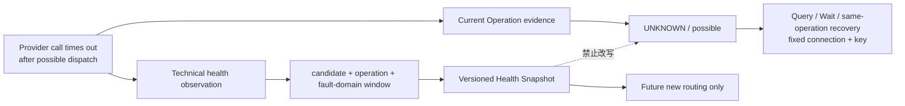
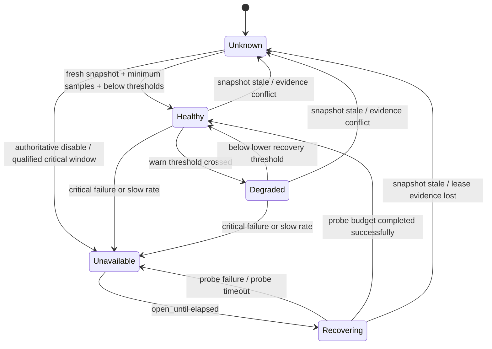
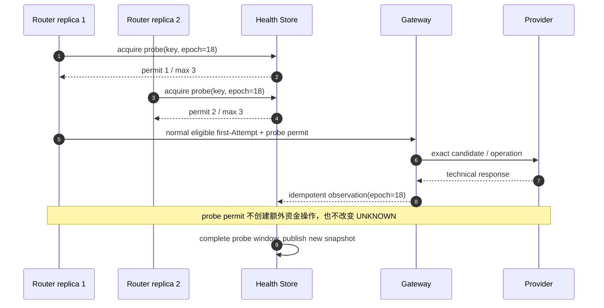
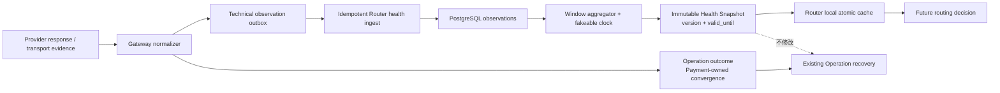

# 第 13 章 Circuit Breaker 与 Provider Health

Aurora 的欧洲 `SALE` 流量开始大量 timeout。第一笔超时已经越过 Gateway 的 dispatch 边界，因此对应 Operation 进入 `UNKNOWN/possible`；几秒后，另一笔相同连接的请求也超时。值班工程师希望立即做两件事：把第一笔标记为 failed 并切到备用 Provider，同时把 PSP A 全局设为 unhealthy。

两件事都错了。第一笔可能已经在 Provider 端 Capture，只是响应丢失，它必须继续 Query/Wait 原 connection；而 PSP A 的美国连接和欧洲 `QUERY` Endpoint 仍然正常，按品牌全局切走会扩大事故。真正可以安全改变的是：**利用跨交易的技术观测，暂时阻止尚未做出路由决定的新请求进入受影响的精确故障域。**

本章的核心命题是：

> **Provider Health 是按 Candidate、Operation 与真实 Fault Domain 建模，且带版本、时效、样本与置信证据的运行状态。它只约束未来新路由，不能把当前 `UNKNOWN` 改成失败，也不能把 Issuer Decline、Risk Block 或 3DS 要求伪装成 Provider 技术故障。**

第 6 章的 Capability 描述“这条 connection 被配置为能做什么”；Health 描述“它最近是否能在延迟预算内可靠响应”。第 12 章决定旧 Attempt 之后能否创建新的资金路径；Health 既不提供 `side_effect=none` 证明，也不授权 Fallback。第 14 章再把本章的 Snapshot version 与当时状态保存进完整 Decision Record。

## 13.1 Problem：一次 timeout 同时产生两种不同事实

Gateway 调用 Provider 超时时，平台得到的是一条真实技术观测：在给定 deadline 内没有收到有效响应。它可以进入 `candidate_eu + sale + provider_api_eu` 的健康窗口，影响**下一次**选择。但对已经 dispatch 的那条 Operation，timeout 只说明结果不可见，不说明 Provider 没有执行。



同样，一笔 `insufficient_funds` Issuer Decline 是业务结果，却也证明 Provider API 在 deadline 内返回了可解析响应。它不应增加 technical failure counter。Stripe 官方文档把 Issuer decline、Provider/Risk block 和 invalid API call 区分为不同失败类型，并附带不同 advice；Adyen 也明确指出 HTTP `200` 只表示请求被接收和处理，不等于支付业务成功。这些契约说明 Payment Outcome 与 Transport/Provider Health 必须分轴建模。[Stripe：Declines](https://docs.stripe.com/declines) [Adyen：HTTP status codes](https://docs.adyen.com/development-resources/response-handling)

| 单次观测 | 当前 Operation | 技术 Health 贡献 | 是否触发新路由 |
| --- | --- | --- | ---: |
| dispatch 后 timeout / connection reset | `UNKNOWN/possible`，恢复原 Operation | technical failure；保留 latency/deadline | 只影响后续决定 |
| 有效 Provider success / pending 响应 | 按 Payment Method 状态机处理 | technical success | 否 |
| Issuer Decline / 需要认证 | conclusive business result 或用户续程 | technical response success，不是 failure | 否 |
| Risk Block | Fraud/Risk 终态 | 不进入 Provider 技术窗口 | 否 |
| 本地 bulkhead 在 dispatch 前拒绝 | `side_effect=none` | local capacity，不能怪 Provider | 由第 12 章 Policy 决定是否允许新 Attempt |
| 未知或无法分类的响应 | 保守进入 `UNKNOWN` 或 review | classifier unknown，不猜 failure/success | 后续 Snapshot 可因此低置信/unknown |

Health 的目标是保护延迟预算和资源，不是提高 Authorization Rate 的另一种名字。按 Issuer、BIN、Card Brand 或 Merchant 人群统计的批准表现属于第 8 章；让 issuer decline 触发 Circuit Breaker，会把顾客资金或风控问题误诊成 Provider 事故，并可能形成 issuer shopping。

## 13.2 Simple Design：一个全局 `healthy bool`

最早的实现通常只有连续失败数：三次错误就把 PSP 全局打开，下一次成功再关闭。

```go
package naivehealth

type Breaker struct {
	Failures int
	Open     bool
}

func (b *Breaker) Record(err error) {
	if err == nil {
		b.Failures = 0
		b.Open = false
		return
	}
	b.Failures++
	if b.Failures >= 3 {
		b.Open = true
	}
}
```

在一个 Provider、一个 Endpoint、一个进程里，这比让每笔请求都等完整 timeout 更好。它能迅速停止向明显故障的依赖增加压力，也容易用单元测试理解。但进入支付生产环境后，代码中的每个词都不明确：`Provider` 是品牌还是连接？`err` 是否包括 decline？三次失败来自多少总请求？哪个 Operation？哪个 Region？每个 Router/Gateway 副本是否各自计数？成功一笔就全量恢复是否安全？

这个模型还把 Circuit state 当成事实源。进程重启会丢失窗口；流量切走后没有新样本，`Open` 既可能永远不恢复，也可能因定时器到点在所有实例同时放量。下一步不是给全局布尔值加更多 `if`，而是先固定观测分类、故障主键、窗口和快照时效。

## 13.3 Problems at Scale：故障不沿 PSP 品牌边界发生

### 13.3.1 Health Key 必须指向可操作的故障域

第 3、6 章已经把 `candidate_id` 固定为精确 Provider Connection，本章继续复用它，并加入 connection revision、operation 与有限集合的 Fault Domain：

```text
HealthKey = candidate_id
          + connection_revision
          + operation
          + fault_domain
```

`fault_domain` 必须来自受控配置，例如 `provider_api/eu-west`、`provider_api/us-east`、`platform_egress/az-a`，不能把 Payment ID、Merchant ID、Issuer、BIN 或任意错误字符串塞进 key。Candidate 已经包含 Merchant Account 与 Region；Fault Domain 用来表达多个 Candidate 可能共享的 Endpoint/egress，也用于隔离同一 Candidate 的不同 Provider API 面。

| 观测主键 | 能安全推断什么 | 不能推断什么 |
| --- | --- | --- |
| `cand_eu/rev7/sale/provider_api_eu` | 该精确连接的 `SALE` 最近技术异常 | 同 PSP 美国连接也异常 |
| `cand_eu/rev7/query/provider_api_eu` | 原 Operation 查询接口异常 | `SALE` 一定失败或未执行 |
| `cand_us/rev3/sale/platform_egress_az_a` | 本地 AZ 到该连接的路径异常 | Provider 全球事故 |
| `pspa/global` | 只是一条过粗告警聚合 | 不能直接成为资金路由 breaker |
| `issuer=123456` | 批准表现分段 | 不是 Provider 技术故障域 |

Connection revision 很重要。凭证、Endpoint 或 Connector 语义发生不兼容变更后，新 revision 不应自动继承旧版本的 `Healthy`，也不应永久继承已经修复的 `Unavailable`。它必须获得新的、可解释的 Snapshot；bootstrap 证据不足时状态为 unknown，而不是复制品牌历史。

### 13.3.2 错误率没有分类就没有意义

Circuit Breaker 只能消费版本化 Technical Observation，而不是任意 Go `error` 或 HTTP status。Adapter/Normalizer 要先说明信号来源与语义：

| Signal class | 示例 | 窗口处理 | 理由 |
| --- | --- | --- | --- |
| `technical_success` | 有效 success/pending 响应或只读 probe | sample +1，failure 不增加 | 技术链路完成；业务结果另算 |
| `technical_failure` | DNS/TLS、connection reset、deadline、契约确认的 Provider unavailable | sample +1，failure +1 | 影响未来调用的技术可用性 |
| `slow` | 超过 operation-specific slow threshold 的有效或失败调用 | slow +1，可与前两类重叠 | 在完全 timeout 前保护延迟预算 |
| `business_response` | Provider 返回的 Issuer Decline 或 requires-action | sample +1，failure 不增加；Outcome 另存 | 不把业务拒绝当事故 |
| `ignored_business` | 本地 Risk Block、用户取消、尚未调用 Provider | 不进入窗口 | 没有 Provider 技术观测 |
| `integration_error` | 非法参数、认证配置错误、schema drift | 从普通窗口隔离，告警/可能强制禁用 | 重试或切流不能自动修复代码/配置 |
| `local_rejected` | bulkhead 满、调用方 deadline 已过 | Provider failure 不增加 | 请求尚未到 Provider |
| `unclassified` | 新 code、证据冲突、normalizer 不认识 | 不升级为 success；降低知识状态 | fail closed，而非猜测 |

同一个 status 在不同 Provider/API 版本中可能含义不同。例如 Adyen 的官方响应说明中，`429` 表示请求过多，而 `500` 也可能由不正确的请求触发；因此“所有 5xx 都算 Provider outage、所有 4xx 都忽略”仍然过粗。[Adyen：HTTP status codes](https://docs.adyen.com/development-resources/response-handling) Observation 必须保存 `classifier_version`，变更映射时用 contract test 和新版本重放，不能修改历史行。

### 13.3.3 低流量、切流与恢复会制造观测盲区

一笔失败后的 `1/1 = 100%` 不是可靠事故证据。滑动窗口必须同时要求时间或数量窗口、最小样本数与明确阈值；窗口空了也不等于恢复。Resilience4j 官方 CircuitBreaker 文档同样把 sliding window、`minimumNumberOfCalls`、failure/slow-call threshold 和 half-open permitted calls 作为不同参数，并只在达到最小调用数后计算失败率。[Resilience4j CircuitBreaker](https://resilience4j.readme.io/docs/circuitbreaker)

打开 Circuit 后，正常流量不再经过该 key，系统会失去被动样本。若仅按“最近五分钟没有错误”自动关闭，零流量会被误读成 100% 成功；若永远等待真实流量，又永远无法恢复。Half-Open/Recovering 必须有独立、全局受限的 probe budget。

### 13.3.4 慢 Provider 会先耗尽本地资源

在失败率达到阈值之前，慢调用已占据 goroutine、socket、连接池和上游 deadline。若所有 Candidate 共享无上限的并发，一条欧洲连接就能拖慢美国连接、Query worker 甚至 Gateway readiness。Google SRE 对级联故障的分析指出，变慢会增加 in-flight 请求并消耗线程、内存和文件描述符，重试与转移流量还会把局部过载扩散到其余实例。[Google SRE：Addressing Cascading Failures](https://sre.google/sre-book/addressing-cascading-failures/)

所以 Circuit Breaker 与 Bulkhead 解决不同问题：前者依据跨请求状态拒绝未来调用，后者无论状态如何都限制当前并发。Bulkhead 必须按 connection/operation 隔离，并为 UNKNOWN Query 等恢复流量保留独立预算；否则新 `SALE` 洪峰会让系统连确认旧资金事实的能力都失去。

## 13.4 Production Design：Observation、Window、State 与 Snapshot

### 13.4.1 Observation 是有限基数、可去重的事实

Gateway 最接近网络与 Provider-specific 语义，应产生 Technical Observation；Health subsystem 拥有聚合与状态。一个目标模型可以是：

```go
package health

import "time"

type State string

const (
	StateUnknown     State = "unknown"
	StateHealthy     State = "healthy"
	StateDegraded    State = "degraded"
	StateUnavailable State = "unavailable"
	StateRecovering  State = "recovering"
)

type SignalClass string

const (
	SignalTechnicalSuccess SignalClass = "technical_success"
	SignalTechnicalFailure SignalClass = "technical_failure"
	SignalBusinessResponse SignalClass = "business_response"
	SignalIgnoredBusiness  SignalClass = "ignored_business"
	SignalLocalRejected    SignalClass = "local_rejected"
)

type Key struct {
	CandidateID        string
	ConnectionRevision string
	Operation          string
	FaultDomain        string
}

type Observation struct {
	ID                string
	Key               Key
	Class             SignalClass
	Source            string
	Latency           time.Duration
	OccurredAt        time.Time
	ClassifierVersion string
}

func TechnicalEffect(class SignalClass) (sample, failure bool) {
	switch class {
	case SignalTechnicalFailure:
		return true, true
	case SignalTechnicalSuccess, SignalBusinessResponse:
		return true, false
	default:
		return false, false
	}
}
```

`Observation.ID` 标识一次实际网络观测，由 Gateway outbox 至少一次投递后在 ingest store 唯一去重。`Source` 使用有限枚举区分同步 dispatch、Query、只读 probe 或人工 incident override；自由文本不能进入聚合主键。Operation ID、Payment ID 可以留在受控 evidence 中做调查关联，但不能成为 metric label 或 HealthKey。重复投递不能把一次 timeout 计三次；一次 `SALE` timeout 后的 `QUERY` 是另一条有独立 operation key 的观测，不应互相覆盖。

上面把 `business_response` 计为技术 sample 但不计 failure，表达“Provider 在 deadline 内给了合约有效回答”；它绝不把 decline 计成 authorization success。若某 Provider 无法可靠区分业务响应与技术拒绝，Normalizer 应产出 unclassified，Snapshot 降为 unknown，而不是为了凑分母猜测。

### 13.4.2 Sliding Window 要有最小样本、迟滞与显式时钟

窗口可以按最近 N 秒分桶，也可以按最近 N 次 technical sample；关键是同一 Snapshot version 固定算法、阈值与 evaluation time。下面的纯状态函数展示一条保守基线：常规窗口达到 `MinSamples` 后才判定；Degraded 使用不同恢复阈值形成迟滞；Unavailable 等待 open duration 后只进入 Recovering；Recovering 的专用 probe window 有任一技术失败就重新打开。

```go
package health

import "time"

type Aggregate struct {
	Samples  uint64
	Failures uint64
	Slow     uint64
	LatestAt time.Time
}

type Config struct {
	MinSamples      uint64
	HalfOpenSamples uint64
	DegradedRate    float64
	OpenRate        float64
	RecoverRate     float64
	OpenFor         time.Duration
	SnapshotTTL     time.Duration
}

type Snapshot struct {
	Key        Key
	State      State
	Version    string
	Confidence string
	ObservedAt time.Time
	ValidUntil time.Time
	OpenUntil  time.Time
	Aggregate  Aggregate
}

func Next(now time.Time, key Key, previous Snapshot, window Aggregate, cfg Config, version string) Snapshot {
	next := Snapshot{
		Key: key, State: StateUnknown, Version: version, Confidence: "low",
		ObservedAt: window.LatestAt, ValidUntil: window.LatestAt.Add(cfg.SnapshotTTL), Aggregate: window,
	}
	previousStateValid := previous.State == "" || previous.State == StateUnknown ||
		previous.State == StateHealthy || previous.State == StateDegraded ||
		previous.State == StateUnavailable || previous.State == StateRecovering
	previousOpenWindowValid := previous.State != StateUnavailable ||
		(!previous.OpenUntil.IsZero() &&
			(previous.ObservedAt.IsZero() || previous.OpenUntil.After(previous.ObservedAt)))
	valid := key.CandidateID != "" && key.ConnectionRevision != "" &&
		key.Operation != "" && key.FaultDomain != "" &&
		previousStateValid && previousOpenWindowValid &&
		(previous.State == "" || previous.Key == key) &&
		version != "" && cfg.MinSamples > 0 && cfg.HalfOpenSamples > 0 &&
		cfg.SnapshotTTL > 0 && cfg.OpenFor > 0 && window.Failures <= window.Samples &&
		window.Slow <= window.Samples && !window.LatestAt.IsZero() && !window.LatestAt.After(now) &&
		cfg.RecoverRate >= 0 && cfg.RecoverRate < cfg.DegradedRate &&
		cfg.DegradedRate < cfg.OpenRate && cfg.OpenRate <= 1
	if !valid {
		return next
	}

	if previous.State == StateUnavailable {
		if now.Before(previous.OpenUntil) {
			next.State, next.OpenUntil = StateUnavailable, previous.OpenUntil
			return next
		}
		next.State = StateRecovering
		return next
	}
	if previous.State == StateRecovering {
		if window.Failures > 0 || window.Slow > 0 {
			next.State, next.OpenUntil = StateUnavailable, now.Add(cfg.OpenFor)
			return next
		}
		if window.Samples < cfg.HalfOpenSamples {
			next.State = StateRecovering
			return next
		}
		next.Confidence = "qualified"
		next.State = StateHealthy
		return next
	}
	if window.Samples < cfg.MinSamples {
		return next
	}

	next.Confidence = "qualified"
	pressure := max(rate(window.Failures, window.Samples), rate(window.Slow, window.Samples))
	if pressure >= cfg.OpenRate {
		next.State, next.OpenUntil = StateUnavailable, now.Add(cfg.OpenFor)
		return next
	}
	if previous.State == StateDegraded && pressure > cfg.RecoverRate {
		next.State = StateDegraded
		return next
	}
	if pressure >= cfg.DegradedRate {
		next.State = StateDegraded
		return next
	}
	next.State = StateHealthy
	return next
}

func (s Snapshot) RoutingState(now time.Time) State {
	if s.Version == "" || s.ValidUntil.IsZero() || !now.Before(s.ValidUntil) {
		return StateUnknown
	}
	return s.State
}

func rate(part, total uint64) float64 { return float64(part) / float64(total) }

func max(a, b float64) float64 {
	if a > b {
		return a
	}
	return b
}
```

这不是声称一组默认数字适合所有 PSP。`slow` threshold、window、minimum sample、open duration 与 probe count 必须按 operation/Provider 契约通过负载测试和事故回放确定，并作为配置版本的一部分。`confidence` 也不应是凭感觉生成的小数；首版用 `low/qualified` 和原始 sample/failure/slow counts 已足以解释。

Snapshot 的 `observed_at` 与 `valid_until` 必须来自窗口中最新的有效 Observation，不能在 Aggregator 每次空转时用 `time.Now()` 延长。否则即使 Gateway 已经停止上报，定时任务仍会制造一份永不过期的“新鲜”Healthy；代码中的 `LatestAt` 正是为了让无新证据最终变成 stale。



Snapshot state 到 Router 的语义必须固定：

| Snapshot view | 新路由行为 | 后续阶段权限 |
| --- | --- | --- |
| `Healthy` 且 fresh | 正常进入候选集合 | Rule/Scoring 可比较 |
| `Degraded` 且 fresh | 仍可 eligible，但携带显式 state/版本；可限流 | 第 9 章 profile 决定惩罚，不能伪装成 Capability |
| `Unavailable` 且 fresh | 从普通新路由硬排除 | 高分、低成本、Rule prefer 都不能复活 |
| `Recovering` 且 fresh | 普通流量排除，只允许持有 probe permit 的受控新请求 | 不能自动全量放回 |
| missing / `Unknown` / stale | fail closed，reason=`health_unknown` 或 `health_snapshot_stale` | 不能把 last-known state 无限续期 |

在启用 fail-closed Health 之前，发布流程必须先生成覆盖所有启用 HealthKey 的 bootstrap snapshot；否则系统会在功能开关打开时正确但灾难性地排除全部 Candidate。Bootstrap 不能靠复制 PSP 品牌状态，应来自配置校验、受控探测与最小真实证据。新 connection 没有真实 `SALE` 样本时，受审计的激活流程最多把它从 Unknown 推进到 Recovering 并发放极小 bootstrap permit，不能直接写成 Healthy；普通流量仍然 fail closed。

### 13.4.3 Half-Open 是共享 Probe Budget，不是每个实例各试几笔

如果十个 Router/Gateway 副本各自在内存里允许五次 half-open，恢复瞬间就有五十个请求；扩容还会继续放大。Probe permit 必须绑定 `HealthKey + state_epoch`，由共享 store 原子领取，限制总数、并发数与 lease 到期，并把结果写回同一 epoch。旧 epoch 的迟到结果不能关闭新 Circuit。



主动探测的证明范围要克制。一个无副作用 account/status API 成功，只能证明认证和该 Endpoint；它不能证明真实 `SALE`、Token、金额与 Capture 能成功。若 `SALE` 只能用真实流量验证，permit 只允许一笔本来就通过 Capability、Risk 与 Policy 的新 first Attempt 被选择到 Recovering Candidate；Health subsystem 不得自己生成虚假支付。当前处于 UNKNOWN 的 Operation 永远不能被拿来当 probe，也不能因为 probe 成功而换路。

### 13.4.4 Bulkhead 在 dispatch 之前获得，并按连接隔离

一个最小 Go Bulkhead 可以用有界 channel 实现。调用方给 Acquire 一个很短的 queue deadline；获得 permit 后才允许把 Operation 标为 `sending/possible` 并越过 Provider 边界。

```go
package bulkhead

import (
	"context"
	"errors"
	"sync"
)

var ErrInvalidLimit = errors.New("bulkhead limit must be positive")

type Limiter struct {
	slots chan struct{}
}

func New(limit int) (*Limiter, error) {
	if limit <= 0 {
		return nil, ErrInvalidLimit
	}
	return &Limiter{slots: make(chan struct{}, limit)}, nil
}

func (l *Limiter) Acquire(ctx context.Context) (release func(), err error) {
	if err := ctx.Err(); err != nil {
		return nil, err
	}
	select {
	case l.slots <- struct{}{}:
		if err := ctx.Err(); err != nil {
			<-l.slots
			return nil, err
		}
		var once sync.Once
		return func() { once.Do(func() { <-l.slots }) }, nil
	case <-ctx.Done():
		return nil, ctx.Err()
	}
}
```

Acquire 超时发生在 dispatch 之前，因此返回的是 `local_bulkhead_rejected/none`，而不是 `provider_timeout/possible`。它不会增加 Provider technical failure；是否允许新的 Fallback Attempt 仍由第 12 章的证据门、allowlist 和 budget 决定。Release 必须覆盖成功、错误与 panic 路径，并用并发测试证明 100 个请求最多只有配置数量同时进入 Provider 调用。

Go 的 `http.Transport` 提供 `MaxConnsPerHost`、idle connection 等传输层限制，并要求 Transport 复用且可并发使用；这些设置值得显式配置，但它们不等于 Candidate/Operation 级资金调用 Bulkhead，尤其当多个 connection 共用 Host 或 HTTP/2 transport 时。[Go `net/http.Transport`](https://pkg.go.dev/net/http#Transport) Gateway 仍需要业务层 permit、短 queue budget 和为 recovery traffic 预留的独立容量。

### 13.4.5 聚合路径不能成为支付同步依赖

Health ingestion 适合沿 Gateway durable outbox 异步传播，而不是让一次 Provider response 等 Router 写入成功：



Observation outbox 积压不会改变 Payment outcome；Router 可以继续使用未过期的 last-known-good Snapshot。Snapshot 一旦 stale，Router fail closed，而不是悄悄回到 Healthy。新版本必须整批校验并原子安装，Decision 至少输出 `health_snapshot_version`、每个 Candidate 的状态与稳定 reason，例如 `health_unavailable`、`health_recovering_probe_only`、`health_unknown`、`health_snapshot_stale`。完整 append-only Decision Envelope、异步投影与保留期属于第 14 章，本章不提前实现 Decision Store。

Provider status page、人工 incident override 和主动 probe 可以成为来源，但所有来源都必须带 scope、observed/effective time 与版本。一个全球 status page 事件可以强制收缩映射到受影响的 keys，却不能因为页面恢复为绿色就覆盖账户级失败窗口；人工 override 也只能版本化地强制 open，不能把 unknown 强制成 Healthy。

## 13.5 与 UNKNOWN、Fallback 和原连接操作的边界

Health Snapshot 的时间箭头只能向未来：

1. 已 dispatch 的 Operation 进入 `UNKNOWN/possible` 后，始终使用原 `operation_id`、connection、Provider key 与 payload Query/Wait；即使 `SALE` key 已 Unavailable，也不能把它改成 failed。
2. Query 是独立 operation/fault-domain key。`SALE` Circuit open 不应阻止查询原资金事实；Gateway 为 recovery Query 保留独立 Bulkhead 和 budget。Query 自己不可用时，Operation 继续 UNKNOWN/review，而不是换 connection 查询。
3. 第 12 章 FallbackPlanner 只有在旧 Attempt terminal、`side_effect=none`、reason allowlisted 且全部 guardrail 通过时才可创建 successor。最新 Health 可以**否决** Plan 中尚未执行的 next Candidate，却不能证明 none、不能新增 Plan 外 Candidate，也不能自行创建 Attempt。
4. Capture、Void、Refund 与已获得的 Authorization/Provider reference 绑定。Health 可以告警、限并发或延后操作，但不能重新评分后交给另一 PSP。
5. Decision 做出后必须引用当时 Snapshot version。不能用“当前 health”重算并覆盖历史原因；第 14 章保存的是当时证据，不是事后猜测。

| 机制 | 回答的问题 | 可改变 Candidate 吗 | 可改变当前资金事实吗 |
| --- | --- | ---: | ---: |
| Health/Circuit | 未来调用这个精确 key 是否应被保护 | 对新决定可排除/降级 | 否 |
| Recovery | 原 Operation 的结果是什么 | 否，固定原 connection | 只能用新证据单调收敛 |
| Fallback | 旧 Attempt 关闭后能否创建 successor | 只能沿固定 Plan，且 Health 可 veto | 不能改写旧 Attempt |
| Decision Record | 当时为何选择/排除 | 否，只记录 | 否 |

## 13.6 Proof by Failure：状态机要在噪声、并发和重启下成立

下面的测试直接证明 Issuer Decline 不是 technical failure，并证明 half-open 的一个技术失败会重新打开。它使用显式时钟，不依赖 `time.Sleep`：

```go
package health

import (
	"testing"
	"time"
)

func TestIssuerDeclineDoesNotOpenAndFailedProbeReopens(t *testing.T) {
	sample, failure := TechnicalEffect(SignalBusinessResponse)
	if !sample || failure {
		t.Fatalf("business response effect = sample %v failure %v", sample, failure)
	}

	now := time.Date(2026, 8, 26, 12, 0, 0, 0, time.UTC)
	key := Key{CandidateID: "cand_eu", ConnectionRevision: "rev7", Operation: "sale", FaultDomain: "provider_api_eu"}
	cfg := Config{
		MinSamples: 20, HalfOpenSamples: 2, DegradedRate: 0.20,
		OpenRate: 0.50, RecoverRate: 0.10, OpenFor: time.Minute, SnapshotTTL: 2 * time.Minute,
	}

	healthy := Next(now, key, Snapshot{}, Aggregate{Samples: 20, LatestAt: now}, cfg, "health_v18")
	if healthy.State != StateHealthy {
		t.Fatalf("declines must not open circuit: %+v", healthy)
	}
	recovering := Snapshot{Key: key, State: StateRecovering, Version: "health_v18"}
	reopened := Next(now, key, recovering, Aggregate{Samples: 2, Failures: 1, LatestAt: now}, cfg, "health_v19")
	if reopened.State != StateUnavailable || !reopened.OpenUntil.After(now) {
		t.Fatalf("failed half-open probe must reopen: %+v", reopened)
	}
}
```

完整失败矩阵还应覆盖：

| 故障注入 | 必须观察到的结果 |
| --- | --- |
| `cand_eu/rev7/sale` 连续 timeout，`cand_us/rev3/sale` 正常 | 只打开 EU key；同 PSP 美国连接仍可用于未来新决定 |
| timeout 后 Provider 实际 Capture，webhook 迟到 | 当前 Operation 始终 UNKNOWN→succeeded；Health open 不产生第二条资金路径 |
| 100 次 Issuer Decline | technical failure 保持 0；Circuit 不因 decline 打开 |
| 窗口只有 1/1 technical failure，`MinSamples=20` | Snapshot unknown/低置信，不用一笔噪声宣布全局事故 |
| Snapshot `valid_until` 过去 | Router 返回 `health_snapshot_stale` 并排除；不沿用旧 Healthy |
| 10 个副本同时请求 half-open permit，global max=3 | shared store 最多发 3 个；其余不调用 Gateway |
| half-open 一次 timeout | 同 epoch 回到 Unavailable，新的 `open_until` 生效 |
| 100 个并发 `SALE`，bulkhead limit=8 | Provider 侧最大 in-flight ≤ 8；排队超时发生在 dispatch 前、certainty=none |
| `SALE` bulkhead 已满，已有 UNKNOWN 需要 Query | reserved Query bulkhead 仍可工作，且固定原 connection |
| Observation outbox 重复投递三次 | unique observation ID 只进入窗口一次 |
| 新 Health Snapshot 只包含一半配置 keys | 整版拒绝安装；未过期旧版继续，过期后 fail closed |
| 当前 Route Plan 的 next Candidate 已 Unavailable | Health 只 veto；FallbackPlanner 不追加另一个 Candidate |

这些测试还要断言 `Gateway calls` 与数据库资金路径数量，而不仅是 State enum。尤其是 timeout 场景：可以同时断言“未来新决定排除 EU”和“原 UNKNOWN 仍只有一个 Attempt/Operation/Provider key”，两条性质缺一不可。

## 13.7 Failure Modes：可靠性机制如何反过来制造事故

### 按 Provider 品牌熔断

局部 Endpoint、Merchant Account 或 Connector 故障会切走全部流量，剩余 Provider 过载；恢复也无法判断哪个域真正修复。Breaker key 必须复用精确 Candidate identity、revision、operation 与受控 Fault Domain。

### 把 `err != nil` 都算失败

Issuer Decline、Risk Block、用户取消、参数错误和本地 bulkhead 会污染 technical failure rate。分类必须 Provider/API-version aware；未知 class 降低知识状态，不能用字符串或 HTTP 大类猜测。

### Circuit open 后把当前 UNKNOWN 标成 failed

这是最危险的越界：群体观测无法证明单笔 Operation 未执行。Health 只影响未来，Recovery 继续原 connection；否则 Circuit Breaker 会变成重复扣款触发器。

### 每个实例拥有自己的 Half-Open 计数

副本数变化会改变真实 probe 流量，滚动发布时新实例还会忘记 open 状态。使用共享 epoch/permit store 和原子 Snapshot；进程内 cache 只是读取副本，不是状态真相。

### 零流量被解释成恢复

切走流量后窗口自然变空。没有错误不等于有成功证据；必须进入 Recovering，用有限 probe 或受控真实 first Attempt 获得新样本。

### Bulkhead 在 `sending` 之后才拒绝

若尚未向 Provider 发送却已记录 `possible`，平台会制造不必要的 UNKNOWN；若先并发发送再拿 permit，限制又毫无作用。Acquire 必须发生在 durable operation created 之后、`first_dispatched_at/sending` 之前，拒绝证据明确为 local/none。

### Snapshot 过期后默认 Healthy

这会让 Health pipeline 故障自动解除所有保护。Missing、invalid、conflicting 与 stale 都是 unknown，普通新流量 fail closed；可用性通过多副本 store、提前刷新和未过期 LKG 提升，不能通过猜测提升。

## 13.8 Trade-offs：保护系统会牺牲什么

| 选择 | 收益 | 代价 | 缓解方式 |
| --- | --- | --- | --- |
| 精细 HealthKey | 局部故障不扩散 | 样本更稀疏、状态更多 | 有限维度、min samples、显式父域告警 |
| Stale/unknown fail closed | 不用无证据 Healthy 放行 | Health pipeline 故障可能降低支付可用性 | bootstrap、冗余 store、提前续期、未过期 LKG |
| Degraded 不立即硬切 | 减少振荡并保留观测 | 一部分请求仍可能变慢 | scoring penalty、流量上限、迟滞 |
| Unavailable 硬排除 | 快速保护 deadline/Provider | 剩余 Candidate 承压 | 容量护栏、逐域切流、全局预算 |
| 极小 half-open budget | 避免恢复惊群 | 恢复速度较慢 | shared permits、分阶段扩容、假时钟测试 |
| Per-connection bulkhead | 故障资源隔离 | 容量可能闲置且配置复杂 | 负载测试、独立 recovery budget、可观测拒绝 |
| 异步 Observation | 不把 Health store 放进支付同步路径 | Snapshot 存在传播延迟 | outbox age/TTL、版本与有效期 |

阈值越灵敏，事故发现越快，但噪声与振荡越多；窗口越长，状态稳定，却可能错过分钟级故障。生产参数必须来自容量测试、历史 incident replay 和 staged rollout，不应照搬某个 CircuitBreaker 库的默认值。Dashboard、SLO 与告警规则留给第 15 章，实验因果判断留给第 16 章，跨 Region 的本地/全局信号组合留给第 19 章，配置审批与发布留给第 20 章。

## 13.9 配套 Go 系统的当前边界与窄增量

截至本章撰写时，配套仓库**尚未实现 Provider Health 或 Circuit Breaker**。但 Router 基线已经不是静态排序：v3 会验证 `routing_context.v2`，按精确 `candidate_id + connection_revision` 做 Capability/Rule/Risk 硬约束，再读取版本化 Cost 与 Performance evidence，执行确定性 Scoring，输出完整 Optimization breakdown、稳定 `candidate_order` 与 `executable_until`；Payment 会在首次 Attempt 事务中固定这些快照。缺少的是 `services/router/internal/health`、Health PostgreSQL store、Snapshot version/reason 与动态故障输入，现有 v3 不会因为运行时事故改变候选。

当前 Provider Gateway 已有每次 Provider 调用的明确 timeout、UNKNOWN/possible 语义、原 connection Query、幂等 Operation、append-only Provider Operation Observation ledger 与向 Payment 投递 outcome 的 durable outbox；这些是未来 Technical Health Observation 的可靠输入边界，却还不是 Health pipeline。它目前为所有 Provider connections 使用一个共享 `http.Client`，没有 per-connection/operation semaphore、Technical Health observation outbox、聚合窗口或 probe lease。Simulator 只能验证故障注入，不能成为真实 PSP 健康基准。

与本章匹配的最窄纵向增量是：

1. 新增 `services/router/internal/health` 的纯状态机、fakeable clock、有限基数 Key、滑动窗口与 Snapshot validator；
2. 为 Router 增加 PostgreSQL observation/snapshot/probe-lease store，以及幂等 internal ingest endpoint；同 Observation ID 不同 payload 进入 quarantine；
3. Gateway 从版本化 classifier 产生 technical observation，经自己的 durable outbox 非阻塞投递；Payment outcome 路径仍独立收敛；
4. Router 对 fresh `Unavailable` 与 unknown/stale 硬排除，对 `Recovering` 只接受全局 probe permit，对 `Degraded` 输出显式 feature 供现有 Scoring profile 处理；Decision 增加 `health_snapshot_version` 与 stable reason codes；
5. Gateway 在设置 `sending/possible` 前获得 per-connection/operation Bulkhead permit，并给 `QUERY` 预留独立容量；
6. 先只覆盖 Simulator 的 `sale` 与 `query` technical observations，用同 PSP 的 US/EU connections 做局部熔断 E2E；Issuer Decline、Risk Block 和当前 UNKNOWN 永远不能触发新资金路径。

在这些包、migration、OpenAPI、race test、真实 PostgreSQL integration test 与 Compose failure E2E 进入代码仓库前，本章 Health 状态机与 Bulkhead 仍是待配套契约，不能描述成已部署能力。已实现的 Router v3 constrained pipeline 只是接收未来 Health evidence 的决策骨架，不会凭空产生动态 Health。本章也不新增真实 PSP、Dashboard、自动 Fallback 或完整 Decision Store。

## 13.10 Summary：熔断未来流量，不裁决过去资金事实

本章从一个全局 `healthy bool` 出发，依次解决了局部故障、错误分类、低样本、切流后的观测盲区、恢复惊群和资源级联。最终 HealthKey 固定在 `candidate_id + connection_revision + operation + fault_domain`；Observation 有稳定 ID、class、source、`occurred_at` 与 classifier version；Snapshot 有 state、版本、有效期、样本与置信证据。

`Healthy` 正常参与新路由，`Degraded` 以显式状态进入后续 profile，`Unavailable` 排除普通新流量，`Recovering` 只允许共享预算内的 probe，missing/unknown/stale 一律 fail closed。Sliding Window 的最小样本防止 1/1 误判，迟滞防止状态抖动，per-connection Bulkhead 则在 Circuit 形成之前保护本地资源。

最重要的边界始终不变：timeout 可以同时成为 future-health technical failure 和 current-operation `UNKNOWN`，但前者绝不能把后者改成 failed。Issuer Decline 不是技术故障；Health 不能授权 Fallback；Capture/Void/Refund 不能换 connection。Provider Adapter/Gateway 产生受控观测，Router 消费版本化 Snapshot 做纯决策，Payment 继续拥有资金状态。

下一章会把 `health_snapshot_version`、当时的 Candidate state 与排除原因放进不可变 Decision Record。它保存“当时为什么避开这条连接”，而不是拿今天的 Health 重算昨天的决定。

## 延伸阅读

* [Resilience4j CircuitBreaker：Sliding Window、Minimum Calls 与 Half-Open](https://resilience4j.readme.io/docs/circuitbreaker)
* [Google SRE：Addressing Cascading Failures](https://sre.google/sre-book/addressing-cascading-failures/)
* [Go `net/http.Transport`](https://pkg.go.dev/net/http#Transport)
* [Stripe：Declines](https://docs.stripe.com/declines)
* [Stripe：Decline Codes](https://docs.stripe.com/declines/codes)
* [Adyen：HTTP status codes](https://docs.adyen.com/development-resources/response-handling)
* [第 6 章：Provider Eligibility](../part-2-routing-engine/provider-eligibility.md)
* [第 9 章：Provider Scoring 与 Risk-Aware Routing](../part-2-routing-engine/provider-scoring.md)
* [第 10 章：Timeout、Retry 与 Unknown State](timeout-and-retry.md)
* [第 12 章：Fallback Routing](fallback-routing.md)
* [第 14 章：Routing Decision Store](../part-4-operating-at-scale/routing-decision-store.md)
