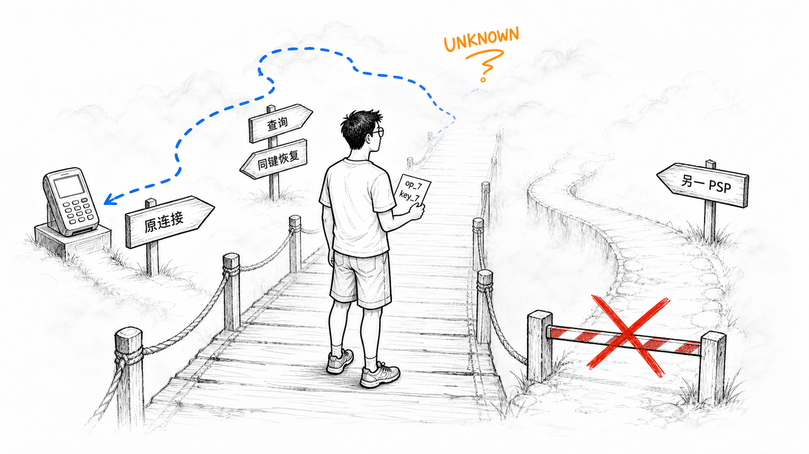
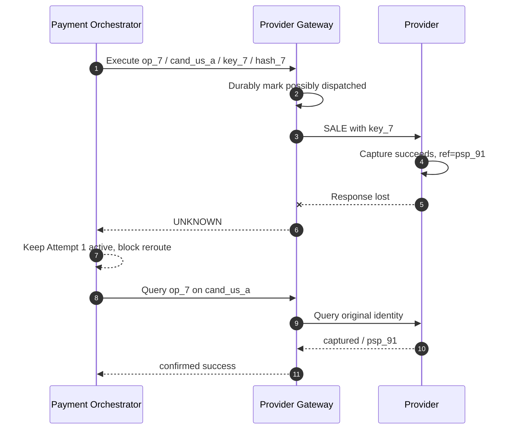
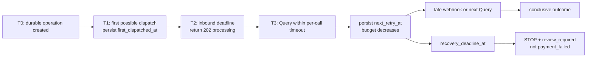
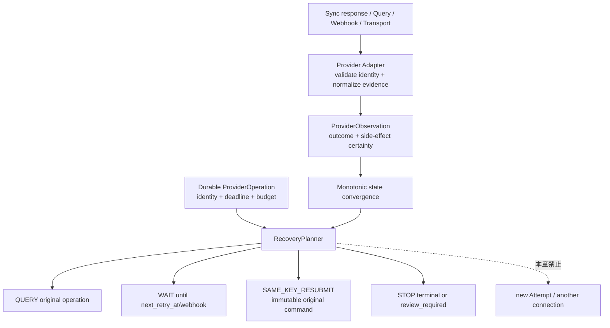
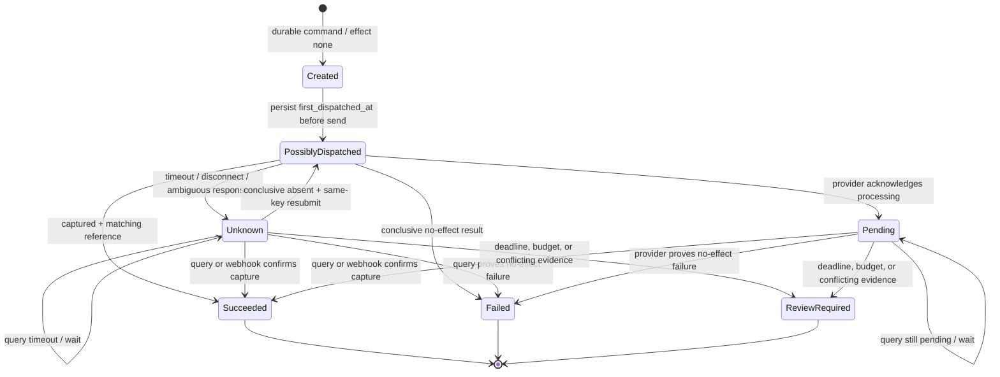

# 第 10 章 Timeout、Retry 与 Unknown State

Aurora 售出一张 129.00 USD 的演唱会门票。Router 已经选定 `cand_us_a`，Payment Orchestrator 创建了一个 automatic-capture `SALE`，Provider 完成处理并生成交易引用。就在响应返回时，Gateway 与 Provider 之间的连接断开。800 毫秒后，调用方只看到 `context deadline exceeded`。

这时最危险的一句话是：“支付失败了，再发一次。”Deadline 能证明的只有 Aurora 没在等待窗口内观察到结果；它不能倒转已经越过进程边界的请求，也不能证明 Provider、Acquirer 或 Issuer 没有执行。于是本章的核心命题是：

> **超时是观测缺失，不是 Provider 未执行。恢复动作必须由副作用确定性、原 Provider Operation 身份、原 connection/key/payload 和剩余 Recovery Deadline 共同决定。**

本章只处理同一 Provider Operation 的恢复：`query`、`wait`、有证据的 `same-key resubmit`，或停止自动恢复。Merchant/API/Provider 三层幂等的完整证明留到第 11 章；跨 Provider 新建 Attempt 的 Fallback 留到第 12 章；Provider 群体健康与熔断留到第 13 章；独立账务事实的 Reconciliation 留到第 17 章。

配套 Go 系统已经把这条安全链落成了窄而完整的 `SALE/automatic` 基线：在调用 Gateway 前持久化 Payment Intent、Attempt 与 Provider Operation；固定 operation、精确 connection revision、Provider key 与 request hash；在第一次可能 dispatch 前只写一次 `first_dispatched_at`；把 `recovery_deadline_at`、剩余 budget、带代数的 lease/claim 与确定性 Jitter 一起持久化；再由纯 `RecoveryPlanner` 只给出 Query、Wait、Same-Key Resubmit 或 Stop。超时后 API 返回 HTTP 202/`processing`，普通 `UNKNOWN/possible` 始终查询原 operation；只有证据冲突、恢复 budget/期限耗尽或持久状态不合法才进入 `review_required`。Gateway 还可对**精确注册的 connection revision**返回结构化、限时且绑定完整 command identity 的 conclusive-absence 证明，普通 404 不能获得这项权力。



UNKNOWN 像雾，不像终点。看不见桥对面的结果时，系统必须握住原 Operation 的身份继续取证；换一条路重新扣款，只会把知识缺口变成第二条资金路径。

## 10.1 Problem：把超时当失败，会创造第二条资金路径

早期实现往往把所有网络错误包在一个重试循环里：

```go
package naive

import "context"

type Command struct {
	AmountMinor int64
	Currency    string
}

type Result struct {
	Status string
}

type Provider interface {
	Sale(context.Context, Command) (Result, error)
}

// Confirm is intentionally unsafe: neither invocation has a durable logical
// operation identity, so the Provider may interpret both as new sales.
func Confirm(ctx context.Context, provider Provider, command Command) (Result, error) {
	first, err := provider.Sale(ctx, command)
	if err == nil {
		return first, nil
	}
	return provider.Sale(ctx, command)
}
```

假设第一次请求已经被 Provider 处理，只是响应丢失；第二次调用就可能成为另一笔 Sale。即使两次金额、卡和 Merchant Reference 看起来相同，也不能据此认定 Provider 会去重。HTTP POST 默认也没有“支付只执行一次”的业务保证。

RFC 9110 明确区分 HTTP method 的幂等语义，并要求客户端不要自动重试非幂等请求，除非它知道该请求在实际语义上幂等，或者能检测出原请求从未生效。[RFC 9110 §9.2.2 Idempotent Methods](https://www.rfc-editor.org/rfc/rfc9110.html#section-9.2.2) 支付 POST 能否安全重放，来自 Provider 明示的幂等契约和平台保存的原操作身份，而不是来自通用 HTTP 客户端。



整个序列只有一条资金操作。`UNKNOWN` 不是一个 Provider 业务结果，而是 Aurora 对远端结果的知识状态；后续 Query 只是补充观察，不创建 Payment Attempt，也不改变 Route Candidate。

### 10.1.1 故障发生在哪里，比错误字符串更重要

| 观察点 | 能否证明没有副作用 | 归一化结果 | 本章允许的下一步 |
| --- | --- | --- | --- |
| 本地校验失败，durable operation 仍是 `created/not_dispatched` | 能，本地状态证明尚未 dispatch | conclusive failure / `none` | 使用同一持久化 command 首次发送 |
| 已标记 dispatch，连接断开或读取超时 | 不能 | `UNKNOWN` / `possible` | Query 或 Wait |
| Provider 返回明确 Decline，契约证明 automatic-capture Sale 未产生资金副作用 | 能 | conclusive failure / `none` | Stop；是否新 Attempt 留第 12 章 |
| Provider 返回 `pending` 与可关联引用 | 不能，但已知请求存在 | `pending` / `possible` | Query 或 Wait webhook |
| Provider 返回完整 captured 结果与匹配引用 | 已确认副作用 | `success` / `confirmed` | Stop 并单调收敛 |
| 无效 JSON 或含糊 5xx，但没有身份冲突证据 | 不能只靠 HTTP 层证明 | `UNKNOWN` / `possible` | Query/Wait 原 Operation |
| operation/connection/reference 身份不匹配 | 暴露证据完整性冲突 | `review_required` | 停止自动化并保留两份证据 |
| Query 自身超时 | 仍不能 | 仍为 `UNKNOWN` | Backoff 后 Query/Wait，不重置身份 |

“连接失败”也不能只按异常类型猜测为 pre-dispatch。代理、TLS、中间层和连接复用会让应用难以确认请求字节是否到达远端。只有 durable local state 明确证明请求从未进入 dispatch，或 Provider 对精确 operation 给出具有契约保证的无副作用证据，才能使用 `SideEffectNone`。

## 10.2 Simple Design：三值结果还不够，要分开结果与确定性

简单系统先把 `success/failure` 扩成 `success/failure/pending/unknown`，再把副作用确定性单独建模。`pending` 是 Provider 明确承认操作仍在处理；`unknown` 是平台缺少可靠观察。二者可能都需要继续查询，但证据强度不同。

下面的 Go 示例刻意不从 HTTP 状态码推断业务结论。Provider Adapter 先把官方响应归一化为 `ProviderVerdict`；只有带引用的 captured、契约明确的 no-effect decline、本地未 dispatch 证明，才会得到确定结果，其他情况默认 `UNKNOWN`：

```go
package observation

type OutcomeClass string

const (
	OutcomeSuccess OutcomeClass = "success"
	OutcomeFailure OutcomeClass = "failure"
	OutcomePending OutcomeClass = "pending"
	OutcomeUnknown OutcomeClass = "unknown"
)

type SideEffectCertainty string

const (
	EffectNone      SideEffectCertainty = "none"
	EffectPossible  SideEffectCertainty = "possible"
	EffectConfirmed SideEffectCertainty = "confirmed"
)

type ProviderVerdict string

const (
	VerdictCaptured         ProviderVerdict = "captured"
	VerdictDeclinedNoEffect ProviderVerdict = "declined_no_effect"
	VerdictPending          ProviderVerdict = "pending"
	VerdictAmbiguous        ProviderVerdict = "ambiguous"
)

type DispatchProof string

const (
	DispatchNever    DispatchProof = "never_dispatched"
	DispatchPossible DispatchProof = "possibly_dispatched"
)

type ProviderObservation struct {
	Verdict           ProviderVerdict
	DispatchProof     DispatchProof
	ProviderReference string
	NormalizedCode    string
}

type Outcome struct {
	Class     OutcomeClass
	Certainty SideEffectCertainty
	Code      string
}

func Normalize(observation ProviderObservation) Outcome {
	switch {
	case observation.Verdict == VerdictCaptured:
		if observation.ProviderReference != "" {
			return Outcome{Class: OutcomeSuccess, Certainty: EffectConfirmed, Code: "captured"}
		}
		return Outcome{Class: OutcomeUnknown, Certainty: EffectPossible, Code: "capture_reference_missing"}
	case observation.Verdict == VerdictDeclinedNoEffect:
		return Outcome{Class: OutcomeFailure, Certainty: EffectNone, Code: observation.NormalizedCode}
	case observation.Verdict == VerdictPending:
		return Outcome{Class: OutcomePending, Certainty: EffectPossible, Code: observation.NormalizedCode}
	case observation.DispatchProof == DispatchNever:
		return Outcome{Class: OutcomeFailure, Certainty: EffectNone, Code: "pre_dispatch"}
	default:
		return Outcome{Class: OutcomeUnknown, Certainty: EffectPossible, Code: "observation_missing"}
	}
}
```

这里的 `VerdictDeclinedNoEffect` 不是“任何 4xx”，而是 Adapter 已按 Provider 文档、operation 类型和响应字段证明的结论。相反，timeout、EOF、连接 reset、无法解析的响应和只有通用 5xx 的响应都落到默认分支。若一次 automatic-capture `SALE` 只收到 `authorized`，它也不能被提升为 `captured`；Authorization、Capture 与 Settlement 仍是不同事实。

Go 的 `context` 文档把 Deadline 描述为跨调用链传播的取消信号，Deadline 到期后 `Context` 被取消；`net/http.Client.Timeout` 也只是给连接、重定向和读取响应等客户端阶段设定总时限。[Go context](https://pkg.go.dev/context) [Go net/http Client](https://pkg.go.dev/net/http#Client) **由此作出的支付领域推论**是：`context.DeadlineExceeded` 说明本地工作应停止等待，不是 Provider transaction 的回滚证明。

## 10.3 Problems at Scale：一次超时会跨越多个时钟和崩溃窗口

### 10.3.1 Request Timeout 不能充当 Recovery Deadline

Merchant 调用 Aurora 时可能只愿意同步等待两秒，Payment 调 Router、Gateway 再调 Provider，每层又有自己的 timeout。若每层都从头拿一份“两秒”，尾部调用会越过上游 deadline；若所有层直接继承最短 Context，Merchant 断开连接又可能中断本应持久执行的恢复工作。

正确做法是区分三个时间概念：

| 时间 | 作用 | 到期后的含义 |
| --- | --- | --- |
| Inbound request deadline | 决定这次 HTTP 请求还能同步等待多久 | 返回 202/当前投影；不改变 Provider 事实 |
| Per-call timeout | 限制一次 Router、Gateway、Provider Query 等 RPC | 本次观察结束；若可能 dispatch，结果仍 unknown |
| Recovery deadline | 限制该 Provider Operation 的自动恢复生命周期 | Stop automation + `review_required`，不能改成 failed |

每个下游调用只能使用 `min(remaining_end_to_end, configured_per_call)`，并给保存结果预留时间。Recovery worker 则从数据库读取持久化 deadline，不依赖已经取消的 Merchant Context。它可以为一次 Query 创建新的短 Context，但不能通过每次调度重新计算一个全新的恢复截止时间。



### 10.3.2 先持久化还是先发送，是不可消除的 Crash Window

如果先调用 Provider、后写数据库，进程可能在 Provider 已 Capture 后崩溃，本地连 operation ID 都没有，恢复只能靠模糊的 Merchant Reference 猜测。若先写 `sending`、后调用 Provider，进程也可能在两步之间崩溃：本地认为“可能已发送”，实际上还没发。

第二种误差更保守，也可恢复。生产系统在事务中持久化 immutable command，随后在 dispatch 前写入 `first_dispatched_at` 和 `SideEffectPossible`。一旦越过这道线，崩溃恢复只能 Query/Wait，除非拿到额外的 no-effect 证明。它可能让少量实际上未发送的请求多等一会儿，却不会用猜测制造第二条资金路径。

当前配套实现已经采用这个方向：Payment 先保存 Intent/Attempt/Operation；同步首发的 `MarkOperationSending` transaction，或接管 `created` crash window 的 recovery claim，会在首次 Gateway I/O 前校验执行权限并只写一次 `first_dispatched_at`。Gateway 随后再用 compare-and-set dispatch claim 只允许赢家把自己的记录推进到 `sending`，然后才调 Provider。worker 对 stale `sending/pending/unknown` 做 Query，而不是创建新 Attempt；`first_dispatched_at` 不能再从 `updated_at` 猜测。

### 10.3.3 HTTP 5xx 描述服务器观察，不是统一的资金结论

一个 400 也许是 Provider 在执行前拒绝参数，一个 422 也许表示同 key 的请求仍在处理中；一个 500 可能发生在执行前，也可能发生在落账后构造响应时；502/504 还可能来自 Aurora 与真实 Provider 之间的代理。只看状态码，无法跨 Provider 推断副作用。

Provider 如果明确提供“本错误无副作用”的字段或错误类别，Adapter 可以将它归一为 conclusive failure。例如 Adyen 的官方 idempotency 文档区分可安全重试的 transient error，并要求 timeout 时复用同一个 idempotency header；同一文档也说明 regional endpoint 之间的 key 去重并非天然共享。这恰好说明 same-key resubmit 必须遵守具体 Provider/账户/Region 契约，不能写成平台全局定律。[Adyen API Idempotency](https://docs.adyen.com/development-resources/api-idempotency)

Stripe 的低层错误文档同样把 socket/timeout 视为无法直接得到响应的场景，并建议在其契约内用同一 idempotency key 重试原请求。[Stripe Advanced Error Handling](https://docs.stripe.com/error-low-level) 这些官方例子支持“同 operation、同 key、同 payload”的恢复方式，却不意味着一个 Provider 的 key 能保护另一个 Provider，也不意味着过期或跨账户 key 仍有效；完整作用域与保留期证明属于第 11 章。

### 10.3.4 Query 的 404 也需要证据等级

查询是恢复动作，不是万能真相。有些 Provider 能按 stable object ID 返回当前状态；例如 Stripe 提供按 PaymentIntent ID retrieve 的官方接口。[Stripe Retrieve a PaymentIntent](https://docs.stripe.com/api/payment_intents/retrieve) 另一些 Provider 的搜索索引可能最终一致、只保留有限时间，或者根本没有覆盖原请求 key 的查询 API。

因此 `not found` 只有满足以下条件才构成 `same-key resubmit` 证据：查询作用域与原 connection/account/region 完全一致；查询键与原 operation 可唯一关联；Provider 契约说明当前窗口内 not-found 能证明请求未创建；响应身份通过校验。若任一条件未知，404 仍只是新的观测缺失，动作只能是 Wait 或再次 Query。

当前 Gateway 已把这条边界做成 typed capability：只有显式配置了 conclusive-absence 权力、且注册表中的 connection ID/revision/namespace/provider 与原 command 全部匹配时，权威 Query 的 absent 才生成有半开有效期的结构化证明；Payment 客户端还会重新校验 operation、Attempt、connection revision、key 与 payload hash。未配置的生产连接、普通 HTTP 404 或带扩展字段的含糊 proof 都保持 `UNKNOWN`，只能再次 Query/Wait；身份漂移则作为完整性冲突停止自动化并进入 review。两类情况都不会触发第二次 POST。Simulator 的这项能力只是 contract-tested 演示，不代表真实 PSP 已提供同等保证。

### 10.3.5 Webhook 会迟到、重复、乱序，也可能与 Query 冲突

同步 response、Query 与 webhook 都是对同一 Provider Operation 的观察来源，没有哪个来源因为“最后到达”就天然更真。Stripe 官方 webhook 文档明确说明 event delivery 不保证生成顺序，并要求处理重复事件；缺失对象可以再从 API 查询。[Stripe Webhooks](https://docs.stripe.com/webhooks)

这要求状态收敛保持单调：confirmed captured 不能被迟到的 transport unknown 降级；重复 event ID 不重复应用；同一个 reference 的同义事件可以合并；不同 Provider reference 或相互冲突的 terminal outcome 都必须保留证据并进入 `review_required`。恢复 worker 不能因为刚做完一次 Query 就忽略随后到达的 webhook。

### 10.3.6 没有持久化预算，Backoff 只是慢一点的无限循环

假设 50 万条 UNKNOWN Operation 都在每个进程启动时立刻 Query，Provider 恢复瞬间会收到新的流量洪峰。进程内计数器又会在重启后归零，形成 retry storm。

每条 operation 至少持久化 `next_retry_at`、`recovery_budget_remaining` 与 `recovery_deadline_at`；worker 通过 lease 或 `FOR UPDATE SKIP LOCKED` 领取，实际发起 Query/Resubmit 才消耗预算，单纯 Wait 不消耗。指数 Backoff 设置上限并加入 Jitter，若 Provider 给出可信 `Retry-After` 或查询节奏约束，则 Adapter 可以把它纳入下一时刻。这里的 budget 约束单条操作恢复；跨交易的 Provider Health 和熔断留在第 13 章。

## 10.4 Production Design：让 Recovery Planner 只做四种动作

### 10.4.1 从现有 UNKNOWN 基线演进，不重造支付核心

| 能力 | 当前配套系统 | 仍需生产化的边界 |
| --- | --- | --- |
| 稳定身份 | Payment/Attempt/Operation 固定 connection ID/revision、namespace、Provider、key 与 payload hash；Gateway 再次校验完整 tuple | 为每个真实 PSP 固定账户、Region、API operation 与 key retention 合同 |
| 精确 Route | Recovery claim 和 Gateway recovery inspection 都不接受新 Candidate；首次执行权限还受已固定的 `executable_until` 约束 | 把真实账户轮换、灾备 endpoint 与旧 revision 的运维流程写成 Provider runbook |
| Immutable command | Payment 保存 request hash；Gateway 保存 typed command 并拒绝 amount、Token、capture mode 或 connection 漂移 | 若真实 Adapter 需要重构 wire payload，发布明确的 payload/derivation version 与兼容迁移 |
| UNKNOWN / Observation | transport/协议含糊结果保持 unknown；sale、query、webhook 证据进入 append-only Gateway observation ledger，冲突不覆盖 | 为真实 PSP normalizer 建立官方契约、回放语料与版本化发布门禁 |
| Query / webhook / absence | 原 operation Query、durable inbox/outbox、严格身份验证与 typed conclusive absence 已实现；普通 404 永不授权重送 | 逐 Adapter 证明 query scope、索引一致性窗口与 not-found 权威性；未证明者关闭 capability |
| Deadline / budget / claim | `first_dispatched_at`、固定 deadline、剩余 budget、`next_retry_at`、deterministic jitter、lease 与 claim generation 均持久化并在事务中推进 | 增加生产级调度、容量隔离、告警、停机排队与人工处置 runbook；in-process worker 不是完整调度平台 |
| Planner | 纯 `RecoveryPlanner` 只有 Query/Wait/Same-Key Resubmit/Stop；claim 事务原子扣预算，执行与完成受 generation fence 约束 | 用真实流量尺度验证调度公平性、Provider rate limit 与长时间 backlog |

当前系统已经把“为什么现在 Query、为什么可以同键重送、为什么必须停”变成了可测试的显式决策，而不是散落在错误分支中的控制流。它仍不是 live-payment 声明：真实 PSP 的 absence/idempotency 合同、生产 scheduler 与容量运维尚未接入。只有对应 delivery manifest 已固定实现 commit 与绿色 CI run，这些代码才构成本章的**已发布**基线；仅有工作树源码不能代替发布证据。

### 10.4.2 ProviderObservation 是证据，不是异常字符串

Gateway Adapter 应把一次同步响应、Query、webhook 或 transport failure 都写成统一 Observation。建议字段包括：

| 字段 | 含义 |
| --- | --- |
| `operation_id` / `provider_connection_id` | 观察归属的原操作与精确连接 |
| `source` | `sync_response`、`query`、`webhook`、`transport` |
| `transport_phase` | `pre_dispatch_proven` 或 `possibly_dispatched` |
| `http_status` | 观测到的协议状态；不能单独决定资金结果 |
| `provider_status/code/reference` | Adapter 验证后的原始证据与关联引用 |
| `outcome_class` | `success/failure/pending/unknown` |
| `side_effect_certainty` | `none/possible/confirmed` |
| `observed_at` / `adapter_version` | 时间与归一化规则版本 |

原始 error text 可以进入受控诊断字段，却不能驱动资金状态机。分类器输出的 stable code 才能进入指标与 RecoveryPlanner。PAN、CVV 或完整 Provider 请求不会出现在 Observation、日志或 webhook inbox 中。



### 10.4.3 Recovery Record 固定身份、时间与预算

`ProviderOperation` 的恢复投影至少需要这些持久字段：

| 字段 | 首次设置 | 不变量 |
| --- | --- | --- |
| `operation_id` | 创建 operation 时 | 永不改变；所有 Query/Resubmit/Webhook 用它关联 |
| `provider_connection_id` | Routing Decision 后 | 永不换 Provider、账户、Connector 或 Region |
| `provider_idempotency_key` | 首次执行前 | resubmit 原样复用；契约作用域留第 11 章 |
| `request_hash` + immutable payload ref | 首次执行前 | amount、currency、Token ref、capture mode 均不可变 |
| `first_dispatched_at` | 第一次进入 possibly-dispatched 前 | 只写一次；不能用每次 `updated_at` 代替 |
| `recovery_deadline_at` | 创建恢复策略时 | 固定绝对时间；调度重启不延期 |
| `next_retry_at` | 每次计划后 | worker 只领取到期项 |
| `recovery_budget_remaining` | 创建恢复策略时 | Query/Resubmit 原子扣减，Wait 不扣减 |
| `last_observation` / `adapter_version` | 每次获得证据时 | 新观察单调合并，冲突不覆盖 |

为了减少跨层漂移，Planner 应是纯函数。它不发 HTTP、不写数据库、不读取最新 Route；调用方在事务中加载 snapshot、得到动作、原子扣预算并更新 `next_retry_at`，随后 worker 执行动作。下面的 Go 示例将动作空间限制为合同规定的四种：

```go
package recovery

import (
	"errors"
	"time"
)

var ErrInvalidSnapshot = errors.New("invalid recovery snapshot")

type Action string

const (
	ActionQuery           Action = "query"
	ActionWait            Action = "wait"
	ActionSameKeyResubmit Action = "same_key_resubmit"
	ActionStop            Action = "stop"
)

type OutcomeClass string

const (
	OutcomeSuccess OutcomeClass = "success"
	OutcomeFailure OutcomeClass = "failure"
	OutcomePending OutcomeClass = "pending"
	OutcomeUnknown OutcomeClass = "unknown"
)

type SideEffectCertainty string

const (
	EffectNone      SideEffectCertainty = "none"
	EffectPossible  SideEffectCertainty = "possible"
	EffectConfirmed SideEffectCertainty = "confirmed"
)

type ResubmitProof string

const (
	ProofNone                     ResubmitProof = "none"
	ProofLocalNeverDispatched     ResubmitProof = "local_never_dispatched"
	ProofProviderConclusiveAbsent ResubmitProof = "provider_conclusive_not_found"
)

type OriginalCommand struct {
	OperationID          string
	ProviderConnectionID string
	ProviderKey          string
	RequestHash          string
}

func (command OriginalCommand) Valid() bool {
	return command.OperationID != "" &&
		command.ProviderConnectionID != "" &&
		command.ProviderKey != "" &&
		command.RequestHash != ""
}

type Snapshot struct {
	Original                OriginalCommand
	Outcome                 OutcomeClass
	Certainty               SideEffectCertainty
	ResubmitProof           ResubmitProof
	QuerySupported          bool
	ReviewRequired          bool
	RecoveryDeadlineAt      time.Time
	NextActionAt            time.Time
	RecoveryBudgetRemaining int
}

type Decision struct {
	Action         Action
	Reason         string
	RequiresReview bool
}

func Plan(now time.Time, snapshot Snapshot) (Decision, error) {
	if !snapshot.Original.Valid() || snapshot.RecoveryDeadlineAt.IsZero() {
		return Decision{}, ErrInvalidSnapshot
	}
	switch snapshot.Outcome {
	case OutcomeSuccess, OutcomeFailure, OutcomePending, OutcomeUnknown:
	default:
		return Decision{}, ErrInvalidSnapshot
	}
	switch snapshot.Certainty {
	case EffectNone, EffectPossible, EffectConfirmed:
	default:
		return Decision{}, ErrInvalidSnapshot
	}
	switch snapshot.ResubmitProof {
	case ProofNone, ProofLocalNeverDispatched, ProofProviderConclusiveAbsent:
	default:
		return Decision{}, ErrInvalidSnapshot
	}
	if snapshot.ReviewRequired {
		return Decision{Action: ActionStop, Reason: "conflicting_evidence", RequiresReview: true}, nil
	}
	if snapshot.Outcome == OutcomeSuccess && snapshot.Certainty == EffectConfirmed {
		return Decision{Action: ActionStop, Reason: "terminal_success"}, nil
	}
	if snapshot.Outcome == OutcomeFailure && snapshot.Certainty == EffectNone {
		return Decision{Action: ActionStop, Reason: "conclusive_failure"}, nil
	}
	if snapshot.Certainty == EffectConfirmed || snapshot.Outcome == OutcomeSuccess ||
		(snapshot.Outcome == OutcomePending && snapshot.ResubmitProof != ProofNone) {
		return Decision{Action: ActionStop, Reason: "conflicting_evidence", RequiresReview: true}, nil
	}
	if !now.Before(snapshot.RecoveryDeadlineAt) {
		return Decision{Action: ActionStop, Reason: "recovery_deadline_exhausted", RequiresReview: true}, nil
	}
	if snapshot.RecoveryBudgetRemaining <= 0 {
		return Decision{Action: ActionStop, Reason: "recovery_budget_exhausted", RequiresReview: true}, nil
	}
	if !snapshot.NextActionAt.IsZero() && now.Before(snapshot.NextActionAt) {
		return Decision{Action: ActionWait, Reason: "backoff_not_elapsed"}, nil
	}
	switch snapshot.ResubmitProof {
	case ProofLocalNeverDispatched, ProofProviderConclusiveAbsent:
		return Decision{Action: ActionSameKeyResubmit, Reason: string(snapshot.ResubmitProof)}, nil
	}
	if snapshot.QuerySupported {
		return Decision{Action: ActionQuery, Reason: "side_effect_possible"}, nil
	}
	return Decision{Action: ActionWait, Reason: "await_provider_evidence"}, nil
}
```

这个函数没有 `retry_other_provider`、`new_attempt` 或 `choose_candidate`。`ActionSameKeyResubmit` 的执行器只能从数据库加载 `OriginalCommand` 对应的不可变 payload，不能接受一个临时构造的新请求；执行前再次核对 connection、key 与 request hash，并在同一事务中消费一次 recovery budget。若 hash 不一致，结果不是“再试试”，而是 `review_required`。

### 10.4.4 Query、Wait 与 Same-Key Resubmit 的证据门槛

| 当前证据 | Query 可用 | Resubmit proof | Planner 动作 |
| --- | ---: | --- | --- |
| `success/confirmed` 或 `failure/none` | 任意 | 任意 | Stop terminal |
| `pending/possible`，未到 `next_retry_at` | 任意 | none | Wait |
| `unknown/possible`，Query 权威且已到时 | 是 | none | Query 原 operation |
| `unknown/possible`，Query 不可用 | 否 | none | Wait webhook，直到 deadline/budget |
| durable local state 证明从未 dispatch | 任意 | local proof | Same-Key Resubmit 原 command |
| 权威 Query 证明 exact operation 不存在 | 是 | provider conclusive not-found | Same-Key Resubmit 原 command |
| 只有普通 404、timeout 或 5xx | 任意 | none | Query/Wait，禁止 Resubmit |
| deadline/budget 耗尽仍 possible | 任意 | none | Stop + `review_required` |

Wait 是主动决策，不是忘记这笔支付。它必须有 `next_retry_at`、正在等待的证据源和 recovery deadline；API 继续返回 `processing`，运营面能看到 age、剩余 budget 与 last observation。Webhook 到达时按同一 operation identity 立即参与收敛，不必等定时器。



状态图里没有从 `Unknown` 到“新 Provider Attempt”的边。这不是遗漏，而是安全边界：同 operation 的观测缺失必须先解决或停止自动化。第 12 章才会讨论 conclusive no-effect failure 之后，Policy 是否允许创建新的 Attempt。

### 10.4.5 Worker Lease 解决并发，不证明远端结果

多个 Recovery worker 可以用 `FOR UPDATE SKIP LOCKED` 或等价 lease 领取到期 operation，但 lease 只证明“当前由谁负责恢复”，不证明 Provider 是否执行。领取事务应同时校验 version、扣减本次 Query/Resubmit budget，并持久化 action、lease expiry 与新的 `next_retry_at`；网络 I/O 不能占着数据库事务等待。

若 worker 在扣预算后、发请求前崩溃，最多保守地浪费一次恢复额度；若在请求返回后、应用 Observation 前崩溃，下一个 worker 仍把 side effect 视为 possible，并查询同一 operation。不能为了补回这两个窗口而回滚 `first_dispatched_at`、增加 budget 或换 key。Lease 过期只允许另一个 worker接管相同工作，不是创建并行资金请求的许可。

## 10.5 Failure Modes：恢复系统最容易在哪些地方撒谎

### 10.5.1 把技术分类冒充资金事实

| 失败模式 | 错误结论 | 正确控制 |
| --- | --- | --- |
| `context deadline exceeded` → failed | Provider 没有执行 | 可能 dispatch 后一律 UNKNOWN |
| 任意 500/502/503/504 → safe retry | 服务器肯定没落副作用 | 需要 Provider-specific no-effect evidence |
| 任意 4xx → conclusive decline | 请求一定未执行 | Adapter 按官方字段和 operation 语义分类 |
| automatic-capture Sale 收到 `authorized` → succeeded | 已 Capture | 保留 possible/pending，直到 Capture 证据 |
| recovery deadline 到期 → payment failed | 时间能证明无扣款 | Stop + review；未知事实仍未知 |

这里尤其不能用“多数时候”覆盖长尾。如果 99.99% 的读取超时发生在 Provider 执行前，把剩余 0.01% 自动重送到新 operation 仍会持续制造重复扣款。可靠性设计要对副作用边界负责，而不是只优化平均错误率。

### 10.5.2 同名 Retry 偷偷改变了操作身份

以下任一变化都不是本章允许的 Retry：生成新 `operation_id`、换 Provider key、换 Merchant Account/Region、改变 amount/currency、换 Token、从 automatic Capture 改成 authorize、换 Candidate。它们要么是 idempotency conflict，要么是第 12 章的新 Attempt；不能藏在 HTTP client 的 retry middleware 中。

通用 HTTP 库还可能自动重试连接错误。Gateway 必须审计 Transport 配置，确保 state-changing POST 不会绕过 RecoveryPlanner；即使 Provider 支持幂等，也要由平台显式复用原 key 与 payload。RFC 9110 还指出客户端不应自动重试一次已经失败的自动重试，这与有限 budget 的设计方向一致。[RFC 9110 §9.2.2](https://www.rfc-editor.org/rfc/rfc9110.html#section-9.2.2)

### 10.5.3 Query/404 被过度信任

若 Provider 的查询索引有延迟，第一次 Query 返回 404，立刻 resubmit 可能与稍后可见的原交易并存。Adapter 的 capability metadata 应声明 query key、覆盖的 operation、consistency window 和 not-found certainty；未知就不能生成 `ProofProviderConclusiveAbsent`。

查询响应还必须验证 Provider、connection/account、operation ID、Provider key 与 reference。一个格式正确但属于别的 Merchant Account 的成功响应不是“可用结果”，而是 correlation conflict，应保留证据并要求人工复核。

### 10.5.4 Backoff 在重启后归零

只把 attempt count 放在 goroutine 变量里，部署或崩溃会让所有 operation 回到第一次重试。`next_retry_at`、budget 和 deadline 必须与 Provider Operation 同一事实源持久化；worker claim 与预算扣减需要事务所有权，避免两个副本同时 Query 或 Resubmit。Jitter 可以分散时刻，却不能代替 lease、唯一身份或 budget。

### 10.5.5 迟到证据采用 Last-Write-Wins

Query 先返回 declined，随后 webhook 带 captured 和另一 reference；或已 captured 后又收到旧的 pending。前者是冲突，后者是可忽略的旧观察，二者都不能简单按 `updated_at` 覆盖。当前配套 domain 已能保护 confirmed terminal、拒绝 reference conflict 并设置 `integrity_status=review_required`；Gateway 的 append-only Observation ledger 还保留 source、`occurred_at`、adapter version、规范化证据与 payload hash，让 sale、Query 和 webhook 经过同一套单调归并规则。

### 10.5.6 可证伪的测试矩阵

设计是否安全，应由故障注入证明：

1. Simulator 先持久化 captured side effect，再丢弃同步响应；Payment worker 随后重启。系统只能 Query 原 operation 或接收其 webhook，最终成功，数据库始终只有一个 Attempt、一条 Payment Operation 和一条 Gateway Operation。
2. 连续三次 Query timeout 只推进持久化 Backoff、扣减 budget；operation ID、connection、Provider key、request hash 均不变化，也没有第二次 Routing Decision。
3. 进程在 durable `created` 后、`first_dispatched_at` 前崩溃，可以从原 command 进行 Same-Key Resubmit；在 `first_dispatched_at` 后崩溃则只能先 Query/Wait。
4. 普通或最终一致的 404 不产生 resubmit proof；只有 Adapter 标记的 conclusive not-found 才允许同 key 重送。
5. Query 一直 unknown 直到 recovery deadline，operation 进入 `review_required`，Payment 仍不被伪造为 failed。
6. captured webhook 与后来的 decline/reference conflict 都被保存，自动恢复停止，confirmed 资金事实不被 last-write-wins 抹除。

当前 Compose E2E 覆盖第一类场景的核心部分：`timeout_then_succeeded` 会从 202/processing 收敛到 succeeded，并断言单一资金路径。新增的 PostgreSQL/app/Gateway integration tests 继续覆盖 worker restart 后 deadline/budget/identity 不变、连续恢复领取、普通 404 不产生第二次 POST、结构化 conclusive absence 才可同键重送，以及路由执行权限过期后的 fail-closed；最终发布仍须由 delivery manifest 所固定的 CI 用真实 PostgreSQL 与 Compose 全量复验。

## 10.6 Trade-offs：等待确定性也有成本

| 选择 | 收益 | 代价 | 控制方式 |
| --- | --- | --- | --- |
| UNKNOWN 时 fail closed | 避免重复资金路径 | 顾客更久看到 processing | 明确 SLA、状态查询和运营解释 |
| 高频 Query | 更快发现终态 | Provider 限流、成本和 herd risk | Backoff、Jitter、Retry-After、budget |
| 主要等待 webhook | 热路径更轻 | webhook 延迟或丢失会延长未知 | 到期 Query + durable inbox |
| 较长 recovery deadline | 更可能自动收敛 | unresolved operation 长期占用运营注意力 | age 指标、分层告警与明确 stop |
| 较短 recovery deadline | 更快进入人工队列 | manual review 量增加 | 按 Payment Method/Provider 契约配置 |
| 极严格的 not-found proof | 最安全 | 某些无查询 Provider 无法自动重送 | Wait/人工处置，不用猜测换可用性 |
| Provider-specific classifier | 证据精确 | Adapter 与合约测试成本高 | 版本化 normalization + contract tests |

Recovery deadline 不应只有一个全球常量。卡的 automatic-capture Sale、异步银行转账和需要用户动作的钱包具有不同终态时延；但 deadline 的选择必须在 dispatch 前固化并可审计，不能看到 operation 一直 unknown 就无限续期。本章的首个实现仍只覆盖 tokenized card automatic-capture Sale，避免用一套时钟假装适配所有 Payment Method。

人工复核也不是失败回收站。进入 `review_required` 时应包含原 operation identity、connection、不可变 command hash、last observations、查询次数、deadline/budget 原因和 Provider references；操作员只能触发受审计的 Query、证据归并或后续修复命令，不能在控制台按“重试”就生成新 Sale。

## 10.7 Summary：先承认不知道，才能安全知道

本章从一次“Provider 已 Capture、响应却丢失”的故障出发，建立了以下不变量：

1. Timeout、断连、无效响应和含糊 5xx 首先是观测缺失；一旦请求可能 dispatch，就归入 `UNKNOWN/possible`，不能标成 failed。
2. 结果类别与副作用确定性分开：`success/failure/pending/unknown` 不替代 `none/possible/confirmed`。
3. 恢复始终固定原 `operation_id`、Provider connection/account/region、Provider key 与 immutable payload/hash；这些值改变就不是同 operation Retry。
4. `RecoveryPlanner` 只有 Query、Wait、Same-Key Resubmit 和 Stop 四种动作，不拥有 Routing，也不创建新 Attempt。
5. Same-Key Resubmit 需要 durable local never-dispatched 证明，或 Provider 对精确 operation 的 conclusive not-found；timeout、普通 404 和 HTTP code 都不够。
6. `first_dispatched_at`、`recovery_deadline_at`、`next_retry_at` 与 recovery budget 必须持久化；重启不能重置时钟或次数。
7. Recovery deadline/budget 耗尽只会停止自动化并进入 `review_required`，不会把未知资金事实改写为失败。
8. Query、同步响应与 webhook 对同一 operation 单调收敛；重复和旧观察可合并，冲突 terminal/reference 证据必须保留，禁止 last-write-wins。
9. UNKNOWN 期间禁止跨 Provider Fallback。第 11 章将证明各层 key、payload fingerprint 与并发所有权；第 12 章只在旧 Attempt 已有明确无副作用终态时讨论新 Attempt。

当前 Go 系统已具备 UNKNOWN、原 operation Query、webhook 收敛、append-only Observation、稳定 connection/key/hash、纯 RecoveryPlanner、固定 deadline/budget 与单一资金路径基线。下一步不是再加一个通用 retry loop，而是把真实 PSP 的 query/absence/idempotency 合同、生产调度与运营 SLA 接到这些已验证的不变量上。系统由此把“暂时没看到结果”处理成一个可审计的恢复过程，而不是把网络不确定性放大成重复支付。

## 延伸阅读

* [第 3 章：Payment Routing System 的职责与边界](../part-1-foundations/routing-system-boundaries.md)
* [第 9 章：Provider Scoring 与 Risk-Aware Routing](../part-2-routing-engine/provider-scoring.md)
* [第 11 章：Idempotency 与支付尝试](idempotency.md)
* [第 12 章：Fallback Routing](fallback-routing.md)
* [第 13 章：Circuit Breaker 与 Provider Health](provider-health.md)
* [第 17 章：Reconciliation](../part-4-operating-at-scale/reconciliation.md)
* [附录 A：Payment Intent、Attempt 与 Provider Request 状态模型](../appendices/payment-state-models.md)
* [RFC 9110：HTTP Semantics](https://www.rfc-editor.org/rfc/rfc9110.html)
* [Go context package](https://pkg.go.dev/context)
* [Adyen API Idempotency](https://docs.adyen.com/development-resources/api-idempotency)
* [Stripe Webhooks](https://docs.stripe.com/webhooks)
