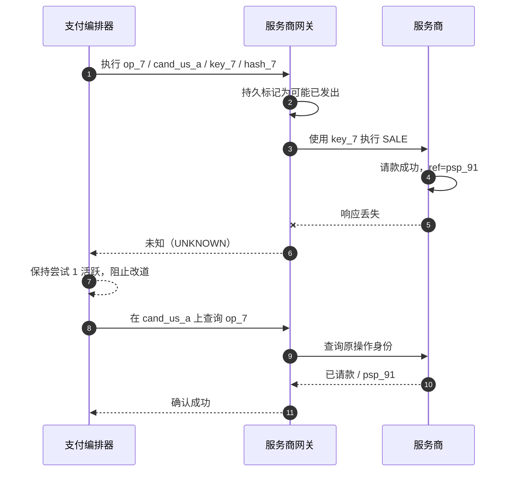
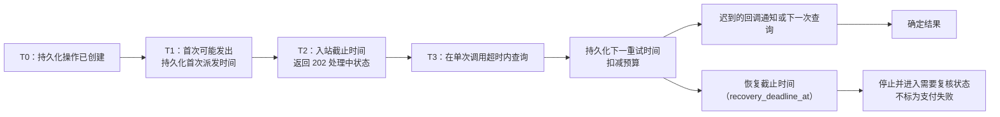
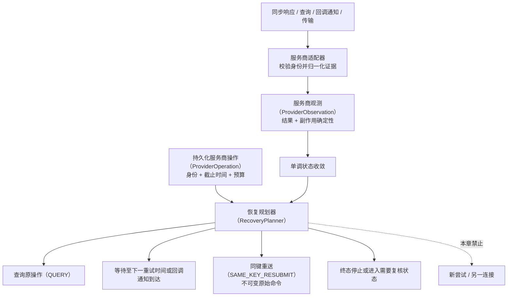
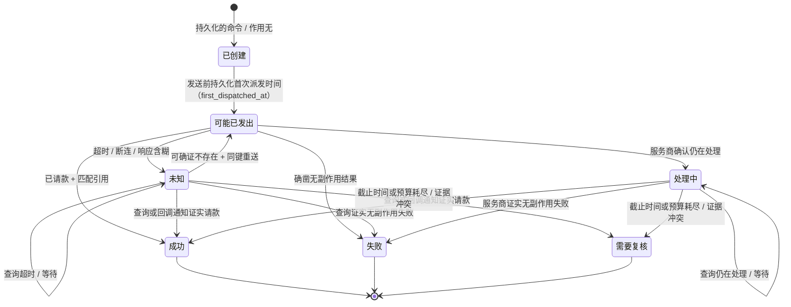

# 第 10 章 超时、重试与未知状态

Aurora 售出一张 129.00 USD 的演唱会门票。路由服务已经选定 `cand_us_a`，支付编排器创建了一个自动请款 `SALE`，服务商完成处理并生成交易引用。就在响应返回时，网关与服务商之间的连接断开。800 毫秒后，调用方只看到 `context deadline exceeded`。

这时最危险的一句话是：“支付失败了，再发一次。”截止时间能证明的只有 Aurora 没在等待窗口内观察到结果；它不能倒转已经越过进程边界的请求，也不能证明服务商、收单机构或发卡机构没有执行。于是本章的核心命题是：

> **超时是观测缺失，不是服务商未执行。恢复动作必须由副作用确定性、原服务商操作身份、原连接/键/载荷和剩余恢复截止时间共同决定。**

本章只处理同一服务商操作的恢复：查询、等待、有证据的同键重送，或停止自动恢复。商户/API/服务商三层幂等的完整证明留到第 11 章；跨服务商新建尝试的后备路由留到第 12 章；服务商群体健康与熔断留到第 13 章；独立账务事实的对账留到第 17 章。

配套 Go 系统已经把这条安全链落成了窄而完整的 `SALE/automatic` 基线：在调用网关前持久化支付意图、尝试与服务商操作；固定操作、精确连接修订、服务商幂等键与请求哈希；在第一次可能派发前只写一次 `first_dispatched_at`；把 `recovery_deadline_at`、剩余预算、带代数的租约/领取权与确定性抖动一起持久化；再由纯 `RecoveryPlanner` 只给出查询、等待、同键重送或停止。超时后 API 返回 HTTP 202/`processing`，普通 `UNKNOWN/possible` 始终查询原操作；只有证据冲突、恢复预算/期限耗尽或持久状态不合法才进入 `review_required`。网关还可对**精确注册的连接修订**返回结构化、限时且绑定完整命令身份的可确证不存在证明，普通 404 不能获得这项权力。


UNKNOWN 像雾，不像终点。看不见桥对面的结果时，系统必须握住原操作的身份继续取证；换一条路重新扣款，只会把知识缺口变成第二条资金路径。

## 10.1 问题：把超时当失败，会创造第二条资金路径

早期实现往往把所有网络错误包在一个重试循环里：

```go
package naive

import "context"

type Command struct {
	AmountMinor int64
	Currency    string
}

type Result struct {
	Status string
}

type Provider interface {
	Sale(context.Context, Command) (Result, error)
}

// Confirm 有意展示不安全做法：两次调用都没有持久的逻辑操作身份，
// 因此服务商可能把它们都解释为新的销售操作。
func Confirm(ctx context.Context, provider Provider, command Command) (Result, error) {
	first, err := provider.Sale(ctx, command)
	if err == nil {
		return first, nil
	}
	return provider.Sale(ctx, command)
}
```

假设第一次请求已经被服务商处理，只是响应丢失；第二次调用就可能成为另一笔销售操作。即使两次金额、卡和商户引用看起来相同，也不能据此认定服务商会去重。HTTP POST 默认也没有“支付只执行一次”的业务保证。

RFC 9110 明确区分 HTTP 方法的幂等语义，并要求客户端不要自动重试非幂等请求，除非它知道该请求在实际语义上幂等，或者能检测出原请求从未生效。[RFC 9110 §9.2.2 幂等方法](https://www.rfc-editor.org/rfc/rfc9110.html#section-9.2.2) 支付 POST 能否安全重放，来自服务商明示的幂等契约和平台保存的原操作身份，而不是来自通用 HTTP 客户端。



整个序列只有一条资金操作。`UNKNOWN` 不是一个服务商业务结果，而是 Aurora 对远端结果的知识状态；后续查询只是补充观察，不创建支付尝试，也不改变候选通道。

### 10.1.1 故障发生在哪里，比错误字符串更重要

| 观察点                                      | 能否证明没有副作用     | 归一化结果                   | 本章允许的下一步        |
| ---------------------------------------- | ------------- | ----------------------- | --------------- |
| 本地校验失败，持久化的操作仍是 `created/not_dispatched` | 能，本地状态证明尚未派发  | 确定失败 / `none`           | 使用同一持久化命令首次发送   |
| 已标记派发，连接断开或读取超时                          | 不能            | `UNKNOWN` / `possible`  | 查询或等待           |
| 服务商返回明确拒绝，契约证明自动请款 `SALE` 操作未产生资金副作用     | 能             | 确定失败 / `none`           | 停止；是否新尝试留第 12 章 |
| 服务商返回 `pending` 与可关联引用                   | 不能，但已知请求存在    | `pending` / `possible`  | 查询或等待回调通知       |
| 服务商返回完整已请款结果与匹配引用                        | 已确认副作用        | `success` / `confirmed` | 停止并单调收敛         |
| 无效 JSON 或含糊 5xx，但没有身份冲突证据                | 不能只靠 HTTP 层证明 | `UNKNOWN` / `possible`  | 查询/等待原操作        |
| 操作/连接/引用身份不匹配                            | 暴露证据完整性冲突     | `review_required`       | 停止自动化并保留两份证据    |
| 查询自身超时                                   | 仍不能           | 仍为 `UNKNOWN`            | 退避后查询/等待，不重置身份  |

“连接失败”也不能只按异常类型猜测为发出前。代理、TLS、中间层和连接复用会让应用难以确认请求字节是否到达远端。只有持久化的本地状态明确证明请求从未进入派发，或服务商对精确操作给出具有契约保证的无副作用证据，才能使用 `SideEffectNone`。

## 10.2 简单设计：三值结果还不够，要分开结果与确定性

简单系统先把 `success/failure` 扩成 `success/failure/pending/unknown`，再把副作用确定性单独建模。`pending` 是服务商明确承认操作仍在处理；`unknown` 是平台缺少可靠观察。二者可能都需要继续查询，但证据强度不同。

下面的 Go 示例刻意不从 HTTP 状态码推断业务结论。服务商适配器先把官方响应归一化为 `ProviderVerdict`；只有带引用的已请款、契约明确的无副作用拒绝、本地未派发证明，才会得到确定结果，其他情况默认 `UNKNOWN`：

```go
package observation

type OutcomeClass string

const (
	OutcomeSuccess OutcomeClass = "success"
	OutcomeFailure OutcomeClass = "failure"
	OutcomePending OutcomeClass = "pending"
	OutcomeUnknown OutcomeClass = "unknown"
)

type SideEffectCertainty string

const (
	EffectNone      SideEffectCertainty = "none"
	EffectPossible  SideEffectCertainty = "possible"
	EffectConfirmed SideEffectCertainty = "confirmed"
)

type ProviderVerdict string

const (
	VerdictCaptured         ProviderVerdict = "captured"
	VerdictDeclinedNoEffect ProviderVerdict = "declined_no_effect"
	VerdictPending          ProviderVerdict = "pending"
	VerdictAmbiguous        ProviderVerdict = "ambiguous"
)

type DispatchProof string

const (
	DispatchNever    DispatchProof = "never_dispatched"
	DispatchPossible DispatchProof = "possibly_dispatched"
)

type ProviderObservation struct {
	Verdict           ProviderVerdict
	DispatchProof     DispatchProof
	ProviderReference string
	NormalizedCode    string
}

type Outcome struct {
	Class     OutcomeClass
	Certainty SideEffectCertainty
	Code      string
}

func Normalize(observation ProviderObservation) Outcome {
	switch {
	case observation.Verdict == VerdictCaptured:
		if observation.ProviderReference != "" {
			return Outcome{Class: OutcomeSuccess, Certainty: EffectConfirmed, Code: "captured"}
		}
		return Outcome{Class: OutcomeUnknown, Certainty: EffectPossible, Code: "capture_reference_missing"}
	case observation.Verdict == VerdictDeclinedNoEffect:
		return Outcome{Class: OutcomeFailure, Certainty: EffectNone, Code: observation.NormalizedCode}
	case observation.Verdict == VerdictPending:
		return Outcome{Class: OutcomePending, Certainty: EffectPossible, Code: observation.NormalizedCode}
	case observation.DispatchProof == DispatchNever:
		return Outcome{Class: OutcomeFailure, Certainty: EffectNone, Code: "pre_dispatch"}
	default:
		return Outcome{Class: OutcomeUnknown, Certainty: EffectPossible, Code: "observation_missing"}
	}
}
```

这里的 `VerdictDeclinedNoEffect` 不是“任何 4xx”，而是适配器已按服务商文档、操作类型和响应字段证明的结论。相反，超时、EOF、连接重置、无法解析的响应和只有通用 5xx 的响应都落到默认分支。若一次自动请款 `SALE` 只收到 `authorized`，它也不能被提升为 `captured`；授权、请款与结算仍是不同事实。

Go 的 `context` 文档把截止时间描述为跨调用链传播的取消信号，截止时间到期后 `Context` 被取消；`net/http.Client.Timeout` 也只是给连接、重定向和读取响应等客户端阶段设定总时限。[Go：上下文](https://pkg.go.dev/context) [Go：`net/http` 客户端](https://pkg.go.dev/net/http#Client) **由此作出的支付领域推论**是：`context.DeadlineExceeded` 说明本地工作应停止等待，不是服务商交易的回滚证明。

## 10.3 规模化问题：一次超时会跨越多个时钟和崩溃窗口

### 10.3.1 请求超时不能充当恢复截止时间

商户调用 Aurora 时可能只愿意同步等待两秒，支付调路由服务、网关再调服务商，每层又有自己的超时。若每层都从头拿一份“两秒”，尾部调用会越过上游截止时间；若所有层直接继承最短上下文，商户断开连接又可能中断本应持久执行的恢复工作。

正确做法是区分三个时间概念：

| 时间       | 作用                     | 到期后的含义                            |
| -------- | ---------------------- | --------------------------------- |
| 入站请求截止时间 | 决定这次 HTTP 请求还能同步等待多久   | 返回 202/当前投影；不改变服务商事实              |
| 单次调用超时   | 限制一次路由服务、网关、服务商查询等 RPC | 本次观察结束；若可能派发，结果仍未知                |
| 恢复截止时间   | 限制该服务商操作的自动恢复生命周期      | 停止自动恢复 + `review_required`，不能改成失败 |

每个下游调用只能使用 `min(remaining_end_to_end, configured_per_call)`，并给保存结果预留时间。恢复工作进程则从数据库读取持久化截止时间，不依赖已经取消的商户上下文。它可以为一次查询创建新的短上下文，但不能通过每次调度重新计算一个全新的恢复截止时间。



### 10.3.2 先持久化还是先发送，是不可消除的崩溃窗口

如果先调用服务商、后写数据库，进程可能在服务商已请款后崩溃，本地连操作 ID 都没有，恢复只能靠模糊的商户引用猜测。若先写 `sending`、后调用服务商，进程也可能在两步之间崩溃：本地认为“可能已发送”，实际上还没发。

第二种误差更保守，也可恢复。生产系统在事务中持久化不可变命令，随后在派发前写入 `first_dispatched_at` 和 `SideEffectPossible`。一旦越过这道线，崩溃恢复只能查询/等待，除非拿到额外的无副作用证明。它可能让少量实际上未发送的请求多等一会儿，却不会用猜测制造第二条资金路径。

当前配套实现已经采用这个方向：支付先保存意图/尝试/操作；同步首发的 `MarkOperationSending` 事务，或接管 `created` 崩溃窗口的恢复领取权，会在首次网关 I/O 前校验执行权限并只写一次 `first_dispatched_at`。网关随后再用比较并交换（CAS）派发领取，只允许赢家把自己的记录推进到 `sending`，然后才调服务商。工作进程对过期 `sending/pending/unknown` 做查询，而不是创建新尝试；`first_dispatched_at` 不能再从 `updated_at` 猜测。

### 10.3.3 HTTP 5xx 描述服务器观察，不是统一的资金结论

一个 400 也许是服务商在执行前拒绝参数，一个 422 也许表示同键的请求仍在处理中；一个 500 可能发生在执行前，也可能发生在落账后构造响应时；502/504 还可能来自 Aurora 与真实服务商之间的代理。只看状态码，无法跨服务商推断副作用。

服务商如果明确提供“本错误无副作用”的字段或错误类别，适配器可以将它归一为确定失败。例如 Adyen 的官方幂等性文档区分可安全重试的暂时性错误，并要求超时时复用同一个幂等标头；同一文档也说明区域端点之间的键去重并非天然共享。这恰好说明同键重送必须遵守具体服务商/账户/区域契约，不能写成平台全局定律。[Adyen API 幂等性](https://docs.adyen.com/development-resources/api-idempotency)

Stripe 的低层错误文档同样把套接字/超时视为无法直接得到响应的场景，并建议在其契约内用同一幂等键重试原请求。[Stripe 高级错误处理](https://docs.stripe.com/error-low-level) 这些官方例子支持“同操作、同键、同载荷”的恢复方式，却不意味着一个服务商的键能保护另一个服务商，也不意味着过期或跨账户键仍有效；完整作用域与保留期证明属于第 11 章。

### 10.3.4 查询的 404 也需要证据等级

查询是恢复动作，不是万能真相。有些服务商能按稳定对象 ID 返回当前状态；例如 Stripe 提供按 PaymentIntent ID 检索的官方接口。[Stripe 检索 PaymentIntent](https://docs.stripe.com/api/payment_intents/retrieve) 另一些服务商的搜索索引可能最终一致、只保留有限时间，或者根本没有覆盖原请求键的查询 API。

因此 `not found` 只有满足以下条件才构成 `same-key resubmit` 证据：查询作用域与原连接/账户/区域完全一致；查询键与原操作可唯一关联；服务商契约说明当前窗口内未找到能证明请求未创建；响应身份通过校验。若任一条件未知，404 仍只是新的观测缺失，动作只能是等待或再次查询。

当前网关已把这条边界做成类型化能力：只有显式配置了可确证不存在权力、且注册表中的连接 ID/修订/命名空间/服务商与原命令全部匹配时，权威查询的“不存在”才生成有半开有效期的结构化证明；支付客户端还会重新校验操作、尝试、连接修订、键与载荷哈希。未配置的生产连接、普通 HTTP 404 或带扩展字段的含糊证明都保持 `UNKNOWN`，只能再次查询/等待；身份漂移则作为完整性冲突停止自动化并进入复核。两类情况都不会触发第二次 POST。模拟器的这项能力只是经过契约测试的演示，不代表真实 PSP 已提供同等保证。

### 10.3.5 回调通知会迟到、重复、乱序，也可能与查询冲突

同步响应、查询与回调通知都是对同一服务商操作的观察来源，没有哪个来源因为“最后到达”就天然更真。Stripe 官方回调通知文档明确说明事件投递不保证生成顺序，并要求处理重复事件；缺失对象可以再从 API 查询。[Stripe：回调通知](https://docs.stripe.com/webhooks)

这要求状态收敛保持单调：已确认已请款不能被迟到的传输未知降级；重复事件 ID 不重复应用；同一个引用的同义事件可以合并；不同服务商引用或相互冲突的终态结果都必须保留证据并进入 `review_required`。恢复工作进程不能因为刚做完一次查询就忽略随后到达的回调通知。

### 10.3.6 没有持久化预算，退避只是慢一点的无限循环

假设 50 万条 UNKNOWN 操作都在每个进程启动时立刻查询，服务商恢复瞬间会收到新的流量洪峰。进程内计数器又会在重启后归零，形成重试风暴。

每条操作至少持久化 `next_retry_at`、`recovery_budget_remaining` 与 `recovery_deadline_at`；工作进程通过租约或 `FOR UPDATE SKIP LOCKED` 领取，实际发起查询/重送才消耗预算，单纯等待不消耗。指数退避设置上限并加入抖动，若服务商给出可信 `Retry-After` 或查询节奏约束，则适配器可以把它纳入下一时刻。这里的预算约束单条操作恢复；跨交易的服务商健康度和熔断留在第 13 章。

## 10.4 生产级设计：让恢复规划器只做四种动作

### 10.4.1 从现有 UNKNOWN 基线演进，不重造支付核心

| 能力              | 当前配套系统                                                                     | 仍需生产化的边界                                      |
| --------------- | -------------------------------------------------------------------------- | --------------------------------------------- |
| 稳定身份            | 支付/尝试/操作固定连接 ID/修订、命名空间、服务商、键与载荷哈希；网关再次校验完整元组                              | 为每个真实 PSP 固定账户、区域、API 操作与键保留期合同               |
| 精确路由            | 恢复领取权和网关恢复检查都不接受新候选通道；首次执行权限还受已固定的 `executable_until` 约束                   | 把真实账户轮换、灾备端点与旧修订的运维流程写成服务商操作手册                |
| 不可变命令           | 支付保存请求哈希；网关保存类型化的命令并拒绝金额、支付凭证令牌、请款模式或连接漂移                                  | 若真实适配器需要重构线格式载荷，发布明确的载荷/推导版本与兼容迁移             |
| UNKNOWN / 观测    | 传输/协议含糊结果保持未知；销售操作、查询、回调通知证据进入只追加网关观测账簿，冲突不覆盖                              | 为真实 PSP 归一化器建立官方契约、回放语料与版本化发布门禁               |
| 查询 / 回调通知 / 不存在 | 原操作查询、持久化的收件箱/发件箱、严格身份验证与类型化的可确证不存在已实现；普通 404 永不授权重送                       | 逐适配器证明查询作用域、索引一致性窗口与未找到权威性；未证明者关闭能力           |
| 截止时间 / 预算 / 领取  | `first_dispatched_at`、固定截止时间、剩余预算、`next_retry_at`、确定性抖动、租约与领取代数均持久化并在事务中推进 | 增加生产级调度、容量隔离、告警、停机排队与人工处置操作手册；进程内工作进程不是完整调度平台 |
| 规划器             | 纯 `RecoveryPlanner` 只有查询/等待/同键重送/停止；领取事务原子扣预算，执行与完成受代数栅栏约束                 | 用真实流量尺度验证调度公平性、服务商速率限制与长时间积压                  |

当前系统已经把“为什么现在查询、为什么可以同键重送、为什么必须停”变成了可测试的显式决策，而不是散落在错误分支中的控制流。它仍不是真实支付声明：真实 PSP 的不存在/幂等性合同、生产调度器与容量运维尚未接入。只有对应交付清单已固定实现提交与绿色 CI 运行记录，这些代码才构成本章的**已发布**基线；仅有工作树源码不能代替发布证据。

### 10.4.2 服务商观测（`ProviderObservation`）是证据，不是异常字符串

网关适配器应把一次同步响应、查询、回调通知或传输失败都写成统一观测。建议字段包括：

| 字段                                        | 含义                                            |
| ----------------------------------------- | --------------------------------------------- |
| `operation_id` / `provider_connection_id` | 观察归属的原操作与精确连接                                 |
| `source`                                  | `sync_response`、`query`、`webhook`、`transport` |
| `transport_phase`                         | `pre_dispatch_proven` 或 `possibly_dispatched` |
| `http_status`                             | 观测到的协议状态；不能单独决定资金结果                           |
| `provider_status/code/reference`          | 适配器验证后的原始证据与关联引用                              |
| `outcome_class`                           | `success/failure/pending/unknown`             |
| `side_effect_certainty`                   | `none/possible/confirmed`                     |
| `observed_at` / `adapter_version`         | 时间与归一化规则版本                                    |

原始错误文本可以进入受控诊断字段，却不能驱动资金状态机。分类器输出的稳定代码才能进入指标与 RecoveryPlanner。PAN、CVV 或完整服务商请求不会出现在观测、日志或回调通知收件箱中。



### 10.4.3 恢复记录固定身份、时间与预算

`ProviderOperation` 的恢复投影至少需要这些持久字段：

| 字段                                     | 首次设置        | 不变量                        |
| -------------------------------------- | ----------- | -------------------------- |
| `operation_id`                         | 创建操作时       | 永不改变；所有查询/重送/回调通知用它关联      |
| `provider_connection_id`               | 路由决策后       | 永不换服务商、账户、连接器或区域           |
| `provider_idempotency_key`             | 首次执行前       | 重送原样复用；契约作用域留第 11 章        |
| `request_hash` + 不可变载荷引用               | 首次执行前       | 金额、币种、支付凭证令牌引用、请款模式均不可变    |
| `first_dispatched_at`                  | 第一次进入可能已发出前 | 只写一次；不能用每次 `updated_at` 代替 |
| `recovery_deadline_at`                 | 创建恢复策略时     | 固定绝对时间；调度重启不延期             |
| `next_retry_at`                        | 每次计划后       | 工作进程只领取到期项                 |
| `recovery_budget_remaining`            | 创建恢复策略时     | 查询/重送原子扣减，等待不扣减            |
| `last_observation` / `adapter_version` | 每次获得证据时     | 新观察单调合并，冲突不覆盖              |

为了减少跨层漂移，规划器应是纯函数。它不发 HTTP、不写数据库、不读取最新路由；调用方在事务中加载快照、得到动作、原子扣预算并更新 `next_retry_at`，随后工作进程执行动作。下面的 Go 示例将动作空间限制为合同规定的四种：

```go
package recovery

import (
	"errors"
	"time"
)

var ErrInvalidSnapshot = errors.New("invalid recovery snapshot")

type Action string

const (
	ActionQuery           Action = "query"
	ActionWait            Action = "wait"
	ActionSameKeyResubmit Action = "same_key_resubmit"
	ActionStop            Action = "stop"
)

type OutcomeClass string

const (
	OutcomeSuccess OutcomeClass = "success"
	OutcomeFailure OutcomeClass = "failure"
	OutcomePending OutcomeClass = "pending"
	OutcomeUnknown OutcomeClass = "unknown"
)

type SideEffectCertainty string

const (
	EffectNone      SideEffectCertainty = "none"
	EffectPossible  SideEffectCertainty = "possible"
	EffectConfirmed SideEffectCertainty = "confirmed"
)

type ResubmitProof string

const (
	ProofNone                     ResubmitProof = "none"
	ProofLocalNeverDispatched     ResubmitProof = "local_never_dispatched"
	ProofProviderConclusiveAbsent ResubmitProof = "provider_conclusive_not_found"
)

type OriginalCommand struct {
	OperationID          string
	ProviderConnectionID string
	ProviderKey          string
	RequestHash          string
}

func (command OriginalCommand) Valid() bool {
	return command.OperationID != "" &&
		command.ProviderConnectionID != "" &&
		command.ProviderKey != "" &&
		command.RequestHash != ""
}

type Snapshot struct {
	Original                OriginalCommand
	Outcome                 OutcomeClass
	Certainty               SideEffectCertainty
	ResubmitProof           ResubmitProof
	QuerySupported          bool
	ReviewRequired          bool
	RecoveryDeadlineAt      time.Time
	NextActionAt            time.Time
	RecoveryBudgetRemaining int
}

type Decision struct {
	Action         Action
	Reason         string
	RequiresReview bool
}

func Plan(now time.Time, snapshot Snapshot) (Decision, error) {
	if !snapshot.Original.Valid() || snapshot.RecoveryDeadlineAt.IsZero() {
		return Decision{}, ErrInvalidSnapshot
	}
	switch snapshot.Outcome {
	case OutcomeSuccess, OutcomeFailure, OutcomePending, OutcomeUnknown:
	default:
		return Decision{}, ErrInvalidSnapshot
	}
	switch snapshot.Certainty {
	case EffectNone, EffectPossible, EffectConfirmed:
	default:
		return Decision{}, ErrInvalidSnapshot
	}
	switch snapshot.ResubmitProof {
	case ProofNone, ProofLocalNeverDispatched, ProofProviderConclusiveAbsent:
	default:
		return Decision{}, ErrInvalidSnapshot
	}
	if snapshot.ReviewRequired {
		return Decision{Action: ActionStop, Reason: "conflicting_evidence", RequiresReview: true}, nil
	}
	if snapshot.Outcome == OutcomeSuccess && snapshot.Certainty == EffectConfirmed {
		return Decision{Action: ActionStop, Reason: "terminal_success"}, nil
	}
	if snapshot.Outcome == OutcomeFailure && snapshot.Certainty == EffectNone {
		return Decision{Action: ActionStop, Reason: "conclusive_failure"}, nil
	}
	if snapshot.Certainty == EffectConfirmed || snapshot.Outcome == OutcomeSuccess ||
		(snapshot.Outcome == OutcomePending && snapshot.ResubmitProof != ProofNone) {
		return Decision{Action: ActionStop, Reason: "conflicting_evidence", RequiresReview: true}, nil
	}
	if !now.Before(snapshot.RecoveryDeadlineAt) {
		return Decision{Action: ActionStop, Reason: "recovery_deadline_exhausted", RequiresReview: true}, nil
	}
	if snapshot.RecoveryBudgetRemaining <= 0 {
		return Decision{Action: ActionStop, Reason: "recovery_budget_exhausted", RequiresReview: true}, nil
	}
	if !snapshot.NextActionAt.IsZero() && now.Before(snapshot.NextActionAt) {
		return Decision{Action: ActionWait, Reason: "backoff_not_elapsed"}, nil
	}
	switch snapshot.ResubmitProof {
	case ProofLocalNeverDispatched, ProofProviderConclusiveAbsent:
		return Decision{Action: ActionSameKeyResubmit, Reason: string(snapshot.ResubmitProof)}, nil
	}
	if snapshot.QuerySupported {
		return Decision{Action: ActionQuery, Reason: "side_effect_possible"}, nil
	}
	return Decision{Action: ActionWait, Reason: "await_provider_evidence"}, nil
}
```

这个函数没有 `retry_other_provider`、`new_attempt` 或 `choose_candidate`。`ActionSameKeyResubmit` 的执行器只能从数据库加载 `OriginalCommand` 对应的不可变载荷，不能接受一个临时构造的新请求；执行前再次核对连接、键与请求哈希，并在同一事务中消费一次恢复预算。若哈希不一致，结果不是“再试试”，而是 `review_required`。

### 10.4.4 查询、等待与同键重送的证据门槛

| 当前证据                                  | 查询可用 | 重送证明      | 规划器动作                  |
| ------------------------------------- | ---: | --------- | ---------------------- |
| `success/confirmed` 或 `failure/none`  |   任意 | 任意        | 停止终态                   |
| `pending/possible`，未到 `next_retry_at` |   任意 | 无         | 等待                     |
| `unknown/possible`，查询权威且已到时           |    是 | 无         | 查询原操作                  |
| `unknown/possible`，查询不可用              |    否 | 无         | 等待回调通知，直到截止时间/预算       |
| 持久化的本地状态证明从未派发                        |   任意 | 本地证明      | 同键重送原命令                |
| 权威查询证明精确操作不存在                         |    是 | 服务商可确证未找到 | 同键重送原命令                |
| 只有普通 404、超时或 5xx                      |   任意 | 无         | 查询/等待，禁止重送             |
| 截止时间/预算耗尽仍 possible                   |   任意 | 无         | 停止 + `review_required` |

等待是主动决策，不是忘记这笔支付。它必须有 `next_retry_at`、正在等待的证据源和恢复截止时间；API 继续返回 `processing`，运营面能看到时长、剩余预算与最近观测。回调通知到达时按同一操作身份立即参与收敛，不必等定时器。



状态图里没有从 `Unknown` 到“新服务商尝试”的边。这不是遗漏，而是安全边界：同操作的观测缺失必须先解决或停止自动化。第 12 章才会讨论确凿无副作用失败之后，策略是否允许创建新的尝试。

### 10.4.5 工作进程租约解决并发，不证明远端结果

多个恢复工作进程可以用 `FOR UPDATE SKIP LOCKED` 或等价租约领取到期操作，但租约只证明“当前由谁负责恢复”，不证明服务商是否执行。领取事务应同时校验版本、扣减本次查询/重送预算，并持久化动作、租约过期时间与新的 `next_retry_at`；网络 I/O 不能占着数据库事务等待。

若工作进程在扣预算后、发请求前崩溃，最多保守地浪费一次恢复额度；若在请求返回后、应用观测前崩溃，下一个工作进程仍把副作用视为 `possible`，并查询同一操作。不能为了补回这两个窗口而回滚 `first_dispatched_at`、增加预算或换键。租约过期只允许另一个工作进程接管相同工作，不是创建并行资金请求的许可。

## 10.5 故障模式：恢复系统最容易在哪些地方撒谎

### 10.5.1 把技术分类冒充资金事实

| 失败模式                               | 错误结论       | 正确控制                   |
| ---------------------------------- | ---------- | ---------------------- |
| `context deadline exceeded` → 失败   | 服务商没有执行    | 可能派发后一律 UNKNOWN        |
| 任意 500/502/503/504 → 安全重试          | 服务器肯定没落副作用 | 需要特定服务商的无副作用证据         |
| 任意 4xx → 明确拒绝                      | 请求一定未执行    | 适配器按官方字段和操作语义分类        |
| 自动请款 `SALE` 操作收到 `authorized` → 成功 | 已请款        | 保留 possible/处理中，直到请款证据 |
| 恢复截止时间到期 → 支付失败                    | 时间能证明无扣款   | 停止 + 复核；未知事实仍未知        |

这里尤其不能用“多数时候”覆盖长尾。如果 99.99% 的读取超时发生在服务商执行前，把剩余 0.01% 自动重送到新操作仍会持续制造重复扣款。可靠性设计要对副作用边界负责，而不是只优化平均错误率。

### 10.5.2 同名重试偷偷改变了操作身份

以下任一变化都不是本章允许的重试：生成新 `operation_id`、换服务商幂等键、换商户账户/区域、改变金额/币种、换支付凭证令牌、从自动请款改成 `authorize`、换候选通道。它们要么是幂等性冲突，要么是第 12 章的新尝试；不能藏在 HTTP 客户端的重试中间件中。

通用 HTTP 库还可能自动重试连接错误。网关必须审计传输层配置，确保改变状态的 POST 不会绕过 RecoveryPlanner；即使服务商支持幂等，也要由平台显式复用原键与载荷。RFC 9110 还指出客户端不应自动重试一次已经失败的自动重试，这与有限预算的设计方向一致。[RFC 9110 §9.2.2](https://www.rfc-editor.org/rfc/rfc9110.html#section-9.2.2)

### 10.5.3 查询/404 被过度信任

若服务商的查询索引有延迟，第一次查询返回 404，立刻重送可能与稍后可见的原交易并存。适配器的能力元数据应声明查询键、覆盖的操作、一致性窗口和未找到确定性；未知就不能生成 `ProofProviderConclusiveAbsent`。

查询响应还必须验证服务商、连接/账户、操作 ID、服务商幂等键与引用。一个格式正确但属于别的商户账户的成功响应不是“可用结果”，而是关联冲突，应保留证据并要求人工复核。

### 10.5.4 退避在重启后归零

只把尝试计数放在 goroutine 变量里，部署或崩溃会让所有操作回到第一次重试。`next_retry_at`、预算和截止时间必须与服务商操作同一事实源持久化；工作进程领取与预算扣减需要事务所有权，避免两个副本同时查询或重送。抖动可以分散时刻，却不能代替租约、唯一身份或预算。

### 10.5.5 迟到证据采用后写覆盖

查询先返回已拒绝，随后回调通知带来已请款状态和另一引用；或已请款后又收到旧的处理中状态。前者是冲突，后者是可忽略的旧观察，二者都不能简单按 `updated_at` 覆盖。当前配套领域已能保护已确认终态、拒绝引用冲突并设置 `integrity_status=review_required`；网关的只追加观测账本还保留来源、`occurred_at`、适配器版本、规范化证据与载荷哈希，让销售操作、查询和回调通知经过同一套单调归并规则。

### 10.5.6 可证伪的测试矩阵

设计是否安全，应由故障注入证明：

1. 模拟器先持久化已请款副作用，再丢弃同步响应；支付工作进程随后重启。系统只能查询原操作或接收其回调通知，最终成功，数据库始终只有一个尝试、一条支付操作和一条网关操作。
2. 连续三次查询超时只推进持久化退避、扣减预算；操作 ID、连接、服务商幂等键、请求哈希均不变化，也没有第二次路由决策。
3. 进程在持久化的 `created` 后、`first_dispatched_at` 前崩溃，可以从原命令进行同键重送；在 `first_dispatched_at` 后崩溃则只能先查询/等待。
4. 普通或最终一致的 404 不产生重送证明；只有适配器标记的可确证未找到才允许同键重送。
5. 查询一直未知直到恢复截止时间，操作进入 `review_required`，支付仍不被伪造为失败。
6. 已请款回调通知与后来的拒绝/引用冲突都被保存，自动恢复停止，已确认资金事实不被后写覆盖抹除。

当前 Compose 端到端测试覆盖第一类场景的核心部分：`timeout_then_succeeded` 会从 202/处理中收敛到成功，并断言单一资金路径。新增的 PostgreSQL/应用层/网关集成测试继续覆盖工作进程重启后截止时间/预算/身份不变、连续恢复领取、普通 404 不产生第二次 POST、结构化可确证不存在才可同键重送，以及路由执行权限过期后的安全拒绝；最终发布仍须由交付清单所固定的 CI 用真实 PostgreSQL 与 Compose 全量复验。

## 10.6 权衡：等待确定性也有成本

| 选择            | 收益       | 代价             | 控制方式                   |
| ------------- | -------- | -------------- | ---------------------- |
| UNKNOWN 时安全拒绝 | 避免重复资金路径 | 顾客更久看到处理中      | 明确 SLA、状态查询和运营解释       |
| 高频查询          | 更快发现终态   | 服务商限流、成本和惊群风险  | 退避、抖动、`Retry-After`、预算 |
| 主要等待回调通知      | 热路径更轻    | 回调通知延迟或丢失会延长未知 | 到期查询 + 持久化的收件箱         |
| 较长恢复截止时间      | 更可能自动收敛  | 未解决操作长期占用运营注意力 | 时长指标、分层告警与明确停止         |
| 较短恢复截止时间      | 更快进入人工队列 | 人工复核量增加        | 按支付方式/服务商契约配置          |
| 极严格的未找到证明     | 最安全      | 某些无查询服务商无法自动重送 | 等待/人工处置，不用猜测换可用性       |
| 特定服务商的分类器     | 证据精确     | 适配器与合约测试成本高    | 版本化归一化 + 契约测试          |

恢复截止时间不应只有一个全球常量。卡的自动请款 `SALE` 操作、异步银行转账和需要用户动作的钱包具有不同终态时延；但截止时间的选择必须在派发前固化并可审计，不能看到操作一直未知就无限续期。本章的首个实现仍只覆盖令牌化银行卡的自动请款 `SALE` 操作，避免用一套时钟假装适配所有支付方式。

人工复核也不是失败回收站。进入 `review_required` 时应包含原操作身份、连接、不可变命令哈希、最近观测、查询次数、截止时间/预算原因和服务商引用；操作员只能触发受审计的查询、证据归并或后续修复命令，不能在控制台按“重试”就生成新销售操作。

## 10.7 小结：先承认不知道，才能安全知道

本章从一次“服务商已请款、响应却丢失”的故障出发，建立了以下不变量：

1. 超时、断连、无效响应和含糊 5xx 首先是观测缺失；一旦请求可能派发，就归入 `UNKNOWN/possible`，不能标成失败。
2. 结果类别与副作用确定性分开：`success/failure/pending/unknown` 不替代 `none/possible/confirmed`。
3. 恢复始终固定原 `operation_id`、服务商连接/账户/区域、服务商幂等键与不可变的载荷/哈希；这些值改变就不是同操作重试。
4. `RecoveryPlanner` 只有查询、等待、同键重送和停止四种动作，不拥有路由，也不创建新尝试。
5. 同键重送需要持久化的本地从未发出证明，或服务商对精确操作的可确证未找到；超时、普通 404 和 HTTP 代码都不够。
6. `first_dispatched_at`、`recovery_deadline_at`、`next_retry_at` 与恢复预算必须持久化；重启不能重置时钟或次数。
7. 恢复截止时间/预算耗尽只会停止自动化并进入 `review_required`，不会把未知资金事实改写为失败。
8. 查询、同步响应与回调通知对同一操作单调收敛；重复和旧观察可合并，冲突终态/引用证据必须保留，禁止后写覆盖。
9. UNKNOWN 期间禁止跨服务商后备路由。第 11 章将证明各层键、载荷指纹与并发所有权；第 12 章只在旧尝试已有明确无副作用终态时讨论新尝试。

当前 Go 系统已具备 UNKNOWN、原操作查询、回调通知收敛、只追加观测、稳定连接/键/哈希、纯 RecoveryPlanner、固定截止时间/预算与单一资金路径基线。下一步不是再加一个通用重试循环，而是把真实 PSP 的查询/不存在/幂等性合同、生产调度与运营 SLA 接到这些已验证的不变量上。系统由此把“暂时没看到结果”处理成一个可审计的恢复过程，而不是把网络不确定性放大成重复支付。

## 延伸阅读

* [第 3 章：支付路由系统的职责与边界](../part-1-foundations/routing-system-boundaries.md)
* [第 9 章：服务商评分与风险感知路由](../part-2-routing-engine/provider-scoring.md)
* [第 11 章：幂等性与支付尝试](idempotency.md)
* [第 12 章：后备路由](fallback-routing.md)
* [第 13 章：熔断器与服务商健康度](provider-health.md)
* [第 17 章：对账](../part-4-operating-at-scale/reconciliation.md)
* [附录 A：支付意图、尝试与服务商请求状态模型](../appendices/payment-state-models.md)
* [RFC 9110：HTTP 语义](https://www.rfc-editor.org/rfc/rfc9110.html)
* [Go `context` 包](https://pkg.go.dev/context)
* [Adyen API 幂等性](https://docs.adyen.com/development-resources/api-idempotency)
* [Stripe：回调通知](https://docs.stripe.com/webhooks)
