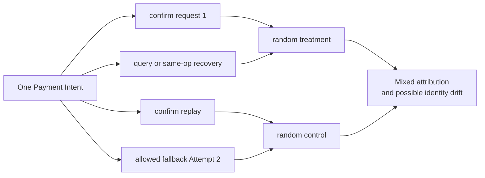
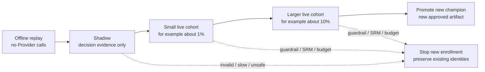
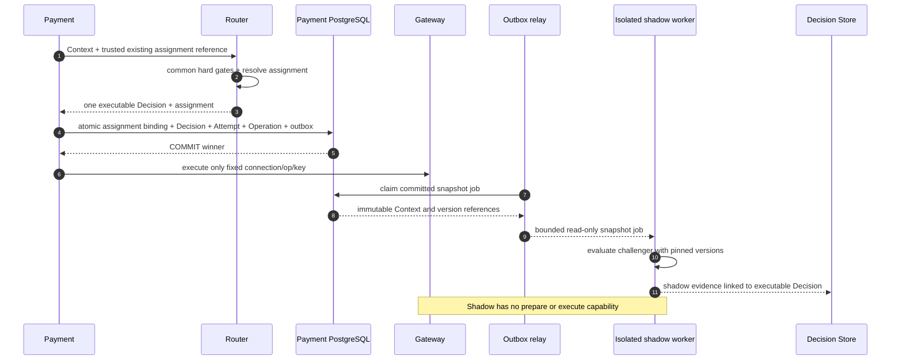

# 第 16 章 Routing Experimentation

Aurora 准备发布一个新的 Cost-Aware Scorer。团队把 10% 的请求交给 challenger，其他请求继续使用 champion。一天后，Dashboard 显示 challenger 的即时成功率高出 0.8 个百分点，工程师正准备全量发布，却发现同一个 Payment Intent 在三次 confirm 中出现了两个实验组；新策略偏好的 `cand_us_b` 也开始触发并发限制。几周后，最早那批支付才陆续出现欺诈预警与拒付。

这些现象不是“样本还不够大”就能解决的。实验单位不稳定，结果无法归因；共享 Provider 容量让两组相互影响，小流量效果无法直接外推；只看即时成功，又把尚未成熟的风险与成本当成零。支付实验首先是业务身份、执行权和证据的设计，其次才是随机数与统计检验。

本章的核心命题是：

> **稳定业务单元、不可变版本和不可绕过的护栏，必须先于“随机切 10%”。默认按 Payment Intent 固定 `ExperimentAssignment`，并把它封存进 Decision；offline replay 与 shadow 只产生分析证据，shadow 绝不创建 Provider Operation。只有经过批准的小流量 live 阶段，才允许一个被指定为 executable 的决定影响真实支付。**

本章依赖[第 14 章](routing-decision-store.md)的不可变事实和[第 15 章](observability.md)的分层测量，但不重写它们。外部结果纠错留给[第 17 章](reconciliation.md)，实际费用留给[第 18 章](settlement.md)，跨 Region 一致性与配置审批分别留给[第 19 章](../part-5-global-routing/multi-region.md)、[第 20 章](../part-5-global-routing/configuration-platform.md)，bandit 与 off-policy learning 留给[第 21 章](../part-5-global-routing/intelligent-routing.md)。当前配套系统没有 experiment package、assignment 或 shadow 执行器，后文 Go 设计均是明确的待配套增量。

## 16.1 Problem：随机的是请求，付钱的却是同一个 Intent

最容易写出的实验分流只有几行：

```go
package naiveexperiment

import "math/rand"

// PickStrategy is intentionally unsuitable for payment experiments:
// repeated requests for the same Intent can receive different variants.
func PickStrategy() string {
	if rand.Intn(100) < 10 {
		return "challenger"
	}
	return "champion"
}
```

随机数本身没有错，错的是把每个 HTTP 请求当成独立实验单位。一次 confirm 的响应丢失后，商户会用同一幂等键重试；Provider Operation 进入 UNKNOWN 后，worker 会 query 或同 key 恢复；旧 Attempt 明确无副作用且 Policy 许可时，还可能创建 Fallback Attempt。这些动作属于同一个业务目标，不能每次重新抽签。



即使系统没有因此双扣，统计也已经被污染。若 treatment 更容易超时，它会产生更多请求、更多 Attempt 和更多重新分组机会；按请求计数便给它更大的权重。若 Fallback 成功被记到最后一次抽中的 control，最初 treatment 的失败又被转嫁出去。一个看似随机的分流器，最终产生的却是由错误、重试和恢复次数选择过的样本。

| 简单实现 | 实验层面的损害 | 支付层面的风险 |
| --- | --- | --- |
| 每次 HTTP 请求随机 | 同一业务单位跨组，重复请求改变权重 | 可能误把 replay 当新执行 |
| 用 `attempt_id` 分桶 | 失败更多的一组产生更多样本 | Fallback 可能逃离原策略与 Route Plan |
| 只统计已成功 dispatch 的请求 | 排除 treatment 自己造成的 Router/prepare 失败 | 掩盖真实服务退化 |
| 把 challenger 也发给 Gateway 测试 | 获得的不是 shadow，而是两条真实路径 | 可能重复授权或扣款 |
| 实验规则强制选择不合格 Candidate | 比较不再处于相同安全区域 | 绕过 Capability、Risk、认证或合同限制 |

因此，实验不能成为 Router 流水线之外的旁路。Context validation、Eligibility、Rule/Risk guardrail 仍先限定合法集合；实验只在被批准的范围内选择策略版本，策略再比较集合内的软目标。一个高分或统计上“显著更好”的 treatment，都不能把 `Risk BLOCK`、未知 Capability 或 `UNKNOWN` 恢复改写成可执行许可。

## 16.2 Simple Design：先冻结实验合同，再冻结分组

### 16.2.1 假设必须比“新策略更好”具体

Aurora 可以把首个假设限定为：“在已通过共同硬护栏的美国 tokenized-card automatic-capture `SALE` Intent 中，scorer v43 相对 v42 降低每个成功 Intent 的成熟成本，同时不降低规定窗口内的 Capture 完成率，也不突破风险与可靠性上限。”这不是宣称某家 Provider 天生更好，而是在明确人群、策略、时间与约束下估计一次策略变化的效果。

| 合同项 | 示例定义 | 为什么必须先写 |
| --- | --- | --- |
| Experiment identity | `exp_cost_v43`，不可复用为另一假设 | 防止中途换问题后合并数据 |
| Randomization unit | `merchant_id + payment_intent_id` | 一次业务目标只分配一次 |
| Pre-treatment population | 指定 Merchant/Region/currency/金额范围与 automatic `SALE` | 入组条件不能由 treatment 的结果决定 |
| Control / treatment | 固定 scorer、Normalizer、软偏好 Rule 与 Feature schema versions | 同一个 variant 不能每天换算法 |
| Common guardrails | 共同 Eligibility/Risk/Health 语义与容量上限 | 实验不能修改支付安全底线 |
| Primary metric | `captured_intent_within_H` 或成熟的 cost-per-success，二选一为主 | 避免事后挑选最好看的指标 |
| Guardrail metrics | duplicate side effect、UNKNOWN age、technical error、延迟、欺诈/拒付、成本上界 | 收益不能抵消安全损失 |
| Statistical plan | 效应方向、MDE、样本/时长上限、置信方法、多重比较与停止规则 | 防止看到结果后修改判定标准 |
| Allocation plan | 分桶算法/key version、实际分配概率、ramp stages | 让 SRM 与重放有精确基线 |
| Ownership | 实验 owner、风险批准者、停止权限、事故 Runbook | 告警必须有人负责且能停止新暴露 |

这里的 `H` 是实验合同明确的观察期限，不是统一的支付最终性期限。Automatic Capture 的完成率也不等于 Authorization Rate，更不等于 Settlement。动态 Risk/Health 值仍要按当前安全契约检查并记录；“版本冻结”冻结的是求值语义与策略 Artifact，不是无限复用一个已经过期的 Risk `ALLOW`。

### 16.2.2 Intent 是默认单位，不是所有实验的万能单位

| 分桶单位 | 适用问题 | 主要代价 |
| --- | --- | --- |
| Payment Intent | 比较一次业务目标的路由、完成率与成本 | 同一顾客多笔支付可能相关，分析需考虑聚类 |
| 获准的 Customer pseudonym | 研究跨次支付的连续体验或行为 | 需要额外数据授权与稳定身份，样本独立数下降 |
| Merchant / Merchant Account | 策略强烈影响共享额度、运营或合同 | 商户数可能很少，集群不平衡使推断更难 |
| Region/connection 的时间块 | 共享容量干扰很强且可控制 carryover | 需要专门 switchback 设计，不能简单每小时轮换 |

本书默认 Intent，因为它与 Payment 的业务边界吻合，能自然覆盖 repeat confirm、query 与 Fallback。若同一顾客的多次支付相互影响，或者 treatment 改变整个 Merchant 的 Provider 配额，就应重新设计随机化与分析单位；不能把一百万个相关 Attempt 宣称为一百万个独立样本。

### 16.2.3 Assignment、Exposure 与 Outcome 必须分列

`ExperimentAssignment{experiment, variant, version, bucket}` 表示“这个 Intent 被分配到哪个实验组”。它不是 Provider 调用，也不是成功或失败。至少要保存五个不同事实：

| 事实 | 发生时点 | 用途 |
| --- | --- | --- |
| Enrollment | 通过预先定义的入组条件 | 定义目标人群与未入组原因 |
| Assignment | 为 Intent 原子固定 variant/version/bucket | SRM、意向处理分析与稳定归属 |
| Applied Decision | 某个策略版本生成并被 Payment 固定为 executable | 记录 guardrail、降级和真实生效路径 |
| Provider Exposure | Operation 进入实际 dispatch | 分析通道技术行为，不等同于 assignment |
| Outcome | 同步、Query、webhook、对账或结算事实成熟 | 计算不同窗口的业务与经济指标 |

未 dispatch 的 assignment 应标为 `not_exposed`，不能伪装成 PSP Decline；但也不能因为 treatment 导致无候选或 prepare 失败，就从效果分析中删除。意向处理分析以预先定义的 assigned cohort 为基础，按事先声明的 Intent outcome 与窗口计算；Provider 技术成功率则只针对真正 dispatch 的 Operation。两种分母服务不同问题，不能互换。

## 16.3 Problems at Scale：实验会改变它正在测量的系统

### 16.3.1 稳定 hash 仍挡不住版本漂移

把随机数换成 `hash(intent_id)` 只是第一步。若分桶 salt、阈值、实验版本或策略引用在运行中变化，同一 Intent 仍可能得到不同答案。生产设计应区分三个版本：`bucket_key_version` 固定分桶空间；`allocation_version` 记录当时的比例与阶段；`policy_version` 固定 control/treatment 的算法。只调整 ramp 比例不应重新抽签已有 Intent，更不能顺便替换 treatment 权重。

Assignment 必须由 Payment 持久化，并进入第 14 章的 DecisionEnvelope/hash。生成可执行路由时，它与首次创建 Attempt 在同一个事务中固定。若已完成分组，但 treatment 求值产生无候选或明确的不可执行结果，则应提交 assignment-only binding 与 `not_exposed` 证据，不创建 Attempt/Operation。否则“只在成功 prepare 时才记分组”会删除策略自己造成的失败。尚未通过请求校验、尚未正式分配或整个本地事务未提交的请求，则不能凭 Router proposal 冒充已分配样本。

数据库对 `(merchant_id, experiment_id, payment_intent_id)` 或等价的 Intent-owned binding 保证唯一。两个并发 confirm 即使分别看到新旧 Artifact，也只有一个 assignment winner；失败者必须读取已固定的版本重新得到一致决定，不能拿着自己那份 loser Decision 去调用 Gateway。持久化 binding 后出现的执行失败仍保留原归属，不因没有资金副作用就移出 cohort。

分桶输入不能包含 `attempt_id`、request ID、时间、当前候选顺序或 Provider health。它们会随恢复或环境变化而变化。Public API 也不能让 Merchant 任意注入 variant/version；这些字段只来自受信任的实验 Artifact 与已持久化 binding。

### 16.3.2 Retry、Query 与 Fallback 保持实验归属，但不是同一种执行

| 动作 | Assignment | 资金身份 | 实验记录 |
| --- | --- | --- | --- |
| 相同 confirm key 的 replay | 读取原 binding，不重算 | 返回原资源/状态 | 不新增独立样本 |
| Same-operation resubmit | 不调用 assigner | 原 operation、connection、Provider key、payload | 记录 recovery，不计新 Intent |
| Query / webhook | 不分组、不选路 | 原 Operation 与 reference | 更新 outcome evidence，不回写 assignment |
| 明确获准的 Fallback | 继承原 Intent variant/version | 新 Attempt、Operation、key；沿 Router-authored 固定 Route Plan | Payment-authored `FallbackExecutionBinding` 引用同一 assignment 与原 Plan，保留 lineage；不签发新排名 |
| UNKNOWN / `review_required` | 原归属不变 | 禁止新资金路径 | 进入恢复/复核，不用换组掩盖失败 |
| Capture / Void / Refund | 关联原归属，不重新实验路由 | 固定原 connection 与 transaction reference | 作为后续经济结果关联原 Intent |

“Fallback 仍在 treatment”并不意味着 treatment 可以随意再选一家 PSP。第 12 章的 `terminal + side_effect=none + allowlisted reason`、Risk、次数和 deadline 闸门照常生效；实验组只是归属，绝不是新 Attempt 的许可证。若新安全护栏令原计划不可执行，系统停止自动化并记录原因，不能把该 Intent 改写成 control 后继续。

### 16.3.3 先检查 Sample Ratio Mismatch，再解释收益

假设 Artifact 声明 control/treatment 为 90/10，1,000 个入组 Intent 却只有 50 个 treatment。原因可能是 hash 输入错误、某个实例配置未更新、treatment 日志漏发、join 丢行或结果相关的过滤。SRM 是观测样本比例与预期比例不符的诊断信号，并不直接告诉我们哪项实现坏了。Fabijan 等人的原始研究把原因分布在 assignment、execution、log processing 与 analysis 等阶段，强调未解释的 SRM 会让效果结论失去可信度。[Diagnosing Sample Ratio Mismatch 原始论文](https://www.microsoft.com/en-us/research/publication/diagnosing-sample-ratio-mismatch-in-online-controlled-experiments-a-taxonomy-and-rules-of-thumb-for-practitioners/)

SRM 的单位应是去重后的 assigned Intent，不是请求数、Attempt 数或被某个 Candidate 实际处理的数量。若 treatment 只在部分合法 Candidate 上改变排序，Candidate distribution 本来就不会等于 10%；把它当作分组 SRM 是口径错误。Ramp 从 1% 变为 10% 后，还必须按 `allocation_version` 分层，或汇总各阶段的预期数量，不能用一个当前比例检查整个历史。

对预期比例已固定的两组，可使用 Pearson chi-square goodness-of-fit 作为教学起点：

\[
\chi^2=\frac{(O_C-E_C)^2}{E_C}+\frac{(O_T-E_T)^2}{E_T}
\]

它依赖足够的预期计数，不能在只有两三个 treatment 的桶里机械套近似。NIST 对该检验给出了相同统计量与样本充分性的限制。[NIST Chi-Square Goodness-of-Fit Test](https://www.itl.nist.gov/div898/handbook/eda/section3/eda35f.htm) 下面代码限定单个 allocation version、两组、已知概率，并在预期计数不足时显式拒绝；统计用浮点数不意味着金额计算也可以用浮点数。

```go
package srm

import (
	"errors"
	"math"
)

var (
	ErrInvalidPlan = errors.New("invalid SRM plan")
	ErrSparseCount = errors.New("expected count too small for chi-square approximation")
)

type Result struct {
	MethodVersion string
	ChiSquare     float64
	PValue        float64
	Flagged       bool
}

func Check(control, treatment uint64, treatmentProbability, alpha float64) (Result, error) {
	if math.IsNaN(treatmentProbability) || math.IsInf(treatmentProbability, 0) ||
		treatmentProbability <= 0 || treatmentProbability >= 1 ||
		math.IsNaN(alpha) || math.IsInf(alpha, 0) || alpha <= 0 || alpha >= 1 {
		return Result{}, ErrInvalidPlan
	}
	total := float64(control) + float64(treatment)
	expectedTreatment := total * treatmentProbability
	expectedControl := total * (1 - treatmentProbability)
	if expectedTreatment < 5 || expectedControl < 5 {
		return Result{}, ErrSparseCount
	}
	deltaTreatment := float64(treatment) - expectedTreatment
	deltaControl := float64(control) - expectedControl
	statistic := deltaTreatment*deltaTreatment/expectedTreatment +
		deltaControl*deltaControl/expectedControl
	// With two groups and a pre-specified probability, the asymptotic df is 1.
	pValue := math.Erfc(math.Sqrt(statistic / 2))
	return Result{
		MethodVersion: "pearson-chi-square-df1-v1",
		ChiSquare:     statistic,
		PValue:        pValue,
		Flagged:       pValue < alpha,
	}, nil
}
```

这里的 `alpha` 必须来自预先发布的诊断计划，不是看到数据后挑选的阈值。这个函数也不是序贯有效的实验停止器：频繁重复检查仍需要定义告警策略。SRM 告警应先冻结收益解读，沿 assignment→Decision→outbox→projection→analysis 检查计数差异；不能删掉“不正常的”样本后宣布通过。

### 16.3.4 Offline replay 与 shadow 都看不到未执行通道的真实结果

历史日志只记录被选中 Candidate 的 outcome。把同一 Context 交给 challenger，能知道它会选 B，却不知道这笔支付真走 B 后会不会获批、超时或产生拒付。把 champion 的成功标签复制给 challenger，是在给没有发生过的路径制造事实。第 8 章的选择偏差不会因为新增了 experiment 字段而消失。

Li 等人的 replay 研究针对 partial-label feedback，证明无偏离线评估需要相应的数据收集与匹配条件；它不是“任何生产日志都能无偏重放”的许可证。[Unbiased Offline Evaluation 原始论文](https://arxiv.org/abs/1003.5956) 本章把 offline replay 用于 determinism、guardrail parity、候选差异、Feature 覆盖与资源预算。只有日志确有合适的随机支持与 propensity，并满足分析假设，才可以进入第 21 章更严格的 off-policy 估计。

Live A/B 的随机分配也只支持其目标人群与实际实施策略的比较，不自动证明一个 Provider 在全球更优。若分析时只保留“treatment 与 control 都成功路由到同一家 PSP”的记录，或排除 treatment 产生的无候选结果，又会按处理后的变量选择样本。入组与分层条件应尽量基于处理前事实，并在实验合同中冻结；事后切片只能标为探索性发现。

### 16.3.5 共享容量会让 control 也受到 treatment 影响

假设 challenger 把更多流量送到 B。B 的账户级 rate limit、Connector 并发池和网络连接被占满后，control 原本就会使用 B 的那部分流量也变慢。此时两组不是互不影响的独立世界，差值反映的是“在当前混合比例与共享容量下”的效果，而不是全量上线后的效果。

Stripe 官方文档明确区分 rate limits 与 concurrency limits，并列出 account/global、endpoint、resource 等限制信号。这说明实验容量预算不能只写一个全局 TPS；应结合实际 Provider contract 和精确 connection 故障域检查。[Stripe Rate Limits](https://docs.stripe.com/rate-limits) 这是对支付架构的推论：每次 ramp 都要同时观察两组的 Provider load、429、队列、UNKNOWN backlog 与 shared bulkhead，而不是只看 treatment 的平均延迟。

可选缓解包括预留容量、隔离实验额度、限制每个 Merchant/connection 的暴露，或在确有强干扰时采用 cluster/switchback 设计。后者会引入集群数量、时间趋势与 carryover 等新的假设；Bojinov 等人的原始研究正是围绕 carryover 长度设计与分析 switchback，不能把它简化为整点轮换两套策略。[Design and Analysis of Switchback Experiments](https://arxiv.org/abs/2009.00148) 因此 1% 通过是下一阶段的证据，不是 100% 的容量证明。

### 16.3.6 即时成功不是成熟收益

| 指标层 | 最早可见的信号 | 实验报告必须保留的状态 |
| --- | --- | --- |
| Router / Gateway 技术质量 | 决策错误、timeout、dispatch latency、限流 | 即时可见，但要区分 Router 与 Provider |
| Intent 完成率 | Capture outcome，或明确业务失败 | `within_H`、pending/UNKNOWN、observed/effective time |
| 欺诈风险 | Risk action、early warning | 代理信号与最终 fraud outcome 分列 |
| 拒付 | Dispute/chargeback evidence | cohort age、成熟比例、开放/已结案状态 |
| 成本 | Expected Cost、attempt fee、Settlement/FX/更正行 | expected/accrued/actual 分列，币种与版本明确 |

Stripe 的官方 dispute 生命周期说明，争议可能在原支付之后较长时间才发起，完整处理也可能持续数月；early fraud warning 与 dispute 甚至不保证同一到达顺序。[Stripe How Disputes Work](https://docs.stripe.com/disputes/how-disputes-work) 因此两天内“没有拒付”不能证明 treatment 的拒付率更低，只能说明这批 cohort 尚未成熟。

报告应按 enrollment cohort age 对齐两组，明确数据截止点与 outcome version。一个 `captured_within_H` 指标可以衡量规定时间内的完成，但不能被命名为最终成功率；一个尚未拿到实际费用的 Intent 也不能贡献零成本。Fallback 的所有 Attempt fee 应归入原 Intent，而不是只算最后成功那次。第 17、18 章负责事实纠错和实际归因，本章只规定实验如何等待、分列与消费这些结果。

### 16.3.7 看到显著就停止，会改变检验本身

每天查看固定终点的 `p < 0.05`，只要显著就停止，再把结果称为“95% 可信”，并不保留原检验的错误控制。Johari、Pekelis 与 Walsh 的原始研究讨论了持续监测下的 always-valid inference，并说明应使用与停止方式相匹配的推断方法。[Always Valid Inference 原始论文](https://arxiv.org/abs/1512.04922)

第一版可以选择预先声明的固定样本/固定时间与成熟窗口；若业务确实需要连续判定，应采用经过验证的序贯方法或 alpha-spending 计划，而不是在 Dashboard 上不断重算普通 p-value。Primary、Guardrail、Merchant 切片和多阶段 ramp 还涉及多重比较；效应大小、置信区间与最小有意义改善必须一起报告，不能只给一个绿色显著性标记。

停止条件至少分三类：资金安全或严重可靠性回归可以立即停止新暴露，不必等显著；SRM/日志缺失等数据质量问题先停止推断并调查；效果优胜或无效停止则遵守统计计划。达到最大时长或暴露预算仍无结论时，应返回 `inconclusive`，而不是继续跑到显著为止。

## 16.4 Production Design：让实验循序进入执行权限

### 16.4.1 从离线到 champion，每一步都增加一项被证明的能力



| 阶段 | 是否产生真实资金副作用 | 能证明什么 | 进入下一阶段前 |
| --- | ---: | --- | --- |
| Offline replay | 否 | 确定性、资格边界、版本与输入覆盖、候选差异 | 无硬约束绕过，缺失证据显式失败 |
| Shadow | 只有原 champion 正常执行 | 线上 Context/Feature 兼容、延迟与资源开销、decision disagreement | shadow 不影响 champion，零 shadow Operation |
| 小流量 live | 每个 Intent 只有一个 executable variant | 窄人群下真实实现效果与即时安全 | SRM/数据完整性通过，风险和容量预算内 |
| 扩大 live | 同上，逐级增加新入组 | 检查负载依赖、Merchant 异质性与成熟结果 | 统计计划与成熟窗口满足，残余风险获批准 |
| Champion promotion | 新 Intent 使用新生产 Artifact | 将已接受策略变成默认 | 保留回滚版本，旧 Intent 不重分组 |

表中的 1% 与 10% 只是演进示例，不是生产安全认证。首个 Go 配套增量应止于稳定 assignment 与 shadow：Payment 仍只执行 champion。进入 live A/B 时，也只是把该 Intent 分配到的策略声明为唯一 executable decision；任何阶段都不允许把两个 Provider 调用当作“对照”。

### 16.4.2 一个确定、可重放的 Go Assigner

下面示例使用 65,536 个等宽 bucket，直接取 HMAC-SHA256 的前 16 位，避免用十进制百分比掩盖实际阈值。`TreatmentBuckets / BucketSpace` 才是 SRM 使用的计划概率。HMAC 的 key 由 secret provider 按 `bucket_key_version` 提供，不进入 Decision 或日志；Go 标准库提供对应实现。[Go crypto/hmac](https://pkg.go.dev/crypto/hmac)

已存在 assignment 的分支必须在 enrollment kill switch 之前返回，这样关闭新入组不会改写已有归属。函数本身不处理资金状态，也不证明输入仍满足执行护栏；后者始终由共同安全流水线检查。

```go
package experiment

import (
	"crypto/hmac"
	"crypto/sha256"
	"encoding/binary"
	"errors"
)

const BucketSpace uint32 = 1 << 16

var ErrInvalidAssignment = errors.New("invalid experiment assignment")

type Unit struct {
	MerchantID      string
	PaymentIntentID string
}

type Artifact struct {
	ExperimentID           string
	AllocationVersion      string
	BucketKeyVersion       string
	ControlPolicyVersion   string
	TreatmentPolicyVersion string
	TreatmentBuckets       uint32
}

type Assignment struct {
	ExperimentID           string
	Version                string
	BucketKeyVersion       string
	Unit                   Unit
	Variant                string
	PolicyVersion          string
	Bucket                 uint32
	ProbabilityNumerator   uint32
	ProbabilityDenominator uint32
}

type Result struct {
	Assignment *Assignment
	Reason     string
}

func Resolve(
	unit Unit,
	existing *Assignment,
	active Artifact,
	key []byte,
	preTreatmentEligible bool,
	enrollmentOpen bool,
) (Result, error) {
	if unit.MerchantID == "" || unit.PaymentIntentID == "" || active.ExperimentID == "" {
		return Result{}, ErrInvalidAssignment
	}
	if existing != nil {
		if existing.Unit != unit || existing.ExperimentID != active.ExperimentID ||
			existing.Version == "" || existing.PolicyVersion == "" || existing.BucketKeyVersion == "" ||
			(existing.Variant != "control" && existing.Variant != "treatment") ||
			existing.Bucket >= BucketSpace || existing.ProbabilityDenominator != BucketSpace ||
			existing.ProbabilityNumerator == 0 || existing.ProbabilityNumerator >= BucketSpace {
			return Result{}, ErrInvalidAssignment
		}
		if (existing.Variant == "treatment" && existing.Bucket >= existing.ProbabilityNumerator) ||
			(existing.Variant == "control" && existing.Bucket < BucketSpace-existing.ProbabilityNumerator) {
			return Result{}, ErrInvalidAssignment
		}
		copyOfExisting := *existing
		return Result{Assignment: &copyOfExisting, Reason: "existing_assignment"}, nil
	}
	if !preTreatmentEligible {
		return Result{Reason: "not_enrolled_scope"}, nil
	}
	if !enrollmentOpen {
		return Result{Reason: "not_enrolled_disabled"}, nil
	}
	if len(key) < 32 || active.AllocationVersion == "" || active.BucketKeyVersion == "" ||
		active.ControlPolicyVersion == "" || active.TreatmentPolicyVersion == "" ||
		active.TreatmentBuckets == 0 || active.TreatmentBuckets >= BucketSpace {
		return Result{}, ErrInvalidAssignment
	}
	mac := hmac.New(sha256.New, key)
	parts := []string{
		"aurora-experiment-bucket-v1", active.ExperimentID, active.BucketKeyVersion,
		unit.MerchantID, unit.PaymentIntentID,
	}
	for _, part := range parts {
		if len(part) > 1024 {
			return Result{}, ErrInvalidAssignment
		}
		var length [4]byte
		binary.BigEndian.PutUint32(length[:], uint32(len(part)))
		_, _ = mac.Write(length[:])
		_, _ = mac.Write([]byte(part))
	}
	digest := mac.Sum(nil)
	bucket := uint32(binary.BigEndian.Uint16(digest[:2]))
	variant := "control"
	policyVersion := active.ControlPolicyVersion
	probability := BucketSpace - active.TreatmentBuckets
	if bucket < active.TreatmentBuckets {
		variant = "treatment"
		policyVersion = active.TreatmentPolicyVersion
		probability = active.TreatmentBuckets
	}
	assignment := &Assignment{
		ExperimentID:           active.ExperimentID,
		Version:                active.AllocationVersion,
		BucketKeyVersion:       active.BucketKeyVersion,
		Unit:                   unit,
		Variant:                variant,
		PolicyVersion:          policyVersion,
		Bucket:                 bucket,
		ProbabilityNumerator:   probability,
		ProbabilityDenominator: BucketSpace,
	}
	return Result{Assignment: assignment, Reason: "new_assignment"}, nil
}
```

`allocation_version` 故意不进入 bucket hash：ramp 改变新 Intent 的阈值，不改变分桶空间。已经入组的 Intent 仍返回它原来的 variant、概率和策略版本。若需要更换 bucket key，应建立新的实验命名空间并保持旧 binding 可读，而不是把正在运行的人群重新洗牌。HMAC 只提供稳定的伪随机映射，不自动证明人群独立或日志完整；A/A 校准、固定向量与 SRM 检查仍不可省略。

这里保存的是 variant assignment probability，不是某个 Candidate 的 exposure propensity。Guardrail、策略与 Route Plan 还会影响实际 Candidate；第 21 章不能直接把这项概率当成 Provider 选择概率用于反事实估计。

### 16.4.3 Assignment 随 Decision 固定，Shadow 走独立只读支路



Shadow job 从已提交的执行快照派生，避免把从未生效的 Router proposal 当成已执行 Decision。这也限定了首个 shadow 切片的覆盖人群；若以后记录 pre-commit proposal，必须标记 `not_applied`，不能混入已执行样本。Worker 只收到第 4 章允许的 Context projection、共同 Guardrail/Feature snapshot 与 challenger Artifact refs，不收到 token、PAN、CVV、Provider secret 或 Gateway credential。它与在线 champion 分离并发池和 deadline；队列满可以在预定 deadline 内等待或显式记为 `shadow_skipped`，超时记录 `shadow_timeout`，都不能拖慢支付或把空结果算成 challenger 失败。

下面的 Go 类型只允许产生 `Report`。没有 `PrepareConfirmation`、Provider Operation 或 Gateway interface；生产环境还要用独立服务身份、API allowlist 和测试落实这个边界，类型设计本身不是安全认证。

```go
package shadow

import (
	"context"
	"errors"
	"time"
)

type Snapshot struct {
	PaymentIntentID         string
	ContextDigest           string
	AmountMinor             int64
	Currency                string
	Operation               string
	CandidateIDs            []string
	GuardrailVersion        string
	FeatureSnapshotVersion  string
	ChallengerPolicyVersion string
}

type Decision struct {
	ID                  string
	SelectedCandidateID string
	PolicyVersion       string
}

type Evaluator interface {
	Evaluate(context.Context, Snapshot) (Decision, error)
}

type Job struct {
	Snapshot            Snapshot
	ChampionDecisionID  string
	ChampionCandidateID string
}

type Report struct {
	Mode                string
	State               string
	Reason              string
	ParentDecisionID    string
	ShadowDecisionID    string
	SelectedCandidateID string
	Agreement           bool
}

// Run executes in an isolated worker, never in the champion's latency budget.
func Run(ctx context.Context, evaluator Evaluator, job Job, budget time.Duration) Report {
	report := Report{Mode: "shadow", ParentDecisionID: job.ChampionDecisionID}
	if budget <= 0 || job.ChampionDecisionID == "" || job.Snapshot.ContextDigest == "" {
		report.State, report.Reason = "invalid", "invalid_shadow_job"
		return report
	}
	snapshot := job.Snapshot
	snapshot.CandidateIDs = append([]string(nil), job.Snapshot.CandidateIDs...)
	shadowContext, cancel := context.WithTimeout(ctx, budget)
	defer cancel()
	decision, err := evaluator.Evaluate(shadowContext, snapshot)
	if err == nil {
		err = shadowContext.Err()
	}
	if err != nil {
		report.State, report.Reason = "error", "shadow_evaluation_error"
		if errors.Is(err, context.DeadlineExceeded) {
			report.State, report.Reason = "timeout", "shadow_budget_exhausted"
		} else if errors.Is(err, context.Canceled) {
			report.State, report.Reason = "canceled", "shadow_job_canceled"
		}
		return report
	}
	if decision.ID == "" || decision.ID == job.ChampionDecisionID ||
		decision.PolicyVersion != snapshot.ChallengerPolicyVersion {
		report.State, report.Reason = "invalid", "shadow_version_mismatch"
		return report
	}
	report.State = "evaluated"
	report.ShadowDecisionID = decision.ID
	report.SelectedCandidateID = decision.SelectedCandidateID
	if decision.SelectedCandidateID == "" {
		report.State, report.Reason = "no_candidate", "shadow_no_candidate"
		return report
	}
	allowed := false
	for _, id := range job.Snapshot.CandidateIDs {
		if id == decision.SelectedCandidateID {
			allowed = true
			break
		}
	}
	if !allowed {
		report.State, report.Reason = "invalid", "shadow_candidate_not_allowed"
		report.SelectedCandidateID = ""
		return report
	}
	report.Agreement = decision.SelectedCandidateID == job.ChampionCandidateID
	return report
}
```

Evaluator 必须响应 context cancellation，worker 还需要独立的资源与并发上限；仅创建一个 deadline 并不能强制终止不合作的计算。Shadow 结果要有独立 ID、`mode=shadow`、parent Decision、Context digest、版本与执行状态，不能覆盖 champion 的 DecisionEnvelope。若需要分析“哪些请求出现 disagreement”，必须同时报告 shadow 覆盖与超时分布；只分析成功跑完的 shadow job，也可能因复杂 Context 更容易超时而产生选择偏差。

### 16.4.4 Kill switch 停的是新分配，不是历史身份

关闭实验时，最危险的实现是把数据库里所有 treatment 改成 control，或者让正在 UNKNOWN 的 Operation 改用 champion route。前者重写实验分母与历史证据，后者可能制造第二条资金路径。安全开关应把 enrollment 状态改为 closed，并记录 cutoff、原因、操作者与版本；已有 assignment 保持不变。

| 关闭时的对象 | 允许动作 | 禁止动作 |
| --- | --- | --- |
| 尚未入组的新 Intent | 不创建 treatment assignment，使用正常 champion 路径并记录未入组原因 | 把它混入旧实验 control 分母 |
| 已有 assignment、尚未 dispatch | 保留归属；若另有安全 execution hold，可停止执行/人工复核 | 改写 variant 或偷偷换 Provider |
| 已 dispatch / UNKNOWN | 按原 operation、connection、key、payload Query/Wait/恢复 | 以“回滚实验”为名创建新 Attempt |
| 已获准的 Fallback | 保持原 variant；继续检查当前安全护栏，必要时 Stop | 重新分桶或跨到 control Route Plan |
| 已成功的 Intent | 保留后续欺诈、拒付与成本观察 | 删除 cohort 或把迟到损失移到 control |

Enrollment kill 与 execution safety hold 是两种权力：前者停止新的实验分配，后者由 Payment/Risk/Capability 的安全契约阻止新的不安全副作用。它们可以在事故中同时触发，但都不能改变已发出 Operation 的身份。Promotion 也遵守同一原则：新 champion 是新发布的默认 Artifact，旧 Intent 的 assignment、Decision 与 Provider reference 不被迁移。

### 16.4.5 当前实现与本章最小工程增量

| 组件 | 当前代码事实 | 本章待配套增量 |
| --- | --- | --- |
| Router v3 data plane | 已执行 `routing_context.v2`、Risk contract、Capability/Rule 硬门禁、版本化 Cost/Performance lookup、受约束 Scoring 和稳定排序 | `internal/experiment` Assigner、immutable Experiment Artifact、scope validator |
| Router response | 已返回完整 candidate order、Risk/Optimization 证据与 executable deadline；无 assignment、experiment mode 或 shadow outcome | 返回 assignment 与单一 executable Decision，shadow report 使用独立类型 |
| Payment `ConfirmIntent` / `PrepareConfirmation` | 创建一个 Attempt/Operation，并在同一事务固定 Context/Decision、Risk/Optimization、候选顺序、可执行截止点与精确 connection | Intent-owned assignment binding，随现有执行快照/outbox 原子固定 |
| Shadow worker | 无 | bounded queue、只读 evaluator、独立预算与身份、零 Gateway capability |
| Experiment operations | 无 | enrollment kill、版本化 ramp plan、SRM/成熟度 scorecard 与失败测试 |

因此当前基线已不是“静态 Router”，但也没有实验执行权：Cost/Performance/Scoring 能生成一个可执行决定，不会凭空产生 assignment、propensity 或 shadow 证据。最小纵向切片不需要一开始就做完整实验平台：先对 1,000 个固定 Intent 验证稳定分桶，再让 champion 正常执行、challenger 只产 shadow evidence，最后验证热关闭后没有新 treatment assignment。Live A/B、统计上线判定、成熟欺诈/拒付与 actual-cost pipeline 都不能由这些单测或 Simulator 结果冒充完成。固定代码基线与待实现范围见[本章交付说明](../deliveries/chapter-16-routing-experimentation.md)。

### 16.4.6 证明性测试矩阵

| 场景 | 注入 | 必须证明 |
| --- | --- | --- |
| Stable assignment | 重复 confirm、进程重启、Candidate 输入乱序 | 同一 Intent 的 variant/version/bucket 完全一致 |
| Concurrent versions | 两个 confirm 分别看到 allocation v1/v2 | 数据库只固定一个 winner，loser 不执行 Gateway |
| Recovery | treatment Operation 响应丢失 | Query/同 key 恢复保持原 assignment 与 connection，只有一条资金路径 |
| Fallback | A 明确无副作用且 allowlist 允许 B | 新 Attempt/op/key，但继承同一 variant/version 和固定 Route Plan |
| Shadow winner | challenger 给另一 Candidate 最高分 | Gateway 中只有 executable Decision 的 Operation，shadow 数量为零 |
| Shadow overload | worker 队列满、超时或缺 Artifact | champion 仍按预算执行；coverage/state 显式可查 |
| Kill switch | 已分配与未分配 Intent 同时到达 | 已有归属不变，新 treatment assignment 为零，不重路由 UNKNOWN |
| SRM | 丢弃一部分 treatment projection | 计数诊断失败，停止收益解读，不能补造 control 数据 |
| Delayed outcome | 先成功，后到拒付/费用更正 | 原 assignment 不变，cohort outcome version 更新，未成熟值不当零 |
| Guardrail bypass | treatment 选择 ineligible Candidate 或 Risk block | 无可执行 Decision、无 Gateway 调用，不因实验优先级而放行 |

## 16.5 Failure Modes：实验不能成为第二套支付状态机

| 失败模式 | 后果 | 受控动作 |
| --- | --- | --- |
| 按请求或 Attempt 重新随机 | 污染与样本权重漂移 | Intent 级一次分配，恢复读取原 binding |
| 中途修改同名 treatment | “一个实验组”包含多套算法 | immutable Artifact，新假设新版本/实验 |
| 只看已执行或已成功样本 | 删除 treatment 自己造成的失败 | 分列 assignment/exposure/outcome，按预注册人群分析 |
| SRM 未解释就发布 | 数据质量问题伪装成收益 | 暂停推断，定位完整证据链 |
| Shadow 双发 Provider | 真实重复资金副作用 | 无 Gateway 权限、无 Operation 类型、契约与 E2E 证明零执行 |
| 1% 收益直接外推全量 | 忽略容量干扰与非线性 | 逐级 ramp，联合观测两组共享资源 |
| 每天普通 p-value 显著即停 | 停止规则改变错误率 | 固定计划或有效序贯方法，报告无结论 |
| 未成熟拒付/费用填零 | 高风险低质量策略被过早提升 | cohort age、成熟率、代理与最终值分列 |
| Kill 后把 treatment 改成 control | 改写历史并可能换资金路径 | 只停新 enrollment，必要时独立 safety hold |
| 实验覆盖 Eligibility/Risk | 以优化为由突破硬约束 | 共同 guardrail 先于所有实验策略 |

安全停止不要求等到统计显著，但停止后也不能宣称 treatment 已被“统计证明有害”。事故证据、运营止损与因果结论是三个不同产物。保留停止原因、暴露量、未成熟结果和原始 Decision，才能在后续复盘中解释当时为何采取行动。

## 16.6 Trade-offs：更少的暴露与更强的证据并不总能同时得到

**Intent 稳定性与统计独立性。** Intent 是清晰的资金业务边界，但顾客、Merchant 与 Provider 容量可能制造相关性。扩大为 cluster 可以减少污染，却减少独立单位并增加异质性；这应由假设与干扰机制决定，而不是为了让 p-value 更小。

**小比例与检测能力。** 小流量限制潜在损失，但 treatment 样本增长慢，也未必触发全量容量压力。在总样本相同、其他条件接近时，极不平衡分配通常使两组差值更不精确。合理选择不是默认 50/50 或默认 1%，而是把损失预算、MDE、成熟窗口与阶段目标一起写进计划。

**冻结与安全更新。** 冻结策略版本保证可解释性，动态安全事实却不能被冻结。共同 Risk/Health/Capability contract 仍可阻止执行；这种不生效要保留在 assigned cohort 的证据里，而不能通过重分组消失。若需要改变实验目标或核心算法，应结束旧实验并创建新合同。

**速度与迟到损失。** 即时技术指标支持快速止损，成熟拒付与实际费用支持经济判断。等待所有尾部结果会拖慢演进，完全不等则会高估收益；可以分阶段设置临时 promotion 与后续成熟度复核，但必须明确剩余风险、暴露上限和撤回条件，不能把代理指标冒充最终事实。

**可重放与数据最小化。** Assignment 只需要内部稳定身份、版本、bucket 与概率，不需要支付凭证或 Fraud 原始特征。第 14 章的最小 Context projection 和不可变引用已经足够支撑本章；“为了实验方便”不应扩大 Router 的敏感数据边界。

## 16.7 Summary

本章把一次随手写下的 90/10 分流，演进为带明确执行权限和证据边界的策略实验：

1. 先固定假设、人群、业务单位、版本、Primary/Guardrail metric、成熟窗口与停止计划；默认以 Intent 稳定分桶。
2. Assignment、Applied Decision、Provider Exposure 与 Outcome 是不同事实。Assignment 在 Payment 本地事务中固定；可执行路径与 Decision/Attempt 一起提交，不可执行的已分配路径保留 `not_exposed` 证据。Repeat confirm、query、retry 与 Fallback 不重新分组。
3. Offline replay 与 shadow 能验证决定与工程行为，不能观察未执行 Provider 的反事实成功率；shadow 永远不创建 Provider Operation。
4. SRM、选择偏差、共享容量干扰、相关样本与迟到结果必须先处理，再解释收益；1% 的结果不是全量上线承诺。
5. 固定终点检验不能无限窥视到显著为止；资金安全停止、数据质量暂停与效果判定分开，`inconclusive` 是有效结论。
6. Kill switch 只关闭新 enrollment，不改历史 variant、不换 UNKNOWN 的 connection/key，也不让 Capture、Void、Refund 重新路由。
7. Eligibility、Risk 与资金安全高于任何实验。当前 Router v3 已有 Cost/Performance/Scoring 受约束流水线，但系统尚无 experiment/assignment/shadow 实现；稳定分桶与零副作用 shadow 是下一条需要代码和失败测试兑现的窄增量。

实验可以帮助平台选择下一份策略，但不能决定已经发生过的资金事实。下一章将转向独立的 Provider 证据：当内部状态与外部世界不一致时，系统必须通过 Reconciliation 发现、匹配和受控修复，而不是让实验 Dashboard 直接改支付终态。
